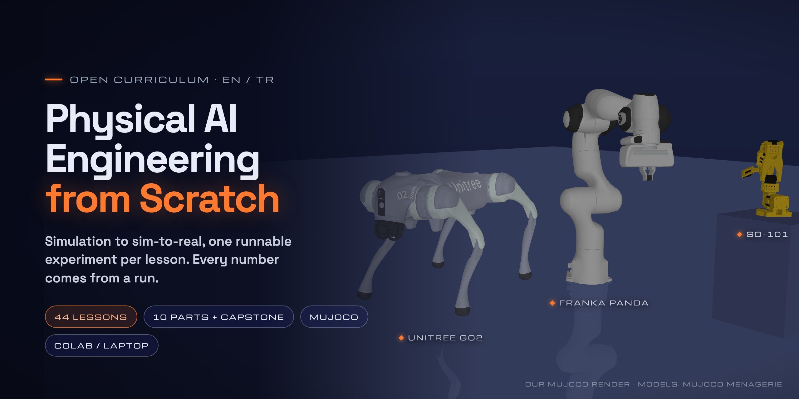

<!-- github-only: hero and badges for the GitHub page; site/scripts/sync.mjs drops this block -->
<p align="center">
  <a href="https://fport.github.io/physical-ai-from-scratch/">
    
  </a>
</p>

<p align="center">
  <a href="#map"></a>
  <a href="#map"></a>
  <a href="tr/README.md"></a>
  <a href="https://fport.github.io/physical-ai-from-scratch/"></a>
  <a href="https://github.com/fport/physical-ai-from-scratch/actions/workflows/pages.yml"></a>
  <a href="notebooks/README.md"></a>
  <br>
  <a href="start-here/setup.md"></a>
  <a href="https://github.com/google-deepmind/mujoco"></a>
  <a href="https://github.com/google-deepmind/mujoco_menagerie"></a>
  <a href="LICENSE"></a>
  <a href="LICENSE-CONTENT"></a>
  <a href="https://github.com/fport/physical-ai-from-scratch/commits/main"></a>
</p>
<!-- /github-only -->

# Physical AI Engineering from Scratch

A complete, open curriculum for the engineering behind robots that act in the physical world: simulation, spatial math, kinematics, dynamics and control, perception, planning, imitation learning, reinforcement learning, sim-to-real, and robot foundation models. Every lesson has a runnable experiment and every number comes from a run or a linked primary source.

**[Setup](start-here/setup.md)** · **[Prerequisites](start-here/prerequisites.md)** · **[How to read a lesson](start-here/how-to-read-a-lesson.md)** · **[First lesson](part-1-simulation/01-world-as-text.md)** · **[Türkçe](tr/README.md)**

## Who it is for

Engineers and students who can program in Python and want to build robot software end to end. General math, machine learning, deep learning and reinforcement-learning basics are not re-taught here: each lesson links the matching lesson of the free [AI Engineering from Scratch](https://aiengineeringfromscratch.com/index.html) course under **Learn first**, and this book teaches the robotics-specific part on top of it.

## How it is built

- **44 lessons in 10 parts and a capstone**, in strict prerequisite order. Each lesson is 30–90 minutes.
- **One template:** the problem → core idea → experiment → break it → on the real robot → check yourself → takeaways and sources.
- **Runnable on a laptop.** Almost every experiment runs on a Mac or Colab CPU with MuJoCo; the few that need a GPU or the real arm say so in their metadata (run type CPU / GPU / ART / HW).
- **Recurring robots:** the SO-101 arm, the Franka Panda and the Unitree Go2, using the [MuJoCo Menagerie](https://github.com/google-deepmind/mujoco_menagerie) models.

## Map

| Part | Topic | Lessons |
|---|---|---|
| 1 | [Simulation](part-1-simulation/README.md) | 01–05 |
| 2 | [Spatial math](part-2-spatial-math/README.md) | 06–07 |
| 3 | [Kinematics](part-3-kinematics/README.md) | 08–10 |
| 4 | [Dynamics and control](part-4-dynamics-and-control/README.md) | 11–16 |
| 5 | [Perception and estimation](part-5-perception-and-estimation/README.md) | 17–21 |
| 6 | [Planning and optimal control](part-6-planning-and-optimal-control/README.md) | 22–24 |
| 7 | [Learning from demonstration](part-7-learning-from-demonstration/README.md) | 25–31 |
| 8 | [Reinforcement learning for robots](part-8-rl-for-robots/README.md) | 32–36 |
| 9 | [Sim to real](part-9-sim-to-real/README.md) | 37–40 |
| 10 | [Foundation models and agents](part-10-foundation-models-and-agents/README.md) | 41–43 |
| — | [Capstone](capstone/README.md) | 44 |

## Learn with your coding agent

```bash
npx skills add fport/physical-ai-from-scratch
```

This installs four skills from [`skills/`](skills/) into your coding agent (Claude Code, Codex, Cursor or any agent that reads `SKILL.md`): **start-learning** (a short placement quiz and a study plan in `PHYSICAL-AI-LEARNING.md`), **learn** (one lesson per session: intuition, diagram, code, a prediction, the experiment run on your machine, exercises), **check-understanding** (a quiz on a part or lesson) and **course-guide** (where is a topic taught, what to read first). In Claude Code start with `/start-learning`.

## Run the experiments

```bash
git clone https://github.com/fport/physical-ai-from-scratch.git
cd physical-ai-from-scratch
uv sync                                   # Python 3.14 + locked dependencies
uv run python experiments/02-timestep/experiment.py
uv run python experiments/09-jacobians/build.py   # a lesson's Build it steps, checked against MuJoCo
uv run pytest                             # tests for physai/, the library you build in the lessons
```

To read the book as a website locally: `cd site && npm install && npm run dev` ([site/README.md](site/README.md)).

## Honesty

Every number in the book comes either from an experiment in `experiments/` (its exact output is saved next to it) or from a linked primary source. Nothing that was not run is presented as a result; hardware steps that have not been run on the real arm are labelled as such. Rules: [Numbers and sources](start-here/numbers-and-sources.md).

## Videos

The Turkish short-video series **Koddan Kasa** summarizes lessons from this book; see [Videos and lessons](start-here/video-map.md).

## Acknowledgements

The lesson format and the "raw version before the framework" principle are inspired by Rohit Ghumare and contributors' [AI Engineering from Scratch](https://github.com/rohitg00/ai-engineering-from-scratch) (MIT), which this book also uses as its prerequisite course. No text or code was copied.

## License

Code (`experiments/`, `notebooks/`, `tools/`, `site/`) is MIT ([LICENSE](LICENSE)); the lesson text is CC BY 4.0 ([LICENSE-CONTENT](LICENSE-CONTENT)). Robot models are downloaded from MuJoCo Menagerie under their own licenses.
