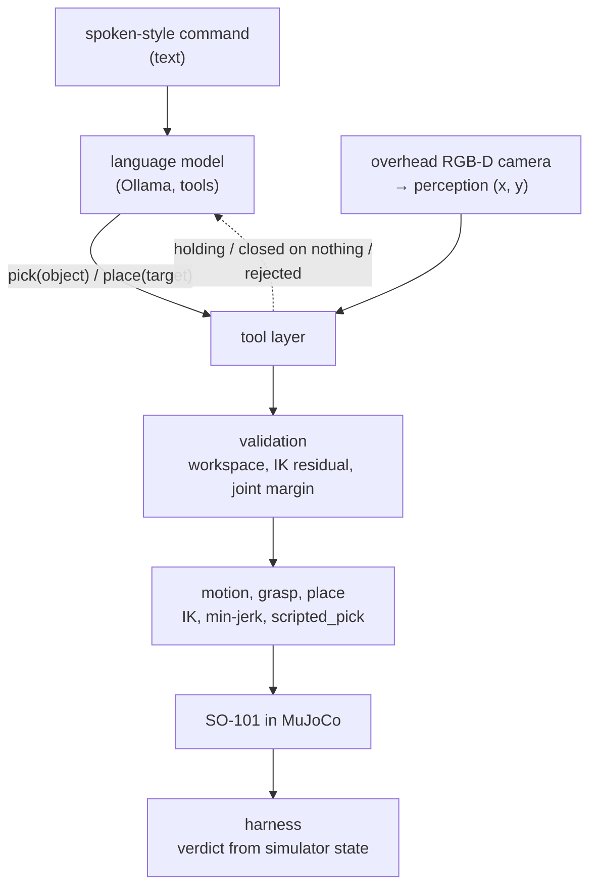

# 44 · Say, see, plan, grasp

<!-- meta -->
| | |
|---|---|
| **Part** | [Capstone](README.md) |
| **Run type** | CPU · Mac or Colab CPU |
| **Prerequisites** | [21](../part-5-perception-and-estimation/21-object-perception.md), [24](../part-6-planning-and-optimal-control/24-lqr-and-mpc.md), [31](../part-7-learning-from-demonstration/31-act.md), [39](../part-9-sim-to-real/39-domain-randomization.md), [42](../part-10-foundation-models-and-agents/42-llm-agents.md) |
| **Learn first** | none |
| **Time** | ~180 min |
| **Code** | [`experiments/44-capstone/experiment.py`](../experiments/44-capstone/experiment.py) |
| **Status** | ✅ done |
<!-- /meta -->

> A system is as good as the product of its layers, and every layer needs a contract you can measure.

## The problem

Every earlier lesson tested one layer with the others idealised: the grasp of [lesson 16](../part-4-dynamics-and-control/16-grasping-and-pick-place.md) knew the cube's true position, the perception of [lesson 21](../part-5-perception-and-estimation/21-object-perception.md) saw one red cube, the agent of [lesson 42](../part-10-foundation-models-and-agents/42-llm-agents.md) was handed ground truth by `find_object`. Put together, the layers interact: an IK rejection comes back to the language model as text and changes what it does next; a small camera error is invisible to perception and shows up as an empty gripper. This capstone builds the whole chain on the simulated SO-101 and measures it end to end, assigning each failure to a layer.

## Core idea

### In plain words

Think of the robot as a chain of microservices: a language model that turns a sentence into a function call, a camera service that says where the cubes are, a validator, a motion planner, a gripper, and a judge. Each one has an API, and each API should come with a contract you can check, the way a service promises a response schema and a latency.

Two things follow from the chain. First, reliability multiplies: if every request has to pass through all services, the end-to-end success rate is the product of the services' success rates, so five very good layers can still make a mediocre system. Second, when a request fails, the service that shows the error is often not the one that caused it. A camera that is slightly off produces no error at all; the failure surfaces three services later as a gripper closing on air. You need something like distributed tracing: a harness that checks every contract along the way and blames the first one that broke.

One design rule keeps this chain manageable: geometry never passes through the language model. It outputs a tool name and an object name, nothing metric. Every coordinate comes from the camera and every joint angle from inverse kinematics.

### Architecture



Seven layers, each built in an earlier lesson:

| layer | component in this experiment | lesson |
|---|---|---|
| language | Ollama `/api/chat` with tools, temperature 0, seed 0 | [42](../part-10-foundation-models-and-agents/42-llm-agents.md) |
| perception | overhead RGB-D camera, HSV mask, depth back-projection | [19](../part-5-perception-and-estimation/19-camera-calibration.md), [20](../part-5-perception-and-estimation/20-pixels-to-table.md), [21](../part-5-perception-and-estimation/21-object-perception.md) |
| validation | workspace radius, IK residual, joint margin | [10](../part-3-kinematics/10-inverse-kinematics.md), [15](../part-4-dynamics-and-control/15-safety.md) |
| motion | damped-least-squares IK, min-jerk joint trajectories | [10](../part-3-kinematics/10-inverse-kinematics.md), [13](../part-4-dynamics-and-control/13-trajectory-generation.md) |
| grasp | `scripted_pick`: servo squeeze, no weld | [16](../part-4-dynamics-and-control/16-grasping-and-pick-place.md) |
| place | `ik_solve` over the box, open the jaw | [10](../part-3-kinematics/10-inverse-kinematics.md) |
| harness | success from simulator state, Wilson interval | [25](../part-7-learning-from-demonstration/25-evaluating-policies.md) |

(HSV mask: keep the pixels whose hue, saturation and brightness fall in the cube's colour range. Depth back-projection: turn a pixel plus its depth into a 3D point. IK residual: how far the best joint solution leaves the gripper from the target.)

### Failure budget and attribution, as code

The harness attributes a failed episode to the **first layer, in pipeline order, that broke its contract**: language (never picked the requested cube, or never placed it) → perception (not detected, or estimate more than 8 mm from the truth) → IK/limits (rejected by validation) → grasp (cube not lifted ≥ 4 cm) → place (not in the box). The agent's `report_result` is logged and never consulted.

```python
ORDER = ["language", "perception", "IK/limits", "grasp", "place"]

def attribute(ep):                       # only called for failed episodes
    for layer in ORDER:                  # pipeline order
        if not ep.contract_ok(layer):    # checked against simulator ground truth
            return layer                 # the first broken contract gets the blame

def end_to_end(p):                       # p[i]: pass rate of layer i among episodes that reach it
    return math.prod(p)                  # layers in series multiply

def even_split(P, L):                    # what each of L layers must reach for end-to-end P
    return P ** (1 / L)

def wilson(k, n, z=1.96):                # 95% interval for a success rate k/n (lesson 25)
    p = k / n
    centre = (p + z * z / (2 * n)) / (1 + z * z / n)
    half = z * math.sqrt(p * (1 - p) / n + z * z / (4 * n * n)) / (1 + z * z / n)
    return centre - half, centre + half
```

| Quantity | Formula |
|---|---|
| end-to-end success | $P_{\text{end-to-end}} = \prod_{i=1}^{L} p_i$ |
| even budget | $p_i = P^{1/L}$ |
| Wilson 95% interval | $\dfrac{\hat p + \frac{z^2}{2n} \pm z\sqrt{\frac{\hat p(1-\hat p)}{n} + \frac{z^2}{4n^2}}}{1 + \frac{z^2}{n}}$ |

$L$ is the number of layers in series, $p_i$ the probability that layer $i$ passes an episode that reached it, $P$ the target end-to-end rate, $\hat p = k/n$ the observed success rate over $n$ episodes and $z$ the normal quantile of the confidence level (1.96 for 95%). For 0.90 over 5 layers, an even split asks each layer for 0.979 (any split needs every $p_i \ge P$).

<details>
<summary>Math details: why the product is exact here, and what 30 episodes can certify</summary>

**The product is exact by construction.** Define $p_i = \text{passed}_i / \text{reached}_i$ over the episodes that reach layer $i$. Since the episodes that reach layer $i+1$ are exactly those that passed layer $i$, the product telescopes: $\prod_i p_i = \text{passed}_L / \text{reached}_1$, the end-to-end rate. No independence assumption is needed for this bookkeeping; independence matters only when you use pass rates measured in isolation to predict a new system.

**Any split needs every layer above the target.** Every factor is at most 1, so $P = \prod p_i \le p_j$ for each $j$: no single layer can be worse than the system you want.

**Thirty clean episodes are not a proof.** For $k = n$ the Wilson lower bound reduces to $n / (n + z^2)$. With $n = 30$ that is $30 / (30 + 1.96^2) \approx 0.886$, below the 0.979 an even 5-layer budget asks for. The bound assumes independent trials; this experiment repeats 6 fixed commands on 5 layouts with a deterministic model, so its intervals are if anything too narrow.

**Camera tilt geometry.** A small tilt $\alpha$ of a camera at height $h$ shifts where a ray meets the table by about $h\,\alpha$ (angle in radians). At $h = 0.6$ m, one degree gives $0.6 \times \pi/180$ m, about 1 cm, which matches the median estimate errors in the Break-it table (9.8 mm at 1°).

Go deeper: [lesson 25](../part-7-learning-from-demonstration/25-evaluating-policies.md) (success rates and intervals), [lesson 21](../part-5-perception-and-estimation/21-object-perception.md) (perception error), [lesson 42](../part-10-foundation-models-and-agents/42-llm-agents.md) (validation and false claims); primary source: E. B. Wilson, ["Probable inference, the law of succession, and statistical inference"](https://doi.org/10.1080/01621459.1927.10502953) (1927).

</details>

### Interfaces and contracts

An interface is a type plus a contract. A contract you cannot check is a hope.

| interface | from → to | what crosses | contract |
|---|---|---|---|
| command | user → LLM | text from speech recognition | none |
| tool call | LLM → tool layer | `look()`, `pick(object)`, `place(target)`, `report_result(...)` | names must match `look()`; else an error message |
| image | camera → perception | 640×480 RGB + depth, $K$ from fovy 50°, extrinsics $T_{wc}$ | $T_{wc}$ as calibrated |
| estimate | perception → planner | cube $(x, y)$ in the base frame, m | error ≤ 8 mm (lesson 21: 8 mm aim error cost 9 of 30 picks) |
| plan | planner → validation | pre / down / lift poses, residual | radius 12–30 cm, residual ≤ 5 mm, down pose ≥ 0.05 rad from limits |
| trajectory | motion → servos | position goals every 2 ms | inside `ctrlrange` |
| postcondition | gripper → LLM | "holding" / "closed on nothing" from the jaw angle | no ground truth |
| verdict | simulator → harness | cube poses | requested cube inside the box, no other cube in it |

$K$ is the camera's intrinsic matrix (focal length and image centre, here from a 50° vertical field of view) and $T_{wc}$ its extrinsics, the camera's pose in the world frame ([lesson 19](../part-5-perception-and-estimation/19-camera-calibration.md)); `ctrlrange` is the allowed command range of each MuJoCo actuator.

## Experiment

**Scene.** Menagerie SO-101 (2 ms timestep) on a gray table, three 3 cm cubes (red, green, blue, 30 g) dropped at random in x 16–25 cm, y −8–10 cm, at least 7 cm apart, and an open purple box (8 × 8 cm inside, 3 cm walls) at (12, −18) cm. The camera of lesson 21 hangs 0.6 m above the table; the arm folds out of view before every image.

**Pipeline.** `pick` perceives, validates, then runs lesson 16's physical pick aimed at the *perceived* position; its answer to the model comes from the jaw angle, not from the simulator.

```python
def pick(self, object):
    self.perceive()                                     # arm parked, one RGB-D frame
    xy = self.scene.get(f"{color_of(object)} cube")     # perception estimate, never ground truth
    if xy is None:                     return error("not visible", self.visible())
    if not R_MIN <= dist(xy) <= R_MAX: return reject("outside the workspace")
    poses, err = g16.plan(m, home, I, [*xy, HALF])      # lesson 16 IK: pre / down / lift
    if err > 5e-3:                     return reject("not reachable (IK error above 5 mm)")
    if margin(poses["down"]) < 0.05:   return reject("too close to a joint limit")
    g16.scripted_pick(m, d, [*xy, HALF])                # physical grasp, no weld
    return "holding" if jaw_angle() > G_CLOSE + 0.15 else "closed on nothing"
```

One simulator shortcut remains inside the grasp: `scripted_pick` ends its squeeze when both jaws touch the target cube in MuJoCo's contact list (a stand-in for a jaw-stall sensor; otherwise it lifts after a 4 s timeout). It sets when the lift starts, not where the arm goes.

`place` solves lesson 10's `ik_solve` for a point at 7.5 cm height over the perceived box centre with a soft "jaw down" term (weight 0.003: a released cube needs no exact orientation, and a hard term pins `wrist_flex` at its limit), drives there with a min-jerk blend, opens the jaw and parks.

**Commands.** Six spoken-style commands, each on the same 5 layouts (seed 0), with `qwen2.5:7b` and `qwen3:1.7b`: 60 episodes.

| id | command | means |
|---|---|---|
| plain | put the red cube in the box | red |
| filler | um, could you grab the green block and drop it in the bin | green |
| terse | blue one, box, please | blue |
| asr | put the read cube in the box | red (recognition error) |
| negation | the cube that is neither red nor green goes in the box | blue |
| turkish | kırmızı küpü kutuya koy | red |

Full script: [`experiments/44-capstone/experiment.py`](../experiments/44-capstone/experiment.py). MuJoCo 3.17.0, NumPy 2.5.4, OpenCV 5.0.0, Python 3.14.7, Ollama 0.32.15, Apple Silicon Mac (Apple M5). The final run took about 5 min on a heavily loaded machine; that is approximate, not a benchmark.

*Predict:* which layer fails most often?

**End-to-end (camera as calibrated):**

| model | success | Wilson 95% | language | perception | IK/limits | grasp | place | false claims |
|---|---|---|---|---|---|---|---|---|
| qwen2.5:7b | 26/30 (0.87) | [0.70, 0.95] | 0 | 0 | 4 | 0 | 0 | 4 |
| qwen3:1.7b | 21/30 (0.70) | [0.52, 0.83] | 5 | 0 | 4 | 0 | 0 | 4 |

**Failure budget, `qwen2.5:7b`:** language 30/30, perception 30/30, IK/limits 26/30 (0.867), grasp 26/26, place 26/26; the product, 0.867, equals the end-to-end rate by construction. A layer that passed 30/30 has a Wilson lower bound of 0.886, below the 0.979 of an even budget: 30 episodes cannot certify a 90% system. The 30 are 6 fixed commands × 5 layouts with a deterministic model, not independent draws, so these intervals are if anything too narrow; the two models' intervals overlap, so this run does not rank them.

**Observations.**

- **The physical layers held.** Perception error of the requested cube had median 0.35 mm, max 0.63 mm (n = 60, the last pick of the requested cube in each episode); no failure was charged to grasp or place.
- **All 8 IK/limits failures are one cause:** the blue cube in layouts 1 and 2, at (23.3, −8.0) and (24.8, 4.3) cm, where lesson 16's three grasp poses are not all reachable within 5 mm (`[REJ:IK]` in `output.txt`). Validation rejected it, which is correct, and then **both models picked a different cube instead** (green, or red for `qwen3:1.7b` on `terse`), released it over the box and reported success: all 8 false claims are this goal substitution, the failure lesson 42 found with `find_object`.
- **Validation runs at the edge of the joint range.** The approach and lift poses, whose joint margin validation does not check, sat at median 0.025 rad from a joint limit (minimum 0.000 rad: `wrist_flex` at 1.658 rad). A 0.05 rad margin on every pose would have rejected at least half the grasps.
- **Language errors were recoverable when the tool layer answered precisely.** `qwen3:1.7b` called `pick(read cube)` and `pick(kırmızı küp)`, got "no 'read cube' visible; visible objects: [...]", called `look()` and succeeded 5/5 on both. It failed `filler` 5/5: it grasped the green cube via `pick(green block)`, never called `look()`, kept calling `place(bin)` and `pick(box)` and ran out of its 6 model turns.
- **The agent does not know when to stop.** On `plain`, `qwen2.5:7b` placed the red cube, then called `place` again, `look()`, and `pick(red cube)` on the cube now in the box; validation rejected it (IK) and it never called `report_result`. The task stayed done only because that pose is out of reach.
- Other cubes were pushed more than 1 cm in 8 of 60 episodes.

**Determinism.** Temperature 0 and seed 0; replies are memoised (cached) within a run by the exact request, so the 557 requests needed 93 distinct calls to Ollama (no coordinates reach the model, so conversations recur across layouts). Four runs that differed only in printed lines produced the same run signature (`f942d461a345`) and identical tables, and an independent review re-run reproduced them; only the wall-time lines changed. The determinism comes from Ollama 0.32.15 with these weights on this machine, as in lesson 42; another version or machine may produce different replies.

## Break it

The camera's extrinsics are calibrated once; then the real camera tilts by an angle the perception code does not know about (rotation about the horizontal axis $(1, 1, 0)/\sqrt 2$). At 0.6 m, each degree moves the estimate by about 1 cm. `qwen2.5:7b`, commands `plain`, `filler`, `terse` × 5 layouts:


| tilt [°] | median estimate error [mm] | success | Wilson 95% | perception | IK/limits | false claims |
|---|---|---|---|---|---|---|
| 0.0 | 0.4 | 13/15 | [0.62, 0.96] | 0 | 2 | 2 |
| 0.5 | 4.9 | 13/15 | [0.62, 0.96] | 0 | 2 | 2 |
| 1.0 | 9.8 | 12/15 | [0.55, 0.93] | 3 | 0 | 2 |
| 1.5 | 14.9 | 12/15 | [0.55, 0.93] | 3 | 0 | 2 |
| 2.0 | 19.8 | 3/15 | [0.07, 0.45] | 12 | 0 | 1 |

The grasp tolerated up to about 15 mm of error along this direction (the open jaw is wide), then collapsed between 1.5° and 2°. At 2° the visible symptom is the gripper: "closed on nothing". The agent retried, up to three picks per episode, but each retry aimed at the same biased estimate. Two lessons follow. First, **the first contract broken is upstream of the first failure seen**: only the harness, which compares the estimate with the simulator's truth, puts these failures in perception. Second, **retries fix random errors, not systematic ones**. On hardware there is no ground truth; the remedy is a calibration check before each session, for example a fiducial (a printed marker the camera can locate precisely) at a known table position whose estimate must land within the 8 mm contract (lesson 19). Note also that at 1.0° and 1.5° two of the 3 failures are the same blue-cube rejections as at 0°, now charged to perception because its contract broke first (the third: the shifted estimate moved the green cube of layout 0 out of IK reach). First-violation attribution is a convention, not a causal proof.

## On the real robot

**Not yet measured on the real arm.** The procedure, with the hardware steps of [lesson 40](../part-9-sim-to-real/40-real-so101.md):

1. Set up and calibrate the follower: `lerobot-setup-motors` and `lerobot-calibrate --robot.type=so101_follower --robot.port=... --robot.id=...` ([LeRobot SO-101](https://huggingface.co/docs/lerobot/so101)). Measure the offset and sign between LeRobot's calibrated degrees and the model's radians (lesson 40).
2. Fix a camera above the table. Calibrate intrinsics and the camera-to-base transform (lesson 19). Before each session, place a fiducial at known table points and check the estimate against the 8 mm contract; the sweep above says why.
3. Re-tune the HSV thresholds once under the room's light, then freeze them (lesson 21).
4. Keep the tool layer unchanged: IK and validation run on the Menagerie model; joint goals go to the arm with `max_relative_target` set (lessons 15, 40). The e-stop stays outside the tool list.
5. The verdict needs a sensor: a camera check that the requested cube is inside the box region, confirmed by a human label. Never the agent's report.
6. Run the same 6 commands on at least 5 layouts and report $k/n$ with a Wilson interval and the layer breakdown, next to the simulation numbers above.

## Check yourself

1. **Easy.** With layer pass rates 0.99, 0.95, 0.98, 0.97, 0.99, what is the end-to-end rate, and which layer would you improve first?
2. **Medium.** Make goal substitution impossible: the tool layer remembers the cube named in the first `pick` call and rejects a `pick` of a different cube in the same episode. Predict the effect on false claims and on success, then run it.
3. **Hard.** Add a `verify()` tool that looks again after `place` and returns the cubes the camera sees inside the box region. Does `qwen2.5:7b` call it, and does it stop the extra `pick` after success? Run it and report the counts.

### Answers

1. 0.99 × 0.95 × 0.98 × 0.97 × 0.99 ≈ 0.885; the 0.95 layer, since it contributes the largest share of the loss.
2. Not computed here. Expected: false claims drop (the 8 substitutions become rejections), success does not change (the requested blue cube is still out of reach).
3. Not computed here; run it.

## Takeaways and sources

- In this simulation, the full chain from a spoken-style command to a cube in the box succeeded 26/30 (Wilson [0.70, 0.95]) with `qwen2.5:7b`; every failure was one reachability limit, and the agent turned each into a false success by substituting another cube.
- Attribute failures by interface contracts measured in the harness; the layer where a failure becomes visible (an empty gripper) is often not the layer that broke (the camera's extrinsics: 2° tilt took success from 13/15 to 3/15).
- 30 clean episodes bound a layer from below at only 0.886; a system that must reach 0.90 over 5 layers asks every layer for 0.979 under an even budget, which takes far more trials than 30 to show.

Sources:
- Ollama [tool calling](https://docs.ollama.com/capabilities/tool-calling); models `qwen2.5:7b`, `qwen3:1.7b`.
- LeRobot [SO-101 documentation](https://huggingface.co/docs/lerobot/so101).
- [MuJoCo Menagerie · robotstudio_so101](https://github.com/google-deepmind/mujoco_menagerie/tree/main/robotstudio_so101) (Apache-2.0).
- E. B. Wilson, ["Probable inference, the law of succession, and statistical inference"](https://doi.org/10.1080/01621459.1927.10502953), *J. Amer. Statist. Assoc.* 22, 209–212, 1927.
- All measured numbers: [`experiments/44-capstone/output.txt`](../experiments/44-capstone/output.txt), figure from [`plot.py`](../experiments/44-capstone/plot.py).

### Where to go next

- Speech in front of the text: Radford et al., [Robust Speech Recognition via Large-Scale Weak Supervision](https://arxiv.org/abs/2212.04356) (Whisper, 2022).
- Grounding the language model in what the robot can do: Ahn et al., [Do As I Can, Not As I Say](https://arxiv.org/abs/2204.01691) (SayCan, 2022); feeding success checks back into the plan: Huang et al., [Inner Monologue](https://arxiv.org/abs/2207.05608) (2022).
- Letting the model write the skill code: Liang et al., [Code as Policies](https://arxiv.org/abs/2209.07753) (2022); composing 3D value maps: Huang et al., [VoxPoser](https://arxiv.org/abs/2307.05973) (2023).
- Replacing the scripted grasp with a learned policy: [lesson 31](../part-7-learning-from-demonstration/31-act.md) (ACT) and [lesson 41](../part-10-foundation-models-and-agents/41-vla.md); Kim et al., [OpenVLA](https://arxiv.org/abs/2406.09246) (2024); Shukor et al., [SmolVLA](https://arxiv.org/abs/2506.01844) (2025).
