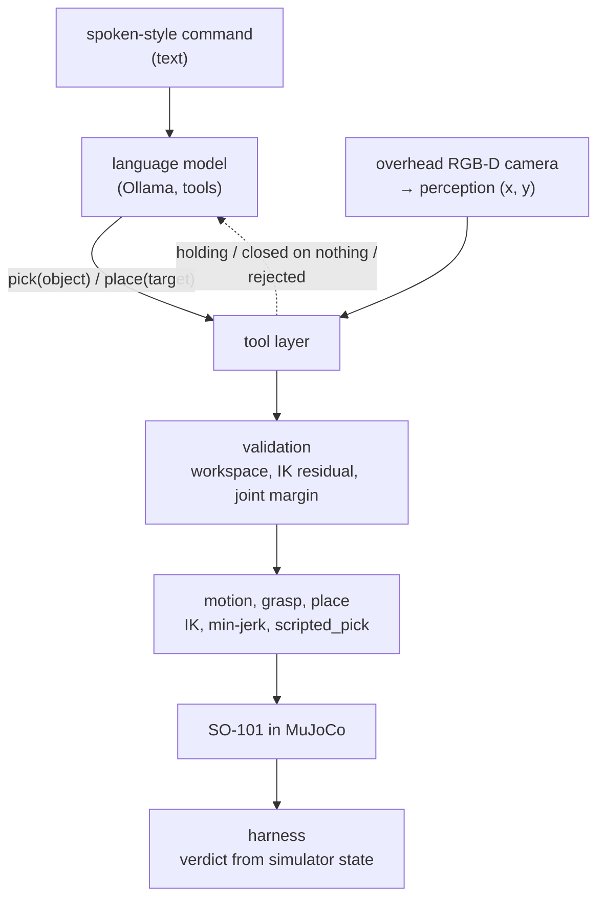
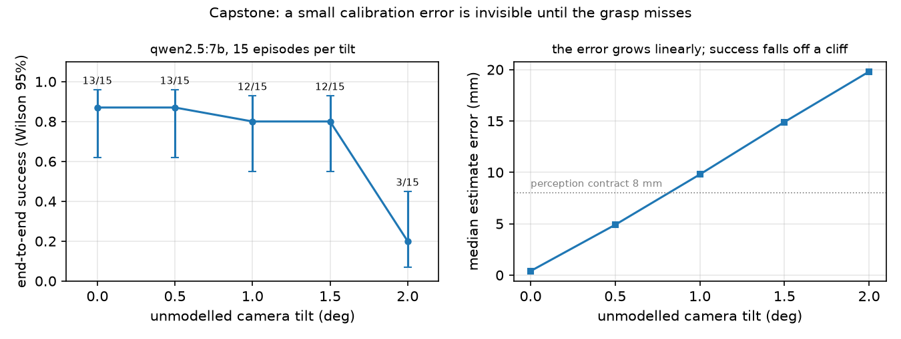

# 44 · Say, see, plan, grasp

<!-- meta -->
| | |
|---|---|
| **Part** | [Capstone](README.md) |
| **Run type** | CPU · Mac or Colab CPU |
| **Prerequisites** | [21](../part-5-perception-and-estimation/21-object-perception.md), [24](../part-6-planning-and-optimal-control/24-lqr-and-mpc.md), [31](../part-7-learning-from-demonstration/31-act.md), [39](../part-9-sim-to-real/39-domain-randomization.md), [42](../part-10-foundation-models-and-agents/42-llm-agents.md) |
| **Learn first** | none |
| **Time** | ~180 min |
| **Code** | [`experiments/44-capstone/experiment.py`](../experiments/44-capstone/experiment.py) |
| **Status** | ✅ done |
<!-- /meta -->

> A system is as good as the product of its layers, and every layer needs a contract you can measure.

## The problem

Every earlier lesson tested one layer with the others idealised: [lesson 16](../part-4-dynamics-and-control/16-grasping-and-pick-place.md)'s grasp knew the cube's true position, [lesson 21](../part-5-perception-and-estimation/21-object-perception.md)'s perception saw one red cube, [lesson 42](../part-10-foundation-models-and-agents/42-llm-agents.md)'s agent got ground truth from `find_object`. Put together, the layers interact: an IK rejection comes back to the model as text and changes what it does next; a small camera error shows up as an empty gripper. This capstone builds the whole chain on the simulated SO-101, measures it end to end and assigns each failure to a layer.

## Core idea

### In plain words

Think of the robot as a chain of microservices: a language model that turns a sentence into a function call, a camera service that says where the cubes are, a validator, a motion planner, a gripper and a judge, each with an API and a contract you can check.

Two things follow. Reliability multiplies: the end-to-end success rate is the product of the services' rates, so five very good layers can still make a mediocre system. And the service that shows an error is often not the one that caused it: a camera that is slightly off produces no error at all, and the failure surfaces three services later as a gripper closing on air. You need something like distributed tracing: a harness that checks every contract and blames the first one that broke.

One design rule keeps the chain manageable: geometry never passes through the language model. It outputs a tool name and an object name; every coordinate comes from the camera, every joint angle from inverse kinematics.

### Architecture



Every layer comes from an earlier lesson: language from [42](../part-10-foundation-models-and-agents/42-llm-agents.md) (Ollama tools, temperature 0, seed 0), perception from [19](../part-5-perception-and-estimation/19-camera-calibration.md)–[21](../part-5-perception-and-estimation/21-object-perception.md) (overhead RGB-D camera, HSV mask, depth back-projection), validation and motion from [10](../part-3-kinematics/10-inverse-kinematics.md), [13](../part-4-dynamics-and-control/13-trajectory-generation.md) and [15](../part-4-dynamics-and-control/15-safety.md), grasp from [16](../part-4-dynamics-and-control/16-grasping-and-pick-place.md) (servo squeeze, no weld), the harness from [25](../part-7-learning-from-demonstration/25-evaluating-policies.md).

### Failure budget and attribution, as code

The harness attributes a failed episode to the **first layer, in pipeline order, that broke its contract**: language (never picked the requested cube, or never placed it) → perception (not detected, or estimate more than 8 mm from the truth) → IK/limits (rejected by validation) → grasp (cube not lifted ≥ 4 cm) → place (not in the box). The agent's `report_result` is logged and never consulted.

```python
layer = attribute(broken_contracts(episode))   # first broken contract, in pipeline order (Build it, Step 3)
p_end_to_end = math.prod(pass_rates)          # layers in series multiply
per_layer = 0.90 ** (1 / 5)                    # even split: 0.979 per layer for 0.90 end to end
lo, hi = wilson(26, 30)                        # lesson 25: [0.70, 0.95]
```

| Quantity | Formula |
|---|---|
| end-to-end success | $P_{\text{end-to-end}} = \prod_{i=1}^{L} p_i$ |
| even budget | $p_i = P^{1/L}$ |
| Wilson 95% interval, $k$ of $n$ | lesson 25 |

$L$ is the number of layers in series, $p_i$ the pass rate of layer $i$ among episodes that reached it, $P$ the target end-to-end rate.

<details>
<summary>Math details: why the product is exact here, and what 30 episodes can certify</summary>

**The product is exact by construction.** With $p_i = \text{passed}_i / \text{reached}_i$, the episodes that reach layer $i+1$ are those that passed layer $i$, so $\prod_i p_i = \text{passed}_L / \text{reached}_1$. No independence is needed for this bookkeeping, only for predicting a new system from layers measured in isolation.

**Any split needs every layer above the target.** Every factor is at most 1, so $P = \prod p_i \le p_j$ for each $j$: no single layer can be worse than the system you want.

**Thirty clean episodes are not a proof.** For $k = n$ the Wilson lower bound is $n / (n + z^2)$: 0.886 at $n = 30$, below the 0.979 an even 5-layer budget asks for.

**Camera tilt geometry.** A small tilt $\alpha$ of a camera at height $h$ shifts where a ray meets the table by about $h\,\alpha$: about 1 cm per degree at 0.6 m (Build it, Step 1).

Go deeper: [lesson 25](../part-7-learning-from-demonstration/25-evaluating-policies.md) (success rates and intervals), [lesson 21](../part-5-perception-and-estimation/21-object-perception.md) (perception error), [lesson 42](../part-10-foundation-models-and-agents/42-llm-agents.md) (validation and false claims); primary source: E. B. Wilson, ["Probable inference, the law of succession, and statistical inference"](https://doi.org/10.1080/01621459.1927.10502953) (1927).

</details>

### Interfaces and contracts

An interface is a type plus a contract. A contract you cannot check is a hope.

| interface | from → to | what crosses | contract |
|---|---|---|---|
| command | user → LLM | text from speech recognition | none |
| tool call | LLM → tool layer | `look()`, `pick(object)`, `place(target)`, `report_result(...)` | names must match `look()`; else an error message |
| image | camera → perception | 640×480 RGB + depth, $K$ from fovy 50°, extrinsics $T_{wc}$ | $T_{wc}$ as calibrated |
| estimate | perception → planner | cube $(x, y)$ in the base frame, m | error ≤ 8 mm (lesson 21: 8 mm aim error cost 9 of 30 picks) |
| plan | planner → validation | pre / down / lift poses, residual | radius 12–30 cm, residual ≤ 5 mm, down pose ≥ 0.05 rad from limits |
| trajectory | motion → servos | position goals every 2 ms | inside `ctrlrange` |
| postcondition | gripper → LLM | "holding" / "closed on nothing" from the jaw angle | no ground truth |
| verdict | simulator → harness | cube poses | requested cube inside the box, no other cube in it |

$K$ is the camera's intrinsic matrix and $T_{wc}$ its pose in the world ([lesson 19](../part-5-perception-and-estimation/19-camera-calibration.md)); `ctrlrange` is each actuator's allowed command range.

## Build it

You will now rebuild the pipeline's contracts from earlier lessons' modules and check each against the Experiment's run: the camera model of lessons 19–21 (`physai.vision`), lesson 42's reach test on lesson 09's chain, lesson 25's Wilson interval (`physai.evaluation`). Only what the capstone adds is new, in [`physai/capstone.py`](../physai/capstone.py). The data is the Experiment's `output.txt`, so no language model or renderer is needed; `uv run python experiments/44-capstone/build.py` runs the steps (output in [`build_output.txt`](../experiments/44-capstone/build_output.txt)).

### Step 1 · Perception, and a tilted camera

The real camera images the top-face centre at a whole pixel; perception casts that pixel's ray back through the *calibrated* camera onto the plane of the cube tops. Tilt the real camera and the two disagree:

```python
def tilt(deg, axis=(1.0, 1.0, 0.0)):
    """World-frame rotation of a camera that has tilted by `deg` about a horizontal axis."""
    a = np.asarray(axis, float)
    return axis_angle_to_mat(a / np.linalg.norm(a), np.radians(deg))
```

```python
def estimate_xy(p_top, K, R_wc_true, R_wc_model, c, z_top):
    """Where perception puts a cube: the true camera images the top-face centre p_top at the nearest pixel, and
    the calibrated (model) camera casts that pixel's ray back onto the plane z = z_top."""
    uv = np.round(project_points(p_top[None], R_wc_true.T, -R_wc_true.T @ c, K))   # whole pixels
    return ray_plane(uv, K, R_wc_model, c, z_top)[0][0, :2]
```

```text
== Step 1. Perception: estimate of the requested cube (plain, filler, terse x 5 layouts) ==
K: f = 514.68 px, centre (319.5, 239.5); camera 0.6 m above the table, looking down
tilt deg  median err mm  max err mm  > 8 mm  Experiment median mm
     0.0            0.4         0.7    0/15                   0.4
     0.5            5.1         5.6    0/15                   4.9
     1.0           10.1        10.6   15/15                   9.8
     1.5           14.9        15.5   15/15                  14.9
     2.0           20.0        20.6   15/15                  19.8
small-angle estimate h * alpha at 1 deg: 9.9 mm
```

Geometry alone reproduces the Experiment's medians within 0.3 mm, including the 0.4 mm of pixel quantization at zero tilt. From 1° on, all 15 estimates break the 8 mm contract, yet the run still succeeded 12 of 15 times at 1° and 1.5°: the open jaw tolerates more than the contract asks.

### Step 2 · Reach

Lesson 42's `ik_position`, at the three grasp heights of lesson 16, plus the 12–30 cm workspace radius:

```text
== Step 2. Reach: workspace radius and IK residual of the three grasp points ==
layout   cube  radius cm  reach miss mm    ours  Experiment
     0   blue       14.7           0.21  accept          ok
     0  green       21.2           0.13  accept          ok
     0    red       18.1           0.44  accept          ok
     1   blue       21.0           0.16  accept      REJ:IK
     1  green       19.2           0.31  accept          ok
     1    red       20.0           0.25  accept          ok
     2   blue       21.4           0.34  accept      REJ:IK
     2  green       17.6           0.27  accept          ok
     2    red       13.8           0.23  accept          ok
     3   blue       18.3           0.42  accept          ok
     3  green       15.9           0.19  accept          ok
     3    red       14.2           0.35  accept          ok
     4   blue       13.1           0.24  accept          ok
     4  green       19.8           0.26  accept          ok
     4    red       16.6           0.20  accept          ok
```

The position-only check accepts all 15 cubes, including the two blue cubes the Experiment rejected: lesson 16's grasp also asks for the jaw pointing down and closing across two faces, and at 21.0 and 21.4 cm from the pan axis that orientation is out of reach while the position is not.

### Step 3 · Contracts from the log, and attribution

```python
def attribute(broken, order=ORDER):
    """First layer, in pipeline order, whose contract broke; None if all held. broken: set of layer names."""
    return next((layer for layer in order if layer in broken), None)
```

The build script reads each episode's tool calls and perception error from `output.txt`, marks the broken contracts (no pick of the requested cube, or no place after holding it; estimate beyond 8 mm; a rejected or empty pick of the requested cube; not in the box) and blames the first:

```text
== Step 3. The harness: contracts from each logged episode, first broken layer ==
failed episodes in output.txt: 33; our first broken layer = the Experiment's on 33/33
qwen2.5:7b: language 0, perception 0, IK/limits 4, grasp 0, place 0; success 26/30
qwen3:1.7b: language 5, perception 0, IK/limits 4, grasp 0, place 0; success 21/30
```

All 33 failed episodes, calibrated and tilted, get the Experiment's layer: attribution is a pure function of the logged contracts, testable without running anything.

### Step 4 · The budget

```python
def failure_budget(first_failures, n, order=ORDER):
    """Episodes that reach each layer and pass it, from the first broken layer of every failed episode.
    Returns [(layer, reached, passed)]; the product of passed / reached is the end-to-end rate."""
    rows, reached = [], n
    for layer in order:
        failed = sum(f == layer for f in first_failures)
        rows.append((layer, reached, reached - failed))
        reached -= failed
    return rows
```

```python
def even_split(P, L):
    """Pass rate every one of L layers in series needs for an end-to-end rate P."""
    return P ** (1 / L)
```

```text
== Step 4. Failure budget and what 30 episodes certify ==
language    reached 30 passed 30  p = 1.000
perception  reached 30 passed 30  p = 1.000
IK/limits   reached 30 passed 26  p = 0.867
grasp       reached 26 passed 26  p = 1.000
place       reached 26 passed 26  p = 1.000
product of layer pass rates 0.867 = end-to-end 26/30 = 0.867; Wilson 95% [0.70, 0.95]
even split of 0.90 over 5 layers: 0.979 per layer; a layer that passed 30/30 has Wilson lower bound 0.886
clean episodes needed before the lower bound reaches 0.979: 181
```

The product telescopes to 26/30, the interval is lesson 25's `wilson`, and a layer needs 181 clean episodes in a row before its lower bound reaches the 0.979 of an even 5-layer split.

### What you keep

`physai.capstone` adds `tilt`, `estimate_xy`, `attribute`, `failure_budget` and `even_split` on top of `vision`, `foundation`, `kinematics` and `evaluation`. [`tests/test_44_capstone.py`](../tests/test_44_capstone.py) checks them: `uv run pytest tests/test_44_capstone.py`; `uv run pytest` runs the whole library's tests.

## Use it

The library pieces are the Experiment's: OpenCV masks (lesson 21), MuJoCo's `Renderer` for the RGB-D frame, lesson 16's `plan` and `scripted_pick`, Ollama's `/api/chat`. The build adds the harness discipline around them:

```python
broken = broken_contracts(cmd, calls, perc_err, success)   # read from the log, never from the agent
layer = attribute(broken)                                   # first broken contract in pipeline order
lo, hi = wilson(k, n)                                       # lesson 25, physai.evaluation
```

Traps:

- **Attribution is a convention.** First-violation blame charges the tilted blue-cube rejections to perception; a causal answer needs the counterfactual run.
- **A broken contract is not a failure.** At 1° every estimate missed by more than 8 mm and 12 of 15 episodes still succeeded.
- **Same check, different contract.** Position reach and grasp-pose reach disagree on two cubes (Step 2): write down which one validation enforces.

## Experiment

**Scene.** Menagerie SO-101 (2 ms timestep), three 3 cm cubes (red, green, blue, 30 g) at random in x 16–25 cm, y −8–10 cm, at least 7 cm apart, an open box (8 × 8 cm inside, 3 cm walls) at (12, −18) cm, lesson 21's camera 0.6 m above the table. `pick` perceives, validates, then runs lesson 16's physical pick aimed at the *perceived* position; its answer to the model comes from the jaw angle.

```python
def pick(self, object):
    self.perceive()                                     # arm parked, one RGB-D frame
    xy = self.scene.get(f"{color_of(object)} cube")     # perception estimate, never ground truth
    if xy is None:                     return error("not visible", self.visible())
    if not R_MIN <= dist(xy) <= R_MAX: return reject("outside the workspace")
    poses, err = g16.plan(m, home, I, [*xy, HALF])      # lesson 16 IK: pre / down / lift
    if err > 5e-3:                     return reject("not reachable (IK error above 5 mm)")
    if margin(poses["down"]) < 0.05:   return reject("too close to a joint limit")
    g16.scripted_pick(m, d, [*xy, HALF])                # physical grasp, no weld
    return "holding" if jaw_angle() > G_CLOSE + 0.15 else "closed on nothing"
```

One simulator shortcut remains: `scripted_pick` ends its squeeze when both jaws touch the cube in MuJoCo's contact list (a stand-in for a jaw-stall sensor; otherwise a 4 s timeout). `place` solves lesson 10's `ik_solve` 7.5 cm above the perceived box centre with a soft "jaw down" term (weight 0.003), drives there with a min-jerk blend, opens the jaw and parks.

**Commands.** Six spoken-style commands, each on the same 5 layouts (seed 0), with `qwen2.5:7b` and `qwen3:1.7b`: 60 episodes.

| id | command | means |
|---|---|---|
| plain | put the red cube in the box | red |
| filler | um, could you grab the green block and drop it in the bin | green |
| terse | blue one, box, please | blue |
| asr | put the read cube in the box | red (recognition error) |
| negation | the cube that is neither red nor green goes in the box | blue |
| turkish | kırmızı küpü kutuya koy | red |

Full script: [`experiments/44-capstone/experiment.py`](../experiments/44-capstone/experiment.py). MuJoCo 3.17.0, NumPy 2.5.4, OpenCV 5.0.0, Python 3.14.7, Ollama 0.32.15, Apple M5; about 5 min on a loaded machine.

*Predict:* which layer fails most often?

**End-to-end (camera as calibrated):**

| model | success | Wilson 95% | language | perception | IK/limits | grasp | place | false claims |
|---|---|---|---|---|---|---|---|---|
| qwen2.5:7b | 26/30 (0.87) | [0.70, 0.95] | 0 | 0 | 4 | 0 | 0 | 4 |
| qwen3:1.7b | 21/30 (0.70) | [0.52, 0.83] | 5 | 0 | 4 | 0 | 0 | 4 |

**Failure budget, `qwen2.5:7b`:** language 30/30, perception 30/30, IK/limits 26/30 (0.867), grasp 26/26, place 26/26; the product, 0.867, equals the end-to-end rate. A layer that passed 30/30 has a Wilson lower bound of 0.886, below the 0.979 of an even budget: 30 episodes cannot certify a 90% system (Build it, Step 4: 181 would). The 30 are 6 fixed commands × 5 layouts with a deterministic model, so the intervals are if anything too narrow; the two models' intervals overlap.

**Observations.**

- **The physical layers held.** Perception error of the requested cube: median 0.35 mm, max 0.63 mm (n = 60); no failure was charged to grasp or place.
- **All 8 IK/limits failures are one cause:** the blue cube in layouts 1 and 2, at (23.3, −8.0) and (24.8, 4.3) cm, where lesson 16's grasp poses (jaw down) are not all reachable within 5 mm. Validation rejected it, correctly, and then **both models picked a different cube instead**, released it over the box and reported success: all 8 false claims are this goal substitution, the failure lesson 42 found.
- **Validation runs at the edge of the joint range:** the unchecked approach and lift poses sat at median 0.025 rad from a joint limit (minimum 0.000 rad).
- **Language errors were recoverable when the tool layer answered precisely.** `qwen3:1.7b` called `pick(read cube)` and `pick(kırmızı küp)`, got "no 'read cube' visible; visible objects: [...]", called `look()` and succeeded 5/5 on both; on `filler` it kept calling `place(bin)` until its 6 turns ran out (0/5).
- **The agent does not know when to stop.** On `plain`, `qwen2.5:7b` placed the red cube, then called `pick(red cube)` on the cube now in the box; validation rejected it (IK), and the task stayed done only because that pose is out of reach.

**Determinism.** Temperature 0 and seed 0; replies are memoised within a run by the exact request, so the 557 requests needed 93 distinct calls to Ollama (no coordinates reach the model). Four runs and an independent review re-run produced the same run signature (`f942d461a345`) and identical tables. This holds for Ollama 0.32.15 with these weights on this machine, as in lesson 42.

## Break it

The camera's extrinsics are calibrated once; then the real camera tilts by an angle perception does not know about (about the horizontal axis $(1, 1, 0)/\sqrt 2$). `qwen2.5:7b`, commands `plain`, `filler`, `terse` × 5 layouts:



| tilt [°] | median estimate error [mm] | success | Wilson 95% | perception | IK/limits | false claims |
|---|---|---|---|---|---|---|
| 0.0 | 0.4 | 13/15 | [0.62, 0.96] | 0 | 2 | 2 |
| 0.5 | 4.9 | 13/15 | [0.62, 0.96] | 0 | 2 | 2 |
| 1.0 | 9.8 | 12/15 | [0.55, 0.93] | 3 | 0 | 2 |
| 1.5 | 14.9 | 12/15 | [0.55, 0.93] | 3 | 0 | 2 |
| 2.0 | 19.8 | 3/15 | [0.07, 0.45] | 12 | 0 | 1 |

The grasp tolerated up to about 15 mm of error along this direction (the open jaw is wide), then collapsed between 1.5° and 2°. At 2° the visible symptom is the gripper, "closed on nothing", and every retry aimed at the same biased estimate. **The first contract broken is upstream of the first failure seen**: only the harness, comparing the estimate with the truth, puts these failures in perception. And **retries fix random errors, not systematic ones**; on hardware, check a fiducial (a printed marker) at a known table position before each session (lesson 19). At 1.0° and 1.5° two of the 3 failures are the blue-cube rejections of 0°, now charged to perception because its contract broke first: first-violation attribution is a convention, not a causal proof.

## On the real robot

**Not yet measured on the real arm.** The procedure, with the hardware steps of [lesson 40](../part-9-sim-to-real/40-real-so101.md):

1. Set up and calibrate the follower: `lerobot-setup-motors` and `lerobot-calibrate --robot.type=so101_follower --robot.port=... --robot.id=...` ([LeRobot SO-101](https://huggingface.co/docs/lerobot/so101)); fit the offset and sign between LeRobot's degrees and the model's radians (lesson 40, Build it).
2. Fix a camera above the table, calibrate intrinsics and the camera-to-base transform (lesson 19), and check a fiducial at known table points against the 8 mm contract before each session.
3. Re-tune the HSV thresholds once under the room's light, then freeze them (lesson 21).
4. Keep the tool layer: IK and validation on the Menagerie model, joint goals sent with `max_relative_target` set (lessons 15, 40), the e-stop outside the tool list.
5. The verdict needs a sensor (a camera check of the box region, confirmed by a human label), never the agent's report.
6. Run the 6 commands on at least 5 layouts; report $k/n$ with a Wilson interval and the layer breakdown next to the simulation numbers.

## Check yourself

1. **Easy.** With layer pass rates 0.99, 0.95, 0.98, 0.97, 0.99, what is the end-to-end rate, and which layer would you improve first?
2. **Medium.** Make goal substitution impossible: the tool layer rejects a `pick` of a different cube than the first one named in the episode. Predict the effect on false claims and on success, then run it.
3. **Hard.** Add a `verify()` tool that looks again after `place` and returns the cubes seen in the box region. Does `qwen2.5:7b` call it, and does it stop the extra `pick` after success?

### Answers

1. 0.99 × 0.95 × 0.98 × 0.97 × 0.99 ≈ 0.885; the 0.95 layer, since it contributes the largest share of the loss.
2. Not computed here. Expected: false claims drop (the 8 substitutions become rejections), success does not change (the requested blue cube is still out of reach).
3. Not computed here; run it.

## Takeaways and sources

- In this simulation, the full chain from a spoken-style command to a cube in the box succeeded 26/30 (Wilson [0.70, 0.95]) with `qwen2.5:7b`; every failure was one reachability limit, and the agent turned each into a false success by substituting another cube.
- Attribute failures by interface contracts measured in the harness; the layer where a failure becomes visible (an empty gripper) is often not the layer that broke (the camera's extrinsics: 2° tilt took success from 13/15 to 3/15).
- 30 clean episodes bound a layer from below at only 0.886; a 0.90 system over 5 layers asks each for 0.979, which takes 181 clean episodes to show.

Sources:
- Ollama [tool calling](https://docs.ollama.com/capabilities/tool-calling); models `qwen2.5:7b`, `qwen3:1.7b`.
- LeRobot [SO-101 documentation](https://huggingface.co/docs/lerobot/so101).
- [MuJoCo Menagerie · robotstudio_so101](https://github.com/google-deepmind/mujoco_menagerie/tree/main/robotstudio_so101) (Apache-2.0).
- E. B. Wilson, ["Probable inference, the law of succession, and statistical inference"](https://doi.org/10.1080/01621459.1927.10502953), *J. Amer. Statist. Assoc.* 22, 209–212, 1927.
- All measured numbers: [`experiments/44-capstone/output.txt`](../experiments/44-capstone/output.txt), figure from [`plot.py`](../experiments/44-capstone/plot.py).

### Where to go next

- Speech in front of the text: [Whisper](https://arxiv.org/abs/2212.04356) (Radford et al., 2022).
- Grounding the model in what the robot can do: [SayCan](https://arxiv.org/abs/2204.01691) (Ahn et al., 2022); success checks back into the plan: [Inner Monologue](https://arxiv.org/abs/2207.05608) (Huang et al., 2022).
- The model writes the skill code: [Code as Policies](https://arxiv.org/abs/2209.07753) (Liang et al., 2022); 3D value maps: [VoxPoser](https://arxiv.org/abs/2307.05973) (Huang et al., 2023).
- A learned grasp instead of the scripted one: [lesson 31](../part-7-learning-from-demonstration/31-act.md), [lesson 41](../part-10-foundation-models-and-agents/41-vla.md); [OpenVLA](https://arxiv.org/abs/2406.09246), [SmolVLA](https://arxiv.org/abs/2506.01844).
