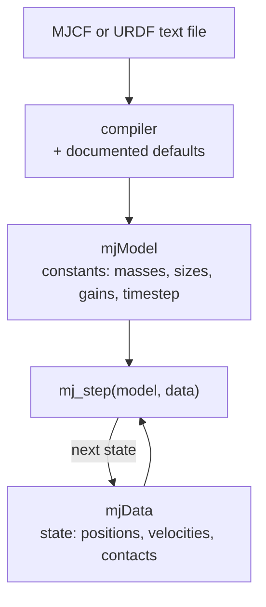

# 01 · The world as text: MJCF and URDF

<!-- meta -->
| | |
|---|---|
| **Part** | [1 · Simulation](README.md) |
| **Run type** | CPU · Mac or Colab CPU |
| **Prerequisites** | none |
| **Learn first** | [Python for AI Engineering](https://aiengineeringfromscratch.com/lesson?path=phases/00-setup-and-tooling/13-python-for-ai-engineering) · [Python Environments](https://aiengineeringfromscratch.com/lesson?path=phases/00-setup-and-tooling/06-python-environments) |
| **Time** | ~30 min |
| **Code** | [`experiments/01-world-as-text/experiment.py`](../experiments/01-world-as-text/experiment.py) · [notebook](../notebooks/01-world-as-text.ipynb) |
| **Status** | ✅ done |
<!-- /meta -->

> A robot model is a text file: every number the engine uses is either written in it or filled in by a documented default.

## The problem

Every simulation starts by loading a model file, and a file that loads is not necessarily a file that is physically right. MuJoCo's own reference warns that a number of public URDF models have inertias that look arbitrary and are too large ([XML reference · compiler/inertiafromgeom](https://mujoco.readthedocs.io/en/stable/XMLreference.html#compiler-inertiafromgeom)). If you cannot read the file, you cannot tell which masses, inertias, limits and gains you are simulating. In this lesson you read MJCF element by element, write a 15-line world, see what the defaults do to it, and then open the real SO-101 model and count what is inside.

## Core idea

### In plain words

A model file is a recipe. It lists the ingredients (rigid parts, their shapes, the joints that connect them, the motors that drive them) and the amounts (sizes, masses, gains). Whatever the recipe leaves out, the engine fills in from a fixed, documented list of defaults, the way a cook assumes "room temperature" when no temperature is given. That is convenient and dangerous: a missing number is never an error, it is a default you did not choose.

MuJoCo reads the file once and *compiles* it into two objects. `mjModel` holds everything that stays constant during a run: masses, sizes, gains, the timestep. `mjData` holds everything that changes: positions, velocities, contact forces. A simulation is a loop that updates `mjData` again and again using `mjModel`.

Mass needs the most care. Either the file states it for each part (`<inertial>`), or the compiler computes it from the shapes, assuming they are solid and of uniform density. A compiler setting decides which rule applies. With the wrong rule, a thin decorative shell is weighed as if it were a solid block of water.



### Loading a model, as code

```python
import mujoco

m = mujoco.MjModel.from_xml_string(xml)   # compile: text -> constants, gaps filled by defaults
d = mujoco.MjData(m)                      # state, initialised from the file
print(m.opt.timestep, sum(m.body_mass))   # always print what was filled in for you
for _ in range(1000):
    mujoco.mj_step(m, d)                  # advance the state by one timestep

# What the compiler computes for a body without <inertial>: a uniform solid box
def box_inertia(mass, a, b, c):           # mass in kg; a, b, c = full side lengths in m
    return (mass / 12 * (b**2 + c**2),    # I_xx: resistance to being spun about x
            mass / 12 * (a**2 + c**2),    # I_yy
            mass / 12 * (a**2 + b**2))    # I_zz
```

| Quantity | Formula |
|---|---|
| inertia of a uniform box | $I_{xx} = \tfrac{m}{12}(b^2 + c^2)$, and cyclically for $I_{yy}, I_{zz}$ |
| mass inferred from a geom | $m = \rho V$ |
| orientation (quaternion) | $(\cos\frac{a}{2},\ \sin\frac{a}{2}\,(x, y, z))$, scalar first |
| free-fall time | $T = \sqrt{2h/g}$ |
| air-drag deceleration | $k v^2/m$ with $k = \frac12 \rho_{\text{air}} A$ |

$m$ is mass; $a, b, c$ are the box's full side lengths; $I$ (inertia) measures how hard a body is to spin about an axis; $\rho$ is density and $V$ volume; $(x, y, z)$ is a unit rotation axis and $a$ in the quaternion row the rotation angle; $h$ is drop height and $g$ gravity; $v$ is speed, $\rho_{\text{air}}$ air density and $A$ the area facing the flow.

<details>
<summary>Math details: inertia inference, quaternions and the drag estimate</summary>

**Box inertia.** For uniform density, $I_{zz} = \int (x^2 + y^2)\,dm$. Integrating $x^2$ over a side of length $a$ gives $a^2/12$ per unit mass, so $I_{zz} = \frac{m}{12}(a^2 + b^2)$. For a cube $a = b = c$ all three are $\frac{m}{12}\cdot 2a^2$. Inference assumes the geom is solid; a hollow shell or a visual mesh is treated as filled.

**Quaternion.** A rotation by angle $a$ about a unit axis is stored as four numbers, $(w, x, y, z) = (\cos\frac a2, \sin\frac a2\,\hat n)$. MuJoCo stores $w$ first; `1 0 0 0` is "no rotation" ([Modeling · Frame orientations](https://mujoco.readthedocs.io/en/stable/modeling.html#corientation)). Other libraries put $w$ last; [lesson 06](../part-2-spatial-math/06-rotations.md) deals with that.

**Why mass cancels in vacuum.** Gravity's force is $mg$, so the acceleration $F/m = g$ does not depend on $m$: every cube falls in $T = \sqrt{2h/g}$.

**Why air delays light cubes.** MuJoCo's drag model adds a deceleration $k v^2/m$ ([Fluid forces](https://mujoco.readthedocs.io/en/stable/computation/fluid.html)). Assume drag is small, so the speed is still $v \approx g t$. The deceleration is then $(k/m)\,g^2 t^2$; integrating it twice over the fall time $T$ gives the distance lost:

$$\Delta z \approx \frac{k}{m}\,g^2 \int_0^T\!\!\int_0^{t} s^2\,ds\,dt = \frac{k}{m}\,\frac{g^2 T^4}{12}$$

It is proportional to $1/m$. The script prints this estimate next to the simulated gap.

Go deeper: [Python for AI Engineering](https://aiengineeringfromscratch.com/lesson?path=phases/00-setup-and-tooling/13-python-for-ai-engineering), [Python Environments](https://aiengineeringfromscratch.com/lesson?path=phases/00-setup-and-tooling/06-python-environments) (AIEFS); [MuJoCo XML reference](https://mujoco.readthedocs.io/en/stable/XMLreference.html), [MuJoCo Modeling](https://mujoco.readthedocs.io/en/stable/modeling.html).

</details>

### MJCF in one table

MJCF is MuJoCo's XML format. A *body* is a rigid part with its own coordinate frame; bodies nest inside each other, forming the *kinematic tree* (each child moves relative to its parent). A *geom* is a shape attached to a body. A *joint* gives a body a *degree of freedom* (dof), one independent way to move.

| Element | What it is | Attributes you will touch |
|---|---|---|
| `option` | global physics settings | `timestep` (default 0.002 s), `integrator` (default `Euler`), `gravity`, `density`/`viscosity` (default 0: no air), `cone` |
| `worldbody` | the fixed root of the tree | static geoms (floor, table) |
| `body` | a rigid frame in the kinematic tree | `pos`, `quat` relative to the parent |
| `geom` | a shape for collision and, by default, for mass | `type`, `size` (half-lengths for a box), `mass` or `density` (default 1000 kg/m³), `friction`, `solref`/`solimp` |
| `joint` | a degree of freedom between a body and its parent | `type` (`hinge`, `slide`, `ball`, `free`), `axis`, `range`, `damping`, `armature` |
| `inertial` | explicit mass properties of a body | `mass`, `pos` (centre of mass), `diaginertia` or `fullinertia` |
| `default` / `class` / `childclass` | named templates of attribute values | e.g. every servo joint gets the same `damping` and `armature` |
| `actuator` | something that produces force | `motor`, `position`, `velocity`, `general`; `joint`, `gear`, `ctrlrange`, `forcerange` |
| `sensor` | quantities written to `mjData.sensordata` | `jointpos`, `framequat`, `touch`, … |

Sources: [XML reference](https://mujoco.readthedocs.io/en/stable/XMLreference.html), [Modeling · Default settings](https://mujoco.readthedocs.io/en/stable/modeling.html#cdefault).

### Mass and inertia: written or inferred

At runtime only the *body* mass properties exist; geom masses are used only at compile time ([geom/mass](https://mujoco.readthedocs.io/en/stable/XMLreference.html#body-geom-mass)). `compiler/inertiafromgeom` picks the rule:

| Value | Behaviour |
|---|---|
| `auto` (default) | infer from the body's geoms only if the body has no `<inertial>` |
| `true` | always infer from geoms, overriding `<inertial>` |
| `false` | every body must have `<inertial>` |

### URDF and MJCF

URDF is the robot format of the ROS ecosystem; many manufacturers publish their robots in it.

| | URDF | MJCF |
|---|---|---|
| Tree | `link` + `joint` | nested `body` + `joint` |
| Mass | `inertial` per link | `inertial`, or inferred from geoms |
| Actuators, sensors, solver, contact parameters | not part of the format | first-class elements |
| Templates | none | `default` classes |

MuJoCo loads URDF directly, but only a subset of its model, plus a custom `<mujoco>` block for compiler options ([Modeling · URDF extensions](https://mujoco.readthedocs.io/en/stable/modeling.html#curdf)). Menagerie documents each conversion in the model's README. For the Go2: convert meshes, add `<mujoco><compiler discardvisual="false" …/></mujoco>` to the URDF, load it in MuJoCo and save MJCF, add a `freejoint`, move shared values into `<default>`, then tune foot contacts ([Menagerie · unitree_go2](https://github.com/google-deepmind/mujoco_menagerie/tree/f3b6013/unitree_go2)). The SO-101 model starts from the manufacturer's public MJCF instead, then switches to `implicitfast` and adds collision primitives ([Menagerie · robotstudio_so101](https://github.com/google-deepmind/mujoco_menagerie/tree/f3b6013/robotstudio_so101)).

## Experiment

### A · 15 lines, two cubes

```xml
<mujoco>
 <option gravity="0 0 -9.81"/>
 <worldbody>
  <geom type="plane" size="2 2 .1"/>
  <geom name="table" type="box" size=".35 .25 .4"/>
  <body name="light" pos="-.13 0 .9">
   <freejoint/>
   <geom type="box" size=".1 .1 .1" mass=".1"/>
  </body>
  <body name="heavy" pos=".13 0 .9">
   <freejoint/>
   <geom type="box" size=".1 .1 .1" mass=".1"/>
  </body>
 </worldbody>
</mujoco>
```

Two 20 cm cubes, bottom faces 40 cm above a tabletop. `<freejoint/>` lets a body move in all six directions (three translations, three rotations), so the cubes can fall. There is no `inertial`, so mass properties come from the geoms. The script edits lines 8 and 12 (masses) and, for air, line 2:

```python
def make_xml(light_kg=0.1, heavy_kg=1.0, air=False):
    lines = list(LINES)
    lines[7] = lines[7].replace('mass=".1"', f'mass="{light_kg:g}"')
    lines[11] = lines[11].replace('mass=".1"', f'mass="{heavy_kg:g}"')
    if air:
        lines[1] = ' <option gravity="0 0 -9.81" density="1.2"/>'   # air density, kg/m³
    return "\n".join(lines)
```

**Predict.** In vacuum, does the 1 kg cube land before the 100 g cube? With `density="1.2"`, which one is late, and how does the delay scale with mass?

**Run.** [`experiment.py`](../experiments/01-world-as-text/experiment.py), MuJoCo 3.17.0, NumPy 2.5.4, Apple M5, deterministic (two runs give identical output, saved in [`output.txt`](../experiments/01-world-as-text/output.txt)).

**Observe.** Compiled defaults: timestep 0.002 s, density 0, viscosity 0, integrator Euler. The inferred inertia of the 100 g cube is 6.6667·10⁻⁴ kg·m² on each axis, equal to $m(a^2+a^2)/12$. Its body quaternion is `[1 0 0 0]`.

In vacuum both cubes reach the tabletop at **step 143** (analytic $\sqrt{2 \cdot 0.40 / 9.81}$ = 0.2856 s). With air, the heavy cube lands at step 143 and the light one at step 145; when the heavy one lands the light one is **1.10 cm** higher, an interpolated delay of **4.08 ms**.

| light cube (heavy = 1 kg) | delay in vacuum | delay with `density="1.2"` |
|---|---|---|
| 5 g | 0.00 ms | 93.44 ms |
| 10 g | 0.00 ms | 46.25 ms |
| 20 g | 0.00 ms | 22.59 ms |
| 50 g | 0.00 ms | 8.65 ms |
| 100 g | 0.00 ms | 4.08 ms |
| 200 g | 0.00 ms | 1.81 ms |
| 500 g | 0.00 ms | 0.45 ms |
| 1 kg | 0.00 ms | 0.00 ms |


Mass cancels in vacuum ($a = F/m = g$). With air the delay scales roughly as $1/m$, because the drag deceleration $k v^2 / m$ with $k = \frac12 \rho A$ is divided by the mass ([Fluid forces](https://mujoco.readthedocs.io/en/stable/computation/fluid.html)); the curve bends below the guide near 1 kg because the heavy cube is slowed a little too. Hand check printed by the script (derivation under Math details above): distance lost $\approx (k/m)\, g^2 T^4/12$ gives 1.28 cm − 0.13 cm = **1.15 cm**, against 1.10 cm simulated. This is the output of MuJoCo's drag model, not a measurement of a real cube.

### B · The real SO-101 file

```python
m = mujoco.MjModel.from_xml_path(path("robotstudio_so101", "so101.xml"))
print(m.nbody, m.njnt, m.nu, sum(m.body_mass))
```

| Quantity (compiled model) | Value |
|---|---|
| bodies (including world) | 9 |
| joints | 6, all hinge (6 dof) |
| actuators | 6, gain `fixed` + bias `affine` = `<position>` servos, kp 998.22, kv 2.731 |
| geoms / sensors | 50 / 0 |
| bodies with explicit `<inertial>` | 7 of 8; `camera_mount` is inferred from its geoms |
| total mass | **0.6454 kg** |
| `option` | timestep 0.005 s, `implicitfast`, `elliptic` cone |

Gain `fixed` plus bias `affine` is how MuJoCo stores a position servo internally. The real file overrides several `option` defaults (it also sets `iterations`, `ls_iterations` and `impratio`). The actuator numbers are the subject of [lesson 05](05-joints-and-actuators.md).

## Break it

Compile the same SO-101 file with `inertiafromgeom="true"`, so every body's `<inertial>` is replaced by geom inference at density 1000 kg/m³ (the default, water):

| | file as written | `inertiafromgeom="true"` |
|---|---|---|
| total mass | 0.6454 kg | **2.3565 kg** (×3.65) |
| shoulder mass | 0.1000 kg | 0.4018 kg |
| upper_arm mass | 0.1030 kg | 0.4551 kg |
| upper_arm largest principal inertia (inertia about the axis that is hardest to spin) | 1.509·10⁻⁴ kg·m² | 9.178·10⁻⁴ kg·m² |

Nothing errors and the model still simulates. The mechanism: inference treats every geom with the default `inertiagrouprange` (0–5), visual meshes included, as a solid of uniform density 1000 kg/m³ ([compiler/inertiagrouprange](https://mujoco.readthedocs.io/en/stable/XMLreference.html#compiler-inertiagrouprange), [geom/density](https://mujoco.readthedocs.io/en/stable/XMLreference.html#body-geom-density)). A gravity-compensation torque (the torque that holds the arm up against its own weight) or a system-identification fit (estimating physical parameters from logged motion) on such a model would be off by the same factor. Always print `sum(m.body_mass)` after loading.

## On the real robot

- The Menagerie SO-101 masses come from the manufacturer's MJCF (README above). They have not been compared with a scale in this book; weighing each link of a real arm is the check. **Not yet measured on the real arm.**
- Procedure: weigh the assembled follower arm without base clamp and cables, compare with 0.6454 kg; any gap must be attributed (screws, cables, print infill) before trusting simulated torques.
- The real arm's motors are listed in the [LeRobot SO-101 guide](https://huggingface.co/docs/lerobot/so101): six STS3215 servos with 1/345 gearing on the follower.

## Check yourself

1. **Easy.** Set `gravity="0 0 -1.62"`. In vacuum, do the two cubes still land at the same step? Predict the analytic time first.
2. **Medium.** Add a third cube: 100 g but 10 cm. In air, is it faster or slower than the 20 cm, 100 g cube? Reason from $k/m = \frac12 \rho A / m$, then run it.
3. **Hard.** Write an MJCF body with a 30 cm capsule geom (`mass="0.2"`) and an explicit `<inertial>` with ten times the capsule's inertia. Compile with `auto`, `true` and `false`, and print `body_mass` and `body_inertia` for each. Which setting fails to compile, and why?

### Answers

1. Yes: in vacuum mass never enters. The analytic time is $\sqrt{2 \cdot 0.40 / 1.62}$; check the step count against it.
2. Faster: at the same mass it has a quarter of the frontal area, so $k/m$ is four times smaller. Run it to see by how much.
3. `auto` keeps your explicit `<inertial>`, `true` replaces it with the capsule's inferred inertia, and `false` compiles here because the body does have `<inertial>`; it fails only for bodies without one.

## Takeaways and sources

- MJCF = `option` + a tree of `body` / `joint` / `geom` + `actuator` / `sensor`; everything not written takes a documented default.
- Mass properties are either explicit (`<inertial>`) or inferred from geoms at uniform density; `inertiafromgeom` decides, and the wrong choice changed the SO-101 mass by a factor of 3.65 without any error.
- MuJoCo quaternions are scalar-first, `1 0 0 0` = identity.

Next: [lesson 02 · Time integration and the timestep](02-timestep.md).

**Sources**
- [MuJoCo XML reference](https://mujoco.readthedocs.io/en/stable/XMLreference.html): `option`, `geom`, `joint`, `inertial`, `compiler/inertiafromgeom`, `inertiagrouprange`.
- [MuJoCo Modeling](https://mujoco.readthedocs.io/en/stable/modeling.html): default classes, frame orientations, URDF extensions.
- [MuJoCo Fluid forces](https://mujoco.readthedocs.io/en/stable/computation/fluid.html).
- [MuJoCo Menagerie](https://github.com/google-deepmind/mujoco_menagerie): `robotstudio_so101` (Apache-2.0) and `unitree_go2` READMEs (pinned commit in `experiments/common/menagerie.py`).
- [LeRobot SO-101 guide](https://huggingface.co/docs/lerobot/so101).
- Our numbers: [`experiments/01-world-as-text/output.txt`](../experiments/01-world-as-text/output.txt).
