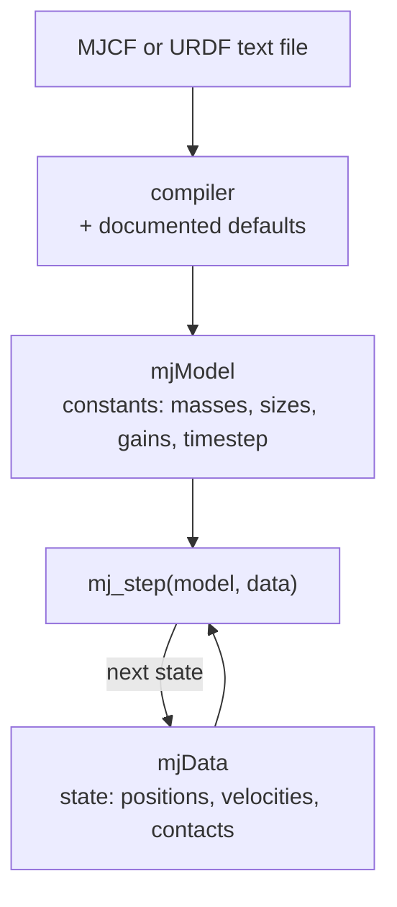
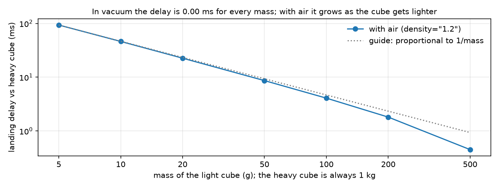

# 01 · The world as text: MJCF and URDF

<!-- meta -->
| | |
|---|---|
| **Part** | [1 · Simulation](README.md) |
| **Run type** | CPU · Mac or Colab CPU |
| **Prerequisites** | none |
| **Learn first** | [Python for AI Engineering](https://aiengineeringfromscratch.com/lesson?path=phases/00-setup-and-tooling/13-python-for-ai-engineering) · [Python Environments](https://aiengineeringfromscratch.com/lesson?path=phases/00-setup-and-tooling/06-python-environments) |
| **Time** | ~30 min |
| **Code** | [`experiments/01-world-as-text/experiment.py`](../experiments/01-world-as-text/experiment.py) · [notebook](../notebooks/01-world-as-text.ipynb) |
| **Status** | ✅ done |
<!-- /meta -->

> A robot model is a text file: every number the engine uses is either written in it or filled in by a documented default.

## The problem

A file that loads is not necessarily physically right. MuJoCo's own reference warns that a number of public URDF models have inertias that look arbitrary and are too large ([XML reference · compiler/inertiafromgeom](https://mujoco.readthedocs.io/en/stable/XMLreference.html#compiler-inertiafromgeom)). If you cannot read the file, you cannot tell which masses, inertias, limits and gains you are simulating. Here you read MJCF, write a 15-line world, see what the defaults do to it, and open the real SO-101 model.

## Core idea

### In plain words

A model file is a recipe: ingredients (rigid parts, shapes, joints, motors) and amounts (sizes, masses, gains). Whatever it leaves out, the engine fills in from a documented list of defaults, the way a cook assumes "room temperature". A missing number is never an error; it is a default you did not choose.

MuJoCo *compiles* the file once into two objects: `mjModel` holds what stays constant (masses, sizes, gains, the timestep), `mjData` what changes (positions, velocities, contact forces). A simulation is a loop that updates `mjData` using `mjModel`.

Mass needs the most care. Either the file states it for each part (`<inertial>`), or the compiler computes it from the shapes as uniform solids; a compiler setting decides which. With the wrong rule, a thin decorative shell is weighed as a solid block of water.



### Loading a model, as code

```python
import mujoco

m = mujoco.MjModel.from_xml_string(xml)   # compile: text -> constants, gaps filled by defaults
d = mujoco.MjData(m)                      # state, initialised from the file
print(m.opt.timestep, sum(m.body_mass))   # always print what was filled in for you
for _ in range(1000):
    mujoco.mj_step(m, d)                  # advance the state by one timestep
# Build it, Step 1 writes what the compiler computes for a body without <inertial>
```

| Quantity | Formula |
|---|---|
| inertia of a uniform box | $I_{xx} = \tfrac{m}{12}(b^2 + c^2)$, and cyclically for $I_{yy}, I_{zz}$ |
| mass inferred from a geom | $m = \rho V$ |
| orientation (quaternion) | $(\cos\frac{a}{2},\ \sin\frac{a}{2}\,(x, y, z))$, scalar first |
| free-fall time | $T = \sqrt{2h/g}$ |
| air-drag deceleration | $k v^2/m$ with $k = \frac12 \rho_{\text{air}} A$ |

$m$ is mass; $a, b, c$ are the box's full side lengths; $I$ (inertia) measures how hard a body is to spin about an axis; $\rho$ is density, $V$ volume; $(x, y, z)$ is a unit axis and $a$ in the quaternion row the angle; $h$ is drop height, $g$ gravity, $v$ speed, $A$ the area facing the flow.

<details>
<summary>Math details: inertia inference, quaternions and the drag estimate</summary>

**Box inertia.** For uniform density, $I_{zz} = \int (x^2 + y^2)\,dm$; integrating $x^2$ over a side $a$ gives $a^2/12$ per unit mass, so $I_{zz} = \frac{m}{12}(a^2 + b^2)$. Inference treats every geom as solid, a hollow shell or visual mesh included.

**Quaternion.** MuJoCo stores $(w, x, y, z) = (\cos\frac a2, \sin\frac a2\,\hat n)$, $w$ first; `1 0 0 0` is "no rotation" ([Modeling · Frame orientations](https://mujoco.readthedocs.io/en/stable/modeling.html#corientation)). Other libraries put $w$ last ([lesson 06](../part-2-spatial-math/06-rotations.md)).

**Why mass cancels in vacuum.** Gravity's force is $mg$, so the acceleration $F/m = g$ does not depend on $m$: every cube falls in $T = \sqrt{2h/g}$.

**Why air delays light cubes.** MuJoCo's drag model adds a deceleration $k v^2/m$ ([Fluid forces](https://mujoco.readthedocs.io/en/stable/computation/fluid.html)). Assume drag is small, so the speed is still $v \approx g t$. The deceleration is then $(k/m)\,g^2 t^2$; integrating it twice over the fall time $T$ gives the distance lost:

$$\Delta z \approx \frac{k}{m}\,g^2 \int_0^T\!\!\int_0^{t} s^2\,ds\,dt = \frac{k}{m}\,\frac{g^2 T^4}{12}$$

It is proportional to $1/m$.

Go deeper: [Python for AI Engineering](https://aiengineeringfromscratch.com/lesson?path=phases/00-setup-and-tooling/13-python-for-ai-engineering), [Python Environments](https://aiengineeringfromscratch.com/lesson?path=phases/00-setup-and-tooling/06-python-environments) (AIEFS); [MuJoCo XML reference](https://mujoco.readthedocs.io/en/stable/XMLreference.html), [MuJoCo Modeling](https://mujoco.readthedocs.io/en/stable/modeling.html).

</details>

### MJCF in one table

MJCF is MuJoCo's XML format. A *body* is a rigid part with its own frame; nested bodies form the *kinematic tree*. A *geom* is a shape attached to a body. A *joint* gives a body a *degree of freedom* (dof), one independent way to move.

| Element | What it is | Attributes you will touch |
|---|---|---|
| `option` | global physics settings | `timestep` (default 0.002 s), `integrator` (default `Euler`), `gravity`, `density`/`viscosity` (default 0: no air), `cone` |
| `worldbody` | the fixed root of the tree | static geoms (floor, table) |
| `body` | a rigid frame in the kinematic tree | `pos`, `quat` relative to the parent |
| `geom` | a shape for collision and, by default, for mass | `type`, `size` (half-lengths for a box), `mass` or `density` (default 1000 kg/m³), `friction`, `solref`/`solimp` |
| `joint` | a degree of freedom between a body and its parent | `type` (`hinge`, `slide`, `ball`, `free`), `axis`, `range`, `damping`, `armature` |
| `inertial` | explicit mass properties of a body | `mass`, `pos` (centre of mass), `diaginertia` or `fullinertia` |
| `default` / `class` / `childclass` | named templates of attribute values | e.g. every servo joint gets the same `damping` and `armature` |
| `actuator` | something that produces force | `motor`, `position`, `velocity`, `general`; `joint`, `gear`, `ctrlrange`, `forcerange` |
| `sensor` | quantities written to `mjData.sensordata` | `jointpos`, `framequat`, `touch`, … |

### Mass and inertia: written or inferred

At runtime only *body* mass properties exist; geom masses are used only at compile time ([geom/mass](https://mujoco.readthedocs.io/en/stable/XMLreference.html#body-geom-mass)). `compiler/inertiafromgeom` picks the rule:

| Value | Behaviour |
|---|---|
| `auto` (default) | infer from the body's geoms only if the body has no `<inertial>` |
| `true` | always infer from geoms, overriding `<inertial>` |
| `false` | every body must have `<inertial>` |

### URDF and MJCF

URDF is the robot format of the ROS ecosystem.

| | URDF | MJCF |
|---|---|---|
| Tree | `link` + `joint` | nested `body` + `joint` |
| Mass | `inertial` per link | `inertial`, or inferred from geoms |
| Actuators, sensors, solver, contact parameters | not part of the format | first-class elements |
| Templates | none | `default` classes |

MuJoCo loads a subset of URDF directly, plus a custom `<mujoco>` block for compiler options ([Modeling · URDF extensions](https://mujoco.readthedocs.io/en/stable/modeling.html#curdf)). Menagerie documents each conversion in the model's README: the Go2 went URDF → MJCF, then got a `freejoint`, `<default>` classes and tuned foot contacts ([Menagerie · unitree_go2](https://github.com/google-deepmind/mujoco_menagerie/tree/f3b6013/unitree_go2)); the SO-101 starts from the manufacturer's MJCF, switches to `implicitfast` and adds collision primitives ([Menagerie · robotstudio_so101](https://github.com/google-deepmind/mujoco_menagerie/tree/f3b6013/robotstudio_so101)).

## Build it

You will now compute by hand what the compiler fills in (mass and inertia from shapes) and what `mj_step` does to a falling cube, in about 60 lines of NumPy, checking each step against MuJoCo. Type the steps into your own file and run it after each step. The finished functions are in [`physai/sim.py`](../physai/sim.py); `uv run python experiments/01-world-as-text/build.py` runs all five steps with the checks (output in [`build_output.txt`](../experiments/01-world-as-text/build_output.txt)).

### Step 1 · Mass and inertia of a solid shape

A body without `<inertial>` gets the mass $\rho V$ and the inertia of its geoms as uniform solids. MJCF sizes are half-lengths (`size=".1 .1 .1"` is a 20 cm box); cylinders and capsules give radius and half-length along $z$.

```python
def solid_inertia(kind, size, density):
    """Mass and principal inertia of a uniform solid, with MuJoCo's `size` convention (half-lengths)."""
    if kind == "box":                                  # size = half-sides (x, y, z)
        a, b, c = 2 * np.asarray(size, float)
        mass = density * a * b * c
        return mass, mass / 12 * np.array([b * b + c * c, a * a + c * c, a * a + b * b])
    if kind == "sphere":                               # size = (radius,)
        r = size[0]
        mass = density * 4 / 3 * np.pi * r**3
        return mass, np.full(3, 2 / 5 * mass * r * r)
    r, h = size[0], 2 * size[1]                        # cylinder/capsule: radius, half-length along z
    m_cyl = density * np.pi * r * r * h
    i_xx, i_zz = m_cyl * (3 * r * r + h * h) / 12, m_cyl * r * r / 2
    if kind == "cylinder":
        return m_cyl, np.array([i_xx, i_xx, i_zz])
    m_sph = density * 4 / 3 * np.pi * r**3             # capsule: cylinder plus two hemispherical caps
    i_xx += m_sph * (2 * r * r / 5 + h * h / 4 + 3 * h * r / 8)
    i_zz += m_sph * 2 * r * r / 5
    return m_cyl + m_sph, np.array([i_xx, i_xx, i_zz])
```

```python
rho = mass / solid_inertia(kind, size, 1.0)[0]     # a geom with mass="..." fixes the density
m_ours, i_ours = solid_inertia(kind, size, rho)     # compare with m.body_mass[1], m.body_inertia[1]
```

```text
== Step 1. Solid shapes: our mass and inertia vs MuJoCo's compiler ==
geom                size (m)  mass (kg)        I_xx        I_yy        I_zz  max rel. err
box          [0.1, 0.1, 0.1]     0.1000  6.6667e-04  6.6667e-04  6.6667e-04       1.1e-16
box        [0.1, 0.05, 0.02]     0.5600  5.4133e-04  1.9413e-03  2.3333e-03       0.0e+00
sphere                [0.04]     0.2681  1.7157e-04  1.7157e-04  1.7157e-04       0.0e+00
cylinder         [0.03, 0.1]     1.5268  5.4329e-03  5.4329e-03  6.8707e-04       2.2e-16
capsule          [0.03, 0.1]     0.6786  3.4383e-03  3.4383e-03  2.9518e-04       2.2e-16
```

The first row is the Experiment's 100 g cube: 6.6667·10⁻⁴ kg·m², as printed there.

### Step 2 · Several geoms, one body

With several geoms, the compiler adds the masses, puts the centre of mass (COM) at their weighted mean, and moves each geom's inertia there with the parallel-axis theorem: a part at offset $r$ from the COM adds $m(\lVert r\rVert^2 I - r r^\top)$.

```python
def combine_parts(masses, positions, inertias):
    """One rigid body from parts (axis-aligned principal inertias at given positions): mass, COM, 3x3 inertia."""
    masses, positions = np.asarray(masses, float), np.asarray(positions, float)
    mass = masses.sum()
    com = masses @ positions / mass
    inertia = np.zeros((3, 3))
    for m_i, p, i_diag in zip(masses, positions, inertias):
        r = p - com                                    # parallel-axis theorem: shift each part to the COM
        inertia += np.diag(i_diag) + m_i * (r @ r * np.eye(3) - np.outer(r, r))
    return mass, com, inertia
```

```text
== Step 2. One body from two parts: a 1 kg box above a 0.5 kg sphere ==
mass 1.5000 kg (body_mass 1.5000) · COM z 0.03333 m (body_ipos z 0.03333)
inertia about the COM, diagonal: [0.0155   0.0155   0.002167] kg m^2
body_inertia:                    [0.0155   0.0155   0.002167] kg m^2
max rel. error 2.2e-16; each part alone about the COM would give I_xx 0.002167 (no parallel-axis term)
```

Without the parallel-axis term the body would look seven times easier to tip over. MuJoCo stores the result in principal axes (`body_inertia` plus the rotation `body_iquat`); here the parts lie on the $z$ axis, so the matrix is already diagonal.

### Step 3 · One fall, step by step

MuJoCo's default `Euler` updates the velocity first, then moves with the new one (lesson 02 explains why the order matters):

```python
def semi_implicit_euler(x, v, accel, h, c_implicit=0.0):
    """Update the velocity first, then move with the new one (MuJoCo's Euler).

    c_implicit: damping per unit inertia treated implicitly, v' = v + h a / (1 + h c), as MuJoCo's
    Euler does for joint damping and implicitfast for every velocity-dependent force (lesson 05).
    """
    v_new = v + h * accel(x, v) / (1 + h * c_implicit)
    return x + h * v_new, v_new
```

The fall itself is a loop until the bottom face crosses the tabletop:

```python
zs, z, v = [0.9], 0.9, 0.0
while z - 0.10 > 0.40:                               # bottom face still above the tabletop
    z, v = semi_implicit_euler(z, v, lambda z, v: -9.81, 0.002)
    zs.append(z)
```

```text
== Step 3. Free fall by hand (velocity first, then position) vs mj_step, vacuum ==
light: lands at step 143 · max |z_ours - z_mujoco| over the fall 1.1e-16 m
heavy: lands at step 143 · max |z_ours - z_mujoco| over the fall 1.1e-16 m
analytic sqrt(2 * 0.40 / 9.81) = 0.2856 s = step 142.8
```

The Experiment's landing step, 143, and its heights to one rounding step. Mass never enters the loop.

### Step 4 · Air drag

With `density` > 0, MuJoCo replaces each body by the uniform box with the same mass and inertia and applies quadratic drag on each face, $F = -\tfrac12 \rho_{\text{air}} A\,|v|\,v$ ([Fluid forces](https://mujoco.readthedocs.io/en/stable/computation/fluid.html)). The box comes from inverting Step 1's box formula:

```python
def inertia_box(mass, inertia):
    """Full side lengths of the uniform box with this mass and principal inertia (MuJoCo's drag shape)."""
    i_x, i_y, i_z = inertia
    return np.sqrt(6 / mass * np.array([i_y + i_z - i_x, i_x + i_z - i_y, i_x + i_y - i_z]))
```

```python
def quadratic_drag(v, box, rho):
    """Drag force on a box moving at v (box axes): -1/2 rho * (area facing each axis) * |v| v."""
    area = np.array([box[1] * box[2], box[0] * box[2], box[0] * box[1]])
    return -0.5 * rho * area * np.abs(v) * v
```

Add the drag to the acceleration, `-9.81 + quadratic_drag(v, box, 1.2)[2] / mass`, and drop both cubes again:

```text
== Step 4. Drag from the equivalent inertia box vs MuJoCo's qfrc_fluid ==
inertia box of the 100 g cube: [0.2 0.2 0.2] m (the geom is 0.2 m)
v_z = -1.0 m/s · our drag 0.024000 N · qfrc_fluid 0.024000 N
v_z = -2.8 m/s · our drag 0.188160 N · qfrc_fluid 0.188160 N
air drop by hand: light lands at step 145, heavy at step 143 · light is 1.10 cm higher when heavy lands · delay 4.08 ms
max |z_ours - z_mujoco| for the light cube over its fall: 0.0e+00 m
```

The Experiment's numbers exactly: steps 145 and 143, 1.10 cm, 4.08 ms. The Math details estimate (1.15 cm) is an approximation; this loop is the simulation itself.

### Step 5 · The whole sweep

```text
== Step 5. The mass sweep with air, from our own integrator (heavy = 1 kg) ==
light     5 g · delay  93.44 ms
light    10 g · delay  46.25 ms
light    20 g · delay  22.59 ms
light    50 g · delay   8.65 ms
light   100 g · delay   4.08 ms
light   200 g · delay   1.81 ms
light   500 g · delay   0.45 ms
light  1000 g · delay   0.00 ms
```

The Observe table, row for row, from your own code.

### What you keep

`physai.sim` now has `solid_inertia`, `combine_parts`, `inertia_box`, `quadratic_drag` and `semi_implicit_euler`; lesson 02 adds explicit Euler and RK4 beside the last one, lesson 05 uses its implicit-damping option. [`tests/test_01_world_as_text.py`](../tests/test_01_world_as_text.py) pins them to MuJoCo; run `uv run pytest tests/test_01_world_as_text.py` after you change anything.

## Use it

In practice the compiler does Steps 1–2; read the result back:

```python
m = mujoco.MjModel.from_xml_path(path("robotstudio_so101", "so101.xml"))
b = m.body("upper_arm").id
m.body_mass[b], m.body_ipos[b]          # mass, COM in the body frame
m.body_inertia[b], m.body_iquat[b]      # principal inertia and the rotation to its axes
sum(m.body_mass)                        # 0.6454 kg: print it after every load
mujoco.mj_setTotalmass(m, 0.70)         # rescales every body's mass AND inertia
```

Each format names them differently:

| Format | Mass | Centre of mass | Inertia |
|---|---|---|---|
| MJCF `<inertial>` | `mass` | `pos` | `diaginertia` (with `quat`) or `fullinertia` (6 numbers) |
| URDF `<inertial>` | `<mass value>` | `<origin xyz rpy>` | `<inertia ixx ixy ixz iyy iyz izz>` |
| compiled `mjModel` | `body_mass` | `body_ipos` | `body_inertia` (principal) + `body_iquat` |

Traps:

- **Half-lengths.** MJCF box `size` is half the side, URDF `<box size>` the full side: a copied number is off by 8 in volume.
- **Principal axes.** `body_inertia` is diagonal in the frame `body_iquat`, not the body frame; for the SO-101 `upper_arm` they differ.
- **Editing arrays.** `m.body_mass[b] = ...` leaves `body_inertia` unchanged (and with it the drag box of Step 4); `mj_setTotalmass` scales both.

## Experiment

### A · 15 lines, two cubes

```xml
<mujoco>
 <option gravity="0 0 -9.81"/>
 <worldbody>
  <geom type="plane" size="2 2 .1"/>
  <geom name="table" type="box" size=".35 .25 .4"/>
  <body name="light" pos="-.13 0 .9">
   <freejoint/>
   <geom type="box" size=".1 .1 .1" mass=".1"/>
  </body>
  <body name="heavy" pos=".13 0 .9">
   <freejoint/>
   <geom type="box" size=".1 .1 .1" mass=".1"/>
  </body>
 </worldbody>
</mujoco>
```

Two 20 cm cubes, bottom faces 40 cm above a tabletop. `<freejoint/>` gives a body all six directions of motion. There is no `inertial`, so mass properties come from the geoms. The script edits lines 8 and 12 (masses) and, for air, line 2:

```python
def make_xml(light_kg=0.1, heavy_kg=1.0, air=False):
    lines = list(LINES)
    lines[7] = lines[7].replace('mass=".1"', f'mass="{light_kg:g}"')
    lines[11] = lines[11].replace('mass=".1"', f'mass="{heavy_kg:g}"')
    if air:
        lines[1] = ' <option gravity="0 0 -9.81" density="1.2"/>'   # air density, kg/m³
    return "\n".join(lines)
```

**Predict.** In vacuum, does the 1 kg cube land before the 100 g cube? With `density="1.2"`, which one is late, and how does the delay scale with mass?

**Run.** [`experiment.py`](../experiments/01-world-as-text/experiment.py), MuJoCo 3.17.0, NumPy 2.5.4, Apple M5, deterministic (two runs give identical output, saved in [`output.txt`](../experiments/01-world-as-text/output.txt)).

**Observe.** Compiled defaults: timestep 0.002 s, density 0, viscosity 0, integrator Euler. The 100 g cube's inferred inertia is 6.6667·10⁻⁴ kg·m² per axis, its body quaternion `[1 0 0 0]`.

In vacuum both cubes reach the tabletop at **step 143** (analytic $\sqrt{2 \cdot 0.40 / 9.81}$ = 0.2856 s). With air, the heavy cube lands at step 143 and the light one at step 145; when the heavy one lands the light one is **1.10 cm** higher, an interpolated delay of **4.08 ms**.

| light cube (heavy = 1 kg) | delay in vacuum | delay with `density="1.2"` |
|---|---|---|
| 5 g | 0.00 ms | 93.44 ms |
| 10 g | 0.00 ms | 46.25 ms |
| 20 g | 0.00 ms | 22.59 ms |
| 50 g | 0.00 ms | 8.65 ms |
| 100 g | 0.00 ms | 4.08 ms |
| 200 g | 0.00 ms | 1.81 ms |
| 500 g | 0.00 ms | 0.45 ms |
| 1 kg | 0.00 ms | 0.00 ms |



Mass cancels in vacuum ($a = F/m = g$). With air the delay scales roughly as $1/m$, because the drag deceleration $k v^2 / m$ is divided by the mass; the curve bends below the guide near 1 kg because the heavy cube is slowed a little too. The hand estimate from Math details, $(k/m)\, g^2 T^4/12$, gives 1.28 cm − 0.13 cm = **1.15 cm** against 1.10 cm simulated. This is MuJoCo's drag model, not a measurement of a real cube.

### B · The real SO-101 file

```python
m = mujoco.MjModel.from_xml_path(path("robotstudio_so101", "so101.xml"))
print(m.nbody, m.njnt, m.nu, sum(m.body_mass))
```

| Quantity (compiled model) | Value |
|---|---|
| bodies (including world) | 9 |
| joints | 6, all hinge (6 dof) |
| actuators | 6, gain `fixed` + bias `affine` = `<position>` servos, kp 998.22, kv 2.731 |
| geoms / sensors | 50 / 0 |
| bodies with explicit `<inertial>` | 7 of 8; `camera_mount` is inferred from its geoms |
| total mass | **0.6454 kg** |
| `option` | timestep 0.005 s, `implicitfast`, `elliptic` cone |

Gain `fixed` plus bias `affine` is how MuJoCo stores a position servo ([lesson 05](05-joints-and-actuators.md)). The file also sets `iterations`, `ls_iterations` and `impratio`.

## Break it

Compile the same SO-101 file with `inertiafromgeom="true"`, so every body's `<inertial>` is replaced by geom inference at density 1000 kg/m³ (the default, water):

| | file as written | `inertiafromgeom="true"` |
|---|---|---|
| total mass | 0.6454 kg | **2.3565 kg** (×3.65) |
| shoulder mass | 0.1000 kg | 0.4018 kg |
| upper_arm mass | 0.1030 kg | 0.4551 kg |
| upper_arm largest principal inertia (inertia about the axis that is hardest to spin) | 1.509·10⁻⁴ kg·m² | 9.178·10⁻⁴ kg·m² |

Nothing errors and the model still simulates. Inference treats every geom in the default `inertiagrouprange` (0–5), visual meshes included, as a solid at 1000 kg/m³ ([compiler/inertiagrouprange](https://mujoco.readthedocs.io/en/stable/XMLreference.html#compiler-inertiagrouprange), [geom/density](https://mujoco.readthedocs.io/en/stable/XMLreference.html#body-geom-density)). A gravity-compensation torque or a system-identification fit (estimating physical parameters from logged motion) on such a model would be off by the same factor. Always print `sum(m.body_mass)` after loading.

## On the real robot

- The Menagerie SO-101 masses come from the manufacturer's MJCF and have not been compared with a scale here. **Not yet measured on the real arm.**
- Procedure: weigh the assembled follower arm without base clamp and cables, compare with 0.6454 kg, and attribute any gap (screws, cables, print infill) before trusting simulated torques.
- The real arm's motors are listed in the [LeRobot SO-101 guide](https://huggingface.co/docs/lerobot/so101): six STS3215 servos with 1/345 gearing on the follower.

## Check yourself

1. **Easy.** Set `gravity="0 0 -1.62"`. In vacuum, do the two cubes still land at the same step? Predict the analytic time first.
2. **Medium.** Add a third cube: 100 g but 10 cm. In air, is it faster or slower than the 20 cm, 100 g cube? Reason from $k/m = \frac12 \rho A / m$, then run it.
3. **Hard.** Write an MJCF body with a 30 cm capsule geom (`mass="0.2"`) and an explicit `<inertial>` with ten times the capsule's inertia. Compile with `auto`, `true` and `false`, and print `body_mass` and `body_inertia` for each. Which setting fails to compile, and why?

### Answers

1. Yes: in vacuum mass never enters. Check the step count against $\sqrt{2 \cdot 0.40 / 1.62}$.
2. Faster: a quarter of the frontal area at the same mass, so $k/m$ is four times smaller.
3. `auto` keeps your `<inertial>`, `true` replaces it with the capsule's inferred inertia (`solid_inertia("capsule", ...)` from Build it predicts it), and `false` compiles because the body has `<inertial>`; it fails only for bodies without one.

## Takeaways and sources

- MJCF = `option` + a tree of `body` / `joint` / `geom` + `actuator` / `sensor`; everything not written takes a documented default.
- Mass properties are either explicit (`<inertial>`) or inferred from geoms at uniform density; `inertiafromgeom` decides, and the wrong choice changed the SO-101 mass by a factor of 3.65 without any error.
- MuJoCo quaternions are scalar-first, `1 0 0 0` = identity.

Next: [lesson 02 · Time integration and the timestep](02-timestep.md).

**Sources**
- [MuJoCo XML reference](https://mujoco.readthedocs.io/en/stable/XMLreference.html): `option`, `geom`, `joint`, `inertial`, `compiler/inertiafromgeom`, `inertiagrouprange`.
- [MuJoCo Modeling](https://mujoco.readthedocs.io/en/stable/modeling.html): default classes, frame orientations, URDF extensions.
- [MuJoCo Fluid forces](https://mujoco.readthedocs.io/en/stable/computation/fluid.html).
- [MuJoCo Menagerie](https://github.com/google-deepmind/mujoco_menagerie): `robotstudio_so101` (Apache-2.0) and `unitree_go2` READMEs (pinned commit in `experiments/common/menagerie.py`).
- [LeRobot SO-101 guide](https://huggingface.co/docs/lerobot/so101).
- Our numbers: [`experiments/01-world-as-text/output.txt`](../experiments/01-world-as-text/output.txt).
