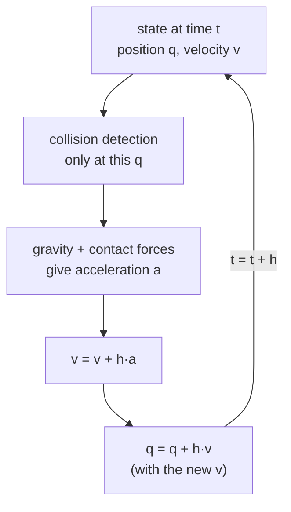

# 02 · Time integration and the timestep

<!-- meta -->
| | |
|---|---|
| **Part** | [1 · Simulation](README.md) |
| **Run type** | CPU · Mac or Colab CPU |
| **Prerequisites** | [01](01-world-as-text.md) |
| **Learn first** | [Calculus for Machine Learning](https://aiengineeringfromscratch.com/lesson?path=phases/01-math-foundations/04-calculus-for-ml) · [Numerical Stability](https://aiengineeringfromscratch.com/lesson?path=phases/01-math-foundations/13-numerical-stability) |
| **Time** | ~30 min |
| **Code** | [`experiments/02-timestep/experiment.py`](../experiments/02-timestep/experiment.py) · [notebook](../notebooks/02-timestep.ipynb) |
| **Status** | ✅ done |
<!-- /meta -->

> A simulator does not let time flow; it jumps by `dt` and looks for contacts only where it lands.

## The problem

Unitree's open training code for its legged robots (Isaac Gym) steps physics at `sim.dt = 0.005` s and lets the policy act every `decimation = 4` steps, i.e. 50 decisions per second ([`legged_robot_config.py`](https://github.com/unitreerobotics/unitree_rl_gym/blob/main/legged_gym/envs/base/legged_robot_config.py)). Why 5 ms and not 20? MuJoCo calls the timestep "the single most important parameter" for the speed–accuracy trade-off ([XML reference · option/timestep](https://mujoco.readthedocs.io/en/stable/XMLreference.html#option)). Here is a concrete failure: a 5 cm cube dropped from 1 m onto a 1 cm tabletop ends up on the floor. The question is which `dt` values cause it, and whether "smaller is always safe" is true.

## Core idea

### In plain words

A simulator works like a strobe light in a dark room. It does not watch a falling cube continuously; it flashes once per timestep, computes where everything is at that instant, and jumps to the next flash. Nothing that happens between two flashes is ever computed.

Collisions are found only at the flashes. If a fast cube is above a thin tabletop at one flash and below it at the next, the engine never sees it touch the table. If a flash catches the cube *inside* the slab, the engine pushes it out through the nearer face, which is the bottom face once the cube's centre is past the middle of the slab. And even when the first touch is caught on the right side, a soft contact can let the cube sink past the middle before it stops, and then it gets pushed out of the bottom.

So the timestep is not only an accuracy knob. Together with the speed of the body and the thickness of the obstacle, it decides whether a contact exists at all.



### One timestep, as code

```python
h = 0.002                          # timestep in seconds (MuJoCo's default)
while t < t_end:
    contacts = detect(q)           # overlaps at THIS position only, never along the path
    a = acceleration(q, v, contacts)   # gravity plus contact forces, divided by mass
    v = v + h * a                  # update the velocity first ...
    q = q + h * v                  # ... then move with the NEW velocity: a jump of v*h
    t = t + h
```

| Quantity | Formula |
|---|---|
| semi-implicit Euler step | $v_{t+h} = v_t + h\,a_t, \qquad q_{t+h} = q_t + h\,v_{t+h}$ |
| distance jumped in one step | $\Delta q = v\,h$ |
| speed after a free fall from height $H$ | $v = \sqrt{2 g H}$ |

$q$ is position, $v$ velocity, $a$ acceleration, $h$ the timestep (`dt`), $t$ time, $g$ gravity and $H$ the drop height.

<details>
<summary>Math details: why "semi-implicit", and what an integrator can and cannot fix</summary>

**Discretizing.** Physics is a differential equation, $\dot q = v$, $\dot v = a(q, v)$. An integrator replaces it with a rule that jumps from $t$ to $t + h$. MuJoCo computes accelerations in continuous time, then integrates ([Computation · Numerical integration](https://mujoco.readthedocs.io/en/stable/computation/index.html#geintegration)).

**Explicit vs semi-implicit Euler.** Explicit Euler moves with the *old* velocity, $q_{t+h} = q_t + h v_t$. Semi-implicit Euler, MuJoCo's default `Euler`, moves with the *new* one. The difference shows on a spring, $a = -\omega^2 q$. Explicit Euler multiplies the oscillation amplitude by $\sqrt{1 + h^2\omega^2} > 1$ every step, so it gains energy at any $h$. For semi-implicit Euler the step matrix has determinant 1, and its eigenvalues stay on the unit circle as long as $h\omega < 2$: the oscillation neither grows nor decays. Beyond $h\omega = 2$ it blows up. That limit returns in [lessons 03](03-contact.md) and [05](05-joints-and-actuators.md).

**What integrators change.** The other integrators treat more of the force terms implicitly (solved at the new state) or use several force evaluations per step (RK4). That helps with stiff damping and smooth motion. None of them adds continuous collision detection: contacts are still found only at sampled states.

**Why the mid-plane matters.** For a thin slab, the shortest way out of the overlap is downward once the cube's centre is past the slab's mid-plane, and the measured contact normal flips exactly there (items 2 and 3 under Observe below).

Go deeper: [Calculus for Machine Learning](https://aiengineeringfromscratch.com/lesson?path=phases/01-math-foundations/04-calculus-for-ml), [Numerical Stability](https://aiengineeringfromscratch.com/lesson?path=phases/01-math-foundations/13-numerical-stability) (AIEFS); [MuJoCo Computation · Integrators](https://mujoco.readthedocs.io/en/stable/computation/index.html#geintegrators).

</details>

### Contact is checked only at the steps

Three things can go wrong for a fast body and a thin obstacle:

| Failure | Condition | Result |
|---|---|---|
| missed contact | no step lands in overlap | the engine never sees the table |
| wrong-side overlap | first overlap already past the slab's mid-plane | the box–box contact normal points *down*; the solver pushes the cube through |
| too-soft contact | contact seen on the right side, but the soft constraint lets the cube sink past the mid-plane | the normal flips during the impact |

The *contact normal* is the direction along which the contact pushes. The third failure is not a timestep problem at all; it is set by `solref`, the contact's softness ([lesson 03](03-contact.md)).

### Integrators

An *integrator* is the rule that turns accelerations into the next velocity and position. "Implicit" means a force term is evaluated at the new, unknown state (which costs a linear solve but tolerates stiff forces); "explicit" means it is evaluated at the current state.

| `integrator` | What is implicit | What it improves |
|---|---|---|
| `Euler` (default) | joint damping only | cheapest; the docs keep it for compatibility and recommend `implicitfast` |
| `implicitfast` | all velocity-dependent forces except Coriolis/centrifugal | stiff damping, actuator `kv`, drag |
| `implicit` | the same plus Coriolis/centrifugal (LU solve) | coupled rotating chains (multi-link pendula) |
| `RK4` | none; 4th-order multi-stage | accuracy of smooth motion, 4 force evaluations per step |
| `discrete` | velocity *and* position stiffness, solved together with constraints | stiff springs and position servos far beyond the explicit limit |

Source: [Computation · Integrators](https://mujoco.readthedocs.io/en/stable/computation/index.html#geintegrators), [option/integrator](https://mujoco.readthedocs.io/en/stable/XMLreference.html#option-integrator). Whether the choice matters for the falling cube is measured below.

## Experiment

Scene: floor, a 24 × 24 × 1 cm tabletop with its top at 30 cm (mid-plane 29.5 cm), and a 5 cm, 100 g cube whose bottom face starts 97.5 cm above the tabletop.

```python
XML = """
<mujoco>
  <worldbody>
    <geom name="floor" type="plane" size="2 2 0.1"/>
    <geom name="table" type="box" size="0.12 0.12 0.005" pos="0 0 0.295"/>
    <body name="cube" pos="0 0 1.30">
      <freejoint/>
      <geom type="box" size="0.025 0.025 0.025" mass="0.1"/>
    </body>
  </worldbody>
</mujoco>"""

m = mujoco.MjModel.from_xml_string(XML)
m.opt.timestep = dt_ms / 1000          # <- the swept number
```

For each `dt` the script records the cube centre at the first step that overlaps the tabletop (the step where the engine could first create a contact), whether any table contact was found, the lowest centre during the impact, and the final result. It repeats the sweep with a stiffer contact, `solref="0.005 1"` on both geoms (the contact uses the average of the two geoms' values; for `dt` above 2.5 ms the solver raises 0.005 to 2·`dt`, see [lesson 03](03-contact.md)).

**Predict.** Impact speed is $\sqrt{2 \cdot 9.81 \cdot 0.975}$ = 4.37 m/s, so a step covers 0.87 cm at 2 ms and 4.37 cm at 10 ms. Where does the cube go through?

**Run.** [`experiment.py`](../experiments/02-timestep/experiment.py), MuJoCo 3.17.0, NumPy 2.5.4, Apple M5, deterministic; output in [`output.txt`](../experiments/02-timestep/output.txt).

| dt (ms) | step (cm) | centre at 1st overlap (cm) | contact seen | lowest centre (cm) | default `solref` | `solref 0.005 1` |
|---|---|---|---|---|---|---|
| 0.5 | 0.22 | 32.32 | yes | — | **through** | stayed |
| 1 | 0.44 | 32.21 | yes | — | **through** | stayed |
| 2 | 0.87 | 31.99 | yes | 29.60 | stayed | stayed |
| 3 | 1.31 | 31.34 | yes | — | **through** | stayed |
| 4 | 1.75 | 32.43 | yes | 30.54 | stayed | stayed |
| 6 | 2.62 | 32.00 | yes | 30.84 | stayed | stayed |
| 8 | 3.50 | 29.80 | yes | 29.65 | stayed | stayed |
| 10 | 4.37 | **28.47** | yes | — | **through** | **through** |
| 12 | 5.25 | 30.69 | yes | 30.69 | stayed | stayed |
| 15 | 6.56 | **27.36** | yes | — | **through** | **through** |
| 20 | 8.75 | 30.72 | yes | 30.72 | stayed | stayed |
| 25, 30, 40, 50 | 10.93–21.87 | — | **no** | — | **through** | **through** |


**Observe.** All three failure modes appear:

1. **Missed contact, ≥ 25 ms.** No step lands in overlap; no contact is ever generated.
2. **Wrong-side overlap, 10 and 15 ms.** The first overlapping step already has the centre below 29.5 cm. At 10 ms the first table contact (t = 0.460 s) is 1.97 cm deep and the normal acting on the cube has z = −1.00: correct force magnitude, wrong direction. A stiffer contact cannot help.
3. **Too-soft contact, 0.5, 1 and 3 ms.** The first overlap is on the correct side; at 1 ms the first contact (t = 0.447 s) is 0.29 cm deep with normal z = +1.00. The default soft contact still lets the 4.37 m/s cube sink: at t = 0.463 s its centre reaches 29.49 cm, just below the mid-plane (about 3 cm of penetration into a 1 cm slab), the normal flips to point down, and the cube falls through. Even the surviving 2 ms run bottoms out at 29.60 cm, 0.1 cm from flipping. With `solref="0.005 1"` every one of these stays.

The result is not monotonic in `dt`: "smaller is safer" fails at 0.5 and 1 ms, "a step thinner than the slab is safe" fails at 3 ms, and 12 and 20 ms survive by the luck of where the last contact-free step lands.

## Break it

Keep `dt` and change only the integrator (default contact):

| dt | Euler | implicitfast | RK4 | discrete |
|---|---|---|---|---|
| 1 ms | through | through | through | through |
| 2 ms | stayed (29.60) | stayed (29.60) | **through** | **through** |
| 8 ms | stayed (29.65) | stayed (29.65) | **through** | **through** |
| 10 ms | through | through | through | through |
| 25 ms | through | through | through | through |

No integrator rescues any failing case, and RK4 and `discrete` fail two cases that Euler survives. The impact is resolved differently by each method; with the Euler run only 0.1 cm from flipping, that difference decides the outcome. The integrator controls how forces are turned into motion between detections; it does not sweep the path between sampled states, and it does not stiffen a soft contact. Candidate fixes are thicker collision geoms or a stiffer `solref` (which fixed the soft-contact cases above), each checked by a sweep like this one. What integrators *do* fix (stiff damping and stiff position servos) is measured in [lesson 05](05-joints-and-actuators.md).

## On the real robot

- On the SO-101, the Menagerie model already sets `timestep="0.005"` and `integrator="implicitfast"` ([so101.xml](https://github.com/google-deepmind/mujoco_menagerie/blob/f3b6013/robotstudio_so101/so101.xml)). A gripper finger closing at moderate speed on a thin object (a card, a cable) is the same geometry as this cube and slab.
- Procedure: before trusting a grasp in simulation, run the grasp at 5, 2 and 1 ms and compare the final object pose. A result that changes with `dt` is a simulation artefact, not a property of the grasp. **Not yet measured on the real arm**; no real-world counterpart has been compared.
- In RL (reinforcement learning), `decimation` decouples control rate from physics rate: the policy can run at 50 Hz while physics runs at 200 Hz.

## Check yourself

1. **Easy.** Make the tabletop 4 cm thick (`size="0.12 0.12 0.02"`, top face kept at 30 cm). Which failure mode should disappear first, and why?
2. **Medium.** Drop the cube from 3 m. Compute the impact speed, then rerun the sweep. Does the set of failing `dt` values grow or shrink?
3. **Hard.** For each `dt` in 0.5–20 ms, find the largest `solref` timeconst (at dampratio 1) for which the cube stays. Plot it. Explain why it cannot fix 10 and 15 ms.

### Answers

1. The too-soft mode: the centre must now sink below the new mid-plane, 2 cm under the top face instead of 0.5 cm, before the normal can flip. Measure the rest; do not assume it.
2. Impact speed is $\sqrt{2 g h}$ with the new height; faster impacts sink deeper and step further, so expect more failures, then check.
3. At 10 and 15 ms the first overlapping step is already below the mid-plane, so the very first contact points down, whatever its stiffness.

## Takeaways and sources

- Semi-implicit Euler jumps by $v\,h$; contact is detected only at step instants.
- In this scene three failure modes coexist: missed contact (large `dt`), wrong-side overlap (medium `dt`), too-soft contact (any `dt`, fixed by `solref`). The result is not monotonic in `dt`.
- Changing the integrator fixed none of them; validate contact-critical behaviour by sweeping `dt`.

Next: [lesson 03 · Contact: soft constraints, solref and solimp](03-contact.md).

**Sources**
- [MuJoCo XML reference · option](https://mujoco.readthedocs.io/en/stable/XMLreference.html#option): `timestep` (default 0.002), `integrator`.
- [MuJoCo Computation · Numerical integration and Integrators](https://mujoco.readthedocs.io/en/stable/computation/index.html#geintegration).
- [`unitree_rl_gym` · `legged_robot_config.py`](https://github.com/unitreerobotics/unitree_rl_gym/blob/main/legged_gym/envs/base/legged_robot_config.py): `dt = 0.005`, `decimation = 4` (read 2026-10-27).
- [Menagerie · robotstudio_so101](https://github.com/google-deepmind/mujoco_menagerie/tree/f3b6013/robotstudio_so101).
- Our numbers: [`experiments/02-timestep/output.txt`](../experiments/02-timestep/output.txt).
