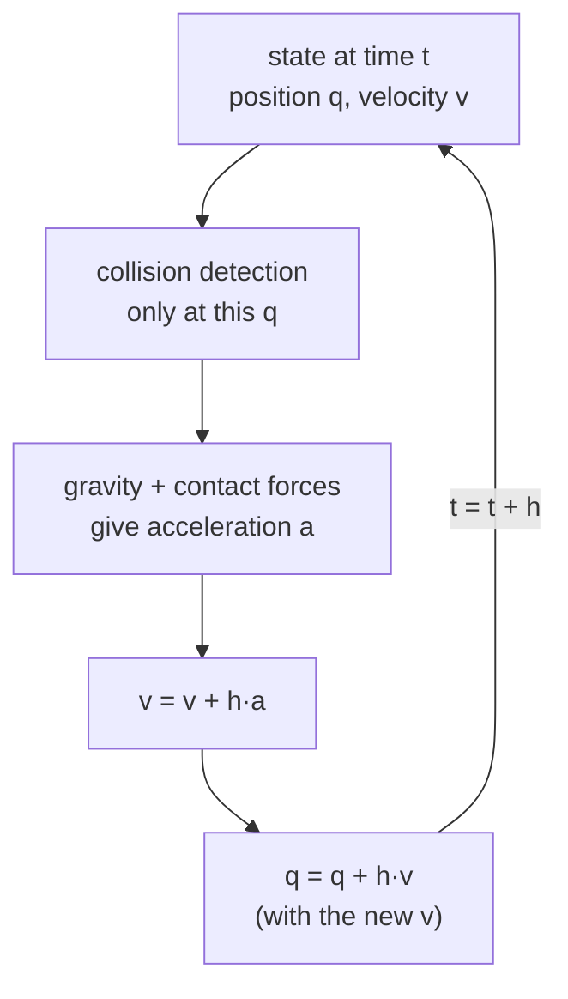

# 02 · Time integration and the timestep

<!-- meta -->
| | |
|---|---|
| **Part** | [1 · Simulation](README.md) |
| **Run type** | CPU · Mac or Colab CPU |
| **Prerequisites** | [01](01-world-as-text.md) |
| **Learn first** | [Calculus for Machine Learning](https://aiengineeringfromscratch.com/lesson?path=phases/01-math-foundations/04-calculus-for-ml) · [Numerical Stability](https://aiengineeringfromscratch.com/lesson?path=phases/01-math-foundations/13-numerical-stability) |
| **Time** | ~30 min |
| **Code** | [`experiments/02-timestep/experiment.py`](../experiments/02-timestep/experiment.py) · [notebook](../notebooks/02-timestep.ipynb) |
| **Status** | ✅ done |
<!-- /meta -->

> A simulator does not let time flow; it jumps by `dt` and looks for contacts only where it lands.

## The problem

Unitree's open training code for its legged robots (Isaac Gym) steps physics at `sim.dt = 0.005` s and lets the policy act every `decimation = 4` steps, i.e. 50 decisions per second ([`legged_robot_config.py`](https://github.com/unitreerobotics/unitree_rl_gym/blob/main/legged_gym/envs/base/legged_robot_config.py)). Why 5 ms and not 20? MuJoCo calls the timestep "the single most important parameter" for the speed–accuracy trade-off ([XML reference · option/timestep](https://mujoco.readthedocs.io/en/stable/XMLreference.html#option)). A concrete failure: a 5 cm cube dropped from 1 m onto a 1 cm tabletop ends up on the floor. Which `dt` values cause it, and is "smaller is always safe" true?

## Core idea

### In plain words

A simulator works like a strobe light in a dark room: it flashes once per timestep, computes where everything is at that instant, and jumps to the next flash. Nothing between two flashes is ever computed.

Collisions are found only at the flashes. A fast cube above a thin tabletop at one flash and below it at the next never touches the table. A flash that catches the cube *inside* the slab pushes it out through the nearer face, the bottom one once the cube's centre is past the middle. And a soft contact can let a cube caught on the right side sink past the middle anyway.

So the timestep is not only an accuracy knob: with the body's speed and the obstacle's thickness, it decides whether a contact exists at all.



### One timestep, as code

```python
h = 0.002                          # timestep in seconds (MuJoCo's default)
while t < t_end:
    contacts = detect(q)           # overlaps at THIS position only, never along the path
    a = acceleration(q, v, contacts)   # gravity plus contact forces, divided by mass
    v = v + h * a                  # update the velocity first ...
    q = q + h * v                  # ... then move with the NEW velocity: a jump of v*h
    t = t + h
```

| Quantity | Formula |
|---|---|
| semi-implicit Euler step | $v_{t+h} = v_t + h\,a_t, \qquad q_{t+h} = q_t + h\,v_{t+h}$ |
| distance jumped in one step | $\Delta q = v\,h$ |
| speed after a free fall from height $H$ | $v = \sqrt{2 g H}$ |

$q$ is position, $v$ velocity, $a$ acceleration, $h$ the timestep (`dt`), $t$ time, $g$ gravity and $H$ the drop height.

<details>
<summary>Math details: why "semi-implicit", and what an integrator can and cannot fix</summary>

**Discretizing.** Physics is a differential equation, $\dot q = v$, $\dot v = a(q, v)$. An integrator replaces it with a rule that jumps from $t$ to $t + h$. MuJoCo computes accelerations in continuous time, then integrates ([Computation · Numerical integration](https://mujoco.readthedocs.io/en/stable/computation/index.html#geintegration)).

**Explicit vs semi-implicit Euler.** Explicit Euler moves with the *old* velocity, $q_{t+h} = q_t + h v_t$; semi-implicit Euler, MuJoCo's `Euler`, with the *new* one. On a spring, $a = -\omega^2 q$, explicit Euler multiplies the amplitude by $\sqrt{1 + h^2\omega^2} > 1$ every step, gaining energy at any $h$. Semi-implicit Euler's step matrix has determinant 1 and eigenvalues on the unit circle while $h\omega < 2$; beyond that it blows up (Build it, Step 3; again in [lessons 03](03-contact.md) and [05](05-joints-and-actuators.md)).

**What integrators change.** The others treat more force terms implicitly (solved at the new state) or evaluate forces several times per step (RK4). That helps stiff damping and smooth motion; none adds continuous collision detection.

**Why the mid-plane matters.** For a thin slab, the shortest way out of the overlap is downward once the cube's centre is past the slab's mid-plane, and the measured contact normal flips exactly there (items 2 and 3 under Observe below).

Go deeper: [Calculus for Machine Learning](https://aiengineeringfromscratch.com/lesson?path=phases/01-math-foundations/04-calculus-for-ml), [Numerical Stability](https://aiengineeringfromscratch.com/lesson?path=phases/01-math-foundations/13-numerical-stability) (AIEFS); [MuJoCo Computation · Integrators](https://mujoco.readthedocs.io/en/stable/computation/index.html#geintegrators).

</details>

### Contact is checked only at the steps

Three things can go wrong for a fast body and a thin obstacle:

| Failure | Condition | Result |
|---|---|---|
| missed contact | no step lands in overlap | the engine never sees the table |
| wrong-side overlap | first overlap already past the slab's mid-plane | the box–box contact normal points *down*; the solver pushes the cube through |
| too-soft contact | contact seen on the right side, but the soft constraint lets the cube sink past the mid-plane | the normal flips during the impact |

The *contact normal* is the direction the contact pushes along. The third failure is set by `solref`, the contact's softness ([lesson 03](03-contact.md)), not by the timestep.

### Integrators

An *integrator* turns accelerations into the next velocity and position. "Implicit" evaluates a force term at the new, unknown state (a linear solve, but it tolerates stiff forces); "explicit" at the current state.

| `integrator` | What is implicit | What it improves |
|---|---|---|
| `Euler` (default) | joint damping only | cheapest; the docs keep it for compatibility and recommend `implicitfast` |
| `implicitfast` | all velocity-dependent forces except Coriolis/centrifugal | stiff damping, actuator `kv`, drag |
| `implicit` | the same plus Coriolis/centrifugal (LU solve) | coupled rotating chains (multi-link pendula) |
| `RK4` | none; 4th-order multi-stage | accuracy of smooth motion, 4 force evaluations per step |
| `discrete` | velocity *and* position stiffness, solved together with constraints | stiff springs and position servos far beyond the explicit limit |

Source: [Computation · Integrators](https://mujoco.readthedocs.io/en/stable/computation/index.html#geintegrators), [option/integrator](https://mujoco.readthedocs.io/en/stable/XMLreference.html#option-integrator). Whether it matters for the falling cube is measured below.

<!-- figure: 02-timestep-tunnel -->

## Build it

You will now write three integrators, measure where each becomes unstable, and reproduce the Experiment's "centre at 1st overlap" column without a physics engine, in about 50 lines of NumPy. Type the steps into your own file and run it after each step. The finished functions are in [`physai/sim.py`](../physai/sim.py); `uv run python experiments/02-timestep/build.py` runs all four steps with the checks (output in [`build_output.txt`](../experiments/02-timestep/build_output.txt)).

### Step 1 · Three ways to take a step

Each stepper takes the state $(x, v)$, a function `accel(x, v)` and the step $h$, and returns the next state. Explicit Euler moves with the old velocity, semi-implicit Euler (MuJoCo's `Euler`, written in lesson 01) with the new one, and RK4 averages four slopes:

```python
def explicit_euler(x, v, accel, h):
    """Move with the old velocity, then update it."""
    return x + h * v, v + h * accel(x, v)
```

```python
def semi_implicit_euler(x, v, accel, h, c_implicit=0.0):
    """Update the velocity first, then move with the new one (MuJoCo's Euler).

    c_implicit: damping per unit inertia treated implicitly, v' = v + h a / (1 + h c), as MuJoCo's
    Euler does for joint damping and implicitfast for every velocity-dependent force (lesson 05).
    """
    v_new = v + h * accel(x, v) / (1 + h * c_implicit)
    return x + h * v_new, v_new
```

```python
def rk4(x, v, accel, h):
    """Classic fourth-order Runge-Kutta on (x, v): four force evaluations per step."""
    k1x, k1v = v, accel(x, v)
    k2x, k2v = v + h / 2 * k1v, accel(x + h / 2 * k1x, v + h / 2 * k1v)
    k3x, k3v = v + h / 2 * k2v, accel(x + h / 2 * k2x, v + h / 2 * k2v)
    k4x, k4v = v + h * k3v, accel(x + h * k3x, v + h * k3v)
    return (x + h / 6 * (k1x + 2 * k2x + 2 * k3x + k4x),
            v + h / 6 * (k1v + 2 * k2v + 2 * k3v + k4v))
```

The test bed is a 1 kg mass on a 1 Hz spring, $a = -\omega^2 x$ with $\omega = 2\pi$ rad/s, built in MuJoCo as a slide joint with `stiffness` = $\omega^2$:

```text
== Step 1. Our steppers vs mj_step on a 1 Hz spring (h = 10 ms, 500 steps) ==
semi_implicit_euler  vs integrator=Euler: max |x_ours - qpos| = 5.6e-17 m
rk4                  vs integrator=RK4  : max |x_ours - qpos| = 4.8e-16 m
explicit_euler: no MuJoCo integrator moves with the old velocity; checked against its formula in Step 2
```

### Step 2 · Energy

A spring should keep its energy $\tfrac12 v^2 + \tfrac12\omega^2 x^2$ forever. After 1000 steps at a comfortable $h\omega$ = 0.063:

```text
== Step 2. Energy after 1000 steps, relative to the start (h = 10 ms, h*w = 0.063) ==
explicit_euler       E/E0 = 51.422174
semi_implicit_euler  E/E0 = 0.999350
rk4                  E/E0 = 0.999999
formula for explicit Euler (1 + h^2 w^2)^n = 51.422174
```

Explicit Euler multiplies the energy by exactly $1 + h^2\omega^2$ per step (Math details): 51 times after ten seconds. Semi-implicit Euler wobbles around the right value without drift; RK4 loses a little.

### Step 3 · The stability limit

Each stepper on a linear force is a 2 × 2 matrix acting on $(x, v)$. Apply one step to $(1, 0)$ and $(0, 1)$ to get its columns; its largest |eigenvalue| is the growth per step:

```python
def step_growth(step, h, k, c=0.0, **kw):
    """Largest |eigenvalue| of one step on a = -k x - c v: above 1, every step amplifies the motion."""
    accel = lambda x, v: -k * x - c * v                # noqa: E731
    cols = [step(x, v, accel, h, **kw) for x, v in ((1.0, 0.0), (0.0, 1.0))]
    return np.abs(np.linalg.eigvals(np.array(cols).T)).max()
```

```text
== Step 3. Growth per step on the undamped spring vs h*w ==
  h*w  explicit_euler  semi_implicit        rk4   max |x| over 10 steps: ours (semi-implicit) / MuJoCo Euler
  0.5        1.118034       1.000000   0.999895   0.1022 m / 0.1022 m (started at 0.1)
  1.0        1.414214       1.000000   0.993905   0.1 m / 0.1 m (started at 0.1)
  1.9        2.147091       1.000000   0.800899   0.3202 m / 0.3202 m (started at 0.1)
  2.1        2.325941       1.877328   0.682240   116.4 m / 116.4 m (started at 0.1)
  2.8        2.973214       5.663429   0.930667   4.123e+06 m / 4.123e+06 m (started at 0.1)
  2.9        3.067572       6.250000   1.193063   1.083e+07 m / 1.083e+07 m (started at 0.1)
```

Semi-implicit Euler is exactly neutral (1.000000) up to $h\omega = 2$ and explodes beyond it, in your code and in MuJoCo alike, step for step. Below the limit the orbit is bounded but distorted: at $h\omega$ = 1.9 the mass swings to 0.32 m from a 0.1 m start. Explicit Euler grows at every $h$. RK4 damps slightly, holds at $h\omega$ = 2.8 and fails at 2.9. This is the $h\omega < 2$ that lessons 03 and 05 meet as contact stiffness and servo gain.

### Step 4 · The first overlapping step

Before the first overlap there is no contact, so free fall with your stepper predicts where the cube lands relative to the slab:

```python
def first_overlap(z0, h, top, bottom, half, g=9.81):
    """Free fall with MuJoCo's Euler from rest at z0: centre height at the first step a cube of half-size
    `half` overlaps a slab between `bottom` and `top`, or None if a step jumps over the slab."""
    z, v = z0, 0.0
    while z + half > bottom:
        z, v = semi_implicit_euler(z, v, lambda x, u: -g, h)
        if z - half < top and z + half > bottom:
            return z
    return None
```

```text
== Step 4. Drop onto the 1 cm tabletop: centre at the first overlapping step (cm) ==
dt (ms)     ours   MuJoCo  side of the mid-plane (29.5 cm)
    0.5    32.32    32.32  above
      1    32.21    32.21  above
      2    31.99    31.99  above
      3    31.34    31.34  above
      4    32.43    32.43  above
      6    32.00    32.00  above
      8    29.80    29.80  above
     10    28.47    28.47  below: pushed out downward
     12    30.69    30.69  above
     15    27.36    27.36  below: pushed out downward
     20    30.72    30.72  above
     25        -        -  no step overlaps: missed contact
     30        -        -  no step overlaps: missed contact
     40        -        -  no step overlaps: missed contact
     50        -        -  no step overlaps: missed contact
```

The Experiment's column, every row, including the wrong-side overlaps (10, 15 ms) and the four timesteps that jump over the slab. What happens *after* the first overlap needs lesson 03's contact model.

### What you keep

`physai.sim` now has `explicit_euler`, `semi_implicit_euler`, `rk4`, `step_growth` and `first_overlap`. Lesson 03 runs `step_growth` on the contact spring, lesson 05 on a position servo. [`tests/test_02_timestep.py`](../tests/test_02_timestep.py) pins them to MuJoCo; run `uv run pytest tests/test_02_timestep.py` after you change anything.

## Use it

In MuJoCo the timestep and the integrator are two fields of `m.opt`, and `mj_step` applies them:

```python
m.opt.timestep = 0.005
m.opt.integrator = mujoco.mjtIntegrator.mjINT_IMPLICITFAST   # or mjINT_EULER, mjINT_RK4, ...
for _ in range(n_substeps):          # physics steps per control decision
    mujoco.mj_step(m, d)
```

Tools split "physics step" and "control step" under different names:

| Tool | Physics step | Control step |
|---|---|---|
| MuJoCo | `m.opt.timestep` | your loop: how many `mj_step` calls per action |
| Gymnasium MuJoCo envs | `model.opt.timestep` | `frame_skip` steps per `env.step()`; `env.dt = timestep * frame_skip` |
| `legged_gym` (The problem) | `sim.dt` = 0.005 s | `decimation` = 4 physics steps per action |
| SciPy `solve_ivp` | adaptive, `method="RK45"` by default | – (not a control loop) |

Traps:

- **"Euler" is semi-implicit.** MuJoCo's `Euler` matches `semi_implicit_euler`, not the textbook method (Step 1).
- **Split stepping ignores RK4.** With `integrator="RK4"`, `mj_step1` followed by `mj_step2` (the split used to set controls mid-step) reproduces `semi_implicit_euler`, not `rk4`: we checked it on the Step 1 spring.
- **`env.dt` is not the timestep.** A Gymnasium policy acts every `frame_skip` physics steps; a rate computed from `model.opt.timestep` alone is off by that factor.

## Experiment

Scene: floor, a 24 × 24 × 1 cm tabletop with its top at 30 cm (mid-plane 29.5 cm), and a 5 cm, 100 g cube starting 97.5 cm above it.

```python
XML = """
<mujoco>
  <worldbody>
    <geom name="floor" type="plane" size="2 2 0.1"/>
    <geom name="table" type="box" size="0.12 0.12 0.005" pos="0 0 0.295"/>
    <body name="cube" pos="0 0 1.30">
      <freejoint/>
      <geom type="box" size="0.025 0.025 0.025" mass="0.1"/>
    </body>
  </worldbody>
</mujoco>"""

m = mujoco.MjModel.from_xml_string(XML)
m.opt.timestep = dt_ms / 1000          # <- the swept number
```

For each `dt` the script records the cube centre at the first step that overlaps the tabletop (where a contact can first appear), whether any table contact was found, the lowest centre during the impact, and the result. It repeats the sweep with a stiffer contact, `solref="0.005 1"` on both geoms (the contact uses the average of the two geoms' values; for `dt` above 2.5 ms the solver raises 0.005 to 2·`dt`, see [lesson 03](03-contact.md)).

**Predict.** Impact speed is $\sqrt{2 \cdot 9.81 \cdot 0.975}$ = 4.37 m/s, so a step covers 0.87 cm at 2 ms and 4.37 cm at 10 ms. Where does the cube go through?

**Run.** [`experiment.py`](../experiments/02-timestep/experiment.py), MuJoCo 3.17.0, NumPy 2.5.4, Apple M5, deterministic; output in [`output.txt`](../experiments/02-timestep/output.txt).

| dt (ms) | step (cm) | centre at 1st overlap (cm) | contact seen | lowest centre (cm) | default `solref` | `solref 0.005 1` |
|---|---|---|---|---|---|---|
| 0.5 | 0.22 | 32.32 | yes | — | **through** | stayed |
| 1 | 0.44 | 32.21 | yes | — | **through** | stayed |
| 2 | 0.87 | 31.99 | yes | 29.60 | stayed | stayed |
| 3 | 1.31 | 31.34 | yes | — | **through** | stayed |
| 4 | 1.75 | 32.43 | yes | 30.54 | stayed | stayed |
| 6 | 2.62 | 32.00 | yes | 30.84 | stayed | stayed |
| 8 | 3.50 | 29.80 | yes | 29.65 | stayed | stayed |
| 10 | 4.37 | **28.47** | yes | — | **through** | **through** |
| 12 | 5.25 | 30.69 | yes | 30.69 | stayed | stayed |
| 15 | 6.56 | **27.36** | yes | — | **through** | **through** |
| 20 | 8.75 | 30.72 | yes | 30.72 | stayed | stayed |
| 25, 30, 40, 50 | 10.93–21.87 | — | **no** | — | **through** | **through** |


**Observe.** All three failure modes appear:

1. **Missed contact, ≥ 25 ms.** No step lands in overlap; no contact is ever generated.
2. **Wrong-side overlap, 10 and 15 ms.** The first overlapping step already has the centre below 29.5 cm. At 10 ms the first table contact (t = 0.460 s) is 1.97 cm deep and the normal acting on the cube has z = −1.00: correct force magnitude, wrong direction. A stiffer contact cannot help.
3. **Too-soft contact, 0.5, 1 and 3 ms.** The first overlap is on the correct side; at 1 ms the first contact (t = 0.447 s) is 0.29 cm deep with normal z = +1.00. The soft contact still lets the 4.37 m/s cube sink: at t = 0.463 s its centre reaches 29.49 cm, just below the mid-plane (about 3 cm into a 1 cm slab), the normal flips and the cube falls through. The surviving 2 ms run bottoms out at 29.60 cm, 0.1 cm from flipping. With `solref="0.005 1"` all of these stay.

The result is not monotonic in `dt`: "smaller is safer" fails at 0.5 and 1 ms, "a step thinner than the slab is safe" at 3 ms, and 12 and 20 ms survive by the luck of where the last contact-free step lands (Build it, Step 4 predicts those landing points).

## Break it

Keep `dt` and change only the integrator (default contact):

| dt | Euler | implicitfast | RK4 | discrete |
|---|---|---|---|---|
| 1 ms | through | through | through | through |
| 2 ms | stayed (29.60) | stayed (29.60) | **through** | **through** |
| 8 ms | stayed (29.65) | stayed (29.65) | **through** | **through** |
| 10 ms | through | through | through | through |
| 25 ms | through | through | through | through |

No integrator rescues any failing case, and RK4 and `discrete` fail two cases that Euler survives: each resolves the impact differently, and with the Euler run only 0.1 cm from flipping, that difference decides. The integrator turns forces into motion between detections; it does not sweep the path between sampled states or stiffen a soft contact. Candidate fixes are thicker collision geoms or a stiffer `solref`, each checked by a sweep like this one. What integrators *do* fix (stiff damping, stiff servos) is measured in [lesson 05](05-joints-and-actuators.md).

## On the real robot

- The Menagerie SO-101 sets `timestep="0.005"` and `integrator="implicitfast"` ([so101.xml](https://github.com/google-deepmind/mujoco_menagerie/blob/f3b6013/robotstudio_so101/so101.xml)). A gripper finger closing on a thin object (a card, a cable) is the same geometry as this cube and slab.
- Procedure: before trusting a grasp in simulation, run the grasp at 5, 2 and 1 ms and compare the final object pose. A result that changes with `dt` is a simulation artefact, not a property of the grasp. **Not yet measured on the real arm**; no real-world counterpart has been compared.
- In RL (reinforcement learning), `decimation` decouples control rate from physics rate: the policy can run at 50 Hz while physics runs at 200 Hz.

## Check yourself

1. **Easy.** Make the tabletop 4 cm thick (`size="0.12 0.12 0.02"`, top face kept at 30 cm). Which failure mode should disappear first, and why?
2. **Medium.** Drop the cube from 3 m. Compute the impact speed, then rerun the sweep. Does the set of failing `dt` values grow or shrink?
3. **Hard.** For each `dt` in 0.5–20 ms, find the largest `solref` timeconst (at dampratio 1) for which the cube stays. Plot it. Explain why it cannot fix 10 and 15 ms.

### Answers

1. The too-soft mode: the centre must now sink 2 cm below the top face instead of 0.5 cm before the normal can flip. Measure the rest.
2. Impact speed is $\sqrt{2 g h}$ with the new height; faster impacts sink deeper and step further. `first_overlap` from Build it predicts the new first-overlap column before you run anything.
3. At 10 and 15 ms the first overlapping step is already below the mid-plane, so the very first contact points down, whatever its stiffness.

## Takeaways and sources

- Semi-implicit Euler jumps by $v\,h$; contact is detected only at step instants.
- In this scene three failure modes coexist: missed contact (large `dt`), wrong-side overlap (medium `dt`), too-soft contact (any `dt`, fixed by `solref`). The result is not monotonic in `dt`.
- Changing the integrator fixed none of them; validate contact-critical behaviour by sweeping `dt`.

Next: [lesson 03 · Contact: soft constraints, solref and solimp](03-contact.md).

**Sources**
- [MuJoCo XML reference · option](https://mujoco.readthedocs.io/en/stable/XMLreference.html#option): `timestep` (default 0.002), `integrator`.
- [MuJoCo Computation · Numerical integration and Integrators](https://mujoco.readthedocs.io/en/stable/computation/index.html#geintegration).
- [`unitree_rl_gym` · `legged_robot_config.py`](https://github.com/unitreerobotics/unitree_rl_gym/blob/main/legged_gym/envs/base/legged_robot_config.py): `dt = 0.005`, `decimation = 4` (read 2026-10-27).
- [Menagerie · robotstudio_so101](https://github.com/google-deepmind/mujoco_menagerie/tree/f3b6013/robotstudio_so101).
- Gymnasium `MujocoEnv` source (`dt = model.opt.timestep * frame_skip`), version 1.4.0.
- Our numbers: [`experiments/02-timestep/output.txt`](../experiments/02-timestep/output.txt), [`build_output.txt`](../experiments/02-timestep/build_output.txt).
