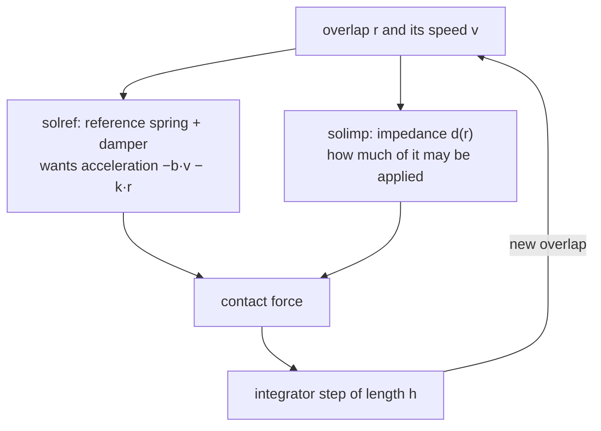

# 03 · Contact: soft constraints, solref and solimp

<!-- meta -->
| | |
|---|---|
| **Part** | [1 · Simulation](README.md) |
| **Run type** | CPU · Mac or Colab CPU |
| **Prerequisites** | [02](02-timestep.md) |
| **Learn first** | [Numerical Stability](https://aiengineeringfromscratch.com/lesson?path=phases/01-math-foundations/13-numerical-stability) |
| **Time** | ~40 min |
| **Code** | [`experiments/03-contact/experiment.py`](../experiments/03-contact/experiment.py) |
| **Status** | ✅ done |
<!-- /meta -->

> MuJoCo contact is a stiff, damped virtual spring: you choose how soft it is, and the timestep decides whether it stays stable.

## The problem

In [lesson 02](02-timestep.md) a cube went through a 1 cm tabletop even at `dt` = 1 ms: the contact was detected on the right side, but it let the cube sink about 3 cm. Every MuJoCo contact interpenetrates a little. The Menagerie SO-101 sets its own gripper contact parameters (`solref="0.01 1"`, `condim="6"`), values its README describes as working well for manipulation ([so101.xml](https://github.com/google-deepmind/mujoco_menagerie/blob/f3b6013/robotstudio_so101/so101.xml), [README](https://github.com/google-deepmind/mujoco_menagerie/tree/f3b6013/robotstudio_so101)). This lesson measures what those two numbers do: how deep a resting cube sinks, how high a dropped cube bounces, and what happens when the contact is stiffer than the timestep can integrate.

## Core idea

### In plain words

Real objects cannot overlap. Forbidding every overlap exactly would mean a hard, jumpy problem at every step, so MuJoCo does something softer: when two shapes overlap, it puts an invisible spring with a shock absorber between them. The deeper the overlap, the harder it pushes back. Objects always sink in a little, and you choose how much.

Two knobs describe that spring. `solref` says how fast it undoes an overlap (its *time constant*: small = stiff) and how strongly it is damped (its *damping ratio*: below 1 it bounces). `solimp` says how much of the spring's push the solver may apply (the *impedance*, between 0 and 1, rising with depth).

The catch is time. A spring that undoes an overlap in less than about two timesteps overshoots on every step and gains energy. That is why MuJoCo quietly refuses time constants shorter than two timesteps.



### The contact spring, as code

```python
def solref_to_spring(timeconst, dampratio, d, d_w):
    b = 2 / (d_w * timeconst)                         # damping of the reference spring (1/s)
    k = d / (d_w**2 * timeconst**2 * dampratio**2)    # stiffness of the reference spring (1/s²)
    return b, k

# What the solver aims for on one contact:  a1 + d * (b * v + k * r) == (1 - d) * a_u
# At rest a1 = v = 0: the resting penetration (Build it, Step 3 solves it exactly)
timeconst_used = max(timeconst, 2 * h)     # the refsafe guard (h = timestep)
```

| Quantity | Formula |
|---|---|
| soft constraint (one contact) | $a_1 + d\,(b\,v + k\,r) = (1 - d)\,a_u$ |
| reference spring from `solref` | $b = \dfrac{2}{d_w\,\text{timeconst}}, \quad k = \dfrac{d(r)}{d_w^2\,\text{timeconst}^2\,\text{dampratio}^2}$ |
| resting penetration | $r = (1-d)\,a_u\,\Big(\dfrac{d_w}{d}\Big)^2\,\text{timeconst}^2\,\text{dampratio}^2$ |
| spring frequency | $\omega = 1/(\text{timeconst}\cdot\text{dampratio})$ |
| stability guard (`refsafe`) | timeconst used $= \max(\text{timeconst}, 2h)$ |

$r$ is the penetration (how far the shapes overlap), $v$ its rate of change, $a_u$ the acceleration the body would have without the contact (gravity, here $g$), and $a_1$ the acceleration the solver produces along the contact normal. $d \in (0,1)$ is the impedance from `solimp`: it rises from $d_0$ at $r = 0$ to $d_w$ at $r$ = width along a smooth S-curve. timeconst and dampratio are the two `solref` numbers, $k$ and $b$ the stiffness and damping they imply, $\omega$ the spring's natural frequency and $h$ the timestep.

<details>
<summary>Math details: resting penetration, the refsafe guard and its gap</summary>

**Resting penetration.** At rest $a_1 = v = 0$, so $d\,k\,r = (1-d)\,a_u$; substituting $k$ gives the table's formula ([Modeling · Solver parameters](https://mujoco.readthedocs.io/en/stable/modeling.html#csolver)). With constant impedance ($d = d_w$) it becomes the docs' $r = a_u (1-d)\,\text{timeconst}^2\,\text{dampratio}^2$. Penetration grows with timeconst²: twice as soft sinks four times as deep. Because $d$ depends on $r$, the exact value is where both relations agree (Build it, Step 3).

**Why `refsafe` exists.** The docs state that timeconst should be at least twice the timestep, otherwise the system becomes too stiff for the integrator and can go unstable; MuJoCo enforces this unless the `refsafe` flag is disabled ([Reference](https://mujoco.readthedocs.io/en/stable/modeling.html#csolverreference), [option/flag/refsafe](https://mujoco.readthedocs.io/en/stable/XMLreference.html#option-flag-refsafe)). It is the step-size limit of [lesson 02](02-timestep.md) applied to the contact spring; Build it, Step 4 computes where it sits.

**The gap in the guard.** "Time constant" here is the inverse of natural frequency times damping ratio, so $\omega = 1/(\text{timeconst}\cdot\text{dampratio})$. `refsafe` clamps timeconst, not the product. A small dampratio therefore raises $\omega$ past the limit even with the guard on. (That holds for `Euler`, `implicitfast`, `implicit` and `RK4`; under `discrete`, `refsafe` instead replaces rows with timeconst·dampratio < $h$, see [option/flag/refsafe](https://mujoco.readthedocs.io/en/stable/XMLreference.html#option-flag-refsafe).)

**Two geoms, one contact.** When two geoms touch, their `solref`/`solimp` are averaged (weights `solmix`) unless one has higher `priority`; margins and gaps are summed ([Contact parameters](https://mujoco.readthedocs.io/en/stable/modeling.html#ccontact)).

Go deeper: [Numerical Stability](https://aiengineeringfromscratch.com/lesson?path=phases/01-math-foundations/13-numerical-stability) (AIEFS: why explicit integration of a stiff spring blows up); [MuJoCo Modeling · Solver parameters](https://mujoco.readthedocs.io/en/stable/modeling.html#csolver).

</details>

### Contact attributes

| Attribute | Numbers (default) | Meaning |
|---|---|---|
| `solref` | `timeconst dampratio` (`0.02 1`) | the reference spring above. Larger timeconst = softer. Negative values = direct `-stiffness -damping` |
| `solimp` | `d0 dw width midpoint power` (`0.9 0.95 0.001 0.5 2`) | $d(r)$ rises from $d_0$ at $r = 0$ to $d_w$ at $r$ = width (1 mm) along a sigmoid |
| `margin` | 0 | contact becomes active (forces) at distance < margin |
| `gap` | 0 | contacts between margin and margin + gap are reported but produce no force |
| `condim` | 3 | 1 frictionless · 3 sliding friction · 4 + torsional · 6 + rolling |

Sources: [Reference (solref)](https://mujoco.readthedocs.io/en/stable/modeling.html#csolverreference), [Impedance (solimp)](https://mujoco.readthedocs.io/en/stable/modeling.html#csolverimpedance), [geom/condim](https://mujoco.readthedocs.io/en/stable/XMLreference.html#body-geom-condim), [margin and gap](https://mujoco.readthedocs.io/en/stable/computation/index.html#comargingap). `condim` is the number of force directions a contact can use: 1 is a pure push along the normal, 3 adds sliding friction in two directions, 4 and 6 add twisting and rolling resistance.

<!-- figure: 03-contact-spring -->

## Build it

You will now write MuJoCo's contact law for one contact in about 50 lines of NumPy, drop a sphere with it, and check each step against MuJoCo's constraint data. The body is the Experiment's single-contact sphere (5 cm radius, 1 kg, `dt` = 2 ms) with `condim="1"`, so one contact is exactly one constraint row. Type the steps into your own file and run it after each step. The finished functions are in [`physai/sim.py`](../physai/sim.py); `uv run python experiments/03-contact/build.py` runs all four steps with the checks (output in [`build_output.txt`](../experiments/03-contact/build_output.txt)).

### Step 1 · The two knobs as numbers

`solimp` becomes the impedance $d(r)$: two power curves that meet at `midpoint` and climb from $d_0$ to $d_w$ over `width`. `solref` becomes the reference spring's stiffness $K$ and damping $B$, with the `refsafe` guard built in:

```python
def impedance(r, solimp):
    """MuJoCo's impedance d(r) for penetration r >= 0: d0 at r = 0 rising to dwidth at r = width."""
    d0, dw, width, mid, power = solimp
    x = min(r / width, 1.0)
    if x >= 1.0:
        return dw
    if x <= mid:                                       # two power curves joined at the midpoint
        y = x**power / mid ** (power - 1)
    else:
        y = 1 - (1 - x) ** power / (1 - mid) ** (power - 1)
    return d0 + y * (dw - d0)
```

```python
def solref_kb(solref, dmax, h, refsafe=True):
    """Stiffness K and damping B of the reference spring, as MuJoCo stores them (efc_KBIP[:, :2])."""
    timeconst, dampratio = solref
    if refsafe:
        timeconst = max(timeconst, 2 * h)              # the guard: never stiffer than two timesteps
    return 1 / (dmax**2 * timeconst**2 * dampratio**2), 2 / (dmax * timeconst)
```

MuJoCo stores $K$, $B$ and $d$ of every active constraint row in `d.efc_KBIP` after `mj_forward`:

```text
== Step 1. Impedance and reference spring vs efc_KBIP (sphere placed at penetration r) ==
timeconst  r (mm)   d ours  d MuJoCo     K ours   K MuJoCo   B ours  B MuJoCo
    0.001     0.5   0.9250    0.9250    69252.1    69252.1   526.32    526.32
    0.004     0.5   0.9250    0.9250    69252.1    69252.1   526.32    526.32
    0.020     0.2   0.9040    0.9040     2770.1     2770.1   105.26    105.26
    0.020     0.5   0.9250    0.9250     2770.1     2770.1   105.26    105.26
    0.020     2.0   0.9500    0.9500     2770.1     2770.1   105.26    105.26
    0.100     0.5   0.9250    0.9250      110.8      110.8    21.05     21.05
```

$K$ is the table's $k$ without its factor $d(r)$; MuJoCo applies $d$ when it builds the reference acceleration. Rows 1 and 2 are identical: timeconst 0.001 s was raised to $2h$ = 0.004 s.

### Step 2 · One contact, one drop

The reference acceleration is $a_\text{ref} = -B v - K d\,(\text{dist})$, with dist < 0 while penetrating. The solver blends it with the free acceleration $a_0$ through the impedance and never lets the contact pull:

```python
def contact_accel(dist, vel, a0, solref, solimp, h, refsafe=True):
    """Normal acceleration of one frictionless contact (dist < 0 = penetrating, a0 = acceleration without it)."""
    if dist >= 0:
        return a0
    d = impedance(-dist, solimp)
    k, b = solref_kb(solref, solimp[1], h, refsafe)
    a_ref = -b * vel - k * d * dist                    # what the reference spring-damper asks for
    return max(a0, (1 - d) * a0 + d * a_ref)           # a contact can push, never pull
```

Plug it into lesson 02's `semi_implicit_euler` as `accel` and drop the sphere from 10 cm:

```text
== Step 2. One contact by hand vs MuJoCo ==
at r = 0.5 mm, v = -0.3 m/s: a_ref ours 32.860111 m/s^2 · efc_aref 32.860111 m/s^2
10 cm drop, 2 s:   peak penetration (mm)   rebound (mm)   max |z_ours - z_mujoco| (m)
dampratio 1.0:           8.726           0.000            2.4e-13
dampratio 0.3:           4.859          14.519            1.4e-13
dampratio 0.1:           2.282          57.912            8.7e-12
```

Your 1-D sphere follows MuJoCo's to 1e-11 m or better: for one frictionless contact, the constraint solver reduces to these lines. The Experiment's cube sinks less (8.283 mm at dampratio 1): four corner contacts share its weight.

### Step 3 · Resting penetration

At rest $a_1 = v = 0$, so the constraint reads $d\,k\,r = (1-d)\,a_u$; because $d$ depends on $r$, solve it by bisection:

```python
def resting_penetration(a_u, solref, solimp, h):
    """Penetration where the contact holds a body still: d k r = (1 - d) a_u, solved for r by bisection."""
    def excess(r):                                     # > 0 once the spring pushes more than needed
        d = impedance(r, solimp)
        k, _ = solref_kb(solref, solimp[1], h)
        return d * d * k * r - (1 - d) * a_u
    lo, hi = 0.0, 1.0
    for _ in range(200):
        mid = (lo + hi) / 2
        lo, hi = (lo, mid) if excess(mid) > 0 else (mid, hi)
    return (lo + hi) / 2
```

```text
== Step 3. Resting penetration: bisection on d k r = (1 - d) a_u vs the resting sphere (mm) ==
timeconst     ours  MuJoCo, 2 s at rest
    0.001   0.0175               0.0175
    0.002   0.0175               0.0175
    0.004   0.0175               0.0175
    0.005   0.0273               0.0273
    0.010   0.1078               0.1078
    0.020   0.3672               0.3672
    0.050   1.2263               1.2262
    0.100   4.9050               4.9050
```

The Experiment's sphere column, every row. At 0.05 s the bisection gives 1.2263 mm against 1.2262 mm after 2 s: that softest-but-one contact is still settling by a tenth of a micrometre.

### Step 4 · Why stiff contacts explode

Near rest, Step 2's law is a linear spring-damper, $a \approx -d B v - d^2 K r$. Lesson 02's `step_growth` measures its growth per step, and your 1-D drop shows what the sphere does:

```text
== Step 4. Growth per step of the linearized contact spring (d = 0.95) vs the 10 cm drop ==
timeconst dampratio refsafe   h*w  growth   highest bottom (m, from 0.100): ours / MuJoCo
   0.0005      1.00     off  4.00  22.314   6.687 / 6.687
   0.0010      1.00     off  2.00   6.464   13.753 / 13.753
   0.0020      1.00     off  1.00   1.618   1.786 / 1.786
   0.0030      1.00     off  0.67   0.699   0.100 / 0.100
   0.0010      1.00      on  0.50   0.750   0.100 / 0.100
   0.0200      0.10      on  1.00   0.894   0.100 / 0.100
   0.0200      0.07      on  1.43   0.894   0.100 / 0.100
   0.0200      0.05      on  2.00   1.740   0.345 / 0.345
```

Growth above 1 means every step amplifies the motion: exactly the rows that launch the sphere, in your code and in MuJoCo. The limit is lower than lesson 02's $h\omega < 2$: the contact's damping is integrated explicitly, which pulls the bound down to $h^2\omega^2 < 4 - 2hc$ ([lesson 05](05-joints-and-actuators.md) derives it), about $h\omega < 0.83$ at dampratio 1. That is why 0.002 s ($h\omega$ = 1.00) explodes and 0.003 s survives, and why `refsafe`'s $2h$ ($h\omega$ = 0.50) is safe. Lowering dampratio raises $\omega$ but not the damping: at 0.05 the growth is 1.740 with `refsafe` on. The Experiment's cube also rebounds slightly above its drop height at 0.07 (0.106 m), which this one-contact sphere does not.

### What you keep

`physai.sim` now has `impedance`, `solref_kb`, `contact_accel` and `resting_penetration`, and you reused `semi_implicit_euler` and `step_growth`. Lesson 04 adds friction to the same contact. [`tests/test_03_contact.py`](../tests/test_03_contact.py) pins them to MuJoCo; run `uv run pytest tests/test_03_contact.py` after you change anything.

## Use it

In MuJoCo you set the two knobs per geom (or per default class, or per `<pair>`) and read the resulting constraint back:

```python
<geom ... solref="0.01 1" solimp="0.9 0.95 0.001 0.5 2" condim="3" priority="1"/>

mujoco.mj_forward(m, d)
d.efc_pos[:d.nefc]        # signed distance per row (negative = penetrating)
d.efc_KBIP[:d.nefc]       # K, B, impedance d and its slope per row (Step 1)
d.efc_aref[:d.nefc]       # reference acceleration (Step 2)
f = np.zeros(6)
mujoco.mj_contactForce(m, d, 0, f)   # contact 0's force in its contact frame: normal first
```

Traps:

- **Rows are not contacts.** With `condim="3"` and the default pyramidal cone one contact has four rows (lesson 04), and their $d$, $K$, $B$ are per row. Index `efc_*` through `d.contact[i].efc_address`.
- **Two geoms, one value.** Mixed `solref`/`solimp` are averaged by `solmix` unless one geom has higher `priority`, as the SO-101 gripper does (Math details).
- **Negative `solref`** switches to direct stiffness and damping, `solref="-stiffness -damping"`, the form the docs recommend for system identification.

## Experiment

A 10 cm, 1 kg cube (and, as a single-contact check, a 5 cm radius, 1 kg sphere) on a plane, `dt` = 2 ms, the same `solref` on both geoms:

```python
<geom type="plane" size="1 1 .1" solref="{tc} {dr}"/>
<body pos="0 0 {z0}">
  <freejoint/>
  <geom type="box" size=".05 .05 .05" mass="1" solref="{tc} {dr}"/>
</body>
```

`rest()` places the body touching the plane and reads the contact distance after 2 s. `drop()` releases it 10 cm above the plane and records the deepest penetration and the rebound height.

**Predict.** If timeconst doubles, how much deeper does the cube sink?

**Run.** [`experiment.py`](../experiments/03-contact/experiment.py), MuJoCo 3.17.0, NumPy 2.5.4, Apple M5, deterministic; output in [`output.txt`](../experiments/03-contact/output.txt).

**Sweep 1 · timeconst → steady penetration** (dampratio 1):

| timeconst (s) | cube (mm) | sphere (mm) | $d$ | equation above (mm) |
|---|---|---|---|---|
| 0.001 | 0.0044 | 0.0175 | 0.9000 | 0.0175 |
| 0.002 | 0.0044 | 0.0175 | 0.9000 | 0.0175 |
| 0.004 | 0.0044 | 0.0175 | 0.9000 | 0.0175 |
| 0.005 | 0.0068 | 0.0273 | 0.9001 | 0.0273 |
| 0.01 | 0.0273 | 0.1078 | 0.9012 | 0.1078 |
| 0.02 (default) | 0.1078 | 0.3672 | 0.9135 | 0.3672 |
| 0.05 | 0.4914 | 1.2262 | 0.9500 | 1.2263 |
| 0.1 | 1.2263 | 4.9050 | 0.9500 | 4.9050 |

- The sphere (one contact) matches the steady-state equation to four digits in every row; the constant-$d$ form matches only once $r$ exceeds the 1 mm width (0.05 and 0.1 s), where $d = d_w$ = 0.95.
- The cube has four corner contacts, each carrying a quarter of the weight. Where both sit at the same $d$ (0.001–0.01 s and 0.1 s) it sinks a quarter as much as the sphere; at 0.02 and 0.05 s its shallower penetration sits lower on the `solimp` sigmoid (smaller $d$), so it sinks relatively more.
- 0.001, 0.002 and 0.004 s give identical results: below $2h$ = 0.004 s `refsafe` replaces the value.

**Sweep 2 · impedance** (`solimp="d d 0.001"`, timeconst 0.02): penetration 0.4905 / 0.0981 / 0.0490 / 0.0098 mm for $d$ = 0.5 / 0.9 / 0.95 / 0.99, i.e. proportional to $1-d$.

**Sweep 3 · dampratio → 10 cm drop** (timeconst 0.02):

| dampratio | peak penetration (mm) | rebound (mm) |
|---|---|---|
| 0.1 | 2.220 | 56.504 |
| 0.2 | 3.503 | 24.202 |
| 0.3 | 4.629 | 13.766 |
| 0.5 | 6.236 | 3.339 |
| 0.7 | 7.288 | 0.055 |
| 1.0 | 8.283 | 0.000 |
| 2.0 | 9.723 | 0.000 |


dampratio is MuJoCo's restitution knob (how bouncy an impact is): below 1 the cube bounces, from 1 on it does not. A softer timeconst at dampratio 1 sinks deeper on impact: 0.297, 3.295, 8.283, 23.248, 48.314 mm for 0.004, 0.01, 0.02, 0.05, 0.1 s. At its deepest, a 1 kg cube dropped 10 cm onto the default contact is 8.283 mm "into" the floor; at rest, 0.1078 mm.

## Break it

**1 · timeconst below 2·dt, `refsafe` off** (dampratio 1, 10 cm drop, `dt` = 2 ms):

| timeconst | refsafe | peak pen. (mm) | max height reached | jitter, last 0.5 s (mm) |
|---|---|---|---|---|
| 0.0005–0.004 | on | 0.297 | 0.100 m (start) | 0.000 |
| 0.0005 | off | 0.297 | **7.834 m** | 497.278 |
| 0.001 | off | 2.327 | **13.809 m** | 2084.273 |
| 0.002 | off | 6.308 | 0.894 m | 267.969 |
| 0.003 | off | 0.578 | 0.100 m (rebound 2.581 mm) | 0.000 |
| 0.004 | off | 0.297 | 0.100 m | 0.000 |

Jitter is the standard deviation of the cube's height over the last 0.5 s, when it should lie still. With the guard on, every timeconst below 0.004 s silently becomes 0.004 s. With it off, the contact injects energy: a 1 kg cube dropped from 10 cm is thrown up to 13.809 m. At 0.003 s (1.5·dt) it survives but rebounds 2.581 mm at dampratio 1, which should not bounce.

**2 · the gap in the guard**: `refsafe` on, timeconst 0.02, small dampratio. With $\omega = 1/(\text{timeconst}\cdot\text{dampratio})$:

| dampratio | $h\omega$ | rebound (mm) | max height |
|---|---|---|---|
| 0.10 | 1.00 | 56.504 | 0.100 m |
| 0.07 | 1.43 | 105.891 | 0.106 m |
| 0.05 | 2.00 | 3146.979 | 3.147 m |

At 0.07 the cube rebounds higher than it was dropped from; at 0.05 ($h\omega$ = 2) it is launched to 3.147 m. Outside `discrete`, `refsafe` checks only timeconst, so a bouncy contact can blow up with the guard on. Keep $\text{timeconst}\cdot\text{dampratio}$ well above `dt`.

## On the real robot

- Menagerie SO-101: arm collision geoms use `condim="3"` and default `solref`; gripper collision geoms (class `collision_gripper`) use `condim="6"`, `friction="1 5e-3 5e-4"`, `solref="0.01 1"` and `priority="1"`, so their parameters win over the object's ([so101.xml](https://github.com/google-deepmind/mujoco_menagerie/blob/f3b6013/robotstudio_so101/so101.xml)). At the model's `timestep="0.005"`, 0.01 s is exactly $2h$, the stiffest value `refsafe` allows.
- The real gripper pads are 3D-printed plastic; no compliance or restitution value for them is published in the sources used here. **Not yet measured on the real arm.** Procedure: drop a known object onto the pad from fixed heights, film the rebound, fit dampratio; press it with a known force, measure deflection, fit timeconst (or the direct `-stiffness -damping` form, see Use it).

## Check yourself

1. **Easy.** With default `solimp`, what timeconst puts a resting 1 kg sphere at 1 mm penetration? Use the equation, then check in the script.
2. **Medium.** Set `margin="0.001"` on the plane. Where does the cube rest relative to the plane surface, and why?
3. **Hard.** At `dt` = 5 ms (the SO-101 timestep), repeat Break it 1 and 2. Which timeconst and dampratio values become unsafe?

### Answers

1. Above 1 mm $d = d_w$ = 0.95, so solve $9.81 \cdot 0.05 \cdot \text{timeconst}^2 = 0.001$; the table brackets it between 0.02 and 0.05 s.
2. The impedance and reference now act on distance − margin, so the cube floats just under 1 mm above the plane at the old resting penetration, without touching it. Measure it.
3. `refsafe` raises any timeconst below 0.01 s. For the rest, run Build it's `step_growth` with $h$ = 0.005 on each setting before you simulate: growth above 1 is unsafe.

## Takeaways and sources

- Contact is a soft constraint; steady penetration is $(1-d)\,a_u\,(d_w/d)^2\,\text{timeconst}^2\,\text{dampratio}^2$, verified to four digits for a single contact.
- dampratio sets bounce; timeconst sets softness. A 10 cm drop on the default contact penetrates 8.283 mm at the deepest point.
- Keep timeconst ≥ 2·dt (refsafe enforces it) and timeconst·dampratio well above dt (only the `discrete` integrator's `refsafe` enforces it).

Next: [lesson 04 · Friction and friction cones](04-friction.md).

**Sources**
- [MuJoCo Modeling · Solver parameters, Contact parameters](https://mujoco.readthedocs.io/en/stable/modeling.html#csolver).
- [MuJoCo XML reference · geom (solref, solimp, margin, gap, condim), option/flag/refsafe](https://mujoco.readthedocs.io/en/stable/XMLreference.html).
- [MuJoCo Computation · Contact, margin and gap](https://mujoco.readthedocs.io/en/stable/computation/index.html#cocontact).
- [Menagerie · robotstudio_so101](https://github.com/google-deepmind/mujoco_menagerie/tree/f3b6013/robotstudio_so101).
- Our numbers: [`experiments/03-contact/output.txt`](../experiments/03-contact/output.txt).
