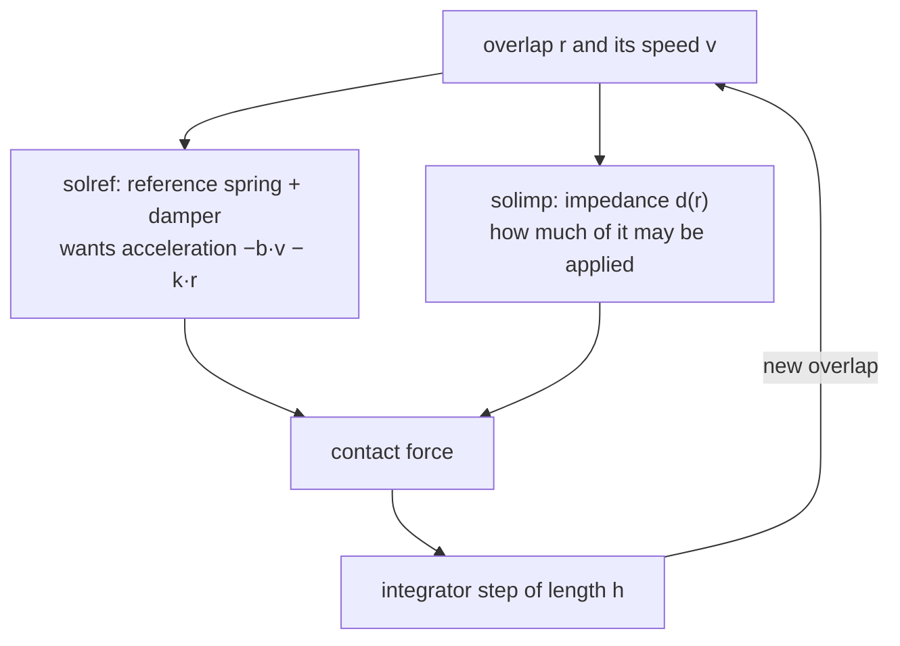

# 03 · Contact: soft constraints, solref and solimp

<!-- meta -->
| | |
|---|---|
| **Part** | [1 · Simulation](README.md) |
| **Run type** | CPU · Mac or Colab CPU |
| **Prerequisites** | [02](02-timestep.md) |
| **Learn first** | [Numerical Stability](https://aiengineeringfromscratch.com/lesson?path=phases/01-math-foundations/13-numerical-stability) |
| **Time** | ~40 min |
| **Code** | [`experiments/03-contact/experiment.py`](../experiments/03-contact/experiment.py) |
| **Status** | ✅ done |
<!-- /meta -->

> MuJoCo contact is a stiff, damped virtual spring: you choose how soft it is, and the timestep decides whether it stays stable.

## The problem

In [lesson 02](02-timestep.md) a cube went through a 1 cm tabletop even at `dt` = 1 ms: the contact was detected on the right side, but it let the cube sink about 3 cm. Real objects do not interpenetrate, yet every MuJoCo contact does a little. The Menagerie SO-101 sets its own contact parameters for the gripper (`solref="0.01 1"`, `condim="6"`) with values its README describes as working well for manipulation ([so101.xml](https://github.com/google-deepmind/mujoco_menagerie/blob/f3b6013/robotstudio_so101/so101.xml), [README](https://github.com/google-deepmind/mujoco_menagerie/tree/f3b6013/robotstudio_so101)). This lesson measures what those two numbers do: how deep a resting cube sinks, how high a dropped cube bounces, and what happens when the contact is made stiffer than the timestep can integrate.

## Core idea

### In plain words

Real objects cannot overlap. A simulator that forbade every overlap exactly would have to solve a hard, jumpy problem at every step. MuJoCo does something softer: when two shapes overlap, it puts an invisible spring with a shock absorber between them. The deeper the overlap, the harder the spring pushes back. Objects therefore always sink in a little, and you choose how much.

Two knobs describe that spring. `solref` says how fast the spring tries to undo an overlap (its *time constant*: small = stiff) and how strongly it is damped (its *damping ratio*: below 1 it bounces, at 1 or above it does not). `solimp` says how much of the spring's push the solver is allowed to apply (the *impedance*, a number between 0 and 1 that rises with depth).

The catch is time. A spring that tries to undo an overlap in less than about two timesteps overshoots on every step, and the simulation gains energy instead of losing it. That is why MuJoCo quietly refuses time constants shorter than two timesteps.



### The contact spring, as code

```python
def solref_to_spring(timeconst, dampratio, d, d_w):
    b = 2 / (d_w * timeconst)                         # damping of the reference spring (1/s)
    k = d / (d_w**2 * timeconst**2 * dampratio**2)    # stiffness of the reference spring (1/s²)
    return b, k

# What the solver aims for on one contact (approximately):
#     a1 + d * (b * v + k * r) == (1 - d) * a_u
# At rest a1 = v = 0, which gives the resting penetration:
def resting_penetration(a_u, timeconst, dampratio, d, d_w):
    return (1 - d) * a_u * (d_w / d)**2 * timeconst**2 * dampratio**2

timeconst_used = max(timeconst, 2 * h)     # the refsafe guard (h = timestep)
```

| Quantity | Formula |
|---|---|
| soft constraint (one contact) | $a_1 + d\,(b\,v + k\,r) = (1 - d)\,a_u$ |
| reference spring from `solref` | $b = \dfrac{2}{d_w\,\text{timeconst}}, \quad k = \dfrac{d(r)}{d_w^2\,\text{timeconst}^2\,\text{dampratio}^2}$ |
| resting penetration | $r = (1-d)\,a_u\,\Big(\dfrac{d_w}{d}\Big)^2\,\text{timeconst}^2\,\text{dampratio}^2$ |
| spring frequency | $\omega = 1/(\text{timeconst}\cdot\text{dampratio})$ |
| stability guard (`refsafe`) | timeconst used $= \max(\text{timeconst}, 2h)$ |

$r$ is the penetration (how far the shapes overlap), $v$ its rate of change, $a_u$ the acceleration the body would have without the contact (gravity, here $g$), and $a_1$ the acceleration the solver produces along the contact normal. $d \in (0,1)$ is the impedance from `solimp`: it rises from $d_0$ at $r = 0$ to $d_w$ at $r$ = width along a smooth S-curve. timeconst and dampratio are the two `solref` numbers, $k$ and $b$ the stiffness and damping they imply, $\omega$ the spring's natural frequency and $h$ the timestep.

<details>
<summary>Math details: resting penetration, the refsafe guard and its gap</summary>

**Resting penetration.** At rest the body neither accelerates nor moves along the normal, so $a_1 = v = 0$ and the constraint reads $d\,k\,r = (1-d)\,a_u$. Substituting $k$ gives the formula in the table ([Modeling · Solver parameters](https://mujoco.readthedocs.io/en/stable/modeling.html#csolver)). With constant impedance ($d = d_w$) it becomes the docs' $r = a_u (1-d)\,\text{timeconst}^2\,\text{dampratio}^2$. Penetration grows with timeconst²: twice as soft sinks four times as deep. Because $d$ depends on $r$ through the `solimp` curve, the exact value sits where both relations agree; the experiment compares both forms.

**Why `refsafe` exists.** The docs state that timeconst should be at least twice the timestep, otherwise the system becomes too stiff for the integrator and can go unstable; MuJoCo enforces this unless the `refsafe` flag is disabled ([Reference](https://mujoco.readthedocs.io/en/stable/modeling.html#csolverreference), [option/flag/refsafe](https://mujoco.readthedocs.io/en/stable/XMLreference.html#option-flag-refsafe)). It is the same idea as the step-size stability limit $h\omega < 2$ in [lesson 02](02-timestep.md): the contact spring must not be stiff relative to the step. With dampratio = 1, timeconst $\ge 2h$ means $h\omega \le 0.5$, a safety margin well inside that limit.

**The gap in the guard.** "Time constant" here is the inverse of natural frequency times damping ratio, so $\omega = 1/(\text{timeconst}\cdot\text{dampratio})$. `refsafe` clamps timeconst, not the product. A small dampratio therefore raises $\omega$ past the limit even with the guard on. (That holds for `Euler`, `implicitfast`, `implicit` and `RK4`; under `discrete`, `refsafe` instead replaces rows with timeconst·dampratio < $h$, see [option/flag/refsafe](https://mujoco.readthedocs.io/en/stable/XMLreference.html#option-flag-refsafe).)

**Two geoms, one contact.** When two geoms touch, their `solref`/`solimp` are averaged (weights `solmix`) unless one has higher `priority`; margins and gaps are summed ([Contact parameters](https://mujoco.readthedocs.io/en/stable/modeling.html#ccontact)).

Go deeper: [Numerical Stability](https://aiengineeringfromscratch.com/lesson?path=phases/01-math-foundations/13-numerical-stability) (AIEFS: why explicit integration of a stiff spring blows up); [MuJoCo Modeling · Solver parameters](https://mujoco.readthedocs.io/en/stable/modeling.html#csolver).

</details>

### Contact attributes

| Attribute | Numbers (default) | Meaning |
|---|---|---|
| `solref` | `timeconst dampratio` (`0.02 1`) | the reference spring above. Larger timeconst = softer. Negative values = direct `-stiffness -damping` |
| `solimp` | `d0 dw width midpoint power` (`0.9 0.95 0.001 0.5 2`) | $d(r)$ rises from $d_0$ at $r = 0$ to $d_w$ at $r$ = width (1 mm) along a sigmoid |
| `margin` | 0 | contact becomes active (forces) at distance < margin |
| `gap` | 0 | contacts between margin and margin + gap are reported but produce no force |
| `condim` | 3 | 1 frictionless · 3 sliding friction · 4 + torsional · 6 + rolling |

Sources: [Reference (solref)](https://mujoco.readthedocs.io/en/stable/modeling.html#csolverreference), [Impedance (solimp)](https://mujoco.readthedocs.io/en/stable/modeling.html#csolverimpedance), [geom/condim](https://mujoco.readthedocs.io/en/stable/XMLreference.html#body-geom-condim), [margin and gap](https://mujoco.readthedocs.io/en/stable/computation/index.html#comargingap). `condim` is the number of force directions a contact can use: 1 is a pure push along the normal, 3 adds sliding friction in two directions, 4 and 6 add twisting and rolling resistance.

## Experiment

A 10 cm, 1 kg cube (and, as a single-contact check, a 5 cm radius, 1 kg sphere) on a plane, `dt` = 2 ms, the same `solref` on both geoms:

```python
<geom type="plane" size="1 1 .1" solref="{tc} {dr}"/>
<body pos="0 0 {z0}">
  <freejoint/>
  <geom type="box" size=".05 .05 .05" mass="1" solref="{tc} {dr}"/>
</body>
```

`rest()` places the body touching the plane and reads the contact distance after 2 s. `drop()` releases it 10 cm above the plane and records the deepest penetration and the rebound height.

**Predict.** If timeconst doubles, how much deeper does the cube sink?

**Run.** [`experiment.py`](../experiments/03-contact/experiment.py), MuJoCo 3.17.0, NumPy 2.5.4, Apple M5, deterministic; output in [`output.txt`](../experiments/03-contact/output.txt).

**Sweep 1 · timeconst → steady penetration** (dampratio 1):

| timeconst (s) | cube (mm) | sphere (mm) | $d$ | equation above (mm) |
|---|---|---|---|---|
| 0.001 | 0.0044 | 0.0175 | 0.9000 | 0.0175 |
| 0.002 | 0.0044 | 0.0175 | 0.9000 | 0.0175 |
| 0.004 | 0.0044 | 0.0175 | 0.9000 | 0.0175 |
| 0.005 | 0.0068 | 0.0273 | 0.9001 | 0.0273 |
| 0.01 | 0.0273 | 0.1078 | 0.9012 | 0.1078 |
| 0.02 (default) | 0.1078 | 0.3672 | 0.9135 | 0.3672 |
| 0.05 | 0.4914 | 1.2262 | 0.9500 | 1.2263 |
| 0.1 | 1.2263 | 4.9050 | 0.9500 | 4.9050 |

- The sphere (one contact) matches the steady-state equation to four digits in every row. The constant-$d$ form from the docs matches only once $r$ exceeds the 1 mm width (0.05 and 0.1 s), where $d = d_w$ = 0.95.
- The cube has four corner contacts, each carrying a quarter of the weight. Where both sit at the same $d$ (0.001–0.01 s and 0.1 s) the cube sinks a quarter as much as the sphere; at 0.02 and 0.05 s its shallower penetration sits lower on the `solimp` sigmoid (smaller $d$), so it sinks relatively more.
- 0.001, 0.002 and 0.004 s give identical results: below $2h$ = 0.004 s `refsafe` replaces the value.

**Sweep 2 · impedance** (`solimp="d d 0.001"`, timeconst 0.02): penetration 0.4905 / 0.0981 / 0.0490 / 0.0098 mm for $d$ = 0.5 / 0.9 / 0.95 / 0.99, i.e. proportional to $1-d$.

**Sweep 3 · dampratio → 10 cm drop** (timeconst 0.02):

| dampratio | peak penetration (mm) | rebound (mm) |
|---|---|---|
| 0.1 | 2.220 | 56.504 |
| 0.2 | 3.503 | 24.202 |
| 0.3 | 4.629 | 13.766 |
| 0.5 | 6.236 | 3.339 |
| 0.7 | 7.288 | 0.055 |
| 1.0 | 8.283 | 0.000 |
| 2.0 | 9.723 | 0.000 |


dampratio is MuJoCo's restitution knob (restitution = how bouncy an impact is): below 1 the cube bounces, at 1 and above it does not. A softer timeconst at dampratio 1 sinks deeper on impact: 0.297, 3.295, 8.283, 23.248, 48.314 mm for 0.004, 0.01, 0.02, 0.05, 0.1 s. A 1 kg cube dropped 10 cm onto the default contact goes 8.283 mm "into" the floor at its deepest point, against a resting penetration of 0.1078 mm.

## Break it

**1 · timeconst below 2·dt, `refsafe` off** (dampratio 1, 10 cm drop, `dt` = 2 ms):

| timeconst | refsafe | peak pen. (mm) | max height reached | jitter, last 0.5 s (mm) |
|---|---|---|---|---|
| 0.0005–0.004 | on | 0.297 | 0.100 m (start) | 0.000 |
| 0.0005 | off | 0.297 | **7.834 m** | 497.278 |
| 0.001 | off | 2.327 | **13.809 m** | 2084.273 |
| 0.002 | off | 6.308 | 0.894 m | 267.969 |
| 0.003 | off | 0.578 | 0.100 m (rebound 2.581 mm) | 0.000 |
| 0.004 | off | 0.297 | 0.100 m | 0.000 |

Jitter is the standard deviation of the cube's height over the last 0.5 s, when it should be lying still. With the guard on, every timeconst below 0.004 s silently becomes 0.004 s. With it off, the spring is too stiff for explicit integration at this step and the contact injects energy: a 1 kg cube dropped from 10 cm is thrown up to 13.809 m. At 0.003 s (1.5·dt) it survives but already rebounds 2.581 mm at dampratio 1, which should not bounce.

**2 · the gap in the guard**: `refsafe` on, timeconst 0.02, small dampratio. With $\omega = 1/(\text{timeconst}\cdot\text{dampratio})$:

| dampratio | $h\omega$ | rebound (mm) | max height |
|---|---|---|---|
| 0.10 | 1.00 | 56.504 | 0.100 m |
| 0.07 | 1.43 | 105.891 | 0.106 m |
| 0.05 | 2.00 | 3146.979 | 3.147 m |

At 0.07 the cube rebounds higher than it was dropped from (energy gain); at 0.05 ($h\omega$ = 2) it is launched to 3.147 m. Outside `discrete`, `refsafe` checks only timeconst, so a bouncy contact can blow up even with the guard on. Keep $\text{timeconst}\cdot\text{dampratio}$ well above `dt`.

## On the real robot

- Menagerie SO-101: arm collision geoms use `condim="3"` and default `solref`; gripper collision geoms (class `collision_gripper`) use `condim="6"`, `friction="1 5e-3 5e-4"`, `solref="0.01 1"` and `priority="1"`, so their parameters win over the object's ([so101.xml](https://github.com/google-deepmind/mujoco_menagerie/blob/f3b6013/robotstudio_so101/so101.xml)). At the model's `timestep="0.005"`, 0.01 s is exactly $2h$, the stiffest value `refsafe` allows.
- The real gripper pads are 3D-printed plastic; no compliance or restitution value for them is published in the sources used here. **Not yet measured on the real arm.** Procedure: drop a known object onto the pad from fixed heights, film the rebound, fit dampratio; press it with a known force, measure deflection, fit timeconst (or use the direct `-stiffness -damping` format, which the docs recommend for system identification, i.e. fitting model parameters to measured motion).

## Check yourself

1. **Easy.** With default `solimp`, what timeconst puts a resting 1 kg sphere at 1 mm penetration? Use the equation, then check in the script.
2. **Medium.** Set `margin="0.001"` on the plane. Where does the cube rest relative to the plane surface, and why?
3. **Hard.** At `dt` = 5 ms (the SO-101 timestep), repeat Break it 1 and 2. Which timeconst and dampratio values become unsafe?

### Answers

1. Above 1 mm $d = d_w$ = 0.95, so solve $9.81 \cdot 0.05 \cdot \text{timeconst}^2 = 0.001$; the table brackets it between 0.02 and 0.05 s.
2. The impedance and reference now act on distance − margin, so at rest that quantity equals the old resting penetration: the cube floats just under 1 mm above the plane, without touching it. Measure it.
3. `refsafe` raises any timeconst below 0.01 s; with it off, expect trouble below 0.01 s. For dampratio, expect it when $0.005/(\text{timeconst}\cdot\text{dampratio})$ approaches 2. Confirm by running.

## Takeaways and sources

- Contact is a soft constraint; steady penetration is $(1-d)\,a_u\,(d_w/d)^2\,\text{timeconst}^2\,\text{dampratio}^2$, verified to four digits for a single contact.
- dampratio sets bounce; timeconst sets softness. A 10 cm drop on the default contact penetrates 8.283 mm at the deepest point.
- Keep timeconst ≥ 2·dt (refsafe enforces it) and timeconst·dampratio well above dt (only the `discrete` integrator's `refsafe` enforces it).

Next: [lesson 04 · Friction and friction cones](04-friction.md).

**Sources**
- [MuJoCo Modeling · Solver parameters, Contact parameters](https://mujoco.readthedocs.io/en/stable/modeling.html#csolver).
- [MuJoCo XML reference · geom (solref, solimp, margin, gap, condim), option/flag/refsafe](https://mujoco.readthedocs.io/en/stable/XMLreference.html).
- [MuJoCo Computation · Contact, margin and gap](https://mujoco.readthedocs.io/en/stable/computation/index.html#cocontact).
- [Menagerie · robotstudio_so101](https://github.com/google-deepmind/mujoco_menagerie/tree/f3b6013/robotstudio_so101).
- Our numbers: [`experiments/03-contact/output.txt`](../experiments/03-contact/output.txt).
