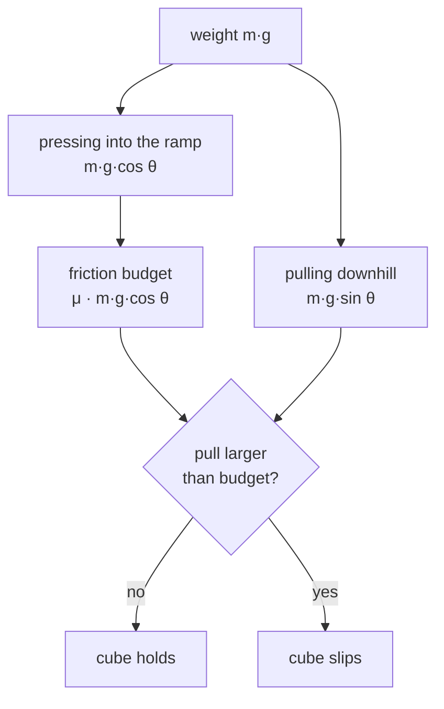

# 04 · Friction and friction cones

<!-- meta -->
| | |
|---|---|
| **Part** | [1 · Simulation](README.md) |
| **Run type** | CPU · Mac or Colab CPU |
| **Prerequisites** | [03](03-contact.md) |
| **Learn first** | [Vectors, Matrices & Operations](https://aiengineeringfromscratch.com/lesson?path=phases/01-math-foundations/02-vectors-matrices-operations) |
| **Time** | ~40 min |
| **Code** | [`experiments/04-friction/experiment.py`](../experiments/04-friction/experiment.py) · [notebook](../notebooks/04-friction.ipynb) |
| **Status** | ✅ done |
<!-- /meta -->

> Slip is decided by a ratio, not a weight: tan θ = μ, and the simulated cone has to approximate it.

## The problem

Unitree's open base training config (the one its Go2 config inherits) randomizes floor friction but not mass: each of `num_envs = 4096` parallel copies draws its friction from `friction_range = [0.5, 1.25]`, with `randomize_base_mass = False` ([`legged_robot_config.py`](https://github.com/unitreerobotics/unitree_rl_gym/blob/main/legged_gym/envs/base/legged_robot_config.py)). For slip, friction is the right knob: whether a foot or a grasped object slips depends on the friction coefficient and on the direction of the contact force, not on how heavy the object is. This lesson measures the slip angle of a cube on a ramp in MuJoCo, checks it against Coulomb's law, and finds the two places where the simulation deviates from it: creep below the threshold, and a pyramidal friction cone that depends on direction.

## Core idea

### In plain words

Friction is a budget. A surface can push sideways on an object, but only up to a limit, and that limit is proportional to how hard the object presses on the surface. The proportionality factor is the friction coefficient μ.

Put a phone on a book and tilt the book slowly. Tilting does two things at once: less of the phone's weight presses into the book (smaller budget) and more of it pulls the phone downhill (bigger demand). At some angle the demand exceeds the budget and the phone slides. A heavy phone presses harder, but it is also pulled harder by exactly the same factor, so weight cancels: the slip angle depends only on μ.

A simulator has to represent that budget. The exact rule says the sideways force may point in any direction, up to the same limit, so the allowed forces form a round cone. MuJoCo's default approximates the round cone with a pyramid, whose flat faces make the limit depend on direction. And because MuJoCo's contact is soft ([lesson 03](03-contact.md)), friction is soft too: below the limit an object can still creep slowly.



### The slip test, as code

```python
from math import sin, cos, atan, degrees

def coulomb_slips(theta, mu, m, g):      # theta in radians, g = gravity (m/s²)
    pull = m * g * sin(theta)              # gravity component along the ramp (N)
    budget = mu * m * g * cos(theta)       # largest friction force the surface can supply (N)
    return pull > budget                   # m and g cancel: same as tan(theta) > mu

slip_angle = degrees(atan(mu))             # e.g. mu = 0.5 -> 26.57°
accel = g * (sin(theta) - mu * cos(theta)) # downhill acceleration once it slides

def in_elliptic_cone(f_n, f_t1, f_t2, mu):  # MuJoCo's round cone, condim 3
    return f_n >= 0 and f_t1**2 + f_t2**2 <= (mu * f_n)**2
```

| Quantity | Formula |
|---|---|
| force pulling the cube downhill | $m g \sin\theta$ |
| friction limit | $\mu\, m g \cos\theta$ |
| slip condition | $\tan\theta > \mu$ |
| acceleration while sliding | $a = g(\sin\theta - \mu\cos\theta)$ |
| elliptic cone | $f_1 \ge 0,\ f_1^2 \ge \sum_i f_i^2/\mu_{i-1}^2$ |

$m$ is the cube's mass, $g$ gravity, $\theta$ the ramp angle and $\mu$ the sliding friction coefficient; $f_1$ is the contact force along the surface normal and $f_2, f_3$ (more with higher `condim`) the tangential components, each limited by its own coefficient $\mu_{i-1}$.

<details>
<summary>Math details: Coulomb's law on a ramp, and why the simulated cone deviates</summary>

**Slip condition.** Static friction can supply at most $\mu N$, where $N = m g\cos\theta$ is the normal force on a ramp. The cube holds while $m g\sin\theta \le \mu\, m g\cos\theta$. Dividing by $m g\cos\theta$ gives $\tan\theta \le \mu$: mass and gravity cancel ([OpenStax University Physics 1, §6.2](https://openstax.org/books/university-physics-volume-1/pages/6-2-friction)). Above the threshold the net downhill force is $m g(\sin\theta - \mu\cos\theta)$, hence the acceleration in the table.

**Cones.** A contact force $f$ is admissible if it lies in the friction cone ([Computation · Contact](https://mujoco.readthedocs.io/en/stable/computation/index.html#cocontact)). The elliptic cone is the inequality in the table. The pyramidal cone is built from $2(n-1)$ non-negative edge forces, where $n$ is `condim`; for `condim=3` that is 4 edges. A pyramid has flat faces, so its cross-section is a polygon, not a circle, and the friction limit it allows depends on the direction of sliding relative to the contact frame. The docs call elliptic cones the better model of physical reality, with pyramidal cones sometimes faster and more robust ([option/cone](https://mujoco.readthedocs.io/en/stable/XMLreference.html#option)).

**Creep.** The friction constraint is solved softly, like the normal one, so a small steady sliding speed below the threshold is allowed. The docs call this slow slippage and list two mitigations: elliptic cones with `impratio` > 1, or the `noslip` solver ([Modeling · Slow slippage](https://mujoco.readthedocs.io/en/stable/modeling.html#cslowslippage)).

**One μ.** `geom/friction` holds three numbers (sliding, torsional, rolling; default `1 0.005 0.0001`). There is one sliding coefficient, so no separate static and kinetic friction. For a contact pair, the element-wise maximum is used unless one geom has higher `priority` ([geom/friction](https://mujoco.readthedocs.io/en/stable/XMLreference.html#body-geom-friction), [Contact parameters](https://mujoco.readthedocs.io/en/stable/modeling.html#ccontact)).

Go deeper: [Vectors, Matrices & Operations](https://aiengineeringfromscratch.com/lesson?path=phases/01-math-foundations/02-vectors-matrices-operations) (AIEFS: splitting a force into components); [OpenStax University Physics 1, §6.2](https://openstax.org/books/university-physics-volume-1/pages/6-2-friction); [MuJoCo Computation · Contact](https://mujoco.readthedocs.io/en/stable/computation/index.html#cocontact).

</details>

### Friction cones in MuJoCo

| `option/cone` | Definition | Rows per `condim=3` contact |
|---|---|---|
| `pyramidal` (default) | $2(n-1)$ non-negative edge forces of a pyramid | 4 |
| `elliptic` | $f_1 \ge 0,\ f_1^2 \ge \sum f_i^2/\mu_{i-1}^2$ | 3 |

A *row* is one scalar unknown the constraint solver has to find for that contact.

## Experiment

An 8 cm cube placed at rest on an 80 × 30 × 2 cm ramp, aligned with it; both geoms get the same μ.

```python
def xml(theta_deg, mu, mass, cone="pyramidal"):
    return f"""
<mujoco>
  <option cone="{cone}"/>
  <worldbody>
    <body name="ramp" euler="0 {-theta_deg} 0">
      <geom type="box" size=".40 .15 .01" friction="{mu} 0.005 0.0001"/>
    </body>
    <body name="cube">
      <freejoint/>
      <geom type="box" size=".04 .04 .04" mass="{mass}" friction="{mu} 0.005 0.0001"/>
    </body>
  </worldbody>
</mujoco>"""
```

2 s are simulated; $v_1$ and $v_2$ are the mean downhill speeds over 0.5–1.0 s and 1.5–2.0 s. Because of creep (slow sliding below the threshold, see Math details), "slipping" needs two conditions:

```python
def slips(v1, v2):
    return v2 > 2.0 and (v2 - v1) > 0.5      # cm/s: fast AND accelerating
```

The slip angle is the smallest angle from which every larger angle slips, on a 0.05° grid from 3° below to 1° above $\arctan\mu$.

**Predict.** Does a 10 kg cube slip at a larger angle than a 0.1 kg one?

**Run.** [`experiment.py`](../experiments/04-friction/experiment.py), MuJoCo 3.17.0, Apple M5, `dt` = 2 ms, deterministic; output in [`output.txt`](../experiments/04-friction/output.txt).

| μ | $\arctan\mu$ | 0.1 kg | 1 kg | 10 kg |
|---|---|---|---|---|
| 0.3 | 16.70° | 16.75° | 16.75° | 16.75° |
| 0.5 | 26.57° | 26.60° | 26.60° | 26.60° |
| 0.8 | 38.66° | 38.70° | 38.70° | 38.70° |

**Observe.**
- Mass has no effect: across the whole sweep, the speed traces of the 0.1 kg and 10 kg cubes differ by at most 2.1·10⁻¹² cm/s (rounding).
- The measured angle is within one grid step of theory (largest deviation +0.05°). For μ = 1 the script gives 44.90° against 45.00°.
- **Creep.** At least 1° below the threshold the cube still moves at a constant speed: up to 0.30, 0.60 and 1.42 cm/s for μ = 0.3, 0.5, 0.8, while $v_2 - v_1$ stays below 0.05 cm/s. With a speed-only criterion ($v_2$ > 2 cm/s) the "slip angle" drops to 16.35° (−0.35°) and 26.25° (−0.32°) for μ = 0.3 and 0.5. Creep, not acceleration, is what that criterion detects.
- The elliptic cone gives the same angles for the aligned cube (16.75°, 26.60°, 38.70°).

## Break it

Rotate the cube 45° about the ramp normal. Coulomb friction is isotropic, so nothing should change:

| μ | cone | slip angle | vs theory | max steady speed ≥ 0.5° below threshold |
|---|---|---|---|---|
| 0.5 | pyramidal | 26.30° | −0.27° | 7.40 cm/s |
| 0.5 | elliptic | 26.60° | +0.03° | 0.18 cm/s |
| 0.8 | pyramidal | 37.70° | −0.96° | 27.24 cm/s |
| 0.8 | elliptic | 38.60° | −0.06° | 0.34 cm/s |

With the default pyramidal cone the rotated cube slips almost 1° early at μ = 0.8 and slides at up to 27.24 cm/s where it should hold. The elliptic cone stays within one or two grid steps. A plausible mechanism is that the pyramid's edges are tied to the contact frame, so the admissible tangential force depends on direction, but this was not isolated here (box–box contact point placement also changes with rotation). Treat it as a measured warning: **if friction limits matter (grasping, foot slip), use `cone="elliptic"` or verify with a sweep.**

The speed curves behind these numbers, for μ = 0.8, show both deviations at once ([`plot.py`](../experiments/04-friction/plot.py) re-runs the same `sweep()`; the per-angle speeds are not in `output.txt`):


## On the real robot

- The Menagerie SO-101 already uses `cone="elliptic"` and `impratio="10"`, the slow-slippage mitigation above. Its gripper collision geoms use `friction="1 5e-3 5e-4"`, `condim="6"` and `priority="1"`, so their μ = 1 overrides the object's ([so101.xml](https://github.com/google-deepmind/mujoco_menagerie/blob/f3b6013/robotstudio_so101/so101.xml)). Whether μ = 1 matches the printed pads against a given object is **not yet measured on the real arm**.
- Procedure (same as this experiment): put the object on a pad-material ramp, tilt slowly, record the slip angle 5 times, μ = tan θ. Real surfaces have a static coefficient larger than the kinetic one; MuJoCo's single μ cannot represent that difference.

## Check yourself

1. **Easy.** Set `mass` to 1000 kg. Predict the slip angle at μ = 0.5, then run `--quick` after editing.
2. **Medium.** Give the ramp μ = 0.3 and the cube μ = 0.8. At which angle does it slip? Then add `priority="1"` to the ramp geom.
3. **Hard.** For the policy trained on μ ∈ [0.5, 1.25], compute the slip-angle range on a ramp. Then measure, with the rotated cube and both cones, how far the pyramidal result can be off at μ = 1.25. Note it for [lesson 39 · Domain randomization](../part-9-sim-to-real/39-domain-randomization.md).

### Answers

1. Unchanged, 26.60° in this setup: mass cancels.
2. Without priority MuJoCo uses the larger μ, 0.8, so expect about 38.7°; with priority on the ramp, μ = 0.3, about 16.75°. Run to confirm.
3. In theory from $\arctan 0.5$ (26.57°, printed by the script) to $\arctan 1.25$; the rotated-cube deviation at μ = 1.25 must be measured, not extrapolated.

## Takeaways and sources

- tan θ = μ, independent of mass; MuJoCo reproduces it within 0.05° for μ = 0.3–0.8 (44.90° vs 45.00° at μ = 1) when the slip criterion requires acceleration.
- Soft contact creeps below the threshold (up to 1.42 cm/s here); a speed-only criterion mistakes creep for slip.
- The default pyramidal cone is direction-dependent in this test (−0.96° at 45°); elliptic is not.

Next: [lesson 05 · Joints and actuators](05-joints-and-actuators.md).

**Sources**
- [OpenStax, University Physics Vol. 1, §6.2 Friction](https://openstax.org/books/university-physics-volume-1/pages/6-2-friction).
- [MuJoCo XML reference · option/cone, geom/friction](https://mujoco.readthedocs.io/en/stable/XMLreference.html); [Computation · Contact](https://mujoco.readthedocs.io/en/stable/computation/index.html#cocontact); [Modeling · Contact parameters](https://mujoco.readthedocs.io/en/stable/modeling.html#ccontact).
- [`unitree_rl_gym` · `legged_robot_config.py`](https://github.com/unitreerobotics/unitree_rl_gym/blob/main/legged_gym/envs/base/legged_robot_config.py): `num_envs = 4096`, `randomize_friction = True`, `friction_range = [0.5, 1.25]` (read 2026-10-27).
- [Menagerie · robotstudio_so101](https://github.com/google-deepmind/mujoco_menagerie/tree/f3b6013/robotstudio_so101).
- Our numbers: [`experiments/04-friction/output.txt`](../experiments/04-friction/output.txt).
