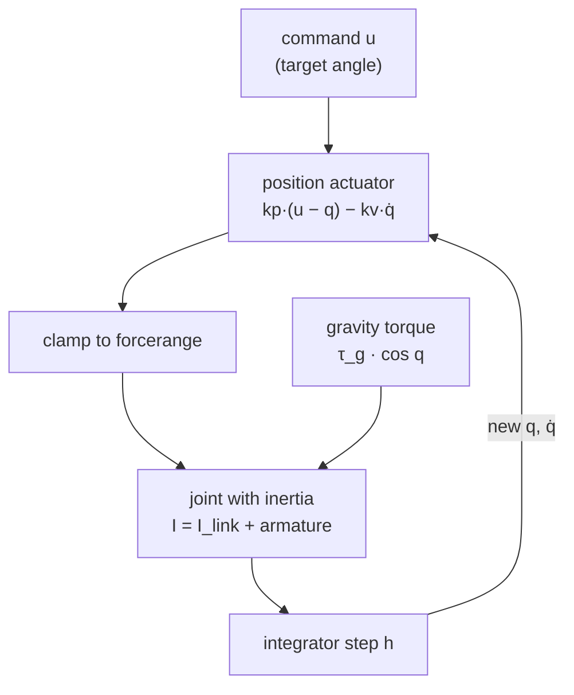

# 05 · Joints and actuators

<!-- meta -->
| | |
|---|---|
| **Part** | [1 · Simulation](README.md) |
| **Run type** | CPU · Mac or Colab CPU |
| **Prerequisites** | [01](01-world-as-text.md), [02](02-timestep.md) |
| **Learn first** | [Calculus for Machine Learning](https://aiengineeringfromscratch.com/lesson?path=phases/01-math-foundations/04-calculus-for-ml) |
| **Time** | ~45 min |
| **Code** | [`experiments/05-joints-and-actuators/experiment.py`](../experiments/05-joints-and-actuators/experiment.py) |
| **Status** | ✅ done |
<!-- /meta -->

> A `<position>` actuator is a PD controller living inside the physics step: its gain sets the sag, and the armature decides whether the step can integrate it.

## The problem

The Menagerie SO-101 gives every joint the same servo: `<position kp="998.22" kv="2.731" forcerange="-2.94 2.94"/>` on a joint with `armature="0.028"`, and a comment says these gains are not a one-to-one copy of the real servo's ([so101.xml](https://github.com/google-deepmind/mujoco_menagerie/blob/f3b6013/robotstudio_so101/so101.xml)). Why is kp almost 1000, what does armature do on a hobby servo, and what happens if you copy the gains but drop the armature? This lesson builds one gravity-loaded link, measures how kp sets sag and rise time, and finds where the same gains make the simulation diverge.

## Core idea

### In plain words

A `<position>` actuator behaves like a spring plus a shock absorber pulling the joint toward the commanded angle. The spring's stiffness is `kp`: the further from the target, the harder it pulls. The shock absorber's strength is `kv`: the faster the joint moves, the more it brakes. Engineers call this a PD controller (Proportional to the error, plus a Derivative term on the speed).

A weight on a spring settles below its unloaded rest: a spring pushes only when stretched. A position servo under gravity does the same: it *sags*, by roughly the gravity torque divided by `kp`. A stiffer spring sags less and arrives sooner.

Stiffness has a price in simulation. A stiff spring on a light joint oscillates fast; when one timestep is long compared with that oscillation, each step overshoots and the simulation explodes. *Armature* is extra inertia added to the joint: in a real servo, the motor's spinning rotor, which the gearbox makes feel much heavier at the joint. It slows the oscillation so the timestep can follow.



### The servo, as code

```python
force = clip(kp * (u - q) - kv * qdot, *forcerange)   # spring toward u, damper on speed (PD), clamped

# Steady sag e under a gravity torque tau_g: solve kp * e == tau_g * cos(e)
sag_estimate = tau_g / kp                        # good when the sag is small

# How fast the joint oscillates, and whether the timestep h can follow it
omega = sqrt(kp / (I_link + armature))           # natural frequency (rad/s)
h_omega = h * omega                              # explicit integration needs about h_omega < 2
kv = 2 * zeta * sqrt(kp * m)                     # what dampratio=zeta sets; m = reflected inertia
```

| Quantity | Formula |
|---|---|
| actuator force | $k_p(u - q) - k_v\,\dot q$, clamped to `forcerange` |
| steady sag | $k_p\,e_{\text{ss}} = \tau_g \cos e_{\text{ss}}\ \ (\approx \tau_g/k_p)$ |
| natural frequency | $\omega = \sqrt{k_p / I}$, with $I = I_{\text{link}} + \text{armature}$ |
| explicit stability limit (undamped) | $h\omega \lesssim 2$ |
| `implicitfast` limit with damping | $h^2\omega^2 < 4 + 2hc$, with $c = (k_v + \text{damping})/I$ |
| `kv` from `dampratio` | $k_v = 2\zeta\sqrt{k_p\,m}$ |

$u$ is the commanded angle, $q$ the joint angle, $\dot q$ its speed; $k_p$, $k_v$ the actuator gains; $\tau_g$ the gravity torque with the link horizontal; $e_{\text{ss}}$ the steady-state error (sag); $I$ the effective inertia, $I_{\text{link}}$ the link's part; $h$ the timestep; $c$ the damping per unit inertia; $\zeta$ the damping ratio, $m$ the reflected inertia at `qpos0`.

<details>
<summary>Math details: sag, rise time and the two stability bounds</summary>

**Sag.** At rest $\dot q = 0$ and $k_p(0 - q) = \tau_g\cos q$ at $q = -e_{\text{ss}}$; for small $e_{\text{ss}}$, $e_{\text{ss}} \approx \tau_g/k_p$. Without an integral term (one that grows while the error persists) the error never reaches zero.

**Rise time.** Linearized around the target, the joint is a mass on a spring with time scale $1/\omega = \sqrt{I/k_p}$; at fixed damping ratio every timing scales with it, hence $\propto 1/\sqrt{k_p}$.

**Explicit limit.** `Euler`, `implicit` and `implicitfast` integrate the position term explicitly; the docs give the limit $h \lesssim 2/\omega_{\max}$ and note that only `discrete` is implicit in position ([Computation · Integrators](https://mujoco.readthedocs.io/en/stable/computation/index.html#geintegrators)), the $h\omega < 2$ of [lessons 02](02-timestep.md) and [03](03-contact.md).

**With implicit damping.** `implicitfast` evaluates the damping at the new velocity: $v' = v + h(-\omega^2 q - c\,v')$, $q' = q + h v'$. The step matrix has determinant $1/(1 + hc)$ and trace $(2 + hc - h^2\omega^2)/(1 + hc)$; a 2×2 linear map is stable when $|\text{trace}| < 1 + \det$, i.e. $h^2\omega^2 < 4 + 2hc$. Damping integrated explicitly (Euler's treatment of `kv`) gives $h^2\omega^2 < 4 - 2hc$: it *lowers* the limit. Build it, Step 4 computes both numerically.

**Armature.** Armature adds to the joint's diagonal of the mass matrix $M$; for a geared motor it is the reflected rotor inertia, rotor inertia × gear ratio² ([XML reference · joint](https://mujoco.readthedocs.io/en/stable/XMLreference.html#body-joint-armature)). A larger $I$ lowers $\omega$.

Go deeper: [Calculus for Machine Learning](https://aiengineeringfromscratch.com/lesson?path=phases/01-math-foundations/04-calculus-for-ml) (AIEFS: linearization around the setpoint); [MuJoCo Modeling · Actuators](https://mujoco.readthedocs.io/en/stable/modeling.html#cactuators).

</details>

### Joints

| `joint type` | dof | Typical use |
|---|---|---|
| `hinge` | 1 rotation about `axis` | every SO-101 joint |
| `slide` | 1 translation along `axis` | linear stages, prismatic grippers |
| `ball` | 3 rotations | rarely in arms |
| `free` | 6 | floating bodies, robot bases |

| Joint attribute | Effect | Source note |
|---|---|---|
| `range` | position limit (a soft constraint, like contact) | enabled by `limited` or `autolimits` |
| `damping` | $\tau = -\text{damping}\cdot\dot q$ | `Euler` treats it implicitly |
| `armature` | extra inertia on the joint's diagonal of $M$ | rotor inertia × gear ratio² |
| `frictionloss` | dry friction that does not scale with a normal force | a constraint, not a force law |

Sources: [XML reference · joint](https://mujoco.readthedocs.io/en/stable/XMLreference.html#body-joint-armature), [Computation · Friction loss](https://mujoco.readthedocs.io/en/stable/computation/index.html#cofriction).

### Actuators

Every actuator is `general`: force $= \text{gain}\cdot\text{ctrl} + \text{bias}$, clamped to `forcerange`, mapped to the joint through `gear` (Build it, Step 1). The shortcuts set gain and bias ([XML reference · actuator](https://mujoco.readthedocs.io/en/stable/XMLreference.html#actuator-position), [Modeling · Actuators](https://mujoco.readthedocs.io/en/stable/modeling.html#cactuators)):

| Shortcut | Force | Notes |
|---|---|---|
| `motor` | $u$ | torque command; the policy is the controller |
| `position` | $k_p(u - q) - k_v\,\dot q$ | built-in PD; `kp` default 1, `kv` default 0, or `dampratio` |
| `velocity` | $k_v(u - \dot q)$ | the docs recommend `implicitfast`/`implicit` with it |

## Build it

You will now write MuJoCo's actuator force law and the Experiment's servo-driven link in about 40 lines of NumPy, reproduce the kp sweep, and predict every cell of Break it from a 2 × 2 matrix. Type the steps into your own file and run it after each step. The finished functions are in [`physai/sim.py`](../physai/sim.py); `uv run python experiments/05-joints-and-actuators/build.py` runs all four steps with the checks (output in [`build_output.txt`](../experiments/05-joints-and-actuators/build_output.txt)).

### Step 1 · One force law for every actuator

Every actuator is affine: force = `gainprm[0]` · ctrl + `biasprm[0]` + `biasprm[1]` · length + `biasprm[2]` · velocity, then clamped. The shortcuts only fill these numbers: `position` sets gain $k_p$ and bias $(0, -k_p, -k_v)$, `velocity` gain $k_v$ and bias $(0, 0, -k_v)$, `motor` gain 1.

```python
def actuator_force(ctrl, length, velocity, gainprm, biasprm, forcerange=None):
    """MuJoCo's affine actuator: gain * ctrl + bias(length, velocity), then clamped to forcerange."""
    force = gainprm[0] * ctrl + biasprm[0] + biasprm[1] * length + biasprm[2] * velocity
    return force if forcerange is None else np.clip(force, *forcerange)
```

For a joint actuator the length is the joint angle and the torque is `gear` × force. Three hinges, one actuator each:

```text
== Step 1. Actuator force laws vs MuJoCo (100 random states and controls) ==
motor, gear 3                        gainprm[0]   1.0 · biasprm[:3] [0. 0. 0.] · max error 0.0e+00 N m
position kp 40 kv 2, forcerange ±5   gainprm[0]  40.0 · biasprm[:3] [  0. -40.  -2.] · max error 3.6e-15 N m
velocity kv 0.7                      gainprm[0]   0.7 · biasprm[:3] [ 0.   0.  -0.7] · max error 0.0e+00 N m
```

### Step 2 · The Experiment's link

Three numbers set the servo's behaviour, each computable by hand: the inertia about the hinge (lesson 01's capsule `solid_inertia` plus the parallel-axis term $m (L/2)^2$), gravity $-\tau_g\cos q$, and $k_v$ from `dampratio` through the inertia, link plus armature:

```python
def kv_from_dampratio(kp, dampratio, inertia):
    """Damping gain that gives a position servo this damping ratio on this inertia: 2 zeta sqrt(kp I)."""
    return 2 * dampratio * np.sqrt(kp * inertia)
```

```text
== Step 2. The Experiment's link: inertia, gravity torque, kv from dampratio ==
link inertia about the hinge 0.00414684 kg m^2 · M_00 - armature 0.00414684
gravity torque at q = 0.3: -tau_g cos q = -0.281156 N m · -qfrc_bias -0.281156 N m
   kp  kv ours  kv MuJoCo
    1    0.359      0.359
   10    1.134      1.134
  100    3.586      3.586
 1000   11.340     11.340
```

The Experiment's tables use the thin-rod $mL^2/3$ = 0.0040 kg·m²; the capsule's rounded ends add 0.00015, so Step 4's $h\omega$ differs from Break it A in the second decimal.

### Step 3 · The servo loop

`implicitfast` treats every velocity-dependent force implicitly, here the actuator's $k_v$, so the step is lesson 01's `semi_implicit_euler` with `c_implicit` = $k_v / I$:

```python
accel = lambda q, v: (actuator_force(0.0, q, v, [kp], [0, -kp, -kv]) - tau_g * np.cos(q)) / I
q, v = semi_implicit_euler(q, v, accel, h, c_implicit=kv / I)     # one implicitfast step
```

The sag solves $k_p e = \tau_g\cos e$ (Newton's method):

```python
def servo_sag(kp, tau_g):
    """Steady error e of a PD servo holding a link against gravity: kp e = tau_g cos e (Newton's method)."""
    e = tau_g / kp
    for _ in range(50):
        e -= (kp * e - tau_g * np.cos(e)) / (kp + tau_g * np.sin(e))
    return e
```

```text
== Step 3. Our servo loop vs mj_step (implicitfast), step -0.5 rad -> 0, 3 s ==
   kp  max |q_ours - qpos|  sag (deg)  servo_sag (deg)  rise 10-90 % (ms)
    1              5.6e-17     16.193           16.193              533.0
    3              1.4e-17      5.594            5.594              335.6
   10              2.8e-17      1.685            1.685              185.6
   30              2.8e-17      0.562            0.562              106.1
  100              1.4e-17      0.169            0.169               56.7
  300              5.6e-17      0.056            0.056               31.6
 1000              2.8e-17      0.017            0.017               16.5
```

The Experiment's sweep, row for row, and a trajectory within 6e-17 rad of `mj_step`.

### Step 4 · Predict Break it

`step_growth` passes keyword arguments to the step, so it compares both integrators on the linearized servo, $a = -(k_p/I)\,q - ((k_v + \text{damping})/I)\,v$. `Euler` treats only the joint damping implicitly; `implicitfast` treats $k_v$ too:

```python
g_euler = step_growth(semi_implicit_euler, h, kp / I, (kv + damping) / I, c_implicit=damping / I)
g_fast = step_growth(semi_implicit_euler, h, kp / I, (kv + damping) / I, c_implicit=(kv + damping) / I)
```

```text
== Step 4. Growth per step: kv explicit (Euler) or implicit (implicitfast) vs MuJoCo ==
      kp armature   h*w  Euler growth  MuJoCo Euler  implicitfast growth  MuJoCo implicitfast
     998    0.028  0.88         0.725        stable                0.812               stable
     998    0.010  1.33         0.343        stable                0.678               stable
     998    0.005  1.65         1.650      diverged                0.595               stable
     998    0.002  2.01         2.838      diverged                0.519               stable
     998    0.000  2.45         4.143      diverged                0.446               stable
    3000    0.028  1.53         0.725        stable                0.812               stable
   10000    0.028  2.79         5.491      diverged                3.262             diverged
   30000    0.028  4.83        19.786      diverged               13.661             diverged
```

Growth above 1 marks exactly the cells where MuJoCo diverges, in both integrators, although the linear test leaves out frictionloss. It is Math details' bound, computed: explicit damping lowers the limit (`Euler` fails at $h\omega$ = 1.65), implicit damping raises it (`implicitfast` holds at 2.45 without armature, but not at kp 10000, $h\omega$ = 2.79, where $hc$ is small).

### What you keep

`physai.sim` now has `actuator_force`, `kv_from_dampratio` and `servo_sag`, and `semi_implicit_euler` with `c_implicit` is an `implicitfast` step. Lesson 12 writes the full joint controller (PID, gravity feedforward) next to it. [`tests/test_05_joints_and_actuators.py`](../tests/test_05_joints_and_actuators.py) pins them to MuJoCo; run `uv run pytest tests/test_05_joints_and_actuators.py` after you change anything.

## Use it

Declare the actuator, let `mj_step` apply it, read the compiled numbers back:

```python
<position joint="j" kp="998.22" kv="2.731" forcerange="-2.94 2.94"/>   # or dampratio="1" instead of kv

d.ctrl[a] = target                                  # in ctrlrange; for <position>, an angle
mujoco.mj_step(m, d)
d.actuator_force[a]                                 # force after the clamp (Step 1)
d.qfrc_actuator                                     # joint torques: gear x force
m.actuator_gainprm[a, 0], m.actuator_biasprm[a, :3] # kp and (0, -kp, -kv)
```

Traps:

- **`<general>` ignores `biasprm`** unless you also set `biastype="affine"` (the default is none); `<position>` sets it for you.
- **Two clamps.** `ctrlrange` limits the command (for `<position>`, an angle), `forcerange` the force.
- **`dampratio` is resolved at compile time** from the inertia at `qpos0` (Step 2); change the armature or a mass at runtime and $k_v$ keeps its old value.

## Experiment

A 20 cm, 0.3 kg capsule on a hinge, horizontal at $q = 0$: $\tau_g$ = 0.2943 N·m, $I_{\text{link}}$ = 0.0040 kg·m² (thin rod), `dt` = 5 ms (the SO-101 timestep), `implicitfast`.

```python
<option timestep="0.005" integrator="implicitfast"/>
<body name="link">
  <joint name="j" type="hinge" axis="0 -1 0" armature="0.028"/>
  <geom type="capsule" fromto="0 0 0 0.2 0 0" size="0.01" mass="0.3"/>
</body>
<actuator><position joint="j" kp="{kp}" dampratio="1"/></actuator>
```

Start at $q = -0.5$ rad, command $u = 0$, run 3 s. Sag = mean error over the last 0.5 s; rise = time from 10 % to 90 % of the way.

**Predict.** kp × 10: what happens to sag, and to rise time?

**Run.** [`experiment.py`](../experiments/05-joints-and-actuators/experiment.py), MuJoCo 3.17.0, NumPy 2.5.4, Apple M5, deterministic; output in [`output.txt`](../experiments/05-joints-and-actuators/output.txt).

| kp (N·m/rad) | kv from dampratio 1 | sag (°) | $\tau_g/k_p$ (°) | exact (°) | rise 10–90 % (ms) |
|---|---|---|---|---|---|
| 1 | 0.359 | 16.193 | 16.862 | 16.193 | 533.0 |
| 3 | 0.621 | 5.594 | 5.621 | 5.594 | 335.6 |
| 10 | 1.134 | 1.685 | 1.686 | 1.685 | 185.6 |
| 30 | 1.964 | 0.562 | 0.562 | 0.562 | 106.1 |
| 100 | 3.586 | 0.169 | 0.169 | 0.169 | 56.7 |
| 300 | 6.211 | 0.056 | 0.056 | 0.056 | 31.6 |
| 1000 | 11.340 | 0.017 | 0.017 | 0.017 | 16.5 |


**Observe.** The sag equals the static balance $k_p e = \tau_g\cos e$ to three decimals in every row; the linear $\tau_g/k_p$ is off only when the sag is large (kp = 1). A position servo with no integral term always sags under gravity: 0.017° at kp 1000, 16.193° at kp 1. Rise time falls as $1/\sqrt{k_p}$ (kp 10 → 100: 185.6 → 56.7 ms). Removing the sag without huge gains is what gravity feedforward does in [lesson 12](../part-4-dynamics-and-control/12-joint-control.md).

## Break it

**A · keep the SO-101 servo, drop the armature.** kp 998.22, kv 2.731, joint damping 0.6, frictionloss 0.052, `dt` = 5 ms; sweep armature:

| armature | $I$ (kg·m²) | $h\omega$ | Euler | implicitfast | discrete |
|---|---|---|---|---|---|
| 0.028 | 0.0320 | 0.88 | stable | stable | stable |
| 0.010 | 0.0140 | 1.34 | stable | stable | stable |
| 0.005 | 0.0090 | 1.67 | **diverged** | stable | stable |
| 0.002 | 0.0060 | 2.04 | **diverged** | stable | stable |
| 0.001 | 0.0050 | 2.23 | **diverged** | stable | stable |
| 0 | 0.0040 | 2.50 | **diverged** | stable | stable |

Euler fails first, already at $h\omega$ = 1.67: it treats joint damping implicitly but the actuator's `kv` explicitly, which is why the docs recommend `implicitfast` or `implicit` whenever `kv` is used ([actuator/position/kv](https://mujoco.readthedocs.io/en/stable/XMLreference.html#actuator-position)). With the Menagerie `forcerange` ±2.94 N·m added, Euler no longer explodes; it chatters (a fast, small back-and-forth around the target): peak-to-peak 0.629° at armature 0.001 and 0.798° at 0, a failure that looks like servo noise rather than numerics.

**B · raise kp** (implicitfast, armature 0.028): stable at kp 3000 ($h\omega$ = 1.53), **diverged** at kp 10000 ($h\omega$ = 2.80) and 30000 ($h\omega$ = 4.84); `discrete` stayed stable at all four. `implicitfast` treats damping implicitly but `kp` explicitly, which gives the bound $h^2\omega^2 < 4 + 2hc$ with $c = (k_v + \text{damping})/I$ (Math details); the docs' $h\omega \lesssim 2$ is the undamped case. With armature 0.028, $hc$ is small and the limit sits just above 2. In A, removing the armature made $I$ tiny and $hc$ large, so `implicitfast` survived $h\omega$ = 2.50 while Euler, with `kv` explicit, failed at 1.67. Build it, Step 4 predicts every cell of A and B this way.

## On the real robot

The script reads the compiled SO-101 model ([Menagerie · robotstudio_so101](https://github.com/google-deepmind/mujoco_menagerie/tree/f3b6013/robotstudio_so101)), home pose `qpos0`, `dt` = 5 ms:

| joint | kp | kv | forcerange (N·m) | armature | $M_{ii}$ (kg·m²) | link part | $h\omega$ | $h\omega$ without armature |
|---|---|---|---|---|---|---|---|---|
| shoulder_pan | 998.22 | 2.731 | ±2.94 | 0.028 | 0.04446 | 0.01646 | 0.75 | 1.23 |
| shoulder_lift | 998.22 | 2.731 | ±2.94 | 0.028 | 0.04542 | 0.01742 | 0.74 | 1.20 |
| elbow_flex | 998.22 | 2.731 | ±2.94 | 0.028 | 0.03734 | 0.00934 | 0.82 | 1.63 |
| wrist_flex | 998.22 | 2.731 | ±2.94 | 0.028 | 0.02913 | 0.00113 | 0.93 | 4.71 |
| wrist_roll | 998.22 | 2.731 | ±2.94 | 0.028 | 0.02808 | 0.00008 | 0.94 | 17.62 |
| gripper | 998.22 | 2.731 | ±2.94 | 0.028 | 0.02802 | 0.00002 | 0.94 | 39.33 |

For the wrist and gripper the armature is almost the whole effective inertia; without it those joints would sit far past $h\omega \approx 2$. Copying kp and kv without the armature into an `Euler` model reproduces Break it A. Whether the SO-101's own `implicitfast` survives without armature was not tested; its large implicit `kv` raises the limit, so assume nothing.

Real hardware facts, from the [LeRobot SO-101 guide](https://huggingface.co/docs/lerobot/so101): the follower uses six STS3215 servos with 1/345 gearing; the leader mixes 1/191, 1/345 and 1/147 so it can be moved by hand. The servos share one bus, each with a unique ID (shoulder pan 1 … gripper 6) stored in its EEPROM (non-volatile memory). The Menagerie comment states that its kp, kv and forcerange assume a servo proportional gain of 16 and are not a one-to-one mapping of LeRobot's gains.

Procedure: command a 0.5 rad step on the real elbow, log the joint position through LeRobot, and compare rise time and sag with the simulated joint under the same load. **Not yet measured on the real arm.**

## Check yourself

1. **Easy.** Replace `<position>` by `<motor>` and send `ctrl = 0`. What does the link do? What `ctrl` holds it horizontal?
2. **Medium.** Add `gear="2"` to the position actuator, keep kp = 100. Does the sag change? Explain with the gear's effect on length and force.
3. **Hard.** For Break it A, find the largest armature at which Euler diverges with kv = 0 (keep joint damping 0.6). Compare with the $h\omega$ = 2 prediction.

### Answers

1. It falls under gravity (zero torque). Holding it needs $u = \tau_g$ = 0.2943 N·m at $q = 0$.
2. `gear` scales both the actuator length and the force mapping, so the joint stiffness becomes gear² × kp: expect about a quarter of the sag. Measure it.
3. Undamped: $h\omega = 2$, i.e. $I = k_p (h/2)^2$. The implicit joint damping widens the bound to $h^2\omega^2 < 4 + 2hc$, so divergence starts at a smaller armature; Build it's `step_growth` with kv = 0 finds it before you run the sweep.

## Takeaways and sources

- `<position>` = PD with gains kp, kv; sag under gravity is $\tau_g\cos e/k_p$ (16.193° at kp 1, 0.017° at kp 1000), rise time ∝ $1/\sqrt{k_p}$.
- Armature lowers $\omega = \sqrt{k_p/I}$. The SO-101's 0.028 is most of the wrist and gripper inertia and keeps $h\omega$ below 1 at 5 ms.
- `Euler` breaks first (explicit `kv`), `implicitfast` once $h^2\omega^2 > 4 + 2hc$ (≈ 2 when damping is small), `discrete` held in every tested case; `step_growth` predicts each cell.

Next: [lesson 06 · Rotations](../part-2-spatial-math/06-rotations.md). Control on top of these actuators: [lesson 12](../part-4-dynamics-and-control/12-joint-control.md).

**Sources**
- [MuJoCo XML reference · joint, actuator (motor, position, velocity, general)](https://mujoco.readthedocs.io/en/stable/XMLreference.html#actuator-position).
- [MuJoCo Modeling · Actuators](https://mujoco.readthedocs.io/en/stable/modeling.html#cactuators); [Computation · Integrators](https://mujoco.readthedocs.io/en/stable/computation/index.html#geintegrators).
- [Menagerie · robotstudio_so101/so101.xml](https://github.com/google-deepmind/mujoco_menagerie/blob/f3b6013/robotstudio_so101/so101.xml) (class `sts3215`).
- [LeRobot SO-101 guide](https://huggingface.co/docs/lerobot/so101).
- Our numbers: [`output.txt`](../experiments/05-joints-and-actuators/output.txt), [`build_output.txt`](../experiments/05-joints-and-actuators/build_output.txt).
