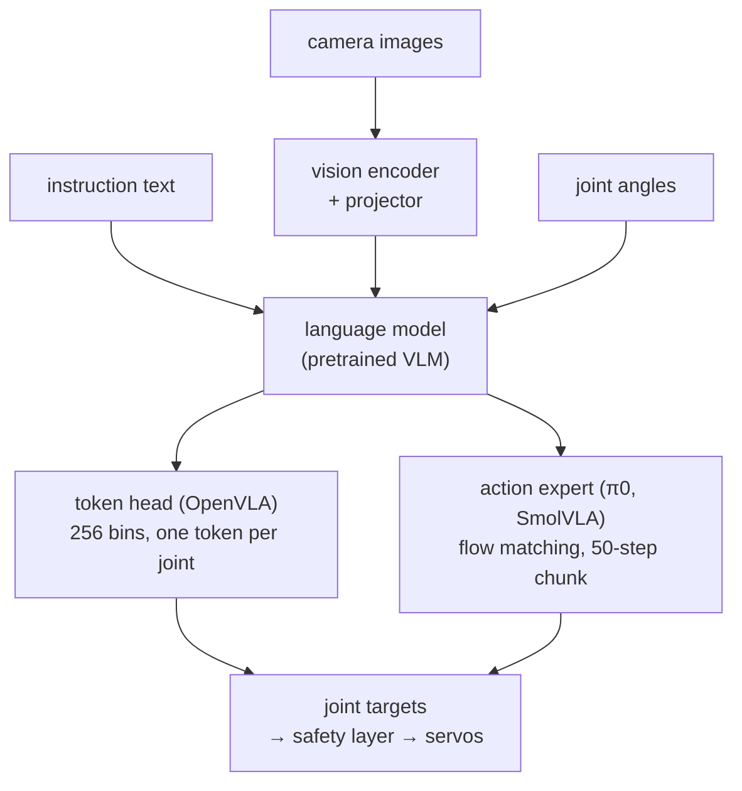

# 41 · Vision-language-action models

<!-- meta -->
| | |
|---|---|
| **Part** | [10 · Foundation models and agents](README.md) |
| **Run type** | ART · shipped results, runs on CPU |
| **Prerequisites** | [31](../part-7-learning-from-demonstration/31-act.md) |
| **Learn first** | [Embodied VLAs: RT-2, OpenVLA, π0, GR00T](https://aiengineeringfromscratch.com/lesson?path=phases/12-multimodal-ai/21-embodied-vlas-openvla-pi0-groot) · [The Full Transformer — Encoder + Decoder](https://aiengineeringfromscratch.com/lesson?path=phases/07-transformers-deep-dive/05-full-transformer) |
| **Time** | ~60 min |
| **Code** | [`experiments/41-vla/experiment.py`](../experiments/41-vla/experiment.py) |
| **Status** | ✅ done |
<!-- /meta -->

> A VLA is a policy whose observation includes a sentence. For the robot, the decisive design choice is on the output side: one token per joint, or a chunk of continuous actions.

## The problem

LeRobot's SmolVLA guide tells an SO-101 owner to record about 50 episodes, fine-tune `lerobot/smolvla_base` and run it with `--task="Grasp a lego block and put it in the bin."` ([docs](https://huggingface.co/docs/lerobot/smolvla)). Before spending GPU hours on that, an engineer needs to know what the network actually reads (which cameras, what state, how much text), what it writes (one action or fifty, tokens or real numbers), and where its parameters sit. Those answers are in public files you can inspect without downloading the weights. This lesson reads them for SmolVLA, π0 and OpenVLA, and then measures what the token-based output costs on the scripted SO-101 pick of [lesson 16](../part-4-dynamics-and-control/16-grasping-and-pick-place.md).

## Core idea

### In plain words

Take a chat model that can look at pictures. Show it three camera frames, the robot's current joint angles and the sentence "put the lego in the bin", and instead of answering with words, let it answer with motor commands. That is a vision-language-action model (VLA): an LLM whose output tokens are joint targets. Most of the network is the pretrained image-and-text model; the robot-specific part is a small piece at the end, the **action head**, which turns the model's internal features into numbers a servo can follow.

There are two ways to build that head. The first treats an action like text: round each joint target to one of 256 levels and write each level as a word, one decoder pass per word. The second lets a small extra network write a whole **chunk** of real-valued actions at once, say the next 50 steps, starting from random noise and cleaning it up in 10 small steps, the way image diffusion models make a picture. Rounding costs resolution, and one word per joint costs one pass of a billions-of-parameters model per joint; a chunk costs one call for 50 actions, which lets a slow model drive a fast servo loop.

### The data flow



### The two action heads, as code

The token head is a quantizer; the flow head is a tiny ODE solver whose velocity comes from a network (Build it writes both).

```python
k = tokenize(a, lo, hi, 256)                  # lo, hi: 1st and 99th percentile of the training actions
a_hat = detokenize(k, lo, hi, 256)            # the bin centre: |a - a_hat| <= Delta / 2
A = sample_chunk(lambda x, tau: v_theta(x, tau, obs), np.random.randn(50 * 32), 10)   # noise -> 50 x 32 chunk
```

| Head | Output | Error | Cost per control step |
|---|---|---|---|
| tokens | $k = \big\lfloor B\,\frac{a - a_{lo}}{a_{hi} - a_{lo}} \big\rfloor$, $\hat a = a_{lo} + (k + \tfrac12)\Delta$ | $\lvert a - \hat a\rvert \le \Delta/2$, $\Delta = \frac{a_{hi} - a_{lo}}{B}$ | $D$ decoder passes |
| flow matching | $A^{\tau+\delta} = A^\tau + \delta\, v_\theta(A^\tau, o)$, $A^0 \sim \mathcal N(0, I)$ | learned, no fixed bound | $1/\delta$ expert passes per chunk of $H$ actions |

$a$ is one action dimension, $B$ the number of bins, $\Delta$ the bin width, $D$ the action dimension, $A$ a chunk of $H$ actions, $\tau \in [0, 1]$ the flow time, $\delta$ the step and $v_\theta$ the velocity network that sees the observation $o$.

<details>
<summary>Math details: the observation, the flow-matching loss and the quantization error</summary>

**Observation and output.** A VLA's observation is

$$o_t = [I_t^1,\dots,I_t^n,\ \ell_t,\ q_t]$$

camera images, the tokens of a language instruction and the proprioceptive state (the robot's own joint angles), and its output is an action chunk $A_t = [a_t, \dots, a_{t+H-1}]$ (π0 paper, [arXiv 2410.24164](https://arxiv.org/abs/2410.24164)). The body is a pretrained vision-language model (VLM): a vision encoder, a projector into the language model's embedding space (the vectors it uses for words), and a transformer language model (see AIEFS: [Embodied VLAs](https://aiengineeringfromscratch.com/lesson?path=phases/12-multimodal-ai/21-embodied-vlas-openvla-pi0-groot)).

**Discrete action tokens (OpenVLA).** Each action dimension is discretized "separately into one of 256 bins", with the bin width dividing the interval between the 1st and 99th quantile of the training actions; the 256 least-used tokens of the Llama tokenizer are overwritten with these bins and the model is trained with the usual next-token loss ([arXiv 2406.09246](https://arxiv.org/abs/2406.09246), §3.2). One 7-D action is 7 tokens, decoded autoregressively, that is one after another, each conditioned on the previous ones.

**Quantization error.** Decoding to the bin centre leaves an error of at most $\Delta/2$; if the true value is spread evenly inside the bin, the RMS error is $\Delta/\sqrt{12}$. Both scale with $1/B$, so each bit removed ($B \to B/2$) doubles the error. Values outside $[a_{lo}, a_{hi}]$ are clipped: the range is frozen from the training data.

**Flow matching (π0, SmolVLA).** A separate "action expert" transformer attends to the VLM's features and learns a velocity field that moves Gaussian noise to the action chunk. With $A^\tau = \tau A + (1-\tau)\epsilon$, $\epsilon \sim \mathcal N(0, I)$, the straight path from noise to data has constant velocity $\frac{d}{d\tau}A^\tau = A - \epsilon$, so the network is trained to predict it:

$$\mathcal L(\theta) = \mathbb E\,\big\|v_\theta(A^\tau, o) - (A - \epsilon)\big\|^2, \qquad A^{\tau+\delta} = A^\tau + \delta\, v_\theta(A^\tau, o),\ \ A^0 \sim \mathcal N(0, I)$$

At inference the ODE is integrated from $\tau = 0$ to $1$ with Euler steps of size $\delta$; $\delta = 0.1$ gives 10 steps.

Go deeper: [Embodied VLAs: RT-2, OpenVLA, π0, GR00T](https://aiengineeringfromscratch.com/lesson?path=phases/12-multimodal-ai/21-embodied-vlas-openvla-pi0-groot), [The Full Transformer](https://aiengineeringfromscratch.com/lesson?path=phases/07-transformers-deep-dive/05-full-transformer); primary sources: [OpenVLA](https://arxiv.org/abs/2406.09246), [π0](https://arxiv.org/abs/2410.24164), [SmolVLA](https://arxiv.org/abs/2506.01844).

</details>

<!-- figure: 41-action-tokenization -->

### Three models side by side

π0 uses 10 Euler steps (δ = 0.1) and H = 50, a 3B PaliGemma VLM plus a 300M action expert, 3.3B in total ([arXiv 2410.24164](https://arxiv.org/abs/2410.24164)). SmolVLA keeps the idea at 450M parameters (about 100M in the expert), uses only the first 16 layers of SmolVLM-2, 64 visual tokens per frame, chunks of n = 50, and interleaves cross- and self-attention in the expert ([arXiv 2506.01844](https://arxiv.org/abs/2506.01844)).

| | OpenVLA | π0 | SmolVLA |
|---|---|---|---|
| action head | 256-bin tokens, autoregressive | flow-matching expert | flow-matching expert |
| output per call | 1 action | chunk, H = 50 | chunk, n = 50 |
| pretraining data | 970k episodes, Open X-Embodiment | 10,000 h from 7 robot configurations and 68 tasks, plus OXE, DROID, Bridge | 481 community datasets, 22.9k episodes, 10.6M frames |

**Cross-embodiment** means one network for robots with different bodies. The configs below pad state and action to `max_action_dim` = 32, so a 6-D SO-101 and a bimanual arm share one network. **Fine-tuning** then adapts the pretrained model to one robot and task: SmolVLA's config freezes the vision encoder and trains only the expert; OpenVLA's LoRA (small low-rank matrices added to the frozen weights) matches full fine-tuning "while training only 1.4% of the model parameters" ([arXiv 2406.09246](https://arxiv.org/abs/2406.09246), §5.3).

## Build it

You will now write both action heads without a network: the token quantizer exactly as the Experiment uses it, and a flow-matching sampler driven by the velocity a perfectly trained network would output. The data are the 229 actions of lesson 16's scripted pick (recorded by the Experiment's `demo()`). The functions are in [`physai/foundation.py`](../physai/foundation.py); `uv run python experiments/41-vla/build.py` runs the steps (output in [`build_output.txt`](../experiments/41-vla/build_output.txt)).

### Step 1 · Tokens

```python
def tokenize(a, lo, hi, n_bins=256):
    """OpenVLA-style action tokens: clip each dimension to [lo, hi], cut it into n_bins equal bins, return the index."""
    x = (np.clip(a, lo, hi) - lo) / (hi - lo)               # 0..1
    return np.minimum((x * n_bins).astype(int), n_bins - 1)
```

```python
def detokenize(k, lo, hi, n_bins=256):
    """Back to an action: the centre of bin k."""
    return lo + (k + 0.5) / n_bins * (hi - lo)
```

```text
== Step 1. Tokens per dimension, bins between the 1st and 99th percentile ==
demonstration: 229 actions x 6 dims; arm-joint ranges (deg): 3.7 69.4 26.1 31.2 0.4
 bins  same tokens as experiment.py  re-tokenized = same  max |err| / (Delta/2)
    4                          True                 True                  1.000
    8                          True                 True                  1.000
   16                          True                 True                  1.000
   64                          True                 True                  1.000
  256                          True                 True                  1.000
 1024                          True                 True                  1.000
```

Your tokens equal the Experiment's at every bin count, de-tokenizing and tokenizing again returns the same token, and the largest error is exactly half a bin. Exactly, not just below: this demonstration holds its extreme poses, its 1st and 99th percentiles are its minimum and maximum, and those values sit on the outer bin edges.

### Step 2 · Half a bin, and $\Delta/\sqrt{12}$

```text
== Step 2. RMS error of the arm joints vs Delta / sqrt(12) ==
 bins  RMS err deg  Delta/sqrt(12) deg  max err deg  Delta/2 (widest) deg
    4        3.161               2.598        8.672                 8.672
    8        1.566               1.299        4.336                 4.336
   16        0.745               0.650        2.168                 2.168
   64        0.209               0.162        0.542                 0.542
  256        0.048               0.041        0.136                 0.136
 1024        0.012               0.010        0.034                 0.034
```

The RMS error halves with every bit, as $\Delta/\sqrt{12}$ predicts, but stays 17–29% above it (0.048° vs 0.041° at 256 bins): the formula assumes values spread evenly inside a bin, and the held extreme poses all sit at the worst place, half a bin from a centre. The numbers match the Experiment's table.

### Step 3 · At the gripper

The joint errors become a tip error through forward kinematics; `fk` from [`physai/kinematics.py`](../physai/kinematics.py) (lesson 09) returns the gripper-frame position.

```text
== Step 3. At the gripper: forward kinematics of the de-tokenized actions ==
 bins  mean tip err mm  max tip err mm
    4            15.69           40.36
    8             8.83           19.75
   16             3.51            9.54
   64             1.24            2.00
  256             0.26            0.60
 1024             0.07            0.17
```

The same tip errors as the Experiment's table: 0.26 mm mean at 256 bins, and 40.36 mm worst case at 4 bins, more than the 30 mm cube.

### Step 4 · What the head costs

```text
== Step 4. Network passes per second at a 30 Hz control loop ==
tokens, one action per call, 6 dims: 30 x 6 = 180 decoder passes/s
tokens for the 7-D OpenVLA action: 30 x 7 = 210 decoder passes/s
chunk of 50, execute 50 before re-planning, 10 flow steps: 0.6 VLM passes/s, 6 expert passes/s, 1667 ms without reacting to new images
chunk of 50, execute 10 before re-planning, 10 flow steps: 3.0 VLM passes/s, 30 expert passes/s, 333 ms without reacting to new images
```

Tokens cost one pass of the whole language model per dimension, every step; a chunk costs one VLM pass and 10 small expert passes per 50 actions. The price is the last column: while a chunk of 50 plays at 30 Hz, the policy ignores new images for 1.67 s; executing 10 actions per chunk buys reaction time with five times the compute.

### Step 5 · The flow head

Training a velocity network is the GPU part (Appendix B), but its target has a closed form for a finite list of training chunks: the average direction from the noisy point to the chunks that could have produced it. Use that exact velocity in place of the network:

```python
def flow_velocity(x, tau, data):
    """The flow-matching velocity a perfectly trained network would output when the training set is `data` (n, d):
    for x_tau = tau a + (1 - tau) eps, E[a - eps | x_tau = x] = (weighted mean of the data - x) / (1 - tau)."""
    logw = -((x[None] - tau * data) ** 2).sum(axis=1) / (2 * (1 - tau) ** 2)   # posterior over training chunks
    w = np.exp(logw - logw.max())
    return (w @ data / w.sum() - x) / (1 - tau)
```

```python
def sample_chunk(velocity, x0, n_steps):
    """Flow-matching inference: integrate dx/dtau = v(x, tau) from noise (tau = 0) to an action chunk (tau = 1)."""
    x = x0.copy()
    for i in range(n_steps):
        x = x + velocity(x, i / n_steps) / n_steps        # Euler step of size 1 / n_steps
    return x
```

```text
== Step 5. Flow head: Euler steps through the exact velocity of the demonstration's chunks ==
training set: 180 chunks of 50 x 6 = 300 numbers; 20 samples from noise
flow steps  RMS to nearest chunk rad  within 0.01 rad  RMS to the mean chunk rad
         1                    0.2576             0/20                     0.0000
         2                    0.0473             0/20                     0.2466
         5                    0.0045            18/20                     0.2890
        10                    0.0032            20/20                     0.2912
        20                    0.0006            20/20                     0.2921
```

One Euler step lands exactly on the *mean* chunk (0.0000 rad from it), an average of 180 different motions, 0.2576 rad from any real one: the blur that a single regression to the mean produces (lesson 30). With more steps the sample commits to one demonstration: 18 of 20 samples end within 0.01 rad of a training chunk after 5 steps, all 20 after 10, π0's and SmolVLA's step count.

### What you keep

`physai.foundation` now has `tokenize`, `detokenize`, `flow_velocity` and `sample_chunk`. Lesson 42 puts a validation layer between such outputs and the robot. [`tests/test_41_vla.py`](../tests/test_41_vla.py) checks the quantization bounds and the sampler: `uv run pytest tests/test_41_vla.py`.

## Use it

In LeRobot the head is inside the policy. `select_action` returns one action per call from a queue of `n_action_steps` actions and runs the model only when the queue is empty ([`modeling_smolvla.py`](https://github.com/huggingface/lerobot/blob/main/src/lerobot/policies/smolvla/modeling_smolvla.py)); not run here:

```python
policy = SmolVLAPolicy.from_pretrained("lerobot/smolvla_base")
action = policy.select_action(batch)      # images, state, task text -> one action; a new chunk every n_action_steps calls
```

| Tool | Action output | Convention to check |
|---|---|---|
| physai | `tokenize(a, lo, hi, 256)`, `sample_chunk(v, noise, 10)` | noise at $\tau = 0$, clean actions at $\tau = 1$ |
| OpenVLA | 256 bins per dimension between the 1st and 99th quantile ([arXiv 2406.09246](https://arxiv.org/abs/2406.09246), §3.2) | bin tokens overwrite the 256 least-used Llama tokens |
| LeRobot SmolVLA | chunk of `chunk_size` 50, `n_action_steps` executed, `num_steps` 10 flow steps (Experiment, part A) | its training code names its convention [`FlowConvention.NOISE_AT_ONE`](https://github.com/huggingface/lerobot/blob/main/src/lerobot/policies/common/flow_matching.py) (noise at t = 1, integrated 1 → 0): time runs the other way |

Traps:

- **The range is frozen.** Bins span the training data's 1st–99th percentile; a new task with wider motions is clipped silently.
- **Flow time direction.** Some code puts noise at $\tau = 0$, some at $t = 1$; mixing the two integrates the wrong way.
- **Padding.** Configs pad actions to `max_action_dim` 32; only the first 6 numbers drive an SO-101.

## Experiment

**A. Read the artifacts.** A `.safetensors` weight file starts with an 8-byte length followed by a JSON table of tensor names and shapes. For each model we fetch `config.json` and only that header (with an HTTP Range request, which asks the server for a byte range instead of the whole file), then sum parameters per component.

```python
n = struct.unpack("<Q", fetch(repo, fn, (0, 7)))[0]      # header length
header = json.loads(fetch(repo, fn, (8, 7 + n)))           # {tensor: {dtype, shape, offsets}}
counts[group_of(name)] += prod(shape)
```

*Predict:* where do most of SmolVLA's 450M parameters sit, in vision, language or action?

Read from the configs: `smolvla_base` expects a 6-D state and three 3 × 256 × 256 cameras, at most 48 language tokens, outputs a 6-D action padded to 32, `chunk_size` 50, `n_action_steps` 50, 10 flow steps. `pi0_base`: three 224 × 224 cameras, 32-D state and action, chunk 50, 10 inference steps, `gemma_2b` + `gemma_300m`. `openvla-7b`: 224 × 224 images, `n_action_bins` 256, 7-D actions, normalization statistics for 25 datasets.

| parameters (from tensor shapes) | smolvla_base | pi0_base | openvla-7b |
|---|---|---|---|
| language model | 204.6M | 1981.9M | 6607.6M |
| vision encoder | 86.4M | 412.4M | 730.9M |
| action expert | 98.2M | 311.5M | – |
| LM output head(s) | 47.3M | 790.0M | 131.3M |
| vision-language connector | 11.8M | 2.4M | 71.4M |
| action / state / time projections | 1.6M | 3.2M | – |
| **total** | **450.0M** | **3501.4M** | **7541.2M** |
| header bytes fetched | 73,056 | 129,872 | 126,432 |

The totals match the papers' 450M and 7B. The stored π0 checkpoint holds 3501.4M against the paper's 3.3B; most of the difference is the action expert's 263.3M vocabulary head (the layer that scores every word of the vocabulary), which π0 does not use (actions leave through the small `action_out_proj`): 3501.4M − 263.3M = 3238.1M. PaliGemma's 526.6M head is needed: the header stores no separate token-embedding tensor, so it doubles as the tied input embedding. The three headers add up to 329,360 bytes; no weights were downloaded. SmolVLA's budget: 204.6M language model, 98.2M action expert; per call it returns 50 × 32 values, OpenVLA 7 tokens (7 decoder passes).

**B. Sweep the number of bins.** Take lesson 16's scripted pick (MuJoCo, 229 actions of 6 joint targets at 50 Hz), tokenize each dimension OpenVLA-style, de-tokenize to bin centres, and replay the result open loop (the stored actions are played back without looking at the scene) in the same scene with the physical success test (cube bottom ≥ 4 cm, both jaws in contact). Tip error is the gripper-frame position from forward kinematics ([lesson 8](../part-3-kinematics/08-forward-kinematics.md)). Full script: [`experiments/41-vla/experiment.py`](../experiments/41-vla/experiment.py). MuJoCo 3.17.0, NumPy 2.5.4, Python 3.14, Apple M5, deterministic.

*Predict:* the arm joints span roughly one radian, so 256 bins should give errors of a fraction of a degree.


| bins | bits/dim | RMS arm-joint err | max arm-joint err | mean tip err | max tip err | replay | cube bottom |
|---|---|---|---|---|---|---|---|
| 1024 | 10 | 0.012° | 0.034° | 0.07 mm | 0.17 mm | lifted | 7.24 cm |
| 256 | 8 | 0.048 | 0.136 | 0.26 | 0.60 | lifted | 7.21 |
| 64 | 6 | 0.209 | 0.542 | 1.24 | 2.00 | lifted | 6.96 |
| 16 | 4 | 0.745 | 2.168 | 3.51 | 9.54 | lifted | 6.68 |
| 8 | 3 | 1.566 | 4.336 | 8.83 | 19.75 | lifted | 5.19 |
| 4 | 2 | 3.161 | 8.672 | 15.69 | 40.36 | **not lifted** | 0.00 |

The original demonstration lifted the cube to 7.37 cm, its un-tokenized 50 Hz replay to 7.25 cm. At 256 bins the error is 0.26 mm at the gripper, below anything else in the loop: the price of tokens is not resolution but one decoder pass per dimension and a clipping range frozen from the training data (here 0.00% of values fell outside: the 1st and 99th percentiles equal the minimum and maximum). The figure also shows the 32- and 128-bin rows of `output.txt`.

## Break it

Lower the bins. Each bit removed roughly doubles the error (arm-joint RMS 0.745° → 1.566° → 3.161° for 16 → 8 → 4 bins). The grasp survives down to 8 bins with a 19.75 mm worst-case tip error, the cube ending lower (5.19 cm). At 4 bins the worst case, 40.36 mm, exceeds the 30 mm cube and the replay does not lift it. Pick the bin count from the task's tolerance (a few millimetres at the jaw), not from the vocabulary size.

## On the real robot

- **SO-101 with SmolVLA.** LeRobot's procedure: record ~50 episodes (10 per cube position in their reference dataset; 25 "was not enough"), fine-tune with `lerobot-train --policy.path=lerobot/smolvla_base` (20k steps "~4 hrs on a single A100"), deploy with `lerobot-rollout --robot.type=so101_follower` ([docs](https://huggingface.co/docs/lerobot/smolvla)). The GPU part is in [Appendix B](../appendix/b-smolvla-finetuning.md). **Not yet measured on our arm.**
- **Latency is a budget.** π0 reports 73 ms per chunk on an RTX 4090 with three cameras ([arXiv 2410.24164](https://arxiv.org/abs/2410.24164), Table I); OpenVLA "approximately 6Hz" on an RTX 4090 ([arXiv 2406.09246](https://arxiv.org/abs/2406.09246)). Chunking lets a slow model drive a 30–50 Hz servo loop (Build it, Step 4); SmolVLA computes the next chunk while the current one executes ([arXiv 2506.01844](https://arxiv.org/abs/2506.01844)). Mac numbers: [Appendix C](../appendix/c-inference-speed-on-mac.md).
- **Hardware for π0.** openpi lists > 8 GB GPU memory for inference, > 22.5 GB for LoRA fine-tuning, and states it is tested only on Ubuntu 22.04 ([openpi](https://github.com/Physical-Intelligence/openpi)). The safety layer of [lesson 15](../part-4-dynamics-and-control/15-safety.md) sits between any of these outputs and the servos.

## Check yourself

1. **Easy.** With OpenVLA-style tokens, how many tokens per control step does a 6-D SO-101 action need, and how many decoder passes per second at 30 Hz?
2. **Medium.** In the 256-bin row the largest joint error is 0.136°. If that is half a bin of the joint with the widest range, roughly how wide is that range?
3. **Hard.** Replace uniform bins with quantile bins (equal number of training values per bin) and rerun part B. Predict before running: which rows change most, and why?

### Answers

1. 6 tokens per step; 6 × 30 = 180 decoder passes per second (with no chunking).
2. One bin ≈ 2 × 0.136° = 0.272°, so the range ≈ 0.272° × 256 ≈ 70°.
3. Not computed here; run it.

## Takeaways and sources

- A VLA maps (images, instruction, joint state) to actions; π0 and SmolVLA emit 50-step continuous chunks from a flow-matching expert, OpenVLA emits 256-bin tokens one dimension at a time.
- The public configs and safetensors headers (329,360 bytes of headers for three models) give inputs, chunk length and the parameter budget: SmolVLA 450.0M with 98.2M in the action expert.
- On the SO-101 pick, 256 bins cost 0.26 mm of tip error; 4 bins (40.36 mm worst case) fail the grasp.

Next: [lesson 42 · LLM agents with robot tools](42-llm-agents.md).

Sources:
- Kim et al., [OpenVLA](https://arxiv.org/abs/2406.09246) (arXiv 2406.09246); config [`openvla/openvla-7b`](https://huggingface.co/openvla/openvla-7b).
- Black et al., [π0: A Vision-Language-Action Flow Model](https://arxiv.org/abs/2410.24164) (arXiv 2410.24164); config [`lerobot/pi0_base`](https://huggingface.co/lerobot/pi0_base); [openpi](https://github.com/Physical-Intelligence/openpi).
- Shukor et al., [SmolVLA](https://arxiv.org/abs/2506.01844) (arXiv 2506.01844); [LeRobot SmolVLA docs](https://huggingface.co/docs/lerobot/smolvla); config [`lerobot/smolvla_base`](https://huggingface.co/lerobot/smolvla_base) (Apache-2.0).
- All measured numbers: [`experiments/41-vla/output.txt`](../experiments/41-vla/output.txt), figure from [`plot.py`](../experiments/41-vla/plot.py).
