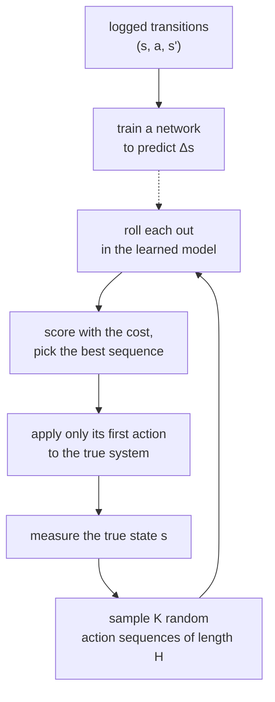

# 43 · World models: learned dynamics

<!-- meta -->
| | |
|---|---|
| **Part** | [10 · Foundation models and agents](README.md) |
| **Run type** | CPU · Mac or Colab CPU |
| **Prerequisites** | [28](../part-7-learning-from-demonstration/28-behavior-cloning.md) |
| **Learn first** | [World Models & Video Diffusion](https://aiengineeringfromscratch.com/lesson?path=phases/04-computer-vision/28-world-models-video-diffusion) · [Multi-Layer Networks and Forward Pass](https://aiengineeringfromscratch.com/lesson?path=phases/03-deep-learning-core/02-multi-layer-networks) |
| **Time** | ~60 min |
| **Code** | [`experiments/43-world-models/experiment.py`](../experiments/43-world-models/experiment.py) |
| **Status** | ✅ done |
<!-- /meta -->

> A learned model of $s' = f(s, a)$ is good enough when a planner that keeps re-measuring the world can use it; one-step accuracy is the wrong yardstick.

## The problem

Model-based control ([lesson 24](../part-6-planning-and-optimal-control/24-lqr-and-mpc.md)) assumes you have the dynamics. For a real arm with a payload, cable drag or worn gears you often do not, but you can log transitions $(s_t, a_t, s_{t+1})$: the state, the action you applied, and the state that followed. Nagabandi et al. trained a neural network on such data from random actions and controlled simulated robots with MPC inside it ([arXiv 1708.02596](https://arxiv.org/abs/1708.02596)); world-model agents push the idea to images and latent states (Ha & Schmidhuber, [arXiv 1803.10122](https://arxiv.org/abs/1803.10122); Dreamer, [arXiv 1912.01603](https://arxiv.org/abs/1912.01603)). Two questions decide whether it works on your system: how fast does the prediction error grow when the model is rolled out on its own outputs, and does planning in the learned model reach the same result as planning in the true one?

## Core idea

### In plain words

A world model is a learned physics simulator. Instead of writing down masses and joints, you record what the system did and train a network to answer one question: "given this state and this action, what is the next state?" It is like building a game engine from replays.

Asked for one step, such a model can be very accurate. The trouble starts when you run it on its own outputs to look further ahead, which is what a planner needs. Each prediction has a small error, the next prediction starts from that slightly wrong state, and the errors pile up. Like dead reckoning without a GPS fix, the learned simulation drifts further from reality the longer you run it.

The fix is the same as for dead reckoning: take a fresh fix often. Model predictive control (MPC) tries many candidate action sequences inside the learned simulator, picks the best, applies only its first action to the real system, measures the real new state and plans again. Every re-measurement resets the drift, so a planner can get good results from a model that would be useless for long open-loop predictions.

### Planning inside a learned model



### World model and planner, as code

```python
# Learned dynamics: predict the change of state and add it
def predict(s, a):                       # s = (theta, theta_dot), a = motor torque
    return s + f_theta(features(s, a))   # f_theta: a small MLP trained on logged transitions

# Open-loop rollout: the model is fed its own predictions
def rollout(s0, actions):
    s, states = s0, []
    for a in actions:
        s = predict(s, a)                # any error in s is carried into the next step
        states.append(s)
    return states

# Random-shooting MPC: one control step
def mpc_step(s, K, H):
    U = random_sequences(K, H)           # K candidate action sequences, each H steps long
    costs = [cost(rollout(s, u), u) for u in U]
    return U[argmin(costs)][0]           # apply only the first action, then measure and repeat
```

| Piece | Formula |
|---|---|
| learned dynamics | $\hat s_{t+1} = s_t + \hat f_\theta(s_t, a_t)$ |
| training | $\min_\theta \sum_{\mathcal D} \big\| (s_{t+1} - s_t) - \hat f_\theta(s_t, a_t) \big\|^2$ |
| $H$-step rollout | $\hat s_{t+h} = \hat s_{t+h-1} + \hat f_\theta(\hat s_{t+h-1}, a_{t+h-1})$ |
| MPC | $a_t = u^{\star}_0$, $\ u^\star = \arg\min_{u^1..u^K} \sum_{h} c(\hat s_{t+h}, u_h)$ |

$s_t$ is the state at step $t$, $a_t$ (or $u_h$) the action, $\hat f_\theta$ the network with weights $\theta$, $\mathcal D$ the dataset of logged transitions, $\hat s$ a predicted state, $H$ the planning horizon, $K$ the number of candidate sequences and $c$ the cost of one predicted step.

<details>
<summary>Math details: why predict the change, why errors compound, and what feedback buys</summary>

**Predicting the change.** Predicting the change is easier than predicting the state (Nagabandi et al., §IV-A): over one control step the state moves little, so $s_{t+1} - s_t$ is a small, well-scaled target, while $s_{t+1}$ itself is mostly a copy of the input. Inputs and targets are normalized to zero mean and unit variance before training (see AIEFS: [Multi-Layer Networks](https://aiengineeringfromscratch.com/lesson?path=phases/03-deep-learning-core/02-multi-layer-networks)).

**Compounding error.** Training minimizes the one-step error. Planning uses $H$-step open-loop predictions, which feed the model its own errors; the same paper validates models with this $H$-step error for that reason. Write $e_h = \hat s_{t+h} - s_{t+h}$ and $\epsilon_h$ for the one-step model error. Linearizing the true dynamics $s_{h+1} = s_h + f(s_h, a_h)$ around the true trajectory gives

$$e_{h+1} \approx \big(I + \tfrac{\partial f}{\partial s}\big)\, e_h + \epsilon_h .$$

Where the dynamics are stable (the hanging pendulum), the bracket shrinks or keeps $e_h$ and the errors roughly add up, so the error grows about linearly with $h$. Where they are unstable (near upright, where nearby states diverge), the bracket has an eigenvalue larger than 1 in magnitude and the error grows geometrically. A test set that mixes both kinds of trajectory has a mean error dominated by the few unstable ones, which is what part A shows.

**Random-shooting MPC.** Sample $K$ action sequences of length $H$, predict each with the model, score them with a cost, apply only the first action of the best one, measure the new state, repeat (Nagabandi et al., §IV-C). Because the plan restarts from the measured state at every step, only the first action of each plan is ever executed; long-horizon prediction error affects the choice of action, not the state the next plan starts from. PETS replaces the single network by a probabilistic ensemble to account for model uncertainty ([arXiv 1805.12114](https://arxiv.org/abs/1805.12114)); Dreamer learns behaviour by backpropagating through imagined latent trajectories ([arXiv 1912.01603](https://arxiv.org/abs/1912.01603)).

Go deeper: [World Models & Video Diffusion](https://aiengineeringfromscratch.com/lesson?path=phases/04-computer-vision/28-world-models-video-diffusion), [Multi-Layer Networks and Forward Pass](https://aiengineeringfromscratch.com/lesson?path=phases/03-deep-learning-core/02-multi-layer-networks); primary sources: [Nagabandi et al.](https://arxiv.org/abs/1708.02596), [PETS](https://arxiv.org/abs/1805.12114), [Dreamer](https://arxiv.org/abs/1912.01603), [World Models](https://arxiv.org/abs/1803.10122).

</details>

<!-- figure: 43-rollout-error -->

### This lesson's system

| term | here |
|---|---|
| state $s$ | $(\theta, \dot\theta)$, $\theta = 0$ hanging |
| action $a$ | motor torque $u$, $\lvert u\rvert \le 2$ N·m |
| model input | $(\cos\theta, \sin\theta, \dot\theta, u)$ (periodic in θ) |
| cost | $\sum_h \mathrm{wrap}(\theta_h - \pi)^2 + 0.1\,\dot\theta_h^2 + 0.001\,u_h^2$ |

The model sees $\cos\theta$ and $\sin\theta$ instead of $\theta$ so that $\theta$ and $\theta + 2\pi$ look the same; $\mathrm{wrap}$ maps an angle difference into $[-\pi, \pi)$, so the cost is lowest upright ($\theta = \pi$).

## Build it

You will now build the whole chain in NumPy: the true dynamics, a dataset, a world model, open-loop rollouts and an MPC planner. One change from the Experiment: instead of an MLP trained with Adam, $\hat f_\theta$ is linear in polynomial features of $(\cos\theta, \sin\theta, \dot\theta, u)$ and fitted with one least-squares solve. That makes the model's capacity a single knob (the degree) and the build deterministic in a few seconds. The functions are in [`physai/foundation.py`](../physai/foundation.py); `uv run python experiments/43-world-models/build.py` runs the steps (output in [`build_output.txt`](../experiments/43-world-models/build_output.txt)).

### Step 1 · The true dynamics

Five substeps of semi-implicit Euler. MuJoCo's Euler integrator treats joint damping implicitly: that is the $I + h b$ in the denominator.

```python
def pendulum_step(s, u, p=PEND):
    """One 0.05 s control step of the torque-limited pendulum, s = (theta, theta_dot), theta = 0 hanging.
    Semi-implicit Euler with implicit joint damping, as MuJoCo's Euler integrator; works on batches."""
    th, w = s[..., 0], s[..., 1]
    u = np.clip(u, -p["u_max"], p["u_max"])
    for _ in range(p["substeps"]):
        tau = u - p["mgl"] * np.sin(th) - p["damping"] * w
        w = w + p["h"] * tau / (p["inertia"] + p["h"] * p["damping"])   # damping taken at the new speed
        th = th + p["h"] * w
    return np.stack([th, w], axis=-1)
```

```text
== Step 1. The pendulum step by hand vs MuJoCo (5 x mj_step of 10 ms) ==
inertia from MuJoCo's mass matrix: 0.25036 kg m^2 (0.25 + 2/5 m r^2 = 0.25036)
max |ours - MuJoCo| over 200 random states and torques: 1.8e-15
```

### Step 2 · Data

The Experiment's recipe: random starts over the whole circle, random torques held for two control steps, 400 trajectories of 50 steps. Every trajectory is a row of one batch, so collecting 20,000 transitions is 50 calls to `pendulum_step`.

```text
== Step 2. Data: 400 random-action trajectories x 50 steps ==
training transitions 20000, held-out transitions 5000
|delta theta| up to 0.589 rad per step, |delta theta_dot| up to 1.433 rad/s per step
```

### Step 3 · Fit the change of state

```python
def poly_features(s, u, degree):
    """All monomials up to `degree` of (cos theta, sin theta, theta_dot / 8, u / 2), constant included."""
    base = np.stack([np.cos(s[..., 0]), np.sin(s[..., 0]), s[..., 1] / 8, u / 2], axis=-1)
    cols = [np.ones(base.shape[:-1])]
    for d in range(1, degree + 1):
        for idx in itertools.combinations_with_replacement(range(4), d):
            cols.append(np.prod(base[..., list(idx)], axis=-1))
    return np.stack(cols, axis=-1)
```

```python
def fit_world_model(S, A, S_next, degree):
    """Least-squares fit of the change of state: S_next - S ~ poly_features(S, A) @ W. Returns W."""
    return np.linalg.lstsq(poly_features(S, A, degree), S_next - S, rcond=None)[0]
```

```python
def predict(W, s, u, degree):
    """Learned dynamics: the next state is the current one plus the predicted change."""
    return s + poly_features(s, u, degree) @ W
```

```text
== Step 3. Fit the change of state, feature degree 1-4 ==
degree features  one-step |angle err| rad  one-step |vel err| rad/s
     1        5                   7.9e-04                   3.9e-02
     2       15                   5.6e-05                   3.3e-03
     3       35                   1.9e-06                   1.3e-04
     4       70                   1.1e-07                   8.4e-06
```

Every extra degree buys more than an order of magnitude of one-step accuracy. Degree 2 (15 features) predicts one step to 5.6e-05 rad on held-out data, already better than the Experiment's 17,410-parameter MLP (0.0004 rad): this system is smooth in these features, and least squares finds the exact minimum where Adam stops after 1200 steps.

### Step 4 · Roll it out

```python
def rollout_errors(step_true, step_model, s0, U, horizons):
    """Feed the same actions U (n, T) to the true system and to the model from the same states s0 (n, 2);
    return {H: (mean, median) |angle error|} after H steps of open-loop prediction."""
    s_true, s_model, out = s0.copy(), s0.copy(), {}
    for k in range(U.shape[1]):
        s_true, s_model = step_true(s_true, U[:, k]), step_model(s_model, U[:, k])
        if k + 1 in horizons:
            e = np.abs(wrap(s_model[:, 0] - s_true[:, 0]))
            out[k + 1] = (e.mean(), np.median(e))
    return out
```

```text
== Step 4. Open-loop rollouts: 200 held-out starts, the same random torques to model and truth ==
degree       H=1       H=5      H=10      H=20      H=40      H=60     H=100  H100/H1   (mean |angle err| rad; med 2: median, degree 2)
     1   1.1e-03   2.8e-02   8.6e-02   2.2e-01   4.2e-01   5.9e-01   7.8e-01      735
     2   5.6e-05   1.8e-03   5.0e-03   9.1e-03   2.3e-02   4.4e-02   8.6e-02     1528
     3   2.4e-06   8.7e-05   2.5e-04   7.8e-04   2.7e-03   5.0e-03   1.3e-02     5355
     4   1.1e-07   4.2e-06   1.1e-05   3.2e-05   8.6e-05   1.3e-04   3.2e-04     2959
 med 2   4.7e-05   1.4e-03   4.1e-03   7.2e-03   1.4e-02   2.1e-02   2.6e-02
```

The growth over 100 steps is 735× for degree 1 and between 1528× and 5355× for the better models: a more accurate model does not compound more slowly. The degree-2 row is the closest to the Experiment's MLP (100-step mean 8.6e-02 vs 0.0966 rad), and its mean again runs away from its median (8.6e-02 vs 2.6e-02 at H = 100), the signature of a few divergent trajectories.

### Step 5 · Plan inside it

```python
def wrap(a):
    """Angle difference mapped into [-pi, pi)."""
    return (a + np.pi) % (2 * np.pi) - np.pi
```

```python
def swing_up_cost(s, u):
    """Per-step cost: angle from upright, speed, torque."""
    return wrap(s[..., 0] - np.pi) ** 2 + 0.1 * s[..., 1] ** 2 + 0.001 * u ** 2
```

```python
def shooting_mpc(step_plan, step_true, s0, H, K, rng, steps=100, hold=5, u_max=2.0):
    """Random-shooting MPC: K piecewise-constant torque sequences of length H, rolled out with step_plan;
    the first action of the cheapest one goes to step_true, then replan from the measured state.
    Returns success (within 0.2 rad of upright for the last 20 steps), mean tail error, first upright step."""
    s, angles = s0.copy(), []
    for _ in range(steps):
        U = np.repeat(rng.uniform(-u_max, u_max, (K, -(-H // hold))), hold, axis=1)[:, :H]
        x, cost = np.repeat(s[None], K, axis=0), np.zeros(K)
        for t in range(H):
            x = step_plan(x, U[:, t])
            cost += swing_up_cost(x, U[:, t])
        s = step_true(s, U[np.argmin(cost), 0])
        angles.append(abs(wrap(s[0] - np.pi)))
    a = np.array(angles)
    first = int(np.argmax(a < 0.2)) if np.any(a < 0.2) else -1
    return bool(np.all(a[-20:] < 0.2)), float(np.mean(a[-20:])), first
```

```text
== Step 5. Random-shooting MPC swing-up, K = 100, 3 starts, 5 s ==
planner            H  success  mean tail err rad  first upright step
true dynamics     10      0/3              0.831                   -
true dynamics     30      3/3              0.023                  66
degree-2 model    10      0/3              0.831                   -
degree-2 model    30      3/3              0.028                  67
```

With the true dynamics as the planner's model your MPC reproduces the Experiment's "true" rows exactly (0/3 at H = 10; 3/3, 0.023 rad, first upright at step 66 at H = 30): same seeds, same candidates, a step that equals MuJoCo's to 1.8e-15. Inside the 15-feature model it also swings up 3/3 at H = 30, upright one step later.

### What you keep

`physai.foundation` now has `pendulum_step`, `poly_features`, `fit_world_model`, `predict`, `wrap`, `rollout_errors`, `swing_up_cost` and `shooting_mpc`. The capstone (lesson 44) uses the same replan-from-measurement loop at the task level. [`tests/test_43_world_models.py`](../tests/test_43_world_models.py) pins the pendulum to MuJoCo: `uv run pytest tests/test_43_world_models.py`.

## Use it

The library way is the Experiment's: a PyTorch MLP that predicts the normalized change of state, trained with Adam, and `mujoco.rollout` to evaluate all K candidates of the true planner in C.

```python
def forward(self, s, u):                                   # predict the change, not the state
    x = (features(s, u) - self.x_mu) / self.x_sd
    return s + self.net(x) * self.d_sd + self.d_mu

st, _ = rollout.rollout(M, D_ROLL, x0[None], ctrl)          # ctrl: (K, H * 5, 1), all candidates at once
```

| Model of $s_{t+1}$ | Where | Fit | One-step error |
|---|---|---|---|
| polynomial, degree 2 | `physai.foundation` | one `lstsq`, 15 weights per output | 5.6e-05 rad (Build it) |
| MLP 4-128-128-2 | Experiment, PyTorch | 1200 Adam steps, 17,410 parameters | 0.0004 rad (part A) |
| the simulator itself | `mujoco.rollout` | none | 0 |

Traps:

- **Angles wrap.** Feed $\cos\theta, \sin\theta$, not $\theta$, and compare angles with `wrap`; otherwise $\pi$ and $-\pi$ look 6.28 rad apart.
- **Predict the change.** $s_{t+1}$ is mostly a copy of $s_t$; a model trained on it spends its capacity copying.
- **One-step error is the wrong yardstick.** Report the H-step table on held-out data; degree 4 is 500 times better than degree 2 at one step but compounds 2959×.

## Experiment

**System.** A MuJoCo pendulum: 1 kg point mass at 0.5 m, hinge damping 0.05 N·m·s/rad, torque limit 2 N·m, which is less than the 4.91 N·m gravity torque at horizontal, so the swing-up (bringing it from hanging to upright) needs pumping: swinging back and forth to build up energy. Control step 0.05 s (5 × 10 ms, semi-implicit Euler). **Data:** 400 trajectories × 50 steps = 20,000 transitions from random starts and random torques. **Model:** MLP 4-128-128-2 (17,410 parameters), 1200 Adam steps of batch 512, train MSE (mean squared error on the training data) 2.47e-06.

Full script: [`experiments/43-world-models/experiment.py`](../experiments/43-world-models/experiment.py). MuJoCo 3.17.0, NumPy 2.5.4, PyTorch 2.14.1 (CPU, 1 thread), Python 3.14, Apple M5. Deterministic: a rerun reproduces every error and success number; only the timings change. Total ~2 min on a heavily loaded machine (approximate).

**A. Rollout horizon → prediction error.** 200 held-out trajectories (not used for training), same random torques fed to model and simulator. *Predict:* if the one-step error is 0.0004 rad, what is it after 100 steps?


| H steps | H [s] | mean \|angle err\| [rad] | median [rad] | mean \|vel err\| [rad/s] |
|---|---|---|---|---|
| 1 | 0.05 | 0.0004 | 0.0004 | 0.0019 |
| 5 | 0.25 | 0.0018 | 0.0012 | 0.0059 |
| 10 | 0.50 | 0.0030 | 0.0023 | 0.0074 |
| 20 | 1.00 | 0.0068 | 0.0031 | 0.0222 |
| 40 | 2.00 | 0.0222 | 0.0042 | 0.0585 |
| 60 | 3.00 | 0.0547 | 0.0047 | 0.1310 |
| 100 | 5.00 | 0.0966 | 0.0072 | 0.2400 |

The mean grows about 240× over 100 steps, faster than linearly after 1 s; the median only 18×. The gap says the error is concentrated in a few trajectories. A plausible mechanism, not instrumented here: trajectories that pass near upright, where nearby states diverge and a small model error decides which way the pendulum falls.

**B. Planning horizon, learned vs true model.** Swing-up from hanging (3 starts, K = 100 sequences, a new random torque every 5 steps), 5 s episodes; success = within 0.2 rad of upright for the whole last second, and the tail error is the mean distance from upright over that last second. The true planner rolls candidates out in MuJoCo (`mujoco.rollout`), the learned one in the MLP; either way the chosen action is applied to the true simulator.

| H | planner | success | mean tail err [rad] | first upright step | plan time [s] |
|---|---|---|---|---|---|
| 10 | true | 0/3 | 0.831 | – | 5.7 |
| 10 | learned | 0/3 | 0.853 | – | 1.2 |
| 20 | true | 2/3 | 0.046 | 76 | 10.9 |
| 20 | learned | 2/3 | 0.059 | 77 | 2.6 |
| 30 | true | 3/3 | 0.023 | 66 | 18.2 |
| 30 | learned | 3/3 | 0.021 | 67 | 4.0 |

The planning horizon, not the model, decides success: 0.5 s is too short to see that pumping pays off, 1.5 s works for both. The learned model matches the true one within a step on the time to reach upright, and it planned 4–5× faster in this run because 100 candidates are evaluated as one batched tensor operation (plan times are wall-clock on a heavily loaded machine and change from run to run; the success and error columns do not).

## Break it

**Starve the model.** A model trained only on low-energy data (|θ| ≤ 0.42 rad seen, torques ≤ 0.5 N·m) has a one-step error of 0.0371 rad on the full-range test set, about 90× worse, and 0.1160 rad after 10 steps. MPC with it still swung up in 2 of 3 starts (H = 20). Shrinking the full-range dataset to 2 trajectories (100 transitions) raised the 20-step error to 0.0307 rad, and MPC with H = 30 still succeeded 3/3. Feedback hides model error: every 0.05 s the planner restarts from the measured state.

**Remove the feedback.** Execute the first k actions of each plan open loop before replanning (H = 30); the right panel of the figure above plots this table:

| k | replan every | true model | tail err [rad] | learned model | tail err [rad] |
|---|---|---|---|---|---|
| 1 | 0.05 s | 3/3 | 0.023 | 3/3 | 0.021 |
| 5 | 0.25 s | 3/3 | 0.074 | 2/3 | 0.126 |
| 10 | 0.50 s | 1/3 | 0.173 | 1/3 | 0.173 |
| 20 | 1.00 s | 0/3 | 0.665 | 0/3 | 0.620 |
| 30 | 1.50 s | 0/3 | 1.216 | 0/3 | 1.216 |

At k = 5 the learned model fails one start that the true model keeps: its open-loop error now matters. Beyond k = 10 even the perfect model fails, because a best-of-100 random sequence cannot balance an unstable equilibrium open loop. Replanning rate is the knob that makes an imperfect model (and an imperfect optimizer) usable.

## On the real robot

- **Not yet measured on the real arm.** Procedure for the SO-101: log joint positions and commanded goals at the control rate during random but limit-respecting motions (validation of [lesson 15](../part-4-dynamics-and-control/15-safety.md)), train $\hat f_\theta$ on $(q, \dot q, q^{\text{goal}}) \to \Delta(q, \dot q)$, report the H-step error table on held-out logs before any closed-loop use.
- Real data contains sensor noise, latency and backlash (play in the gears) that this pendulum does not; the model learns them only if they are in the data. Random torques on a pendulum are cheap; on an arm they must be bounded in position, speed and torque.
- Keep the replan rate high and the horizon short enough to compute in one control period; on hardware the planning time in table B is part of the latency budget.

## Check yourself

1. **Easy.** From table A, by what factor does the mean angle error grow from 1 s to 5 s of open-loop prediction?
2. **Medium.** Why can the mean H-step error grow much faster than the median? Use the H = 100 row.
3. **Hard.** Replace the single MLP with an ensemble of 5 (different seeds) and use the ensemble spread as an extra cost term, as in PETS. Rerun the low-energy case. Predict before running: does success rise above 2/3?

### Answers

1. 0.0966 / 0.0068 ≈ 14.
2. At H = 100 the mean is 0.0966 rad and the median 0.0072 rad: most trajectories stay accurate, a few diverge by large angles and dominate the mean (likely those passing near the unstable upright state; not instrumented here).
3. Not computed here; run it.

## Takeaways and sources

- A 17,410-parameter MLP trained on 20,000 random transitions predicts one step to 0.0004 rad; rolled out for 100 steps, the mean error grows 240×.
- Random-shooting MPC inside the learned model swung the pendulum up as reliably as MPC inside MuJoCo (3/3 at H = 30), at a fraction of the planning time on this machine.
- Frequent replanning from measured states absorbs large model errors; open-loop execution of 5 steps already exposes them.

Next: Capstone · [lesson 44 · Say, see, plan, grasp](../capstone/44-capstone.md).

Sources:
- Nagabandi, Kahn, Fearing, Levine, [Neural Network Dynamics for Model-Based Deep RL with Model-Free Fine-Tuning](https://arxiv.org/abs/1708.02596) (arXiv 1708.02596).
- Ha & Schmidhuber, [World Models](https://arxiv.org/abs/1803.10122) (arXiv 1803.10122); Hafner et al., [Dream to Control](https://arxiv.org/abs/1912.01603) (arXiv 1912.01603); Chua et al., [PETS](https://arxiv.org/abs/1805.12114) (arXiv 1805.12114).
- MuJoCo [Python bindings, `rollout` module](https://mujoco.readthedocs.io/en/stable/python.html).
- All measured numbers: [`experiments/43-world-models/output.txt`](../experiments/43-world-models/output.txt), figure from [`plot.py`](../experiments/43-world-models/plot.py).
