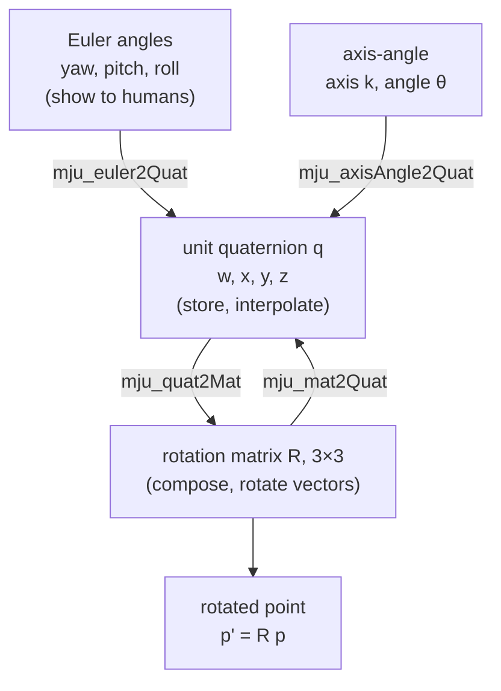

# 06 · Rotations: matrices, Euler angles, axis-angle, quaternions

<!-- meta -->
| | |
|---|---|
| **Part** | [2 · Spatial math](README.md) |
| **Run type** | CPU · Mac or Colab CPU |
| **Prerequisites** | [01](../part-1-simulation/01-world-as-text.md) |
| **Learn first** | [Linear Algebra Intuition](https://aiengineeringfromscratch.com/lesson?path=phases/01-math-foundations/01-linear-algebra-intuition) · [Matrix Transformations](https://aiengineeringfromscratch.com/lesson?path=phases/01-math-foundations/03-matrix-transformations) |
| **Time** | ~60 min |
| **Code** | [`experiments/06-rotations/experiment.py`](../experiments/06-rotations/experiment.py) |
| **Status** | ✅ done |
<!-- /meta -->

> Store orientation as a rotation matrix or a unit quaternion; use Euler angles only for display.

## The problem

Open any MuJoCo model with a free-floating body and look at its state vector. One free body has `nq = 7` position numbers (3 for position, 4 for a quaternion) but only `nv = 6` velocity numbers (3 linear, 3 angular); our run prints exactly that, with the default quaternion `[1, 0, 0, 0]`. Why would a simulator store four numbers for a three-dimensional quantity, and why do position and velocity have different sizes?

Because every three-number description of orientation breaks somewhere. With Euler angles, a gripper pitched to 90° loses one rotational direction: no finite Euler-angle rate produces it. This lesson measures where that happens and what it costs, and shows the representations that do not break.

## Core idea

### In plain words

Orientation answers "which way is this thing facing?". Think of a camera on a tripod head with three knobs: pan (turn left/right), tilt (look up/down) and roll (twist the picture). Three knob readings are **Euler angles**, easy for people to read, which is why every UI shows them.

Now tilt the camera straight up. Pan and roll now spin it about the same vertical line, and no knob turns it sideways from that pose: one direction is gone, **gimbal lock**. The camera can still point anywhere; it is the three-knob *description* that breaks, and it misbehaves in a whole neighbourhood of that pose.

The fix is to describe orientation without a sequence of turns. A **rotation matrix** writes down where the object's three axes point, in the parent's coordinates. A **unit quaternion** packs "turn by this angle about this axis" into four numbers. Neither has a bad pose; the quaternion's one quirk is that $q$ and $-q$ mean the same orientation, so code that compares or blends quaternions must check the sign.



### Rotations as code

```python
import numpy as np

def Rz(a):                         # rotation by angle a (rad) about the z axis
    c, s = np.cos(a), np.sin(a)
    return np.array([[c, -s, 0], [s, c, 0], [0, 0, 1]])
# Ry(a) and Rx(a) are built the same way about y and x

p = np.array([1.0, 0, 0])
Rz(np.pi / 2) @ p                  # active: rotate the vector          -> [0, 1, 0]
Rz(np.pi / 2).T @ p                # passive: same vector, coordinates in a frame turned +90° -> [0, -1, 0]

R = Rz(yaw) @ Ry(pitch) @ Rx(roll) # Euler z-y'-x'': composing = multiplying, and the order matters
q = np.r_[np.cos(angle / 2), np.sin(angle / 2) * axis]   # unit quaternion, scalar first (Build it: slerp too)
```

The two `Rz` lines are the two readings of one matrix, and the run prints exactly those vectors:

| Reading | Formula | Meaning |
|---|---|---|
| Active | $p' = R\,p$ | rotate the vector $p$ |
| Passive | $p_B = R_{AB}^\top\, p_A$ | same point, coordinates in a frame $B$ rotated by $R_{AB}$ |

| Representation | Formula | Bad poses |
|---|---|---|
| Rotation matrix | $R^\top R = I,\ \det R = +1$ | none |
| Euler angles z-y'-x'' | $R = R_z(\psi)R_y(\theta)R_x(\phi)$ | pitch $\theta = \pm 90°$ (gimbal lock) |
| Axis-angle (Rodrigues) | $R = I + \sin\theta\,K + (1-\cos\theta)\,K^2$ | – |
| Unit quaternion | $q = (\cos\tfrac{\theta}{2},\ \sin\tfrac{\theta}{2}\,\hat k)$ | none, but $q$ and $-q$ are the same rotation |

$R$ is a 3×3 matrix whose columns are the rotated frame's axes in the parent frame; $\psi, \theta, \phi$ are yaw, pitch and roll; in the axis-angle rows $\hat k$ is the unit rotation axis and $\theta$ the angle; $K = [\hat k]_\times$ is the matrix that computes a cross product, $Kv = \hat k \times v$; $q$ is written scalar first.

Composition is matrix multiplication and does **not** commute: $R_z(90°)R_x(90°)$ and $R_x(90°)R_z(90°)$ differ by a 120° rotation (measured below). In $R_{AC} = R_{AB} R_{BC}$, read left to right, each new rotation is about the axes of the frame just reached (intrinsic). To blend two orientations, use **slerp** (spherical linear interpolation) along the shortest arc, never a straight line in Euler angles.

Why Euler angles fail, in one line: the matrix $E$ that turns Euler-angle rates into the body's angular velocity has $\det E = \cos\theta$, which is zero at pitch ±90°.

<details>
<summary>Math details: the Euler-rate map, Rodrigues and slerp</summary>

**Euler-rate map.** For intrinsic z-y'-x'' (yaw $\psi$, pitch $\theta$, roll $\phi$) the body angular velocity is linear in the angle rates:

$$\omega_b = E(\theta,\phi)\begin{bmatrix}\dot\phi\\ \dot\theta\\ \dot\psi\end{bmatrix},\qquad E=\begin{bmatrix}1&0&-\sin\theta\\0&\cos\phi&\sin\phi\cos\theta\\0&-\sin\phi&\cos\phi\cos\theta\end{bmatrix},\qquad \det E=\cos\theta .$$

At $\theta = \pm 90°$ the first and third columns become parallel: roll and yaw turn the body about the same axis. That is gimbal lock, a singularity of the parameterization, not of the physical rotation. Near it, $E$ is still invertible but nearly singular, so producing an ordinary angular velocity needs very large angle rates (Break it).

**Rodrigues' formula.** Any rotation is an angle $\theta$ about a unit axis $\hat k$. With $K = [\hat k]_\times$ (the skew-symmetric cross-product matrix), $R = I + \sin\theta\,K + (1-\cos\theta)\,K^2$.

**Unit quaternions.** $q = (\cos\tfrac{\theta}{2},\ \sin\tfrac{\theta}{2}\,\hat k)$. Because of the half angle, turning by $\theta + 2\pi$ gives $-q$ for the same physical rotation: the **double cover**, $q$ and $-q$ are one rotation.

**Slerp** interpolates along the shortest great arc: $\mathrm{slerp}(q_0,q_1,t) = \frac{\sin((1-t)\Omega)}{\sin\Omega}q_0 + \frac{\sin(t\Omega)}{\sin\Omega}q_1$, $\cos\Omega = q_0\cdot q_1$, after flipping $q_1 \to -q_1$ if $q_0\cdot q_1 < 0$. Without the flip, the arc can cover the long way round.

Go deeper: AIEFS [Linear Algebra Intuition](https://aiengineeringfromscratch.com/lesson?path=phases/01-math-foundations/01-linear-algebra-intuition), [Matrix Transformations](https://aiengineeringfromscratch.com/lesson?path=phases/01-math-foundations/03-matrix-transformations); the rigorous treatment of $SO(3)$ (the group of all rotation matrices) and exponential coordinates is Lynch & Park, *Modern Robotics*, Ch. 3.

</details>

### In MuJoCo

MuJoCo writes quaternions scalar first; the null rotation is `1 0 0 0` ([MuJoCo modeling: frame orientations](https://mujoco.readthedocs.io/en/stable/modeling.html)). It converts between representations with `mju_euler2Quat` (sequence string; lowercase = intrinsic, uppercase = extrinsic), `mju_axisAngle2Quat`, `mju_quat2Mat`, `mju_mat2Quat`, `mju_mulQuat`, `mju_subQuat` ([API reference](https://mujoco.readthedocs.io/en/stable/APIreference/APIfunctions.html)). This answers the opening puzzle: orientation is stored as 4 quaternion numbers, an angular velocity as a 3-vector, so `nq` and `nv` differ.

<!-- figure: 06-gimbal-lock -->

## Build it

You will now write the rotation toolbox every later lesson uses, quaternion algebra, conversions, Euler angles and slerp, in about 80 lines of NumPy, and check each function against MuJoCo's `mju_*` routines and SciPy. Type the steps into your own file and run it after each step. The finished functions are in [`physai/spatial.py`](../physai/spatial.py), next to `quat_to_mat` and `axis_angle_to_mat` (the Rodrigues formula), which lesson 09 also uses; `uv run python experiments/06-rotations/build.py` runs all five steps with the checks (output in [`build_output.txt`](../experiments/06-rotations/build_output.txt)).

### Step 1 · Quaternion algebra

A unit quaternion $q = (w, x, y, z)$ composes by the Hamilton product, inverts by flipping the vector part, and rotates a vector by sandwiching it:

```python
def quat_mul(a, b):
    """Hamilton product a * b: the rotation b followed by a (as matrices, R(a) @ R(b))."""
    w1, x1, y1, z1 = a
    w2, x2, y2, z2 = b
    return np.array([w1 * w2 - x1 * x2 - y1 * y2 - z1 * z2,
                     w1 * x2 + x1 * w2 + y1 * z2 - z1 * y2,
                     w1 * y2 - x1 * z2 + y1 * w2 + z1 * x2,
                     w1 * z2 + x1 * y2 - y1 * x2 + z1 * w2])
```

```python
def quat_conj(q):
    """Conjugate (w, -x, -y, -z): the inverse rotation of a unit quaternion."""
    return np.array([q[0], -q[1], -q[2], -q[3]])
```

```python
def quat_rotate(q, v):
    """Rotate the 3-vector v by the unit quaternion q: the vector part of q * (0, v) * conj(q)."""
    return quat_mul(quat_mul(q, np.r_[0.0, v]), quat_conj(q))[1:]
```

The matrix of a quaternion is `quat_to_mat`, already in the file:

```python
def quat_to_mat(q):
    """Unit quaternion (w, x, y, z), MuJoCo's order, to a 3x3 rotation matrix."""
    w, x, y, z = q
    return np.array([
        [1 - 2 * (y * y + z * z), 2 * (x * y - w * z), 2 * (x * z + w * y)],
        [2 * (x * y + w * z), 1 - 2 * (x * x + z * z), 2 * (y * z - w * x)],
        [2 * (x * z - w * y), 2 * (y * z + w * x), 1 - 2 * (x * x + y * y)],
    ])
```

```text
== Step 1. Quaternion algebra vs MuJoCo (1000 random rotations) ==
quat_mul    vs mju_mulQuat     2.2e-16
quat_conj   vs mju_negQuat     0.0e+00
quat_rotate vs mju_rotVecQuat  1.3e-15
R(a * b) vs R(a) @ R(b)        1.2e-15
R(-q) vs R(q)                  0.0e+00
```

The product order matches matrix order, $R(a\,b) = R(a)\,R(b)$, and $-q$ gives exactly the same matrix (the double cover).

### Step 2 · Conversions

Axis-angle to quaternion is the half-angle formula. Matrix to quaternion needs care: reading $w = \tfrac12\sqrt{1 + \operatorname{tr} R}$ fails near 180°, where $w \to 0$. Shepperd's method picks whichever of $w, x, y, z$ is largest and divides by it:

```python
def axis_angle_to_quat(axis, angle):
    """Unit quaternion for a rotation by `angle` (rad) about the unit vector `axis`."""
    return np.r_[np.cos(angle / 2), np.sin(angle / 2) * np.asarray(axis, float)]
```

```python
def mat_to_quat(R):
    """Rotation matrix to unit quaternion with w >= 0 (Shepperd: divide by the largest of 4w^2, 4x^2, 4y^2, 4z^2)."""
    t = np.trace(R)
    cands = [t, R[0, 0] - R[1, 1] - R[2, 2], R[1, 1] - R[0, 0] - R[2, 2], R[2, 2] - R[0, 0] - R[1, 1]]
    i = int(np.argmax(cands))
    s = 2 * np.sqrt(1 + cands[i])                      # 4 times the largest component
    if i == 0:
        q = [s / 4, (R[2, 1] - R[1, 2]) / s, (R[0, 2] - R[2, 0]) / s, (R[1, 0] - R[0, 1]) / s]
    elif i == 1:
        q = [(R[2, 1] - R[1, 2]) / s, s / 4, (R[0, 1] + R[1, 0]) / s, (R[0, 2] + R[2, 0]) / s]
    elif i == 2:
        q = [(R[0, 2] - R[2, 0]) / s, (R[0, 1] + R[1, 0]) / s, s / 4, (R[1, 2] + R[2, 1]) / s]
    else:
        q = [(R[1, 0] - R[0, 1]) / s, (R[0, 2] + R[2, 0]) / s, (R[1, 2] + R[2, 1]) / s, s / 4]
    q = np.array(q)
    return q if q[0] >= 0 else -q
```

```text
== Step 2. Axis-angle and matrix -> quaternion vs MuJoCo and SciPy ==
axis_angle_to_quat vs mju_axisAngle2Quat       1.1e-16
mat_to_quat vs mju_mat2Quat (w >= 0)           5.6e-16
mat_to_quat vs SciPy as_quat(scalar_first)     2.2e-16
quat_to_mat(mat_to_quat(R)) round trip         7.8e-16
180 deg about x: mat_to_quat gives [0. 1. 0. 0.] (trace -1: the x branch)
```

MuJoCo and SciPy may return $-q$; comparing with $w \ge 0$ removes that sign.

### Step 3 · Euler angles both ways

```python
def euler_zyx_to_mat(yaw, pitch, roll):
    """Intrinsic z-y'-x'' Euler angles (rad) to a rotation matrix: Rz(yaw) @ Ry(pitch) @ Rx(roll)."""
    cy, sy, cp, sp, cr, sr = np.cos(yaw), np.sin(yaw), np.cos(pitch), np.sin(pitch), np.cos(roll), np.sin(roll)
    return np.array([[cy * cp, cy * sp * sr - sy * cr, cy * sp * cr + sy * sr],
                     [sy * cp, sy * sp * sr + cy * cr, sy * sp * cr - cy * sr],
                     [-sp, cp * sr, cp * cr]])
```

```python
def mat_to_euler_zyx(R):
    """Rotation matrix to (yaw, pitch, roll), pitch in [-pi/2, pi/2]; at pitch = +-90 deg yaw and roll are not unique."""
    pitch = np.arcsin(np.clip(-R[2, 0], -1, 1))
    return np.arctan2(R[1, 0], R[0, 0]), pitch, np.arctan2(R[2, 1], R[2, 2])
```

```text
== Step 3. Euler z-y'-x'' vs mju_euler2Quat('zyx') and SciPy from_euler('ZYX') ==
vs MuJoCo 'zyx' (lowercase = intrinsic there)  8.9e-16
vs SciPy 'ZYX' (uppercase = intrinsic there)   5.6e-16
vs SciPy 'zyx' (extrinsic: a different rotation) 2.00
mat_to_euler_zyx round trip, angles            9.9e-14 rad
pitch 89.0 deg: (yaw, roll) = (0.7, 0.3) and (0.9, 0.5) give matrices 3.2e-03 apart
pitch 90.0 deg: (yaw, roll) = (0.7, 0.3) and (0.9, 0.5) give matrices 1.1e-16 apart
```

The same three angles mean $R_z R_y R_x$ in MuJoCo's lowercase `"zyx"` and in SciPy's uppercase `"ZYX"`: the two libraries use opposite letter cases for intrinsic sequences, and SciPy's lowercase gives a different rotation. The last two lines are gimbal lock as numbers: at 90° two different (yaw, roll) pairs give one matrix, so no extraction can recover them.

### Step 4 · The Euler-rate matrix

```python
def euler_rate_matrix(pitch, roll):
    """E with body angular velocity w_b = E @ (roll', pitch', yaw') for z-y'-x'' angles; det E = cos(pitch)."""
    cp, sp, cr, sr = np.cos(pitch), np.sin(pitch), np.cos(roll), np.sin(roll)
    return np.array([[1, 0, -sp], [0, cr, sr * cp], [0, -sr, cr * cp]])
```

Check each column by finite differences: nudge one angle, and the body angular velocity is the skew part of $R^\top \dot R$.

```text
== Step 4. The Euler-rate matrix E (roll = 30 deg) ==
pitch  0.00 deg: det E 1.000e+00 (cos 1.000e+00) · cond      1.00 · |E - E_fd| 5e-11
pitch 60.00 deg: det E 5.000e-01 (cos 5.000e-01) · cond      3.73 · |E - E_fd| 8e-11
pitch 80.00 deg: det E 1.736e-01 (cos 1.736e-01) · cond     11.43 · |E - E_fd| 8e-11
pitch 89.00 deg: det E 1.745e-02 (cos 1.745e-02) · cond    114.59 · |E - E_fd| 7e-11
pitch 89.90 deg: det E 1.745e-03 (cos 1.745e-03) · cond   1145.92 · |E - E_fd| 7e-11
pitch 89.99 deg: det E 1.745e-04 (cos 1.745e-04) · cond  11459.16 · |E - E_fd| 7e-11
```

$\det E = \cos\theta$ to every printed digit, and the condition numbers are the Experiment's Step 2 table (11.43 at 80°, 114.59 at 89°).

### Step 5 · Slerp

```python
def slerp(q0, q1, t, shortest=True):
    """Spherical linear interpolation; with shortest=True flip q1 when q0 . q1 < 0 (q1 and -q1 are one rotation)."""
    dot = q0 @ q1
    if shortest and dot < 0:
        q1, dot = -q1, -dot
    om = np.arccos(np.clip(dot, -1, 1))
    if om < 1e-9:
        return q0.copy()
    return (np.sin((1 - t) * om) * q0 + np.sin(t * om) * q1) / np.sin(om)
```

```python
def quat_angle(q0, q1):
    """Angle (rad) of the rotation that takes orientation q0 to q1, in [0, pi]; q and -q give the same answer."""
    return 2 * np.arccos(np.clip(abs(q0 @ q1), 0, 1))
```

Interpolate 300 pairs that are 60° apart, half of them with $q_1$ replaced by $-q_1$, and add up the rotation travelled over 100 small steps:

```text
== Step 5. Slerp vs SciPy, and the sign check (300 pairs, 60 deg apart) ==
slerp(q0, q1, 0.3) vs SciPy Slerp (w >= 0): 3.3e-16 · pairs with q0.q1 < 0: 143
sign check True : rotation travelled min   60.0 deg, max   60.0 deg
sign check False: rotation travelled min   60.0 deg, max  300.0 deg
```

The Experiment's Break it, from your own slerp: the sign check is the difference between 60° and 300°. (This draw has 143 negative pairs, the Experiment's 156.)

### What you keep

`physai.spatial` now has `quat_mul`, `quat_conj`, `quat_rotate`, `axis_angle_to_quat`, `mat_to_quat`, `euler_zyx_to_mat`, `mat_to_euler_zyx`, `euler_rate_matrix`, `quat_angle` and `slerp`. Lesson 07 builds rigid transforms on them; lesson 09 reads body orientations with `quat_to_mat`. [`tests/test_06_rotations.py`](../tests/test_06_rotations.py) pins them to MuJoCo and SciPy; run `uv run pytest tests/test_06_rotations.py` after you change anything.

## Use it

MuJoCo's `mju_*` functions write into a preallocated output array, first argument:

```python
q = np.zeros(4)
mujoco.mju_euler2Quat(q, np.array([yaw, pitch, roll]), "zyx")   # intrinsic z-y'-x''
R = np.zeros(9); mujoco.mju_quat2Mat(R, q)                      # row-major 3x3, flattened
mujoco.mju_mulQuat(q_ab, q_a, q_b)                              # q_a * q_b
mujoco.mju_rotVecQuat(v_out, v, q)

from scipy.spatial.transform import Rotation
r = Rotation.from_quat(q, scalar_first=True)                    # SciPy's default order is (x, y, z, w)
r.as_euler("ZYX")                                               # uppercase = intrinsic in SciPy
```

| Tool | Quaternion order | Intrinsic z-y'-x'' |
|---|---|---|
| physai, MuJoCo | $(w, x, y, z)$ | `euler_zyx_to_mat`; `mju_euler2Quat(q, e, "zyx")` |
| SciPy `Rotation` | $(x, y, z, w)$ unless `scalar_first=True` | `from_euler("ZYX", e)`; lowercase is extrinsic |
| MJCF `euler="..."` | – | `<compiler eulerseq="zyx"/>`; the default is `"xyz"` (In MuJoCo above) |

Traps:

- **Letter case flips meaning.** Step 3: `"zyx"` is intrinsic in MuJoCo and extrinsic in SciPy, and nothing errors.
- **Matrices are flat.** `mju_quat2Mat` and `d.xmat` hold 9 numbers in row-major order; `reshape(3, 3)` before multiplying.
- **Signs of quaternions.** Two correct conversions can return $q$ and $-q$; compare rotations with `quat_angle`, not with `np.allclose` on the four numbers.

## Experiment

Script: [`experiments/06-rotations/experiment.py`](../experiments/06-rotations/experiment.py). MuJoCo 3.17.0, NumPy 2.5.4, Apple Silicon Mac (Apple M5), deterministic seeds, under 10 s.

**Predict first.** At what pitch does the Euler-rate map become a problem: 45°, 80°, or only at exactly 90°? And how far can naive Euler-angle interpolation stray from the true shortest rotation?

**Step 1 · conversions agree.** 1000 random rotations; hand-written matrices vs MuJoCo's functions.

```python
q = np.zeros(4)
mujoco.mju_euler2Quat(q, [yaw, pitch, roll], "zyx")   # intrinsic z-y'-x''
R = np.zeros(9); mujoco.mju_quat2Mat(R, q)
```

| Check (1000 random rotations) | max abs error |
|---|---|
| `mju_euler2Quat("zyx")` vs $R_zR_yR_x$ | 5.6e-16 |
| `mju_axisAngle2Quat` vs Rodrigues | 6.7e-16 |
| `mju_mat2Quat` → `mju_quat2Mat` round trip | 4.2e-16 |
| $q$ vs $-q$ matrix | 0.0e+00 |
| $\lvert R^\top R - I\rvert$ after 1000 compositions | 1.4e-14 |

**Step 2 · sweep pitch → conditioning of $E$.** The **condition number** cond(E) says how much $E$ can amplify relative errors when you invert it: 1 is perfect, infinity means a direction is lost. σ_min, the smallest singular value, is how much $E$ shrinks its weakest direction. The analytic $E$ is checked against central differences of $R$ (agreement ≤ 9.6e-11 in every row). Roll is fixed at 30°.

| pitch | det E | σ_min | cond(E) |
|---|---|---|---|
| 0° | 1.00 | 1.00 | 1.000 |
| 60° | 0.500 | 0.366 | 3.732 |
| 80° | 0.174 | 0.123 | 11.43 |
| 89° | 0.0175 | 0.0123 | 114.6 |
| 89.9° | 0.00175 | 0.00123 | 1146 |
| 89.99° | 0.000175 | 0.000123 | 11460 |
| 90° | 6.12e-17 | 3.40e-17 | inf |

The condition number grows like $1/\cos\theta$, already 11.43 at 80°: the trouble is a neighbourhood, not a point.

**Step 3 · sweep start pitch → interpolation error.** 300 pairs per row; the goal is the start rotated 60° about a random axis. Naive interpolation is linear in (yaw, pitch, roll), with yaw and roll wrapped the short way; slerp is the reference. "dev" is the largest angle between the two paths, "path/60" is how much rotation the Euler path really travels.

| start pitch | median dev | p95 dev | max dev | median path/60° | pairs with dev > 90° |
|---|---|---|---|---|---|
| 0° | 3.71° | 6.30° | 6.95° | 1.010 | 0 |
| 30° | 4.44° | 14.88° | 20.62° | 1.014 | 0 |
| 60° | 7.83° | 23.91° | 179.74° | 1.042 | 7 |
| 85° | 14.96° | 178.59° | 179.83° | 1.149 | 22 |
| 89° | 16.99° | 178.73° | 179.99° | 1.190 | 23 |


Even at pitch 0 the Euler path is not the shortest one (median 3.71° off). Near 90° the goal's pitch can cross the ±90° boundary; the extracted yaw and roll then jump by about 180°, and the interpolated orientation swings the long way round: up to 5.595 times the 60° it should travel.

## Break it

**Euler rates blow up.** Ask for a 1 rad/s body rotation about the direction $E$ loses at 90° (for roll 30°: $\omega_b \propto (0, \sin\phi, \cos\phi)$) and solve $E\,\dot{\boldsymbol\alpha} = \omega_b$:

| pitch | 0° | 60° | 85° | 89° | 89.9° | 89.99° |
|---|---|---|---|---|---|---|
| required ‖Euler rate‖ (rad/s) | 1.0 | 2.6 | 16.2 | 81.0 | 810.3 | 8102.8 |

A controller that commands Euler-angle rates would saturate its actuators (hit their speed or torque limit) for a perfectly ordinary motion. You will meet the same mechanism as a kinematic singularity in [lesson 10](../part-3-kinematics/10-inverse-kinematics.md): a matrix that maps rates to velocities loses rank.

**Slerp without the sign check.** Same 300 pairs 60° apart, but $q_1$ is replaced by $-q_1$ at random (same rotation). 156 of 300 pairs had $q_0\cdot q_1 < 0$. With the check, every path travels 60.0°; without it, the worst path travels 300.0°: the long way around, because the quaternion arc covers $360° - 60°$ of rotation.

## On the real robot

- The SO-101 joints are hinges (each turns about one fixed axis), so joint angles never suffer gimbal lock. The problem appears one level up: whenever you write a gripper orientation target as roll-pitch-yaw (teleoperation UIs, dataset labels, policy actions). Store and interpolate quaternions; convert to Euler angles only to show a human.
- Conventions differ between tools. MuJoCo puts the scalar first; its `eulerseq` compiler default is `"xyz"`, and the docs state that URDF's "rpy" corresponds to `"XYZ"` (extrinsic) in MJCF ([XML reference: compiler/eulerseq](https://mujoco.readthedocs.io/en/stable/XMLreference.html#compiler-eulerseq)). Many other libraries put the scalar last. Before trusting any logged orientation, convert one known rotation and check it.
- IMUs and camera trackers deliver orientation estimates with noise. Nothing in this lesson was measured on hardware; the numbers above are pure math in double precision.

## Check yourself

1. **Easy.** Is $R_x(90°)^\top$ the active rotation by −90° about x, or the passive change of coordinates into a frame rotated by +90°? (Answer both.)
2. **Medium.** Repeat Step 2 for the extrinsic sequence `"XYZ"` (each turn about the fixed parent axes). At which pitch is its rate map singular?
3. **Hard.** Modify `interp_stats` so naive interpolation first unwraps the goal's Euler triple to the branch closest to the start (try both $(\psi,\theta,\phi)$ and $(\psi\pm\pi, \pi-\theta, \phi\pm\pi)$). Does the max deviation at start pitch 85° fall below 90°? Does the median?

### Answers

1. Both: $R_x(90°)^\top = R_x(-90°)$ as an active rotation, and it also maps coordinates in the parent frame into a frame rotated by +90° about x.
2. Extrinsic X, then Y, then Z (fixed axes) gives $R = R_z(c)R_y(b)R_x(a)$: the same matrix as intrinsic z-y'-x''. So it is singular at the same place, middle angle ±90°. Check it by feeding the extrinsic sequence to `mju_euler2Quat` and comparing matrices.
3. Not computed in this lesson's script. Run it and compare with the Step 3 table; whatever you find, the median deviation at pitch 0 cannot reach zero, because a straight line in Euler angles is not a geodesic (shortest path) in $SO(3)$.

## Takeaways and sources

- Rotation matrices and unit quaternions are singularity-free; Euler angles have a rate map with $\det E = \cos\theta$, already cond 11.43 at 80° pitch.
- Never interpolate Euler angles; slerp with the $q_0\cdot q_1<0$ flip travels the true 60.0°, naive Euler paths travelled up to 5.595 times that.
- Know your convention: scalar-first vs scalar-last, intrinsic (lowercase) vs extrinsic (uppercase), active vs passive.

Next: [lesson 07 · Rigid transforms and frame trees](07-rigid-transforms.md).

**Sources**

- K. M. Lynch, F. C. Park, *Modern Robotics: Mechanics, Planning, and Control*, Cambridge Univ. Press, 2017, Ch. 3 "Rigid-Body Motions". [Book page and free preprint](https://hades.mech.northwestern.edu/index.php/Modern_Robotics).
- MuJoCo documentation: [Modeling · frame orientations](https://mujoco.readthedocs.io/en/stable/modeling.html), [XML reference · compiler/eulerseq](https://mujoco.readthedocs.io/en/stable/XMLreference.html#compiler-eulerseq), [API functions (`mju_*` math)](https://mujoco.readthedocs.io/en/stable/APIreference/APIfunctions.html).
