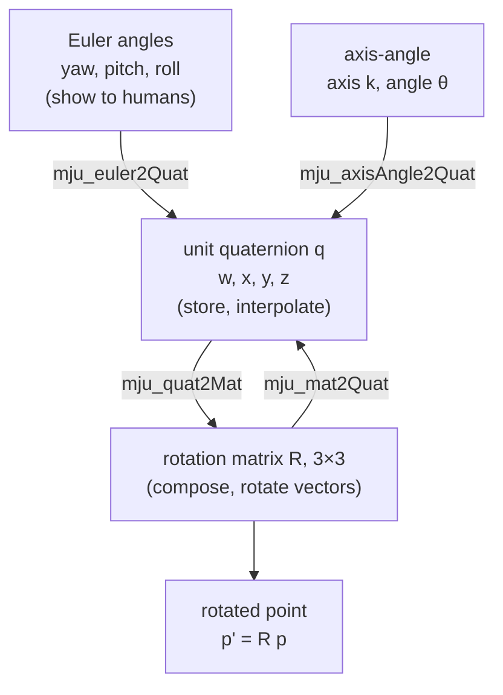

# 06 · Rotations: matrices, Euler angles, axis-angle, quaternions

<!-- meta -->
| | |
|---|---|
| **Part** | [2 · Spatial math](README.md) |
| **Run type** | CPU · Mac or Colab CPU |
| **Prerequisites** | [01](../part-1-simulation/01-world-as-text.md) |
| **Learn first** | [Linear Algebra Intuition](https://aiengineeringfromscratch.com/lesson?path=phases/01-math-foundations/01-linear-algebra-intuition) · [Matrix Transformations](https://aiengineeringfromscratch.com/lesson?path=phases/01-math-foundations/03-matrix-transformations) |
| **Time** | ~60 min |
| **Code** | [`experiments/06-rotations/experiment.py`](../experiments/06-rotations/experiment.py) |
| **Status** | ✅ done |
<!-- /meta -->

> Store orientation as a rotation matrix or a unit quaternion; use Euler angles only for display.

## The problem

Open any MuJoCo model with a free-floating body and look at its state vector. One free body has `nq = 7` position numbers (3 for position, 4 for a quaternion) but only `nv = 6` velocity numbers (3 linear, 3 angular); our run prints exactly that, with the default quaternion `[1, 0, 0, 0]`. Why would a simulator store four numbers for a three-dimensional quantity, and why do position and velocity have different sizes?

Because every three-number description of orientation breaks somewhere. With Euler angles, a gripper pitched to 90° loses one rotational direction: no finite Euler-angle rate produces it. This lesson measures where that happens and what it costs, and shows the representations that do not break.

## Core idea

### In plain words

Orientation answers "which way is this thing facing?". Think of a camera on a tripod head with three knobs: pan (turn left/right), tilt (look up/down) and roll (twist the picture). Three knob readings are **Euler angles**. They are easy for people to read, which is why every UI shows them.

Now tilt the camera straight up. Pan and roll now spin it about the same vertical line, and no knob turns the camera sideways from that pose. One direction is gone: that is **gimbal lock**. The camera can of course point anywhere; it is the three-knob *description* that breaks, and it misbehaves in a whole neighbourhood of that pose, not just at it.

The fix is to describe orientation without a sequence of turns. A **rotation matrix** simply writes down where the object's three axes point, as three arrows in the parent's coordinates. A **unit quaternion** packs "turn by this angle about this axis" into four numbers. Neither has a bad pose. The quaternion has one quirk: $q$ and $-q$ mean the same orientation, so code that compares or blends quaternions must check the sign.



### Rotations as code

```python
import numpy as np

def Rz(a):                         # rotation by angle a (rad) about the z axis
    c, s = np.cos(a), np.sin(a)
    return np.array([[c, -s, 0], [s, c, 0], [0, 0, 1]])
# Ry(a) and Rx(a) are built the same way about y and x

p = np.array([1.0, 0, 0])
Rz(np.pi / 2) @ p                  # active: rotate the vector          -> [0, 1, 0]
Rz(np.pi / 2).T @ p                # passive: same vector, coordinates in a frame turned +90° -> [0, -1, 0]

R = Rz(yaw) @ Ry(pitch) @ Rx(roll) # Euler z-y'-x'': composing = multiplying, and the order matters

def quat(axis, angle):             # axis: unit 3-vector, angle in rad
    return np.r_[np.cos(angle / 2), np.sin(angle / 2) * axis]   # scalar first, as in MuJoCo

def slerp(q0, q1, t):              # blend two orientations, t from 0 to 1
    if q0 @ q1 < 0:                # q1 and -q1 are the same rotation: take the short way
        q1 = -q1
    om = np.arccos(np.clip(q0 @ q1, -1, 1))   # angle between the quaternions
    return (np.sin((1 - t) * om) * q0 + np.sin(t * om) * q1) / np.sin(om)
```

The two `Rz` lines are the two readings of one matrix, and the run prints exactly those vectors:

| Reading | Formula | Meaning |
|---|---|---|
| Active | $p' = R\,p$ | rotate the vector $p$ |
| Passive | $p_B = R_{AB}^\top\, p_A$ | same point, coordinates in a frame $B$ rotated by $R_{AB}$ |

| Representation | Formula | Bad poses |
|---|---|---|
| Rotation matrix | $R^\top R = I,\ \det R = +1$ | none |
| Euler angles z-y'-x'' | $R = R_z(\psi)R_y(\theta)R_x(\phi)$ | pitch $\theta = \pm 90°$ (gimbal lock) |
| Axis-angle (Rodrigues) | $R = I + \sin\theta\,K + (1-\cos\theta)\,K^2$ | – |
| Unit quaternion | $q = (\cos\tfrac{\theta}{2},\ \sin\tfrac{\theta}{2}\,\hat k)$ | none, but $q$ and $-q$ are the same rotation |

$R$ is a 3×3 matrix whose columns are the rotated frame's axes in the parent frame; $\psi, \theta, \phi$ are yaw, pitch and roll; in the axis-angle rows $\hat k$ is the unit rotation axis and $\theta$ the angle; $K = [\hat k]_\times$ is the matrix that computes a cross product, $Kv = \hat k \times v$; $q$ is written scalar first.

Composition is matrix multiplication and does **not** commute: $R_z(90°)R_x(90°)$ and $R_x(90°)R_z(90°)$ differ by a 120° rotation (measured below). $R_{AC} = R_{AB} R_{BC}$: read left to right, each new rotation is about the axes of the frame you just reached (intrinsic). To blend two orientations, use **slerp** (spherical linear interpolation), which follows the shortest arc, never a straight line in Euler angles.

Why Euler angles fail, in one line: the matrix $E$ that turns Euler-angle rates into the body's angular velocity has $\det E = \cos\theta$, which is zero at pitch ±90°.

<details>
<summary>Math details: the Euler-rate map, Rodrigues and slerp</summary>

**Euler-rate map.** For intrinsic z-y'-x'' (yaw $\psi$, pitch $\theta$, roll $\phi$) the body angular velocity is linear in the angle rates:

$$\omega_b = E(\theta,\phi)\begin{bmatrix}\dot\phi\\ \dot\theta\\ \dot\psi\end{bmatrix},\qquad E=\begin{bmatrix}1&0&-\sin\theta\\0&\cos\phi&\sin\phi\cos\theta\\0&-\sin\phi&\cos\phi\cos\theta\end{bmatrix},\qquad \det E=\cos\theta .$$

At $\theta = \pm 90°$ the first and third columns become parallel: roll and yaw turn the body about the same axis. That is gimbal lock, a singularity of the parameterization, not of the physical rotation. Near it, $E$ is still invertible but nearly singular, so producing an ordinary angular velocity needs very large angle rates (Break it).

**Rodrigues' formula.** Any rotation is an angle $\theta$ about a unit axis $\hat k$. With $K = [\hat k]_\times$ (the skew-symmetric cross-product matrix), $R = I + \sin\theta\,K + (1-\cos\theta)\,K^2$.

**Unit quaternions.** $q = (\cos\tfrac{\theta}{2},\ \sin\tfrac{\theta}{2}\,\hat k)$. Because of the half angle, turning by $\theta + 2\pi$ gives $-q$ for the same physical rotation: the **double cover**, $q$ and $-q$ are one rotation.

**Slerp** interpolates along the shortest great arc: $\mathrm{slerp}(q_0,q_1,t) = \frac{\sin((1-t)\Omega)}{\sin\Omega}q_0 + \frac{\sin(t\Omega)}{\sin\Omega}q_1$, $\cos\Omega = q_0\cdot q_1$, after flipping $q_1 \to -q_1$ if $q_0\cdot q_1 < 0$. Without the flip, the arc can cover the long way round.

Go deeper: AIEFS [Linear Algebra Intuition](https://aiengineeringfromscratch.com/lesson?path=phases/01-math-foundations/01-linear-algebra-intuition), [Matrix Transformations](https://aiengineeringfromscratch.com/lesson?path=phases/01-math-foundations/03-matrix-transformations); the rigorous treatment of $SO(3)$ (the group of all rotation matrices) and exponential coordinates is Lynch & Park, *Modern Robotics*, Ch. 3.

</details>

### In MuJoCo

MuJoCo writes quaternions scalar first: its modeling guide writes the quaternion for an axis-angle rotation with the cosine term first, and the null rotation is `1 0 0 0` ([MuJoCo modeling: frame orientations](https://mujoco.readthedocs.io/en/stable/modeling.html)). It converts between representations with `mju_euler2Quat` (sequence string; lowercase = intrinsic, uppercase = extrinsic), `mju_axisAngle2Quat`, `mju_quat2Mat`, `mju_mat2Quat`, `mju_mulQuat`, `mju_subQuat` ([API reference](https://mujoco.readthedocs.io/en/stable/APIreference/APIfunctions.html)). This answers the opening puzzle: orientation is stored as 4 quaternion numbers, but an angular velocity is a plain 3-vector, so `nq` and `nv` differ.

<!-- figure: 06-gimbal-lock -->

## Experiment

Script: [`experiments/06-rotations/experiment.py`](../experiments/06-rotations/experiment.py). MuJoCo 3.17.0, NumPy 2.5.4, Apple Silicon Mac (Apple M5), deterministic seeds, under 10 s.

**Predict first.** At what pitch does the Euler-rate map become a problem: 45°, 80°, or only at exactly 90°? And how far can naive Euler-angle interpolation stray from the true shortest rotation?

**Step 1 · conversions agree.** 1000 random rotations; hand-written matrices vs MuJoCo's functions.

```python
q = np.zeros(4)
mujoco.mju_euler2Quat(q, [yaw, pitch, roll], "zyx")   # intrinsic z-y'-x''
R = np.zeros(9); mujoco.mju_quat2Mat(R, q)
```

| Check (1000 random rotations) | max abs error |
|---|---|
| `mju_euler2Quat("zyx")` vs $R_zR_yR_x$ | 5.6e-16 |
| `mju_axisAngle2Quat` vs Rodrigues | 6.7e-16 |
| `mju_mat2Quat` → `mju_quat2Mat` round trip | 4.2e-16 |
| $q$ vs $-q$ matrix | 0.0e+00 |
| $\lvert R^\top R - I\rvert$ after 1000 compositions | 1.4e-14 |

**Step 2 · sweep pitch → conditioning of $E$.** The **condition number** cond(E) says how much $E$ can amplify relative errors when you invert it: 1 is perfect, infinity means a direction is lost. σ_min, the smallest singular value, is how much $E$ shrinks its weakest direction. The analytic $E$ is checked against central differences of $R$ (agreement ≤ 9.6e-11 in every row). Roll is fixed at 30°.

| pitch | det E | σ_min | cond(E) |
|---|---|---|---|
| 0° | 1.00 | 1.00 | 1.000 |
| 60° | 0.500 | 0.366 | 3.732 |
| 80° | 0.174 | 0.123 | 11.43 |
| 89° | 0.0175 | 0.0123 | 114.6 |
| 89.9° | 0.00175 | 0.00123 | 1146 |
| 89.99° | 0.000175 | 0.000123 | 11460 |
| 90° | 6.12e-17 | 3.40e-17 | inf |

The condition number grows like $1/\cos\theta$: it is already 11.43 at 80°. The trouble is not a single point but a neighbourhood.

**Step 3 · sweep start pitch → interpolation error.** 300 pairs per row; the goal is the start rotated 60° about a random axis. Naive interpolation is linear in (yaw, pitch, roll), with yaw and roll wrapped the short way; slerp is the reference. "dev" is the largest angle between the two paths, "path/60" is how much rotation the Euler path really travels.

| start pitch | median dev | p95 dev | max dev | median path/60° | pairs with dev > 90° |
|---|---|---|---|---|---|
| 0° | 3.71° | 6.30° | 6.95° | 1.010 | 0 |
| 30° | 4.44° | 14.88° | 20.62° | 1.014 | 0 |
| 60° | 7.83° | 23.91° | 179.74° | 1.042 | 7 |
| 85° | 14.96° | 178.59° | 179.83° | 1.149 | 22 |
| 89° | 16.99° | 178.73° | 179.99° | 1.190 | 23 |


Even at pitch 0 the Euler path is not the shortest one (median 3.71° off). Near 90° the goal's pitch can cross the ±90° boundary; the extracted yaw and roll then jump by about 180°, and the interpolated orientation swings the long way round: up to 5.595 times the 60° it should travel.

## Break it

**Euler rates blow up.** Ask for a 1 rad/s body rotation about the direction $E$ loses at 90° (for roll 30°: $\omega_b \propto (0, \sin\phi, \cos\phi)$) and solve $E\,\dot{\boldsymbol\alpha} = \omega_b$:

| pitch | 0° | 60° | 85° | 89° | 89.9° | 89.99° |
|---|---|---|---|---|---|---|
| required ‖Euler rate‖ (rad/s) | 1.0 | 2.6 | 16.2 | 81.0 | 810.3 | 8102.8 |

A controller that commands Euler-angle rates would saturate its actuators (hit their speed or torque limit) to produce a perfectly ordinary motion. This is the same mechanism you will meet again as a kinematic singularity in [lesson 10](../part-3-kinematics/10-inverse-kinematics.md): a matrix that maps rates to velocities loses rank.

**Slerp without the sign check.** Same 300 pairs 60° apart, but $q_1$ is replaced by $-q_1$ at random (same rotation). 156 of 300 pairs had $q_0\cdot q_1 < 0$. With the check, every path travels 60.0°; without it, the worst path travels 300.0°: the long way around, because the quaternion arc covers $360° - 60°$ of rotation.

## On the real robot

- The SO-101 joints are hinges (each turns about one fixed axis), so joint angles never suffer gimbal lock. The problem appears one level up: whenever you write a gripper orientation target as roll-pitch-yaw (teleoperation UIs, dataset labels, policy actions). Store and interpolate quaternions; convert to Euler angles only to show a human.
- Conventions differ between tools. MuJoCo puts the scalar first; its `eulerseq` compiler default is `"xyz"`, and the docs state that URDF's "rpy" corresponds to `"XYZ"` (extrinsic) in MJCF ([XML reference: compiler/eulerseq](https://mujoco.readthedocs.io/en/stable/XMLreference.html#compiler-eulerseq)). Many other libraries put the scalar last. Before trusting any logged orientation, convert one known rotation and check it.
- IMUs and camera trackers deliver orientation estimates with noise. Nothing in this lesson was measured on hardware; the numbers above are pure math in double precision.

## Check yourself

1. **Easy.** Is $R_x(90°)^\top$ the active rotation by −90° about x, or the passive change of coordinates into a frame rotated by +90°? (Answer both.)
2. **Medium.** Repeat Step 2 for the extrinsic sequence `"XYZ"` (each turn about the fixed parent axes). At which pitch is its rate map singular?
3. **Hard.** Modify `interp_stats` so naive interpolation first unwraps the goal's Euler triple to the branch closest to the start (try both $(\psi,\theta,\phi)$ and $(\psi\pm\pi, \pi-\theta, \phi\pm\pi)$). Does the max deviation at start pitch 85° fall below 90°? Does the median?

### Answers

1. Both: $R_x(90°)^\top = R_x(-90°)$ as an active rotation, and it also maps coordinates in the parent frame into a frame rotated by +90° about x.
2. Extrinsic X, then Y, then Z (fixed axes) gives $R = R_z(c)R_y(b)R_x(a)$: the same matrix as intrinsic z-y'-x''. So it is singular at the same place, middle angle ±90°. Check it by feeding the extrinsic sequence to `mju_euler2Quat` and comparing matrices.
3. Not computed in this lesson's script. Run it and compare with the Step 3 table; whatever you find, the median deviation at pitch 0 cannot reach zero, because a straight line in Euler angles is not a geodesic (shortest path) in $SO(3)$.

## Takeaways and sources

- Rotation matrices and unit quaternions are singularity-free; Euler angles have a rate map with $\det E = \cos\theta$, already cond 11.43 at 80° pitch.
- Never interpolate Euler angles; slerp with the $q_0\cdot q_1<0$ flip travels the true 60.0°, naive Euler paths travelled up to 5.595 times that.
- Know your convention: scalar-first vs scalar-last, intrinsic (lowercase) vs extrinsic (uppercase), active vs passive.

Next: [lesson 07 · Rigid transforms and frame trees](07-rigid-transforms.md).

**Sources**

- K. M. Lynch, F. C. Park, *Modern Robotics: Mechanics, Planning, and Control*, Cambridge Univ. Press, 2017, Ch. 3 "Rigid-Body Motions". [Book page and free preprint](https://hades.mech.northwestern.edu/index.php/Modern_Robotics).
- MuJoCo documentation: [Modeling · frame orientations](https://mujoco.readthedocs.io/en/stable/modeling.html), [XML reference · compiler/eulerseq](https://mujoco.readthedocs.io/en/stable/XMLreference.html#compiler-eulerseq), [API functions (`mju_*` math)](https://mujoco.readthedocs.io/en/stable/APIreference/APIfunctions.html).
