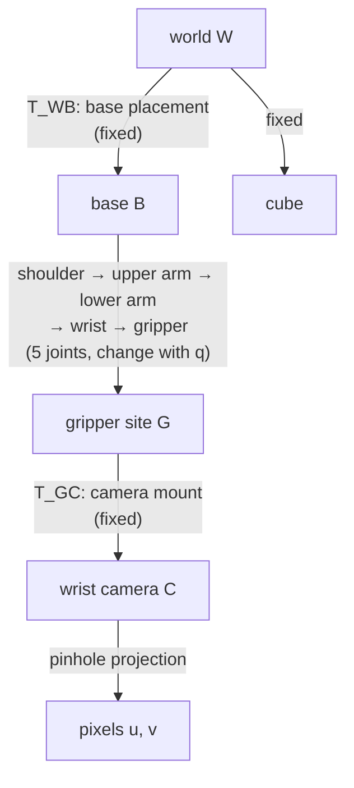

# 07 · Rigid transforms and frame trees

<!-- meta -->
| | |
|---|---|
| **Part** | [2 · Spatial math](README.md) |
| **Run type** | CPU · Mac or Colab CPU |
| **Prerequisites** | [06](06-rotations.md) |
| **Learn first** | [Vectors, Matrices & Operations](https://aiengineeringfromscratch.com/lesson?path=phases/01-math-foundations/02-vectors-matrices-operations) · [Matrix Transformations](https://aiengineeringfromscratch.com/lesson?path=phases/01-math-foundations/03-matrix-transformations) |
| **Time** | ~45 min |
| **Code** | [`experiments/07-rigid-transforms/experiment.py`](../experiments/07-rigid-transforms/experiment.py) |
| **Status** | ✅ done |
<!-- /meta -->

> Every point is a number triple only together with the name of its frame; a transform is how you change that name.

## The problem

The Menagerie SO-101 model carries a wrist camera (`wrist_cam`, vertical field of view 61°, defined on the gripper in [`so101.xml`](https://github.com/google-deepmind/mujoco_menagerie/blob/f3b6013/robotstudio_so101/so101.xml)). A detector finds a cube in that image. To grasp it, the arm needs the cube in its **base** frame; to close the jaws, in the **gripper** frame; to log it with other robots, in the **world** frame. Each of these is a different triple of numbers for the same physical point, and they change every time a joint moves.

Mixing them up does not crash anything. It silently sends the gripper 10 to 42 cm away from the cube (measured below). This lesson builds the four transforms by hand and checks them against MuJoCo.

## Core idea

### In plain words

"The cube is 15 cm in front of me" is only useful if you know where "me" is and which way I face. Compare it with a GPS coordinate, which means the same thing to everyone. A **frame** is such a reference: an origin plus three axis directions. The world frame is the GPS of the scene; the base, gripper and camera frames are "in front of me" for each part of the robot. The same cube has a different number triple in each.

A **rigid transform** is the recipe for converting between two frames: rotate (lesson 06), then shift. If you know where the gripper is in the base frame and where the camera is in the gripper frame, you can chain the two recipes to get the camera in the base frame. In code that is plain function composition: `world_from_base(base_from_gripper(gripper_from_camera(p)))`. Naming transforms "A from B" keeps the chain honest: neighbouring letters must match, like units.

A robot is a tree of such frames, the **frame tree**. Some edges are fixed (where the base is bolted, where the camera is screwed onto the gripper); others change whenever a joint turns.



### Transforms as code

```python
import numpy as np

# T(R, t) builds [R t; 0 1]; T_inv(M) = [R^T  -R^T t; 0 1] (Build it, Step 1 writes both)
# Naming: T_AB maps coordinates in frame B to coordinates in frame A ("A from B").
p_B = np.array([x, y, z, 1.0])   # homogeneous point: append a 1 so the shift is part of the product
p_A = T_AB @ p_B                 # B -> A
T_AC = T_AB @ T_BC               # chain = composition; the inner letters cancel
p_B = T_inv(T_AB) @ p_A          # A -> B
```

The pose of frame $B$ in frame $A$ is a rotation $R_{AB}$ plus the position $t_{AB}$ of $B$'s origin in $A$, packed in a 4×4 **homogeneous transform**:

$$T_{AB} = \begin{bmatrix} R_{AB} & t_{AB} \\ 0 & 1\end{bmatrix},\qquad p_A = T_{AB}\,p_B\ \ (\text{with } p = [x\ y\ z\ 1]^\top).$$

| Operation | Formula | Rule of thumb |
|---|---|---|
| Compose | $T_{AC} = T_{AB}\,T_{BC}$ | inner subscripts cancel |
| Invert | $T_{AB}^{-1} = T_{BA} = \begin{bmatrix} R^\top & -R^\top t \\ 0 & 1\end{bmatrix}$ | never call a general matrix inverse |
| Change frame of a point | $p_B = T_{AB}^{-1}\,p_A$ | the subscript you want goes on the right |

$T_{AB}$ is the transform that takes coordinates in $B$ to coordinates in $A$; $R_{AB}$ is its 3×3 rotation and $t_{AB}$ its translation in metres; $p_A$ and $p_B$ are the same physical point written in frames $A$ and $B$, with a 1 appended.

<details>
<summary>Math details: why the inverse is cheap and why distances survive</summary>

**Homogeneous coordinates.** Appending a 1 to a point turns "rotate, then add $t$" into a single matrix product, $T p = [Rp + t;\ 1]$. That is what makes chains of transforms a chain of multiplications.

**Closed-form inverse.** Solve $p_A = R p_B + t$ for $p_B$: $p_B = R^{-1}(p_A - t) = R^\top p_A - R^\top t$, because a rotation matrix satisfies $R^\top R = I$. This is exact and cheaper than a general inverse; the experiment checks it against `np.linalg.inv`.

**Distances are preserved.** For two points, $\lVert T p - T p'\rVert = \lVert R(p - p')\rVert = \lVert p - p'\rVert$. So if two frames are rigidly attached (a constant transform between them), any point moves by the same distance in both: Result 3 shows this for the gripper and the camera.

**Which coordinates change when a joint moves.** $p_F = T_{WF}^{-1}\,p_W$. A joint changes $T_{WF}$ only if it lies on the path from the world to $F$ in the tree, so a joint downstream of $F$ cannot change $F$-coordinates.

Go deeper: AIEFS [Vectors, Matrices & Operations](https://aiengineeringfromscratch.com/lesson?path=phases/01-math-foundations/02-vectors-matrices-operations), [Matrix Transformations](https://aiengineeringfromscratch.com/lesson?path=phases/01-math-foundations/03-matrix-transformations); Lynch & Park, *Modern Robotics*, Ch. 3.

</details>

### Frame trees in MuJoCo

MuJoCo computes the world pose of every node and stores it in `mjData` ([API reference](https://mujoco.readthedocs.io/en/stable/APIreference/APIfunctions.html)):

| Object | Position | Orientation | Filled by |
|---|---|---|---|
| body (regular frame) | `xpos` | `xmat`, `xquat` | `mj_kinematics` |
| body inertial frame | `xipos` | `ximat` | `mj_kinematics` |
| site | `site_xpos` | `site_xmat` | `mj_kinematics` |
| camera | `cam_xpos` | `cam_xmat` | `mj_camlight` (part of `mj_forward`) |

A **site** is a named, massless frame attached to a body, used to mark points such as the tool tip. Two conventions to memorize. A MuJoCo camera looks along the **−z** axis of its frame, with +x right and +y up in the image ([XML reference: camera](https://mujoco.readthedocs.io/en/stable/XMLreference.html#body-camera)). In a `framepos` sensor, `objtype/reftype="body"` means the body's **inertial** frame (origin at the centre of mass), while `"xbody"` means its regular frame ([XML reference: framepos](https://mujoco.readthedocs.io/en/stable/XMLreference.html#sensor-framepos)).

## Build it

You will now write 4 × 4 transforms and the walk down MuJoCo's frame tree in about 50 lines of NumPy, compute every frame of the Experiment's scene from the model file and `qpos` alone, and check each step against MuJoCo. The model is the Experiment's: SO-101 base moved and yawed 30°, a free cube on the table. Type the steps into your own file and run it after each step. The finished functions are in [`physai/spatial.py`](../physai/spatial.py), next to lesson 06's rotations; `uv run python experiments/07-rigid-transforms/build.py` runs all five steps with the checks (output in [`build_output.txt`](../experiments/07-rigid-transforms/build_output.txt)).

### Step 1 · A transform, its inverse, a composition

```python
def transform(R, t):
    """4x4 homogeneous transform from a 3x3 rotation R and a translation t."""
    T = np.eye(4)
    T[:3, :3], T[:3, 3] = np.asarray(R).reshape(3, 3), t
    return T
```

```python
def transform_inv(T):
    """Closed-form inverse [R t; 0 1]^-1 = [R^T  -R^T t; 0 1]."""
    R, t = T[:3, :3], T[:3, 3]
    return transform(R.T, -R.T @ t)
```

```python
def transform_point(T, p):
    """Apply T to a point: R p + t (the homogeneous 1 is implicit)."""
    return T[:3, :3] @ p + T[:3, 3]
```

MuJoCo stores poses as a position and a scalar-first quaternion; lesson 06's `quat_to_mat` turns one into a transform:

```python
def pose_to_transform(pos, quat):
    """MuJoCo's (pos, quat) pair, quat scalar first, as a 4x4 transform."""
    return transform(quat_to_mat(quat), pos)
```

MuJoCo's own pose algebra is `mju_negPose` (inverse) and `mju_mulPose` (composition):

```text
== Step 1. Transforms: inverse and composition (1000 random poses) ==
transform_inv vs np.linalg.inv   1.6e-15
transform_inv vs mju_negPose     4.4e-16
T_a @ T_b vs mju_mulPose         1.1e-15
```

### Step 2 · Walk the frame tree

Every body's pose is its parent's pose, times its fixed offset (`body_pos`, `body_quat`, the pose at `qpos0`), times one motion per joint. A hinge turns about its axis through the joint's anchor `jnt_pos`, so the turn is sandwiched between "move to the anchor" and "move back"; a slide translates; a free joint's `qpos` is the world pose itself.

```python
def frame_tree(m, qpos):
    """World pose (4x4) of every body, walking MuJoCo's tree from static model data and qpos alone."""
    T = [np.eye(4)]                                    # body 0 is the world
    for b in range(1, m.nbody):
        Tb = T[m.body_parentid[b]] @ pose_to_transform(m.body_pos[b], m.body_quat[b])   # pose at qpos0
        for j in range(m.body_jntadr[b], m.body_jntadr[b] + m.body_jntnum[b]):
            a, kind = m.jnt_qposadr[j], m.jnt_type[j]
            if kind == 0:                              # free: qpos holds the world pose itself
                Tb = pose_to_transform(qpos[a:a + 3], qpos[a + 3:a + 7])
                continue
            anchor = transform(np.eye(3), m.jnt_pos[j])
            if kind == 1:                              # ball: rotate by the quaternion about the anchor
                move = pose_to_transform(np.zeros(3), qpos[a:a + 4])
            elif kind == 2:                            # slide: translate along the axis
                move = transform(np.eye(3), m.jnt_axis[j] * (qpos[a] - m.qpos0[a]))
            else:                                      # hinge: rotate about the axis through the anchor
                move = transform(axis_angle_to_mat(m.jnt_axis[j], qpos[a] - m.qpos0[a]), np.zeros(3))
            Tb = Tb @ anchor @ move @ transform_inv(anchor)
        T.append(Tb)
    return T
```

Bodies are stored parent before child, so one pass in index order is enough:

```text
== Step 2. Frame-tree walk vs MuJoCo's xpos / xmat (every body, 50 random arm poses) ==
10 bodies (world, 8 SO-101 links, the free cube) · max |pos error| 2.2e-16 m · max |rotation error| 1.0e-15
```

Your walk reproduces `mj_kinematics` for all ten bodies, the free cube included, from static model numbers and `qpos`.

### Step 3 · Frames hanging off bodies

Sites, cameras and a body's inertial frame are fixed offsets from a body: one more product each.

```python
T_WG = T[m.site_bodyid[s]] @ pose_to_transform(m.site_pos[s], m.site_quat[s])     # gripper site
T_WC = T[m.cam_bodyid[c]] @ pose_to_transform(m.cam_pos[c], m.cam_quat[c])        # wrist camera
T_WI = T[b] @ pose_to_transform(m.body_ipos[b], m.body_iquat[b])                 # inertial frame
```

```text
== Step 3. Frames hanging off bodies: site, camera, inertial frame ==
site gripperframe    max error 4.4e-16
camera wrist_cam     max error 6.4e-16
base inertial frame  max error 3.5e-15
```

### Step 4 · The cube in every frame

"The cube in frame F" is $T_{WF}^{-1}\,p_W$:

```text
== Step 4. The cube in each frame: our transforms vs the framepos sensors ==
base B                0.2200  0.0000  0.0150 m · max |ours - sensor| 2.8e-17
gripper G             0.0806 -0.0290 -0.0205 m · max |ours - sensor| 1.0e-16
camera C             -0.0064 -0.0011 -0.1508 m · max |ours - sensor| 1.1e-16
base INERTIAL frame  -0.0044  0.0397  0.2032 m · max |ours - sensor| 7.4e-16
inertial frame vs regular frame of the base: 295.5 mm apart
```

Result 1 of the Experiment, now without reading a single pose from `mjData`, and the 295.5 mm trap explained: `reftype="body"` measures from the base's inertial frame, whose offset and rotation are `body_ipos`, `body_iquat`.

### Step 5 · Use them

With the camera-frame point, the pinhole formula from Result 2 gives pixels; with the gripper transform, each Break it mistake is one wrong line:

```text
== Step 5. Use the transforms: pixels, and five ways to get the cube into the gripper frame ==
f = 407.4 px · cube centre at u = 302.7, v = 242.8 px (camera looks along -z, image v grows downward)
T_WG^-1 p (correct)              error    0.0 mm
R (p - t): R instead of R^T      error  101.0 mm
(T_BG T_WB)^-1 p: wrong order    error  103.2 mm
R^T p: forgot the translation    error  274.3 mm
T_WG p: transform, not inverse   error  424.4 mm
chain: max |T_WB @ T_BG - T_WG| = 1.1e-16
```

The Experiment's numbers, from your own transforms.

### What you keep

`physai.spatial` now has `transform`, `transform_inv`, `transform_point`, `pose_to_transform` and `frame_tree`. Lesson 08 turns the walk into forward kinematics of the arm, lesson 19 calibrates the camera transform $T_{GC}$. [`tests/test_07_rigid_transforms.py`](../tests/test_07_rigid_transforms.py) pins them to MuJoCo; run `uv run pytest tests/test_07_rigid_transforms.py` after you change anything.

## Use it

MuJoCo computes the whole tree in `mj_kinematics` (cameras in `mj_camlight`; `mj_forward` calls both) and leaves the results in `mjData`:

```python
mujoco.mj_forward(m, d)
T_WB = transform(d.xmat[b], d.xpos[b])                  # body b (regular frame)
T_WG = transform(d.site_xmat[s], d.site_xpos[s])        # site s
T_WC = transform(d.cam_xmat[c], d.cam_xpos[c])          # camera c: looks along its -z
pos, quat = np.zeros(3), np.zeros(4)
mujoco.mju_mulPose(pos, quat, pos_a, quat_a, pos_b, quat_b)   # compose without 4x4 matrices
mujoco.mju_negPose(pos, quat, pos_a, quat_a)                  # invert
```

| Tool | Pose stored as | Camera looks along |
|---|---|---|
| physai | 4 × 4 `T_AB` (B to A) | – |
| MuJoCo | `xpos` + `xmat` (9 numbers, row-major) or `xquat` (scalar first) | −z, +y up |
| OpenCV | `rvec` (axis-angle) + `tvec`, world to camera | +z, +y down (On the real robot) |

Traps:

- **Stale frames.** `xpos`, `xmat` are only as fresh as the last `mj_kinematics`/`mj_forward`; set `qpos` and forget the call, and every frame is the previous pose's.
- **`mj_kinematics` skips cameras.** `cam_xpos`, `cam_xmat` come from `mj_camlight`, which `mj_forward` runs (the Experiment's script uses `mj_forward` for this reason).
- **Body vs inertial frame.** `xpos`/`xmat` are the body frame, `xipos`/`ximat` the centre-of-mass frame (Step 4: 295.5 mm apart here).

## Experiment

Script: [`experiments/07-rigid-transforms/experiment.py`](../experiments/07-rigid-transforms/experiment.py). MuJoCo 3.17.0, NumPy 2.5.4, Apple Silicon Mac (Apple M5), deterministic, about 2 s.

**Setup.** The SO-101 base is moved with `MjSpec` (MuJoCo's API for editing a model in code) to (0.10, −0.05, 0) m and yawed 30°, so world ≠ base. A 3 cm cube sits on the table at (0.2905, 0.0600, 0.015) m in world. The arm is in a pose where the wrist camera sees the cube. Four `framepos` sensors report the cube in base (`xbody`), base (`body`), gripper site and camera.

**Predict first.** When you rotate `shoulder_pan`, which of the four coordinate triples of the (unmoving) cube change?

```python
def T_inv(M):
    R, t = M[:3, :3], M[:3, 3]
    return T(R.T, -R.T @ t)

F = {"B": T(d.xmat[base], d.xpos[base]),
     "G": T(d.site_xmat[site], d.site_xpos[site]),
     "C": T(d.cam_xmat[cam], d.cam_xpos[cam])}
cube_in = {k: (T_inv(Tw) @ np.append(p_world, 1))[:3] for k, Tw in F.items()}
```

**Result 1 · hand transforms vs MuJoCo.**

| Frame | cube by hand (m) | max abs diff vs sensor |
|---|---|---|
| world W | (0.2905, 0.0600, 0.0150) | – |
| base B | (0.2200, 0.0000, 0.0150) | 2.8e-17 |
| gripper G (site `gripperframe`) | (0.0806, −0.0290, −0.0205) | 1.4e-17 |
| camera C (`wrist_cam`) | (−0.0064, −0.0011, −0.1508) | 4.1e-17 |

The closed-form inverse matches `np.linalg.inv` to 1.1e-15, and $T_{WB}T_{BG}$ reproduces $T_{WG}$ to 5.6e-17. The camera triple has $z = -0.1508$ m: the cube is 15 cm in front of the lens, almost on the optical axis (the line straight out of the lens).

**Result 2 · from camera frame to pixels.** A pinhole camera divides by depth: a point twice as far lands twice as close to the image centre. With focal length $f = (H/2)/\tan(\text{fovy}/2) = 407.4$ px at 640×480, the cube centre projects to $u = 302.7$, $v = 242.8$ px ($u = W/2 + f x/(-z)$, $v = H/2 - f y/(-z)$). Projecting the 8 cube corners and filling their convex hull gives a silhouette with IoU (overlap area divided by union area) 0.979 against MuJoCo's rendered segmentation mask (9643 vs 9454 px), centroid offset 0.74 px. The silhouette, not the centroid, is the right check (see On the real robot).

**Result 3 · sweep `shoulder_pan`.** Other joints fixed; coordinates in cm.

| pan | cube in B | cube in G | cube in C | gripper site in W |
|---|---|---|---|---|
| −40° | 22.00, 0.00, 1.50 | 5.30, 2.62, 11.15 | 12.62, 2.90, −9.83 | 18.88, 9.21, 8.26 |
| 0° | 22.00, 0.00, 1.50 | 8.16, −1.46, −0.19 | 1.23, 1.14, −14.39 | 25.47, 2.79, 8.26 |
| 40° | 22.00, 0.00, 1.50 | 5.30, −10.68, −7.96 | −6.62, −8.08, −17.01 | 26.40, −6.36, 8.26 |

Then every arm joint is swept ±30° around the pose (kinematics only, limits not enforced):

| Joint swept | max change in W | in B | in G | in C | drift of $T_{GC}$ |
|---|---|---|---|---|---|
| shoulder_pan | 0.00 mm | 0.00 mm | 93.77 mm | 93.77 mm | 7.8e-16 |
| shoulder_lift | 0.00 | 0.00 | 93.44 | 93.44 | 7.8e-16 |
| elbow_flex | 0.00 | 0.00 | 150.07 | 150.07 | 7.8e-16 |
| wrist_flex | 0.00 | 0.00 | 124.53 | 124.53 | 5.6e-16 |
| wrist_roll | 0.00 | 0.00 | 15.74 | 15.74 | 5.6e-16 |

Coordinates in a frame change only when a joint lies **between** that frame and the world in the tree. Base coordinates never change; gripper and camera coordinates change by exactly the same distance, because $T_{GC}$ is constant (drift ≤ 7.8e-16) and a rigid transform preserves distances. `wrist_roll` changes the gripper-frame coordinates least (15.74 mm): turning by up to 30° about the roll axis moves them by $2r\sin 15°$, with $r$ the cube's distance from that axis, so the cube is only about 30 mm off it.

## Break it

Five ways to compute the cube in the gripper frame, scored against the sensor:

| Computation | error |
|---|---|
| $T_{WG}^{-1}\,p$ (correct) | 0.0 mm |
| $R\,(p - t)$: R instead of Rᵀ (active/passive confusion) | 101.0 mm |
| $(T_{BG}\,T_{WB})^{-1}\,p$: wrong composition order | 103.2 mm |
| $R^\top p$: forgot the translation | 274.3 mm |
| $T_{WG}\,p$: used the transform instead of its inverse | 424.4 mm |

And the subtle one: a `framepos` sensor with `reftype="body"` reads (−0.0044, 0.0397, 0.2032) m, 295.5 mm away from the true base-frame value, because it uses the base's inertial frame, whose origin is at the centre of mass and whose axes are the principal axes of inertia. None of these errors throws an exception.

## On the real robot

- On hardware there is no `framepos` sensor; $T_{WB}$ (where the base is bolted) and $T_{GC}$ (where the camera sits on the gripper) must be **measured** by calibration (see [lesson 19](../part-5-perception-and-estimation/19-camera-calibration.md)). The model's $T_{GC}$ is a CAD value. Not yet measured on the real arm.
- OpenCV's pinhole model projects $u = f_x X_c/Z_c + c_x$, $v = f_y Y_c/Z_c + c_y$ with pixel rows growing downward, i.e. +z forward and +y down ([calib3d.hpp](https://github.com/opencv/opencv/blob/4.x/modules/calib3d/include/opencv2/calib3d.hpp)). A MuJoCo camera-frame point becomes an OpenCV one by a 180° rotation about x: $(x, y, z) \to (x, -y, -z)$. Getting this wrong flips the image.
- Do not use blob centroids as projected centres. In Result 2 the rendered mask centroid is $u = 299.3$, $v = 240.3$ px, while the centre projects to $u = 302.7$, $v = 242.8$ px: under perspective, the centroid of a solid's image is not the image of its centre. For calibration use corners or keypoints.

## Check yourself

1. **Easy.** In Result 3, why is the gripper site's world z constant (8.26 cm) for every pan angle?
2. **Medium.** Write $T_{BC}$ in terms of the `T_inv` and the dictionary `F`. Which joints does it depend on?
3. **Hard.** Add a `framequat` sensor for the cube with `reftype="camera"` and verify $R_{CW}R_{W,\text{cube}}$ by hand. What is the max error?

### Answers

1. The pan axis is vertical (base is only yawed), so rotating about it keeps every point at its height.
2. $T_{BC}$ = `T_inv(F["B"]) @ F["C"]`. It depends on all five arm joints, and on none of the base placement.
3. Not computed in this lesson's script; compare your error with the position errors of Result 1.

## Takeaways and sources

- $p_B = T_{AB}^{-1}p_A$ with the closed-form inverse; in this setup hand transforms matched MuJoCo to ≤ 4.1e-17 m.
- A joint changes coordinates only in frames downstream of it in the tree; base coordinates of the cube stayed at 0.00 mm change while gripper/camera coordinates moved up to 150.07 mm.
- Know the frame conventions: camera −z forward (MuJoCo), `body` = inertial frame vs `xbody` = regular frame (295.5 mm trap).

Next: [lesson 08 · Forward kinematics, degrees of freedom and workspace](../part-3-kinematics/08-forward-kinematics.md).

**Sources**

- K. M. Lynch, F. C. Park, *Modern Robotics*, Ch. 3 "Rigid-Body Motions" (homogeneous transforms). [Book page](https://hades.mech.northwestern.edu/index.php/Modern_Robotics).
- MuJoCo: [XML reference · camera](https://mujoco.readthedocs.io/en/stable/XMLreference.html#body-camera), [XML reference · framepos](https://mujoco.readthedocs.io/en/stable/XMLreference.html#sensor-framepos), [API functions](https://mujoco.readthedocs.io/en/stable/APIreference/APIfunctions.html).
- SO-101 model: [MuJoCo Menagerie `robotstudio_so101`](https://github.com/google-deepmind/mujoco_menagerie/blob/f3b6013/robotstudio_so101/so101.xml) (Apache-2.0).
