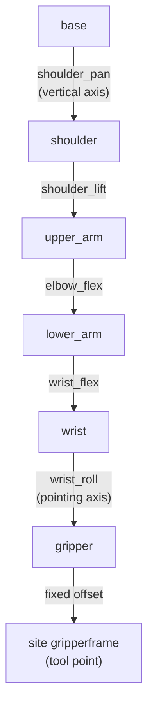

# 08 · Forward kinematics, degrees of freedom and workspace

<!-- meta -->
| | |
|---|---|
| **Part** | [3 · Kinematics](README.md) |
| **Run type** | CPU · Mac or Colab CPU |
| **Prerequisites** | [07](../part-2-spatial-math/07-rigid-transforms.md) |
| **Learn first** | [Matrix Transformations](https://aiengineeringfromscratch.com/lesson?path=phases/01-math-foundations/03-matrix-transformations) |
| **Time** | ~45 min |
| **Code** | [`experiments/08-forward-kinematics/experiment.py`](../experiments/08-forward-kinematics/experiment.py) |
| **Status** | ✅ done |
<!-- /meta -->

> Forward kinematics is a product of transforms along the tree; the number of joints in that product decides which poses exist at all.

## The problem

The SO-101 follower arm uses six STS3215 servos ([LeRobot SO-101 guide](https://huggingface.co/docs/lerobot/so101)). One of them only opens and closes the jaw. That leaves **five** joints to place a gripper whose pose has **six** numbers (3 position, 3 orientation). A policy or a teleoperator can ask for a gripper pose that no joint setting produces, and nothing in the arm will say so.

Before computing joint angles for a target (lesson 10), you need the forward map: joint angles → gripper pose. This lesson builds it by hand from the MJCF file, checks it against MuJoCo, measures the arm's workspace, and shows exactly which orientations the five joints cannot give.

## Core idea

### In plain words

Think of a desk lamp with hinges. If you know every hinge angle, you can say exactly where the bulb is: start at the foot, follow the first arm, turn by the first hinge angle, follow the next arm, and so on. That is **forward kinematics (FK)**: joint angles in, tool pose out. It is a pure function with exactly one answer, cheap to evaluate, and it is just the frame tree of lesson 07 multiplied out from the base to the tool.

The reverse question ("which angles put the bulb here?") is harder, and sometimes has no answer at all. The reason is counting. A gripper pose needs six numbers: three for where it is, three for which way it faces. Each joint is one knob. The SO-101 has five knobs that move the gripper, so it cannot set six numbers independently. Three of its joints (shoulder lift, elbow, wrist flex) have parallel axes, so together they move the gripper only inside one vertical plane; the pan joint turns that plane, and wrist roll spins the gripper about its own pointing axis. At a given point, the gripper can only point within that plane.

The **workspace** is every point the tool can reach. For a real arm there is no formula for it; you estimate it by trying many random joint settings and recording where the tool lands.



Lift, elbow and wrist flex are the three parallel "pitch" axes. The sixth motor, `gripper`, hangs off the `gripper` body and only moves the jaw, so it is not in this chain.

### Forward kinematics as code

```python
import numpy as np

def fk(q):                                  # q: the 5 arm joint angles (rad)
    M = np.eye(4)                           # start at the base frame
    for T_static, axis, qi in zip(STATIC, AXES, q):
        M = M @ T_static                    # fixed offset parent -> child body (MJCF pos/quat)
        M = M @ T(axis_rot(axis, qi), np.zeros(3))  # turn by qi about the joint axis
    return M @ T_SITE                       # fixed offset to the tool point (site pos/quat)

# Workspace by sampling: uniform random joints within limits, keep where the tool lands
pts = np.array([fk(np.random.uniform(lo, hi))[:3, 3] for _ in range(N)])
```

| Quantity | Formula |
|---|---|
| Forward kinematics | $T_{W,\text{site}}(q) = \prod_{i=1}^{n}\Big(T^{\text{static}}_{i}\ \mathrm{Rot}(\hat a_i, q_i)\Big)\ T_{\text{site}}$ |
| Mobility of an open chain of 1-DoF joints | number of joints $n$ |
| Workspace | $\{\,p(q) : q_{\min} \le q \le q_{\max}\,\}$ |

$q_i$ is the angle of joint $i$; $T^{\text{static}}_i$ is the fixed transform from the parent body to body $i$ (from `body_pos`/`body_quat`); $\hat a_i$ is the joint axis in that body's frame (`jnt_axis`, with the joint at the body origin, `jnt_pos = 0` in this model); $\mathrm{Rot}(\hat a, q)$ is a rotation by $q$ about $\hat a$; $T_{\text{site}}$ is the fixed offset of the tool site; $p(q)$ is the tool position and $q_{\min}, q_{\max}$ are the joint limits.

| Arm | Joints moving the tool | Task dimension | Consequence |
|---|---|---|---|
| SO-101 | 5 (pan, lift, elbow, wrist flex, wrist roll) | 6 | at a given point, only a 2-D family of orientations exists |
| Franka Panda | 7 | 6 | one redundant DoF: generically many solutions |

A **degree of freedom (DoF)** is one independent number you can change; "redundant" means more joints than the task needs.

<details>
<summary>Math details: product of exponentials, counting DoF and the arm plane</summary>

**Same map, other notation.** Lynch & Park write FK as a product of matrix exponentials, $T(q) = e^{[\mathcal S_1]q_1}\cdots e^{[\mathcal S_n]q_n}M$, where $M$ is the tool pose at $q = 0$ and $\mathcal S_i$ is joint $i$'s screw axis in the base frame (*Modern Robotics*, Ch. 4). The factors differ from the MJCF-style product above, the result does not.

**Counting.** A pose has 3 position and 3 orientation numbers. Fixing the tool position uses 3 of the SO-101's 5 joint DoF, which leaves $5 - 3 = 2$ for orientation: a 2-D family out of the 3-D set of all orientations.

**The arm plane.** Lift, elbow and wrist flex rotate about parallel axes with normal $n$, so they move the tool and its approach axis only within the plane perpendicular to $n$; pan rotates that plane about the vertical. Wrist roll spins the tool about the approach axis, which leaves the approach direction unchanged. So at a fixed point the approach axis must lie in the arm plane. The 12 mm site offset from the roll axis (Step 1) bends this rule slightly.

**Why sampling is uneven.** Uniform sampling in joint space is not uniform in space: regions where small joint changes move the tool a lot are visited rarely, so rare corners need many samples to show up.

Go deeper: AIEFS [Matrix Transformations](https://aiengineeringfromscratch.com/lesson?path=phases/01-math-foundations/03-matrix-transformations); Lynch & Park, *Modern Robotics*, Ch. 2 "Configuration Space" and Ch. 4 "Forward Kinematics".

</details>

## Experiment

Script: [`experiments/08-forward-kinematics/experiment.py`](../experiments/08-forward-kinematics/experiment.py). MuJoCo 3.17.0, NumPy 2.5.4, SciPy, Apple Silicon Mac (Apple M5), deterministic seeds, about 80 s of CPU time.

**Predict first.** How many 1 cm voxels does the SO-101's reachable space occupy, and do 10,000 random joint samples find most of them?

**Step 1 · FK by hand.** The chain is read from the compiled model: base → shoulder → upper_arm → lower_arm → wrist → gripper → site `gripperframe`.

```python
def fk_hand(q):
    M = np.eye(4)
    for Ts, jt in zip(STATIC, JOINT):          # T_static from body_pos / body_quat
        M = M @ Ts
        if jt is not None:
            j, ax = jt
            M = M @ T(axis_rot(ax, q[j]), np.zeros(3))
    return M @ T_SITE                          # site_pos / site_quat
```

Over 1000 random joint vectors within limits, hand FK and `mj_kinematics` agree to **3.3e-16 m** in position and **1.2e-15** per rotation-matrix entry. The tool site is 12.0 mm off the wrist-roll axis, so rolling 0 → 180° moves it 24.0 mm: a detail that matters later for IK.

**Step 2 · DoF.** The model has `nq = 6`, `nv = 6`, 6 actuators:

| Joint | Range (deg) |
|---|---|
| shoulder_pan | −110.0 .. 110.0 |
| shoulder_lift | −100.0 .. 100.0 |
| elbow_flex | −96.8 .. 96.8 |
| wrist_flex | −95.0 .. 95.0 |
| wrist_roll | −157.2 .. 162.8 |
| gripper | −10.0 .. 100.0 |

Five of them move `gripperframe`; the sixth moves only the jaw.

**Step 3 · sweep the number of samples → workspace estimate.** Joint vectors uniform within limits, no collision filtering. Volume is counted as occupied **voxels** (cubic cells of 1 cm or 2 cm); the **convex hull** is the smallest convex shape around all points.

| Samples | volume, 1 cm voxels | volume, 2 cm voxels | convex hull | max reach | site below z = 0 |
|---|---|---|---|---|---|
| 1,000 | 1.0 L | 7.6 L | 234.5 L | 0.471 m | 25.4% |
| 10,000 | 9.5 L | 60.9 L | 269.7 L | 0.473 m | 25.2% |
| 100,000 | 71.8 L | 222.2 L | 283.6 L | 0.473 m | 24.9% |
| 1,000,000 | 230.4 L | 282.9 L | 289.6 L | 0.473 m | 25.1% |

Max reach (measured from the point on the pan axis at shoulder height) converges after 10,000 samples, the volume does not: with 1 cm voxels it is still growing at one million samples, because uniform joint sampling visits the workspace very unevenly. The convex hull converges fastest but overestimates, since it fills every concave region. A quarter of all joint vectors put the tool below the table plane the base stands on.


## Break it

**Required orientation out of the arm plane.** Fix the target point (0.22, 0, 0.08) m. Find the arm plane (normal $n$ = shoulder-lift axis; the three pitch axes are parallel to 4.6e-16). Ask for an approach direction $a = \cos\beta\,a_0 + \sin\beta\,n$, where $a_0$ is in the plane, 45° below horizontal. Solve with a bounded least-squares solver from 12 seeds (random starting joint vectors; lesson 10 builds such solvers):

| β (out of plane) | 0° | 5° | 10° | 20° | 30° | 45° | 60° | 90° |
|---|---|---|---|---|---|---|---|---|
| best approach error | 0.098° | 3.086° | 8.083° | 18.077° | 28.070° | 43.058° | 58.036° | 87.682° |
| position error | 0.000 mm | 0.000 | 0.000 | 0.000 | 0.000 | 0.000 | 0.000 | 0.000 |

The position is always reached; the orientation error grows one-for-one with β, staying slightly below it (3.086° at 5°, 87.682° at 90°). That small gain comes from the 12 mm site offset: rolling the wrist moves the site out of the plane, which lets pan turn slightly. At β = 0 the solver ends with wrist_roll at its joint limit, leaving 0.098°.

**Random orientations.** 200 uniformly random full orientations at the same point (6-D task):

| Arm | median error | within 1° | within 5° | within 10° | within 30° |
|---|---|---|---|---|---|
| SO-101 (5 joints), point (0.22, 0, 0.08) m | 72.0° | 2 / 200 | 5 / 200 | 8 / 200 | 33 / 200 |
| Franka Panda (7 joints), point (0.5, 0, 0.4) m | 0.00° | 181 / 200 | 187 / 200 | 189 / 200 | 199 / 200 |

For the SO-101, an arbitrary gripper orientation is the exception, not the rule. The Panda still misses some targets (max error 33.6°); with joint limits active and only 6 seeds, this run does not separate joint limits from local minima.

## On the real robot

- The LeRobot guide names the six motors shoulder pan, shoulder lift, elbow flex, wrist flex, wrist roll and gripper ([LeRobot SO-101](https://huggingface.co/docs/lerobot/so101)), the same six joints as the Menagerie model.
- Real FK is only as good as the link lengths and the joint zero offsets. LeRobot's calibration puts every joint at the middle of its range and then moves each through its full range; the Menagerie model notes a 5-degree calibration offset on the elbow range in its comments ([so101.xml](https://github.com/google-deepmind/mujoco_menagerie/blob/f3b6013/robotstudio_so101/so101.xml)). How far the real gripper lands from the model's FK has not yet been measured on the real arm. Procedure: command 20 poses, measure the gripper tip with a ruler or a camera marker, compare with `mj_kinematics`.
- Datasets that store gripper poses as 6-D actions for a 5-DoF arm contain targets the robot cannot reach exactly. Store joint positions, or check reachability before training.

## Check yourself

1. **Easy.** Why is the `gripper` joint not part of the FK chain to `gripperframe`?
2. **Medium.** Using `fk_hand`, find the joint vector in the 1,000,000-sample run that gives the maximum reach. Is the arm straight?
3. **Hard.** Which single extra hinge, placed where, would let the SO-101 reach any orientation at the test point? Argue with the plane picture, then test it by adding the joint with `MjSpec`.

### Answers

1. The site `gripperframe` is attached to the `gripper` body; the `gripper` joint moves the child body `moving_jaw_so101_v1`, which is not an ancestor of the site.
2. Not computed in this lesson's script. Compare what you find with the stretched pose of lesson 10.
3. A hinge whose axis is not parallel to the pitch axes and not along the approach axis, for example a wrist yaw between wrist flex and wrist roll. It lets the approach axis leave the plane. Not computed here.

## Takeaways and sources

- FK = product of static offsets and joint rotations read from the MJCF; hand version matched `mj_kinematics` to 3.3e-16 m.
- Sampled workspace volume depends on sample count and voxel size (230.4 L vs 282.9 L at one million samples); quote both.
- 5 joints cannot realize a 6-D pose: the out-of-plane orientation error grows with β (87.682° at 90°), and only 2 of 200 random orientations were reachable within 1°, vs 181 of 200 for the 7-joint Panda.

Next: [lesson 09 · Jacobians and differential kinematics](09-jacobians.md).

**Sources**

- K. M. Lynch, F. C. Park, *Modern Robotics*, Ch. 2 "Configuration Space" and Ch. 4 "Forward Kinematics". [Book page](https://hades.mech.northwestern.edu/index.php/Modern_Robotics).
- LeRobot, [SO-101 assembly and setup guide](https://huggingface.co/docs/lerobot/so101).
- MuJoCo Menagerie: [`robotstudio_so101`](https://github.com/google-deepmind/mujoco_menagerie/blob/f3b6013/robotstudio_so101/so101.xml) (Apache-2.0), [`franka_emika_panda`](https://github.com/google-deepmind/mujoco_menagerie/tree/f3b6013/franka_emika_panda).
- MuJoCo [API functions](https://mujoco.readthedocs.io/en/stable/APIreference/APIfunctions.html) (`mj_kinematics`).
