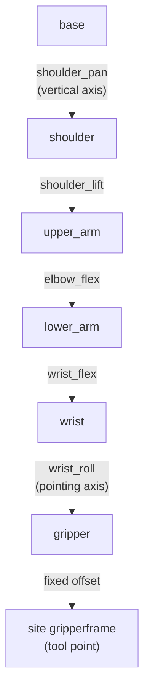

# 08 · Forward kinematics, degrees of freedom and workspace

<!-- meta -->
| | |
|---|---|
| **Part** | [3 · Kinematics](README.md) |
| **Run type** | CPU · Mac or Colab CPU |
| **Prerequisites** | [07](../part-2-spatial-math/07-rigid-transforms.md) |
| **Learn first** | [Matrix Transformations](https://aiengineeringfromscratch.com/lesson?path=phases/01-math-foundations/03-matrix-transformations) |
| **Time** | ~45 min |
| **Code** | [`experiments/08-forward-kinematics/experiment.py`](../experiments/08-forward-kinematics/experiment.py) |
| **Status** | ✅ done |
<!-- /meta -->


> Forward kinematics is a product of transforms along the tree; the number of joints in that product decides which poses exist at all.

## The problem

The SO-101 follower arm uses six STS3215 servos ([LeRobot SO-101 guide](https://huggingface.co/docs/lerobot/so101)). One of them only opens and closes the jaw. That leaves **five** joints to place a gripper whose pose has **six** numbers (3 position, 3 orientation). A policy or a teleoperator can ask for a gripper pose that no joint setting produces, and nothing in the arm will say so.

Before computing joint angles for a target (lesson 10), you need the forward map: joint angles → gripper pose. This lesson builds it by hand from the MJCF file, checks it against MuJoCo, measures the arm's workspace, and shows exactly which orientations the five joints cannot give.

## Core idea

### In plain words

Think of a desk lamp with hinges. If you know every hinge angle, you can say exactly where the bulb is: start at the foot, follow the first arm, turn by the first hinge angle, follow the next arm, and so on. That is **forward kinematics (FK)**: joint angles in, tool pose out. It is a pure function with exactly one answer, cheap to evaluate, and it is just the frame tree of lesson 07 multiplied out from the base to the tool.

The reverse question ("which angles put the bulb here?") is harder, and sometimes has no answer at all. The reason is counting. A gripper pose needs six numbers: three for where it is, three for which way it faces. Each joint is one knob. The SO-101 has five knobs that move the gripper, so it cannot set six numbers independently. Three of its joints (shoulder lift, elbow, wrist flex) have parallel axes, so together they move the gripper only inside one vertical plane; the pan joint turns that plane, and wrist roll spins the gripper about its own pointing axis.

The **workspace** is every point the tool can reach. For a real arm there is no formula for it; you estimate it by trying many random joint settings and recording where the tool lands.



Lift, elbow and wrist flex are the three parallel "pitch" axes. The sixth motor, `gripper`, hangs off the `gripper` body and only moves the jaw, so it is not in this chain.

### Forward kinematics as code

```python
M = np.eye(4)                                     # start at the base frame
for T_static, axis, qi in zip(STATIC, AXES, q):   # one entry per body, base to tip
    M = M @ T_static @ T(axis_rot(axis, qi), np.zeros(3))   # fixed offset, then the joint turn
tool = M @ T_SITE                                 # fixed offset to the tool point
```

| Quantity | Formula |
|---|---|
| Forward kinematics | $T_{W,\text{site}}(q) = \prod_{i=1}^{n}\Big(T^{\text{static}}_{i}\ \mathrm{Rot}(\hat a_i, q_i)\Big)\ T_{\text{site}}$ |
| Mobility of an open chain of 1-DoF joints | number of joints $n$ |
| Workspace | $\{\,p(q) : q_{\min} \le q \le q_{\max}\,\}$ |

$q_i$ is the angle of joint $i$; $T^{\text{static}}_i$ is the fixed transform from the parent body to body $i$ (from `body_pos`/`body_quat`); $\hat a_i$ is the joint axis in that body's frame (`jnt_axis`); $\mathrm{Rot}(\hat a, q)$ is a rotation by $q$ about $\hat a$; $T_{\text{site}}$ is the fixed offset of the tool site; $p(q)$ is the tool position and $q_{\min}, q_{\max}$ are the joint limits.

| Arm | Joints moving the tool | Task dimension | Consequence |
|---|---|---|---|
| SO-101 | 5 (pan, lift, elbow, wrist flex, wrist roll) | 6 | at a given point, only a 2-D family of orientations exists |
| Franka Panda | 7 | 6 | one redundant DoF: generically many solutions |

A **degree of freedom (DoF)** is one independent number you can change; "redundant" means more joints than the task needs.

<details>
<summary>Math details: product of exponentials, counting DoF and the arm plane</summary>

**Same map, other notation.** Lynch & Park write FK as a product of matrix exponentials, $T(q) = e^{[\mathcal S_1]q_1}\cdots e^{[\mathcal S_n]q_n}M$, where $M$ is the tool pose at $q = 0$ and $\mathcal S_i$ is joint $i$'s screw axis in the base frame (*Modern Robotics*, Ch. 4). The factors differ from the MJCF-style product above, the result does not.

**Counting.** A pose has 3 position and 3 orientation numbers. Fixing the tool position uses 3 of the SO-101's 5 joint DoF, which leaves $5 - 3 = 2$ for orientation: a 2-D family out of the 3-D set of all orientations.

**The arm plane.** Lift, elbow and wrist flex rotate about parallel axes with normal $n$, so they move the tool and its approach axis only within the plane perpendicular to $n$; pan rotates that plane about the vertical. Wrist roll spins the tool about the approach axis, which leaves the approach direction unchanged. So at a fixed point the approach axis must lie in the arm plane. The 12 mm site offset from the roll axis (Build it, Step 3) bends this rule slightly.

**Why sampling is uneven.** Uniform sampling in joint space is not uniform in space: regions where small joint changes move the tool a lot are visited rarely, so rare corners need many samples to show up.

Go deeper: AIEFS [Matrix Transformations](https://aiengineeringfromscratch.com/lesson?path=phases/01-math-foundations/03-matrix-transformations); Lynch & Park, *Modern Robotics*, Ch. 2 "Configuration Space" and Ch. 4 "Forward Kinematics".

</details>

<!-- figure: 08-arm-plane-workspace -->

## Build it

You will now write the SO-101's forward kinematics yourself in about 50 lines of NumPy and check every step against MuJoCo. Your code takes only the model's static numbers from MuJoCo: where each body sits on its parent, which way each hinge points, where the tool point is. Everything that depends on the pose is yours.

Type the steps into a file of your own (for example `scratch/my_fk.py`) and run it after each step. The finished functions are in [`physai/kinematics.py`](../physai/kinematics.py); `uv run python experiments/08-forward-kinematics/build.py` runs all four steps with the checks (output in [`build_output.txt`](../experiments/08-forward-kinematics/build_output.txt)).

### Step 1 · Describe the chain

A serial arm is a list of links from the base to the tip. Each link is a rigid body: its origin and orientation relative to the previous body at $q = 0$, and the hinge it turns about. Two small dataclasses hold that:

```python
@dataclass
class Link:
    pos: np.ndarray    # body origin in the parent body's frame (m)
    rot: np.ndarray    # body orientation in the parent frame, 3x3, at q = 0
    axis: np.ndarray   # hinge axis in this body's frame (unit)
    anchor: np.ndarray  # a point on the hinge axis, in this body's frame (m)
```

```python
@dataclass
class Chain:
    links: list        # base to tip, one hinge each
    tool_pos: np.ndarray  # tool point in the last body's frame (m)
```

The reader walks from the tool site up to the world body, then turns the list around so it runs base to tip. Bodies without a hinge (the SO-101's base) become fixed offsets.

```python
def chain_from_mujoco(m, site_name):
    """Read the hinge chain from the world down to a site (static model data only)."""
    site = m.site(site_name)
    bodies, b = [], int(site.bodyid[0])
    while b != 0:                                  # walk up to the world body
        bodies.append(b)
        b = int(m.body_parentid[b])
    links = []
    for b in reversed(bodies):
        hinges = [j for j in range(m.njnt) if m.jnt_bodyid[j] == b and m.jnt_type[j] == 3]
        j = hinges[0] if hinges else None          # bodies without a hinge are fixed offsets
        links.append(Link(m.body_pos[b].copy(), quat_to_mat(m.body_quat[b]),
                          m.jnt_axis[j].copy() if j is not None else None,
                          m.jnt_pos[j].copy() if j is not None else None))
    return Chain(links, site.pos.copy())
```

```text
== Step 1. The chain: world -> gripperframe ==
link       offset in parent (m)  hinge axis (body frame)
   0                 [0. 0. 0.]                    fixed
   1     [0.0388 0.     0.0624]               [0. 0. 1.]
   2  [-0.0304 -0.0183 -0.0542]               [0. 0. 1.]
   3  [-0.1126 -0.028   0.    ]               [0. 0. 1.]
   4  [-0.1349  0.0052  0.    ]               [0. 0. 1.]
   5  [ 0.     -0.0611  0.0181]               [0. 0. 1.]
tool point in the last body: [ 0.012  -0.0002 -0.0981] m
```

Every hinge of this arm turns about its own body's $z$ axis; the arm's shape lives in the offsets and in the body orientations (`body_quat`, turned into matrices with `quat_to_mat` from [`physai/spatial.py`](../physai/spatial.py), the formula from [lesson 06](../part-2-spatial-math/06-rotations.md)).

### Step 2 · Forward kinematics by hand

Walk from the base to the tip and keep the current body's pose in the world, a rotation $R$ and a position $p$. At each link: step to the body's origin ($p \leftarrow p + R\,\text{pos}$), take on its orientation ($R \leftarrow R\,\text{rot}$). At a hinge, write down its axis and a point on it in world coordinates, then turn everything beyond it about that line by $q_i$. Rodrigues' formula builds the turn:

```python
def axis_angle_to_mat(axis, angle):
    """Rotation by `angle` (rad) about the unit vector `axis` (Rodrigues' formula)."""
    k = np.array([[0, -axis[2], axis[1]], [axis[2], 0, -axis[0]], [-axis[1], axis[0], 0]])
    return np.eye(3) + np.sin(angle) * k + (1 - np.cos(angle)) * (k @ k)
```

```python
def fk(chain, q):
    """Joint axes and anchor points in the world, and the tool position, at joint angles q."""
    R, p = np.eye(3), np.zeros(3)                  # pose of the current body in the world
    axes, anchors, i = [], [], 0
    for link in chain.links:
        p = p + R @ link.pos                       # step to this body's origin...
        R = R @ link.rot                           # ...and its orientation at q = 0
        if link.axis is not None:
            a, o = R @ link.axis, p + R @ link.anchor
            axes.append(a)
            anchors.append(o)
            turn = axis_angle_to_mat(a, q[i])      # turn everything beyond about the hinge line
            R, p = turn @ R, o + turn @ (p - o)
            i += 1
    return np.array(axes), np.array(anchors), p + R @ chain.tool_pos
```

The turn is about a line, not about the world origin, which is why the position update is $o + T(p - o)$: shift so the line passes through the origin, rotate, shift back. `fk` also returns every hinge's world axis and anchor point; lesson 09 builds the Jacobian from them.

```text
== Step 2. Forward kinematics by hand vs mj_kinematics (1000 random poses) ==
max |p_ours - site_xpos| = 2.8e-16 m
```

On the Experiment's 1000 poses your FK and MuJoCo agree to round-off. The Experiment's 4×4 product gets 3.3e-16 m on the same poses: a different order of the same floating-point operations, not a different answer.

### Step 3 · Count the joints, find the plane

The DoF argument of Core idea is now something you can check in your own output: count the hinges, test that the three pitch axes stay parallel in every pose, and measure how far the tool point sits from the wrist-roll axis (the length of $\hat a \times (p - o)$, the lever arm that lesson 09 turns into a Jacobian column).

```python
axes, anchors, p0 = fk(chain, np.zeros(5))
par = max(np.linalg.norm(np.cross(axes[1], axes[k])) for k in (2, 3))   # lift vs elbow, wrist flex
lever = np.linalg.norm(np.cross(axes[4], p0 - anchors[4]))               # tool point to the roll axis
```

```text
== Step 3. Degrees of freedom and the arm plane, from your FK ==
hinges in the chain: 5; model: nq = 6, nv = 6 (the 6th joint moves only the jaw)
lift, elbow, wrist flex axes parallel: max |a_lift x a_k| over 50 poses = 1.2e-16
tool point off the wrist_roll axis: 12.0 mm; roll 0 -> 180 deg moves it 24.0 mm
```

Five hinges for a six-number pose, three of them parallel in every pose: the plane of Core idea. The 12.0 mm and 24.0 mm are the Experiment's Step 1 numbers.

### Step 4 · Sample the workspace

Draw joint vectors uniformly within the limits, run your FK on each, and count the occupied cubes:

```python
def sample_workspace(chain, lo, hi, n, seed=1):
    """Tool positions for n joint vectors drawn uniformly within the joint limits [lo, hi]."""
    qs = np.random.default_rng(seed).uniform(lo, hi, size=(n, len(lo)))
    return np.array([fk(chain, q)[2] for q in qs])
```

```python
def voxel_volume(points, size):
    """Volume (m^3) of the cubic cells of edge `size` (m) that contain at least one point."""
    cells = np.unique(np.floor(points / size).astype(int), axis=0)
    return len(cells) * size ** 3
```

```text
== Step 4. Workspace by sampling (seed 1, the Experiment's first samples) ==
 samples  1 cm voxels (L)  2 cm voxels (L)  max reach (m)  below z = 0
    1000              1.0              7.6          0.471        25.4%
   10000              9.5             60.9          0.473        25.2%
```

With the Experiment's seed these are its first 1,000 and 10,000 samples, so the rows match its table exactly (1.0 / 7.6 L, then 9.5 / 60.9 L, 0.473 m). The one-million row takes your pure-Python FK over a minute; the Experiment calls `mj_kinematics` instead.

### What you keep

`physai.kinematics` now has `Link`, `Chain`, `chain_from_mujoco`, `fk`, `sample_workspace` and `voxel_volume`. Lesson 09 builds the Jacobian on `fk`, lesson 10 inverse kinematics on that. [`tests/test_08_forward_kinematics.py`](../tests/test_08_forward_kinematics.py) pins them to MuJoCo; run `uv run pytest tests/test_08_forward_kinematics.py` after you change anything.

## Use it

In MuJoCo forward kinematics is one call, and it fills the pose of every body, joint and site at once:

```python
d.qpos[:5] = q
mujoco.mj_kinematics(m, d)                  # or mj_forward, which also runs everything after it
p = d.site_xpos[site_id]                    # equals fk(chain, q)[2] to round-off (Step 2)
R = d.site_xmat[site_id].reshape(3, 3)      # 9 numbers, row-major
axes, anchors = d.xaxis[:5], d.xanchor[:5]  # equal fk(chain, q)[0] and [1]
```

| Tool | Call | What you get |
|---|---|---|
| physai | `fk(chain, q)` | hinge axes, anchors and tool position, world frame |
| MuJoCo | `mj_kinematics(m, d)` | `xpos`/`xquat`/`xmat` of bodies, `site_xpos`/`site_xmat`, `xaxis`/`xanchor` of joints |
| *Modern Robotics* code | `FKinSpace(M, Slist, thetalist)` | 4×4 tool pose from the home pose $M$ and the space screw axes ([`core.py`](https://github.com/NxRLab/ModernRobotics/blob/master/packages/Python/modern_robotics/core.py)) |

Three traps:

- **Rows or columns.** `site_xmat` is flattened row-major; `reshape(3, 3)` gives the rotation, `reshape(3, 3).T` its inverse. A transposed rotation still looks like a valid rotation.
- **Stale poses.** Writing `qpos` changes nothing until `mj_kinematics` or `mj_forward` runs; reading `site_xpos` before that returns the previous pose without any warning.
- **`qpos` is not one number per joint.** Here `nq = nv`, but a free or ball joint stores a quaternion (lesson 36): index joints through `m.jnt_qposadr`, not by position in a list.

## Experiment

Script: [`experiments/08-forward-kinematics/experiment.py`](../experiments/08-forward-kinematics/experiment.py). MuJoCo 3.17.0, NumPy 2.5.4, SciPy, Apple Silicon Mac (Apple M5), deterministic seeds, about 80 s of CPU time.

**Predict first.** How many 1 cm voxels does the SO-101's reachable space occupy, and do 10,000 random joint samples find most of them?

**Step 1 · FK by hand.** The chain is read from the compiled model: base → shoulder → upper_arm → lower_arm → wrist → gripper → site `gripperframe`. The script multiplies 4×4 transforms (`T_static` from `body_pos`/`body_quat`, then the joint rotation) instead of turning about anchor lines as Build it does. Over 1000 random joint vectors within limits, hand FK and `mj_kinematics` agree to **3.3e-16 m** in position and **1.2e-15** per rotation-matrix entry. The tool site is 12.0 mm off the wrist-roll axis, so rolling 0 → 180° moves it 24.0 mm: a detail that matters later for IK.

**Step 2 · DoF.** The model has `nq = 6`, `nv = 6`, 6 actuators:

| Joint | Range (deg) |
|---|---|
| shoulder_pan | −110.0 .. 110.0 |
| shoulder_lift | −100.0 .. 100.0 |
| elbow_flex | −96.8 .. 96.8 |
| wrist_flex | −95.0 .. 95.0 |
| wrist_roll | −157.2 .. 162.8 |
| gripper | −10.0 .. 100.0 |

Five of them move `gripperframe`; the sixth moves only the jaw.

**Step 3 · sweep the number of samples → workspace estimate.** Joint vectors uniform within limits, no collision filtering. Volume is counted as occupied **voxels** (cubic cells of 1 cm or 2 cm); the **convex hull** is the smallest convex shape around all points.

| Samples | volume, 1 cm voxels | volume, 2 cm voxels | convex hull | max reach | site below z = 0 |
|---|---|---|---|---|---|
| 1,000 | 1.0 L | 7.6 L | 234.5 L | 0.471 m | 25.4% |
| 10,000 | 9.5 L | 60.9 L | 269.7 L | 0.473 m | 25.2% |
| 100,000 | 71.8 L | 222.2 L | 283.6 L | 0.473 m | 24.9% |
| 1,000,000 | 230.4 L | 282.9 L | 289.6 L | 0.473 m | 25.1% |

Max reach (from the point on the pan axis at shoulder height) converges after 10,000 samples, the volume does not: with 1 cm voxels it is still growing at one million samples, because uniform joint sampling visits the workspace very unevenly. The convex hull converges fastest but overestimates, since it fills every concave region. A quarter of all joint vectors put the tool below the table plane the base stands on.


## Break it

**Required orientation out of the arm plane.** Fix the target point (0.22, 0, 0.08) m. Find the arm plane (normal $n$ = shoulder-lift axis; the three pitch axes are parallel to 4.6e-16). Ask for an approach direction $a = \cos\beta\,a_0 + \sin\beta\,n$, where $a_0$ is in the plane, 45° below horizontal. Solve with a bounded least-squares solver from 12 seeds (random starting joint vectors; lesson 10 builds such solvers):

| β (out of plane) | 0° | 5° | 10° | 20° | 30° | 45° | 60° | 90° |
|---|---|---|---|---|---|---|---|---|
| best approach error | 0.098° | 3.086° | 8.083° | 18.077° | 28.070° | 43.058° | 58.036° | 87.682° |
| position error | 0.000 mm | 0.000 | 0.000 | 0.000 | 0.000 | 0.000 | 0.000 | 0.000 |

The position is always reached; the orientation error grows one-for-one with β, staying slightly below it. That small gain comes from the 12 mm site offset: rolling the wrist moves the site out of the plane, which lets pan turn slightly. At β = 0 the solver ends with wrist_roll at its joint limit, leaving 0.098°.

**Random orientations.** 200 uniformly random full orientations at the same point (6-D task):

| Arm | median error | within 1° | within 5° | within 10° | within 30° |
|---|---|---|---|---|---|
| SO-101 (5 joints), point (0.22, 0, 0.08) m | 72.0° | 2 / 200 | 5 / 200 | 8 / 200 | 33 / 200 |
| Franka Panda (7 joints), point (0.5, 0, 0.4) m | 0.00° | 181 / 200 | 187 / 200 | 189 / 200 | 199 / 200 |

For the SO-101, an arbitrary gripper orientation is the exception, not the rule. The Panda still misses some targets (max error 33.6°); with joint limits active and only 6 seeds, this run does not separate joint limits from local minima.

## On the real robot

- The LeRobot guide names the six motors shoulder pan, shoulder lift, elbow flex, wrist flex, wrist roll and gripper ([LeRobot SO-101](https://huggingface.co/docs/lerobot/so101)), the same six joints as the Menagerie model.
- Real FK is only as good as the link lengths and the joint zero offsets. LeRobot's calibration puts every joint at the middle of its range and then moves each through its full range; the Menagerie model notes a 5-degree calibration offset on the elbow range in its comments ([so101.xml](https://github.com/google-deepmind/mujoco_menagerie/blob/f3b6013/robotstudio_so101/so101.xml)). How far the real gripper lands from the model's FK has not yet been measured on the real arm. Procedure: command 20 poses, measure the gripper tip with a ruler or a camera marker, compare with `mj_kinematics`.
- Datasets that store gripper poses as 6-D actions for a 5-DoF arm contain targets the robot cannot reach exactly. Store joint positions, or check reachability before training.

## Check yourself

1. **Easy.** Why is the `gripper` joint not part of the FK chain to `gripperframe`?
2. **Medium.** Using your `fk`, find the joint vector in the 1,000,000-sample run that gives the maximum reach. Is the arm straight?
3. **Hard.** Which single extra hinge, placed where, would let the SO-101 reach any orientation at the test point? Argue with the plane picture, then test it by adding the joint with `MjSpec`.

### Answers

1. The site `gripperframe` is attached to the `gripper` body; the `gripper` joint moves the child body `moving_jaw_so101_v1`, which is not an ancestor of the site.
2. Not computed in this lesson's script. Compare what you find with the stretched pose of lesson 10.
3. A hinge whose axis is not parallel to the pitch axes and not along the approach axis, for example a wrist yaw between wrist flex and wrist roll. It lets the approach axis leave the plane. Not computed here.

## Takeaways and sources

- FK = product of static offsets and joint rotations read from the MJCF; your hand version matched `mj_kinematics` to 2.8e-16 m, the Experiment's to 3.3e-16 m.
- Sampled workspace volume depends on sample count and voxel size (230.4 L vs 282.9 L at one million samples); quote both.
- 5 joints cannot realize a 6-D pose: the out-of-plane orientation error grows with β (87.682° at 90°), and only 2 of 200 random orientations were reachable within 1°, vs 181 of 200 for the 7-joint Panda.

Next: [lesson 09 · Jacobians and differential kinematics](09-jacobians.md).

**Sources**

- K. M. Lynch, F. C. Park, *Modern Robotics*, Ch. 2 "Configuration Space" and Ch. 4 "Forward Kinematics". [Book page](https://hades.mech.northwestern.edu/index.php/Modern_Robotics); [Python library `core.py`](https://github.com/NxRLab/ModernRobotics/blob/master/packages/Python/modern_robotics/core.py).
- LeRobot, [SO-101 assembly and setup guide](https://huggingface.co/docs/lerobot/so101).
- MuJoCo Menagerie: [`robotstudio_so101`](https://github.com/google-deepmind/mujoco_menagerie/blob/f3b6013/robotstudio_so101/so101.xml) (Apache-2.0), [`franka_emika_panda`](https://github.com/google-deepmind/mujoco_menagerie/tree/f3b6013/franka_emika_panda).
- MuJoCo [API functions](https://mujoco.readthedocs.io/en/stable/APIreference/APIfunctions.html) (`mj_kinematics`).
