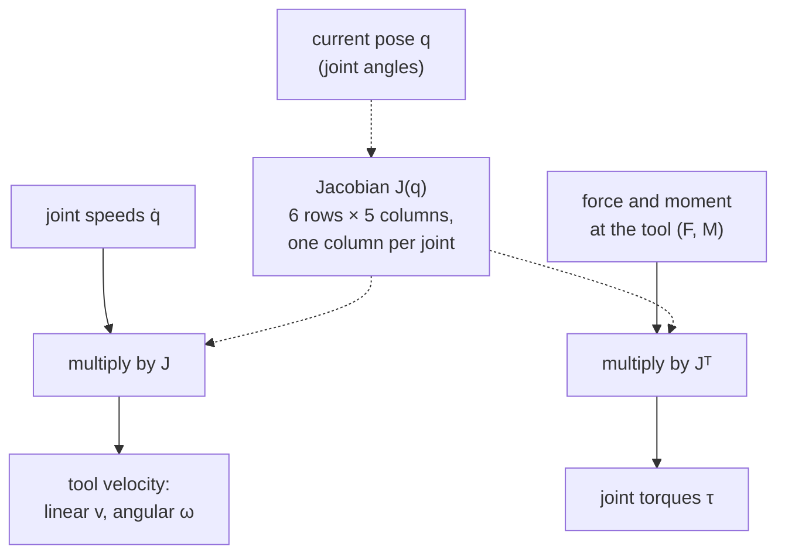

# 09 · Jacobians and differential kinematics

<!-- meta -->
| | |
|---|---|
| **Part** | [3 · Kinematics](README.md) |
| **Run type** | CPU · Mac or Colab CPU |
| **Prerequisites** | [08](08-forward-kinematics.md) |
| **Learn first** | [Calculus for Machine Learning](https://aiengineeringfromscratch.com/lesson?path=phases/01-math-foundations/04-calculus-for-ml) · [Linear Systems](https://aiengineeringfromscratch.com/lesson?path=phases/01-math-foundations/17-linear-systems) |
| **Time** | ~45 min |
| **Code** | [`experiments/09-jacobians/experiment.py`](../experiments/09-jacobians/experiment.py) |
| **Status** | ✅ done |
<!-- /meta -->

> One matrix maps joint speeds to tool speed, and its transpose maps tool forces back to joint torques.

## The problem

How much torque does the SO-101's shoulder servo need to hold a 2 N push at the gripper? How fast does the gripper move when the joints turn at a combined 1 rad/s? Both questions have the same answer: a 6×5 matrix that changes with every pose. The Menagerie model limits each servo to 2.94 N m (`forcerange="-2.94 2.94"` in [`so101.xml`](https://github.com/google-deepmind/mujoco_menagerie/blob/f3b6013/robotstudio_so101/so101.xml)); whether a payload is safe depends on that matrix, not on the payload alone.

You also need that matrix to be exactly right: lesson 10 iterates with it hundreds of times. A common shortcut is to compute it by finite differences. This lesson measures when that shortcut is accurate and when it is not.

## Core idea

### In plain words

Turn one motor a little and watch the gripper: it moves a little in some direction, at some speed. Do that for each motor and write the answers down, one column per motor. That table is the **Jacobian**: "which way and how fast the hand moves when each motor turns a little". Turn several motors at once and the hand's velocity is simply the sum of those columns, each scaled by its motor's speed. The table changes with the pose, because the lever arms change: the shoulder moves the hand much faster when the arm is stretched out than when it is folded.

The same table, read backwards (its **transpose**), answers the force question. Push on the gripper and each motor feels a torque equal to the push times its lever arm, which is exactly what its column encodes. A long lever multiplies the torque, like a long wrench.

If you cannot write the table down analytically, you can measure it: nudge one joint by a small step, see how far the tool moved, divide. That is a **finite difference**, the same trick as a numerical gradient check in ML. Too large a step and the curvature of the motion spoils the estimate; too small and floating-point round-off does.



### Jacobians as code

```python
import numpy as np

def hinge_column(axis, o, p):    # axis: joint axis (unit, world), o: point on the axis, p: tool point
    jp = np.cross(axis, p - o)   # tool linear velocity per 1 rad/s of this joint (m/s)
    jr = axis                    # tool angular velocity per 1 rad/s of this joint (rad/s)
    return np.r_[jp, jr]

J = np.column_stack([hinge_column(a, o, p) for a, o in zip(axes, origins)])   # 6 x n
twist = J @ qdot                 # [v; w]: tool velocity for joint speeds qdot
tau = J.T @ np.r_[F, M]          # joint torques for the tool to push with force F and moment M

def fd_column(tool_pos, q, i, eps=1e-5):   # central difference for column i (position rows)
    dq = np.zeros_like(q)
    dq[i] = eps
    return (tool_pos(q + dq) - tool_pos(q - dq)) / (2 * eps)
```

| Quantity | Formula |
|---|---|
| Velocity map | $\begin{bmatrix} v \\ \omega \end{bmatrix} = J(q)\,\dot q = \begin{bmatrix} J_p(q) \\ J_r(q) \end{bmatrix}\dot q ,\qquad J \in \mathbb R^{6\times n}$ |
| Column $i$ of a hinge | $J_{p,i} = \hat a_i \times (p - o_i)$, $\ J_{r,i} = \hat a_i$ |
| Static force map | $\tau = J^\top \begin{bmatrix} F \\ M \end{bmatrix}$ |
| Forward difference | $\frac{x(q + \varepsilon e_i) - x(q)}{\varepsilon}$, error $O(\varepsilon)$ |
| Central difference | $\frac{x(q+\varepsilon e_i) - x(q-\varepsilon e_i)}{2\varepsilon}$, error $O(\varepsilon^2)$ |

$q$ and $\dot q$ are the joint angles and speeds; $v$ and $\omega$ are the tool's linear and angular velocity in world coordinates; $J_p$ and $J_r$ are the three position and three rotation rows of $J$; $\hat a_i$ is hinge $i$'s unit axis in world coordinates and $o_i$ any point on it; $p$ is the tool point; $F$ and $M$ are the force and moment the tool exerts on the environment; $\tau$ is the vector of joint torques; $x(q)$ is the tool position, $e_i$ the unit vector for joint $i$ and $\varepsilon$ the step.

This is the **geometric Jacobian** (Lynch & Park, *Modern Robotics*, Ch. 5). MuJoCo returns it with `mj_jac` (any world point attached to a body), `mj_jacBody` and `mj_jacSite` ([API reference](https://mujoco.readthedocs.io/en/stable/APIreference/APIfunctions.html)). An external wrench (force plus moment) $(F, M)$ pushing on the tool is held by $-J^\top[F;M]$.

<details>
<summary>Math details: the column formula, virtual work and the best finite-difference step</summary>

**Column of a hinge.** Turning hinge $i$ at 1 rad/s rotates everything beyond it about the axis $\hat a_i$ through $o_i$. A point $p$ on a rigid body rotating with angular velocity $\omega$ about a line through $o$ moves with $\omega \times (p - o)$, which gives $J_{p,i} = \hat a_i \times (p - o_i)$ and $J_{r,i} = \hat a_i$.

**Static force map by virtual work.** In equilibrium the power the joints put in equals the power the tool delivers: $\tau^\top \dot q = [F; M]^\top [v; \omega] = [F; M]^\top J\dot q$ for every $\dot q$, hence $\tau = J^\top [F; M]$. Friction, backlash and gravity are extra terms (gravity enters in Break it).

**Finite-difference error.** A Taylor expansion gives a truncation error of order $\varepsilon$ for the forward difference and $\varepsilon^2$ for the central one. Floating-point round-off adds an error of about $\epsilon_{\text{mach}}\lvert x\rvert/\varepsilon$, where $\epsilon_{\text{mach}}$ is the machine epsilon (the relative precision of a double). Minimizing the sum gives a best step of roughly $\sqrt{\epsilon_{\text{mach}}}$ for forward and $\sqrt[3]{\epsilon_{\text{mach}}}$ for central differences.

**Rotation columns are special.** Moving one hinge by $\varepsilon$ rotates the tool by exactly $\varepsilon$ about that hinge's axis, so the orientation difference quotient has no truncation error, only round-off (Experiment, Step 2).

Go deeper: AIEFS [Calculus for Machine Learning](https://aiengineeringfromscratch.com/lesson?path=phases/01-math-foundations/04-calculus-for-ml), [Linear Systems](https://aiengineeringfromscratch.com/lesson?path=phases/01-math-foundations/17-linear-systems); Lynch & Park, *Modern Robotics*, Ch. 5 "Velocity Kinematics and Statics".

</details>

<!-- figure: 09-velocity-ellipse -->

## Build it

You will now write the SO-101's Jacobian yourself in about 30 lines of NumPy on top of lesson 08, and check every step against MuJoCo. From [lesson 08](08-forward-kinematics.md) you have `chain_from_mujoco` and `fk`, which returns every hinge's world axis $\hat a_i$, a point $o_i$ on it, and the tool point $p$: exactly the three things the column formula needs. Nothing new comes from MuJoCo.

Type the steps into a file of your own (for example `scratch/my_jacobian.py`) and run it after each step. The finished functions are in [`physai/kinematics.py`](../physai/kinematics.py); `uv run python experiments/09-jacobians/build.py` runs all four steps with the checks (output in [`build_output.txt`](../experiments/09-jacobians/build_output.txt)).

### Step 1 · One hinge column

The formula from Core idea, for one hinge: the linear part is the axis crossed with the lever from the axis to the tool, the angular part is the axis itself.

```python
def hinge_column(axis, o, p):
    """Tool twist per 1 rad/s of one hinge: linear part a x (p - o), angular part a."""
    return np.r_[np.cross(axis, p - o), axis]
```

```python
chain = chain_from_mujoco(m, "gripperframe")              # lesson 08
axes, anchors, p = fk(chain, Q0)
col = hinge_column(axes[1], anchors[1], p)                # shoulder_lift
```

```text
== Step 1. One hinge column at q = (0, -0.6, 0.9, 0.4, 0.3) ==
shoulder_lift column, ours:    -0.0198   0.0000  -0.2193   0.0000   1.0000   0.0000
shoulder_lift column, MuJoCo:  -0.0198   0.0000  -0.2193   0.0000   1.0000   0.0000
lever |a x (p - o)| = 0.2202 m, max difference 8.3e-17
```

The lift column is $(-0.0198, 0, -0.2193)$ m/s per rad/s: turning the lift moves the tool mostly straight down, at the speed of a 0.2202 m lever.

### Step 2 · Columns into a Jacobian

One column per hinge, stacked, using the axes and anchors that `fk` already returns:

```python
def jacobian(chain, q):
    """Geometric Jacobian (6 x n) of the tool point: rows 0-2 linear, rows 3-5 angular, world frame."""
    axes, anchors, p = fk(chain, q)
    return np.column_stack([hinge_column(a, o, p) for a, o in zip(axes, anchors)])
```

```text
== Step 2. Jacobian from hinge columns vs mj_jacSite (50 poses) ==
max entry error: linear rows 3.9e-16, angular rows 1.0e-15
```

### Step 3 · Use the matrix

With $J$ in hand, the two questions from The problem are one line each:

```python
J = jacobian(chain, Q0)
speed = np.linalg.norm(J[:3] @ (np.ones(5) / np.sqrt(5)))   # tool speed, every joint at 1/sqrt(5) rad/s
tau = J[:3].T @ np.array([0, 0, -2.0])                       # torques for a 2 N push down
```

```text
== Step 3. Use it at q = (0, -0.6, 0.9, 0.4, 0.3) ==
tool speed for every joint at 1/sqrt(5) rad/s: 0.312 m/s
F =     [0, 0, -2.0] N  ->  J^T F =  0.0000  0.4385  0.5194  0.2586  0.0042 N m
F =      [2.0, 0, 0] N  ->  J^T F =  0.0052 -0.0397 -0.2571 -0.1873 -0.0036 N m
F =      [0, 1.5, 0] N  ->  J^T F = -0.3745  0.0000  0.0000  0.0000  0.0175 N m
```

The lift torque for the downward push is 2 N times the vertical entry of the lift column from Step 1. Compare with the Experiment's Step 3 table: the servo held 0.4383 N m at the lift, here you get 0.4385 N m. The 0.0002 is not a bug. The servos give a little under the load, the arm settles at a slightly different pose, and $J$ depends on the pose; at the settled pose the two agree to 4.2e-14. The pan entry is zero for the reason the first exercise asks about.

### Step 4 · Check yourself with finite differences

The test you can run on any Jacobian, including one of a learned model: nudge each joint and difference your own forward kinematics.

```python
def fd_jacobian(tool_pos, q, eps=1e-5):
    """Position rows of the Jacobian by central differences of any function q -> tool position."""
    cols = []
    for i in range(len(q)):
        dq = np.zeros(len(q))
        dq[i] = eps
        cols.append((tool_pos(q + dq) - tool_pos(q - dq)) / (2 * eps))
    return np.column_stack(cols)
```

```text
== Step 4. Central differences of our FK vs our analytic Jacobian (eps = 1e-5) ==
median max entry error: 4.7e-12
```

That is the error the Experiment's ε sweep finds for central differences at ε = 1e-5 against `mj_jacSite` (5.6e-12), now against your own matrix.

### What you keep

`physai.kinematics` now also has `hinge_column`, `jacobian` and `fd_jacobian`. Lesson 10 builds inverse kinematics on them, lesson 14 a task-space controller. [`tests/test_09_jacobians.py`](../tests/test_09_jacobians.py) pins them to MuJoCo; run `uv run pytest tests/test_09_jacobians.py` after you change anything.

## Use it

In practice you ask the library for the same matrix. In MuJoCo that is three calls, and the second one is easy to forget:

```python
mujoco.mj_kinematics(m, d)
mujoco.mj_comPos(m, d)                     # mj_jac* reads data that only mj_comPos fills
jacp, jacr = np.zeros((3, m.nv)), np.zeros((3, m.nv))
mujoco.mj_jacSite(m, d, jacp, jacr, site_id)
J = np.r_[jacp, jacr]                      # equals jacobian(chain, q) to 1e-15 (Build it, Step 2)
```

Other tools return the same information with different conventions. Check which one you have before you mix numbers:

| Tool | Call | Row order | Velocity of which point, in which axes |
|---|---|---|---|
| physai | `jacobian(chain, q)` | linear, then angular | the tool point, world axes |
| MuJoCo | `mj_jacSite(m, d, jacp, jacr, site)` | two 3 × nv arrays | the site, world axes |
| Pinocchio | `computeFrameJacobian(model, data, q, frame_id, LOCAL_WORLD_ALIGNED)` | linear, then angular | the frame origin, world axes (as above); `LOCAL` uses the frame's own axes |
| *Modern Robotics* | space Jacobian $J_s$, body Jacobian $J_b$ | angular, then linear | $J_s$: the body point at the space-frame origin; $J_b$: the body frame's origin, body axes |

Three traps that cost hours:

- **Columns are degrees of freedom.** MuJoCo's Jacobians have `m.nv` columns (velocities), not `m.nq` (positions). They differ as soon as a model has a free or ball joint (a quaternion has 4 numbers but 3 rotational velocities); see lesson 36.
- **Quaternion order.** MuJoCo stores $(w, x, y, z)$; SciPy's `Rotation.from_quat` expects $(x, y, z, w)$ unless you pass `scalar_first=True`.
- **Stale data.** `mj_jacSite` reads positions computed by the last `mj_kinematics`/`mj_forward`; change `qpos` and forget to recompute, and you get the Jacobian of the previous pose without any error.

## Experiment

Script: [`experiments/09-jacobians/experiment.py`](../experiments/09-jacobians/experiment.py). MuJoCo 3.17.0, NumPy 2.5.4, Apple Silicon Mac (Apple M5), deterministic, a few seconds.

```python
mujoco.mj_kinematics(m, d)
mujoco.mj_comPos(m, d)                     # fills the data mj_jac* reads
jp, jr = np.zeros((3, m.nv)), np.zeros((3, m.nv))
mujoco.mj_jacSite(m, d, jp, jr, site_id)   # 3 x nv each, world frame
```

**Predict first.** Is a smaller finite-difference step always better? Which step would you pick?

**Step 1 · velocity map.** 50 random poses, random unit joint velocities. Predicted $J\dot q$ vs the actual site motion over $10^{-6}$ s: max relative error 7.9e-07 (linear) and 3.8e-07 (angular). With every joint at $1/\sqrt5$ rad/s ($\lvert\dot q\rvert = 1$), the median site speed is 0.306 m/s.

**Step 2 · sweep the step ε.** Median over 50 poses of the largest entry error against `mj_jacSite`. Orientation differences use `mju_subQuat`, rotated into the world frame.

| ε (rad) | forward $J_p$ | forward $J_r$ | central $J_p$ | central $J_r$ |
|---|---|---|---|---|
| 1e-1 | 1.2e-02 | 4.8e-15 | 4.2e-04 | 2.6e-15 |
| 1e-3 | 1.2e-04 | 4.5e-13 | 4.2e-08 | 2.5e-13 |
| 1e-5 | 1.2e-06 | 4.7e-11 | **5.6e-12** | 2.3e-11 |
| 1e-7 | 1.2e-08 | 4.5e-09 | 4.7e-10 | 2.3e-09 |
| 1e-8 | **9.8e-09** | 4.4e-08 | 4.9e-09 | 2.3e-08 |
| 1e-10 | 9.5e-07 | 4.4e-06 | 4.3e-07 | 2.2e-06 |
| 1e-12 | 8.9e-05 | 4.6e-04 | 4.7e-05 | 2.4e-04 |
| 1e-14 | 8.3e-03 | 4.5e-02 | 4.5e-03 | 2.6e-02 |

The translational error is V-shaped. To the right of the minimum, truncation (error falls 10× per decade for forward, 100× for central); to the left, round-off (error rises 10× per decade). The best forward step is 1e-8 (error 9.8e-09), the best central step 1e-5 (error 5.6e-12). For comparison, $\sqrt{\epsilon_{\text{mach}}} = $ 1.5e-08 and $\sqrt[3]{\epsilon_{\text{mach}}} = $ 6.1e-06.


The rotational columns have **no truncation error at all**: moving one hinge by ε rotates the site by exactly ε about that hinge's axis, so the difference quotient is exact and only round-off remains (4.8e-15 at ε = 0.1, growing as ε shrinks).

**Step 3 · verify τ = Jᵀ F in simulation.** Gravity and joint friction loss are switched off so only the external force acts. The arm holds a pose with its position servos (motors that push back toward a commanded angle); a constant force is applied at the gripper site through `xfrc_applied` (force plus the moment $r\times F$, because `xfrc_applied` acts at the body's centre of mass). After 20 s of simulation the joints are at rest (max |q̇| = 8.5e-15 rad/s) and the servo torques are compared with $J^\top F$:

| F at site (N) | $J^\top F$ (N m), joints 1–5 | servo torque (N m), sign flipped | max diff |
|---|---|---|---|
| (0, 0, −2) | 0.0000, 0.4383, 0.5191, 0.2584, 0.0042 | 0.0000, 0.4383, 0.5191, 0.2584, 0.0042 | 4.2e-14 |
| (2, 0, 0) | 0.0052, −0.0395, −0.2569, −0.1872, −0.0036 | same | 7.1e-14 |
| (0, 1.5, 0) | −0.3745, −0.0000, −0.0001, −0.0001, 0.0175 | same | 7.2e-14 |
| (1, −1, 1) | 0.2523, −0.2390, −0.3882, −0.2229, −0.0156 | same | 1.6e-13 |

The servos settle on exactly $-J^\top F$. A sideways push (0, 1.5, 0) N loads almost only the pan joint; a downward push loads the three pitch joints.

## Break it

**Push the tip load until a servo saturates.** With gravity on, the servos must supply $\tau = g(q) - f\,J_p^\top(-\hat z)$ for a downward tip force $f$. Taking the model's 2.94 N m limit for every joint:

| Pose (rad) | lift axis → tip (m) | gravity torque, lift / elbow (N m) | max extra tip load | limiting joint |
|---|---|---|---|---|
| near (0, −1.5, 1.5, 0.5, 0) | 0.172 | −0.059 / −0.469 | 8.81 N | elbow_flex |
| mid (0, −0.6, 0.9, 0.4, 0) | 0.220 | −0.281 / −0.443 | 9.61 N | elbow_flex |
| stretched (0, 1.3, −1.3, 0, 0) | 0.411 | −0.909 / −0.483 | 4.95 N | shoulder_lift |

Then the stretched case is simulated for 5 s with the force set to a fraction of that limit:

| tip force (N) | × limit | tip drop after 5 s | lift servo torque |
|---|---|---|---|
| 0.00 | 0.0 | 0.5 mm | −0.909 N m |
| 2.48 | 0.5 | 1.2 mm | −1.925 N m |
| 4.46 | 0.9 | 1.8 mm | −2.737 N m |
| 5.45 | 1.1 | 147.4 mm | −2.940 N m |
| 7.43 | 1.5 | 179.7 mm | −2.940 N m |

Below the limit the arm sags by about a millimetre (finite servo stiffness). Ten per cent above it the lift servo clamps at −2.940 N m and the arm falls 147.4 mm. Doubling the lever from 0.220 m to 0.411 m roughly halved the safe load: the Jacobian, not the payload, sets the limit.

## On the real robot

- The 2.94 N m `forcerange` is a model parameter. The MJCF comment says the position gains and forces were calculated assuming a servo proportional gain of 16; they are "not a 1-to-1 mapping" of LeRobot's servo gains ([so101.xml](https://github.com/google-deepmind/mujoco_menagerie/blob/f3b6013/robotstudio_so101/so101.xml)). Do not read the payload table as a hardware rating. Not yet measured on the real arm. Procedure: hang known weights at the gripper in the stretched pose, record the joint torque (for example from the servo's current reading, if your driver exposes it), and fit against $J^\top F$.
- On hardware the static map also carries joint friction (the model's `frictionloss`, switched off in Step 3), gear backlash and cable forces; expect $\tau = J^\top F$ to hold only up to those.
- If you compute Jacobians by finite differences anyway (for example around a learned model), use central differences with ε near 1e-5 rad, not 1e-8.

## Check yourself

1. **Easy.** Why is the first entry of $J^\top F$ exactly 0.0000 for $F = (0, 0, -2)$ N?
2. **Medium.** Which pose maximizes the shoulder-lift torque per newton of downward tip force? Use the lever column to argue, then check with `mj_jacSite`.
3. **Hard.** Repeat the ε sweep in float32 (cast positions to `np.float32` before differencing). Where do the optimal steps move, and why?

### Answers

1. Joint 1 (pan) has a vertical axis; a vertical force has no moment about a vertical axis, so $\hat a_1 \cdot (r \times F) = 0$.
2. The fully stretched horizontal pose: the lift torque per newton equals the horizontal distance from the lift axis to the tip, 0.410 N m/N at the stretched pose in the script output. Check others with the script.
3. Not computed here. Expect the minima to move to larger ε, near $\sqrt{\epsilon_{32}}$ and $\sqrt[3]{\epsilon_{32}}$ with $\epsilon_{32} \approx 1.2\times10^{-7}$ (the float32 machine epsilon).

## Takeaways and sources

- `mj_jacSite` gives the geometric Jacobian; $J\dot q$ matched the real site velocity to 7.9e-07 relative error.
- Finite differences have an optimal step: 1e-8 (forward, 9.8e-09) and 1e-5 (central, 5.6e-12) in this sweep; smaller is worse.
- $\tau = J^\top F$ held to 1.6e-13 N m in simulation; with a 0.411 m lever the model's servos hold only 4.95 N of tip load.

Next: [lesson 10 · Inverse kinematics and singularities](10-inverse-kinematics.md).

**Sources**

- K. M. Lynch, F. C. Park, *Modern Robotics*, Ch. 5 "Velocity Kinematics and Statics". [Book page](https://hades.mech.northwestern.edu/index.php/Modern_Robotics).
- MuJoCo [API functions](https://mujoco.readthedocs.io/en/stable/APIreference/APIfunctions.html) (`mj_jac`, `mj_jacSite`, `mju_subQuat`).
- SO-101 model and servo parameters: [MuJoCo Menagerie `robotstudio_so101`](https://github.com/google-deepmind/mujoco_menagerie/blob/f3b6013/robotstudio_so101/so101.xml).
