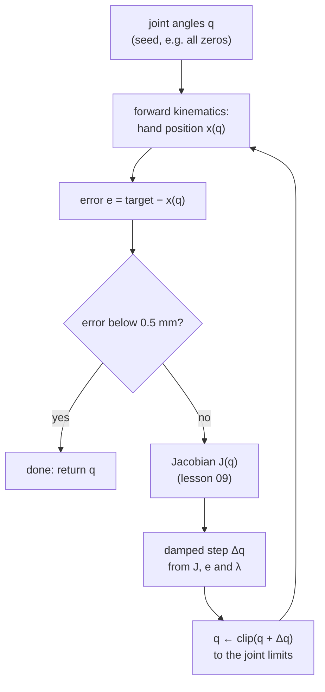

# 10 · Inverse kinematics and singularities

<!-- meta -->
| | |
|---|---|
| **Part** | [3 · Kinematics](README.md) |
| **Run type** | CPU · Mac or Colab CPU |
| **Prerequisites** | [09](09-jacobians.md) |
| **Learn first** | [Singular Value Decomposition](https://aiengineeringfromscratch.com/lesson?path=phases/01-math-foundations/11-singular-value-decomposition) · [Optimization](https://aiengineeringfromscratch.com/lesson?path=phases/01-math-foundations/08-optimization) · [Linear Systems](https://aiengineeringfromscratch.com/lesson?path=phases/01-math-foundations/17-linear-systems) |
| **Time** | ~60 min |
| **Code** | [`experiments/10-inverse-kinematics/experiment.py`](../experiments/10-inverse-kinematics/experiment.py) |
| **Status** | ✅ done |
<!-- /meta -->

> Inverse kinematics is Newton's method on forward kinematics; damping is what keeps it from exploding where the Jacobian loses rank.

## The problem

A grasp planner says: put the SO-101's gripper at (0.20, 0.05, 0.05) m, fingers pointing down. The servos need five joint angles. Forward kinematics (lesson 08) goes the other way. Closed-form inverses exist only for special cases of this geometry and ignore joint limits, so in general you solve it numerically, with the Jacobian of lesson 09, and three things can go wrong: the iteration diverges, it converges to a solution outside the joint limits, or it asks for absurd joint speeds near a stretched-out arm.

This lesson writes a small, reusable `ik_solve` and measures each failure.

## Core idea

### In plain words

Inverse kinematics (IK) asks the reverse of lesson 08: "which joint angles put the hand *there*?". There is no general formula, so you solve it the way you would tune any black box: measure how far the hand is from the target, ask the Jacobian (lesson 09) which small joint change would move the hand toward it, take that step, and repeat. This is Newton's method applied to forward kinematics, and from a good start it converges in a handful of steps.

It goes wrong in three ways. First, when the arm is almost straight it cannot move the hand further outward; asking for that anyway makes the solver divide by a nearly zero number and command enormous joint moves. Such a pose is a **singularity**: the Jacobian has lost a direction. Second, the solver can run into a joint limit and stall there. Third, there may be several answers (elbow up or elbow down), and some of them lie outside the joint limits.

The standard fix for the first problem is **damping**: refuse giant steps. Damped least squares moves the hand where it can, and simply gives up on the direction the arm cannot serve, instead of exploding.



### IK as code

```python
for it in range(max_iter):
    e = target - fk_pos(q)                         # task error (m)
    if np.linalg.norm(e) < tol:                    # 0.5 mm: success
        break
    J = jac_pos(q)                                 # 3 x n position Jacobian (lesson 09)
    q = np.clip(q + J.T @ np.linalg.solve(J @ J.T + lam**2 * np.eye(3), e), lo, hi)   # damped step, limits
```

| Method | Step $\Delta q$ | Source |
|---|---|---|
| Newton-Raphson (pseudo-inverse) | $J^{+}e$ | *Modern Robotics*, Ch. 6 |
| Jacobian transpose | $\alpha J^\top e$, $\ \alpha = \dfrac{\langle e, JJ^\top e\rangle}{\lVert JJ^\top e\rVert^2}$ | Buss 2009, §3 |
| Damped least squares (DLS) | $J^\top (JJ^\top + \lambda^2 I)^{-1} e$ | Buss 2009, §5 |
| Manipulability | $w = \sqrt{\det(JJ^\top)} = \prod_i \sigma_i$ | Yoshikawa 1985 |

$e = x^\* - x(q)$ is the task error between the target $x^\*$ and the current tool position $x(q)$; $J$ is the Jacobian at $q$ and $J^{+}$ its pseudo-inverse (the least-squares inverse of a non-square matrix); $\alpha$ is a step length; $\lambda$ is the damping, in metres here because $J_p$ is in m/rad; $\sigma_i$ are the singular values of $J$ (how strongly it stretches each of its principal directions); $w$ is the manipulability, which falls to zero at a singularity.

The pseudo-inverse is fast but takes huge steps near a singularity; the transpose method always takes safe but slow steps; DLS sits in between, tuned by λ. **Joint limits** are enforced here by clamping after every step. **Multiple solutions** exist whenever the task has fewer equations than the arm has joints, or when the geometry folds (elbow up / elbow down).

<details>
<summary>Math details: DLS through the SVD, singularities and manipulability</summary>

**Newton on FK.** Linearize $x(q + \Delta q) \approx x(q) + J\Delta q$ and solve $J\Delta q = e$ for $\Delta q$, then repeat. When $J$ is not square or not invertible, the least-squares solution is $J^{+}e$.

**DLS** minimizes $\lVert J\Delta q - e\rVert^2 + \lambda^2\lVert\Delta q\rVert^2$: fit the error, but pay for large steps. With the singular value decomposition $J = \sum_i \sigma_i u_i v_i^\top$ the difference from Newton is one factor per direction:

$$J^{+}e = \sum_i \frac{1}{\sigma_i}\,v_i u_i^\top e, \qquad \Delta q_{\text{DLS}} = \sum_i \frac{\sigma_i}{\sigma_i^2+\lambda^2}\,v_i u_i^\top e .$$

As $\sigma_i \to 0$ the pseudo-inverse gain $1/\sigma_i$ explodes; the DLS gain goes to zero. For $\sigma_i \gg \lambda$ the two are almost equal. Buss notes that λ must be large enough for stability near singularities, but too large a value makes convergence slow ([Buss 2009](https://mathweb.ucsd.edu/~sbuss/ResearchWeb/ikmethods/iksurvey.pdf)).

**Singularity and manipulability.** A pose is singular when $J$ loses rank. Yoshikawa's manipulability measure, $w = \sqrt{\det(JJ^\top)} = \prod_i \sigma_i$, is proportional to the volume of the velocity ellipsoid produced by unit joint speeds and falls to zero at a singularity ([Yoshikawa 1985](https://doi.org/10.1177/027836498500400201)). The direction $u_i$ of the smallest $\sigma_i$ is the direction the tool can barely move in.

**Limits and branches.** Clamping after each step is the simplest way to respect joint limits; it can leave the iteration stuck against a limit, which the Experiment's Step 1 measures. Different seeds can converge to different branches of the solution set (its Step 2).

Go deeper: AIEFS [Singular Value Decomposition](https://aiengineeringfromscratch.com/lesson?path=phases/01-math-foundations/11-singular-value-decomposition), [Optimization](https://aiengineeringfromscratch.com/lesson?path=phases/01-math-foundations/08-optimization), [Linear Systems](https://aiengineeringfromscratch.com/lesson?path=phases/01-math-foundations/17-linear-systems); Lynch & Park, *Modern Robotics*, Ch. 5–6; Buss 2009; Yoshikawa 1985.

</details>

<!-- figure: 10-ik-dls -->

## Build it

You will now write the damped least-squares solver yourself in about 25 lines of NumPy, on top of lesson 09's `fk` and `hinge_column`, and check it against MuJoCo, NumPy's pseudo-inverse and the Experiment. Nothing new comes from MuJoCo except the joint limits.

Type the steps into a file of your own (for example `scratch/my_ik.py`) and run it after each step. The finished functions are in [`physai/kinematics.py`](../physai/kinematics.py); `uv run python experiments/10-inverse-kinematics/build.py` runs all four steps with the checks (output in [`build_output.txt`](../experiments/10-inverse-kinematics/build_output.txt)).

### Step 1 · One damped step

The DLS step solves a 3 × 3 system instead of inverting $J$; with $\lambda = 0$ it is the pseudo-inverse step.

```python
def dls_step(J, e, lam):
    """Damped least-squares step J^T (J J^T + lam^2 I)^-1 e; lam = 0 gives the pseudo-inverse step."""
    return J.T @ np.linalg.solve(J @ J.T + lam ** 2 * np.eye(len(e)), e)
```

Check it against the SVD form from the math details, $\sum_i \sigma_i/(\sigma_i^2+\lambda^2)\,v_i u_i^\top e$, at $q = 0$ for a 1 cm error:

```python
J = jacobian(chain, np.zeros(5))[:3]                 # position rows, lesson 09
U, sig, Vt = np.linalg.svd(J, full_matrices=False)
svd = Vt.T @ (sig / (sig ** 2 + lam ** 2) * (U.T @ e))
```

```text
== Step 1. One DLS step vs the SVD formula (q = 0, a 1 cm error) ==
singular values of J_p at q = 0: 0.4764 0.3527 0.0771 m/rad
lam = 0     |dq| = 0.1008 rad, max diff to sum sigma/(sigma^2+lam^2) v u^T e: 4.2e-17
lam = 0.01  |dq| = 0.0992 rad, max diff to sum sigma/(sigma^2+lam^2) v u^T e: 2.8e-17
lam = 0.1   |dq| = 0.0394 rad, max diff to sum sigma/(sigma^2+lam^2) v u^T e: 2.1e-17
lam = 0 vs np.linalg.pinv(J) @ e: max diff 4.2e-17
```

The smallest singular value is 0.0771 m/rad, so λ = 0.01 barely changes the step (0.1008 → 0.0992 rad) while λ = 0.1 shortens it to 0.0394 rad: damping only bites in directions where $\sigma_i$ is not much larger than λ.

### Step 2 · The loop, with joint limits

Repeat the step until the error is below 0.5 mm, clipping to the joint limits after every step. One `fk` call per iteration gives both the error and the columns:

```python
def ik_solve(chain, target, q0, lo, hi, lam=0.1, tol=5e-4, max_iter=200):
    """Position IK by damped least squares, clipped to the joint limits after every step.

    Returns (q, success, iterations); success means |target - tool position| < tol (m).
    """
    q = np.array(q0, dtype=float)
    for it in range(max_iter + 1):
        axes, anchors, p = fk(chain, q)
        e = target - p                             # task error (m)
        if np.linalg.norm(e) < tol:
            return q, True, it
        if it == max_iter:
            break
        J = np.column_stack([hinge_column(a, o, p)[:3] for a, o in zip(axes, anchors)])  # position rows
        q = np.clip(q + dls_step(J, e, lam), lo, hi)
    return q, False, max_iter
```

```text
== Step 2. Solve for (0.20, 0.05, 0.05) m from q = 0, check with mj_kinematics ==
lam = 0    success True,   5 iterations, q = [-0.306 -1.745  1.573  0.949  0.012] rad, MuJoCo tool error 0.189 mm
lam = 0.1  success True,  13 iterations, q = [-0.306 -0.922  1.091  0.969  0.009] rad, MuJoCo tool error 0.392 mm
```

MuJoCo's own forward kinematics confirms both answers. They are different answers: five joints for three position numbers leave a two-dimensional family of solutions, and the undamped solver ended with the lift clipped at its −100° limit (−1.745 rad) and still converged.

### Step 3 · The Experiment's sweep

Run your solver on the Experiment's 500 targets (FK of the same random joint vectors) at its best damping:

```python
targets = np.array([fk(chain, q)[2] for q in np.random.default_rng(0).uniform(LO, HI, size=(500, 5))])
res = [ik_solve(chain, t, np.zeros(5), LO, HI, lam=0.1) for t in targets]
```

```text
== Step 3. The Experiment's sweep: 500 reachable targets, q0 = 0, tol 0.5 mm, 200 iterations ==
lam = 0.1: success 88.6%, median 15 iterations, p95 92; 56 of 57 failures end at a joint limit
```

Every number matches the Experiment's λ = 0.1 row (88.6%, median 15, p95 92, 56 of 57), because your FK and Jacobian equal MuJoCo's to round-off and the loop is the same.

### Step 4 · Watch the singularity

Stretch the arm from the bent pose to the Experiment's straight pose and ask for 5 cm/s along the weakest direction $u_3$. Manipulability is the product of the singular values:

```python
Jp = jacobian(chain, q_bent + s * (q_straight - q_bent))[:3]
U, sig, Vt = np.linalg.svd(Jp)
w = np.prod(sig)                                      # = sqrt(det(J J^T))
v = 0.05 * U[:, 2]                                    # 5 cm/s along the weakest direction
qdot_pinv, qdot_dls = dls_step(Jp, v, 0.0), dls_step(Jp, v, 0.1)
```

```text
== Step 4. Stretching the arm: singular values, manipulability, joint speed for 5 cm/s ==
    s  sigma1  sigma2    sigma3          w  |qdot| pinv  |qdot| DLS 0.1
 0.00  0.4764  0.2419  7.71e-02  8.879e-03         0.65           0.242
 0.50  0.5155  0.3885  4.42e-02  8.857e-03         1.13           0.185
 0.90  0.5295  0.4397  9.20e-03  2.143e-03         5.43           0.046
 0.99  0.5301  0.4412  9.35e-04  2.187e-04        53.47           0.005
 1.00  0.5301  0.4411  1.05e-04  2.444e-05       478.33           0.001
```

These are the Experiment's Step 3 and Break it numbers: σ₃ falls to 1.05e-04, the pseudo-inverse asks for 478.33 rad/s, DLS stays near 0.001 rad/s.

### What you keep

`physai.kinematics` now has `dls_step` and `ik_solve`. Whenever a later lesson needs joint targets for a hand position (lesson 13's Cartesian straight line solves IK at every waypoint), this is the loop. [`tests/test_10_inverse_kinematics.py`](../tests/test_10_inverse_kinematics.py) checks it against MuJoCo's FK and the SVD formula; run `uv run pytest tests/test_10_inverse_kinematics.py` after you change anything.

## Use it

MuJoCo computes forward kinematics and Jacobians but has no IK solver: the library way is the same loop with `mj_jacSite`, which is what the Experiment's `ik_solve` does, or a general bounded least-squares solver:

```python
from scipy.optimize import least_squares

def residual(q):
    d.qpos[:5] = q
    mujoco.mj_kinematics(m, d)
    return d.site_xpos[site_id] - target              # metres

sol = least_squares(residual, q0, bounds=(lo, hi))     # joint limits as bounds, sol.x = joint angles
```

Lesson 08's Break it used this with 12 seeds. It respects the limits properly (no clipping), at the cost of more FK calls per solve.

| Tool | Call | Method, limits |
|---|---|---|
| physai | `ik_solve(chain, target, q0, lo, hi, lam=0.1)` | DLS, clipped to the limits after each step |
| Experiment | `ik_solve(model, data, target, method="dls", damping=0.1)` | same loop on `mj_jacSite`; also `"pinv"`, `"transpose"`, an optional target axis |
| SciPy | `least_squares(residual, q0, bounds=(lo, hi))` | trust-region least squares, bounds enforced by the solver |
| *Modern Robotics* code | `IKinSpace(Slist, M, T, thetalist0, eomg, ev)` | Newton-Raphson with `pinv`, full 6-D pose, no joint limits, at most 20 iterations ([`core.py`](https://github.com/NxRLab/ModernRobotics/blob/master/packages/Python/modern_robotics/core.py)) |

Three traps:

- **λ has units.** With position rows in m/rad, λ is in metres. Stack orientation rows (rad/rad) and position rows into one $J$ and a single λ treats a metre like a radian; weight the rows first, as the Experiment's `axis_weight` does.
- **Clipping hides failure.** A clipped solver returns some joint vector every time. Check the success flag (or the final error), never just the returned `q`.
- **The seed picks the branch.** Different starting joint vectors converge to different solutions (Build it, Step 2, and the Experiment's Step 2). Seed from the current robot pose when tracking, so consecutive solutions stay on one branch.

## Experiment

Script: [`experiments/10-inverse-kinematics/experiment.py`](../experiments/10-inverse-kinematics/experiment.py). MuJoCo 3.17.0, NumPy 2.5.4, Apple Silicon Mac (Apple M5), deterministic, about 6 s of CPU time.

The script's solver works on MuJoCo's Jacobian and is importable (the experiment code sits under `if __name__ == "__main__":`):

```python
sys.path.insert(0, "experiments/10-inverse-kinematics")
from experiment import ik_solve
res = ik_solve(model, data, target_pos, method="dls", damping=0.1)   # res.q, res.success, res.iters
```

**Predict first.** Which λ gives the highest success rate: 0 (pure Newton), 0.01, 0.1 or 0.3 (units: metres, since $J_p$ is in m/rad)?

**Step 1 · sweep λ.** 500 random **reachable** position targets (FK of random joint vectors within limits), seed (starting joint vector) $q_0 = 0$, success = error below 0.5 mm within 200 iterations.

| Method | success | median iters | p95 iters | median max ‖Δq‖ (rad) | failures ending at a joint limit |
|---|---|---|---|---|---|
| Jacobian transpose | 85.6% | 35 | 151 | 0.699 | 24 of 72 |
| pseudo-inverse (λ = 0) | 73.2% | 6 | 34 | 4.901 | 132 of 134 |
| DLS λ = 0.001 | 73.2% | 6 | 34 | 4.900 | 130 of 134 |
| DLS λ = 0.01 | 76.0% | 6 | 34 | 4.737 | 120 of 120 |
| DLS λ = 0.03 | 84.6% | 7 | 30 | 3.920 | 77 of 77 |
| **DLS λ = 0.1** | **88.6%** | 15 | 92 | 1.598 | 56 of 57 |
| DLS λ = 0.3 | 74.6% | 64 | 167 | 0.485 | 50 of 127 |
| DLS λ = 0.1 + 4 random restarts | 96.8% | 17 (total) | – | – | – |

With little damping, Newton takes steps of several radians, the clamp pins a joint at its limit, and the iteration stalls there: almost every failure ends at a limit. With λ = 0.3 the steps are short, most failures are simply out of iterations (77 of 127 do not end at a limit). λ = 0.1 is the sweet spot here, and restarting failed solves from random seeds lifts success to 96.8%.


**Step 2 · multiple solutions.** Target (0.20, 0.05, 0.05) m, fingers (site x-axis) pointing down, wrist_roll fixed at 0, so four joints face four independent constraints. 100 random seeds, DLS λ = 0.01:

| Joint limits | converged | distinct solutions | inside the real limits |
|---|---|---|---|
| ignored | 96 / 100 | 4 | 1 |
| enforced | 92 / 100 | 1 | 1 |

Without limits the solver finds the four textbook branches: front/back (pan −17.6° or 163.1°) × elbow up/down. Only one, (−17.6°, −17.2°, 29.3°, 77.9°), is inside the SO-101's ranges. A solver that ignores limits lands on an unreachable branch for 37 + 20 + 13 of its 96 converged seeds.

**Step 3 · manipulability while stretching.** From a bent pose (lift 1.3 rad, elbow 0) to the straight pose found by minimizing $\sigma_3$ (elbow −73.74°, wrist 2.01°); $s$ interpolates. Position Jacobian, 3×5; cond = σ₁/σ₃:

| s | σ₁ | σ₂ | σ₃ | w | cond | reach (m) |
|---|---|---|---|---|---|---|
| 0.00 | 0.4764 | 0.2419 | 7.71e-02 | 8.879e-03 | 6.2 | 0.3477 |
| 0.50 | 0.5155 | 0.3885 | 4.42e-02 | 8.857e-03 | 12 | 0.3945 |
| 0.90 | 0.5295 | 0.4397 | 9.20e-03 | 2.143e-03 | 58 | 0.4104 |
| 0.99 | 0.5301 | 0.4412 | 9.35e-04 | 2.187e-04 | 570 | 0.4110 |
| 1.00 | 0.5301 | 0.4411 | 1.05e-04 | 2.444e-05 | 5100 | 0.4110 |

Two singular values stay put; the third, the radial direction, collapses. The reach changes by less than a millimetre between s = 0.90 and 1.00 while $w$ drops from 2.143e-03 to 2.444e-05: near the boundary of the workspace the arm can barely move outward.

## Break it

At each pose, request a tool velocity of 5 cm/s along the weakest direction $u_3$ and compute the joint velocity:

| s | ‖q̇‖ pinv (rad/s) | ‖q̇‖ DLS λ=0.03 | DLS achieved / requested | ‖q̇‖ DLS λ=0.1 | DLS achieved / requested |
|---|---|---|---|---|---|
| 0.500 | 1.13 | 0.774 | 0.685 | 0.185 | 0.164 |
| 0.900 | 5.43 | 0.467 | 0.086 | 0.046 | 0.008 |
| 0.990 | 53.47 | 0.052 | 0.001 | 0.005 | 0.000 |
| 0.999 | 345.39 | 0.008 | 0.000 | 0.001 | 0.000 |
| 1.000 | 478.33 | 0.006 | 0.000 | 0.001 | 0.000 |

The pseudo-inverse asks for 478.33 rad/s at the stretched pose, from a 5 cm/s request. DLS keeps joint speeds bounded and pays with tracking: it simply does not move in the direction the arm cannot serve. This is the trade-off you tune with λ: accuracy far from singularities vs bounded commands near them.

## On the real robot

- Never send raw pseudo-inverse velocities to servos. Use DLS (or clamp $\Delta q$) and enforce joint limits in the solver, not only in the firmware: a firmware limit stops the joint but the solver keeps believing it moved.
- The model's joint ranges come from the Menagerie file (the elbow range carries a 5-degree calibration offset per its comment, [so101.xml](https://github.com/google-deepmind/mujoco_menagerie/blob/f3b6013/robotstudio_so101/so101.xml)). Your physical arm's usable ranges depend on its LeRobot calibration ([LeRobot SO-101](https://huggingface.co/docs/lerobot/so101)); read them back before trusting IK.
- Simulation results only. IK accuracy on the real SO-101 (where the tip actually lands for a commanded IK solution) has not yet been measured on the real arm. Procedure: solve IK for 20 targets on a grid, command the joints, measure the tip, report the error distribution.

## Check yourself

1. **Easy.** Why does DLS with λ = 0.001 behave almost exactly like the pseudo-inverse in the Experiment's Step 1?
2. **Medium.** Use `ik_solve` with `target_axis` and `joints=ARM[:4]` (wrist_roll fixed, as in Step 2) to ask for "fingers horizontal, pointing along +x" at (0.20, 0.0, 0.15) m. Does it converge to 1e-5? Explain with the arm plane from lesson 08.
3. **Hard.** Implement an adaptive damping $\lambda(w) = \lambda_0 (1 - w/w_0)^2$ for $w < w_0$, else 0 (Buss lists several published schemes that choose λ from the configuration), and rerun the Experiment's Step 1 sweep (or Build it, Step 3). Does it beat fixed λ = 0.1 on success and iterations?

### Answers

1. λ² = 1e-6 m² is negligible against $\sigma_i^2$ except very close to a singularity, so $\sigma_i/(\sigma_i^2+\lambda^2) \approx 1/\sigma_i$.
2. Expect no. The pitch joints keep the fingers parallel to one vertical plane whose direction only pan can change; fingers along +x fix pan, and with wrist_roll held at 0 the site then sits slightly off y = 0, so position and axis cannot both be met exactly. Within the SO-101's ranges the miss is much larger, because shoulder_lift and wrist_flex end at their limits. Run it and read the residual (not computed in this lesson's script).
3. Not computed here.

## Takeaways and sources

- Newton's step $J^{+}e$ converges fast (median 6 iterations) but succeeded on only 73.2% of targets from $q_0=0$; DLS λ = 0.1 succeeded on 88.6% and, with restarts, 96.8%.
- Enforcing joint limits changed the answer from 4 solutions to the 1 the SO-101 can actually reach.
- Manipulability $w$ fell from 8.879e-03 to 2.444e-05 as the arm straightened; the pseudo-inverse then demanded 478.33 rad/s for 5 cm/s, DLS stayed bounded.

Next: [lesson 11 · Rigid-body dynamics](../part-4-dynamics-and-control/11-rigid-body-dynamics.md).

**Sources**

- K. M. Lynch, F. C. Park, *Modern Robotics*, Ch. 5 "Velocity Kinematics and Statics" (manipulability) and Ch. 6 "Inverse Kinematics". [Book page](https://hades.mech.northwestern.edu/index.php/Modern_Robotics).
- S. R. Buss, "Introduction to Inverse Kinematics with Jacobian Transpose, Pseudoinverse and Damped Least Squares methods", unpublished report, UC San Diego, 2009. [PDF](https://mathweb.ucsd.edu/~sbuss/ResearchWeb/ikmethods/iksurvey.pdf).
- T. Yoshikawa, "Manipulability of Robotic Mechanisms", *The International Journal of Robotics Research* 4(2):3–9, 1985. [doi:10.1177/027836498500400201](https://doi.org/10.1177/027836498500400201).
- MuJoCo [API functions](https://mujoco.readthedocs.io/en/stable/APIreference/APIfunctions.html) (`mj_jacSite`).
