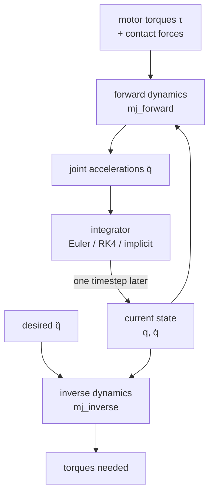

# 11 · Rigid-body dynamics

<!-- meta -->
| | |
|---|---|
| **Part** | [4 · Dynamics and control](README.md) |
| **Run type** | CPU · Mac or Colab CPU |
| **Prerequisites** | [09](../part-3-kinematics/09-jacobians.md) |
| **Learn first** | [Calculus for Machine Learning](https://aiengineeringfromscratch.com/lesson?path=phases/01-math-foundations/04-calculus-for-ml) · [Linear Systems](https://aiengineeringfromscratch.com/lesson?path=phases/01-math-foundations/17-linear-systems) |
| **Time** | ~60 min |
| **Code** | [`experiments/11-rigid-body-dynamics/experiment.py`](../experiments/11-rigid-body-dynamics/experiment.py) |
| **Status** | ✅ done |
<!-- /meta -->

> Every controller in this part is built from three terms: an inertia matrix, a bias force and the torque you send. This lesson computes all three by hand and checks MuJoCo's.

## The problem

To hold a Franka Panda still in its `home` pose, joint 2 needs about 29 N·m and joint 4 about 22 N·m just to fight gravity (measured on the Menagerie model below). To move it you also need the torque that accelerates its links, and that depends on where the other links are. Ignore it and the arm sags, lags or overshoots. Lessons 12–16 all start from the same equation of motion; here you build it, verify MuJoCo's version against a system small enough to derive by hand, and measure how the integrator changes the physics.

## Core idea

### In plain words

Moving a robot arm is Newton's "force = mass × acceleration", written once for the whole chain of links. Three things decide how a joint accelerates:

- **How heavy the arm feels right now.** A figure skater spins faster with arms pulled in. A robot shoulder feels a stretched arm as much heavier than a folded one, and moving one joint drags on the others.
- **Forces that act even when you send nothing.** Gravity, and once joints move, the sideways pushes between links (Coriolis and centrifugal, as on a merry-go-round). Together: the **bias force**, what you must cancel to keep things as they are.
- **What you push with, and what pushes back.** Motor torques, and contact forces from the table or an object.

You can ask the equation two questions. **Forward dynamics**: "these torques; which acceleration?", what a simulator does every step. **Inverse dynamics**: "this acceleration; which torques?", what a controller needs. A simulator then advances in small steps, and the way it takes each step (the **integrator**) can quietly add or remove energy.



### The equation of motion as code

```python
M = mass_matrix(q)                   # (n, n) how heavy each joint feels in this pose      -> mj_fullM
c = bias(q, qd)                      # (n,)   gravity + Coriolis/centrifugal               -> qfrc_bias
qdd = np.linalg.solve(M, tau + J_c.T @ f_contact - c)     # forward dynamics (simulator)
tau_needed = M @ qdd_desired + c - J_c.T @ f_contact      # inverse dynamics (controller)
qd = qd + dt * qdd; q = q + dt * qd  # semi-implicit Euler: new velocity first, then position
```

| Formula | What it is |
|---|---|
| $M(q)\,\ddot q + C(q,\dot q)\,\dot q + g(q) = \tau + J^\top(q)\, f$ | equation of motion of a rigid open chain (Lynch & Park, *Modern Robotics*, ch. 8) |
| $\ddot q = M^{-1}\big(\tau + J^\top f - c\big)$, $\;c = C\dot q + g$ | forward dynamics |
| $\tau = M\ddot q_d + c - J^\top f$ | inverse dynamics |
| $c = g(q)$ when $\dot q = 0$ | torque that holds the arm still (gravity compensation) |

$q \in \mathbb{R}^n$: joint angles; $M(q)$: joint-space inertia; $C\dot q$: Coriolis/centrifugal forces; $g(q)$: gravity torques; $c$: their sum (the bias force); $\tau$: applied torques; $f$: contact forces, mapped by the Jacobian $J$ (lesson 09).

| Term | Meaning | Where MuJoCo stores it |
|---|---|---|
| $M(q)$ | joint-space inertia, symmetric positive definite, pose-dependent | `mjData.M` (sparse; `qM` in older versions), dense copy via `mj_fullM` |
| $C(q,\dot q)\dot q + g(q)$ | the **bias** force $c$ | `mjData.qfrc_bias` |
| $\tau$ | actuator and user forces | `qfrc_actuator`, `qfrc_applied` |
| $J^\top f$ | contact and constraint forces on the joints | `qfrc_constraint` |

MuJoCo writes the same equation as $M\dot v + c = \tau + J^\top f$. `mj_forward` computes `qacc` from $q, \dot q, \tau$ (what `mj_step` does before integrating); `mj_inverse` computes `qfrc_inverse` from $q, \dot q, \ddot q$ ([API reference](https://mujoco.readthedocs.io/en/stable/APIreference/APIfunctions.html)). At rest the bias is pure gravity: the feedforward of lesson 12.

**Integrators.** MuJoCo offers `Euler` (semi-implicit, as above), `RK4` (four force evaluations per step), `implicit` (also uses the derivatives of velocity-dependent forces) and `implicitfast` (the same without the Coriolis/centripetal derivatives; recommended by the docs for most models, although the default is still `Euler`) ([Computation · Numerical integration](https://mujoco.readthedocs.io/en/stable/computation/index.html)). A frictionless pendulum must keep its energy, so energy drift measures integration error.

<details>
<summary>Math details: where the equation comes from, and why integrators drift</summary>

**Origin.** With kinetic energy $T = \tfrac12 \dot q^\top M(q)\dot q$ and potential energy $U(q)$, the Euler–Lagrange equations $\frac{d}{dt}\frac{\partial T}{\partial \dot q} - \frac{\partial T}{\partial q} + \frac{\partial U}{\partial q} = \tau$ give exactly $M\ddot q + C\dot q + g = \tau$. The $C\dot q$ term collects everything that comes from $M$ changing with $q$; it is quadratic in the velocities, which is why it vanishes at rest. $g = \partial U/\partial q$. Contact forces enter through virtual work as $J^\top f$.

**Why $M$ is symmetric positive definite.** $T = \tfrac12 \dot q^\top M \dot q > 0$ for every non-zero velocity, so the forward-dynamics solve always has a unique answer. Its condition number says how unequal the heaviest and lightest directions are.

**How MuJoCo computes $c$ and $M$.** $c$ by the recursive Newton–Euler algorithm with zero acceleration, $M$ by the composite rigid body algorithm ([Computation](https://mujoco.readthedocs.io/en/stable/computation/index.html)): the two algorithms of Build it.

**Energy drift.** Without friction and actuators, $E = T + U$ is constant. A first-order integrator errs in proportion to $\Delta t$ per unit of simulated time, so the error halves with the step; why semi-implicit Euler loses its usual bounded error here is in Break it.

Go deeper: [Calculus for Machine Learning](https://aiengineeringfromscratch.com/lesson?path=phases/01-math-foundations/04-calculus-for-ml) (derivatives, chain rule), [Linear Systems](https://aiengineeringfromscratch.com/lesson?path=phases/01-math-foundations/17-linear-systems) (solving $M\ddot q = b$); Lynch & Park, [*Modern Robotics*](https://hades.mech.northwestern.edu/index.php/Modern_Robotics), ch. 8; MuJoCo [Computation](https://mujoco.readthedocs.io/en/stable/computation/index.html).

</details>

## Build it

You will now write inverse dynamics, the mass matrix and a simulator step in about 120 lines of NumPy, checked against MuJoCo on the Experiment's double pendulum, the SO-101 and the Panda. From MuJoCo you take only static numbers: offsets, axes, masses, centres of mass, inertias, armature, gravity.

Type the steps into a file of your own (for example `scratch/my_dynamics.py`) and run it after each step. The finished functions are in [`physai/dynamics.py`](../physai/dynamics.py); `uv run python experiments/11-rigid-body-dynamics/build.py` runs all five steps with the checks (output in [`build_output.txt`](../experiments/11-rigid-body-dynamics/build_output.txt)).

### Step 1 · A tree of bodies, in world coordinates

Lesson 08 walked one chain to one tool point. Dynamics needs every body (the SO-101's moving jaw still weighs something), so the reader keeps the whole tree with each body's mass properties:

```python
@dataclass
class Body:
    parent: int          # index of the parent body in the tree, -1 for the world
    pos: np.ndarray      # origin in the parent's frame (m)
    rot: np.ndarray      # orientation in the parent's frame at q = 0, 3x3
    joint: str           # "hinge", "slide" or "" (welded to its parent)
    axis: np.ndarray     # joint axis in this body's frame (unit)
    anchor: np.ndarray   # a point on the joint axis, in this body's frame (m)
    mass: float          # kg
    com: np.ndarray      # centre of mass in this body's frame (m)
    inertia: np.ndarray  # 3x3 rotational inertia about the centre of mass, body frame (kg m^2)
```

```python
@dataclass
class Tree:
    bodies: list         # base to tips: a parent always comes before its children
    armature: np.ndarray  # rotor inertia added to each joint, one per degree of freedom (kg m^2)
    gravity: np.ndarray  # m/s^2, world frame
```

```python
def tree_from_mujoco(m):
    """Every body of a model whose joints are single hinges or slides (static model data only)."""
    bodies = []
    for b in range(1, m.nbody):
        kind, axis, anchor = "", None, None
        if m.body_jntnum[b] > 1:
            raise ValueError("one joint per body only")
        if m.body_jntnum[b]:
            j = m.body_jntadr[b]
            kind = {3: "hinge", 2: "slide"}[int(m.jnt_type[j])]
            axis, anchor = m.jnt_axis[j].copy(), m.jnt_pos[j].copy()
        R = quat_to_mat(m.body_iquat[b])           # principal axes of inertia in the body frame
        bodies.append(Body(int(m.body_parentid[b]) - 1, m.body_pos[b].copy(), quat_to_mat(m.body_quat[b]),
                           kind, axis, anchor, float(m.body_mass[b]), m.body_ipos[b].copy(),
                           R @ np.diag(m.body_inertia[b]) @ R.T))
    return Tree(bodies, m.dof_armature.copy(), m.opt.gravity.copy())
```

The trick that keeps the rest short: write every velocity as one 6-vector $(\omega, v_0)$, angular velocity and the velocity of the body point that sits at the world origin, and every inertia as a 6 × 6 matrix about the world origin. A hinge with axis $\hat a$ through $o$ then moves its body with $S = (\hat a,\ o \times \hat a)$ per rad/s, and the inertia of several bodies is simply their sum.

```python
def skew(v):
    """Matrix of the cross product: skew(a) @ b = a x b."""
    return np.array([[0, -v[2], v[1]], [v[2], 0, -v[0]], [-v[1], v[0], 0]])
```

```python
def spatial_inertia(mass, c, Ic):
    """6x6 inertia about the world origin of a body with centre of mass c and inertia Ic about c (world)."""
    C = skew(c)
    return np.block([[Ic + mass * C @ C.T, mass * C], [mass * C.T, mass * np.eye(3)]])
```

```python
def spatial_tree(tree, q):
    """At joint positions q: each body's centre of mass, 6x6 inertia and joint motion vector, all in the world.

    A joint's motion vector S is the body's spatial velocity per unit joint speed: (a, o x a) for a hinge
    with axis a through o, (0, a) for a slide; None for a welded body.
    """
    R, p, coms, inertias, S, k = [], [], [], [], [], 0
    for b in tree.bodies:
        Rp, pp = (R[b.parent], p[b.parent]) if b.parent >= 0 else (np.eye(3), np.zeros(3))
        Rb, pb, s = Rp @ b.rot, pp + Rp @ b.pos, None
        if b.joint:
            a, o = Rb @ b.axis, pb + Rb @ b.anchor
            if b.joint == "hinge":
                turn = axis_angle_to_mat(a, q[k])
                Rb, pb, s = turn @ Rb, o + turn @ (pb - o), np.r_[a, np.cross(o, a)]
            else:
                pb, s = pb + a * q[k], np.r_[np.zeros(3), a]
            k += 1
        R.append(Rb)
        p.append(pb)
        coms.append(pb + Rb @ b.com)
        inertias.append(spatial_inertia(b.mass, coms[-1], Rb @ b.inertia @ Rb.T))
        S.append(s)
    return coms, inertias, S
```

```text
== Step 1. The body tree of the double pendulum ==
body parent  joint mass (kg)    com in body (m)  inertia diag (kg m^2)
   0     -1  hinge     1.000      [0.2 0.  0. ]       [0.02 0.02 0.02]
   1      0  hinge     0.500   [0.15 0.   0.  ]    [0.005 0.005 0.005]
centres of mass vs MuJoCo's xipos, 1000 random poses: max diff 2.2e-16 m
```

### Step 2 · Inverse dynamics: recursive Newton–Euler

Outward from the base, each body's velocity is its parent's plus $S\dot q_i$, its acceleration its parent's plus $S\ddot q_i$ plus a term because $S$ itself moves; each body needs the net force $I a + v \times^* I v$. Inward from the tips, every joint carries its whole subtree, and its torque is the part along its own $S$. Gravity is free: accelerate the base upward at 9.81 m/s².

```python
def cross_motion(v):
    """6x6 matrix of v x (.) for motion vectors (velocities, accelerations)."""
    w, u = skew(v[:3]), skew(v[3:])
    return np.block([[w, np.zeros((3, 3))], [u, w]])
```

```python
def rnea(tree, q, qd, qdd):
    """Inverse dynamics by recursive Newton-Euler: the joint forces that give accelerations qdd at (q, qd)."""
    _, inertias, S = spatial_tree(tree, q)
    V, A, f, dof, k = [], [], [], [], 0
    for i, b in enumerate(tree.bodies):            # outward: velocities and accelerations
        if b.parent >= 0:
            v, a = V[b.parent], A[b.parent]
        else:                                      # gravity enters as an upward acceleration of the base
            v, a = np.zeros(6), np.r_[np.zeros(3), -tree.gravity]
        dof.append(k if S[i] is not None else None)
        if S[i] is not None:
            v = v + S[i] * qd[k]
            a = a + S[i] * qdd[k] + cross_motion(v) @ S[i] * qd[k]
            k += 1
        V.append(v)
        A.append(a)
        f.append(inertias[i] @ a - cross_motion(v).T @ inertias[i] @ v)   # net force on the body
    tau = tree.armature * np.asarray(qdd, dtype=float)
    for i in reversed(range(len(tree.bodies))):    # inward: each joint carries its whole subtree
        if dof[i] is not None:
            tau[dof[i]] += S[i] @ f[i]
        if tree.bodies[i].parent >= 0:
            f[tree.bodies[i].parent] = f[tree.bodies[i].parent] + f[i]
    return tau
```

```text
== Step 2. Inverse dynamics (RNEA) vs mj_inverse and the hand formula, 1000 random states ==
max |tau_ours - qfrc_inverse| = 3.6e-15 N m, max |tau_ours - (M qdd + C qd + g)| = 3.6e-15 N m
```

### Step 3 · Bias and gravity

Ask for zero acceleration and RNEA returns the bias $c = C\dot q + g$; at rest that is the gravity torque. This is how MuJoCo computes `qfrc_bias` too:

```python
c = rnea(tree, q, qd, np.zeros(n))          # = qfrc_bias
g = rnea(tree, q, np.zeros(n), np.zeros(n)) # = qfrc_bias at rest: gravity compensation
```

```text
== Step 3. Bias c = rnea(q, qd, 0) vs qfrc_bias; at rest it is gravity ==
double pendulum, 1000 states: max |c_ours - qfrc_bias| = 2.7e-15 N m
SO-101 stretched (all 0)                g(q) =  0.000 -0.573 -0.483 -0.130 -0.007 N m, max diff to qfrc_bias 1.1e-16
SO-101 folded (lift -1.57, elbow 1.57)  g(q) =  0.000 -0.066 -0.483 -0.130 -0.007 N m, max diff to qfrc_bias 1.8e-16
```

The SO-101 rows are the Experiment's Result 3.

### Step 4 · The mass matrix: composite rigid bodies

Column $j$ of $M$ is the joint force that accelerates joint $j$ alone at 1 rad/s² from rest. Everything beyond it moves as one rigid block, the **composite** body, whose world inertia is a plain sum. The force on it is $I^c_j S_j$, and each joint between $j$ and the base feels the part along its own axis:

```python
def mass_matrix(tree, q):
    """Joint-space inertia M(q) by composite rigid bodies: M_ij = S_i . (Ic_j S_j) for i an ancestor of j."""
    _, inertias, S = spatial_tree(tree, q)
    comp = [I.copy() for I in inertias]
    for i in reversed(range(len(tree.bodies))):    # composite inertia: a body plus everything beyond it
        if tree.bodies[i].parent >= 0:
            comp[tree.bodies[i].parent] += comp[i]
    dof = np.cumsum([s is not None for s in S]) - 1
    M = np.zeros((len(tree.armature), len(tree.armature)))
    for j in range(len(tree.bodies)):
        if S[j] is None:
            continue
        F, i = comp[j] @ S[j], j                   # force to accelerate body j's subtree at joint j's unit rate
        while i >= 0:                              # ...as felt by every joint between j and the base
            if S[i] is not None:
                M[dof[i], dof[j]] = M[dof[j], dof[i]] = S[i] @ F
            i = tree.bodies[i].parent
    return M + np.diag(tree.armature)
```

```text
== Step 4. Mass matrix by composite rigid bodies vs mj_fullM ==
double pendulum, 1000 poses: max diff 1.4e-16 kg m^2 to mj_fullM, 1.1e-16 to the formula
SO-101: 6 joints, 20 random poses, max diff 1.9e-17 kg m^2
Panda: 9 joints, 20 random poses, max diff 2.1e-14 kg m^2
Panda 'home': diag M = 1.509 2.795 1.471 1.058 0.144 0.154 0.107 kg m^2, cond(M[:7, :7]) = 32.6
```

The Panda's 9 joints include two finger slides; the diagonal (with 0.100 kg·m² `armature` per joint) and the condition number 32.6 are the Experiment's.

### Step 5 · A simulator: forward dynamics plus semi-implicit Euler

Forward dynamics is one linear solve with the two pieces you have; one Euler step in MuJoCo's order and the energy finish the simulator:

```python
def forward_dynamics(tree, q, qd, tau):
    """Joint accelerations for applied joint forces tau: M(q) qdd = tau - c(q, qd)."""
    bias = rnea(tree, q, qd, np.zeros(len(q)))     # c = C(q, qd) qd + g(q): forces for zero acceleration
    return np.linalg.solve(mass_matrix(tree, q), tau - bias)
```

```python
def energy(tree, q, qd):
    """Kinetic plus potential energy (J), potential measured from the world origin."""
    coms, _, _ = spatial_tree(tree, q)
    potential = -sum(b.mass * tree.gravity @ c for b, c in zip(tree.bodies, coms))
    return 0.5 * qd @ mass_matrix(tree, q) @ qd + potential
```

```python
qd = qd + dt * forward_dynamics(tree, q, qd, np.zeros(2))   # new speed first...
q = q + dt * qd                                             # ...then the angle from the new speed
```

```text
== Step 5. Forward dynamics + semi-implicit Euler, 10 s at dt = 2 ms (the Experiment's Euler row) ==
after 10 s: max |q_ours - q_mj_step| = 1.3e-13 rad
energy error: max 14.357%, final +14.353% (one step earlier +14.355%) of 4.660 J
```

After 5000 steps your pendulum is 1.3e-13 rad from `mj_step`'s, and the energy peaks at the Experiment's 14.357%. The final value differs in the third decimal (+14.353% vs +14.355%) because `d.energy` after `mj_step` belongs to the state at the start of that step; your energy one step earlier is +14.355%.

### What you keep

`physai.dynamics` now has `tree_from_mujoco`, `spatial_tree`, `rnea`, `mass_matrix`, `forward_dynamics` and `energy`. Lesson 13 adds $M(q)\ddot q_r$ feedforward with `mass_matrix`; lesson 14 builds the hand's inertia from it. [`tests/test_11_rigid_body_dynamics.py`](../tests/test_11_rigid_body_dynamics.py) pins them to MuJoCo on a hinge–slide test model, the SO-101 and the Panda; run `uv run pytest tests/test_11_rigid_body_dynamics.py` after you change anything.

## Use it

MuJoCo fills all of this during `mj_forward`; ask for what you need after the right call:

```python
mujoco.mj_forward(m, d)                    # fills d.M (sparse), d.qfrc_bias, d.qacc
M = np.zeros((m.nv, m.nv))
mujoco.mj_fullM(m, d, M)                   # dense M, = mass_matrix(tree, q)
c = d.qfrc_bias                            # = rnea(tree, q, qd, 0)
d.qacc[:] = qdd_desired
mujoco.mj_inverse(m, d)                    # d.qfrc_inverse = rnea(tree, q, qd, qdd)
```

| Tool | Inverse dynamics | Mass matrix | Gravity only |
|---|---|---|---|
| physai | `rnea(tree, q, qd, qdd)` | `mass_matrix(tree, q)` | `rnea(tree, q, 0, 0)` |
| MuJoCo | `mj_inverse` → `qfrc_inverse` | `mj_fullM` after `mj_forward` | `qfrc_bias` with `qvel = 0` |
| Pinocchio | `rnea(model, data, q, v, a)` → `data.tau` | `crba(model, data, q)` → `data.M`, upper triangle only | `computeGeneralizedGravity(model, data, q)` → `data.g` |
| *Modern Robotics* code | `InverseDynamics(thetalist, dthetalist, ddthetalist, g, Ftip, Mlist, Glist, Slist)` | `MassMatrix(thetalist, Mlist, Glist, Slist)` | `GravityForces(thetalist, g, Mlist, Glist, Slist)` |

Sources: Pinocchio [`rnea.hpp`](https://github.com/stack-of-tasks/pinocchio/blob/master/include/pinocchio/algorithm/rnea.hpp), [`crba.hpp`](https://github.com/stack-of-tasks/pinocchio/blob/master/include/pinocchio/algorithm/crba.hpp); *Modern Robotics* [`core.py`](https://github.com/NxRLab/ModernRobotics/blob/master/packages/Python/modern_robotics/core.py).

Four traps:

- **Half a matrix.** Pinocchio's `crba` fills only the upper triangle of `data.M`; MuJoCo's `d.M` is sparse. Use `mj_fullM` (or symmetrize) before `M @ x`.
- **`mj_inverse` needs `qacc`.** It reads `d.qacc` as the desired acceleration; leave the value from the last step there and you get the torque for that one.
- **What is in `qfrc_inverse`.** It is what the actuators must add: passive forces (joint damping, springs) and constraint forces are subtracted, `qfrc_inverse = rnea − qfrc_passive − qfrc_constraint`. On the SO-101 (joint damping 0.6) it differs from your `rnea` whenever a joint moves.
- **Armature.** Menagerie models add rotor inertia to the diagonal (0.028 on the SO-101, 0.100 on the Panda). Leave it out and your $M$ is wrong by exactly that much.

## Experiment

**Predict first.** For a two-link pendulum derived by hand, how close will MuJoCo's `M`, `qfrc_bias` and `mj_inverse` be to the formulas: 1e-3, 1e-8 or machine precision? And which integrator will keep the energy of a swinging double pendulum constant at the default 2 ms step?

**Setup.** Two links swing in the x–z plane on hinges about $y$. Link 1: 1 kg, 40 cm, centre of mass at 20 cm, inertia 0.02 kg·m². Link 2: 0.5 kg, 30 cm, centre of mass at 15 cm, inertia 0.005 kg·m². No joint damping, no friction, no contacts. With $a = m_2 l_1 c_2$:

$$M = \begin{bmatrix} m_1c_1^2 + I_1 + m_2(l_1^2 + c_2^2 + 2 l_1 c_2\cos q_2) + I_2 & m_2(c_2^2 + l_1 c_2 \cos q_2) + I_2 \\ \cdot & m_2 c_2^2 + I_2 \end{bmatrix},\quad C\dot q = a \sin q_2 \begin{bmatrix} -(2\dot q_1 \dot q_2 + \dot q_2^2) \\ \dot q_1^2 \end{bmatrix}$$

The script compares `mj_fullM`, `qfrc_bias`, `mj_inverse` and `mj_forward` with these formulas on 1000 random states (seed 0, $q \in [-\pi, \pi]$, $\dot q \in [-5, 5]$ rad/s, $\ddot q \in [-20, 20]$ rad/s²). Then the pendulum is released from horizontal and swings passively for 10 s, for 4 integrators × 6 timesteps. Full script: [`experiments/11-rigid-body-dynamics/experiment.py`](../experiments/11-rigid-body-dynamics/experiment.py). MuJoCo 3.17.0, NumPy 2.5.4, Python 3.14, Apple M5, deterministic, ~3 s.

**Result 1: MuJoCo matches the formulas to machine precision.**

| Check (max over 1000 states) | max abs. difference |
|---|---|
| `mj_fullM` vs $M(q)$ | 1.39e-16 kg·m² |
| `qfrc_bias` vs $C\dot q + g$ | 1.78e-15 N·m |
| `mj_inverse` vs $\tau$ (largest $|\tau|$ = 9.0 N·m) | 3.55e-15 N·m |
| `mj_forward` acceleration vs $\ddot q$ | 1.88e-13 rad/s² |

**Result 2: the integrator changes the physics.** Energy error over 10 s, in % of the 4.660 J the pendulum can release; each cell is max |E(t) − E₀| / final E − E₀.

| integrator | 0.5 ms | 1 ms | 2 ms | 5 ms | 10 ms | 20 ms |
|---|---|---|---|---|---|---|
| `Euler` | 3.467 / +3.467 | 6.984 / +6.984 | 14.357 / +14.355 | 41.123 / +39.316 | 89.992 / +56.191 | 140.049 / +124.182 |
| `RK4` | 0.000 / −0.000 | 0.000 / −0.000 | 0.000 / −0.000 | 0.000 / −0.000 | 0.003 / −0.001 | 0.037 / −0.014 |
| `implicit` | 3.093 / −3.093 | 6.007 / −6.007 | 11.352 / −11.352 | 24.317 / −24.317 | 39.105 / −39.105 | 55.292 / −54.794 |
| `implicitfast` | identical to `Euler` in every cell | | | | | |


- **Euler gains energy, implicit loses it**, both roughly in proportion to the timestep (6.984 → 3.467 when dt halves). At the default 2 ms the frictionless double pendulum gains 14.357% in 10 s.
- **`implicitfast` = `Euler` here.** Without joint damping the only velocity-dependent force is Coriolis/centripetal, which `implicitfast` drops and `Euler` never had.
- **`implicit` dissipates**: linearising the Coriolis forces adds numerical damping, often welcome with contacts, wrong for studying energy.
- **RK4** stays at 0.000% up to 5 ms, at four force evaluations per step.

**Result 3: the same quantities on robots.** With $\dot q = 0$ (a keyframe is a named pose stored in the model file):

| Model, pose | $g(q)$ from `qfrc_bias` [N·m] |
|---|---|
| Panda `home`, joints 1–7 | 0.00, −29.36, 0.00, 22.05, 0.67, 2.31, −0.00 |
| SO-101 stretched forward (all 0), joints 1–5 | 0.000, −0.573, −0.483, −0.130, −0.007 |
| SO-101 folded (lift −1.57, elbow 1.57) | 0.000, −0.066, −0.483, −0.130, −0.007 |

The Panda's diagonal of $M$ at `home` is 1.509, 2.795, 1.471, 1.058, 0.144, 0.154, 0.107 kg·m², of which 0.100 on every joint is the model's `armature` (reflected rotor inertia); condition number 32.6. A shoulder that feels 2.795 kg·m² and a wrist that feels 0.107 kg·m² will not behave alike under the same gains (lessons 12 and 14).

## Break it

Push the timestep of the semi-implicit Euler run: at 20 ms the passive pendulum ends 10 s with **+124.182%** of its releasable energy and peaks at +140.049%. A frictionless pendulum swinging higher than it was released is integration error, and nothing warns you: no NaN, no exception. The only defence is a check like this one: energy (enable it with `<flag energy="enable"/>`, read `d.energy`), or comparing against a smaller step.

The mechanism: semi-implicit Euler uses the inertia and the Coriolis force from the start of each step. With constant inertia and no velocity-dependent forces it would be symplectic (bounded, oscillating energy error); here $M$ depends on $q_2$ and the Coriolis force is explicit, so the per-step error accumulates, in proportion to dt. Your Build it simulator shows the same 14.357% at 2 ms.

## On the real robot

- **SO-101.** LeRobot drives the STS3215 servos in position mode ([`so_follower.py`](https://github.com/huggingface/lerobot/blob/main/src/lerobot/robots/so_follower/so_follower.py), `set_operating_mode("position", motor)`); there is no torque input, so $M$ and $g$ enter only through the servo's own loop. The $g(q)$ numbers above use the Menagerie model's masses and inertias; they are model outputs, not measured on the real arm.
- **Panda.** libfranka exposes the dynamic model; its Cartesian impedance example reads `model.coriolis(robot_state)` every cycle and adds it to its command ([`cartesian_impedance_control.cpp`](https://github.com/frankarobotics/libfranka/blob/main/examples/cartesian_impedance_control.cpp)), the structure of lesson 14.
- **Model error.** Real arms carry cables, gearbox friction and payloads that the URDF/MJCF does not contain. An inverse-dynamics term is only as good as the inertial parameters behind it; identifying them is the subject of [lesson 38 · System identification](../part-9-sim-to-real/38-system-identification.md).

## Check yourself

1. **Easy.** For the double pendulum above, by how much does $M_{11}$ change between $q_2 = 0$ (arm straight) and $q_2 = \pi$ (folded back)?
2. **Medium.** Call `mj_inverse` on the Panda at `home` with `qvel = 0` and `qacc = 0`. What should `qfrc_inverse` equal, and why?
3. **Hard.** Add `damping="0.05"` to both pendulum joints and rerun part B. Predict before running: does `implicitfast` still equal `Euler`? Does the energy now decrease for every integrator?

### Answers

1. $\Delta M_{11} = 4 m_2 l_1 c_2 = 4 \cdot 0.5 \cdot 0.4 \cdot 0.15 = 0.12$ kg·m² (larger when straight).
2. The gravity torque, i.e. `qfrc_bias` from Result 3 (−29.36 N·m on joint 2, 22.05 N·m on joint 4): with zero acceleration, zero velocity and no contacts, the only force needed is the one that cancels gravity; passive damping is zero at zero velocity.
3. Not part of the saved run; run it. Hint from the docs: `Euler` treats joint damping implicitly, and `implicitfast` adds the derivatives of every velocity-dependent force except Coriolis/centripetal, so expect them to stay identical. Check whether Euler's numerical gain still shows on top of the damping.

## Takeaways and sources

- $M(q)\ddot q + c(q,\dot q) = \tau + J^\top f$; `mj_fullM` gives $M$, `qfrc_bias` gives $c$ (pure gravity at rest), `mj_inverse` the torque for a desired acceleration. Your RNEA and composite-body code match them to ~1e-15, the hand formulas too.
- The integrator is part of the physics: at 2 ms, semi-implicit Euler adds 14.357% energy to a frictionless double pendulum in 10 s, `implicit` removes 11.352%, RK4 stays at 0.000% (three decimals).
- Robot inertia is pose-dependent and very uneven across joints (Panda diagonal 2.795 vs 0.107 kg·m²), which is why one set of gains rarely fits all joints.

Next: [lesson 12 · Joint control](12-joint-control.md).

Sources:
- Lynch, K. M., Park, F. C. [*Modern Robotics*](https://hades.mech.northwestern.edu/index.php/Modern_Robotics), Cambridge University Press, 2017, ch. 8 (Dynamics of Open Chains).
- MuJoCo documentation: [Computation](https://mujoco.readthedocs.io/en/stable/computation/index.html) (equations of motion, integrators), [API functions](https://mujoco.readthedocs.io/en/stable/APIreference/APIfunctions.html) (`mj_inverse`, `mj_forward`, `mj_fullM`), [`mjdata.h`](https://github.com/google-deepmind/mujoco/blob/main/include/mujoco/mjdata.h) (`M`, `qfrc_bias`, `qfrc_inverse`).
- [MuJoCo Menagerie](https://github.com/google-deepmind/mujoco_menagerie): `franka_emika_panda`, `robotstudio_so101`.
- LeRobot [`so_follower.py`](https://github.com/huggingface/lerobot/blob/main/src/lerobot/robots/so_follower/so_follower.py); libfranka [`cartesian_impedance_control.cpp`](https://github.com/frankarobotics/libfranka/blob/main/examples/cartesian_impedance_control.cpp) (both read 2026-10-27).
- All measured numbers: [`experiments/11-rigid-body-dynamics/output.txt`](../experiments/11-rigid-body-dynamics/output.txt).
