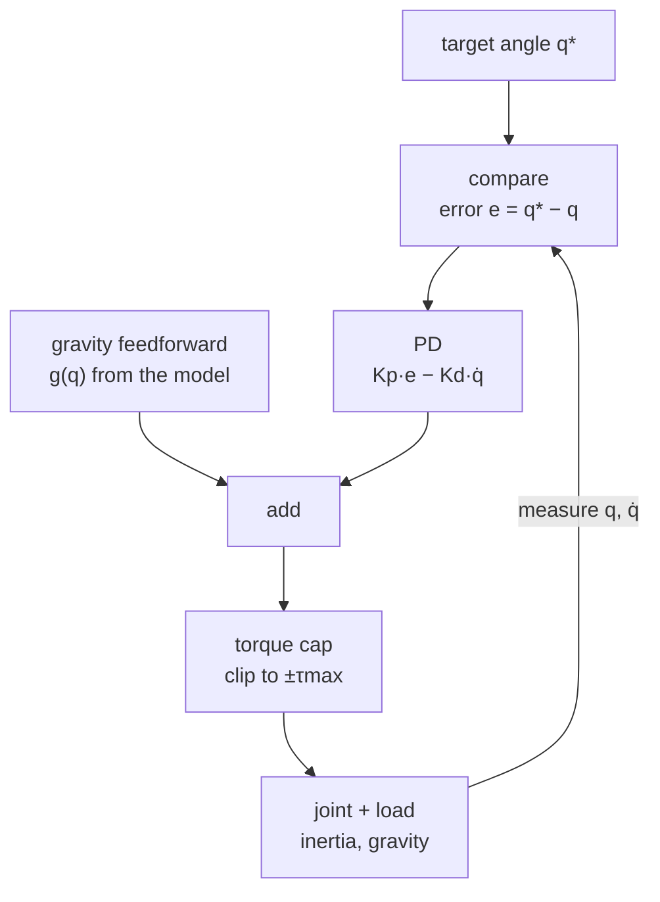

# 12 · Joint control: PD, PID, gravity feedforward and position servos

<!-- meta -->
| | |
|---|---|
| **Part** | [4 · Dynamics and control](README.md) |
| **Run type** | CPU · Mac or Colab CPU |
| **Prerequisites** | [05](../part-1-simulation/05-joints-and-actuators.md), [11](11-rigid-body-dynamics.md) |
| **Learn first** | [Calculus for Machine Learning](https://aiengineeringfromscratch.com/lesson?path=phases/01-math-foundations/04-calculus-for-ml) |
| **Time** | ~60 min |
| **Code** | [`experiments/12-joint-control/experiment.py`](../experiments/12-joint-control/experiment.py) · [notebook](../notebooks/12-joint-control.ipynb) |
| **Status** | ✅ done |
<!-- /meta -->

> A policy says "joint to this angle". Two numbers, Kp and Kd, decide how the joint gets there, and they cannot fix gravity on their own.

## The problem

The Unitree Go2 has 12 leg joints. In Unitree's open training code every one of them is driven by the same PD rule (proportional–derivative: a spring plus a damper, explained below) with `stiffness = 20` (Kp, N·m/rad), `damping = 0.5` (Kd, N·m·s/rad), `control_type = 'P'` ([`go2_config.py`](https://github.com/unitreerobotics/unitree_rl_gym/blob/main/legged_gym/envs/go2/go2_config.py)):

```python
# legged_robot.py · _compute_torques
torques = self.p_gains*(actions_scaled + self.default_dof_pos - self.dof_pos) - self.d_gains*self.dof_vel
return torch.clip(torques, -self.torque_limits, self.torque_limits)
```

([`legged_robot.py`](https://github.com/unitreerobotics/unitree_rl_gym/blob/main/legged_gym/envs/base/legged_robot.py)). The policy updates the target every 20 ms (`sim.dt = 0.005`, `decimation = 4`, [`legged_robot_config.py`](https://github.com/unitreerobotics/unitree_rl_gym/blob/main/legged_gym/envs/base/legged_robot_config.py)); the PD rule turns it into torque every 5 ms. Unitree's low-level stand-up example for the real Go2 uses different numbers, Kp = 60 and Kd = 5 ([`go2_stand_example.cpp`](https://github.com/unitreerobotics/unitree_sdk2/blob/main/example/go2/go2_stand_example.cpp)). Why do these numbers work, what do they get wrong, and what does an SO-101 servo do instead?

## Core idea

### In plain words

Picture the joint tied to its target angle by a **spring and a shock absorber**, like a car wheel tied to the body. The spring pulls harder the further the joint is from the target; its stiffness is **Kp**. The shock absorber resists speed, whatever the direction; its strength is **Kd**. A stiff spring with a weak absorber gets there fast and then bounces (**overshoot**). A strong absorber kills the bounce but makes the motion sluggish. There is a sweet spot in between, and it depends on how heavy the joint is: the absorber that calms a light wrist is too weak for a heavy shoulder.

A controller is a loop that never stops: measure the angle, compare it with the target, correct with a torque, repeat every millisecond. Gravity breaks the spring picture in one way: a spring only pushes when it is stretched, so to hold up a weight it has to stay stretched, and the joint settles a little **below** its target (**sag**). There are three ways out: a stiffer spring (less sag, never zero), an **integral** term that keeps a running tally of how long it has been wrong and pushes harder (removes sag, slowly, and can overshoot), or **feedforward**: compute the weight from the model and add exactly that torque before any error appears.

A hobby servo like the SO-101's runs this same loop inside the motor. You send it a target angle, never a torque, and it pushes back with at most its **torque cap**.



### The control loop as code

```python
integ = 0.0
while True:                               # every dt (1 ms here; inside the servo on a real arm)
    q, qd = read_joint()                  # measure: angle [rad], velocity [rad/s]
    e = q_target - q                      # compare: distance to the target [rad]
    tau = kp * e - kd * qd                # correct: spring toward target, damper against speed
    integ += e * dt                       # PID only: running sum of past error [rad*s]
    tau += ki * integ                     # PID only: push harder the longer the error lasts
    tau += gravity_torque(q)              # feedforward only: cancel the known load (qfrc_bias)
    tau = np.clip(tau, -tau_max, tau_max) # the motor cannot give more than its cap
    apply_torque(tau)
```

| Formula | What it tells you |
|---|---|
| $\tau = K_p (q^* - q) - K_d \dot q$ | the PD law (spring + damper) |
| $I\ddot q + K_d \dot q + K_p q = K_p q^*$ | the closed loop is a mass–spring–damper |
| $\omega_n = \sqrt{K_p / I}$ | how fast it responds; settling time scales as $1/\omega_n$ |
| $\zeta = \dfrac{K_d}{2\sqrt{K_p I}}$ | the shape: below 1 it overshoots, 1 is critical damping, above 1 it creeps |
| $\text{overshoot} = e^{-\pi\zeta/\sqrt{1-\zeta^2}}$ for $\zeta<1$ | fraction of the step it swings past the target |
| $K_p\, e = g(q^* - e)$ | the sag $e$ where the spring balances the gravity torque |

Here $q$ is the joint angle, $q^*$ the target, $\dot q$ the joint speed, $\tau$ the motor torque, $I$ the joint's inertia (from lesson 11, the diagonal of $M$), $K_p$ the stiffness in N·m/rad, $K_d$ the damping in N·m·s/rad, $\omega_n$ the natural frequency in rad/s, $\zeta$ the damping ratio (no unit), $e = q^* - q$ the error and $g(\cdot)$ the gravity torque at a given angle. Kp sets the speed, Kd sets the shape.

| Fix for the sag | Law | Price |
|---|---|---|
| Raise Kp | same | stiffer, more saturation (the torque hits its cap), less robust to contact |
| PID | $+\,K_i \int e\,dt$ | slow, and the integral winds up (keeps growing) during large moves |
| Gravity feedforward | $+\,g(q)$ from the model (`qfrc_bias` at rest) | needs a correct model (lesson 11) |

**Servo.** In the MuJoCo Menagerie model each STS3215 is a `position` actuator, force $= k_p(\text{ctrl} - q) - k_v\dot q$ with $k_p = 998.22$, $k_v = 2.731$, clipped at ±2.94 N·m (`so101.xml`; the file notes these gains are not a 1-to-1 mapping of the servo gains LeRobot uses). It is a PD loop with a torque cap, running inside the motor.

<details>
<summary>Math details: the second-order system, overshoot and why gravity needs more than PD</summary>

**Closed loop.** Insert $\tau = K_p(q^* - q) - K_d\dot q$ into one joint's equation of motion $I\ddot q = \tau$ (no gravity): $I\ddot q + K_d\dot q + K_p q = K_p q^*$. Divide by $I$: $\ddot q + 2\zeta\omega_n\dot q + \omega_n^2 q = \omega_n^2 q^*$ with $\omega_n$ and $\zeta$ as in the table. The characteristic roots are $-\zeta\omega_n \pm \omega_n\sqrt{\zeta^2 - 1}$: complex (oscillating) for $\zeta < 1$, a double real root at $\zeta = 1$, two real roots (one of them slow) for $\zeta > 1$, which is why overdamping settles more slowly again.

**Overshoot.** For $\zeta<1$ the step response is $q(t) = q^*\big(1 - e^{-\zeta\omega_n t}(\cos\omega_d t + \tfrac{\zeta}{\sqrt{1-\zeta^2}}\sin\omega_d t)\big)$ with $\omega_d = \omega_n\sqrt{1-\zeta^2}$. Its first peak is at $t = \pi/\omega_d$, which gives the overshoot formula. Every time constant in the response is a multiple of $1/\omega_n$ at fixed $\zeta$, so quadrupling Kp halves the settling time.

**Gravity sag.** With a load torque the equilibrium ($\dot q = \ddot q = 0$) requires $K_p e = g(q^* - e)$: a non-zero $e$ for any finite $K_p$. For the link of part B, $g = mgl\cos(\cdot)$ and the fixed point is solved numerically.

**Integral action.** With $+K_i\int e\,dt$, an equilibrium needs $\frac{d}{dt}\int e\,dt = e = 0$, so the steady error vanishes. The price: the loop becomes third order, and during a large move the integral accumulates error that must be "unwound" past the target (windup). Feedforward instead adds $g(q)$ so that the remaining error dynamics are the gravity-free ones above, as long as the model is right.

Go deeper: [Linear Systems](https://aiengineeringfromscratch.com/lesson?path=phases/01-math-foundations/17-linear-systems); Lynch & Park, [*Modern Robotics*](https://hades.mech.northwestern.edu/index.php/Modern_Robotics), ch. 11 (Robot Control).

</details>

<!-- figure: 12-pd-step -->

## Build it

You will now write the joint controller yourself in about 50 lines of NumPy: the gravity torque, the simulator step, the PD law and a PID with the limits a real motor needs. Every step is checked against MuJoCo running the same joint. The joint is the one from the Experiment, parts A and B: a 1 kg point mass 30 cm from a hinge, torque applied every 1 ms. The only things your code takes from MuJoCo are static numbers you could read off the XML (mass, distance, timestep).

Type the steps into a file of your own (for example `scratch/my_joint.py`) instead of copying them, and run it after each step. The finished functions are in [`physai/control.py`](../physai/control.py); `uv run python experiments/12-joint-control/build.py` runs all six steps with the checks (output in [`build_output.txt`](../experiments/12-joint-control/build_output.txt)).

### Step 1 · The load: gravity on one link

With $q = 0$ horizontal and $q > 0$ pointing down, the mass sits at height $-l\sin q$, so gravity turns the joint with $mgl\cos q$: largest when the link is horizontal, zero when it hangs straight down. The inertia about the axis is $ml^2$ plus the small $10^{-4}$ kg·m² of the mass itself.

```python
def gravity_torque(q, m, l, g=9.81):
    """Torque gravity puts on a hinge with a point mass m at distance l (q = 0 horizontal, q > 0 down)."""
    return m * g * l * np.cos(q)
```

MuJoCo calls the same quantity `qfrc_bias`, with the opposite sign: it is the force the joint must *supply* to stay put, not the force gravity applies.

```text
== Step 1. Gravity torque m g l cos(q) by hand vs MuJoCo ==
inertia: m l^2 + 1e-4 = 0.0901 kg m^2, MuJoCo mass matrix = 0.0901 kg m^2
 q (deg)  ours (N m)  -qfrc_bias (N m)
       0      2.9430            2.9430
      30      2.5487            2.5487
      60      1.4715            1.4715
      90      0.0000            0.0000
     -45      2.0810            2.0810
max difference: 4.7e-16 N m
```

### Step 2 · The simulator: one semi-implicit Euler step

Newton for a hinge is $I\ddot q = \tau + \tau_{\text{load}}$. Integrate it in the order MuJoCo's default `Euler` integrator does: first the new speed from the acceleration, then the new angle from the **new** speed. That order (semi-implicit, or symplectic, Euler) keeps an undamped pendulum from slowly gaining energy, which the textbook order (angle from the old speed) does.

```python
def step_joint(q, qd, tau, inertia, dt, load=0.0):
    """One semi-implicit Euler step: new speed from the torques, then new angle from the new speed."""
    qdd = (tau + load) / inertia                   # motor torque plus load torque (e.g. gravity)
    qd = qd + dt * qdd
    q = q + dt * qd                                # uses the updated speed: this is the "semi"
    return q, qd
```

```python
def simulate_joint(torque_fn, q0, inertia, dt, steps, load_fn=None):
    """Run a torque controller on one joint from rest at q0; returns the angle after every step."""
    q, qd, qs = q0, 0.0, []
    for _ in range(steps):
        load = load_fn(q) if load_fn else 0.0
        q, qd = step_joint(q, qd, torque_fn(q, qd), inertia, dt, load)
        qs.append(q)
    return np.array(qs)
```

```text
== Step 2. Semi-implicit Euler by hand vs mj_step (free swing from horizontal, 1 s) ==
angle after 1 s: ours 77.423 deg, MuJoCo 77.423 deg
max |q_ours - q_mujoco| over 1000 steps: 4.4e-16 rad
```

The free swing agrees with `mj_step` to one rounding step for 1000 steps: the integrator is MuJoCo's.

### Step 3 · The PD law

The controller is one line, the spring and the damper from Core idea:

```python
def pd_torque(q, qd, q_target, kp, kd):
    """PD law: a spring toward q_target (stiffness kp) and a damper against the joint speed (kd)."""
    return kp * (q_target - q) - kd * qd
```

```python
I, DT = 1.0 * 0.3 ** 2 + 1e-4, 0.001
kd = 2 * zeta * np.sqrt(20 * I)                     # Kd for a chosen damping ratio
q = simulate_joint(lambda q, qd: pd_torque(q, qd, 0.5, 20, kd), 0.0, I, DT, 4000)
overshoot = (q.max() - 0.5) / 0.5 * 100
```

On the MuJoCo side the same torque goes into `d.ctrl[0]` of a motor actuator (gear 1), or into `d.qfrc_applied[0]`; both are tried below.

```text
== Step 3. PD step 0 -> 0.5 rad, Kp = 20, no gravity: overshoot ==
 zeta     Kd  ours %  MuJoCo %  formula %
  0.1  0.268   72.91     72.91      72.92
  0.3  0.805   37.14     37.14      37.23
  0.5  1.342   16.16     16.16      16.30
  0.7  1.879    4.45      4.45       4.60
  1.0  2.685    0.00      0.00       0.00
max |q_ours - q_mujoco| over all runs: 3.3e-16 rad
same loop through qfrc_applied instead of the motor: max diff 0.0e+00 rad
```

These are the Experiment's part A numbers, digit for digit, because the Experiment runs exactly this loop. The formula column comes from the ideal continuous system; the simulated overshoot sits 0.01 to 0.15 points below it.

### Step 4 · Sag under gravity

Add the load from Step 1 (`load_fn=lambda q: gravity_torque(q, 1.0, 0.3)`) and step from hanging (90°) to horizontal (0°). At rest the spring must carry the weight, $K_p e = mgl\cos e$, which a few lines of fixed-point iteration solve:

```python
def pd_sag(kp, mgl, iters=200):
    """Steady error e of a PD joint holding a link at horizontal: the fixed point of kp e = mgl cos(e)."""
    e = 0.0
    for _ in range(iters):
        e = mgl * np.cos(e) / kp
    return e
```

```text
== Step 4. PD under gravity, hanging (90 deg) -> horizontal (0 deg), zeta 0.7: sag ==
  Kp  ours (deg)  MuJoCo (deg)  Kp e = mgl cos e (deg)
   5      29.385        29.385                  29.385
  20       8.342         8.342                   8.342
  80       2.106         2.106                   2.106
```

Your simulator, MuJoCo and the formula agree to three decimals at every Kp: the sag of the Experiment's part B is a property of the PD law, not of the simulator.

### Step 5 · Gravity feedforward

Feedforward adds the torque the model says gravity needs, before any error appears: $\tau = K_p e - K_d\dot q - g(q)$ with your `gravity_torque` as $g$ (the minus sign is MuJoCo's `+qfrc_bias`).

```python
KD = 2 * 0.7 * np.sqrt(20 * I)                      # 1.879, zeta = 0.7
load = lambda q: gravity_torque(q, 1.0, 0.3)
q = simulate_joint(lambda q, qd: pd_torque(q, qd, 0.0, 20, KD) - load(q), np.pi / 2, I, DT, 4000, load)
```

```text
== Step 5. PD + gravity feedforward, Kp = 20, Kd = 1.879 ==
feedforward                            overshoot (deg)  final err (deg)  t into 0.5 deg (s)
ours: -g(q) at the current q                     4.009            0.000               0.463
MuJoCo: qfrc_bias after mj_forward               4.009            0.000               0.463
MuJoCo: qfrc_bias left by mj_step                3.994            0.000               0.463
max |q_ours - q_fresh|: 4.2e-17 rad
```

The final error is gone, as in the Experiment. But the overshoot here is 4.009°, while the Experiment's table says 3.994°. The difference is a timing detail: the Experiment reads `d.qfrc_bias` right after `mj_step`, and at that moment it still holds the value computed at the *start* of the step, for the angle one millisecond ago. Recompute it (`mj_forward`) or compute $g(q)$ yourself and you get 4.009°; reuse the old value and you get 3.994°. A 1 ms lag in a feedforward term is harmless here, but on a real robot the same lag comes from the bus and the sensor, and it grows.

### Step 6 · Limits: anti-windup and the torque cap

Two things a controller on real hardware must have: a limit on the integral (otherwise it winds up during a large move, the 46.016° overshoot of the Experiment) and the motor's torque cap. Both go into one small class:

```python
@dataclass
class PID:
    """PD + integral + feedforward, with an anti-windup clamp and the motor's torque limit."""
    kp: float
    kd: float
    ki: float = 0.0
    i_max: float = np.inf      # anti-windup: the integral term may give at most this torque (N m)
    tau_max: float = np.inf    # motor torque limit (N m)
    integ: float = 0.0         # running sum of the error (rad s)

    def __call__(self, q, qd, q_target, dt, tau_ff=0.0):
        self.integ += (q_target - q) * dt
        if self.ki:                                # clamp the sum, not just the output
            lim = self.i_max / self.ki
            self.integ = min(max(self.integ, -lim), lim)
        tau = pd_torque(q, qd, q_target, self.kp, self.kd) + self.ki * self.integ + tau_ff
        return min(max(tau, -self.tau_max), self.tau_max)
```

The clamp limits the *sum*, not just the term's output: a clipped output over a growing sum would still have to unwind before it could move again. The value 3 N·m is chosen just above the most the integral ever needs to supply, the gravity torque at horizontal, $mgl$ = 2.943 N·m (Step 1).

```text
== Step 6. Limits: integrator clamp (anti-windup) and torque cap ==
controller                             overshoot (deg)  final err (deg)  t into 0.5 deg (s)
PID Ki = 160                                    46.016            0.000               1.520   peak |tau| 31.67 N m
PID Ki = 160, |Ki integ| <= 3 N m                4.646            0.000               0.685   peak |tau| 31.67 N m
PD + feedforward                                 4.009            0.000               0.463   peak |tau| 31.42 N m
PD + feedforward, |tau| <= 3.5 N m               2.512            0.000               0.607   peak |tau| 3.50 N m
PID Ki = 160, ours vs MuJoCo: max diff 7.5e-17 rad
torque cap, ours (clip in PID) vs MuJoCo (unclipped torque, ctrlrange = +-3.5): max diff 2.2e-16 rad
```

The clamp cuts the PID overshoot from 46.016° (the Experiment's Ki = 160 row) to 4.646° and the time into ±0.5° from 1.520 s to 0.685 s, with the same zero final error. Without a cap the first command is 31.42 N·m, more than ten times the load: $K_p$ times a 90° error. A 3.5 N·m cap makes the move slower (0.607 s) and, here, gentler (2.512°). A cap below 2.943 N·m could not hold the link at all; that is what the SO-101 runs into in part C.

### What you keep

`physai.control` now has `gravity_torque`, `step_joint`, `simulate_joint`, `pd_torque`, `pd_sag` and `PID`. A trajectory (lesson 13) is the same controller with a moving `q_target`; later lessons import it instead of re-deriving it. [`tests/test_12_joint_control.py`](../tests/test_12_joint_control.py) pins them to MuJoCo and to the ζ and sag formulas; run `uv run pytest tests/test_12_joint_control.py` after you change anything.

## Use it

In practice you rarely write the torque loop for a position-controlled joint: MuJoCo's `position` actuator is the same PD law, computed inside `mj_step`. You send the target, not the torque:

```xml
<actuator>
  <position joint="j" kp="20" kv="1.879"/>      <!-- or kp="20" dampratio="0.7" -->
</actuator>
```

```python
d.ctrl[0] = q_target          # position actuator: force = kp (ctrl - q) - kv qdot
mujoco.mj_step(m, d)
```

If you want your own torque loop (PID, feedforward, a learned policy), use a `motor` actuator (`ctrl` is the torque, times `gear`) or write `qfrc_applied` directly, and for the gravity term either recompute `qfrc_bias` with `mj_forward` or let MuJoCo cancel gravity with `gravcomp="1"` on the body:

```python
mujoco.mj_forward(m, d)                                   # qfrc_bias for the current q
d.ctrl[0] = kp * (q_target - d.qpos[0]) - kd * d.qvel[0] + d.qfrc_bias[0]
mujoco.mj_step(m, d)
```

```text
== Use it. MuJoCo's own position actuator and gravity compensation ==
dampratio="0.7" -> kv = 1.879 (2 zeta sqrt(Kp I) = 1.879)
step 0 -> 0.5 rad: overshoot 4.45 %, max diff to our PD loop 1.1e-16 rad
under gravity, hanging -> horizontal     overshoot (deg)  final err (deg)  qfrc_passive  qfrc_actuator
position actuator                                  0.000            8.342         0.000         -2.912
+ body gravcomp="1"                                4.009            0.000        -2.943          0.000
+ joint actuatorgravcomp="true"                    4.009            0.000         0.000         -2.943
```

`dampratio` computes the same Kd you computed by hand, the position actuator reproduces your Step 3 loop to 1.1e-16 rad, and under gravity it sags the same 8.342° as Step 4. `gravcomp` removes the sag with your Step 5 overshoot (4.009°).

The same two gains have different names elsewhere. Units differ too, so never copy a number from one row to another:

| Where | P gain | D gain | Notes |
|---|---|---|---|
| physai | `PID.kp` | `PID.kd` | N·m/rad and N·m·s/rad; `ki`, `i_max`, `tau_max` as in Step 6 |
| MuJoCo `position` actuator | `kp` | `kv`, or `dampratio` | the SO-101 model: `kp="998.22" kv="2.731" forcerange="-2.94 2.94"` ([`so101.xml`](https://github.com/google-deepmind/mujoco_menagerie/blob/f3b6013/robotstudio_so101/so101.xml)) |
| `unitree_rl_gym` config | `stiffness` | `damping` | dicts per joint name, 20 and 0.5 for the Go2 ([`go2_config.py`](https://github.com/unitreerobotics/unitree_rl_gym/blob/main/legged_gym/envs/go2/go2_config.py)) |
| `unitree_sdk2` low-level command | `motor_cmd()[i].kp()` | `motor_cmd()[i].kd()` | set in each command together with `q`, `dq` and `tau`; 60 and 5 in the stand example ([`go2_stand_example.cpp`](https://github.com/unitreerobotics/unitree_sdk2/blob/main/example/go2/go2_stand_example.cpp)) |
| Isaac Lab actuator config | `stiffness` ("p-gain") | `damping` ("d-gain") | implicit actuators hand them to the physics engine, explicit ones compute the effort themselves ([`isaaclab.actuators`](https://isaac-sim.github.io/IsaacLab/main/source/api/lab/isaaclab.actuators.html)) |
| LeRobot SO-101 follower (Feetech STS3215) | `P_Coefficient` = 16 | `D_Coefficient` = 32 | servo register values, no physical unit; `I_Coefficient` = 0 ([`config_so_follower.py`](https://github.com/huggingface/lerobot/blob/main/src/lerobot/robots/so_follower/config_so_follower.py)) |

Three traps:

- **A gain is not a gain.** LeRobot's P coefficient 16 is a register value inside the servo; the Menagerie model's `kp = 998.22` N·m/rad was derived assuming that setting and is "not a 1-to-1 mapping" (the comment in `so101.xml`). Retune when you change tools.
- **Stale `qfrc_bias`.** After `mj_step` it holds the value from the start of that step (Step 5: 3.994° instead of 4.009°). On a moving arm with several joints it is also more than gravity: it contains the Coriolis and centrifugal torques; only at rest is it $g(q)$ alone.
- **Free gravity compensation.** With `gravcomp="1"` the link holds while the actuator reports 0.000 N·m, because MuJoCo books the 2.943 N·m as a passive force. A real motor has to supply it. `actuatorgravcomp="true"` on the joint books it under `qfrc_actuator`, so your torque budget sees it.

## Experiment

Full script: [`experiments/12-joint-control/experiment.py`](../experiments/12-joint-control/experiment.py). MuJoCo 3.17.0, NumPy 2.5.4, Python 3.14, Apple M5, deterministic, ~2 s. Four parts, each a sweep.

**A. Damping ratio.** One joint, $I$ = 0.0901 kg·m² (1 kg at 30 cm), no gravity, Kp = 20, step 0 → 0.5 rad, torque applied every 1 ms. *Predict:* at which ζ does overshoot vanish, and which ζ settles fastest?

| ζ | Kd | overshoot % (sim) | formula % | settling 2% [s] |
|---|---|---|---|---|
| 0.1 | 0.268 | 72.91 | 72.92 | 2.573 |
| 0.3 | 0.805 | 37.14 | 37.23 | 0.751 |
| 0.5 | 1.342 | 16.16 | 16.30 | 0.538 |
| 0.7 | 1.879 | 4.45 | 4.60 | 0.398 |
| 1.0 | 2.685 | 0.00 | 0.00 | 0.393 |
| 1.5 | 4.027 | 0.00 | 0.00 | 0.716 |

The formula holds to a fraction of a percent. ζ ≈ 0.7–1 settles fastest; overdamping (1.5) is slower again. At fixed ζ = 0.7, settling time halves when Kp quadruples: Kp 5 / 20 / 80 → ωn 7.45 / 14.90 / 29.80 rad/s → 0.799 / 0.398 / 0.197 s.

**B. Gravity.** Same joint with gravity ($mgl$ = 2.943 N·m), step from hanging (90°) to horizontal (0°), ζ = 0.7.

| Kp | sag (sim) | sag from $K_p e = mgl\cos e$ |
|---|---|---|
| 5 | 29.385° | 29.385° |
| 10 | 16.193° | 16.193° |
| 20 | 8.342° | 8.342° |
| 40 | 4.204° | 4.204° |
| 80 | 2.106° | 2.106° |

Then Kp = 20, Kd = 1.879, three ways to remove the 8.342° sag (4 s simulated):

```python
tau = kp * e - kd * qd + ki * integ        # PID
tau += d.qfrc_bias[0]                       # or: gravity feedforward from the model
```

| controller | final error | overshoot | time into ±0.5° |
|---|---|---|---|
| PD | 8.342° | 0.000° | never |
| PID, Ki = 10 | 0.603° | 0.365° | not within 4 s |
| PID, Ki = 40 | −0.001° | 12.359° | 1.310 s |
| PID, Ki = 160 | 0.000° | 46.016° | 1.520 s |
| PD + `qfrc_bias` | −0.000° | 3.994° | 0.463 s |

The integral term removes the error but trades it for time or overshoot. Feedforward removes it immediately, with the overshoot of the ζ = 0.7 loop itself (lesson 11's $g(q)$ doing its job). The script reads `qfrc_bias` one step late; with the fresh value the overshoot is 4.009° (Build it, Step 5).


**C. SO-101 servo.** Arm stretched forward (all joints 0, gripper about 39 cm out), payload at the gripper frame, all servos told to hold 0, 3 s.

| payload | gravity torque, shoulder | shoulder sag | servo torque | gripper drop |
|---|---|---|---|---|
| 0.00 kg | −0.573 N·m | 0.033° | −0.573 N·m | 0.03 cm |
| 0.25 kg | −1.363 | 0.078° | −1.364 | 0.09 |
| 0.50 kg | −2.153 | 0.124° | −2.156 | 0.14 |
| 0.70 kg | −2.785 | 0.160° | −2.789 | 0.18 |
| 0.80 kg | −3.101 | 37.403° | −2.940 (cap) | 22.30 |
| 1.00 kg | −3.733 | 37.403° | −2.940 (cap) | 22.30 |

With $k_p$ near 1000 N·m/rad the sag is a fraction of a degree, until the gravity torque passes the 2.94 N·m cap. Then the position loop has nothing left and the arm falls until the gripper rests on the floor. A stiff servo hides gravity; its torque limit does not.

**D. Go2 case study.** The Menagerie Go2 lies with folded legs (body at 10 cm); for 3 s all 12 joints get $\tau = K_p(q^* - q) - K_d\dot q$, clipped at the motor limits; $q^*$ = `default_joint_angles` from `go2_config.py`. Final = mean body height over 2.5–3 s; overshoot = (peak − final)/(final − start); "steps saturated" = share of control steps in which some joint hit its torque limit.

| Kp / Kd | peak | t peak | feet on floor at peak | final | overshoot | steps saturated |
|---|---|---|---|---|---|---|
| **20 / 0.5** (training) | 25.6 cm | 0.45 s | 4 | **25.2 cm** | 3.0% | 0.0% |
| 5 / 0.5 | 11.1 | 2.92 | 4 | 11.1 | 0.8% | 0.0% |
| 10 / 0.5 | 19.7 | 2.75 | 4 | 19.6 | 0.1% | 0.0% |
| 40 / 0.5 | 36.0 | 0.28 | 2 | 29.1 | 36.4% | 0.5% |
| 80 / 0.5 | **50.8** | 0.33 | **0** | 29.9 | 104.5% | 2.9% |
| 20 / 0 | 26.3 | 0.31 | 4 | 24.7 | **11.0%** | 0.0% |
| 20 / 2 | 25.3 | 1.04 | 4 | 25.2 | 1.2% | 0.0% |
| 60 / 5 (real-robot example gains) | 29.9 | 1.11 | 4 | 29.8 | 0.2% | 0.9% |
| 20 / 0.5 + 5 kg on the body | 22.7 | 0.38 | 4 | 21.8 | 7.4% | 0.0% |

If the target angles were held exactly, the body would stand at 32.35 cm (front legs; rear 31.39 cm; geometry only). With 20 / 0.5 it stands at 25.2 cm, about 7 cm low: this is part B's gravity sag, on twelve joints at once. PD alone does not close it; in training, the policy closes it by shifting the target (`action_scale = 0.25` in `go2_config.py`).

## Break it

**Kp up, Kd fixed.** At 80 / 0.5 the body overshoots to 50.8 cm at t = 0.33 s with **all four feet off the floor**, and some joint is at its torque limit in 2.9% of the steps. In ζ terms: Kp quadrupled while Kd stayed put, so ζ halved; the joints swing far past the target and the stored energy throws the robot. Raising Kd with Kp (60 / 5) gives 0.2% overshoot and a 29.8 cm stance.

**Ki up.** In part B, Ki = 160 removes the steady (long-run) error but overshoots by 46.016°: during the 90° move the integral accumulates a large error that must be "unwound" past the target. Real controllers clamp or freeze the integrator during saturation and large errors (anti-windup), or use feedforward and keep Ki small. The 3 N·m clamp of Build it, Step 6 brings the same Ki = 160 down to 4.646° of overshoot.

## On the real robot

- **Go2.** 20 / 0.5 are training-simulation gains under a policy that moves the target every 20 ms. Unitree's `unitree_rl_gym/deploy` has real-robot configs for G1, H1 and H1_2 only, none for the Go2 ([`deploy_real/configs`](https://github.com/unitreerobotics/unitree_rl_gym/tree/main/deploy/deploy_real/configs)). The SDK stand example uses Kp 60, Kd 5 and does not step the target: it interpolates linearly from the start pose through waypoints, each phase lasting 500 or more ticks of 2 ms ([`go2_stand_example.cpp`](https://github.com/unitreerobotics/unitree_sdk2/blob/main/example/go2/go2_stand_example.cpp), [Python version](https://github.com/unitreerobotics/unitree_sdk2_python/blob/master/example/go2/low_level/go2_stand_example.py)). A ramped target is the trajectory idea of lesson 13. None of the Go2 numbers in this lesson are measured on hardware.
- **Model differences.** The Menagerie Go2 adds passive joint damping 2 N·m·s/rad and friction loss 0.2 N·m; the training [`go2.urdf`](https://github.com/unitreerobotics/unitree_rl_gym/blob/main/resources/robots/go2/urdf/go2.urdf) has no joint damping entries and a knee effort limit of 35.55 N·m (Menagerie: 45.43 N·m). Our step is 2 ms (training: 5 ms). Even "Kd = 0" therefore has damping, and every oscillation here is softer than in training. Trust the qualitative results (Kp 5 cannot stand, Kp 80 leaves the floor, 20 / 0.5 stands about 7 cm low); treat exact overshoot percentages as specific to this model.
- **SO-101.** The follower arm uses six STS3215 servos with 1/345 gearing; the leader arm mixes 1/191, 1/345 and 1/147 so it can hold itself up yet be moved by hand ([LeRobot SO-101 docs](https://huggingface.co/docs/lerobot/so101)). You send goal positions; the loop that turns position error into motor current runs in the servo. Part C's sag and drop numbers come from the Menagerie model and are not yet measured on the real arm. Procedure to measure: stretch the arm forward, hang known masses at the gripper, read `Present_Position` of shoulder_lift, and stop before the servo overheats.

## Check yourself

1. **Easy.** A wrist joint has $I$ = 0.01 kg·m² and Kp = 20 N·m/rad. Which Kd gives ζ = 0.7?
2. **Medium.** In part B, what Kp would bring the PD sag of the 1 kg, 30 cm link under 1°? Use $K_p e \approx mgl$.
3. **Hard.** Add an I term to the Go2 rule (`Ki * integral(q* - q)`) in `experiment.py`. Does the ~7 cm gap close within 3 s? What happens to overshoot and to the feet-at-peak count?

### Answers

1. $K_d = 2\zeta\sqrt{K_p I} = 2 \cdot 0.7 \cdot \sqrt{0.2} \approx 0.63$ N·m·s/rad.
2. $e < 1° = 0.01745$ rad needs $K_p > 2.943 / 0.01745 \approx 169$ N·m/rad (the table's trend: Kp 80 → 2.106°).
3. Not computed here; run it.

## Takeaways and sources

- PD is a spring–damper: $\zeta = K_d / (2\sqrt{K_p I})$ predicts overshoot to within a fraction of a percent (72.91% vs 72.92% at ζ = 0.1); ζ ≈ 0.7–1 settles fastest.
- Under gravity PD sags by $g/K_p$ (8.342° at Kp 20); PID removes it slowly and winds up (46.016° overshoot at Ki 160); gravity feedforward from `qfrc_bias` removes it at once.
- A position servo is a stiff PD with a torque cap; Go2's 20 / 0.5 stands 7 cm low without a policy, 80 / 0.5 throws it off the floor.

Next: [lesson 13 · Trajectory generation](13-trajectory-generation.md).

Sources:
- [`unitree_rl_gym`](https://github.com/unitreerobotics/unitree_rl_gym): [`go2_config.py`](https://github.com/unitreerobotics/unitree_rl_gym/blob/main/legged_gym/envs/go2/go2_config.py), [`legged_robot.py`](https://github.com/unitreerobotics/unitree_rl_gym/blob/main/legged_gym/envs/base/legged_robot.py), [`legged_robot_config.py`](https://github.com/unitreerobotics/unitree_rl_gym/blob/main/legged_gym/envs/base/legged_robot_config.py) (BSD-3-Clause, © Unitree Robotics).
- [`unitree_sdk2` · `go2_stand_example.cpp`](https://github.com/unitreerobotics/unitree_sdk2/blob/main/example/go2/go2_stand_example.cpp), [`unitree_sdk2_python` · `go2_stand_example.py`](https://github.com/unitreerobotics/unitree_sdk2_python/blob/master/example/go2/low_level/go2_stand_example.py): Kp 60, Kd 5, interpolated targets.
- [LeRobot SO-101 documentation](https://huggingface.co/docs/lerobot/so101) (read 2026-10-27).
- [MuJoCo Menagerie](https://github.com/google-deepmind/mujoco_menagerie): `unitree_go2` (BSD-3-Clause, © Unitree Robotics), `robotstudio_so101` (Apache-2.0); [MuJoCo Modeling · actuators](https://mujoco.readthedocs.io/en/stable/modeling.html).
- Lynch & Park, [*Modern Robotics*](https://hades.mech.northwestern.edu/index.php/Modern_Robotics), ch. 11 (Robot Control).
- All measured numbers: [`experiments/12-joint-control/output.txt`](../experiments/12-joint-control/output.txt).

> Go2 model: MuJoCo Menagerie (Google DeepMind), from the Unitree Robotics URDF, BSD-3-Clause. The Unitree and Go2 names are used factually; Unitree does not sponsor or endorse this work.
