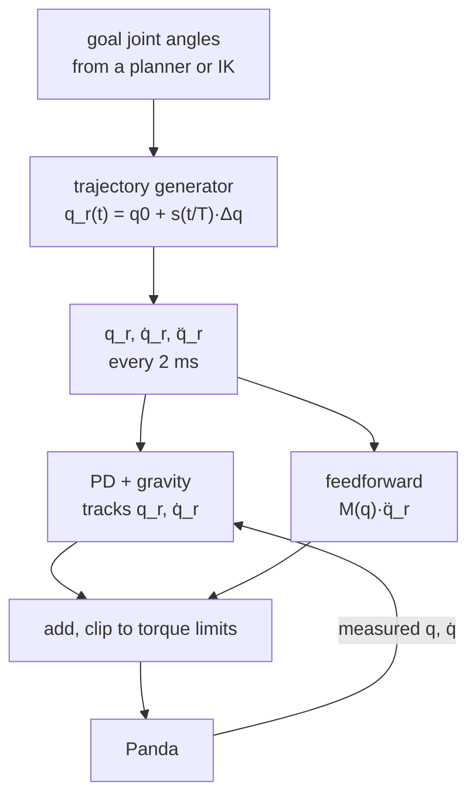

# 13 · Trajectory generation

<!-- meta -->
| | |
|---|---|
| **Part** | [4 · Dynamics and control](README.md) |
| **Run type** | CPU · Mac or Colab CPU |
| **Prerequisites** | [10](../part-3-kinematics/10-inverse-kinematics.md), [12](12-joint-control.md) |
| **Learn first** | [Calculus for Machine Learning](https://aiengineeringfromscratch.com/lesson?path=phases/01-math-foundations/04-calculus-for-ml) |
| **Time** | ~45 min |
| **Code** | [`experiments/13-trajectory-generation/experiment.py`](../experiments/13-trajectory-generation/experiment.py) |
| **Status** | ✅ done |
<!-- /meta -->

> A controller tracks whatever you give it. Give it a step and it will try to produce infinite acceleration; give it a smooth curve and the torque stays small.

## The problem

In lesson 12, Unitree's real-robot stand-up example did not send the stand pose in one go: it interpolated toward it in phases of 500 to 1000 ticks of 2 ms ([`go2_stand_example.py`](https://github.com/unitreerobotics/unitree_sdk2_python/blob/master/example/go2/low_level/go2_stand_example.py)). Robot interfaces go further: libfranka's `rate_limiting.h` defines per-joint maxima of 10 rad/s² acceleration, 5000 rad/s³ jerk (the rate of change of acceleration) and 1000 N·m/s torque rate at a 1 ms control period, with `limitRate` functions that clip commands to them ([`rate_limiting.h`](https://github.com/frankarobotics/libfranka/blob/main/include/franka/rate_limiting.h)). A planner or an IK solver gives you *where* to go; trajectory generation decides *how the reference moves in time*, and that choice sets the peak torque, the jerk that shakes the structure, and the tracking error (how far the robot lags behind its reference). This lesson measures all three on a Panda.

## Core idea

### In plain words

A controller chases its reference, the angle it is told to be at right now. If the reference teleports to the goal (a **step**), the controller tries to get there instantly and asks for an enormous torque. A **trajectory** is the reference written as a schedule instead: where each joint should be at every tick between start and goal.

Think of an elevator. A cheap one lurches when it starts and stops; a good one eases into motion, cruises and eases out. What you feel as a lurch is **jerk**, the rate at which acceleration changes. The shape of the schedule decides it:

- **linear**: constant speed from the first instant, so speed jumps at both ends;
- **trapezoid**: speed ramps up, cruises, ramps down, so acceleration jumps at the corners;
- **cubic**: speed is smooth, but acceleration still jumps at the start and the end;
- **quintic**: position, speed and acceleration all start and end at rest. This is the **minimum-jerk** move.

Duration matters more than shape: do the same move in half the time and every acceleration (and torque) is four times larger, every jerk eight times. Two more choices follow: interpolate in joint angles (cheap, but the hand follows a curve) or along a straight line for the hand (needs IK at every point), and whether to add **feedforward**, the torque the planned acceleration needs, sent in advance instead of waiting for an error to build up.



### Time scaling as code

Every move is "start + fraction of the way × total change"; only the fraction `s` changes with time.

```python
def quintic(t, T):
    u = min(max(t / T, 0.0), 1.0)              # normalised time, 0 at start, 1 at the end
    s = 10*u**3 - 15*u**4 + 6*u**5             # fraction of the move done, 0 -> 1
    sd = (30*u**2 - 60*u**3 + 30*u**4) / T     # ds/dt  [1/s]
    sdd = (60*u - 180*u**2 + 120*u**3) / T**2  # d2s/dt2 [1/s^2]
    return s, sd, sdd

s, sd, sdd = quintic(t, T)
q_ref, qd_ref, qdd_ref = q0 + s*dq, sd*dq, sdd*dq      # per-joint reference [rad, rad/s, rad/s^2]
tau = g(q) + kp*(q_ref - q) + kd*(qd_ref - qd)         # PD tracking + gravity (lesson 12)
tau += M(q) @ qdd_ref                                  # optional feedforward (lesson 11's M)
```

| shape | $s(u)$ | boundary conditions | peak $|\ddot q|$ | jerk |
|---|---|---|---|---|
| step | 1 | none | ∞ | ∞ |
| linear | $u$ | position | ∞ (velocity jumps) | ∞ |
| trapezoidal velocity | accelerate $T/3$, cruise, decelerate $T/3$ | position, velocity | $4.5\,\Delta q/T^2$ | ∞ (acceleration jumps) |
| cubic | $3u^2 - 2u^3$ | position, velocity | $6\,\Delta q/T^2$ | ∞ at the ends |
| quintic | $10u^3 - 15u^4 + 6u^5$ | position, velocity, acceleration | $5.77\,\Delta q/T^2$ | $60\,\Delta q/T^3$ |

Here $q(t) = q_0 + s(t/T)\,\Delta q$, $u = t/T \in [0,1]$ is normalised time, $s(u)$ the time scaling with $s(0) = 0$ and $s(1) = 1$ (Lynch & Park, ch. 9), $q_0$ the start angles, $\Delta q$ the total change, $T$ the duration, $\ddot q$ the joint acceleration and jerk $\dddot q$ its time derivative. "Boundary conditions" lists what the shape sets to rest at both ends.


**Joint space vs Cartesian.** Interpolating in joint space stays inside the joint limits whenever both ends do, but the hand follows a curve. A Cartesian straight line needs IK at every waypoint (lesson 10) and can pass through singularities or joint limits; it costs more joint motion.

**Feedforward.** A tracking controller $\tau = g(q) + K_p(q_r - q) + K_d(\dot q_r - \dot q)$ produces torque only from an error. Adding the model term $M(q)\ddot q_r$ (lesson 11) supplies the accelerating torque in advance; a smooth reference makes $\ddot q_r$ available and bounded.

<details>
<summary>Math details: where the quintic comes from, and the 1/T² and 1/T³ laws</summary>

**Polynomials from boundary conditions.** A cubic has four coefficients, enough for $s$ and $\dot s$ at both ends: $s(0)=0$, $s(1)=1$, $s'(0)=s'(1)=0$ give $3u^2 - 2u^3$. Its acceleration $s'' = 6 - 12u$ is $\pm 6$ at the ends, and jumps there from the zero of the rest state. A quintic has six coefficients; adding $s''(0) = s''(1) = 0$ gives $10u^3 - 15u^4 + 6u^5$. Its acceleration $s'' = 60u - 180u^2 + 120u^3$ peaks at $u = (3-\sqrt3)/6$ with value $10\sqrt3/3 \approx 5.77$; its jerk $s''' = 60 - 360u + 360u^2$ is largest at the ends, 60.

**Minimum jerk.** Minimising $\int_0^1 (s''')^2\,du$ gives, by the Euler–Lagrange equation, $s^{(6)} = 0$: a fifth-order polynomial. With rest at both ends it is exactly the quintic above (Flash & Hogan 1985).

**Scaling with duration.** By the chain rule, $\dot q = \Delta q\, s'(u)/T$, $\ddot q = \Delta q\, s''(u)/T^2$, $\dddot q = \Delta q\, s'''(u)/T^3$. The shape fixes the constants in the table; the duration fixes the powers of $T$. Joint torque $\approx M\ddot q$ + gravity, so halving $T$ quadruples the dynamic part of the torque.

**Why a jump means infinite jerk.** If acceleration changes by a finite amount in zero time, its derivative is a spike (in a 2 ms simulation: the change divided by 2 ms), which is what the robot-jerk columns of the experiment measure.

Go deeper: [Calculus for Machine Learning](https://aiengineeringfromscratch.com/lesson?path=phases/01-math-foundations/04-calculus-for-ml) (derivatives, chain rule); Lynch & Park, [*Modern Robotics*](https://hades.mech.northwestern.edu/index.php/Modern_Robotics), ch. 9; T. Flash, N. Hogan, [doi:10.1523/JNEUROSCI.05-07-01688.1985](https://doi.org/10.1523/JNEUROSCI.05-07-01688.1985).

</details>

## Experiment

**Setup.** Panda (Menagerie) from the `home` keyframe, joint move $\Delta q$ = (0.6, 0.4, −0.4, 0.5, 0.5, −0.4, 0.6) rad. The model's built-in position actuators are switched off (`actuator_gainprm` and `actuator_biasprm` set to 0) and torques go to `qfrc_applied`, clipped at the model's limits (87 N·m joints 1–4, 12 N·m joints 5–7). Controller and physics run at 2 ms:

```python
s, sd, sdd = profile(kind, d.time, T)
q_ref, qd_ref = Q0 + s * DQ, sd * DQ
tau = d.qfrc_bias[:7] + KP * (q_ref - q) + KD * (qd_ref - qd)    # PD + gravity/Coriolis
tau = np.clip(tau, -lim, lim)
```

Kp = (600, 600, 600, 600, 250, 150, 50), Kd = (50, 50, 50, 50, 20, 12, 4). "Robot" columns are measured from `qacc` in simulation; robot jerk is its finite difference at 2 ms. "Steps saturated" is the share of control steps in which some joint torque was clipped at its limit. Full script: [`experiments/13-trajectory-generation/experiment.py`](../experiments/13-trajectory-generation/experiment.py). MuJoCo 3.17.0, NumPy 2.5.4, Python 3.14, Apple M5, deterministic, ~4 s.

**Predict.** Which shape has the smallest tracking error? Which has the smallest jerk?

**A. Five shapes, T = 1 s** (reference values for the largest joint, 0.6 rad; errors = max $|q_r - q|$ during the move):

| shape | ref. peak acc [rad/s²] | ref. peak jerk [rad/s³] | robot peak acc | robot peak jerk | tracking error | steps saturated |
|---|---|---|---|---|---|---|
| step | ∞ | ∞ | 739.2 | 175025 | 34.35° | 5.5% |
| linear | ∞ | ∞ | 220.9 | 110475 | 0.78° | 0.0% |
| trapezoid | 2.70 | ∞ | 3.0 | 1003 | 1.08° | 0.0% |
| cubic | 3.59 | ∞ | 3.6 | 1337 | 1.05° | 0.0% |
| quintic | 3.46 | 35.78 | 3.7 | 35 | 1.32° | 0.0% |
| quintic + $M\ddot q_r$ − passive | 3.46 | 35.78 | 3.5 | 48 | **0.01°** | 0.0% |

- **The step** saturates the torque in 5.5% of steps and lags 34.35° behind its own reference; the robot's acceleration peaks at 739.2 rad/s².
- **Jerk follows continuity.** Every shape whose acceleration jumps (linear, trapezoid, cubic) produces robot jerk of 1003–110475 rad/s³; the quintic produces 35 rad/s³, matching its reference (35.78). Jerk is what excites flexible links, gearboxes and the object in the gripper.
- **The tracking error of smooth shapes is about 1° and not decided by the shape.** The worst joint is joint 7 (Kp 50), where the model's passive damping (1 N·m·s/rad) and the inertia are not compensated. Adding the model feedforward $M\ddot q_r$ and cancelling `qfrc_passive` drops the error to 0.01°. The shape decides jerk; the model decides tracking error.

**B. Sweep the duration** (same move):

| T [s] | shape | ref. peak acc | ref. peak jerk | robot peak jerk | error |
|---|---|---|---|---|---|
| 0.25 | cubic | 56.68 | ∞ | 21311 | 4.46° |
| 0.25 | quintic | 55.41 | 2249.0 | 2107 | 5.52° |
| 0.50 | cubic | 14.28 | ∞ | 5317 | 2.16° |
| 0.50 | quintic | 13.86 | 284.6 | 234 | 2.73° |
| 1.00 | cubic | 3.59 | ∞ | 1337 | 1.05° |
| 1.00 | quintic | 3.46 | 35.8 | 35 | 1.32° |
| 2.00 | cubic | 0.90 | ∞ | 335 | 0.52° |
| 2.00 | quintic | 0.87 | 4.5 | 4 | 0.65° |

Acceleration scales as $1/T^2$ (56.68 → 14.28 → 3.59 → 0.90, factor 4 per halving), the quintic's jerk as $1/T^3$ (2249.0 → 284.6 → 35.8 → 4.5, factor 8), and the PD-only tracking error roughly as $1/T$. At every duration the cubic's robot jerk is an order of magnitude or more above the quintic's (21311 vs 2107 rad/s³ at 0.25 s, 335 vs 4 at 2 s).

**C. Joint space vs Cartesian.** The tool centre point moves 50 cm along $y$ with constant orientation, between IK solutions A and B (IK residual below 0.001 mm):

| interpolation | max distance from the line | hand path | joint path |
|---|---|---|---|
| joint space (quintic in $q$) | 5.38 cm | 51.53 cm | 1.089 rad |
| Cartesian (IK per waypoint) | 0.00 cm | 50.00 cm | 1.256 rad |

Same endpoints, same timing: the joint-space path bows 5.38 cm off the line. Enough to hit a box edge in a cluttered scene; irrelevant in free space, where joint space is cheaper (1.089 vs 1.256 rad of joint travel) and never meets a singularity mid-path.

## Break it

Shorten the move. At T = 0.25 s the reference needs 55.41 rad/s² (quintic) on a 0.6 rad joint motion; even the smooth quintic now produces 2107 rad/s³ of robot jerk and 5.52° of tracking error; shorter moves raise the reference acceleration as $1/T^2$, the jerk as $1/T^3$ and the PD tracking error roughly as $1/T$. Go to the extreme, T → 0, and you get the step: torque saturation (5.5% of steps), 739.2 rad/s² acceleration and a 34.35° lag. The mechanism is the scaling law, not the controller: no gain setting can produce acceleration the actuators cannot supply, and when the torque clips, the PD's carefully tuned damping is gone.

## On the real robot

- **Panda / FR3 class.** libfranka's rate limiter constants (10 rad/s² joint acceleration, 5000 rad/s³ jerk, 1 ms period; [`rate_limiting.h`](https://github.com/frankarobotics/libfranka/blob/main/include/franka/rate_limiting.h)) are violated by any reference that jumps. In our sweep, both cubic and quintic exceed 10 rad/s² at T = 0.5 s (14.28 and 13.86), and the cubic's acceleration discontinuity gives unbounded jerk at any duration. A quintic of 1 s stays inside both limits (3.46 rad/s², 35.78 rad/s³). These comparisons use our simulated references; nothing here was run on a Panda.
- **Go2.** The SDK stand example's piecewise-linear ramp (lesson 12) is the "linear" row: bounded position steps, but velocity jumps at every waypoint.
- **SO-101.** The servos receive goal positions at the rate of the control loop. A policy running at 30 Hz that outputs raw targets is effectively sending a staircase; whether interpolating between targets reduces jerk on the real arm is not yet measured.

## Check yourself

1. **Easy.** A quintic moves a joint 1 rad in 2 s. What are its peak acceleration and peak jerk?
2. **Medium.** Why does the linear profile have the smallest tracking error in part A (0.78°) despite an infinite reference acceleration?
3. **Hard.** Add $M(q)\ddot q_r - $ `qfrc_passive` feedforward to the cubic and the trapezoid in `experiment.py`. Predict before running: does their tracking error also drop to ~0.01°? Does their robot jerk change?

### Answers

1. Peak acceleration $5.77 \cdot 1 / 2^2 \approx 1.44$ rad/s²; peak jerk $60 \cdot 1 / 2^3 = 7.5$ rad/s³ (formulas from the table).
2. Its peak velocity ($\Delta q/T$) is the lowest of all shapes and its acceleration is zero except for two instants, which is consistent with the unmodelled damping torque being smallest; the infinite acceleration only appears as two short spikes (220.9 rad/s² robot peak) at the start and end.
3. Not computed here; run it.

## Takeaways and sources

- Time scaling sets the physics: accelerations scale with $1/T^2$, jerks with $1/T^3$; a step saturates the Panda's torque and lags 34.35°.
- Continuity of acceleration decides jerk: quintic 35 rad/s³ vs 1003–1337 rad/s³ for trapezoid and cubic at T = 1 s. Tracking error is decided by the model: feedforward cuts it from 1.32° to 0.01°.
- Joint-space interpolation bows off the straight line (5.38 cm over 50 cm here); use Cartesian interpolation only where the path matters.

Next: [lesson 14 · Operational-space and impedance control](14-impedance-control.md).

Sources:
- Lynch & Park, [*Modern Robotics*](https://hades.mech.northwestern.edu/index.php/Modern_Robotics), ch. 9 (Trajectory Generation).
- T. Flash, N. Hogan, "The coordination of arm movements: an experimentally confirmed mathematical model", *Journal of Neuroscience* 5(7):1688–1703, 1985, [doi:10.1523/JNEUROSCI.05-07-01688.1985](https://doi.org/10.1523/JNEUROSCI.05-07-01688.1985).
- libfranka [`rate_limiting.h`](https://github.com/frankarobotics/libfranka/blob/main/include/franka/rate_limiting.h) (main branch, read 2026-10-27); [`go2_stand_example.py`](https://github.com/unitreerobotics/unitree_sdk2_python/blob/master/example/go2/low_level/go2_stand_example.py).
- [MuJoCo Menagerie · `franka_emika_panda`](https://github.com/google-deepmind/mujoco_menagerie/tree/f3b6013/franka_emika_panda).
- All measured numbers: [`experiments/13-trajectory-generation/output.txt`](../experiments/13-trajectory-generation/output.txt).
