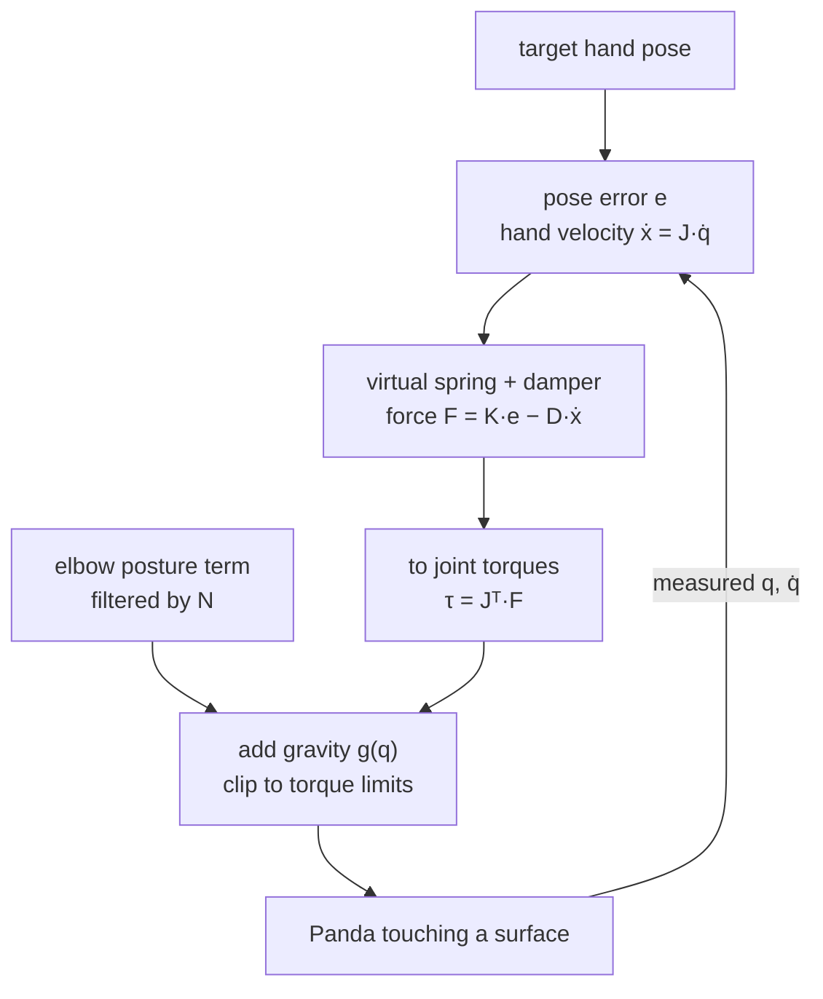

# 14 · Operational-space and impedance control

<!-- meta -->
| | |
|---|---|
| **Part** | [4 · Dynamics and control](README.md) |
| **Run type** | CPU · Mac or Colab CPU |
| **Prerequisites** | [11](11-rigid-body-dynamics.md), [12](12-joint-control.md) |
| **Learn first** | [Linear Systems](https://aiengineeringfromscratch.com/lesson?path=phases/01-math-foundations/17-linear-systems) |
| **Time** | ~60 min |
| **Code** | [`experiments/14-impedance-control/experiment.py`](../experiments/14-impedance-control/experiment.py) |
| **Status** | ✅ done |
<!-- /meta -->

> Position control asks "where is the hand?". Impedance control asks "how hard should the hand push back when it is not there?"

## The problem

A stiff position controller that meets an unexpected table keeps pushing until something gives: the motor torque limit, the part, or the table. Tasks such as wiping, inserting a peg or pressing a button need the opposite: a hand that behaves like a spring of chosen stiffness. libfranka's Cartesian impedance example does exactly this on a Panda with a translational stiffness of 150 N/m and a rotational stiffness of 10 N·m/rad, computing joint torques from the Jacobian every cycle ([`cartesian_impedance_control.cpp`](https://github.com/frankarobotics/libfranka/blob/main/examples/cartesian_impedance_control.cpp)). This lesson builds that controller and its operational-space relative on a torque-controlled Panda in MuJoCo, then pushes the hand into a rigid surface.

## Core idea

### In plain words

Position control says "be exactly here"; with stiff gains it is a hand welded to a rigid rod. **Impedance control** instead ties the hand to its target with a virtual spring and damper of chosen stiffness. In free air the hand follows the target. Against a table it stops, the spring stretches, and the hand pushes with *stiffness × how far the target sits behind the surface*. You command how the hand reacts when it is not where you asked, like pressing a doorbell with a relaxed finger instead of a locked arm.

The Jacobian of lesson 09, transposed, turns that hand force into joint torques, like a chain of levers.

Two refinements make it work on a real arm. First, the arm feels heavier when you push the hand in some directions than in others, so one spring gives a different response along each axis; **operational-space control** scales the spring by that felt mass so every direction behaves alike. Second, a 7-joint arm has one spare motion: the elbow can swing while the hand stays put (the **null space**). A separate posture spring, filtered so it cannot move the hand, keeps the elbow where you want it.



### Impedance and operational-space control as code

```python
J, v, e = jac(q), jac(q) @ qd, pose_error(x_target, x)   # (6, 7) Jacobian, hand velocity, pose error
Lam = np.linalg.inv(J @ np.linalg.inv(M(q)) @ J.T)      # inertia the hand "feels" per direction [kg]
F = K * e - D * v                                       # impedance: spring K [N/m], damper D at the hand
# F = Lam @ (kp * e - kd * v)                           # operational space: same response in every direction
tau = J.T @ F + N @ (k0 * (q0 - q) - d0 * qd) + g(q)    # hand spring + filtered elbow posture + gravity
```

| Formula | What it is |
|---|---|
| $\tau = J^\top \big(K e - D\dot x\big) + g(q) \;(+\, C\dot q)$ | task-space PD = impedance control |
| $F = K e$ (at rest against an obstacle) | the contact force you design (Hogan 1985) |
| $\Lambda(q) = \big(J M^{-1} J^\top\big)^{-1}$ | the arm's inertia as felt at the hand |
| $F = \Lambda\,(k_p e - k_d \dot x)$ | operational-space control: unit-mass behaviour in every direction (Khatib 1987) |
| $N = I - J^\top \bar J^\top, \qquad \bar J = M^{-1}J^\top\Lambda$ | null-space projector for posture torques |

Here $x$ is the pose of the tool centre point (TCP, the working point of the gripper), $\dot x = J(q)\dot q$ its 6-D velocity (lesson 09), $e$ the pose error (position, and orientation as $\tfrac12\sum_i R_i \times R_{d,i}$, built from the columns $R_i$ of the current and desired rotation matrices), $F$ the **wrench** (a force and a torque together, six numbers), $K, D$ the stiffness and damping, $k_p, k_d$ the same per unit mass, $M$ the joint-space inertia, $g(q)$ gravity, $C\dot q$ the Coriolis term and $I$ the identity matrix.

At rest against an obstacle the hand pushes with $F = K e$. $\Lambda$ differs by direction and pose, so one $K$ responds differently along x, y and z. A full operational-space implementation also cancels the task-space Coriolis term; here $C\dot q + g$ is cancelled in joint space with `qfrc_bias` (Lynch & Park ch. 11).

**What we changed in the model.** Menagerie's Panda has position-servo actuators. We zero their `gainprm` and `biasprm`, write our torques to `qfrc_applied`, and clip them at the model's `forcerange` (87 N·m joints 1–4, 12 N·m joints 5–7). With `MjSpec` we add a `tcp` site 10.34 cm in front of the flange and a probe sphere of 1 cm radius just ahead of it; for part B we add a rigid block under the hand, and only the probe can collide with it (`contype = conaffinity = 2`).

<details>
<summary>Math details: J transpose, the hand's inertia and why null-space torques leave the hand alone</summary>

**Why $\tau = J^\top F$.** Power is the same whether you count it at the hand or at the joints: $F^\top \dot x = F^\top J\dot q = (J^\top F)^\top \dot q$. So the joint torques that produce the hand wrench $F$ are $J^\top F$ (the principle of virtual work). No inverse of $J$ is needed.

**The hand's inertia.** From $M\ddot q + c = \tau$ and $\ddot x = J\ddot q + \dot J\dot q$, with $\tau = J^\top F + c$: $\ddot x = J M^{-1} J^\top F + \dot J \dot q$. The matrix $J M^{-1} J^\top$ maps a hand force to a hand acceleration, so its inverse $\Lambda$ is a mass (6 × 6, kg for the translational block). Choosing $F = \Lambda(k_p e - k_d \dot x)$ turns each axis into $\ddot x \approx k_p e - k_d \dot x$, a unit-mass spring–damper with the same $\omega_n = \sqrt{k_p}$ in every direction (ignoring $\dot J\dot q$).

**Null space.** A null-space torque $\tau_0$ is filtered to $N\tau_0$. Its hand acceleration is $J M^{-1} N \tau_0 = \big(J M^{-1} - J M^{-1} J^\top \Lambda J M^{-1}\big)\tau_0 = (JM^{-1} - JM^{-1})\tau_0 = 0$, using $J M^{-1} J^\top = \Lambda^{-1}$. That is what "dynamically consistent" means: the posture term cannot push the hand, and it cannot correct a hand error either.

**Contact force.** With gravity cancelled and the hand at rest against a rigid surface, the controller's force $K e - D\cdot 0$ is balanced by the contact force, so the surface feels $K e$ as long as no joint torque is clipped. The impact before that is different: a hand of mass $\Lambda_{zz}$ arriving with speed is stopped by the contact itself, and the peak force depends on that contact's stiffness, not on $K$.

Go deeper: [Calculus for Machine Learning](https://aiengineeringfromscratch.com/lesson?path=phases/01-math-foundations/04-calculus-for-ml); O. Khatib, [doi:10.1109/JRA.1987.1087068](https://doi.org/10.1109/JRA.1987.1087068); N. Hogan, [doi:10.1115/1.3140702](https://doi.org/10.1115/1.3140702); Lynch & Park, [*Modern Robotics*](https://hades.mech.northwestern.edu/index.php/Modern_Robotics), ch. 11.

</details>

<!-- figure: 14-impedance-wall -->

## Build it

You will now write both task-space controllers in about 35 lines of NumPy and rerun the Experiment's three tests with them. The Jacobian is lesson 09's, the mass matrix lesson 11's; Step 2 shows they equal MuJoCo's here, so the simulation loops then take them from MuJoCo (`mj_jacSite`, `mj_fullM`), which is faster.

Type the steps into a file of your own (for example `scratch/my_impedance.py`) and run it after each step. The finished functions are in [`physai/control.py`](../physai/control.py); `uv run python experiments/14-impedance-control/build.py` runs all five steps with the checks (output in [`build_output.txt`](../experiments/14-impedance-control/build_output.txt)).

### Step 1 · The orientation error

A position error is a difference; an orientation error needs a rotation that turns the current frame toward the desired one. Half the sum of the column cross products gives it as one 3-vector:

```python
def orientation_error(R, R_des):
    """Rotation (rad, world axes) that turns R toward R_des: half the sum of column cross products."""
    return 0.5 * sum(np.cross(R[:, i], R_des[:, i]) for i in range(3))
```

```text
== Step 1. Orientation error for R_des = Rot(axis, angle) R ==
  1 deg about (0.6, 0, 0.8): |e| = 0.0175 (angle 0.0175 rad), max |e - sin(angle) axis| = 4.0e-17
 10 deg about (0.6, 0, 0.8): |e| = 0.1736 (angle 0.1745 rad), max |e - sin(angle) axis| = 1.4e-17
 45 deg about (0.6, 0, 0.8): |e| = 0.7071 (angle 0.7854 rad), max |e - sin(angle) axis| = 1.1e-16
 90 deg about (0.6, 0, 0.8): |e| = 1.0000 (angle 1.5708 rad), max |e - sin(angle) axis| = 3.3e-16
```

It points along the rotation axis with length $\sin(\text{angle})$: the angle for small errors (0.0175 at 1°), only 1.0 at 90°, so large orientation errors pull less hard.

### Step 2 · The hand's inertia

```python
def task_inertia(J, M):
    """The arm's inertia as felt at the tool: Lambda = (J M^-1 J^T)^-1."""
    return np.linalg.inv(J @ np.linalg.solve(M, J.T))
```

```python
J = jacobian(chain_from_mujoco(m, "tcp"), q0[:7])        # lesson 09
M = mass_matrix(tree_from_mujoco(m), q0)[:7, :7]        # lesson 11
Lam = task_inertia(J, M)
```

```text
== Step 2. The hand's inertia at the start pose, from physai's J and M ==
physai vs MuJoCo: max diff J 3.2e-15, M 3.3e-15
Lambda_xx, yy, zz = 11.87, 5.10, 6.88 kg; Lambda from MuJoCo's J and M differs by 1.6e-14
```

The diagonal is the Experiment's $\Lambda_{ii}$ column: the hand feels 11.87 kg along x but 5.10 kg along y.

### Step 3 · Two wrench laws

The impedance law is a spring–damper at the hand; the operational-space law multiplies a unit-mass spring–damper by $\Lambda$. Both become joint torques through $J^\top$, plus the bias, clipped per joint:

```python
def impedance_wrench(e, v, K, D, Kr, Dr):
    """A spring-damper at the tool: force K e - D v (N) and moment Kr e_rot - Dr w (N m)."""
    return np.r_[K * e[:3] - D * v[:3], Kr * e[3:] - Dr * v[3:]]
```

```python
def osc_wrench(Lam, e, v, kp, kd):
    """Operational space: the wrench that gives every direction the unit-mass response kp e - kd v."""
    return Lam @ (kp * e - kd * v)
```

```python
def task_torque(J, F, bias, lim, N=None, tau0=None):
    """Joint torques J^T F + bias (+ N tau0), clipped joint by joint at the limits; also returns 'clipped'."""
    tau = J.T @ F + bias
    if N is not None:
        tau = tau + N @ tau0
    return np.clip(tau, -lim, lim), bool(np.any(np.abs(tau) > lim))
```

```python
J, M = jac_mass(d)                                       # mj_jacSite, mj_fullM
e, v = tcp_error(d, target), J @ d.qvel[:7]              # position error + orientation_error, hand velocity
F = impedance_wrench(e, v, 600.0, 50.0, 30.0, 3.0)       # or osc_wrench(task_inertia(J, M), e, v, 100.0, 14.0)
d.qfrc_applied[:7] = task_torque(J, F, d.qfrc_bias[:7], lim)[0]
```

```text
== Step 3. 5 cm steps, 2 s each: impedance (K 600, D 50) vs operational space (kp 100, kd 14) ==
controller axis  overshoot %  t into 2 mm (s)  off-axis peak (mm)
impedance     x         13.0            0.854                5.43
impedance     y          9.8            0.532                1.02
impedance     z         17.0            0.572                5.61
osc           x          3.2            0.322                1.70
osc           y          3.8            0.304                0.68
osc           z          4.6            0.500                2.97
```

Every cell equals the Experiment's part A table: same law, same numbers.

### Step 4 · The null space

```python
def null_space_projector(J, M, Lam):
    """N = I - J^T Jbar^T with Jbar = M^-1 J^T Lambda: N tau0 never accelerates the tool."""
    Jbar = np.linalg.solve(M, J.T) @ Lam
    return np.eye(M.shape[0]) - J.T @ Jbar.T
```

First the property from the math details, then the Experiment's elbow push with a posture spring $10(q_0 - q) - 2\dot q$ filtered by $N$:

```text
== Step 4. Null space: J M^-1 N, then the Experiment's 20 N elbow push ==
max |J M^-1 N| = 1.1e-15  (a null-space torque never moves the hand)
without null-space posture: tcp error 14.13 mm, elbow moved 0.30 cm, |q - q0| 0.124 rad
   with null-space posture: tcp error 14.14 mm, elbow moved 0.00 cm, |q - q0| 0.000 rad
```

$J M^{-1} N$ is zero to round-off, so the posture term cannot move the hand (14.13 vs 14.14 mm) but brings the elbow back (0.30 → 0.00 cm).

### Step 5 · Press on the surface

Ramp the target 5 cm below the block's top face with the quintic of lesson 13 and hold:

```text
== Step 5. Press 5 cm into the surface: holding force vs K x 5 cm ==
K =   300 N/m: K x 5 cm =  15.0 N, holding force  14.98 N
K =  1000 N/m: K x 5 cm =  50.0 N, holding force  49.77 N
```

At rest the surface feels $K e$: 14.98 and 49.77 N for 15 and 50 N designed, the Experiment's part B rows.

### What you keep

`physai.control` now also has `orientation_error`, `task_inertia`, `impedance_wrench`, `osc_wrench`, `null_space_projector` and `task_torque`. Lesson 15 returns to their torque limits as a safety tool. [`tests/test_14_impedance_control.py`](../tests/test_14_impedance_control.py) checks the null-space and unit-mass properties on the Panda; run `uv run pytest tests/test_14_impedance_control.py` after you change anything.

## Use it

MuJoCo has no task-space controller; you assemble one from its pieces every step, which is exactly what the Experiment's `Controller` does:

```python
mujoco.mj_jacSite(m, d, jp, jr, site)                    # after mj_step / mj_forward: fresh for this state
J = np.vstack([jp, jr])[:, :7]
mujoco.mj_fullM(m, d, M)                                 # dense M; or mj_solveM(m, d, x, y) for M^-1 y
d.qfrc_applied[:7] = np.clip(J.T @ F + d.qfrc_bias[:7], -lim, lim)
```

| Tool | Impedance law | Bias term |
|---|---|---|
| physai | `task_torque(J, impedance_wrench(e, v, K, D, Kr, Dr), bias, lim)` | `bias` you pass, here `qfrc_bias` (gravity + Coriolis) |
| libfranka example | $\tau_d = J^\top(-K e - D J\dot q)$ + `coriolis`, $K$ = 150 N/m and 10 N·m/rad, $D = 2\sqrt{K}$ ([`cartesian_impedance_control.cpp`](https://github.com/frankarobotics/libfranka/blob/main/examples/cartesian_impedance_control.cpp)) | Coriolis only: the robot compensates gravity itself |

Note the sign: libfranka's error is current minus desired, ours desired minus current.

Three traps:

- **$\Lambda$ explodes at singularities.** $J M^{-1} J^\top$ loses rank where $J$ does (lesson 10), and its inverse blows up; damp it or fall back to impedance control near a stretched arm.
- **The arm block of $M$.** The Panda's $M$ is 9 × 9 with the fingers; the controller uses `M[:7, :7]`, the arm's inertia with the fingers held.
- **Gravity twice or not at all.** `qfrc_bias` already holds gravity; adding a separate $g(q)$ doubles it. On a robot that compensates gravity itself (libfranka), adding it at all is wrong.

## Experiment

Full script: [`experiments/14-impedance-control/experiment.py`](../experiments/14-impedance-control/experiment.py). MuJoCo 3.17.0, NumPy 2.5.4, Python 3.14, Apple M5, deterministic, ~3 s. Start pose: IK from `home` to TCP (50, 0, 30) cm, hand pointing down (q = 0.0, −0.11, −0.0, −2.273, −0.0, 2.163, −0.785).

```python
Lam = np.linalg.inv(J @ Minv @ J.T)
if mode == "impedance":
    F = np.concatenate([K * e[:3] - D * v[:3], Kr * e[3:] - Dr * v[3:]])
else:                                            # operational space
    F = Lam @ (kp * e - kd * v)
tau = J.T @ F + d.qfrc_bias[:7]
tau = np.clip(tau, -lim, lim)
```

**A. 5 cm steps along x, y, z** (2 s each; "off-axis peak" is the largest motion along the two axes that should not move). Impedance: K = 600 N/m, D = 50 N·s/m. Operational space: $k_p$ = 100 s⁻², $k_d$ = 14 s⁻¹. *Predict:* which controller gives the same response in all three directions?

| controller | axis | $\Lambda_{ii}$ | overshoot | time into ±2 mm | off-axis peak |
|---|---|---|---|---|---|
| impedance | x | 11.87 kg | 13.0% | 0.854 s | 5.43 mm |
| impedance | y | 5.10 kg | 9.8% | 0.532 s | 1.02 mm |
| impedance | z | 6.88 kg | 17.0% | 0.572 s | 5.61 mm |
| operational space | x | 11.87 kg | 3.2% | 0.322 s | 1.70 mm |
| operational space | y | 5.10 kg | 3.8% | 0.304 s | 0.68 mm |
| operational space | z | 6.88 kg | 4.6% | 0.500 s | 2.97 mm |

The hand feels 11.87 kg along x but 5.10 kg along y. With one K and one D, impedance control is a different spring–mass system per direction (settling 0.532–0.854 s) and couples the axes (5.61 mm off-axis). Scaling by Λ makes the responses close (3.2–4.6% overshoot); the residual differences come from what this controller leaves out (task-space Coriolis, joint damping, torque clipping).

**A2. Null space.** Operational-space control holds the TCP still; a 20 N push along +y hits the elbow (`link4`) for 0.3 s.

| controller | TCP error (max) | elbow displacement at the end | $\|q - q_0\|$ at the end |
|---|---|---|---|
| no null-space term | 14.13 mm | 0.30 cm | 0.124 rad |
| + null-space posture | 14.14 mm | 0.00 cm | 0.000 rad |

Without the posture term nothing restores the redundant direction: the arm ends in a different configuration with the hand in the same place. The projected term brings it back without changing the hand error.

**B. Push into a surface.** The target ramps (quintic, 1 s) from 3 cm above the surface to 5 cm below it and holds for 1.5 s. Impedance control, $D = 2\sqrt{K\Lambda_{zz}}$, $K_r$ = 30 N·m/rad. *Predict:* is the holding force $K \times 5$ cm for every K?

| K [N/m] | K × 5 cm | force, holding | peak force | penetration | steps saturated | contact lost | max tilt |
|---|---|---|---|---|---|---|---|
| 100 | 5.0 N | 5.00 N | 54.7 N | 0.545 mm | 0.0% | 0 | 0.46° |
| 300 | 15.0 | 14.98 | 74.7 | 0.708 | 0.0% | 0 | 0.56° |
| 1000 | 50.0 | 49.77 | 89.5 | 0.823 | 0.0% | 0 | 0.59° |
| 3000 | 150.0 | 148.45 | 148.5 | 0.888 | 0.0% | 0 | 0.60° |
| 10000 | 500.0 | 483.60 | 1028.1 | 1.823 | 77.9% | 0 | 56.91° |
| 30000 | 1500.0 | 395.95 | 1132.7 | 19.180 | 80.8% | 6 | 96.27° |
| 100000 | 5000.0 | 205.03 | 1245.0 | 21.679 | 81.8% | 10 | 111.22° |


Up to K = 3000 the holding force matches K × 5 cm (148.45 N against 150 N at K = 3000): **the force is designed, not measured.** Penetration stays below 1 mm and is set by MuJoCo's soft-contact parameters, not by the stiffness you chose: it grows only from 0.545 to 0.888 mm while the force grows about 30 times. The peak force at low K (54.7 N at K = 100, against a 5.00 N holding force) is the impact: a hand with $\Lambda_{zz}$ = 6.88 kg arriving at speed is stopped by the stiff contact, whatever spring you designed behind it.

## Break it

Raise K past what the joints can deliver. At K = 10000 the commanded wrench needs more torque than some joint can give in 77.9% of the steps. Per-joint clipping keeps each torque legal but changes the direction of the wrench actually applied, and the orientation loop loses: the hand tilts 56.91°. At K = 30000 and 100000 the tilt passes 90°, the probe bounces on and off the surface (6 and 10 contact losses during the hold), the holding force falls to 395.95 and 205.03 N, and the measured penetration (19.180 and 21.679 mm, along the now-tilted probe) is no longer a contact property. A stiffness is only real below the torque limits; past them, scale the whole command or limit the wrench in task space instead of clipping joints independently (lesson 15).

## On the real robot

- **Panda.** libfranka's example uses $K$ = 150 N/m and 10 N·m/rad with damping $2\sqrt{K}$ (unit mass), and sends $\tau_d = J^\top(-K e - D J\dot q) + $ `coriolis`; it adds no gravity term to the command ([`cartesian_impedance_control.cpp`](https://github.com/frankarobotics/libfranka/blob/main/examples/cartesian_impedance_control.cpp)). It also sets the robot's collision thresholds before starting (`setCollisionBehavior`). Our K = 100–300 rows are in that range; the numbers above are simulation results, not Panda measurements.
- **SO-101.** LeRobot puts the STS3215 servos in position mode ([`so_follower.py`](https://github.com/huggingface/lerobot/blob/main/src/lerobot/robots/so_follower/so_follower.py)); there is no joint-torque command, so the controller of this lesson cannot run on it as written. Compliance there comes from the servo's own gains and torque limit (lesson 12, part C).
- **Contact models differ.** Real contact stiffness, friction and the robot's own joint elasticity shape the impact peak; the 54.7 N spike is a property of MuJoCo's soft contact at a 2 ms step and should not be read as a real force.

## Check yourself

1. **Easy.** With K = 1000 N/m, how far behind a surface must the target sit for a 20 N press?
2. **Medium.** In part A2 the TCP error is 14.13 mm without and 14.14 mm with the null-space term. Why can the null-space term not reduce it?
3. **Hard.** In part B, replace per-joint clipping by a uniform scale $\tau \leftarrow \tau \cdot \min(1, \min_i \tau_{\max,i}/|\tau_i|)$ and rerun K = 10000. Predict before running: does the tilt disappear? What happens to the force?

### Answers

1. $e = F/K$ = 20 / 1000 = 2 cm.
2. With the dynamically consistent projection $N = I - J^\top \bar J^\top$, null-space torques produce no acceleration of the hand, so they can neither cause nor correct a hand error. The 14 mm comes from the elbow push itself and is resisted only by the task-space part of the controller.
3. Not computed here; run it.

## Takeaways and sources

- $\tau = J^\top F + g$ turns a designed task-space spring into joint torques; against a surface the force is $K e$ (5.00 / 14.98 / 49.77 / 148.45 N for K = 100–3000 at 5 cm).
- The hand's inertia $\Lambda$ depends on direction (11.87 vs 5.10 kg here); scaling by $\Lambda$ (operational space) gives uniform responses; null-space projection controls the redundant elbow without moving the hand.
- Stiffness ends at the torque limits: past them per-joint clipping tilts the hand (56.91° at K = 10000) and the force no longer follows K.

Next: [lesson 15 · Safety](15-safety.md).

Sources:
- O. Khatib, "A unified approach for motion and force control of robot manipulators: The operational space formulation", *IEEE Journal on Robotics and Automation* 3(1):43–53, 1987, [doi:10.1109/JRA.1987.1087068](https://doi.org/10.1109/JRA.1987.1087068).
- N. Hogan, "Impedance Control: An Approach to Manipulation: Part I—Theory", *Journal of Dynamic Systems, Measurement, and Control* 107(1):1–7, 1985, [doi:10.1115/1.3140702](https://doi.org/10.1115/1.3140702).
- Lynch & Park, [*Modern Robotics*](https://hades.mech.northwestern.edu/index.php/Modern_Robotics), ch. 11 (Robot Control: task-space motion, force and impedance control).
- libfranka [`cartesian_impedance_control.cpp`](https://github.com/frankarobotics/libfranka/blob/main/examples/cartesian_impedance_control.cpp); LeRobot [`so_follower.py`](https://github.com/huggingface/lerobot/blob/main/src/lerobot/robots/so_follower/so_follower.py) (read 2026-10-27).
- MuJoCo: [`mj_jacSite`, `mj_fullM`, `mj_contactForce`](https://mujoco.readthedocs.io/en/stable/APIreference/APIfunctions.html); [Menagerie `franka_emika_panda`](https://github.com/google-deepmind/mujoco_menagerie/tree/f3b6013/franka_emika_panda).
- All measured numbers: [`experiments/14-impedance-control/output.txt`](../experiments/14-impedance-control/output.txt).
