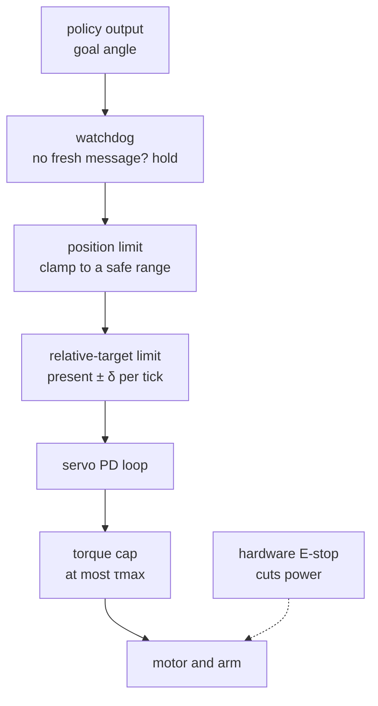

# 15 · Safety: limits, torque caps, e-stop and watchdogs

<!-- meta -->
| | |
|---|---|
| **Part** | [4 · Dynamics and control](README.md) |
| **Run type** | CPU · Mac or Colab CPU |
| **Prerequisites** | [12](12-joint-control.md) |
| **Learn first** | none |
| **Time** | ~40 min |
| **Code** | [`experiments/15-safety/experiment.py`](../experiments/15-safety/experiment.py) |
| **Status** | ✅ done |
<!-- /meta -->

> A learned policy will one day send a wrong number. Safety is the layer between that number and the motor that makes the wrong number cheap.

## The problem

LeRobot's SO-101 follower has a setting whose comment says it exists "for safety purposes": `max_relative_target` limits how far a goal may be from the present position, and it is off (`None`) by default ([`config_so_follower.py`](https://github.com/huggingface/lerobot/blob/main/src/lerobot/robots/so_follower/config_so_follower.py)). The same codebase sets the gripper's torque limit to 50% "to avoid burnout". Neither says what happens when a policy outputs a bad target next to an obstacle. This lesson measures it in simulation: one bad command, several safeguards, the forces with and without each.

## Core idea

### In plain words

Give a learned policy what a new driver's car has. A **position limit** is a fence: the goal never leaves a safe range. A **rate limit** is a speed limiter: the goal moves only a little per control tick (one cycle of the command loop). A **torque cap** is a slipping clutch: however wrong the goal, the motor pushes no harder. A **watchdog** is a train's dead-man's switch: no fresh command in time, stop. An **E-stop** pulls the plug, independent of the software it protects.

Two rules decide what each layer can do. First, **a limit acts on one variable, not on harm**: a torque cap bounds how hard the arm keeps pushing on an obstacle, but a fast arm still hits hard. Second, **what "stop" means depends on the interface**: a position servo that receives no new goal holds the last one; an arm driven by velocity commands keeps moving.



### The safety layers as code

```python
def safe_goal(target, q_now, t_now, t_last_msg):
    if t_now - t_last_msg > watchdog_timeout:          # stale command: stop where you are
        return q_now
    goal = np.clip(target, q_min, q_max)               # position limit
    return np.clip(goal, q_now - delta, q_now + delta) # relative-target limit: <= delta rad per tick
# torque cap: set once, enforced by the actuator (MuJoCo: forcerange; STS3215: a register)
```

| Formula | What it bounds |
|---|---|
| goal $\leftarrow \text{clip}(\text{goal},\, q - \delta,\, q + \delta)$ | goal speed: at most $\delta/\Delta t$ |
| $F \approx \tau_{\max}/r$ | steady push on an obstacle at lever $r$ |
| travel $\approx v\, t_w$ | distance the arm keeps moving before the watchdog fires |
| $k_p\,\delta \ge \tau_{\max}$ | when true, a stalled servo still pushes at its cap despite the rate limit |

Here $q$ is the present joint angle, $\delta$ the largest allowed step of the goal per tick, $\Delta t$ the tick length (20 ms at 50 Hz), $\tau_{\max}$ the torque cap, $r$ the lever from the joint axis to the contact, $F$ the contact force, $v$ the joint speed, $t_w$ the watchdog timeout and $k_p$ the servo's stiffness (lesson 12).

<details>
<summary>Math details: why a torque cap bounds the push but not the impact</summary>

**Steady push.** At rest against the post the joint torque balances the contact moment, $\tau = F r$; saturated at the cap, $F = \tau_{\max}/r$, whatever the speed or contact model.

**Impact.** The arm arrives with joint speed $\omega$ and inertia $I$; a contact spring of stiffness $k_c$ absorbs $\tfrac12 I\omega^2$, so the peak grows with $\omega$ and $\sqrt{k_c}$. A torque cap limits it only indirectly (slower acceleration); a rate limit limits the arrival speed directly.

**Rate limit and a stalled servo.** Against an obstacle the position stops changing, the goal stays $\delta$ ahead, and the servo commands $k_p\delta$, which the cap clips to $\tau_{\max}$ whenever $k_p\delta \ge \tau_{\max}$.

Go deeper: LeRobot [`robots/utils.py`](https://github.com/huggingface/lerobot/blob/main/src/lerobot/robots/utils.py) (`ensure_safe_goal_position`); MuJoCo [Modeling · actuators and `forcerange`](https://mujoco.readthedocs.io/en/stable/modeling.html); Lynch & Park, [*Modern Robotics*](https://hades.mech.northwestern.edu/index.php/Modern_Robotics), ch. 11.

</details>

## Build it

You will write the four layers in about 50 lines of NumPy and put them into the Experiment's command loop. MuJoCo is the referee: same servo torques and, with your layers in the loop, the same tables. The finished functions are in [`physai/safety.py`](../physai/safety.py); `uv run python experiments/15-safety/build.py` runs the five steps in about 2 s (output in [`build_output.txt`](../experiments/15-safety/build_output.txt)).

### Step 1 · Clamp the goal

```python
def clamp_goal(target, q_now, q_min=None, q_max=None, delta=None):
    """Position limit, then relative-target limit: the goal stays in [q_min, q_max] and within delta of q_now."""
    goal = target
    if q_min is not None or q_max is not None:
        goal = np.clip(goal, q_min, q_max)                  # a fence around the safe range
    if delta is not None:
        goal = np.clip(goal, q_now - delta, q_now + delta)  # at most delta ahead of where the joint is now
    return goal
```

First the fence, then the step relative to where the joint is *now*. Check: four hand cases, then 100,000 random targets against "present position plus a clipped difference":

```text
== Step 1. The goal clamp: position limit 0.3 rad, relative-target limit 0.02 rad ==
  target  q_now    goal
    1.20   0.00   0.020
    1.20   0.29   0.300
    0.25   0.24   0.250
   -1.00  -0.10  -0.120
100000 random: max |goal - q_now| = 0.0200 rad, outside range: 0, vs present + clip(diff): 1.7e-18
goal speed bound delta / tick = 1.00 rad/s
```

In the second row the fence wins (0.300, not 0.31). The 1.00 rad/s bound applies to the goal, not the joint: Step 3 measures 1.82 rad/s.

### Step 2 · Cap the torque

```python
def servo_torque(goal, q, qd, kp, kv, tau_max):
    """A position servo with a torque cap: kp (goal - q) - kv qd, clipped to +-tau_max."""
    return np.clip(kp * (goal - q) - kv * qd, -tau_max, tau_max)
```

MuJoCo's position actuator computes `gainprm[0]·ctrl + biasprm[1]·q + biasprm[2]·qdot` with `biasprm = (0, −kp, −kv)`, after clamping `ctrl` to `ctrlrange`, and clips the result to `forcerange`. The check reads $k_p$, $k_v$ and the ranges from the model; targets go far beyond the joint range:

```text
== Step 2. The capped servo vs MuJoCo's position actuator (SO-101, 2000 random states) ==
kp = 998.22, kv = 2.731, cap = 2.94 N m, pan ctrlrange = [-1.920, 1.920] rad
cap 2.94 N m: max |ours - MuJoCo| = 2.3e-13 N m; cap reached at an error of 2.95 mrad
cap 0.50 N m: max |ours - MuJoCo| = 2.2e-14 N m; cap reached at an error of 0.50 mrad
```

A joint at rest hits the 2.94 N·m cap at an error of 2.95 mrad, so against any bad command the cap, not the gains, sets the push.

### Step 3 · Put the layers in the loop

In the loop:

```python
lim = (-q_lim, q_lim) if q_lim is not None else (None, None)
d.ctrl[pan] = clamp_goal(target, d.qpos[0], *lim, delta)   # every tick
m.actuator_forcerange[pan] = [-cap, cap]                    # once, before the run
```

The check replays part A with your layers and the Experiment's loop, then measures the contact lever $r$:

```text
== Step 3. Part A with our layers in the loop (bad command: pan target 0 -> 1.2 rad at t = 0.1 s) ==
safeguard     peak N  push N  speed   tau  max |ours - Exp.|
none          125.98   14.33   4.49  2.94  0.0e+00
limit 0.3       0.00    0.00   4.02  2.94  0.0e+00
delta 0.02     45.82   14.48   1.82  2.94  0.0e+00
cap 0.5        21.34    2.12   0.75  0.50  0.0e+00
all three       0.00    0.00   0.75  0.50  0.0e+00
steady push vs tau_max / r (r = lever of the post contacts about the pan axis):
  cap 2.94: r = 22.5 cm, tau_max / r = 13.07 N, push 14.33 N
  cap 1.00: r = 22.5 cm, tau_max / r =  4.44 N, push  4.34 N
  cap 0.50: r = 22.6 cm, tau_max / r =  2.22 N, push  2.12 N
stall test: kp * 0.005 = 4.99 N m >= 2.94 N m
```

Part A's table, bit for bit. With $r$ = 22.5 cm, $\tau_{\max}/r$ predicts 2.22 and 4.44 N against 2.12 and 4.34 N measured, and 13.07 against 14.33 N at the full cap: the formula ignores the friction forces at the contact, which also carry moment about the axis. And 4.99 N·m ≥ 2.94 N·m: even part C's tightest δ cannot bound the push.

### Step 4 · The watchdog

```python
class Watchdog:
    """Expires when no fresh command has arrived for longer than `timeout` seconds."""

    def __init__(self, timeout):
        self.timeout, self.last = timeout, None

    def feed(self, t):
        """Call whenever a fresh command arrives at time t."""
        self.last = t

    def expired(self, t):
        return self.last is not None and t - self.last > self.timeout
```

Feed it on every message; on a silent tick, an expired watchdog zeroes the velocity and holds the present angle:

```python
if msg is not None:
    wd.feed(t)
elif wd.expired(t) and v_cmd != 0.0:
    v_cmd, target = 0.0, d.qpos[0]          # stale command: stop and hold here
```

```text
== Step 4. Watchdog: jog at 1 rad/s, the last message at t = 0.18 s (part D) ==
 timeout s  stopped after s  travel deg  peak N  max |ours - Exp.|
      none            0.350       19.57   24.48  0.0e+00
       0.5            0.350       19.57   24.48  0.0e+00
       0.2            0.230       11.61    0.00  0.0e+00
      0.05            0.090        3.58    0.00  0.0e+00
```

Part D's rows again: 0.5 s is longer than the 0.350 s the arm needs to reach the post.

### Step 5 · The E-stop latch

```python
class EStop:
    """A latch: one press stops the robot until someone resets it after the cause is gone."""

    def __init__(self):
        self.tripped = False

    def update(self, pressed):
        """Call every tick with the button (or fault) state; returns True while the stop is active."""
        self.tripped = self.tripped or bool(pressed)
        return self.tripped

    def reset(self, pressed):
        """Clear the latch, but only if the button is released."""
        if not pressed:
            self.tripped = False
        return self.tripped
```

A bouncing button or a fault that clears for one tick must not restart the arm; reset works only after release. The check presses for one tick, then replays part E with the latch:

```text
== Step 5. E-stop latch, then part E: stop a 1 rad/s jog at t = 0.2 s ==
pressed for one tick: active [False, True, True, True]; reset while pressed: True; after release: False
stop         travel deg  stopped after s  gripper drop cm  max |ours - Exp.|
hold               0.15            0.030             0.02  0.0e+00
torque off         1.53            0.124            11.74  0.0e+00
```

The latch decides *whether* to stop; *how* is part E's choice. A real E-stop also cuts motor power in hardware.

### What you keep

`physai.safety` now has `clamp_goal`, `servo_torque`, `Watchdog` and `EStop`; [lesson 40](../part-9-sim-to-real/40-real-so101.md) runs the real SO-101 behind them and [lesson 41](../part-10-foundation-models-and-agents/41-vla.md) puts them between a model's output and the servos. Test: `uv run pytest tests/test_15_safety.py`.

## Use it

In MuJoCo two layers are model attributes enforced inside `mj_step`, and "torque off" is a flag:

```python
m.actuator_ctrlrange[pan] = [-0.3, 0.3]          # position limit on the goal (needs ctrllimited)
m.actuator_forcerange[pan] = [-0.5, 0.5]         # torque cap (needs forcelimited)
m.opt.disableflags |= mujoco.mjtDisableBit.mjDSBL_ACTUATION   # every actuator stops producing force
```

```text
== Use it. The position limit and the cap as model attributes (MuJoCo clamps inside mj_step) ==
actuator_ctrlrange = [-0.3, 0.3]: peak   0.00 N, push  0.00 N; vs our layer 0.0e+00
actuator_forcerange = [-0.5, 0.5]: peak  21.34 N, push  2.12 N; vs our layer 0.0e+00
```

The step limit, watchdog and latch live in your loop, on the robot as in simulation.

| Layer | physai | MuJoCo | LeRobot SO-101 follower | libfranka |
|---|---|---|---|---|
| position limit | `clamp_goal(q_min, q_max)` | actuator `ctrlrange` + `ctrllimited` | | |
| step limit | `clamp_goal(delta)`, against the present angle | | `max_relative_target` → `ensure_safe_goal_position`, against `Present_Position` | `limitRate(max_derivatives, commanded, last_commanded)`, against the last command |
| torque cap | `servo_torque(tau_max)` | actuator `forcerange` + `forcelimited`; joint `actuatorfrcrange` | gripper `Max_Torque_Limit` 500 | |
| torque off | | `mjDSBL_ACTUATION` | `disable_torque_on_disconnect` | |

Sources: MuJoCo [XML reference](https://mujoco.readthedocs.io/en/stable/XMLreference.html); LeRobot [`robots/utils.py`](https://github.com/huggingface/lerobot/blob/main/src/lerobot/robots/utils.py), [`so_follower.py`](https://github.com/huggingface/lerobot/blob/main/src/lerobot/robots/so_follower/so_follower.py); libfranka [`rate_limiting.h`](https://github.com/frankarobotics/libfranka/blob/main/include/franka/rate_limiting.h).

Three traps:

- **Against the present angle or the last command?** LeRobot reads `Present_Position` before every send and clamps against it, as `clamp_goal` does. A limiter against the last command (libfranka's `limitRate`) keeps advancing the goal while the joint is stalled; when the obstacle goes, the arm jumps to catch up.
- **Units.** The SO-101 follower normalizes the five body joints to degrees by default (`use_degrees = True`) and the gripper to 0–100, so `max_relative_target = 0.02` means 0.02°, not 0.02 rad. And `ensure_safe_goal_position` tests `isinstance(max_relative_target, float)`: an integer such as `5` raises `TypeError`.
- **A flag can switch a limit off.** `ctrlrange` clamps only while `ctrllimited` is on and the global `clampctrl` flag is not disabled; otherwise the position limit silently disappears.

## Experiment

**Setup.** SO-101 (Menagerie `scene.xml`), each joint the model's STS3215 position servo ($k_p$ = 998.22, $k_v$ = 2.731, cap ±2.94 N·m; lesson 12). Timestep 2 ms, command loop 50 Hz. Arm pose: shoulder_lift −0.5, elbow 0.5, wrist 0.8 rad; gripper frame at (29.4, −0.1, 12.8) cm. A fixed post (2 × 2 × 20 cm) stands in the gripper's swing path at pan ≈ 0.6 rad. The loop is Build it's Step 3; script: [`experiments/15-safety/experiment.py`](../experiments/15-safety/experiment.py). MuJoCo 3.17.0, NumPy 2.5.4, Python 3.14, Apple M5, deterministic, ~3 s.

**A. One bad command.** At t = 0.1 s the shoulder_pan target jumps 0 → 1.2 rad. *Predict:* which single safeguard prevents the impact, which only softens it?

| safeguard | peak force on post | steady push force | peak pan speed | peak torque |
|---|---|---|---|---|
| none | 125.98 N | 14.33 N | 4.49 rad/s | 2.94 N·m |
| joint limit \|pan\| ≤ 0.3 rad | 0.00 | 0.00 | 4.02 | 2.94 |
| relative target ≤ 0.02 rad/tick | 45.82 | 14.48 | 1.82 | 2.94 |
| torque cap 0.5 N·m | 21.34 | 2.12 | 0.75 | 0.50 |
| all three | 0.00 | 0.00 | 0.75 | 0.50 |

Only the position limit prevents contact, and only because we knew where the obstacle was. The rate limit cuts the impact (45.82 vs 125.98 N) but not the steady push. The torque cap cuts both.

**B. Sweep the torque cap** (same bad command, nothing else):

| cap [N·m] | 2.94 | 2.00 | 1.00 | 0.50 | 0.25 | 0.10 |
|---|---|---|---|---|---|---|
| peak force [N] | 125.98 | 69.79 | 37.96 | 21.34 | 8.57 | 0.00 |
| steady push [N] | 14.33 | 8.73 | 4.34 | 2.12 | 1.48 | 0.00 |
| peak speed [rad/s] | 4.49 | 3.16 | 1.58 | 0.75 | 0.33 | 0.08 |

The cap also limits speed; at 0.10 N·m the arm does not reach the post within 2 s. Between 0.5 and 2 N·m the steady push is nearly proportional to the cap (2.12, 4.34, 8.73 N): $F \approx \tau_{\max}/r$ with a lever of about 23 cm (Step 3 measures 22.5 cm).

**C. Sweep the relative-target limit δ** (goal clamped to present ± δ every 20 ms):

| δ [rad] | none | 0.2 | 0.05 | 0.02 | 0.01 | 0.005 |
|---|---|---|---|---|---|---|
| speed at impact [rad/s] | 4.494 | 4.494 | 2.866 | 1.513 | 0.929 | 0.359 |
| peak force [N] | 125.98 | 125.98 | 72.94 | 45.82 | 21.39 | 17.17 |
| steady push [N] | 14.33 | 14.33 | 13.54 | 14.48 | 14.67 | 13.54 |


Smaller δ lowers the impact speed and peak, but the steady push stays near 14 N: once the arm stalls, the goal is still present + δ, and $k_p\,\delta$ ≥ 2.94 N·m for every δ here (998.22 × 0.005 ≈ 5 N·m).

**D. Watchdog.** The operator jogs shoulder_pan at 1 rad/s with velocity commands (the goal advances by $v\,\Delta t$ per tick). The last message arrives at t = 0.18 s (pan 0.185 rad); the controller keeps that velocity until a watchdog holds the current position.

| timeout | stopped after the last message | max travel after it | peak force on post |
|---|---|---|---|
| none | 0.350 s (stopped by the post) | 19.57° | 24.48 N |
| 1 s | 0.350 s | 19.57° | 24.48 N |
| 0.5 s | 0.350 s | 19.57° | 24.48 N |
| 0.2 s | 0.230 s | 11.61° | 0.00 |
| 0.1 s | 0.130 s | 5.88° | 0.00 |
| 0.05 s | 0.090 s | 3.58° | 0.00 |

A watchdog only helps if it fires before the arm reaches the obstacle: here 0.5 s and 1 s are too slow.

**E. Two ways to stop** from the same 1 rad/s jog at t = 0.2 s:

| stop | max pan travel after the stop | pan stopped after | gripper drop |
|---|---|---|---|
| hold position (goal := present) | 0.15° | 0.030 s | 0.02 cm |
| torque off (actuation disabled) | 1.53° | 0.124 s | 11.74 cm |

Torque off stops the pan joint by friction alone and lets gravity take the shoulder: the gripper falls 11.74 cm, to the floor from 12.8 cm. Holding stops faster and keeps the arm up, but needs a working controller.

## Break it

Use the rate limiter as the only protection. Generous, δ = 0.2 rad per tick is 10 rad/s, more than the servo ever reaches (4.494 rad/s): the run equals no limiter (125.98 N). Tight, δ = 0.005 rad cuts the impact to 17.17 N, yet the arm keeps pushing with 13.54 N as long as the bad command lasts. A rate limit is not a contact-force limit; that is the torque cap's job (B) or a model of where the obstacles are (A).

## On the real robot

- **SO-101 / LeRobot.** `max_relative_target` is off by default (Use it). At connect, LeRobot writes position-mode P/I/D coefficients 16/0/32 to every STS3215 and, for the gripper only, `Max_Torque_Limit` 500, `Protection_Current` 250 and `Overload_Torque` 25 ([`so_follower.py`](https://github.com/huggingface/lerobot/blob/main/src/lerobot/robots/so_follower/so_follower.py)). `disable_torque_on_disconnect = True` makes a disconnect part E's "torque off": expect the arm to drop.
- **Not measured on the real arm.** Impact forces here depend on MuJoCo's contact model and the 2 ms step. Procedure: put a kitchen scale or force sensor where the post is, jog slowly (not a step) into it at a reduced torque limit, record the peak; start with the lowest limit and never put a hand in the path. A hardware E-stop is separate from all software layers above.

## Check yourself

1. **Easy.** With the torque cap at 1.0 N·m and a lever of 23 cm, what steady push force do you expect? Compare with part B.
2. **Medium.** Why does δ = 0.02 rad/tick give a peak pan speed of 1.82 rad/s in part A, above the 1 rad/s that 0.02 rad per 20 ms suggests?
3. **Hard.** Add a velocity-dependent torque cap (full cap below 0.2 rad/s, 0.5 N·m above) and rerun part A. Predict the impact peak and steady push first.

### Answers

1. $1.0/0.23 \approx 4.3$ N; part B measures 4.34 N.
2. The goal is relative to the *present* position and updated every 20 ms. Within a tick the servo sees an error of δ, and $k_p\delta$ ≈ 20 N·m exceeds the 2.94 N·m cap, so it accelerates at full torque, passes the goal and brakes; the speed oscillates around δ/Δt = 1 rad/s with peaks above it.
3. Not computed here; run it.

## Takeaways and sources

- Each safeguard bounds one variable: a position limit prevents known collisions (0 N), a torque cap bounds the push (14.33 → 2.12 N at 0.5 N·m), a rate limit bounds the impact speed (4.494 → 0.359 rad/s) but not the push.
- A watchdog must fire before the arm can reach anything: 0.05–0.2 s avoided the post here, 0.5 s did not.
- "Stop" is a design choice: holding position stops in 0.030 s; torque off drops the gripper 11.74 cm.

Next: [lesson 16 · Grasping and scripted pick-and-place](16-grasping-and-pick-place.md).

Sources:
- LeRobot [`config_so_follower.py`](https://github.com/huggingface/lerobot/blob/main/src/lerobot/robots/so_follower/config_so_follower.py), [`so_follower.py`](https://github.com/huggingface/lerobot/blob/main/src/lerobot/robots/so_follower/so_follower.py), [`robots/utils.py`](https://github.com/huggingface/lerobot/blob/main/src/lerobot/robots/utils.py) (Apache-2.0, read 2026-10-27).
- libfranka [`rate_limiting.h`](https://github.com/frankarobotics/libfranka/blob/main/include/franka/rate_limiting.h).
- MuJoCo [Modeling · actuators and `forcerange`](https://mujoco.readthedocs.io/en/stable/modeling.html), [XML reference](https://mujoco.readthedocs.io/en/stable/XMLreference.html), [`mj_contactForce`](https://mujoco.readthedocs.io/en/stable/APIreference/APIfunctions.html); [Menagerie `robotstudio_so101`](https://github.com/google-deepmind/mujoco_menagerie/tree/f3b6013/robotstudio_so101).
- Lynch & Park, [*Modern Robotics*](https://hades.mech.northwestern.edu/index.php/Modern_Robotics), ch. 11.
- All measured numbers: [`experiments/15-safety/output.txt`](../experiments/15-safety/output.txt) and [`build_output.txt`](../experiments/15-safety/build_output.txt).
