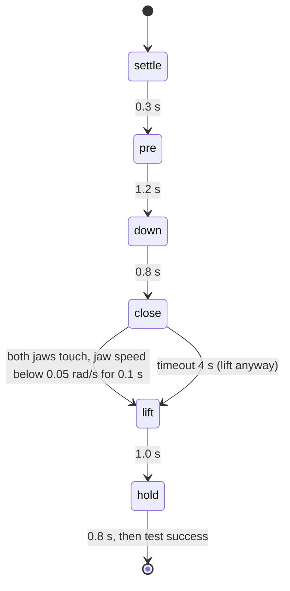

# 16 · Grasping and scripted pick-and-place

<!-- meta -->
| | |
|---|---|
| **Part** | [4 · Dynamics and control](README.md) |
| **Run type** | CPU · Mac or Colab CPU |
| **Prerequisites** | [10](../part-3-kinematics/10-inverse-kinematics.md), [13](13-trajectory-generation.md) |
| **Learn first** | none |
| **Time** | ~60 min |
| **Code** | [`experiments/16-grasping-and-pick-place/experiment.py`](../experiments/16-grasping-and-pick-place/experiment.py) |
| **Status** | ✅ done |
<!-- /meta -->

> A grasp holds when friction can carry the load. Everything else in pick-and-place, IK, trajectories, the state machine, exists to put two jaws where that is true.

## The problem

Part 7 trains policies from demonstrations, and the cheapest come from a script that already works. A scripted pick in simulation is easy to fake: weld the cube to the gripper when the jaws close and every attempt "succeeds". The physical question: with a real contact model and no attachment, when does an SO-101 lift a 3 cm cube, and when does it squeeze it out, drop it, or never close? The answer comes from the friction cone of [lesson 04](../part-1-simulation/04-friction.md), measured on 240 simulated grasps.

## Core idea

### In plain words

Pinch a cube between two fingers and nothing holds it from below: friction at the fingertips carries the whole weight, at most *grip coefficient × squeeze*. A heavier cube slides out. A wet bar of soap is the low-friction case: you squeeze harder, and if you squeeze while the fingers still move, the soap shoots away.

A scripted pick-and-place is a small **state machine**, like a traffic light: each state has an action (arm target, jaw open or closed) and an exit condition (a timer, or something sensed). The script moves the open jaws above the cube, lowers them, closes until the sensors say the grip has formed, lifts and holds.



### The grasp test and the state machine as code

```python
ratio = mu * (N1 + N2) / (m * g)   # N1, N2: normal forces of the two jaws (mj_contactForce)
holds = ratio >= 1.0               # below 1 the cube slides out of the jaws

state = "settle"
while state != "done":
    command_arm_and_jaw(state)     # IK + min-jerk target, jaw open or closed
    if state == "close":           # sensed, not timed (timeout 4 s)
        if both_jaws_touch() and jaw_still(speed=0.05, for_s=0.1) or timed_out(4.0):
            state = "lift"
    elif time_in_state() >= DURATION[state]:
        state = NEXT[state]        # settle -> pre -> down -> close; lift -> hold -> done
```

| Formula | What it says |
|---|---|
| $\mu\,(N_1 + N_2) \;\ge\; m g$ | friction can carry the weight (Lynch & Park, ch. 12) |
| $\dfrac{\mu (N_1 + N_2)}{m g} \ge 1$ | the same as a ratio: the friction-cone margin |
| $m_{\max} = \mu (N_1+N_2)/g$ | the heaviest cube a given squeeze can lift |

Here $\mu$ is the jaw–cube friction coefficient, $N_1, N_2$ the normal forces of the two jaws on the cube, $m$ the cube mass and $g$ = 9.81 m/s². The grasp is **antipodal**: the two contact normals point at each other, the jaws press horizontally and only friction acts upward.

**Gripper and friction.** The SO-101 has a fixed jaw and a hinged moving jaw (`gripper` joint) driven by an STS3215 position servo. Commanded to the closed limit on a 3 cm cube, the servo pushes until it reaches its torque cap, so the cap and the jaw lever set the squeeze. The jaw pads have friction 1 and priority 1; the cube gets priority 2 so that its μ is the one MuJoCo uses (Use it).

**The states.** `pre` moves the open jaws to 5.5 cm above the cube centre, `down` to 4 mm below it, `close` ramps the jaw shut over 0.3 s while the arm holds, `lift` rises to 7 cm above the centre. Arm targets come from damped-least-squares IK on the 5 arm joints (lesson 10), blended with the quintic of lesson 13. **Success, physically:** at the end the cube bottom is ≥ 4 cm above the floor **and** touches both jaws.

<details>
<summary>Math details: the friction cone, the squeeze and why the lift needs a little more</summary>

**Coulomb friction.** At each contact the tangential force is at most $\mu N_i$ (lesson 04). The two tangential forces carry the weight, $f_{t,1} + f_{t,2} = mg$ with each $f_{t,i} \le \mu N_i$, hence $\mu(N_1 + N_2) \ge mg$.

**Squeeze from the torque cap.** A stalled servo pushes with its cap $\tau_{\max}$; at jaw lever $r_j$ the moving jaw presses with about $\tau_{\max}/r_j$, and the fixed jaw pushes back as hard so the cube stays balanced. So $N_1 + N_2 \approx 2\tau_{\max}/r_j$: the force is not split between the jaws.

**The lift.** Accelerating the cube upward at $a$ needs $\mu(N_1+N_2) \ge m(g + a)$, slightly more than a static ratio of 1. During closing the jaw pushes the cube sideways; if a contact force leaves its cone then, the cube slips away before the static test applies.

Go deeper: [lesson 04 · Friction](../part-1-simulation/04-friction.md); Lynch & Park, [*Modern Robotics*](https://hades.mech.northwestern.edu/index.php/Modern_Robotics), ch. 12; MuJoCo [Modeling · contact parameters](https://mujoco.readthedocs.io/en/stable/modeling.html).

</details>

<!-- figure: 16-grasp-cone -->

## Build it

You will write the grasp test, the squeeze formula and the pick state machine in about 90 lines of NumPy and drive the Experiment's SO-101 with them; MuJoCo's contact forces and SciPy are the referees. The finished functions are in [`physai/grasp.py`](../physai/grasp.py); `uv run python experiments/16-grasping-and-pick-place/build.py` runs the five steps in about 5 s (output in [`build_output.txt`](../experiments/16-grasping-and-pick-place/build_output.txt)).

### Step 1 · The friction-cone test

```python
def cone_ratio(mu, normal_forces, mass, g=9.81):
    """Friction-cone margin of an antipodal grasp: mu (N1 + N2) / (m g). Below 1 the object slides out."""
    return mu * np.sum(normal_forces) / (mass * g)
```

```python
def max_mass(mu, normal_forces, g=9.81):
    """The heaviest object this squeeze can hold by friction alone."""
    return mu * np.sum(normal_forces) / g
```

The check recomputes the ratio columns of parts A–C from the squeeze printed in `output.txt`:

```text
== Step 1. The friction-cone ratio from the Experiment's own squeeze forces (output.txt) ==
part A: 6 rows, max |ours - printed ratio| = 0.01
part B: 4 rows, max |ours - printed ratio| = 0.00
part C: 8 rows, max |ours - printed ratio| = 0.00
max_mass: mu 0.05, 12.74 N -> 0.065 kg; mu 0.3, 16.25 N -> 0.497 kg
```

The 0.01 is the rounding of the printed squeeze. At μ = 0.3, 16.25 N could hold 0.497 kg at rest, yet part C drops 0.45 kg: the lift needs more (Step 5).

### Step 2 · Look inside a held grasp

```python
def cone_use(f_contact, mu):
    """How much of its friction cone a contact uses: |tangential| / (mu * normal), from a contact-frame
    force (normal, tangent1, tangent2), the order mj_contactForce returns. Above 1 it slides."""
    f = np.asarray(f_contact, float)
    return np.hypot(f[1], f[2]) / (mu * f[0])
```

The check sums the vertical force on the cube over all jaw contacts and asks how much of its cone each contact uses:

```text
== Step 2. Inside a held grasp (end of the hold, cube in the air) ==
case             contacts  sum Fz N   m g N  max cone use
mu 1.0, 30 g           18     0.294   0.294         0.037
mu 0.3, 0.4 kg          7     3.924   3.924         1.000
```

Friction alone carries exactly the weight. With 30 g and μ = 1 the busiest contact uses 3.7 % of its cone; at 0.4 kg and μ = 0.3 (ratio 1.24) some contacts sit at the edge (1.000) and the others carry the rest.

### Step 3 · The squeeze from the torque cap

```python
def squeeze_from_cap(tau_max, r_jaw):
    """Squeeze of a stalled parallel jaw: the moving jaw presses tau/r, the fixed jaw pushes back as hard,
    so N1 + N2 = 2 tau / r (the force is not split between the jaws)."""
    return 2 * tau_max / r_jaw
```

The jaw lever $r$ is measured: the moment arm of the moving-jaw contacts about the hinge, weighted by normal force. The jaw's static friction lets it press with $\tau$ plus or minus that loss:

```text
== Step 3. Squeeze from the jaw torque cap (mu = 0.05, 30 g, nominal position) ==
jaw friction loss 0.052 N m; band = 2 (tau +- loss) / r
 cap N m  r_jaw cm  2 tau / r N          band N  squeeze N  N fixed / N moving
    1.00      7.37        27.13  [25.72, 28.54]      26.12               1.002
    0.50      7.42        13.47  [12.07, 14.87]      12.66               1.001
    0.30      7.44         8.07    [6.67, 9.47]       6.68               1.004
```

The squeeze lies inside the band at every cap and the jaws press equally (ratio 1.00): each carries about $\tau/r$, the total is $2\tau/r$. These are single picks at the nominal position; the tables average 10 positions.

### Step 4 · The state machine

```python
def minjerk(u):
    """Minimum-jerk blend 0 -> 1 over u in [0, 1]: zero velocity and acceleration at both ends."""
    u = min(1.0, max(0.0, u))
    return u ** 3 * (10 - 15 * u + 6 * u * u)
```

```python
class PickMachine:
    """settle -> pre -> down -> close -> lift -> hold -> done. Timed states end after their duration;
    close ends on a sensed condition: both jaws touch and the jaw is still for `still_time` (or a timeout)."""

    NEXT = dict(settle="pre", pre="down", down="close", close="lift", lift="hold", hold="done")
    MOVES = dict(settle=("home", "home"), pre=("home", "pre"), down=("pre", "down"),
                 lift=("down", "lift"), hold=("lift", "lift"))

    def __init__(self, durations, close_timeout=4.0, still_speed=0.05, still_time=0.1, t0=0.0):
        self.dur, self.timeout = durations, close_timeout
        self.still_speed, self.still_time = still_speed, still_time
        self.state, self.t_state, self.still_since, self.close_s = "settle", t0, None, float("nan")

    def command(self, now, poses, jaw_open, jaw_closed):
        """Arm joint targets and jaw target for this step: min-jerk between poses; in close, a jaw ramp."""
        t = now - self.t_state
        if self.state == "close":
            u = minjerk(t / self.dur["close_ramp"])
            return poses["down"], jaw_open + u * (jaw_closed - jaw_open)
        a, b = self.MOVES[self.state]
        q = poses[a] + minjerk(t / self.dur[self.state]) * (poses[b] - poses[a])
        return q, jaw_open if self.state in ("settle", "pre", "down") else jaw_closed

    def update(self, now, both_touch=False, jaw_speed=0.0):
        """Call after every physics step with what the sensors say; returns the (possibly new) state."""
        t = now - self.t_state
        if self.state == "close":
            settled = both_touch and abs(jaw_speed) < self.still_speed and t > self.dur["close_ramp"]
            if not settled:
                self.still_since = None
            elif self.still_since is None:
                self.still_since = now
            if self.still_since is not None and now - self.still_since >= self.still_time:
                self.close_s = t                           # the grip formed: lift
                self.state, self.t_state = "lift", now
            elif t > self.timeout:
                self.state, self.t_state = "lift", now     # lift anyway; the success test will tell
        elif t >= self.dur[self.state] - 1e-9:
            self.state, self.t_state = self.NEXT[self.state], now
        return self.state
```

The loop asks for targets, steps MuJoCo and reports what the jaws sense:

```python
while sm.state != "done":
    d.ctrl[arm], d.ctrl[jaw] = sm.command(d.time, poses, G_OPEN, G_CLOSE)
    mujoco.mj_step(m, d)
    nf, nm = jaw_contacts(m, d)                       # normal force from each jaw (mj_contactForce)
    sm.update(d.time, nf > 0 and nm > 0, d.qvel[jaw_dof])
```

Check against the Experiment's `scripted_pick` from the same start:

```text
== Step 4. Our state machine vs the Experiment's scripted_pick (nominal pick) ==
minjerk: s(0.5) = 0.500, peak speed 1.8750 (15/8 = 1.875), |v|, |a| at the ends < 6e-04 (finite differences)
ours: held, lift 7.37 cm, jaw forces 39.84 / 39.83 N, close 0.474 s, 2287 steps
Exp.: success True, lift 7.37 cm, jaw forces 39.84 / 39.83 N, close 0.474 s, 2287 steps; max |qpos ours - Exp.| = 0.0e+00
```

Identical to the last bit over 2287 steps, and the blend starts and ends at rest.

### Step 5 · Outcomes and their uncertainty

```python
def pick_outcome(lift, touches_both, closed, min_lift=0.04):
    """Physical success test: lifted at least min_lift (m) and still in both jaws; else why it failed."""
    if lift >= min_lift and touches_both:
        return "held"
    return "dropped" if closed else "not closed"
```

```python
def wilson(k, n, z=1.96):
    """Wilson 95 % interval for a success rate of k out of n trials."""
    p = k / n
    den = 1 + z * z / n
    c = (p + z * z / (2 * n)) / den
    h = z * math.sqrt(p * (1 - p) / n + z * z / (4 * n * n)) / den
    return max(0.0, c - h), min(1.0, c + h)
```

The check reruns three sweep rows with your machine and compares the Wilson interval with SciPy's:

```text
== Step 5. Three sweep rows rerun with our machine (10 positions, seed 0) ==
row           held / not closed / dropped  squeeze N  ratio      Wilson 95%  vs SciPy
A mu 0.03               2 / 8 / 0              12.29   1.25    [0.06, 0.51]   5.6e-06
C 0.4 kg               10 / 0 / 0              16.25   1.24    [0.72, 1.00]   7.4e-06
C 0.45 kg               0 / 0 / 10             16.47   1.12    [0.00, 0.28]   7.4e-06
```

Parts A and C, number for number. SciPy uses $z$ = 1.95996…, you use 1.96, hence the 1e-5.

### What you keep

`physai.grasp` now has `cone_ratio`, `max_mass`, `cone_use`, `squeeze_from_cap`, `minjerk`, `PickMachine`, `pick_outcome`, `wilson`. [Lesson 26](../part-7-learning-from-demonstration/26-teleop-replay-data.md) records demonstrations with the scripted pick, and [lesson 25](../part-7-learning-from-demonstration/25-evaluating-policies.md) reports success rates with Wilson intervals. Test: `uv run pytest tests/test_16_grasping_and_pick_place.py`.

## Use it

MuJoCo decides the contact physics; your code sets and reads it:

```python
geom.priority = 2; geom.friction = [mu, 0.03, 0.003]; geom.condim = 4   # MjSpec: whose mu counts, sliding + torsion
m.opt.cone                                   # 1 = elliptic in the SO-101 model, 0 = pyramidal
mujoco.mj_contactForce(m, d, k, f6)          # contact k: f6[:3] = (normal, tangent1, tangent2), then torques
on_geom2 = d.contact[k].frame.reshape(3, 3).T @ f6[:3]    # world frame; normal points geom1 -> geom2
ci = scipy.stats.binomtest(k, n).proportion_ci(method="wilson")
```

| Piece | physai / this lesson | MuJoCo | SciPy |
|---|---|---|---|
| friction coefficient that counts | μ in `cone_ratio` | geom with higher `priority`, else element-wise max of `friction` | |
| contact force | `cone_use(f)` input, (normal, t1, t2) | `mj_contactForce`, contact frame, normal first | |
| success interval | `wilson(k, n)` | | `binomtest(k, n).proportion_ci(method="wilson")` |

Sources: MuJoCo [Modeling · contact](https://mujoco.readthedocs.io/en/stable/modeling.html), [`mjContact`](https://mujoco.readthedocs.io/en/stable/APIreference/APItypes.html), [`mj_contactForce`](https://mujoco.readthedocs.io/en/stable/APIreference/APIfunctions.html); SciPy [`binomtest`](https://docs.scipy.org/doc/scipy/reference/generated/scipy.stats.binomtest.html).

Three traps:

- **Sign and frame.** `mj_contactForce` is in the contact frame, whose normal points from `geom1` to `geom2`: flip the sign when the cube is `geom1` (Step 2).
- **Pyramidal cones have more rows.** With `cone="pyramidal"`, `efc_force` holds $2(\text{condim} - 1)$ pyramid-edge forces per contact, not (normal, tangents); read forces through `mj_contactForce`.
- **SciPy's default interval is not Wilson.** `proportion_ci()` defaults to `method="exact"` (Clopper–Pearson, wider); pass `method="wilson"` to match the tables.

## Experiment

The pick is one function Part 7 imports to record demonstrations:

```python
def scripted_pick(model, data, cube_pos, record=False):
    """Runs settle -> pre -> down -> close -> lift -> hold in (model, data).
    Returns success, lift_cm, squeeze_N, close_s, ... and with record=True the
    per-step (time, state, qpos, ctrl) trajectory."""
```

Setup: SO-101 (Menagerie `scene.xml`, timestep 2 ms), 3 cm cube, `condim` 4, cube friction μ, mass m, jaw torque cap τ (default 2.94 N·m). Every sweep value runs 10 cube positions uniform in a 2 × 2 cm square around (22, 0) cm, seed 0. Script: [`experiments/16-grasping-and-pick-place/experiment.py`](../experiments/16-grasping-and-pick-place/experiment.py). MuJoCo 3.17.0, NumPy 2.5.4, Python 3.14, Apple M5, deterministic, ~30 s.

Nominal pick (μ 1.0, 30 g, default cap): success, cube bottom at 7.37 cm, IK error 0.18 mm, jaw forces 39.84 / 39.83 N, 2287 recorded steps. A squeeze of about 80 N on a 0.29 N cube never tests friction, so parts A and C use a 0.5 N·m cap.

*Predict:* with τ = 0.5 N·m the squeeze is about 13 N, so for 30 g the cone fails below μ ≈ 0.02. Will the measured boundary sit there?

**A. Friction sweep** (30 g, τ = 0.5 N·m). "close" = time in the close state, "squeeze" = $N_1 + N_2$ when it ends (means over trials where the jaw closed). "Wilson 95%" is the range of true success rates consistent with k of n; with 10 trials it is wide. "Ejected": cube ended more than 30 cm away.

| μ | success | Wilson 95% | close | squeeze | $\mu(N_1+N_2)/mg$ | held / not closed / dropped; ejected |
|---|---|---|---|---|---|---|
| 0.005 | 0/10 | [0.00, 0.28] | – | – | – | 0 / 10 / 0; 10 |
| 0.01 | 0/10 | [0.00, 0.28] | – | – | – | 0 / 10 / 0; 10 |
| 0.015 | 0/10 | [0.00, 0.28] | – | – | – | 0 / 10 / 0; 10 |
| 0.02 | 0/10 | [0.00, 0.28] | 1.59 s | 14.21 N | 0.97 | 0 / 9 / 1; 8 |
| 0.03 | 2/10 | [0.06, 0.51] | 1.62 | 12.29 | 1.25 | 2 / 8 / 0; 7 |
| 0.05 | 10/10 | [0.72, 1.00] | 1.63 | 12.74 | 2.16 | 10 / 0 / 0; 0 |
| 0.1 | 10/10 | [0.72, 1.00] | 1.63 | 13.26 | 4.51 | 10 / 0 / 0; 0 |
| 0.3 | 10/10 | [0.72, 1.00] | 1.58 | 14.24 | 14.52 | 10 / 0 / 0; 0 |
| 1.0 | 10/10 | [0.72, 1.00] | 1.56 | 14.91 | 50.65 | 10 / 0 / 0; 0 |

The boundary lies between μ = 0.03 and 0.05, near the prediction, but the failures below it are **not** drops after the lift. In 47 of the 48 failed trials at μ ≤ 0.03 the jaw never settled: the cube left the jaws while they closed (45 ejected). Low friction fails at the squeeze, before the weight matters. The ejection distances reflect MuJoCo's soft contact at very low μ, not real speeds.

**B. Jaw torque cap** (30 g, μ = 0.05):

| τ [N·m] | success | close | squeeze | ratio | held / not closed / dropped; ejected |
|---|---|---|---|---|---|
| 2.94 | 7/10 | 0.96 s | 88.93 N | 15.11 | 7 / 1 / 2; 3 |
| 1.0 | 10/10 | 0.91 | 27.23 | 4.63 | 10 / 0 / 0; 0 |
| 0.5 | 10/10 | 1.63 | 12.74 | 2.16 | 10 / 0 / 0; 0 |
| 0.3 | 10/10 | 2.65 | 7.04 | 1.20 | 10 / 0 / 0; 0 |
| 0.2 | 0/10 | – | – | – | 0 / 10 / 0; 5 |
| 0.15 | 0/10 | – | – | – | 0 / 10 / 0; 0 |
| 0.1 | 0/10 | – | – | – | 0 / 10 / 0; 0 |

Squeeze grows roughly in proportion to the cap (7.04 → 12.74 → 27.23 N; Step 3). Below 0.3 N·m the jaw closes so slowly against its damping (0.60 N·m·s/rad) and friction loss (0.052 N·m) that it never settles within the 4 s timeout (close time 0.91 → 1.63 → 2.65 s as the cap drops). At 2.94 N·m, 3 of 10 cubes are shot out: more force is not always a better grasp.

**C. Mass sweep** (μ = 0.3, τ = 0.5 N·m):

| m [kg] | 0.03 | 0.1 | 0.2 | 0.3 | 0.4 | 0.45 | 0.5 | 0.7 |
|---|---|---|---|---|---|---|---|---|
| success | 10/10 | 10/10 | 10/10 | 10/10 | 10/10 | 0/10 | 0/10 | 0/10 |
| squeeze [N] | 14.24 | 14.95 | 15.52 | 15.87 | 16.25 | 16.47 | 16.61 | 16.90 |
| $\mu(N_1+N_2)/mg$ | 14.52 | 4.57 | 2.37 | 1.62 | 1.24 | 1.12 | 1.02 | 0.74 |
| outcome | held | held | held | held | held | dropped | dropped | dropped |


Here the cone is the whole story: every mass with mean ratio ≥ 1.24 holds in all trials, every mass with ratio ≤ 1.12 drops during the lift. The boundary sits slightly above 1: the extra force to accelerate the cube upward.

## Break it

Lower μ (part A) or raise the mass (part C) and the grasp fails two ways. Heavy cube, ratio ≤ 1.12: it slides down between the jaws during the lift, as the cone predicts. Slippery cube, μ ≤ 0.015: all 10 cubes per value are expelled while the jaw closes. Even at μ = 0.03, static ratio 1.25, 8 of 10 grasps never form. A cone check on the final grasp is necessary but not sufficient: closing must keep the contacts inside their cones too.

## On the real robot

- **SO-101 / LeRobot.** At connect, LeRobot limits the gripper servo with `Max_Torque_Limit` 500, `Protection_Current` 250 and `Overload_Torque` 25 ([`so_follower.py`](https://github.com/huggingface/lerobot/blob/main/src/lerobot/robots/so_follower/so_follower.py)). Their value in newton-metres at the jaw is not documented there; the Menagerie cap of 2.94 N·m is a model parameter, not a measurement.
- **Not yet measured on the real arm.** Procedure: 3 cm cubes of two surface finishes, weighed; run the scripted pick (joint offsets from calibration) 20 times per cube at fixed positions; score with the same physical test (lifted ≥ 4 cm, held 1 s); report k/n with a Wilson interval.
- **Sim-to-real gaps.** Real friction differs between static and kinetic and varies with dust and wear (MuJoCo has one μ), and pads deform. Expect the boundary to move; the method carries over.

## Check yourself

1. **Easy.** With squeeze $N_1 + N_2$ = 12.74 N and μ = 0.05, what is the heaviest cube the cone condition allows?
2. **Medium.** Why does the script end `close` on a sensed condition instead of after a fixed 0.6 s? Use part B's close times.
3. **Hard.** Make the `close` state also check that the cube has not moved more than 5 mm since the jaw ramp started, and abort (re-open, re-approach) if it has. Rerun part A. Predict first: does success at μ = 0.03 improve?

### Answers

1. $m \le \mu (N_1+N_2)/g = 0.05 \cdot 12.74 / 9.81 \approx 0.065$ kg.
2. Close time ranges from 0.91 s (τ 1.0 N·m) to 2.65 s (τ 0.3 N·m). A fixed 0.6 s is shorter than all of them, so it would lift before the jaw settled; a timer long enough for the slowest cap wastes time at the fast ones.
3. Not computed here; run it.

## Takeaways and sources

- The friction cone predicts the lift: with the squeeze measured, ratio ≥ 1.24 held 50/50 trials and ratio ≤ 1.12 dropped 30/30 (part C).
- At low μ the grasp fails earlier, during closing (47 of 48 failures at μ ≤ 0.03); squeeze scales with the jaw cap, and too low a cap never closes within 4 s.
- `scripted_pick` (and `physai.grasp.PickMachine`) is a physically verified demonstration generator: state machine, IK, min-jerk, a sensed close condition, no weld.

Next: Part 5 · [lesson 17 · Sensors, noise and filtering](../part-5-perception-and-estimation/17-sensors-noise-filtering.md); the demonstrations are used in [lesson 26](../part-7-learning-from-demonstration/26-teleop-replay-data.md).

Sources:
- Lynch & Park, [*Modern Robotics*](https://hades.mech.northwestern.edu/index.php/Modern_Robotics), ch. 12 (Grasping and Manipulation).
- MuJoCo [Modeling · contact parameters (priority, friction)](https://mujoco.readthedocs.io/en/stable/modeling.html), [`mj_contactForce`](https://mujoco.readthedocs.io/en/stable/APIreference/APIfunctions.html); [Menagerie `robotstudio_so101`](https://github.com/google-deepmind/mujoco_menagerie/tree/f3b6013/robotstudio_so101) (Apache-2.0).
- LeRobot [`so_follower.py`](https://github.com/huggingface/lerobot/blob/main/src/lerobot/robots/so_follower/so_follower.py) (read 2026-10-27).
- All measured numbers: [`experiments/16-grasping-and-pick-place/output.txt`](../experiments/16-grasping-and-pick-place/output.txt) and [`build_output.txt`](../experiments/16-grasping-and-pick-place/build_output.txt).
