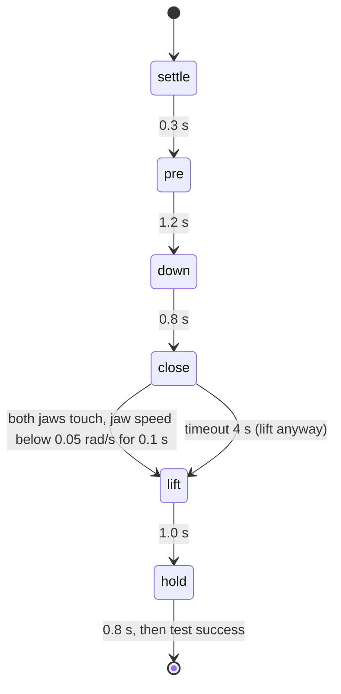

# 16 · Grasping and scripted pick-and-place

<!-- meta -->
| | |
|---|---|
| **Part** | [4 · Dynamics and control](README.md) |
| **Run type** | CPU · Mac or Colab CPU |
| **Prerequisites** | [10](../part-3-kinematics/10-inverse-kinematics.md), [13](13-trajectory-generation.md) |
| **Learn first** | none |
| **Time** | ~60 min |
| **Code** | [`experiments/16-grasping-and-pick-place/experiment.py`](../experiments/16-grasping-and-pick-place/experiment.py) |
| **Status** | ✅ done |
<!-- /meta -->

> A grasp holds when friction can carry the load. Everything else in pick-and-place, IK, trajectories, the state machine, exists to put two jaws where that is true.

## The problem

Part 7 trains policies from demonstrations, and the cheapest demonstrations come from a script that already works. A scripted pick in simulation is easy to fake: weld the cube to the gripper when the jaws close and every attempt "succeeds". The question this lesson answers honestly is the physical one: with a real contact model and no attachment, when does an SO-101 actually lift a 3 cm cube, and when does it squeeze it out, drop it, or never close? The answer comes from the friction cone of [lesson 04](../part-1-simulation/04-friction.md), measured on 240 simulated grasps.

## Core idea

### In plain words

When you pinch a cube between two fingers, nothing holds it from below: friction at the fingertips carries the whole weight. Friction can carry at most *grip coefficient × how hard you squeeze*. If the weight is larger, the cube slides out. Holding a wet bar of soap is the low-friction case: you have to squeeze harder, and if you squeeze while the fingers are still moving, the soap shoots away.

A scripted pick-and-place is a small **state machine**, like the states of a game character or a traffic light: each state has an action (where the arm goes, whether the jaw is open) and an exit condition (a timer, or something sensed). The script moves the open jaws above the cube, lowers them, closes until the sensors say the grip has formed, lifts, and holds. The physics test at the end is honest: no welding the cube to the gripper, only contact and friction.



### The grasp test and the state machine as code

```python
# Friction cone for a two-jaw grasp on parallel faces
squeeze = N1 + N2                  # normal forces of the two jaws on the cube [N] (mj_contactForce)
ratio = mu * squeeze / (m * g)     # how many times friction could carry the weight
holds = ratio >= 1.0               # below 1 the cube slides out of the jaws

# State machine: an action per state, an exit condition per state
state, t0 = "settle", time()
while state != "done":
    command_arm_and_jaw(state)                         # IK + min-jerk target, jaw open or closed
    t = time() - t0
    if state == "close":
        if both_jaws_touch() and jaw_still(speed=0.05, for_s=0.1):   # sensed, not timed
            state, t0 = "lift", time()
        elif t > 4.0:                                  # timeout: lift anyway, the test will tell
            state, t0 = "lift", time()
    elif t >= DURATION[state]:
        state, t0 = NEXT[state], time()                # settle -> pre -> down -> close; lift -> hold -> done
```

| Formula | What it says |
|---|---|
| $\mu\,(N_1 + N_2) \;\ge\; m g$ | friction can carry the weight (Lynch & Park, ch. 12) |
| $\dfrac{\mu (N_1 + N_2)}{m g} \ge 1$ | the same as a ratio: the friction-cone margin |
| half-angle $= \arctan\mu$ | each contact force must stay inside a cone this wide around the surface normal |
| $m_{\max} = \mu (N_1+N_2)/g$ | the heaviest cube a given squeeze can lift |

Here $\mu$ is the friction coefficient between jaw and cube, $N_1, N_2$ the normal forces with which the two jaws press on the cube, $m$ the cube mass and $g$ = 9.81 m/s² gravity. The grasp is **antipodal**: two contacts whose normals point at each other along the line joining them; on two parallel cube faces the jaws press horizontally and only friction acts upward.

**Gripper geometry.** The SO-101 gripper has a fixed jaw and a moving jaw on a hinge (the `gripper` joint, range −0.17 to 1.75 rad in the Menagerie model), driven by an STS3215 position servo. Commanding the closed limit (−0.17 rad) on a 3 cm cube makes the servo push until it reaches its torque cap; the squeeze force is set by that cap and the jaw lever.

**Which friction counts.** MuJoCo uses the friction of the geom with higher `priority` in a contact (otherwise the element-wise maximum) ([Modeling](https://mujoco.readthedocs.io/en/stable/modeling.html)); the SO-101 jaw pads have priority 1 and friction 1, so the cube gets priority 2 to make its μ the one that counts.

**The states in detail:**

| state | arm target | jaw | exit when |
|---|---|---|---|
| settle | home | open | 0.3 s |
| pre | min-jerk to 5.5 cm above the cube centre | open | 1.2 s |
| down | min-jerk to grasp height (4 mm below the centre) | open | 0.8 s |
| close | hold | ramp to closed (0.3 s) | both jaws touch the cube and jaw speed < 0.05 rad/s for 0.1 s (timeout 4 s) |
| lift | min-jerk to 7 cm above the centre | closed | 1.0 s |
| hold | hold | closed | 0.8 s |

Arm targets come from damped-least-squares IK on the 5 arm joints (gripper frame at the target, approach axis down, jaws closing along x; lesson 10), blended with the quintic of lesson 13. The `close` exit is a sensed condition, not a timer: how long the jaw needs depends on its torque cap (part B).

**Success, physically.** At the end: cube bottom ≥ 4 cm above the floor **and** contact with both jaws.

<details>
<summary>Math details: the friction cone, the squeeze and why the lift needs a little more</summary>

**Coulomb friction.** At each contact the tangential force $f_{t,i}$ can be at most $\mu N_i$. Geometrically, the total contact force must lie inside a cone around the normal with half-angle $\arctan\mu$ (lesson 04). For the antipodal grasp the two tangential forces together carry the weight: $f_{t,1} + f_{t,2} = mg$ with each $f_{t,i} \le \mu N_i$, hence $\mu(N_1 + N_2) \ge mg$.

**Squeeze from the torque cap.** A stalled position servo pushes with its cap $\tau_{\max}$; at jaw lever $r_j$ the moving jaw presses with about $\tau_{\max}/r_j$, and the fixed jaw pushes back with the same force so the cube stays balanced. Each contact therefore carries about $\tau_{\max}/r_j$ and $N_1 + N_2 \approx 2\tau_{\max}/r_j$; the force is not split between them. That is why the squeeze in part B grows roughly in proportion to the cap.

**The lift.** Accelerating the cube upward at $a$ needs $\mu(N_1+N_2) \ge m(g + a)$, so the measured success boundary sits slightly above a static ratio of 1. During closing the contacts are moving and the jaw pushes the cube sideways; if the contact force leaves its cone at that moment, the cube slips away before the static test even applies, which is what part A shows at very low μ.

**MuJoCo contact.** `condim` 4 adds torsional friction to the sliding friction of `condim` 3, and MuJoCo's contacts are soft: they allow a small penetration, so forces and ejection speeds at very low μ are properties of the model ([Modeling](https://mujoco.readthedocs.io/en/stable/modeling.html)).

Go deeper: [lesson 04 · Friction](../part-1-simulation/04-friction.md); Lynch & Park, [*Modern Robotics*](https://hades.mech.northwestern.edu/index.php/Modern_Robotics), ch. 12 (Grasping and Manipulation); MuJoCo [Modeling · contact parameters](https://mujoco.readthedocs.io/en/stable/modeling.html).

</details>

## Experiment

The pick is one function that Part 7 can import to record demonstrations:

```python
def scripted_pick(model, data, cube_pos, record=False):
    """Runs settle -> pre -> down -> close -> lift -> hold in (model, data).
    Returns success, lift_cm, squeeze_N, close_s, ... and with record=True the
    per-step (time, state, qpos, ctrl) trajectory."""
```

Setup: SO-101 (Menagerie `scene.xml`, timestep 2 ms), 3 cm cube, `condim` 4 (sliding plus torsional friction), cube friction μ, cube mass m, jaw torque cap τ (default 2.94 N·m). Every sweep value runs 10 cube positions uniform in a 2 × 2 cm square around (22, 0) cm, seed 0. Full script: [`experiments/16-grasping-and-pick-place/experiment.py`](../experiments/16-grasping-and-pick-place/experiment.py). MuJoCo 3.17.0, NumPy 2.5.4, Python 3.14, Apple M5, deterministic, ~30 s.

Nominal pick (μ 1.0, 30 g, default cap): success, cube bottom at 7.37 cm, IK error 0.18 mm, jaw normal forces 39.84 / 39.83 N, 2287 recorded steps. With the default cap the squeeze is about 80 N on a 0.29 N cube: friction is never the limit. To see the cone, parts A and C use a 0.5 N·m cap.

*Predict:* with τ = 0.5 N·m the squeeze is about 13 N, so for a 30 g cube the cone condition fails below μ ≈ 0.02. Will the measured boundary sit there?

**A. Friction sweep** (30 g, τ = 0.5 N·m). "close" = time in the close state, "squeeze" = $N_1 + N_2$ when it ends (means over trials where the jaw closed). "Wilson 95%" is the range of true success rates that is consistent with k successes in n trials; with only 10 trials it is wide. "Ejected" counts cubes that ended more than 30 cm away.

| μ | success | Wilson 95% | close | squeeze | $\mu(N_1+N_2)/mg$ | held / not closed / dropped; ejected |
|---|---|---|---|---|---|---|
| 0.005 | 0/10 | [0.00, 0.28] | – | – | – | 0 / 10 / 0; 10 |
| 0.01 | 0/10 | [0.00, 0.28] | – | – | – | 0 / 10 / 0; 10 |
| 0.015 | 0/10 | [0.00, 0.28] | – | – | – | 0 / 10 / 0; 10 |
| 0.02 | 0/10 | [0.00, 0.28] | 1.59 s | 14.21 N | 0.97 | 0 / 9 / 1; 8 |
| 0.03 | 2/10 | [0.06, 0.51] | 1.62 | 12.29 | 1.25 | 2 / 8 / 0; 7 |
| 0.05 | 10/10 | [0.72, 1.00] | 1.63 | 12.74 | 2.16 | 10 / 0 / 0; 0 |
| 0.1 | 10/10 | [0.72, 1.00] | 1.63 | 13.26 | 4.51 | 10 / 0 / 0; 0 |
| 0.3 | 10/10 | [0.72, 1.00] | 1.58 | 14.24 | 14.52 | 10 / 0 / 0; 0 |
| 1.0 | 10/10 | [0.72, 1.00] | 1.56 | 14.91 | 50.65 | 10 / 0 / 0; 0 |

The boundary lies between μ = 0.03 and 0.05, near the predicted value, but the failures below it are **not** drops after the lift. In 47 of the 48 failed trials at μ ≤ 0.03 the jaw never settled on the cube: the cube left the jaws while they were closing, and in 45 it ended more than 30 cm away ("ejected"). Low friction fails at the squeeze, before the weight matters. We did not instrument the contact geometry during closing; the large ejection distances are a property of MuJoCo's soft contact at very low μ and should not be read as real speeds.

**B. Jaw torque cap** (30 g, μ = 0.05):

| τ [N·m] | success | close | squeeze | ratio | held / not closed / dropped; ejected |
|---|---|---|---|---|---|
| 2.94 | 7/10 | 0.96 s | 88.93 N | 15.11 | 7 / 1 / 2; 3 |
| 1.0 | 10/10 | 0.91 | 27.23 | 4.63 | 10 / 0 / 0; 0 |
| 0.5 | 10/10 | 1.63 | 12.74 | 2.16 | 10 / 0 / 0; 0 |
| 0.3 | 10/10 | 2.65 | 7.04 | 1.20 | 10 / 0 / 0; 0 |
| 0.2 | 0/10 | – | – | – | 0 / 10 / 0; 5 |
| 0.15 | 0/10 | – | – | – | 0 / 10 / 0; 0 |
| 0.1 | 0/10 | – | – | – | 0 / 10 / 0; 0 |

Squeeze grows roughly in proportion to the cap (7.04 → 12.74 → 27.23 N). Below 0.3 N·m the jaw closes so slowly against its own passive damping and friction loss (0.60 N·m·s/rad and 0.052 N·m in the model) that it does not settle within the 4 s timeout (close time 0.91 → 1.63 → 2.65 s as the cap drops). At the default 2.94 N·m, 3 of 10 cubes are shot out on this slippery surface: more force is not always a better grasp.

**C. Mass sweep** (μ = 0.3, τ = 0.5 N·m):

| m [kg] | 0.03 | 0.1 | 0.2 | 0.3 | 0.4 | 0.45 | 0.5 | 0.7 |
|---|---|---|---|---|---|---|---|---|
| success | 10/10 | 10/10 | 10/10 | 10/10 | 10/10 | 0/10 | 0/10 | 0/10 |
| squeeze [N] | 14.24 | 14.95 | 15.52 | 15.87 | 16.25 | 16.47 | 16.61 | 16.90 |
| $\mu(N_1+N_2)/mg$ | 14.52 | 4.57 | 2.37 | 1.62 | 1.24 | 1.12 | 1.02 | 0.74 |
| outcome | held | held | held | held | held | dropped | dropped | dropped |


Here the cone condition is the whole story: every mass whose mean ratio is ≥ 1.24 holds in all trials, every mass with mean ratio ≤ 1.12 drops in all trials during the lift (Wilson 95% for 10/10: [0.72, 1.00]; for 0/10: [0.00, 0.28]). The boundary sits slightly above the static value of 1, consistent with the extra force needed to accelerate the cube upward during the lift.

## Break it

Lower μ at a fixed cap (part A) or raise the mass (part C) and the grasp fails two different ways. Heavy cube, ratio 1.12 or below: the cube slides down between the jaws during the lift, exactly as the friction cone predicts. Slippery cube, μ ≤ 0.015: the grasp never forms; all 10 cubes per value are expelled while the jaw closes. Even at μ = 0.03, where the measured static ratio is 1.25, 8 of 10 grasps never form. A friction-cone check on the final grasp is necessary but not sufficient; the closing motion has to keep the contacts inside their cones too.

## On the real robot

- **SO-101 / LeRobot.** At connect, LeRobot limits the gripper servo with `Max_Torque_Limit` 500 ("50% of max torque to avoid burnout"), `Protection_Current` 250 and `Overload_Torque` 25 ([`so_follower.py`](https://github.com/huggingface/lerobot/blob/main/src/lerobot/robots/so_follower/so_follower.py)). How those register values map to newton-metres at the jaw is not documented there; the Menagerie cap of 2.94 N·m is a model parameter, not a measurement.
- **Not yet measured on the real arm.** Procedure: print or buy 3 cm cubes of two surface finishes, weigh them, run the scripted pick (with joint offsets from calibration) 20 times per cube at fixed positions, record success with the same physical test (lifted ≥ 4 cm, held 1 s), and report k/n with a Wilson interval.
- **Sim-to-real gaps.** Real friction differs between static and kinetic and varies with dust and wear; MuJoCo has one μ (lesson 04). Jaw pads deform. Expect the boundary to move; the method (measure the squeeze, compute the cone margin) carries over.

## Check yourself

1. **Easy.** With squeeze $N_1 + N_2$ = 12.74 N and μ = 0.05, what is the heaviest cube the cone condition allows?
2. **Medium.** Why does the script end `close` on a sensed condition instead of after a fixed 0.6 s? Use part B's close times.
3. **Hard.** Make the `close` state also check that the cube has not moved more than 5 mm since the jaw ramp started, and abort (re-open, re-approach) if it has. Rerun part A. Predict before running: does success at μ = 0.03 improve?

### Answers

1. $m \le \mu (N_1+N_2)/g = 0.05 \cdot 12.74 / 9.81 \approx 0.065$ kg.
2. Close time ranges from 0.91 s (τ 1.0 N·m) to 2.65 s (τ 0.3 N·m). A fixed 0.6 s is shorter than every measured close time, so it would lift before the jaw has settled at every cap; a timer long enough for the slowest cap would waste time at the fast ones.
3. Not computed here; run it.

## Takeaways and sources

- The friction cone predicts the lift: with the squeeze measured, ratio ≥ 1.24 held 50/50 trials and ratio ≤ 1.12 dropped 30/30 (part C).
- At low μ the grasp fails earlier, during closing (47 of 48 failures at μ ≤ 0.03); squeeze scales with the jaw torque cap, and too low a cap never closes within 4 s.
- `scripted_pick(model, data, cube_pos, record=True)` is a physically verified demonstration generator: state machine + IK + min-jerk + a sensed close condition, no weld.

Next: Part 5 · [lesson 17 · Sensors, noise and filtering](../part-5-perception-and-estimation/17-sensors-noise-filtering.md); the demonstrations are used in [lesson 26](../part-7-learning-from-demonstration/26-teleop-replay-data.md).

Sources:
- Lynch & Park, [*Modern Robotics*](https://hades.mech.northwestern.edu/index.php/Modern_Robotics), ch. 12 (Grasping and Manipulation).
- MuJoCo [Modeling · contact parameters (priority, friction)](https://mujoco.readthedocs.io/en/stable/modeling.html), [`mj_contactForce`](https://mujoco.readthedocs.io/en/stable/APIreference/APIfunctions.html); [Menagerie `robotstudio_so101`](https://github.com/google-deepmind/mujoco_menagerie/tree/f3b6013/robotstudio_so101) (Apache-2.0).
- LeRobot [`so_follower.py`](https://github.com/huggingface/lerobot/blob/main/src/lerobot/robots/so_follower/so_follower.py) (read 2026-10-27); [LeRobot SO-101 docs](https://huggingface.co/docs/lerobot/so101).
- All measured numbers: [`experiments/16-grasping-and-pick-place/output.txt`](../experiments/16-grasping-and-pick-place/output.txt).
