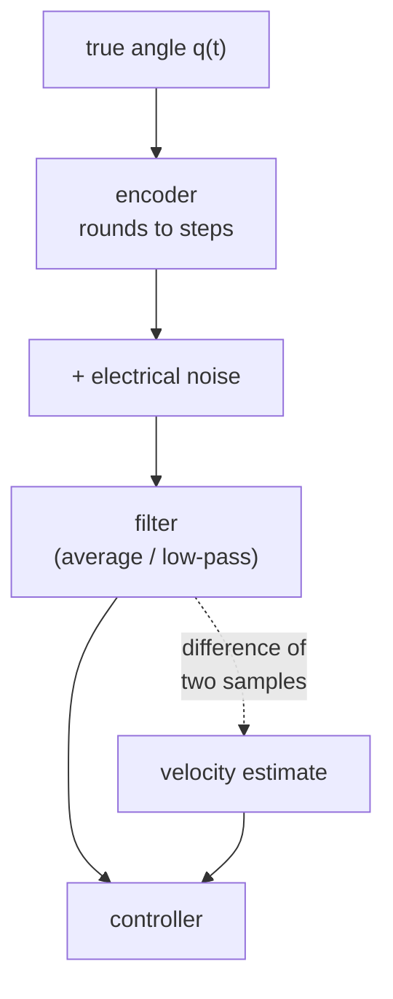

# 17 · Sensors, noise and filtering

<!-- meta -->
| | |
|---|---|
| **Part** | [5 · Perception and estimation](README.md) |
| **Run type** | CPU · Mac or Colab CPU |
| **Prerequisites** | [12](../part-4-dynamics-and-control/12-joint-control.md) |
| **Learn first** | [Probability and Distributions](https://aiengineeringfromscratch.com/lesson?path=phases/01-math-foundations/06-probability-and-distributions) · [Stochastic Processes](https://aiengineeringfromscratch.com/lesson?path=phases/01-math-foundations/22-stochastic-processes) |
| **Time** | ~45 min |
| **Code** | [`experiments/17-sensors-noise-filtering/experiment.py`](../experiments/17-sensors-noise-filtering/experiment.py) |
| **Status** | ✅ done |
<!-- /meta -->

> Every filter buys lower noise with delay; the right window is the one where the two errors are equal for the motion you actually have.

## The problem

A joint controller ([lesson 12](../part-4-dynamics-and-control/12-joint-control.md)) needs the joint's position and velocity. A real arm gives you neither directly. It gives you encoder readings that jump in small steps and wobble with electrical noise, and it gives you velocity only if you compute it yourself from consecutive readings. Smoothing the readings removes the wobble but makes them late, and a feedback loop reacts badly to late data ([lesson 37](../part-9-sim-to-real/37-latency.md)). This lesson measures that trade-off on a simulated SO-101 joint and ends with a rule for picking a filter.

## Core idea

### In plain words

Think of a jittery speedometer. If you read the needle once, you get a noisy number. If you average the last ten readings, the number is calm, but it describes where the car was a moment ago, not where it is now. The more readings you average, the calmer and the older the number gets.

So any smoothing filter has two errors pulling in opposite directions:

- **Noise error**: what is left of the jitter. It shrinks as you average more.
- **Lag error**: how far the joint moved since the readings you averaged. It grows as you average more, and it grows faster when the joint moves faster.

The best filter is where the sum of the two is smallest. Where that is depends on how fast your joint moves. That is the whole lesson.

### The signal chain



### The two filters, as code

If you have written a rolling average over a stream of numbers, you already know the first filter. Readings arrive every `dt` seconds (here `dt = 0.002`, i.e. 500 per second); Build it writes both filters in full.

```python
# Moving average: the mean of the last n readings
y[k] = mean(z[k - n + 1 : k + 1])
# First-order low-pass: move a fraction alpha toward each new reading
alpha = dt / (tau + dt)                      # tau = 1 / (2 pi fc); small alpha = heavy smoothing
y[k] = y[k - 1] + alpha * (z[k] - y[k - 1])
```

A moving average over `n` readings reports the value from the middle of its window, $(n-1)/2$ samples ago; the low-pass filter lags by about its time constant `tau`.

| Filter | Knob | Delay | Noise left (std) |
|---|---|---|---|
| Moving average | window $n$ | $\frac{n-1}{2}\,\Delta t$ | $\sigma/\sqrt{n}$ |
| First-order low-pass | cutoff $f_c$ | $\approx \tau = \frac{1}{2\pi f_c}$ | shrinks as $f_c$ falls |

Here $\Delta t$ is the time between readings and $\sigma$ is the noise standard deviation of one reading. The lag error is roughly *speed × delay*: a joint moving at 0.6 rad/s seen through a 16 ms filter is about $0.6 \times 0.016 \approx 0.01$ rad behind.

<details>
<summary>Math details: where σ/√n and the error trade-off come from</summary>

**Averaging cuts noise by √n.** If the $n$ readings carry independent noise $v_i$ with variance $\sigma^2$, the noise in their mean is $\frac1n\sum v_i$, whose variance is $\frac{1}{n^2}\cdot n\sigma^2 = \sigma^2/n$. The standard deviation falls as $\sigma/\sqrt n$. Independence matters: correlated noise (for example a slow drift) is not removed this way.

**Delay of the moving average.** For a slowly varying signal $q(t)$, a Taylor expansion of the window mean around now gives $\frac1n\sum_{i=0}^{n-1} q(t - i\Delta t) \approx q\big(t - \tfrac{n-1}{2}\Delta t\big)$: the output is the signal delayed by half the window.

**Low-pass filter.** $y_k = y_{k-1} + \alpha(z_k - y_{k-1})$ is the discrete form of $\tau\dot y = z - y$. For frequencies well below $f_c = 1/(2\pi\tau)$ its phase delay tends to $\tau$; near and above $f_c$ it is smaller, which the experiment shows at 0.5 Hz.

**The trade-off.** With delay $t_d$ the filtered position is roughly $q(t - t_d)$ plus residual noise, so

$$e_{\text{rms}}^2 \approx \underbrace{\sigma^2\, g(t_d)}_{\text{noise, falls with delay}} + \underbrace{\overline{\dot q^{\,2}}\; t_d^2}_{\text{lag, grows with delay}}$$

where $g$ decreases with $t_d$ (for the moving average, $g = 1/n$ with $t_d = \frac{n-1}{2}\Delta t$). A falling term plus a growing term has a minimum.

**Velocity is harder.** Velocity from two readings, $(z_{k+1} - z_{k-1})/(2\Delta t)$, divides their noise by a small number: the noise grows by a factor of about $1/\Delta t$. So the noise term is much larger for velocity, and its minimum sits at a much longer delay.

Go deeper (random variables, variance, noise processes): [Probability and Distributions](https://aiengineeringfromscratch.com/lesson?path=phases/01-math-foundations/06-probability-and-distributions), [Stochastic Processes](https://aiengineeringfromscratch.com/lesson?path=phases/01-math-foundations/22-stochastic-processes).
</details>

<!-- figure: 17-moving-average -->

### Sensors in brief

| Sensor | Reports | Typical error |
|---|---|---|
| Encoder ($N$ counts/rev) | angle rounded to steps of $2\pi/N$ | quantization (step size) + electrical noise |
| Gyroscope | angular velocity | slowly varying **bias** + noise; integrating a bias gives an angle that drifts away linearly |
| Accelerometer | specific force | at rest it reads **gravity**, not zero |

MuJoCo sensors (`jointpos`, `jointvel`, `gyro`, `accelerometer`, …) write exact values into `mjData.sensordata`. Their `noise` attribute is only stored metadata: the docs state it does not affect the simulation ([MuJoCo Modeling · sensors](https://mujoco.readthedocs.io/en/stable/modeling.html#sensor-noise)). You add noise yourself.

## Build it

You will now write the sensor model and both filters yourself, in about 40 lines of NumPy, and check each against SciPy or a formula from Core idea. Only the true joint motion comes from MuJoCo (the Experiment's `simulate`), so Build it and the Experiment score the same 5000 readings.

Type the steps into a file of your own and run it after each one. The finished functions are in [`physai/estimation.py`](../physai/estimation.py); `uv run python experiments/17-sensors-noise-filtering/build.py` runs all five steps (output in [`build_output.txt`](../experiments/17-sensors-noise-filtering/build_output.txt)).

### Step 1 · The encoder

An encoder rounds the angle to whole counts; the electronics add noise on top:

```python
def encoder_reading(q, counts, sigma, rng):
    """What an encoder reports for true angles q: rounded to steps of 2 pi / counts, plus white noise."""
    step = 2 * np.pi / counts                       # one count, in rad
    return np.round(q / step) * step + rng.normal(0, sigma, np.shape(q))
```

Rounding to steps of $\Delta$ leaves an error between $-\Delta/2$ and $\Delta/2$, spread evenly, so its standard deviation is $\Delta/\sqrt{12}$. Check that on a million random angles, then on the lesson's signal:

```text
== Step 1. The encoder: 4096 counts/rev, sigma 10 mrad ==
step = 1.534 mrad, max |rounding error| = 0.767 mrad (step / 2 = 0.767)
rounding error std 0.4427 mrad vs step / sqrt(12) = 0.4428 mrad
lesson signal: max |ours - Exp. encoder| = 0.0e+00 rad
expected reading error sqrt(sigma^2 + step^2/12) = 10.01 mrad, measured 9.95 mrad
```

The rounding part (0.44 mrad) is small next to the 10 mrad noise, so the expected reading error is 10.01 mrad. This seed's noise draw comes out 0.6 % low, which is why the Experiment measures 9.95 mrad.

### Step 2 · The moving average

The running sum turns each window mean into one subtraction, so the cost does not grow with $n$:

```python
def moving_average(x, n):
    """Causal moving average: the mean of the last n samples (fewer at the start), as in lesson 17."""
    c = np.cumsum(np.insert(x, 0, 0.0))
    i = np.arange(len(x))
    lo = np.maximum(0, i + 1 - n)
    return (c[i + 1] - c[lo]) / (i + 1 - lo)
```

Three checks: the same numbers as a plain loop over windows, the noise left on pure white noise against $1/\sqrt n$, and the delay. A ramp makes the delay exact: the mean of the last $n$ samples of a straight line is its value $(n-1)/2$ samples ago.

```text
== Step 2. Moving average: window mean, noise left, delay on a ramp ==
n = 5: max |ours - loop over windows| = 2.2e-16
    n  noise std left  1/sqrt(n)  ramp lag samples  (n-1)/2
    5          0.4459     0.4472               2.0      2.0
   17          0.2415     0.2425               8.0      8.0
   65          0.1226     0.1240              32.0     32.0
```

### Step 3 · The first-order low-pass

```python
def low_pass(x, fc, dt):
    """First-order low-pass with cutoff fc (Hz): move a fraction alpha toward each new sample."""
    tau = 1.0 / (2 * np.pi * fc)                    # time constant (s)
    alpha = dt / (tau + dt)                         # small alpha = heavy smoothing
    y = np.empty(len(x))
    y[0] = x[0]                                     # start at the first reading
    for k in range(1, len(x)):
        y[k] = y[k - 1] + alpha * (x[k] - y[k - 1])
    return y
```

This is a recursive filter, $y_k = \alpha z_k + (1-\alpha) y_{k-1}$, which `scipy.signal.lfilter` runs with coefficients `b = [alpha]`, `a = [1, alpha - 1]`. Starting SciPy from `lfilter_zi(b, a) * z[0]` makes it begin at the first reading, as yours does. Two formulas to check: white noise of unit variance leaves $\alpha/(2-\alpha)$ of its variance, and on a ramp the output trails by $(1-\alpha)/\alpha$ samples, which with $\alpha = \Delta t/(\tau + \Delta t)$ is exactly $\tau/\Delta t$.

```text
== Step 3. First-order low-pass: vs scipy.signal.lfilter, noise left, delay on a ramp ==
fc Hz   alpha  max |ours - lfilter|  noise std left  sqrt(a/(2-a))  ramp lag samples  tau/dt
   50  0.3859               2.2e-16          0.4878         0.4889              1.59    1.59
   10  0.1116               3.3e-16          0.2423         0.2431              7.96    7.96
    2  0.0245               1.8e-15          0.1103         0.1114             39.79   39.79
```

The ramp lag is $\tau$ to two decimals at every cutoff. The noise left is within about 1 % of the formula (the gap is the finite noise sample).

### Step 4 · Velocity from differences

```python
def central_difference(y, dt):
    """Velocity from samples: (y[k+1] - y[k-1]) / 2 dt inside, one-sided at the two ends."""
    v = np.empty(len(y))
    v[1:-1] = (y[2:] - y[:-2]) / (2 * dt)
    v[0], v[-1] = (y[1] - y[0]) / dt, (y[-1] - y[-2]) / dt
    return v
```

This is what `np.gradient(y, dt)` does, and the check confirms it to the last bit. Two readings with independent errors of 10.01 mrad, divided by $2\Delta t$ = 4 ms, predict the raw velocity noise:

```text
== Step 4. Velocity by central differences ==
max |ours - np.gradient| = 0.0e+00 rad/s
raw velocity error: predicted sqrt(2) * 10.01 mrad / (2 dt) = 3.54 rad/s, measured 3.50 rad/s (true velocity RMS 0.63)
```

Predicted 3.54, measured 3.50 rad/s: the same 0.6 % low draw as Step 1. The noise is more than five times the true velocity, which is why velocity needs much heavier filtering than position.

### Step 5 · Measure the delay and the errors

The Experiment defines a filter's delay as the shift that best lines the filtered signal up with the truth:

```python
def delay_samples(y, ref, max_lag=400, skip=500):
    """The shift (in samples) that best aligns a filtered signal y with the true signal ref."""
    errs = [np.mean((y[skip + lag:] - ref[skip:len(ref) - lag]) ** 2) for lag in range(max_lag)]
    return int(np.argmin(errs))
```

Run every filter of the Experiment through your functions and compare with its numbers:

```text
== Step 5. Every filter on the lesson's signal vs the Experiment ==
      filter  delay ms  theory ms  pos RMS mrad  vel RMS rad/s  max |ours - Exp.|
      MA n=1       0.0        0.0          9.95           3.50            0.0e+00
      MA n=3       2.0        2.0          5.91           1.65            0.0e+00
      MA n=5       4.0        4.0          5.17           1.01            0.0e+00
      MA n=9       8.0        8.0          6.03           0.55            0.0e+00
     MA n=17      16.0       16.0         10.22           0.29            0.0e+00
     MA n=33      32.0       32.0         19.76           0.16            0.0e+00
     MA n=65      64.0       64.0         39.01           0.12            0.0e+00
    MA n=129     128.0      128.0         76.52           0.19            0.0e+00
   LPF 50 Hz       4.0        3.2          5.30           1.35            0.0e+00
   LPF 20 Hz       8.0        8.0          6.02           0.71            0.0e+00
   LPF 10 Hz      16.0       15.9         10.16           0.39            0.0e+00
    LPF 2 Hz      78.0       79.6         47.33           0.14            0.0e+00
  LPF 0.5 Hz     274.0      318.3        152.59           0.35            0.0e+00
lag error of MA n=17: speed x delay = 0.61 rad/s x 16 ms = 9.8 mrad
```

Every row equals the Experiment table, to the last digit. The measured delays match $(n-1)\Delta t/2$ for every window. For the low-pass they match $\tau$ only while $f_c$ is well above the motion (delays are whole 2 ms samples, so the 50 Hz row shows 3.2 ms as 4.0; the 0.5 Hz row is 274 ms, not 318.3 ms). The last line is the lag error from Core idea for MA n=17: 9.8 mrad of the 10.22 measured.

### What you keep

`physai.estimation` now has `encoder_reading`, `moving_average`, `low_pass`, `central_difference` and `delay_samples`. [Lesson 18](18-kalman-filter.md) uses the same encoder model and `moving_average` as its baseline and replaces both filters with one that predicts; [lesson 37](../part-9-sim-to-real/37-latency.md) comes back to delay inside a feedback loop. [`tests/test_17_sensors_noise_filtering.py`](../tests/test_17_sensors_noise_filtering.py) pins them to SciPy; run `uv run pytest tests/test_17_sensors_noise_filtering.py` after you change anything.

## Use it

SciPy runs both filters as one call, `scipy.signal.lfilter(b, a, x)`, the difference equation $a_0 y_k = \sum b_i x_{k-i} - \sum_{j\ge1} a_j y_{k-j}$:

```python
from scipy.signal import group_delay, lfilter, lfilter_zi

y_ma = lfilter(np.ones(n) / n, 1.0, z)                    # moving average (first n-1 outputs differ)
alpha = dt / (1 / (2 * np.pi * fc) + dt)
b, a = [alpha], [1.0, alpha - 1.0]
y_lp, _ = lfilter(b, a, z, zi=lfilter_zi(b, a) * z[0])   # low-pass, starting at the first reading
_, gd = group_delay((b, a), w=[0.2], fs=1 / dt)          # delay in samples at 0.2 Hz
```

`group_delay` gives the delay from the coefficients alone, without a signal: $(n-1)/2$ samples for the moving average and $\tau/\Delta t$ at low frequency for the low-pass, both checked in the tests. Other tools order and place the same window differently:

| Call | Window | Start-up |
|---|---|---|
| physai `moving_average(x, n)` | last $n$ samples (causal) | mean of the samples seen so far |
| `scipy.signal.lfilter(np.ones(n)/n, 1, x)` | last $n$ samples (causal) | samples before the start count as 0 ("initial rest") |
| `scipy.ndimage.uniform_filter1d(x, n)` | centred on the sample (`origin=0`), uses the future | `mode='reflect'` at the edges; `origin=(n-1)//2` makes it causal (checked in the tests) |
| `np.gradient(y, dt)` | one sample before and after (central) | one-sided differences at both ends |

Sources: [`lfilter`](https://docs.scipy.org/doc/scipy/reference/generated/scipy.signal.lfilter.html), [`group_delay`](https://docs.scipy.org/doc/scipy/reference/generated/scipy.signal.group_delay.html), [`uniform_filter1d`](https://docs.scipy.org/doc/scipy/reference/generated/scipy.ndimage.uniform_filter1d.html), [`np.gradient`](https://numpy.org/doc/stable/reference/generated/numpy.gradient.html).

Three traps:

- **A centred filter looks free.** `uniform_filter1d` and `np.gradient` use samples from the future: offline they show zero delay, in a running controller those samples do not exist yet. The Experiment's velocity uses `np.gradient` and so peeks one sample ahead.
- **"First-order low-pass at $f_c$" is not one filter.** `scipy.signal.butter(1, 10, fs=500)` returns `b = [0.0592, 0.0592]`, `a = [1, -0.8816]` (bilinear transform); this lesson's $\alpha$ gives `a = [1, -0.8884]`. Both are called a 10 Hz first-order low-pass.
- **The `noise` attribute adds nothing.** MuJoCo stores it as metadata; the noise in this lesson is the one you add in Step 1.

## Experiment

**Setup.** SO-101 from MuJoCo Menagerie, timestep 2 ms (500 Hz sampling). `shoulder_pan` follows $0.5\sin(2\pi\,0.2t) + 0.2\sin(2\pi\,0.5t)$ rad through its position actuator for 10 s. We model a 12-bit encoder (4096 counts/rev, step 1.534 mrad) plus white noise $\sigma = 10$ mrad. These are teaching values, not datasheet values. Velocity is computed with `np.gradient` (central difference) of the filtered signal. Delay is the shift that best aligns the filtered and true signals.

```python
s = spec.add_sensor(name="q_pan", type=mujoco.mjtSensor.mjSENS_JOINTPOS,
                    objname="shoulder_pan", objtype=mujoco.mjtObj.mjOBJ_JOINT)
s.noise = 0.01                          # metadata only
...
z = np.round(q / step) * step + rng.normal(0, SIGMA, q.shape)   # our encoder
y = moving_average(z, n)                # or low_pass(z, fc)
```

**Predict.** Raw velocity noise should be about $\sqrt2\,\sigma/(2\Delta t) \approx 3.5$ rad/s, larger than the true velocity. The best position window should be short, the best velocity window much longer.

**Run** `uv run python experiments/17-sensors-noise-filtering/experiment.py` (MuJoCo 3.17.0, NumPy 2.5.4, Apple M5, deterministic).

First checks: the `jointpos` sensor declared with `noise=0.01` differs from `qpos` by exactly 0.0 rad. (Sensors are computed at the start of `mj_step`, from the state before integration; compare against that state or you see a one-step offset.) The raw reading has position RMS error 9.95 mrad and velocity RMS error 3.50 rad/s, against a true velocity RMS of 0.63 rad/s.


| Filter | Delay (ms) | Position RMS (mrad) | Velocity RMS (rad/s) |
|---|---|---|---|
| raw | 0.0 | 9.95 | 3.50 |
| MA n=3 | 2.0 | 5.91 | 1.65 |
| **MA n=5** | 4.0 | **5.17** | 1.01 |
| MA n=9 | 8.0 | 6.03 | 0.55 |
| MA n=17 | 16.0 | 10.22 | 0.29 |
| MA n=33 | 32.0 | 19.76 | 0.16 |
| **MA n=65** | 64.0 | 39.01 | **0.12** |
| MA n=129 | 128.0 | 76.52 | 0.19 |
| LPF 50 Hz | 4.0 | 5.30 | 1.35 |
| LPF 20 Hz | 8.0 | 6.02 | 0.71 |
| LPF 10 Hz | 16.0 | 10.16 | 0.39 |
| LPF 2 Hz | 78.0 | 47.33 | 0.14 |
| LPF 0.5 Hz | 274.0 | 152.59 | 0.35 |

**Observe.**

1. The moving-average delay equals $(n-1)\Delta t/2$ in every row. The low-pass delay matches $\tau$ (15.9 → 16.0 ms at 10 Hz) until $f_c$ approaches the signal frequencies: at 0.5 Hz it is 274 ms, not 318.3 ms, because $\tau$ is only the low-frequency limit.
2. Position error is lowest at about 4 ms of delay (MA n=5, 5.17 mrad) and grows almost linearly beyond it: from 17 samples on, the filter is worse than no filter at all.
3. Velocity needs 16 times the delay (MA n=65, 64 ms, 0.12 rad/s). One filter cannot serve both. This is the gap the Kalman filter of lesson 18 closes.
4. At equal delay, the two filter types perform almost the same (MA n=9: 6.03 mrad; LPF 20 Hz: 6.02 mrad at 8 ms). The delay you accept matters more than the filter's shape.

The IMU check (same script): the arm at rest reads $|a| = 9.810$ m/s² on the accelerometer. A gyro with a 0.02 rad/s bias and 0.05 rad/s noise, integrated for 10 s, reports a rotation of 0.209 rad (12.0°) for a joint that did not move.

## Break it

Keep MA n=17 (16 ms delay) and make the motion faster by scaling both frequencies by $k$:

| k | True velocity RMS (rad/s) | Raw position RMS (mrad) | MA17 position RMS (mrad) |
|---|---|---|---|
| 0.5 | 0.28 | 9.94 | 5.01 |
| 1 | 0.61 | 9.95 | 10.22 |
| 2 | 1.27 | 9.95 | 20.46 |
| 4 | 2.51 | 9.95 | 40.00 |
| 8 | 3.73 | 9.94 | 59.49 |

The raw error does not care about speed. The filtered error follows *speed × delay*: 0.61 rad/s × 16 ms ≈ 9.8 mrad versus 10.22 measured. A window tuned on a slow test move becomes worse than no filter on a fast move. Tune filters on the fastest motion the robot will actually perform, or use a model-based filter that predicts the motion instead of averaging it (lesson 18).

## On the real robot

- The SO-101 follower uses six Feetech STS3215 servos with 1/345 gearing ([LeRobot SO-101 docs](https://github.com/huggingface/lerobot/blob/main/docs/source/so101.mdx)). Position comes from the servo's internal encoder over the serial bus; there is no velocity sensor and no IMU in the [Menagerie model](https://github.com/google-deepmind/mujoco_menagerie/tree/f3b6013/robotstudio_so101). We did not verify the STS3215 encoder resolution; the 4096 counts above is our modelling choice.
- On real hardware the read rate is limited by the bus, not by a 2 ms timestep, so $\Delta t$ and the delays above change. Recompute them for your loop rate.
- Measuring your own $\sigma$: hold the arm in a fixed pose, log every joint for 10 s, and take the standard deviation per joint. A pure quantizer at rest may show zero variance; command a slow ramp and look at the residual from a fitted line instead. Not yet measured on the real arm.

## Check yourself

1. **Easy.** A 64-sample moving average runs at 200 Hz. What is its delay?
2. **Medium.** In the table, why is the best velocity window (65) much longer than the best position window (5)? Use the "dividing noise by Δt" argument.
3. **Hard.** Replace `np.gradient` with a causal backward difference $(y_k - y_{k-1})/\Delta t$. Predict the raw velocity noise, then run it. Does the best velocity window change?

### Answers

1. $(64-1)/2 \times 5$ ms $= 157.5$ ms.
2. Differentiating multiplies the remaining noise by about $1/\Delta t = 500$ s⁻¹, while the lag term only changes from speed × delay to acceleration × delay. The noise term is far larger for velocity than for position, so the minimum of noise + lag moves to a much longer delay.
3. Predicted raw noise $\sqrt2\,\sigma/\Delta t \approx 7.1$ rad/s, twice the central-difference value, because the central difference spans two sample intervals. Run it to see the new optimum; we did not.

## Takeaways and sources

- MuJoCo sensors are exact; `noise` is metadata. Quantization, white noise and gyro bias are yours to add.
- A filter's delay is predictable ($\frac{n-1}{2}\Delta t$ or $\approx\tau$) and its lag error is about speed × delay. The best window depends on how fast the joint moves, and it is different for position and for velocity.
- Integrating a biased gyro drifts linearly; you need a second sensor or a model to correct it.

Next: [lesson 18](18-kalman-filter.md), the Kalman filter.

Sources:
- [MuJoCo Modeling · Sensors](https://mujoco.readthedocs.io/en/stable/modeling.html#sensor-noise): sensors do not affect the simulation; `noise` is stored standard deviation only.
- [MuJoCo XML reference · accelerometer](https://mujoco.readthedocs.io/en/stable/XMLreference.html#sensor-accelerometer): `accelerometer` outputs linear acceleration including gravity in the site frame.
- [LeRobot SO-101 docs](https://github.com/huggingface/lerobot/blob/main/docs/source/so101.mdx): follower arm with six STS3215 servos.
- [MuJoCo Menagerie · robotstudio_so101](https://github.com/google-deepmind/mujoco_menagerie/tree/f3b6013/robotstudio_so101) (Apache-2.0).
- All numbers above: [`experiment.py`](../experiments/17-sensors-noise-filtering/experiment.py), output in [`output.txt`](../experiments/17-sensors-noise-filtering/output.txt).
