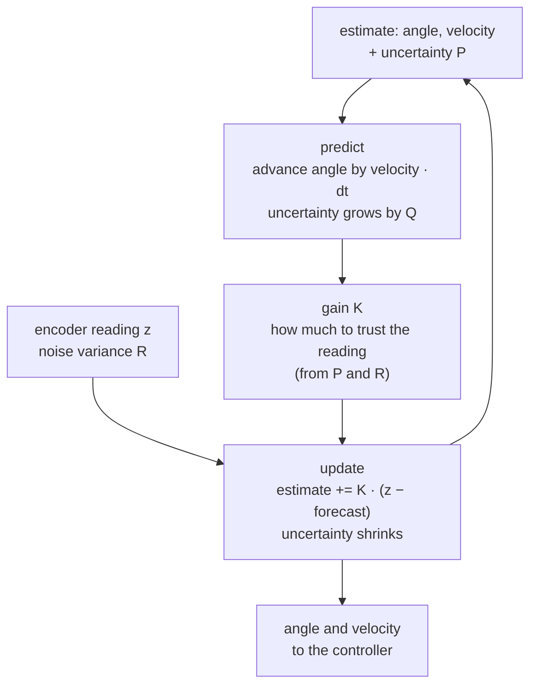

# 18 · The Kalman filter

<!-- meta -->
| | |
|---|---|
| **Part** | [5 · Perception and estimation](README.md) |
| **Run type** | CPU · Mac or Colab CPU |
| **Prerequisites** | [17](17-sensors-noise-filtering.md) |
| **Learn first** | [Probability and Distributions](https://aiengineeringfromscratch.com/lesson?path=phases/01-math-foundations/06-probability-and-distributions) · [Bayes' Theorem](https://aiengineeringfromscratch.com/lesson?path=phases/01-math-foundations/07-bayes-theorem) |
| **Time** | ~60 min |
| **Code** | [`experiments/18-kalman-filter/experiment.py`](../experiments/18-kalman-filter/experiment.py) |
| **Status** | ✅ done |
<!-- /meta -->

> A Kalman filter is a moving average that knows how the joint moves, so it can smooth without lagging, and it tells you how wrong it thinks it is.

## The problem

Lesson 17 ended with a contradiction measured on the same noisy SO-101 joint signal: the best position filter had 4 ms of delay (moving average of 5 samples, 5.17 mrad), the best velocity filter needed 64 ms (65 samples, 0.12 rad/s). A controller wants both from one **estimator** (code that infers what you cannot measure directly from what you can), without delay, plus a number saying how much to trust them. Kalman's 1960 recursive filter ([Kalman 1960](https://doi.org/10.1115/1.3662552)) does this when you can write a linear model of the motion.

## Core idea

### In plain words

Think of a weather forecaster who also owns a thermometer. Every few minutes she makes a forecast from what she knew a moment ago ("it was mild and warming up, so now it should be a little warmer"), then reads the thermometer, which is a bit noisy. She does not pick one of the two. She blends them, trusting each in proportion to how reliable it has been: a good model and a bad thermometer means "mostly the forecast", a precise thermometer means "mostly the reading". After the blend she is more sure than before, and she remembers how sure.

A Kalman filter does exactly that for the joint, 500 times per second. The forecast comes from a model of motion: "the joint keeps its velocity". The reading comes from the encoder. The blend weight, called the **gain**, is recomputed every step from two numbers you supply: how noisy the encoder is, and how much the joint can surprise the model.

The forecast is why it does not lag. The moving average of lesson 17 only looks backwards, so it reports where the joint was. The Kalman filter moves its estimate forward with the velocity it has estimated before comparing with the new reading, so a smooth motion is not averaged into the past. And because it tracks its own uncertainty, it can tell you how far to trust each estimate.

### The predict/update loop



### The filter, as code

The state is a vector of two numbers, the joint angle `q` and its velocity `qd`. `P` is a 2×2 **covariance** matrix: the filter's own estimate of how wrong it is (the square root of its diagonal is a standard deviation per state entry).

```python
dt = 0.002                                   # time between encoder readings (s)
F = np.array([[1, dt], [0, 1]])              # motion model: q += qd * dt, qd stays
H = np.array([[1, 0]])                       # the encoder measures q only
Q = q_c * np.array([[dt**3 / 3, dt**2 / 2],  # how far the model may drift per step;
                    [dt**2 / 2, dt]])        # q_c = how hard the joint may accelerate
R = encoder_variance                         # measured noise of one reading (rad^2)

def kalman_step(x, P, z):
    # predict: forecast the state one step ahead; uncertainty grows
    x = F @ x
    P = F @ P @ F.T + Q
    # gain: which share of the surprise to believe (0 = ignore the encoder)
    S = H @ P @ H.T + R                      # expected spread of the surprise
    K = P @ H.T / S
    # update: move the forecast part of the way towards the reading
    x = x + (K * (z - H @ x)).ravel()        # z - H x is the surprise ("innovation")
    P = (np.eye(2) - K @ H) @ P              # uncertainty shrinks
    return x, P
```

For a single number the gain is just $K = P/(P+R)$: if the forecast is uncertain ($P \gg R$) you copy the reading, if the reading is noisy ($R \gg P$) you keep the forecast.

| Step | Formula |
|---|---|
| Predict state | $\hat x^-_k = F\hat x_{k-1}$ |
| Predict covariance | $P^-_k = F P_{k-1} F^\top + Q$ |
| Gain | $K_k = P^-_k H^\top (H P^-_k H^\top + R)^{-1}$ |
| Update state | $\hat x_k = \hat x^-_k + K_k(z_k - H\hat x^-_k)$ |
| Update covariance | $P_k = (I - K_k H)P^-_k$ |

Here $\hat x_k = [q,\ \dot q]^\top$ is the estimate at step $k$, the superscript $-$ marks the forecast before reading $z_k$, $P$ is the estimate's covariance, $F$ is the motion model, $H$ picks out what the sensor sees, $Q$ is the covariance of what the model gets wrong in one step, $R$ is the variance of the encoder noise, and $K$ is the gain.

You set two knobs:

| Knob | Physical meaning | How to set it |
|---|---|---|
| $R$ | measurement noise variance | measure it: log the sensor at rest or along a known motion ([Welch & Bishop](https://techreports.cs.unc.edu/papers/95-041.pdf), §1 "Filter Parameters and Tuning") |
| $q_c$ | how hard the joint can accelerate unannounced | tune it: the only real design choice |

Two facts worth knowing before the experiment. With constant $Q$ and $R$, $P_k$ and $K_k$ converge to constants, so after a short start-up period (the **transient**) the filter is a fixed linear filter (Welch & Bishop say the same). And once that transient has passed, the estimate depends only on the ratio $q_c/R$; the absolute scale only changes the reported $P$.

<details>
<summary>Math details: the model, where Q and R come from, and why the gain is a trust ratio</summary>

**The model.** State $x_k\in\mathbb R^n$, measurement $z_k$ ([Welch & Bishop, TR 95-041](https://techreports.cs.unc.edu/papers/95-041.pdf), eqs. 1.1–1.2):

$$x_k = F x_{k-1} + w_{k-1},\quad w\sim\mathcal N(0,Q) \qquad z_k = H x_k + v_k,\quad v\sim\mathcal N(0,R)$$

The filter is optimal (minimum mean-squared error) when this model is true: linear dynamics, and independent Gaussian noise $w$ and $v$ with the stated covariances.

**Constant-velocity model for one joint.** $x = [q,\ \dot q]^\top$, the encoder sees only $q$:

$$F = \begin{bmatrix}1 & \Delta t\\ 0 & 1\end{bmatrix},\quad H = [1\ \ 0],\quad Q = q_c\begin{bmatrix}\Delta t^3/3 & \Delta t^2/2\\ \Delta t^2/2 & \Delta t\end{bmatrix}$$

**Where Q comes from.** Model the acceleration $a(t)$ as white noise of intensity $q_c$ (rad²/s³). Over one step it changes the velocity by $\int_0^{\Delta t} a(s)\,ds$ and the angle by $\int_0^{\Delta t} (\Delta t - s)\,a(s)\,ds$. The variances and covariance of these two integrals are $q_c\Delta t$, $q_c\int_0^{\Delta t}(\Delta t-s)^2ds = q_c\Delta t^3/3$ and $q_c\Delta t^2/2$: the matrix above.

**Where R comes from.** $R$ is the encoder variance: here $\sigma^2 + \Delta^2/12$, white noise plus rounding to steps of size $\Delta$ (lesson 17). A rounding error uniform on $[-\Delta/2, \Delta/2]$ has variance $\Delta^2/12$.

**The gain as a trust ratio.** In one dimension ($F = H = 1$) the update is $\hat x = \hat x^- + K(z - \hat x^-)$ with $K = P^-/(P^- + R)$, i.e.

$$\hat x = \frac{R}{P^- + R}\,\hat x^- + \frac{P^-}{P^- + R}\,z$$

a weighted average whose weights are the inverse variances. This is also the product of two Gaussians, the forecast $\mathcal N(\hat x^-, P^-)$ and the measurement $\mathcal N(z, R)$: the Bayesian reading (see AIEFS: [Bayes' Theorem](https://aiengineeringfromscratch.com/lesson?path=phases/01-math-foundations/07-bayes-theorem)).

**Only the ratio matters.** Scaling $Q$, $R$ and the initial $P$ by the same factor $c$ scales every $P^-_k$ and $P_k$ by $c$ and leaves $K_k$ unchanged, so the estimates are identical. The initial $P$ is forgotten after the transient, so in practice only $q_c/R$ sets the estimate.

**Coverage.** If the error is Gaussian with the variance the filter claims, it lies inside $\pm 2\sqrt{P_{00}}$ about 95 % of the time. A much lower fraction means the filter is overconfident.

Go deeper: [Probability and Distributions](https://aiengineeringfromscratch.com/lesson?path=phases/01-math-foundations/06-probability-and-distributions), [Bayes' Theorem](https://aiengineeringfromscratch.com/lesson?path=phases/01-math-foundations/07-bayes-theorem); the original paper [Kalman 1960](https://doi.org/10.1115/1.3662552); the tutorial [Welch & Bishop, TR 95-041](https://techreports.cs.unc.edu/papers/95-041.pdf).

</details>

## Experiment

**Setup.** The same signal as lesson 17: SO-101 `shoulder_pan` in MuJoCo, 2 ms timestep, the same trajectory, a 12-bit encoder model plus 10 mrad white noise, same seed, so the noise sequence is identical. $R = 1.002\times10^{-4}$ rad² (σ 10.01 mrad). We sweep $q_c$ over six decades and measure position and velocity RMS error, delay, and **2σ coverage**: the fraction of samples where the true position lies within $\pm2\sqrt{P_{00}}$. For a Gaussian error that matches its claimed $P$, coverage is about 95 %.

```python
F = np.array([[1.0, DT], [0.0, 1.0]]); H = np.array([[1.0, 0.0]])
Q = q_psd * np.array([[DT**3 / 3, DT**2 / 2], [DT**2 / 2, DT]])
for k in range(len(z)):
    x = F @ x;  P = F @ P @ F.T + Q                       # predict
    S = H @ P @ H.T + r;  K = (P @ H.T) / S               # gain
    x = x + (K * (z[k] - H @ x)).ravel();  P = (np.eye(2) - K @ H) @ P   # update
```

**Predict.** Too small $q_c$: the filter trusts the constant-velocity model, smooths a lot, lags, and is overconfident. Too large: it follows the noise.

**Run** `uv run python experiments/18-kalman-filter/experiment.py` (MuJoCo 3.17.0, NumPy 2.5.4, Apple M5, deterministic).


| $q_c$ | Position RMS (mrad) | Delay (ms) | Velocity RMS (rad/s) | $K_q$ | $K_{\dot q}$ | 2σ coverage (%) |
|---|---|---|---|---|---|---|
| 0.001 | 20.71 | 16.0 | 0.250 | 0.0235 | 0.140 | 8.0 |
| 0.01 | 6.91 | 4.0 | 0.138 | 0.0414 | 0.437 | 32.4 |
| 0.1 | 3.23 | 0.0 | **0.084** | 0.0724 | 1.361 | 91.0 |
| **1** | **3.15** | 0.0 | 0.093 | 0.1251 | 4.179 | 97.8 |
| 10 | 4.02 | 0.0 | 0.203 | 0.2116 | 12.545 | 98.1 |
| 100 | 5.22 | 0.0 | 0.482 | 0.3448 | 36.165 | 97.8 |
| 1000 | 6.61 | 0.0 | 1.136 | 0.5285 | 97.018 | 97.3 |

Lesson 17 baselines on the same data: MA N=5 gives 5.17 mrad at 4.0 ms delay; MA N=65 gives 0.120 rad/s velocity error.

**Observe.**

1. At $q_c = 1$ the filter beats the best lesson-17 position filter (3.15 vs 5.17 mrad) with zero measured delay, and at $q_c = 0.1$ it beats the best velocity filter (0.084 vs 0.120 rad/s), from the same single filter. The baselines used `np.gradient`, which peeks one sample ahead; the Kalman filter is strictly **causal** (it uses only past and present readings) and still wins.
2. Zero delay is not magic: the prediction step extrapolates with the estimated velocity, so a smooth motion is not "averaged into the past".
3. The gains are constants after the start-up transient (the table shows the final $K$). A steady-state Kalman filter is a fixed two-state linear filter whose gains you could hard-code.
4. Coverage is the honesty check: does the filter's claimed uncertainty match its actual error? At $q_c = 0.001$ the filter claims a small $P$ while lagging 16 ms behind: only 8.0 % of the samples fall inside its own 2σ band. Never use $P$ from a mistuned filter for decisions such as gating outliers or fusing sensors.

## Break it

**Wrong R.** True noise fixed, the filter is told $R_{\text{used}} = f\cdot R$, with $q_c = 1$:

| $R_{\text{used}}/R$ | Position RMS (mrad) | Velocity RMS (rad/s) | 2σ coverage (%) |
|---|---|---|---|
| 0.01 | 5.22 | 0.482 | 17.5 |
| 0.1 | 4.02 | 0.203 | 53.9 |
| 1 | 3.15 | 0.093 | 97.8 |
| 10 | 3.23 | 0.084 | 100.0 |
| 100 | 6.91 | 0.138 | 100.0 |

The RMS columns repeat the $q_c$ sweep exactly: $R\times0.01$ at $q_c=1$ gives the same 5.22 mrad / 0.482 rad/s as $q_c = 100$ with the true $R$. The estimate only sees $q_c/R$. Coverage does not repeat: underestimating $R$ makes the filter overconfident (17.5 %), overestimating it makes it pessimistic (100 %). So RMS error can look fine while the covariance is wrong.

**Unmodeled acceleration.** Add a 0.3 rad step to the joint command at $t = 5$ s. The position actuator answers with a true peak velocity of 4.05 rad/s, an acceleration the constant-velocity model calls "noise".

| $q_c$ | Max position error in 0.5 s after step (mrad) | Max velocity error (rad/s) | Position RMS before step (mrad) |
|---|---|---|---|
| 1 | 44.1 | 2.92 | 3.22 |
| 100 | 19.6 | 2.57 | 5.26 |
| 10000 | 22.3 | 7.74 | 7.98 |

The tuned filter lags the step by up to 44.1 mrad. Raising $q_c$ a hundredfold halves the transient but costs smooth-motion accuracy (5.26 vs 3.22 mrad), and at $10^4$ the filter follows noise and velocity error explodes. The mechanism: the model has no way to represent a known command. The fix is not a bigger $Q$ but a better model: feed the commanded acceleration or motor torque as the **control input** $Bu$, a known term added to the forecast (Welch & Bishop eq. 1.1), or switch $Q$ during known transients.

## On the real robot

- $R$ is measured, not guessed: log each SO-101 joint in a held pose and along a slow ramp (procedure in [lesson 17](17-sensors-noise-filtering.md)). Not yet measured on the real arm.
- Serial-bus reads arrive with jitter (irregular spacing in time). Build $F$ and $Q$ from the actual time since the last sample, not a nominal $\Delta t$; both are explicit functions of $\Delta t$ above.
- The SO-101 servos close their own position loop internally (LeRobot puts them in position mode and writes their PID gains, [`so_follower.py`](https://github.com/huggingface/lerobot/blob/main/src/lerobot/robots/so_follower/so_follower.py)); a host-side Kalman filter improves the velocity and state estimates you log, feed to a policy, or use for collision detection, not the servo's internal loop.
- If you know the command sent to each joint (you do), put it into the model before increasing $Q$. The step test above is the failure you will otherwise see at every fast start and stop.

## Check yourself

1. **Easy.** In the table, which $q_c$ would you choose if you only cared about velocity? About position?
2. **Medium.** Explain why $R_{\text{used}} = 0.1R$ at $q_c = 1$ gives exactly the same RMS as the true $R$ at $q_c = 10$.
3. **Hard.** Extend the state to $[q,\dot q,\ddot q]$ (constant-acceleration model) and rerun the step test. Does the transient shrink without hurting the smooth part?

### Answers

1. Velocity: $q_c = 0.1$ (0.084 rad/s). Position: $q_c = 1$ (3.15 mrad).
2. Scaling $Q$ and $R$ (and the initial $P$, whose influence is gone after the transient) by the same factor scales $P$ by that factor and leaves $K = P^-H^\top(HP^-H^\top+R)^{-1}$ unchanged. $q_c=1, R/10$ is the same ratio as $q_c=10, R$.
3. Not computed here; run it. Expect a smaller lag at the step and a noisier velocity on the smooth part, because the extra state also has to be estimated from position alone.

## Takeaways and sources

- A constant-velocity Kalman filter gives position and velocity from one noisy encoder, causally and without the delay of averaging filters (3.15 mrad and 0.084–0.093 rad/s here).
- Only $q_c/R$ sets the estimate; the absolute values set the covariance. Check coverage before trusting $P$.
- Unmodeled acceleration shows up as transient lag; fix the model (control input) before inflating $Q$.

Next: [lesson 19](19-camera-calibration.md), the camera model and calibration.

Sources:
- R. E. Kalman, "A New Approach to Linear Filtering and Prediction Problems", *Journal of Basic Engineering* 82(1):35–45, 1960. [doi:10.1115/1.3662552](https://doi.org/10.1115/1.3662552)
- G. Welch, G. Bishop, "An Introduction to the Kalman Filter", TR 95-041, UNC Chapel Hill (updated 2004). [PDF](https://techreports.cs.unc.edu/papers/95-041.pdf)
- Signal and noise model: [lesson 17](17-sensors-noise-filtering.md).
- All numbers above: [`experiment.py`](../experiments/18-kalman-filter/experiment.py), output in [`output.txt`](../experiments/18-kalman-filter/output.txt).
