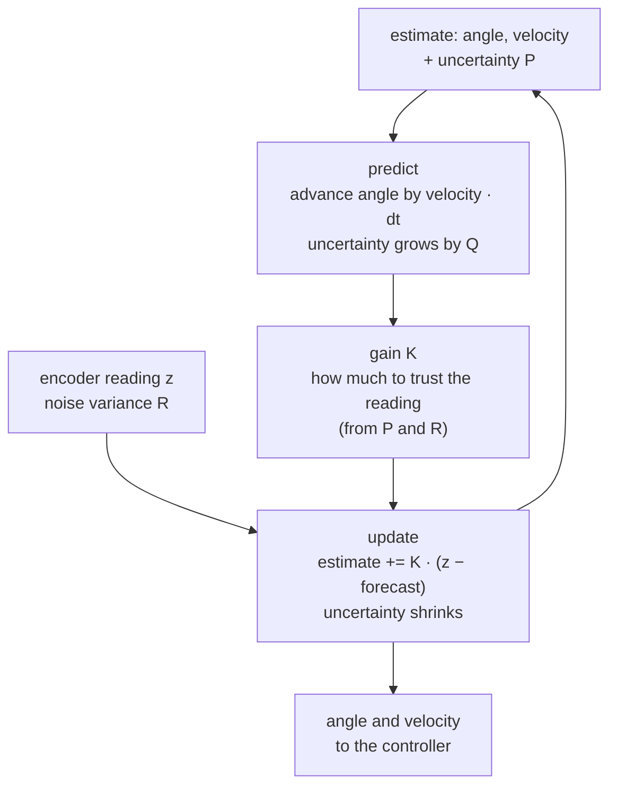
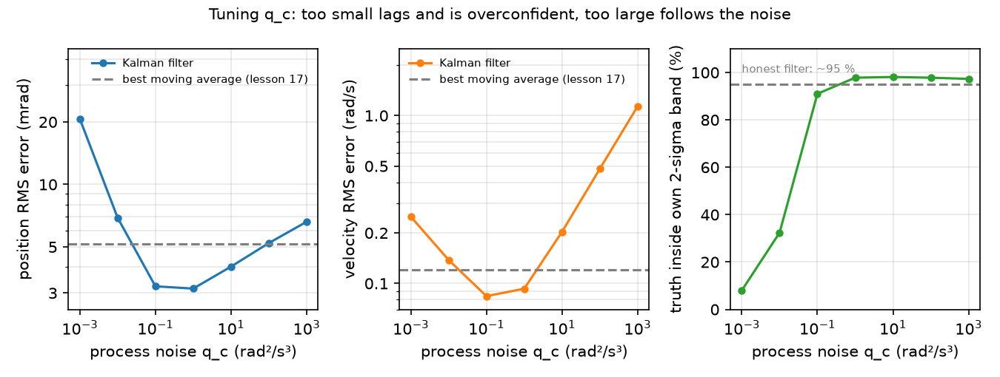

# 18 · The Kalman filter

<!-- meta -->
| | |
|---|---|
| **Part** | [5 · Perception and estimation](README.md) |
| **Run type** | CPU · Mac or Colab CPU |
| **Prerequisites** | [17](17-sensors-noise-filtering.md) |
| **Learn first** | [Probability and Distributions](https://aiengineeringfromscratch.com/lesson?path=phases/01-math-foundations/06-probability-and-distributions) · [Bayes' Theorem](https://aiengineeringfromscratch.com/lesson?path=phases/01-math-foundations/07-bayes-theorem) |
| **Time** | ~60 min |
| **Code** | [`experiments/18-kalman-filter/experiment.py`](../experiments/18-kalman-filter/experiment.py) |
| **Status** | ✅ done |
<!-- /meta -->

> A Kalman filter is a moving average that knows how the joint moves, so it can smooth without lagging, and it tells you how wrong it thinks it is.

## The problem

Lesson 17 ended with a contradiction on one noisy SO-101 joint signal: the best position filter had 4 ms of delay (moving average of 5, 5.17 mrad), the best velocity filter 64 ms (65 samples, 0.12 rad/s). A controller wants both from one **estimator** (code that infers what you cannot measure from what you can), without delay, plus a number saying how much to trust them. Kalman's recursive filter ([Kalman 1960](https://doi.org/10.1115/1.3662552)) does this when the motion has a linear model.

## Core idea

### In plain words

Think of a weather forecaster with a noisy thermometer. Every few minutes she forecasts from what she knew a moment ago ("mild and warming, so a little warmer now"), reads the thermometer, and blends the two, trusting each as far as it has been reliable. After the blend she is more sure than before, and she remembers how sure.

A Kalman filter does that for the joint, 500 times per second: the forecast comes from "the joint keeps its velocity", the reading from the encoder, and the blend weight, the **gain**, is recomputed every step from two numbers you supply: how noisy the encoder is and how much the joint can surprise the model.

The forecast is why it does not lag. Lesson 17's moving average only looks backwards, so it reports where the joint was; the Kalman filter first moves its estimate forward with its estimated velocity, then compares with the new reading.

### The predict/update loop



### The filter, as code

The state is the joint angle `q` and velocity `qd`; `P` is a 2×2 **covariance** matrix, the filter's own estimate of how wrong it is (the square root of its diagonal is a standard deviation). One step (Build it writes each line as a function):

```python
x = F @ x;  P = F @ P @ F.T + Q          # predict: forecast one step; uncertainty grows by Q
K = P @ H.T / (H @ P @ H.T + R)          # gain: which share of the surprise to believe
x = x + K @ (z - H @ x)                  # update: z - H x is the surprise ("innovation")
P = (np.eye(2) - K @ H) @ P              # uncertainty shrinks
```

For a single number the gain is $K = P/(P+R)$: an uncertain forecast ($P \gg R$) copies the reading, a noisy reading ($R \gg P$) keeps the forecast.

| Step | Formula |
|---|---|
| Predict state | $\hat x^-_k = F\hat x_{k-1}$ |
| Predict covariance | $P^-_k = F P_{k-1} F^\top + Q$ |
| Gain | $K_k = P^-_k H^\top (H P^-_k H^\top + R)^{-1}$ |
| Update state | $\hat x_k = \hat x^-_k + K_k(z_k - H\hat x^-_k)$ |
| Update covariance | $P_k = (I - K_k H)P^-_k$ |

Here $\hat x_k = [q,\ \dot q]^\top$ is the estimate at step $k$, $-$ marks the forecast before $z_k$, $P$ its covariance, $F$ the motion model, $H$ what the sensor sees, $Q$ the model's error covariance per step, $R$ the encoder noise variance, $K$ the gain.

You set two knobs:

| Knob | Physical meaning | How to set it |
|---|---|---|
| $R$ | measurement noise variance | measure it: log the sensor at rest or along a known motion ([Welch & Bishop](https://techreports.cs.unc.edu/papers/95-041.pdf), §1 "Filter Parameters and Tuning") |
| $q_c$ | how hard the joint can accelerate unannounced | tune it: the only real design choice |

Two facts used below: with constant $Q$ and $R$, $P_k$ and $K_k$ converge, so after a start-up **transient** the filter is a fixed linear filter (Welch & Bishop); and then only $q_c/R$ sets the estimate, while the absolute scale sets the reported $P$.

<details>
<summary>Math details: the model, where Q and R come from, and why the gain is a trust ratio</summary>

**The model.** State $x_k\in\mathbb R^n$, measurement $z_k$ ([Welch & Bishop, TR 95-041](https://techreports.cs.unc.edu/papers/95-041.pdf), eqs. 1.1–1.2):

$$x_k = F x_{k-1} + w_{k-1},\quad w\sim\mathcal N(0,Q) \qquad z_k = H x_k + v_k,\quad v\sim\mathcal N(0,R)$$

The filter is optimal (minimum mean-squared error) when this model is true: linear dynamics, independent Gaussian $w$ and $v$.

**Constant-velocity model for one joint.** $x = [q,\ \dot q]^\top$, the encoder sees only $q$:

$$F = \begin{bmatrix}1 & \Delta t\\ 0 & 1\end{bmatrix},\quad H = [1\ \ 0],\quad Q = q_c\begin{bmatrix}\Delta t^3/3 & \Delta t^2/2\\ \Delta t^2/2 & \Delta t\end{bmatrix}$$

**Where Q comes from.** Model the acceleration $a(t)$ as white noise of intensity $q_c$ (rad²/s³). Over one step it changes the velocity by $\int_0^{\Delta t} a(s)\,ds$ and the angle by $\int_0^{\Delta t} (\Delta t - s)\,a(s)\,ds$, whose variances and covariance are $q_c\Delta t$, $q_c\Delta t^3/3$ and $q_c\Delta t^2/2$: the matrix above.

**Where R comes from.** The encoder variance $\sigma^2 + \Delta^2/12$: white noise plus rounding to steps of size $\Delta$ (lesson 17, Build it, Step 1).

**The gain as a trust ratio.** In one dimension ($F = H = 1$), $K = P^-/(P^- + R)$ and the update is

$$\hat x = \frac{R}{P^- + R}\,\hat x^- + \frac{P^-}{P^- + R}\,z$$

a weighted average with inverse-variance weights: the product of the Gaussians $\mathcal N(\hat x^-, P^-)$ and $\mathcal N(z, R)$ (see AIEFS: [Bayes' Theorem](https://aiengineeringfromscratch.com/lesson?path=phases/01-math-foundations/07-bayes-theorem)).

**Only the ratio matters.** Scaling $Q$, $R$ and the initial $P$ by $c$ scales every $P^-_k$ and $P_k$ by $c$ and leaves $K_k$ unchanged; the initial $P$ is forgotten after the transient.

**Coverage.** A Gaussian error with the claimed variance lies inside $\pm 2\sqrt{P_{00}}$ about 95 % of the time; much less means the filter is overconfident.

Go deeper: the AIEFS lessons under "Learn first"; [Kalman 1960](https://doi.org/10.1115/1.3662552); the tutorial [Welch & Bishop, TR 95-041](https://techreports.cs.unc.edu/papers/95-041.pdf).

</details>

<!-- figure: 18-kalman -->

## Build it

You will now write the filter in about 60 lines of NumPy, checking every step. Only the signal comes from the Experiment script, so both run on the same 5000 readings; SciPy is only a referee. Type the steps into your own file and run it after each one. The finished functions are in [`physai/estimation.py`](../physai/estimation.py); `uv run python experiments/18-kalman-filter/build.py` runs all six steps with the checks (output in [`build_output.txt`](../experiments/18-kalman-filter/build_output.txt)).

### Step 1 · Write down the model

Four matrices describe the joint and its encoder, all built from the time step and your two knobs:

```python
def cv_model(dt, q_c, r):
    """Constant-velocity model of one joint: state [q, qdot], the sensor reads q.

    q_c: intensity of the white acceleration noise (rad^2/s^3); r: variance of one reading (rad^2).
    """
    F = np.array([[1.0, dt], [0.0, 1.0]])                            # q += qdot * dt, qdot stays
    Q = q_c * np.array([[dt**3 / 3, dt**2 / 2], [dt**2 / 2, dt]])   # white acceleration over one step
    H = np.array([[1.0, 0.0]])                                       # the encoder sees q only
    R = np.array([[r]])
    return F, Q, H, R
```

The check lets the computer do the Math details integral: Van Loan's method puts the continuous model into one block matrix whose matrix exponential contains both $F$ and the exact $Q$:

```python
A = np.array([[0.0, 1.0], [0.0, 0.0]])                 # d/dt [q, qd] = A x + [0, 1] a
W = np.array([[0.0, 0.0], [0.0, 1.0]])                 # white acceleration of intensity 1 enters qd
C = scipy.linalg.expm(np.block([[-A, W], [np.zeros((2, 2)), A.T]]) * dt)
Phi, Q_vl = C[2:, 2:].T, C[2:, 2:].T @ C[:2, 2:]       # equal to F and Q
```

```text
== Step 1. The model at dt = 2 ms, q_c = 1 rad^2/s^3, R = 1e-4 rad^2 ==
F = [1 0.002; 0 1]   H = [1 0]   R = [0.0001]
Q = [2.667e-09 2e-06; 2e-06 0.002]
max |F - expm(A dt)| = 0.0e+00, max |Q - Q_VanLoan| / max |Q| = 2.1e-19
```

Per 2 ms step, white acceleration barely moves the angle (2.667e-09 rad²) but visibly moves the velocity (0.002 rad²/s²); the model ties the two, so the encoder also informs the velocity.

### Step 2 · Predict

```python
def kf_predict(x, P, F, Q):
    """Forecast one step: the state moves with the model, the uncertainty grows by Q."""
    return F @ x, F @ P @ F.T + Q
```

Check one step by hand from $x = (0.1\ \text{rad},\ 0.5\ \text{rad/s})$: the angle becomes $0.1 + 0.5 \cdot 0.002 = 0.101$, $P_{00}$ becomes $10^{-4} + \Delta t^2 + \Delta t^3/3$. Then forecast 500 times without a reading: with the exact $Q$, 500 steps must equal one step of $T = 1$ s, $F^{500} P_0 F^{500\top} + q_c\,[T^3/3,\ T^2/2;\ T^2/2,\ T]$.

```text
== Step 2. Predict: one step from x = (0.1 rad, 0.5 rad/s), P = diag(1e-4, 1) ==
x- = [0.101 0.5]   P- = [0.000104003 0.002002; 0.002002 1.002]
max |x- - hand| = 0.0e+00, max |P- - hand| = 0.0e+00
after 500 predicts (1 s): position sigma 0.010 -> 1.155 rad, max |P - closed form| / max |P| = 2.2e-15
```

Without readings the position uncertainty grows from 0.010 to 1.155 rad in one second, mostly the starting velocity uncertainty of 1 rad/s carried for 1 s.

### Step 3 · Update

```python
def kf_update(x, P, z, H, R):
    """Blend the forecast with a reading z; returns the new state, covariance and the gain."""
    S = H @ P @ H.T + R                            # expected spread of the innovation
    K = P @ H.T @ np.linalg.inv(S)                 # share of the surprise to believe
    x = x + K @ (np.atleast_1d(z) - H @ x)         # z - H x is the innovation
    P = (np.eye(len(x)) - K @ H) @ P               # uncertainty shrinks
    return x, P, K
```

The check writes the same Bayes rule with inverse covariances (**information**), which simply add: $P^{+\,-1} = P^{-\,-1} + H^\top R^{-1} H$.

```text
== Step 3. Update: the one-step forecast meets a reading z = 0.12 rad ==
K = [0.5098 9.814]   x+ = [0.1107 0.6865]   sigma_q 10.20 -> 7.14 mrad
scalar check K_q = P00/(P00 + R) = 0.5098
max |x+ - info form| = 2.2e-16, max |P+ - info form| = 1.1e-16
```

The forecast (1.04e-4 rad²) and the reading (1e-4 rad²) are about equally uncertain, so $K_q = 0.5098$, the scalar rule's number: go about halfway. $K_{\dot q} = 9.814$ is what a scalar filter cannot give: one angle reading also corrects the velocity, through the off-diagonal entry of $P$.

### Step 4 · Run it on the lesson's encoder

```python
def kalman_filter(z, dt, q_c, r, x0=None, P0=None):
    """Run the constant-velocity filter over readings z; returns states, covariances and the last gain."""
    F, Q, H, R = cv_model(dt, q_c, r)
    x = np.array([z[0], 0.0]) if x0 is None else x0     # start at the first reading, at rest
    P = np.diag([r, 1.0]) if P0 is None else P0         # sure of q to one reading, unsure of qdot
    xs, Ps = np.zeros((len(z), 2)), np.zeros((len(z), 2, 2))
    for k in range(len(z)):
        x, P = kf_predict(x, P, F, Q)
        x, P, K = kf_update(x, P, z[k], H, R)
        xs[k], Ps[k] = x, P
    return xs, Ps, K
```

Load the Experiment's signal instead of rewriting it; lesson 17's moving average is the baseline:

```python
spec = importlib.util.spec_from_file_location("kf_experiment", "experiments/18-kalman-filter/experiment.py")
exp = importlib.util.module_from_spec(spec)
spec.loader.exec_module(exp)
q, v = exp.simulate(exp.reference)                          # true angle and velocity from MuJoCo
z = exp.encoder(q, np.random.default_rng(exp.SEED))         # 12-bit steps + 10 mrad noise
r = exp.SIGMA**2 + (2 * np.pi / exp.COUNTS) ** 2 / 12       # R from Math details
xs, Ps, K = kalman_filter(z, exp.DT, 1.0, r)
```

```python
def moving_average(x, n):
    """Causal moving average: the mean of the last n samples (fewer at the start), as in lesson 17."""
    c = np.cumsum(np.insert(x, 0, 0.0))
    i = np.arange(len(x))
    lo = np.maximum(0, i + 1 - n)
    return (c[i + 1] - c[lo]) / (i + 1 - lo)
```

```text
== Step 4. The lesson's encoder signal (Experiment setup, seed 0) ==
R = 1.002e-04 rad^2, 5000 readings, scored after the first 500
        filter  pos RMS mrad  vel RMS rad/s     K_q    K_qd  max |ours - Exp.|
  KF q_c = 0.1          3.23          0.084  0.0724   1.361            5.6e-15
    KF q_c = 1          3.15          0.093  0.1251   4.179            5.1e-15
      MA N = 5          5.17                                           0.0e+00
```

These are the Experiment table's numbers: same signal, start ($x_0$ at the first reading at rest, $P_0 = \text{diag}(R, 1)$) and scoring after 500 samples. The 5e-15 is rounding: you multiply by $S^{-1}$, the Experiment divides by $S$.

### Step 5 · The constant gain, three ways

After the transient the gain is constant. Find it without data by iterating the covariance recursion until it settles:

```python
def steady_state_gain(F, Q, H, R, rtol=1e-12, max_iter=100_000):
    """Iterate the covariance recursion until it stops changing; returns the constant gain K and forecast P."""
    P = Q.copy()
    for _ in range(max_iter):
        K = P @ H.T @ np.linalg.inv(H @ P @ H.T + R)
        P_next = F @ (P - K @ H @ P) @ F.T + Q     # update, then predict
        done = np.allclose(P_next, P, rtol=rtol, atol=0.0)
        P = P_next
        if done:
            break
    return P @ H.T @ np.linalg.inv(H @ P @ H.T + R), P
```

SciPy solves the fixed point directly. `scipy.linalg.solve_discrete_are(a, b, q, r)` is written for LQR: it returns the $X$ with $A^\top X A - X - A^\top X B (R + B^\top X B)^{-1} B^\top X A + Q = 0$. With $F^\top$ for $A$ and $H^\top$ for $B$ it becomes the filter's equation (the **duality** of estimation and control), and $X$ is the steady forecast covariance $P^-$:

```python
P_dare = scipy.linalg.solve_discrete_are(F.T, H.T, Q, R)   # filter = LQR with A -> F^T, B -> H^T
K_dare = P_dare @ H.T @ np.linalg.inv(H @ P_dare @ H.T + R)
```

```text
== Step 5. Steady-state gain: run, Riccati iteration, scipy.linalg.solve_discrete_are ==
    q_c     K_q     K_qd  |K_iter - K_dare|  |K_run - K_dare|
  0.001  0.0235    0.140            3.6e-12           1.4e-14
   0.01  0.0414    0.437            4.9e-12           1.4e-14
    0.1  0.0724    1.361            3.9e-12           6.4e-15
      1  0.1251    4.179            1.9e-12           5.4e-14
     10  0.2116   12.545            1.4e-12           6.2e-14
    100  0.3448   36.165            1.8e-12           7.1e-15
   1000  0.5285   97.018            2.6e-11           8.5e-14
```

These are the Experiment table's final gains. Your iteration agrees with SciPy to about 1e-12 (its stopping tolerance), the running filter's last gain to about 1e-14.

### Step 6 · Is the uncertainty honest?

```python
def coverage(err, sd, k=2.0):
    """Fraction of samples whose error lies within +-k of the filter's own standard deviation."""
    return np.mean(np.abs(err) <= k * sd)
```

Compare the error the filter claims, $\sqrt{P_{00}}$ at the end of the run, with the error it makes:

```text
== Step 6. Honest uncertainty: claimed sigma vs actual error ==
    q_c  claimed sigma mrad  actual RMS mrad  2-sigma coverage %
  0.001                1.53            20.71                 8.0
   0.01                2.04             6.91                32.4
    0.1                2.69             3.23                91.0
      1                3.54             3.15                97.8
     10                4.60             4.02                98.1
    100                5.88             5.22                97.8
   1000                7.28             6.61                97.3
q_c and R (and P0) x 100: max |x change| = 7.1e-15 rad, P ratio 100.000
```

At $q_c = 0.001$ the filter claims 1.53 mrad and is off by 20.71 mrad: overconfident, 8.0 % inside its band. At $q_c = 1$ it claims 3.54 and makes 3.15 mrad, slightly pessimistic, 97.8 %. No row hits 95 %: this joint accelerates as a smooth sine, not white noise, and rounding is not Gaussian; on data from the filter's own model the test in `tests/` gets 93–97 %. The last line measures the ratio fact: scaling $q_c$, $R$ and $P_0$ by 100 changes the estimate by 7.1e-15 rad and the covariance by exactly 100.

### What you keep

`physai.estimation` now also has `cv_model`, `kf_predict`, `kf_update`, `kalman_filter`, `steady_state_gain` and `coverage`. A later script that needs joint velocity can import `kalman_filter` instead of differentiating noise; [lesson 24](../part-6-planning-and-optimal-control/24-lqr-and-mpc.md) calls `solve_discrete_are` again for LQR. [`tests/test_18_kalman_filter.py`](../tests/test_18_kalman_filter.py) pins them to SciPy and hand values: `uv run pytest tests/test_18_kalman_filter.py`.

## Use it

NumPy and SciPy have no Kalman filter class (SciPy gives the steady state, Step 5); OpenCV has one. The same filter as Step 4:

```python
kf = cv2.KalmanFilter(2, 1, 0, cv2.CV_64F)           # 2 states, 1 measurement, no control; default is CV_32F
F, Q, H, R = cv_model(dt, 1.0, r)
kf.transitionMatrix, kf.measurementMatrix = F, H
kf.processNoiseCov, kf.measurementNoiseCov = Q, R
kf.statePost = np.array([[z[0]], [0.0]])
kf.errorCovPost = np.diag([r, 1.0])
est = []
for zk in z:
    kf.predict()
    est.append(kf.correct(np.array([[zk]])).ravel().copy())   # correct() returns its internal Mat
```

Compare `np.array(est)` with Step 4's `xs` yourself. Names differ between tools:

| Piece | This lesson / physai | filterpy `KalmanFilter` | OpenCV `cv2.KalmanFilter` |
|---|---|---|---|
| motion model | $F$ | `F` | `transitionMatrix` |
| what the sensor sees | $H$ | `H` | `measurementMatrix` |
| process noise (per step) | $Q$ | `Q` | `processNoiseCov` |
| measurement noise (variance) | $R$ | `R` | `measurementNoiseCov` |
| covariance before / after the reading | $P^-$, $P$ | `P_prior`, `P_post` (and `P`) | `errorCovPre`, `errorCovPost` |
| gain | $K$ | `K` | `gain` |
| the two steps | `kf_predict`, `kf_update` | `predict()`, `update(z)` | `predict()`, `correct(z)` |

Sources: [filterpy KalmanFilter](https://filterpy.readthedocs.io/en/latest/kalman/KalmanFilter.html), OpenCV's [`tracking.hpp`](https://github.com/opencv/opencv/blob/4.x/modules/video/include/opencv2/video/tracking.hpp); the OpenCV defaults are printed by `cv2.KalmanFilter(2, 1)` in OpenCV 5.0.0.

Three traps:

- **Which $Q$?** filterpy's `Q_continuous_white_noise(dim=2, dt, spectral_density)` is this lesson's $Q$, with $q_c$ in rad²/s³; `Q_discrete_white_noise(dim=2, dt, var)` assumes constant acceleration within each step, $Q = G G^\top \cdot$`var` with $G = [\Delta t^2/2,\ \Delta t]^\top$ and `var` in rad²/s⁴ ([filterpy.common](https://filterpy.readthedocs.io/en/latest/common/common.html)): the same knob value gives a different filter.
- **$R$ is a variance, not a standard deviation.** This encoder's $R$ is 1.002e-4 rad² (σ 10.01 mrad). Pass σ = 0.01 as $R$ and the filter thinks its encoder is about 100 times noisier: Break it's $R_{\text{used}}/R = 100$ row, 6.91 mrad instead of 3.15 and a useless 100 % coverage. `sensor_msgs/Imu` covariances are variances too, row-major; all zeros means "unknown", −1 in element 0 "no estimate" ([`Imu.msg`](https://github.com/ros2/common_interfaces/blob/rolling/sensor_msgs/msg/Imu.msg)).
- **Silent defaults and float32.** OpenCV's `measurementMatrix` starts as zeros, so an unconfigured filter ignores its readings without an error, and `errorCovPost` at zero treats the first state as certain. Its default `CV_32F` is why the snippet asks for `CV_64F`: $Q$ spans 2.667e-09 to 0.002.

## Experiment

**Setup.** Lesson 17's signal: SO-101 `shoulder_pan` in MuJoCo, 2 ms timestep, 12-bit encoder plus 10 mrad white noise, same seed and noise sequence. $R = 1.002\times10^{-4}$ rad² (σ 10.01 mrad). We sweep $q_c$ over six decades and measure position and velocity RMS error, delay, and **2σ coverage**: the fraction of samples where the true position lies within $\pm2\sqrt{P_{00}}$ (about 95 % for an honest Gaussian error).

```python
F = np.array([[1.0, DT], [0.0, 1.0]]); H = np.array([[1.0, 0.0]])
Q = q_psd * np.array([[DT**3 / 3, DT**2 / 2], [DT**2 / 2, DT]])
for k in range(len(z)):
    x = F @ x;  P = F @ P @ F.T + Q                       # predict
    S = H @ P @ H.T + r;  K = (P @ H.T) / S               # gain
    x = x + (K * (z[k] - H @ x)).ravel();  P = (np.eye(2) - K @ H) @ P   # update
```

**Predict.** Too small $q_c$: the filter trusts the model, smooths a lot, lags and is overconfident. Too large: it follows the noise.

**Run** `uv run python experiments/18-kalman-filter/experiment.py` (MuJoCo 3.17.0, NumPy 2.5.4, Apple M5, deterministic).



| $q_c$ | Position RMS (mrad) | Delay (ms) | Velocity RMS (rad/s) | $K_q$ | $K_{\dot q}$ | 2σ coverage (%) |
|---|---|---|---|---|---|---|
| 0.001 | 20.71 | 16.0 | 0.250 | 0.0235 | 0.140 | 8.0 |
| 0.01 | 6.91 | 4.0 | 0.138 | 0.0414 | 0.437 | 32.4 |
| 0.1 | 3.23 | 0.0 | **0.084** | 0.0724 | 1.361 | 91.0 |
| **1** | **3.15** | 0.0 | 0.093 | 0.1251 | 4.179 | 97.8 |
| 10 | 4.02 | 0.0 | 0.203 | 0.2116 | 12.545 | 98.1 |
| 100 | 5.22 | 0.0 | 0.482 | 0.3448 | 36.165 | 97.8 |
| 1000 | 6.61 | 0.0 | 1.136 | 0.5285 | 97.018 | 97.3 |

Lesson 17 baselines on the same data: MA N=5 gives 5.17 mrad at 4.0 ms delay; MA N=65 gives 0.120 rad/s velocity error.

**Observe.**

1. At $q_c = 1$ one filter beats the best lesson-17 position filter (3.15 vs 5.17 mrad) with zero measured delay, and at $q_c = 0.1$ the best velocity filter (0.084 vs 0.120 rad/s). The baselines used `np.gradient`, which peeks one sample ahead; the Kalman filter is strictly **causal** and still wins.
2. The table shows the final $K$, a constant after the transient: gains you could hard-code.
3. At $q_c = 0.001$ the filter claims a small $P$ while lagging 16 ms: 8.0 % coverage. Never use $P$ from a mistuned filter for gating outliers or fusing sensors.

## Break it

**Wrong R.** True noise fixed, the filter is told $R_{\text{used}} = f\cdot R$, with $q_c = 1$:

| $R_{\text{used}}/R$ | Position RMS (mrad) | Velocity RMS (rad/s) | 2σ coverage (%) |
|---|---|---|---|
| 0.01 | 5.22 | 0.482 | 17.5 |
| 0.1 | 4.02 | 0.203 | 53.9 |
| 1 | 3.15 | 0.093 | 97.8 |
| 10 | 3.23 | 0.084 | 100.0 |
| 100 | 6.91 | 0.138 | 100.0 |

The RMS columns repeat the $q_c$ sweep exactly ($R\times0.01$ at $q_c=1$ gives the 5.22 mrad / 0.482 rad/s of $q_c = 100$): the estimate only sees $q_c/R$. Coverage does not repeat: underestimating $R$ makes the filter overconfident (17.5 %), overestimating it pessimistic (100 %). RMS error can look fine while the covariance is wrong.

**Unmodeled acceleration.** A 0.3 rad step in the joint command at $t = 5$ s gives a true peak velocity of 4.05 rad/s, an acceleration the model calls "noise".

| $q_c$ | Max position error in 0.5 s after step (mrad) | Max velocity error (rad/s) | Position RMS before step (mrad) |
|---|---|---|---|
| 1 | 44.1 | 2.92 | 3.22 |
| 100 | 19.6 | 2.57 | 5.26 |
| 10000 | 22.3 | 7.74 | 7.98 |

The tuned filter lags the step by up to 44.1 mrad. A hundredfold $q_c$ halves the transient but costs smooth-motion accuracy (5.26 vs 3.22 mrad); at $10^4$ velocity error explodes. The model cannot represent a known command, so fix the model, not $Q$: feed the commanded acceleration or torque as the **control input** $Bu$, a known term added to the forecast (Welch & Bishop eq. 1.1), or switch $Q$ during known transients.

## On the real robot

- $R$ is measured, not guessed: log each SO-101 joint in a held pose and along a slow ramp (procedure in [lesson 17](17-sensors-noise-filtering.md)). Not yet measured on the real arm.
- Serial-bus reads arrive with jitter (irregular spacing in time): build $F$ and $Q$ from the actual time since the last sample, not a nominal $\Delta t$.
- The SO-101 servos close their own position loop (LeRobot puts them in position mode and writes their PID gains, [`so_follower.py`](https://github.com/huggingface/lerobot/blob/main/src/lerobot/robots/so_follower/so_follower.py)); a host-side Kalman filter improves the estimates you log, feed to a policy or use for collision detection, not the servo's loop.
- You know the command sent to each joint: put it into the model before increasing $Q$, or expect the step-test lag at every fast start and stop.

## Check yourself

1. **Easy.** In the table, which $q_c$ would you choose if you only cared about velocity? About position?
2. **Medium.** Explain why $R_{\text{used}} = 0.1R$ at $q_c = 1$ gives exactly the same RMS as the true $R$ at $q_c = 10$.
3. **Hard.** Extend the state to $[q,\dot q,\ddot q]$ (constant-acceleration model) and rerun the step test. Does the transient shrink without hurting the smooth part?

### Answers

1. Velocity: $q_c = 0.1$ (0.084 rad/s). Position: $q_c = 1$ (3.15 mrad).
2. Scaling $Q$, $R$ (and the initial $P$, forgotten after the transient) by one factor scales $P$ and leaves $K$ unchanged; $q_c=1, R/10$ is the ratio of $q_c=10, R$.
3. Not computed here; run it. Expect a smaller lag at the step and a noisier velocity on the smooth part: the extra state is also estimated from position alone.

## Takeaways and sources

- A constant-velocity Kalman filter gives position and velocity from one noisy encoder, causally and without the averaging delay (3.15 mrad, 0.084–0.093 rad/s here).
- Only $q_c/R$ sets the estimate; the absolute values set the covariance. Check coverage before trusting $P$.
- Unmodeled acceleration shows up as transient lag; fix the model (control input) before inflating $Q$.

Next: [lesson 19](19-camera-calibration.md), the camera model and calibration.

Sources:
- R. E. Kalman, "A New Approach to Linear Filtering and Prediction Problems", *Journal of Basic Engineering* 82(1):35–45, 1960. [doi:10.1115/1.3662552](https://doi.org/10.1115/1.3662552)
- G. Welch, G. Bishop, "An Introduction to the Kalman Filter", TR 95-041, UNC Chapel Hill (updated 2004). [PDF](https://techreports.cs.unc.edu/papers/95-041.pdf)
- Signal and noise model: [lesson 17](17-sensors-noise-filtering.md).
- All numbers above: [`experiment.py`](../experiments/18-kalman-filter/experiment.py), output in [`output.txt`](../experiments/18-kalman-filter/output.txt).
