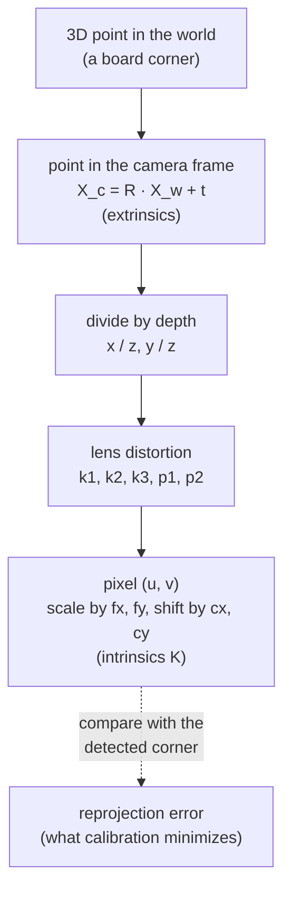

# 19 · Camera model, calibration and hand-eye calibration

<!-- meta -->
| | |
|---|---|
| **Part** | [5 · Perception and estimation](README.md) |
| **Run type** | CPU · Mac or Colab CPU |
| **Prerequisites** | [07](../part-2-spatial-math/07-rigid-transforms.md) |
| **Learn first** | [Image Fundamentals — Pixels, Channels, Color Spaces](https://aiengineeringfromscratch.com/lesson?path=phases/04-computer-vision/01-image-fundamentals) · [Linear Systems](https://aiengineeringfromscratch.com/lesson?path=phases/01-math-foundations/17-linear-systems) |
| **Time** | ~60 min |
| **Code** | [`experiments/19-camera-calibration/experiment.py`](../experiments/19-camera-calibration/experiment.py) |
| **Status** | ✅ done |
<!-- /meta -->

> A camera is a 3×3 matrix, a few distortion numbers and a pose; calibration recovers them only if your data makes them observable.

## The problem

Every pixel-to-table computation (lesson 20) and every grasp from vision (lesson 21) multiplies by the camera matrix $K$ and the camera pose. A focal length 1 % off scales every lateral offset computed from the image by 1 %; a wrong camera-to-gripper transform shifts every grasp. OpenCV's `calibrateCamera` almost always returns a small reprojection error, also when $K$ is wrong. This lesson calibrates a MuJoCo camera whose true $K$ is known, so you can see when the error number lies.

## Core idea

### In plain words

A camera is a function from a 3D point to a pixel. The **extrinsics** say where the camera is and which way it looks: a rigid transform from the world into the camera's frame ([lesson 07](../part-2-spatial-math/07-rigid-transforms.md)). The **intrinsics** describe the inside: the focal length in pixels and where the optical axis hits the image (the principal point). A few **distortion** coefficients describe how a real lens bends straight lines.

**Calibration** fits those parameters to a checkerboard whose corners you know to the millimetre: detect the corners, then search for the parameters whose predicted pixels land on them. The leftover mismatch is the **reprojection error**. Like a training loss, it says how well the model fits these examples, not whether the parameters are right. A board held flat in front of the camera is the classic trap: "long lens, board far away" and "short lens, board close" produce the same picture.

**Hand-eye calibration** finds where a wrist camera sits on the gripper. The gripper pose comes from the joint angles, the board pose from the image; the board never moves, so every pair of arm poses gives one equation for the unknown mount, which is pinned down only if the wrist rotates about different axes.

### The camera as a pipeline



### The camera, as code

```python
X_c = R @ X_w + t                            # world -> camera (x right, y down, z forward), metres
x, y = X_c[0] / X_c[2], X_c[1] / X_c[2]      # divide by depth: farther points move less on the image
u, v = fx * x + cx, fy * y + cy              # to pixels (distortion bends x, y just before this line)
fy = (height / 2) / np.tan(np.radians(fovy) / 2)   # MuJoCo: 480 px tall, fovy 50 deg -> 514.68 px
# calibration: K, dist and one (R_i, t_i) per view that minimize the squared pixel error over all corners
```

| Piece | Formula |
|---|---|
| Projection | $[u,\ v,\ 1]^\top \sim K\,[x/z,\ y/z,\ 1]^\top$ |
| Intrinsics | $K = \begin{bmatrix}f_x & 0 & c_x\\ 0 & f_y & c_y\\ 0&0&1\end{bmatrix}$ |
| Extrinsics | $X_c = R\,X_w + t$ |
| Radial distortion | $x_d = x_n(1 + k_1 r^2 + k_2 r^4 + k_3 r^6)$ |
| $K$ of a MuJoCo camera | $f_x = f_y = \dfrac{H/2}{\tan(\mathrm{fovy}/2)},\ c_x = \dfrac{W-1}{2},\ c_y = \dfrac{H-1}{2}$ |
| Hand-eye | $A_{ij}X = XB_{ij}$ |

$(u, v)$: pixel; $(x, y, z)$: point in the camera frame; $\sim$: equal up to scale; $f_x, f_y$: focal lengths (px); $(c_x, c_y)$: principal point; $(R, t)$: world to camera; $x_n = x/z$, $r^2 = x_n^2 + y_n^2$; $k_i$: radial coefficients; $W \times H$: image size; $X$: camera pose in the gripper frame; $A_{ij}$, $B_{ij}$: measured gripper and board motions (Math details).

<details>
<summary>Math details: conventions, Zhang's method and the hand-eye equation</summary>

**Pinhole model** (Hartley & Zisserman, camera models). The camera frame follows OpenCV: $x$ right, $y$ down, $z$ forward. Distortion acts on the normalized coordinates before $K$; besides the radial part there are tangential terms $p_1, p_2$ ([OpenCV calib3d](https://github.com/opencv/opencv/blob/4.x/modules/calib3d/include/opencv2/calib3d.hpp)).

**K from MuJoCo.** `fovy` is the vertical field of view in degrees; the horizontal one follows from the image size ([MuJoCo XML · camera/fovy](https://mujoco.readthedocs.io/en/stable/XMLreference.html#body-camera-fovy)), so pixels are square and $f_x = f_y$. The $-1$ in $c_x = (W-1)/2$ is OpenCV's convention that pixel centres sit on integer coordinates. MuJoCo cameras look along their $-z$ axis with $y$ up, so the axes flip: for the camera-to-world rotation (`cam_xmat`) $R^{wc}_{\text{OpenCV}} = R^{wc}_{\text{MuJoCo}}\,\mathrm{diag}(1,-1,-1)$, and for the world-to-camera $R$ the factor goes on the left: $R = \mathrm{diag}(1,-1,-1)\,(R^{wc}_{\text{MuJoCo}})^\top$.

**Calibration.** `calibrateCamera` follows Zhang's planar method ([Zhang 2000](https://doi.org/10.1109/34.888718)): intrinsics from the plane-to-image **homographies** (3×3 maps from board points to pixels), board poses, then Levenberg–Marquardt on the total reprojection error. Build it writes all three.

**Why flat boards fail.** For a board parallel to the image at depth $Z$, $u = f_x X/Z + c_x$: only the ratio $f_x/Z$ is constrained. Tilt makes $Z$ vary across the board, and the varying foreshortening separates $f$ from $Z$.

**Hand-eye.** With gripper poses $G_i$ (forward kinematics), board poses $C_i$ in the camera (PnP: camera pose from known 3D points and their pixels) and the board fixed in the base, $G_i X C_i = G_j X C_j$, which gives

$$A_{ij}X = XB_{ij},\qquad A_{ij} = G_j^{-1}G_i,\quad B_{ij} = C_jC_i^{-1}$$

Park & Martin's closed form ([Park & Martin 1994](https://doi.org/10.1109/70.326576)): with rotation vectors $\alpha = \log R_A$, $\beta = \log R_B$ and $M = \sum\beta\alpha^\top$, $R_X = (M^\top M)^{-1/2}M^\top$; then $t_X$ from the stacked linear system $(R_A - I)\,t_X = R_X t_B - t_A$. OpenCV's `calibrateHandEye` offers this and four other methods, and needs at least two motions with non-parallel rotation axes. When the rotations are small, $R_A - I \approx 0$ and the translation is poorly determined.

Go deeper: [Image Fundamentals — Pixels, Channels, Color Spaces](https://aiengineeringfromscratch.com/lesson?path=phases/04-computer-vision/01-image-fundamentals), [Linear Systems](https://aiengineeringfromscratch.com/lesson?path=phases/01-math-foundations/17-linear-systems); [Zhang 2000](https://doi.org/10.1109/34.888718); [Park & Martin 1994](https://doi.org/10.1109/70.326576); Hartley & Zisserman ([book page](https://www.robots.ox.ac.uk/~vgg/hzbook/)).

</details>

<!-- figure: 19-pinhole -->

## Build it

You will now write the camera model, Zhang's calibration and the hand-eye solver in NumPy and check every step. The data are the Experiment's: the same rendered board views (same seed), the corners OpenCV detects in them, and the SO-101 poses. OpenCV only finds corners and referees.

Type the steps into a file of your own and run it after each step. The finished functions are in [`physai/vision.py`](../physai/vision.py); `uv run python experiments/19-camera-calibration/build.py` runs all five steps with the checks (output in [`build_output.txt`](../experiments/19-camera-calibration/build_output.txt)).

### Step 1 · K and the projection

```python
def intrinsics_from_fovy(fovy, width, height):
    """Camera matrix K of a MuJoCo camera: square pixels, vertical field of view fovy (degrees)."""
    f = (height / 2) / np.tan(np.radians(fovy) / 2)
    return np.array([[f, 0.0, (width - 1) / 2], [0.0, f, (height - 1) / 2], [0.0, 0.0, 1.0]])
```

```python
def project_points(X, R, t, K, dist=(0.0, 0.0, 0.0, 0.0, 0.0)):
    """World points X (N, 3) to pixels (N, 2). R, t: world -> camera; dist = (k1, k2, p1, p2, k3), OpenCV's order."""
    Xc = X @ R.T + t                                    # camera frame: x right, y down, z forward
    x, y = Xc[:, 0] / Xc[:, 2], Xc[:, 1] / Xc[:, 2]     # divide by depth
    k1, k2, p1, p2, k3 = dist
    r2 = x * x + y * y
    radial = 1 + k1 * r2 + k2 * r2**2 + k3 * r2**3
    xd = x * radial + 2 * p1 * x * y + p2 * (r2 + 2 * x * x)     # tangential terms p1, p2
    yd = y * radial + p1 * (r2 + 2 * y * y) + 2 * p2 * x * y
    return np.c_[K[0, 0] * xd + K[0, 1] * yd + K[0, 2], K[1, 1] * yd + K[1, 2]]
```

The distortion terms follow OpenCV's order and formula. Check $K$ against the Experiment's ground truth, the projection of each true board pose against the corners detected in MuJoCo's images, and the distorted projection against `cv2.projectPoints`:

```text
== Step 1. K from fovy and the pinhole projection ==
fovy 50 deg, 640x480: fx = fy = 514.68 px, cx = 319.5, cy = 239.5   max |K - Experiment's k_true()| = 0.0e+00
60 rendered views: detected corners vs our projection, mean 0.220 px, max 0.525 px
with dist (k1, k2, p1, p2, k3) = (-0.15, 0.03, 0.001, -0.002, 0.01): max |ours - cv2.projectPoints| = 2.6e-13 px
```

These are the Experiment's corner-detection numbers: MuJoCo renders an ideal pinhole, so what is left is the detector. With distortion your code and OpenCV agree to 1e-13 px.

### Step 2 · One homography per view

The board is a plane, so its corners map to pixels by a 3×3 homography (Math details). Each corner gives two linear equations in the nine entries of $H$; the best solution of the stacked system is the last right singular vector. Moving both point sets to unit scale first (Hartley's normalization) keeps the system well conditioned.

```python
def homography_dlt(src, dst):
    """3x3 H with dst ~ H src from N >= 4 point pairs (N, 2 arrays): the normalized direct linear transform."""
    def normalizer(p):                                   # centroid to 0, mean distance to sqrt(2)
        c = p.mean(axis=0)
        s = np.sqrt(2) / np.mean(np.linalg.norm(p - c, axis=1))
        return np.array([[s, 0, -s * c[0]], [0, s, -s * c[1]], [0, 0, 1]])
    Ts, Td = normalizer(src), normalizer(dst)
    a = np.c_[src, np.ones(len(src))] @ Ts.T
    b = np.c_[dst, np.ones(len(dst))] @ Td.T
    A = []
    for (x, y, _), (u, v, _) in zip(a, b):               # u = (h1 . a) / (h3 . a), same for v: two rows
        A.append([x, y, 1, 0, 0, 0, -u * x, -u * y, -u])
        A.append([0, 0, 0, x, y, 1, -v * x, -v * y, -v])
    Hn = np.linalg.svd(np.array(A))[2][-1].reshape(3, 3)  # least-squares null vector of A
    H = np.linalg.inv(Td) @ Hn @ Ts                      # undo the normalization
    return H / H[2, 2]
```

```text
== Step 2. One homography per view (board plane -> pixels) ==
RMS distance of the 54 corners from H(board point): 0.091 px
max |ours - cv2.findHomography| = 0.0068 px, max |ours - true K[r1 r2 t]| = 0.352 px
on exact projected corners: max |ours - true| = 2.3e-13 px
```

Exact on exact corners (2.3e-13 px); on detected corners within 0.0068 px of `cv2.findHomography` (which refines a slightly different error) and 0.352 px from the true homography: the detection error again.

### Step 3 · Zhang's closed form

Each homography is $H \sim K[r_1\ r_2\ t]$. Because $r_1$ and $r_2$ are orthonormal, every view gives two linear equations in the six entries of $B = K^{-\top}K^{-1}$: $h_1^\top B h_2 = 0$ and $h_1^\top B h_1 = h_2^\top B h_2$. Stack them, take the null vector, and read $K$ out of $B$ ([Zhang 2000](https://doi.org/10.1109/34.888718), section 3.1):

```python
def zhang_intrinsics(Hs):
    """Closed-form K from >= 3 board-to-image homographies (Zhang 2000); also returns the singular values of V."""
    def v(H, i, j):                                      # h_i^T B h_j as a linear function of b
        a, c = H[:, i], H[:, j]
        return np.array([a[0] * c[0], a[0] * c[1] + a[1] * c[0], a[1] * c[1],
                         a[2] * c[0] + a[0] * c[2], a[2] * c[1] + a[1] * c[2], a[2] * c[2]])
    V = np.array([row for H in Hs for row in (v(H, 0, 1), v(H, 0, 0) - v(H, 1, 1))])
    _, sv, Vt = np.linalg.svd(V)
    b11, b12, b22, b13, b23, b33 = Vt[-1] * np.sign(Vt[-1][0])  # B = K^-T K^-1, up to scale
    cy = (b12 * b13 - b11 * b23) / (b11 * b22 - b12**2)
    lam = b33 - (b13**2 + cy * (b12 * b13 - b11 * b23)) / b11
    fx = np.sqrt(lam / b11)
    fy = np.sqrt(lam * b11 / (b11 * b22 - b12**2))
    skew = -b12 * fx**2 * fy / lam
    cx = skew * cy / fy - b13 * fx**2 / lam
    return np.array([[fx, skew, cx], [0.0, fy, cy], [0.0, 0.0, 1.0]]), sv
```

```text
== Step 3. Zhang's closed form: K from the homographies ==
from the 60 true homographies: max |K - K_true| = 8.3e-13 px
 views      fx      fy      cx      cy   skew  fx err %
     3  511.70  512.07  319.94  238.44  0.135     0.579
     5  513.44  513.44  319.45  239.33  0.097     0.242
    10  514.89  514.85  318.71  239.23  0.003     0.040
    20  514.40  514.38  319.00  239.51 -0.022     0.055
    60  514.40  514.47  319.28  239.32  0.031     0.054
singular values of V / largest, 10 views (the last one is the solution, the one before decides):
  tilt 35 deg: 1.0e+00 9.6e-01 2.7e-01 7.7e-04 3.4e-04 2.3e-09
  tilt  0 deg: 1.0e+00 8.6e-01 1.2e-03 3.6e-06 6.7e-07 1.1e-11   -> fx = 24982 px
```

On exact homographies the formula returns $K$ to 8.3e-13 px. On detected corners it stalls near 0.05 % focal error: it minimizes an algebraic quantity, not pixels, which Step 4 fixes. The singular values show the Break it failure before any fit: the second-smallest is 3.4e-4 of the largest with tilted boards and 6.7e-7 with flat ones, so two directions of $b$ fit almost equally well and the "solution", $f_x$ = 24982 px, is noise.

### Step 4 · Poses, then Levenberg–Marquardt

With $K$ known, $K^{-1}H$ is a scaled $[r_1\ r_2\ t]$; complete $r_3 = r_1 \times r_2$ and snap to the nearest rotation:

```python
def pose_from_homography(H, K):
    """Board pose (R, t) in the camera from its homography: K^-1 H = scale * [r1 r2 t]."""
    A = np.linalg.inv(K) @ H
    s = np.sign(A[2, 2]) / np.linalg.norm(A[:, 0])       # the board lies in front: t_z > 0
    r1, r2, t = s * A[:, 0], s * A[:, 1], s * A[:, 2]
    U, _, Vt = np.linalg.svd(np.c_[r1, r2, np.cross(r1, r2)])
    return U @ Vt, t                                     # nearest rotation matrix
```

These starts are good to 0.090° and 0.44 mm. The final fit minimizes the squared pixel errors over $f_x, f_y, c_x, c_y, k_1, k_2$ and all 60 poses at once, with a finite-difference Jacobian built one view at a time (a pose only moves its own view's pixels); the damping chooses between a Gauss–Newton step and a short gradient step. Rotations are updated as $R \cdot \exp(w)$:

```python
def rotvec_to_mat(w):
    """Rotation vector (axis * angle, rad) to a 3x3 matrix (Rodrigues' formula, safe at w = 0)."""
    a = np.linalg.norm(w)
    k = np.array([[0, -w[2], w[1]], [w[2], 0, -w[0]], [-w[1], w[0], 0]])
    if a < 1e-12:
        return np.eye(3) + k
    return np.eye(3) + np.sin(a) / a * k + (1 - np.cos(a)) / a**2 * (k @ k)
```

```python
def mat_to_rotvec(R):
    """3x3 rotation matrix to its rotation vector (angle below pi)."""
    a = np.arccos(np.clip((np.trace(R) - 1) / 2, -1.0, 1.0))
    v = np.array([R[2, 1] - R[1, 2], R[0, 2] - R[2, 0], R[1, 0] - R[0, 1]])
    return v / 2 if a < 1e-12 else a / (2 * np.sin(a)) * v
```

```python
def refine_calibration(obj, views, K, poses, iters=10):
    """Levenberg-Marquardt on the total reprojection error over fx, fy, cx, cy, k1, k2 and every board pose.

    obj: (N, 3) board corners; views: list of (N, 2) detected pixels; poses: list of (R, t) starting guesses.
    Pose i moves by a small correction c_i = (w, dt): R @ rotvec_to_mat(w), t + dt. Returns K, dist, poses, RMS.
    """
    def view_residual(q, pose, c, uv):                   # q = (fx, fy, cx, cy, k1, k2)
        Kq = np.array([[q[0], 0.0, q[2]], [0.0, q[1], q[3]], [0.0, 0.0, 1.0]])
        R, t = pose[0] @ rotvec_to_mat(c[:3]), pose[1] + c[3:]
        return (project_points(obj, R, t, Kq, (q[4], q[5], 0.0, 0.0, 0.0)) - uv).ravel()

    def residual(q, c):
        return np.concatenate([view_residual(q, p, ci, uv) for p, ci, uv in zip(poses, c, views)])

    n, m = len(views), 2 * len(obj)
    q, c = np.r_[K[0, 0], K[1, 1], K[0, 2], K[1, 2], 0.0, 0.0], np.zeros((n, 6))
    r, damping = residual(q, c), 1e-3
    for _ in range(iters):
        J = np.zeros((n * m, 6 + 6 * n))                 # pose i only moves the pixels of view i
        for i, (p, uv) in enumerate(zip(poses, views)):
            rows, x = slice(i * m, (i + 1) * m), np.r_[q, c[i]]
            for j in range(12):                          # forward differences: 6 shared + 6 own parameters
                h = 1e-6 * max(1.0, abs(x[j]))
                xh = x.copy()
                xh[j] += h
                J[rows, j if j < 6 else 6 * i + j] = (view_residual(xh[:6], p, xh[6:], uv) - r[rows]) / h
        JtJ = J.T @ J
        step = np.linalg.solve(JtJ + damping * np.diag(np.diag(JtJ)), -J.T @ r)
        q_new, c_new = q + step[:6], c + step[6:].reshape(n, 6)
        r_new = residual(q_new, c_new)
        if r_new @ r_new < r @ r:                        # better: accept, trust the linear model more
            q, c, r, damping = q_new, c_new, r_new, damping / 10
        else:                                            # worse: reject, take a shorter step
            damping *= 10
    Kq = np.array([[q[0], 0.0, q[2]], [0.0, q[1], q[3]], [0.0, 0.0, 1.0]])
    new = [(R @ rotvec_to_mat(ci[:3]), t + ci[3:]) for (R, t), ci in zip(poses, c)]
    return Kq, np.array([q[4], q[5], 0.0, 0.0, 0.0]), new, np.sqrt(2 * np.mean(r**2))
```

```text
== Step 4. Poses from the homographies, then Levenberg-Marquardt on all 60 views ==
start poses vs truth: median 0.090 deg, 0.44 mm
                                       fx      fy      cx      cy       k1       k2  RMS px
ours (k1, k2)                         514.56  514.55  319.30  239.25  +0.0034  -0.0214   0.091
cv2.calibrateCamera, k1 k2 only       514.56  514.55  319.30  239.25  +0.0034  -0.0214   0.091
cv2.calibrateCamera, default 5 coef   514.58  514.58  319.57  239.33  +0.0005  +0.0461   0.091
max |K ours - K cv2 (same model)| = 7.0e-08 px, fx error vs truth 0.025 %
fitted poses vs truth: median 0.051 deg, 0.49 mm
```

Your fit and `cv2.calibrateCamera` with the same model ($k_1, k_2$ only) agree to 7.0e-08 px. OpenCV's default model adds $p_1, p_2, k_3$; that is the Experiment's "all 60 views" line (514.58, 319.57, 239.33). On a lens without any distortion the extra coefficients shift $c_x$ by 0.27 px and the RMS stays 0.091 px: another fit the error number cannot judge.

### Step 5 · Hand-eye

```python
def hand_eye_park(As, Bs):
    """Solve A X = X B (Park & Martin 1994). As: gripper motions, Bs: camera motions (4x4); X: camera in gripper."""
    M = sum(np.outer(mat_to_rotvec(B[:3, :3]), mat_to_rotvec(A[:3, :3])) for A, B in zip(As, Bs))
    w, V = np.linalg.eigh(M.T @ M)
    Rx = V @ np.diag(w ** -0.5) @ V.T @ M.T              # rotation: (M^T M)^(-1/2) M^T
    C = np.vstack([A[:3, :3] - np.eye(3) for A, _ in zip(As, Bs)])
    d = np.concatenate([Rx @ B[:3, 3] - A[:3, 3] for A, B in zip(As, Bs)])
    X = np.eye(4)
    X[:3, :3], X[:3, 3] = Rx, np.linalg.lstsq(C, d, rcond=None)[0]   # translation: (R_A - I) t = R_X t_B - t_A
    return X
```

`cv2.calibrateHandEye` is missing from the OpenCV 5.0.0 Python build used here, so the Experiment uses this solver too. The check replays its loop with the same seed:

```text
== Step 5. Hand-eye AX = XB on the Experiment's SO-101 poses (same seed, 15 poses, 20 trials) ==
true camera offset in the gripper frame: 76.0 mm
 rot noise deg  trans noise mm  X rot err deg  X trans err mm  max |X ours - X Exp.|
             0               0          0.000            0.00               1.8e-15
           0.1             0.5          0.050            0.31               2.3e-14
           0.2               1          0.105            0.68               9.5e-14
           0.5               2          0.177            1.55               2.7e-14
             1               5          0.389            2.84               1.9e-12
             2              10          0.905            6.87               8.2e-15
```

These are the Experiment table's numbers row by row; your $X$ equals the Experiment's to 1e-12 (`mat_to_rotvec` replaces `cv2.Rodrigues`).

### What you keep

`physai.vision` now has `intrinsics_from_fovy`, `project_points`, `homography_dlt`, `zhang_intrinsics`, `pose_from_homography`, `rotvec_to_mat`, `mat_to_rotvec`, `refine_calibration` and `hand_eye_park`. [Lesson 20](20-pixels-to-table.md) reuses `homography_dlt` and `project_points` on the way back from pixels to the table. [`tests/test_19_camera_calibration.py`](../tests/test_19_camera_calibration.py) pins them to exact synthetic data, SciPy and OpenCV; run `uv run pytest tests/test_19_camera_calibration.py` after you change anything.

## Use it

OpenCV does the whole pipeline: detect, refine, calibrate, then check on held-out views.

```python
objp = board_corners_m.astype(np.float32)                     # (54, 3), z = 0, in metres: sets the unit of t
ok, c = cv2.findChessboardCorners(gray, (9, 6))               # inner corners (columns, rows)
c = cv2.cornerSubPix(gray, c, (5, 5), (-1, -1), criteria)     # sub-pixel refinement
rms, K, dist, rvecs, tvecs = cv2.calibrateCamera([objp] * n, views, (640, 480), None, None)   # size = (width, height)
_, rvec, tvec = cv2.solvePnP(objp, held_out, K, dist)         # board pose under the estimated K
px, _ = cv2.projectPoints(objp, rvec, tvec, K, dist)          # reproject and compare
```

`calibrateCameraExtended` returns the same plus the standard deviation of every intrinsic: report it with the RMS. Other tools name the same pieces differently:

| Piece | This lesson / physai | OpenCV | MuJoCo | ROS `sensor_msgs/CameraInfo` |
|---|---|---|---|---|
| intrinsics | $K$ | `cameraMatrix` | `fovy` + image size, or `focal`/`principal`/`sensorsize` | `k`, 9 values, row-major |
| distortion | `dist` = $(k_1, k_2, p_1, p_2, k_3)$ | `distCoeffs`, same order | no attribute: ideal pinhole | `d` with `distortion_model` `"plumb_bob"`: $(k_1, k_2, t_1, t_2, k_3)$ |
| camera axes | $x$ right, $y$ down, $z$ forward | same | $x$ right, $y$ up, looks along $-z$ | optical frame: $x$ right, $y$ down, $z$ into the image |
| board pose | $(R, t)$, world to camera | `rvec` (rotation vector), `tvec` | — | — |

Sources: [OpenCV calib3d](https://docs.opencv.org/4.x/d9/d0c/group__calib3d.html), [MuJoCo XML · camera](https://mujoco.readthedocs.io/en/stable/XMLreference.html#body-camera-fovy), [`CameraInfo.msg`](https://github.com/ros2/common_interfaces/blob/rolling/sensor_msgs/msg/CameraInfo.msg).

Traps:

- **Image size is (width, height).** `calibrateCamera` takes `(640, 480)`; the NumPy image is `(480, 640)`. Pass `gray.shape[::-1]`.
- **Units come from `objp`.** Squares in millimetres give `tvec` in millimetres. A board printed at 98 % scale makes every translation 2 % wrong and leaves the RMS untouched.
- **MuJoCo's camera is not OpenCV's.** Flip $y$ and $z$ (`diag(1, -1, -1)`, Math details) before you compare poses; forgetting it puts the board behind the camera.

## Experiment

**Setup.** A 9×6 inner-corner checkerboard with 25 mm squares, built from box geoms (exact geometry), moved as a mocap body (placed directly, without physics) to random poses (±35° tilt about x and y, ±20° about z) 0.5–0.65 m in front of a 640×480 camera with `fovy = 50`. Ground truth: $f_x = f_y = 514.68$ px, $c_x = 319.5$, $c_y = 239.5$. Corners from `findChessboardCorners` + `cornerSubPix`. 60 training views, 15 **held-out** views (a test set): estimate each held-out board pose with `solvePnP` under the estimated $K$ and distortion, then reproject.

```python
r.update_scene(d, camera="cam"); img = r.render()
ok, c = cv2.findChessboardCorners(gray, (9, 6))
c = cv2.cornerSubPix(gray, c, (5, 5), (-1, -1), crit)
rms, K, dist, _, _ = cv2.calibrateCamera([objp] * n, views, (640, 480), None, None)
```

**Predict.** Few views should give a small training error but a wrong $K$.

**Run** `uv run python experiments/19-camera-calibration/experiment.py` (MuJoCo 3.17.0, OpenCV 5.0.0, NumPy 2.5.4, Apple M5, deterministic: two runs gave identical output).

The renderer is an ideal pinhole camera: detected corners sit 0.220 px (mean), 0.525 px (max) from the projection with the ground-truth $K$. With all 60 views: $f_x = f_y = 514.58$, $c_x = 319.57$, $c_y = 239.33$, $k_1 = +0.0005$, training RMS 0.091 px.

| Views | Train RMS (px) | Held-out RMS (px) | $f_x$ error (%) | $f_y$ error (%) | $c_x$ error (px) | $c_y$ error (px) |
|---|---|---|---|---|---|---|
| 3 | 0.088 | 0.103 | 0.292 | 0.230 | 1.17 | 0.89 |
| 5 | 0.089 | 0.101 | 0.145 | 0.146 | 0.93 | 0.54 |
| 10 | 0.093 | 0.101 | 0.066 | 0.064 | 0.41 | 0.30 |
| 20 | 0.093 | 0.101 | 0.043 | 0.046 | 0.40 | 0.24 |
| 40 | 0.091 | 0.101 | 0.021 | 0.025 | 0.23 | 0.18 |

(median of 10 random subsets per row)


**Observe.** The training RMS is flat (0.088–0.093 px) while the focal error drops about 14-fold from 3 to 40 views. The held-out RMS is just as flat (0.101–0.103 px): `solvePnP` re-fits each held-out pose and absorbs a small focal error, so it only flags gross failures (2.441 px in the tilt test below). Ground truth is the only honest check; on a real camera, add the parameter standard deviations from `calibrateCameraExtended`.

**Distortion.** We warp 20 views with a known $k_1 = -0.15$ (`cv2.remap`). Calibration recovers $k_1 = -0.1558$ with 0.096 % focal error. Forcing distortion to zero on the same views raises the RMS to 0.252 px and the focal error to 1.24 %: an unmodeled lens bends $f$.

**Hand-eye.** SO-101 gripper poses from forward kinematics at random joint angles (60 % of each range); $X$ is the Menagerie `wrist_cam` pose in the gripper frame (offset 76.0 mm). Noise on the board-in-camera poses stands in for PnP errors; 15 poses per solve, 20 trials, Park & Martin's solver.

| Rotation noise (deg) | Translation noise (mm) | $X$ rotation error (deg) | $X$ translation error (mm) |
|---|---|---|---|
| 0 | 0 | 0.000 | 0.00 |
| 0.1 | 0.5 | 0.050 | 0.31 |
| 0.2 | 1 | 0.105 | 0.68 |
| 0.5 | 2 | 0.177 | 1.55 |
| 1 | 5 | 0.389 | 2.84 |
| 2 | 10 | 0.905 | 6.87 |

Exact data gives exact $X$; with 105 motion pairs the error stays below the per-pose noise.

## Break it

**Remove the tilt.** 10 views, tilt limited to ±t:

| Tilt (deg) | Train RMS (px) | Held-out RMS (px) | $f_x$ error (%) |
|---|---|---|---|
| 0 | 0.088 | 2.441 | 1193 |
| 2 | 0.087 | 0.179 | 5.61 |
| 5 | 0.083 | 0.114 | 1.93 |
| 15 | 0.092 | 0.102 | 0.48 |
| 35 | 0.091 | 0.101 | 0.02 |

With fronto-parallel boards (facing the camera squarely) the training RMS is still 0.088 px and the focal length is off by 1193 %: a longer lens and a farther board explain the same corners (Math details; Build it, Step 3 shows it in the linear system). OpenCV's `calibrateCamera` docs ask for "multiple board poses with significant tilt" ([calib3d.hpp](https://github.com/opencv/opencv/blob/4.x/modules/calib3d/include/opencv2/calib3d.hpp)).

**Remove the rotation diversity** (hand-eye, noise 0.5° / 2 mm, joints sampled in a fraction of their range; a fresh random pose pool per row):

| Range fraction | Median rotation between poses (deg) | $X$ rotation error (deg) | $X$ translation error (mm) |
|---|---|---|---|
| 0.02 | 3.6 | 4.818 | 27.18 |
| 0.05 | 9.2 | 2.200 | 13.68 |
| 0.1 | 18.8 | 0.977 | 4.89 |
| 0.3 | 54.8 | 0.348 | 1.85 |
| 0.6 | 116.4 | 0.274 | 1.33 |

Translation enters through $(R_A - I)\,t_X$; when the arm barely rotates, $R_A - I \approx 0$ and noise is divided by a near-zero matrix: the hand-eye version of the flat board.

## On the real robot

- The Menagerie SO-101 has a `wrist_cam` with `fovy = 61` in its model file ([robotstudio_so101](https://github.com/google-deepmind/mujoco_menagerie/tree/f3b6013/robotstudio_so101)); a real webcam has its own $K$ and distortion. Not yet measured on the real arm.
- Intrinsics: print a checkerboard, measure the squares with calipers (scale error goes straight into $t$), glue it flat, take 20+ views with strong tilt and varied distance, and check held-out error and parameter standard deviations, not only the RMS.
- Hand-eye: fix the board, move the arm through 15+ poses with large wrist rotations, record joint angles (forward kinematics, [lesson 08](../part-3-kinematics/08-forward-kinematics.md)) and the PnP board pose, then solve $AX = XB$. Joint-angle errors and servo backlash (play in the gears) enter $A$ directly.
- Autofocus and auto-zoom change $K$; lock them before calibrating.

## Check yourself

1. **Easy.** Compute $f_y$ for a 1280×720 image and `fovy = 61`.
2. **Medium.** Why is a 0.09 px training RMS no evidence of a good calibration? Point to the two tables.
3. **Hard.** Set `CALIB_FIX_ASPECT_RATIO` and `CALIB_FIX_PRINCIPAL_POINT` and repeat the 0° tilt row. Does fixing parameters rescue the degenerate case?

### Answers

1. $f_y = 360/\tan(30.5°)$; $= 611.2$ px.
2. The views sweep shows flat training RMS while $f_x$ error changes 14-fold; the tilt sweep shows 0.088 px with a 1193 % focal error. RMS measures fit, not observability.
3. Not computed here. Fixing $c_x, c_y$ and the aspect ratio does not remove the $f/Z$ ambiguity of parallel planes; run it to see.

## Takeaways and sources

- In MuJoCo, $K$ follows from `fovy` and the image size; use it as ground truth to test your calibration pipeline.
- Calibration accuracy comes from view diversity (tilt, distance, rotation), not from a small reprojection error.
- Hand-eye needs large, non-parallel rotations; its translation error grows roughly like $1/\|R_A - I\|$.

Next: [lesson 20](20-pixels-to-table.md), from pixels to the table.

Sources:
- Z. Zhang, "A flexible new technique for camera calibration", *IEEE TPAMI* 22(11):1330–1334, 2000. [doi:10.1109/34.888718](https://doi.org/10.1109/34.888718)
- F. C. Park, B. J. Martin, "Robot sensor calibration: solving AX=XB on the Euclidean group", *IEEE Trans. Robotics and Automation* 10(5):717–721, 1994. [doi:10.1109/70.326576](https://doi.org/10.1109/70.326576)
- [OpenCV calib3d docs](https://docs.opencv.org/4.x/d9/d0c/group__calib3d.html) and [source header](https://github.com/opencv/opencv/blob/4.x/modules/calib3d/include/opencv2/calib3d.hpp): `calibrateCamera` algorithm, distortion model, `calibrateHandEye` methods and minimum motions.
- [MuJoCo XML reference · camera](https://mujoco.readthedocs.io/en/stable/XMLreference.html#body-camera-fovy): `fovy` semantics. [ROS 2 `CameraInfo.msg`](https://github.com/ros2/common_interfaces/blob/rolling/sensor_msgs/msg/CameraInfo.msg): ROS camera fields.
- R. Hartley, A. Zisserman, *Multiple View Geometry in Computer Vision*, 2nd ed., Cambridge University Press, 2004 ([book page](https://www.robots.ox.ac.uk/~vgg/hzbook/)).
- All numbers above: [`experiment.py`](../experiments/19-camera-calibration/experiment.py), output in [`output.txt`](../experiments/19-camera-calibration/output.txt); Build it: [`build.py`](../experiments/19-camera-calibration/build.py), [`build_output.txt`](../experiments/19-camera-calibration/build_output.txt).
