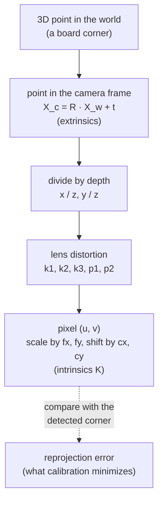

# 19 · Camera model, calibration and hand-eye calibration

<!-- meta -->
| | |
|---|---|
| **Part** | [5 · Perception and estimation](README.md) |
| **Run type** | CPU · Mac or Colab CPU |
| **Prerequisites** | [07](../part-2-spatial-math/07-rigid-transforms.md) |
| **Learn first** | [Image Fundamentals — Pixels, Channels, Color Spaces](https://aiengineeringfromscratch.com/lesson?path=phases/04-computer-vision/01-image-fundamentals) · [Linear Systems](https://aiengineeringfromscratch.com/lesson?path=phases/01-math-foundations/17-linear-systems) |
| **Time** | ~60 min |
| **Code** | [`experiments/19-camera-calibration/experiment.py`](../experiments/19-camera-calibration/experiment.py) |
| **Status** | ✅ done |
<!-- /meta -->

> A camera is a 3×3 matrix, a few distortion numbers and a pose; calibration recovers them only if your data makes them observable.

## The problem

Every pixel-to-table computation (lesson 20) and every grasp from vision (lesson 21) multiplies by the camera matrix $K$ and the camera pose. A focal length that is 1 % off scales every lateral offset computed from the image by 1 %; a wrong camera-to-gripper transform shifts every grasp by the same error. OpenCV's `calibrateCamera` returns a small reprojection error almost always, including when $K$ is wrong. This lesson calibrates a MuJoCo camera whose true $K$ is known, so you can see when the error number lies.

## Core idea

### In plain words

Treat a camera as a function: you give it a 3D point, it returns a pixel. The function has two groups of parameters. The **extrinsics** say where the camera is and which way it looks: a rigid transform from the world into the camera's own frame ([lesson 07](../part-2-spatial-math/07-rigid-transforms.md)). The **intrinsics** describe the inside: how many pixels one unit of "sideways per unit forward" covers (the focal length, in pixels) and where the optical axis hits the image (the principal point). A real lens also bends straight lines a little; a few **distortion** coefficients describe that bend.

**Calibration** is fitting those parameters from examples. You show the camera a checkerboard whose corner positions you know to the millimetre, detect the corners in the image, and search for the parameters that make the function's predicted pixels land on the detected ones. The leftover mismatch is the **reprojection error**. It plays the role of training loss in machine learning: it tells you how well the model fits these examples, not whether the parameters are right. If the examples do not pin the parameters down, a wrong camera fits just as well. A board held flat in front of the camera is such a case: "long lens, board far away" and "short lens, board close" produce the same picture.

**Hand-eye calibration** solves a different unknown: where exactly a camera mounted on the wrist sits relative to the gripper. You know the gripper pose from the joint angles and the board pose relative to the camera from the image. The board never moves, so every pair of arm poses gives one equation for the unknown mount; the equations only pin it down if the wrist rotates about different axes.

### The camera as a pipeline



### The camera, as code

```python
def project(X_w, R, t, fx, fy, cx, cy, k1=0.0):
    X_c = R @ X_w + t                         # world -> camera (x right, y down, z forward), metres
    x, y = X_c[0] / X_c[2], X_c[1] / X_c[2]   # perspective: farther points move less on the image
    r2 = x * x + y * y                        # squared distance from the image centre
    x, y = x * (1 + k1 * r2), y * (1 + k1 * r2)   # radial distortion, first term only
    return fx * x + cx, fy * y + cy           # to pixels

# A MuJoCo camera has square pixels; K follows from fovy and the image size
fy = (height / 2) / np.tan(np.radians(fovy) / 2)   # 480 px tall, fovy 50 deg -> 514.68 px
fx, cx, cy = fy, (width - 1) / 2, (height - 1) / 2

# Calibration: find K, dist and one board pose (R_i, t_i) per view that minimize
#   sum over views i and corners j of |project(corner_j, R_i, t_i, K, dist) - detected_ij|^2
```

| Piece | Formula |
|---|---|
| Projection | $[u,\ v,\ 1]^\top \sim K\,[x/z,\ y/z,\ 1]^\top$ |
| Intrinsics | $K = \begin{bmatrix}f_x & 0 & c_x\\ 0 & f_y & c_y\\ 0&0&1\end{bmatrix}$ |
| Extrinsics | $X_c = R\,X_w + t$ |
| Radial distortion | $x_d = x_n(1 + k_1 r^2 + k_2 r^4 + k_3 r^6)$ |
| $K$ of a MuJoCo camera | $f_x = f_y = \dfrac{H/2}{\tan(\mathrm{fovy}/2)},\ c_x = \dfrac{W-1}{2},\ c_y = \dfrac{H-1}{2}$ |
| Hand-eye | $A_{ij}X = XB_{ij}$ |

$(u, v)$ is the pixel, $(x, y, z)$ the point in the camera frame, $\sim$ means "equal up to a scale factor", $f_x, f_y$ are the focal lengths in pixels, $(c_x, c_y)$ the principal point, $(R, t)$ the rotation and translation from world to camera, $x_n$ a normalized coordinate ($x/z$) with $r^2 = x_n^2 + y_n^2$, $k_1, k_2, k_3$ the radial distortion coefficients, $W \times H$ the image size, and $X$ the unknown camera pose in the gripper frame, with $A_{ij}$ and $B_{ij}$ the measured gripper and board motions defined below.

<details>
<summary>Math details: conventions, Zhang's method and the hand-eye equation</summary>

**Pinhole model** (see Hartley & Zisserman, *Multiple View Geometry*, ch. on camera models). A point $X_c = (x, y, z)$ in the camera frame (OpenCV convention: $x$ right, $y$ down, $z$ forward) projects to

$$\begin{bmatrix}u\\v\\1\end{bmatrix} \sim K\begin{bmatrix}x/z\\y/z\\1\end{bmatrix},\qquad K = \begin{bmatrix}f_x & 0 & c_x\\ 0 & f_y & c_y\\ 0&0&1\end{bmatrix},\qquad X_c = R\,X_w + t$$

Lens distortion is applied to the normalized coordinates before $K$; besides the radial part there are tangential terms $p_1, p_2$ ([OpenCV calib3d](https://github.com/opencv/opencv/blob/4.x/modules/calib3d/include/opencv2/calib3d.hpp)).

**K from MuJoCo.** A camera's `fovy` is the vertical field of view in degrees; the horizontal one follows from the image size ([MuJoCo XML · camera/fovy](https://mujoco.readthedocs.io/en/stable/XMLreference.html#body-camera-fovy)). So pixels are square and $f_x = f_y$. The $-1$ in $c_x = (W-1)/2$ is OpenCV's convention that pixel centres sit on integer coordinates. MuJoCo cameras look along their $-z$ axis with $y$ up, so the axes flip: for the camera-to-world rotation (`cam_xmat`) $R^{wc}_{\text{OpenCV}} = R^{wc}_{\text{MuJoCo}}\,\mathrm{diag}(1,-1,-1)$, and for the world-to-camera $R$ used in $X_c = R\,X_w + t$ the factor goes on the left: $R = \mathrm{diag}(1,-1,-1)\,(R^{wc}_{\text{MuJoCo}})^\top$.

**Calibration.** `calibrateCamera` follows Zhang's planar method ([Zhang 2000](https://doi.org/10.1109/34.888718)): initial intrinsics from the plane-to-image **homographies** (3×3 maps from board coordinates to pixels, lesson 20), initial board poses with `solvePnP` (camera pose from known 3D points and their pixels), then Levenberg–Marquardt, a nonlinear least-squares solver, on the total reprojection error ([OpenCV calib3d docs](https://docs.opencv.org/4.x/d9/d0c/group__calib3d.html)).

**Why flat boards fail.** For a board parallel to the image at depth $Z$, $u = f_x X/Z + c_x$: only the ratio $f_x/Z$ is constrained. Tilt makes $Z$ vary across the board, and the varying foreshortening separates $f$ from $Z$.

**Hand-eye.** For a camera on the gripper, the unknown is $X$, the camera pose in the gripper frame. With gripper poses $G_i$ (forward kinematics) and board poses $C_i$ in the camera (PnP), the board is fixed in the base, $G_i X C_i = G_j X C_j$, which gives

$$A_{ij}X = XB_{ij},\qquad A_{ij} = G_j^{-1}G_i,\quad B_{ij} = C_jC_i^{-1}$$

Park & Martin's closed form ([Park & Martin 1994](https://doi.org/10.1109/70.326576)): with $\alpha = \log R_A$, $\beta = \log R_B$ (rotation vectors), $M = \sum\beta\alpha^\top$, $R_X = (M^\top M)^{-1/2}M^\top$; then $t_X$ from the stacked linear system $(R_A - I)\,t_X = R_X t_B - t_A$. OpenCV's `calibrateHandEye` offers this and four other methods, and needs at least two motions with non-parallel rotation axes. When the rotations are small, $R_A - I \approx 0$ and the translation is poorly determined.

Go deeper: [Image Fundamentals — Pixels, Channels, Color Spaces](https://aiengineeringfromscratch.com/lesson?path=phases/04-computer-vision/01-image-fundamentals), [Linear Systems](https://aiengineeringfromscratch.com/lesson?path=phases/01-math-foundations/17-linear-systems); [Zhang 2000](https://doi.org/10.1109/34.888718); [Park & Martin 1994](https://doi.org/10.1109/70.326576); Hartley & Zisserman ([book page](https://www.robots.ox.ac.uk/~vgg/hzbook/)).

</details>

## Experiment

**Setup.** A 9×6 inner-corner checkerboard with 25 mm squares, built from box geoms (exact geometry, no texture mapping), moved as a mocap body (a body you place directly, without physics) to random poses (±35° tilt about x and y, ±20° about z) 0.5–0.65 m in front of a 640×480 camera with `fovy = 50`. Ground truth: $f_x = f_y = 514.68$ px, $c_x = 319.5$, $c_y = 239.5$. Corners from `findChessboardCorners` + `cornerSubPix`. 60 training views, 15 **held-out** views (not used for fitting, like a test set). Held-out error = estimate each held-out board pose with `solvePnP` under the estimated $K$ and distortion, then reproject.

```python
r.update_scene(d, camera="cam"); img = r.render()
ok, c = cv2.findChessboardCorners(gray, (9, 6))
c = cv2.cornerSubPix(gray, c, (5, 5), (-1, -1), crit)
rms, K, dist, _, _ = cv2.calibrateCamera([objp] * n, views, (640, 480), None, None)
```

**Predict.** Few views should give a small training error but a wrong $K$.

**Run** `uv run python experiments/19-camera-calibration/experiment.py` (MuJoCo 3.17.0, OpenCV 5.0.0, NumPy 2.5.4, Apple M5, deterministic: two runs gave identical output).

The renderer is an ideal pinhole camera (no lens distortion): detected corners sit 0.220 px (mean), 0.525 px (max) from the projection with the ground-truth $K$. With all 60 views: $f_x = f_y = 514.58$, $c_x = 319.57$, $c_y = 239.33$, $k_1 = +0.0005$, training RMS 0.091 px.

| Views | Train RMS (px) | Held-out RMS (px) | $f_x$ error (%) | $f_y$ error (%) | $c_x$ error (px) | $c_y$ error (px) |
|---|---|---|---|---|---|---|
| 3 | 0.088 | 0.103 | 0.292 | 0.230 | 1.17 | 0.89 |
| 5 | 0.089 | 0.101 | 0.145 | 0.146 | 0.93 | 0.54 |
| 10 | 0.093 | 0.101 | 0.066 | 0.064 | 0.41 | 0.30 |
| 20 | 0.093 | 0.101 | 0.043 | 0.046 | 0.40 | 0.24 |
| 40 | 0.091 | 0.101 | 0.021 | 0.025 | 0.23 | 0.18 |

(median of 10 random subsets per row)


**Observe.** The training RMS is flat (0.088–0.093 px) while the focal error drops about 14-fold from 3 to 40 views. The reprojection error measures how well the model fits these corners, not how right $K$ is. The held-out RMS is just as flat (0.101–0.103 px): `solvePnP` re-fits each held-out pose and absorbs a small focal error, so it only flags gross failures (2.441 px in the tilt test below). Ground truth is the only honest check; on a real camera, add the parameter standard deviations that `calibrateCameraExtended` returns.

**Distortion.** We warp 20 views with a known $k_1 = -0.15$ (`cv2.remap`). Calibration recovers $k_1 = -0.1558$ with 0.096 % focal error. Forcing distortion to zero on the same views raises the RMS to 0.252 px and the focal error to 1.24 %: an unmodeled lens bends $f$.

**Hand-eye.** SO-101 gripper poses from forward kinematics at random joint angles (60 % of each range); $X$ is the Menagerie `wrist_cam` pose in the gripper frame (offset 76.0 mm). Noise is added to the board-in-camera poses (as PnP errors would), 15 poses per solve, 20 trials. `cv2.calibrateHandEye` is not exposed in the OpenCV 5.0.0 Python build used here, so the script implements Park & Martin directly (`hand_eye_park`).

| Rotation noise (deg) | Translation noise (mm) | $X$ rotation error (deg) | $X$ translation error (mm) |
|---|---|---|---|
| 0 | 0 | 0.000 | 0.00 |
| 0.1 | 0.5 | 0.050 | 0.31 |
| 0.2 | 1 | 0.105 | 0.68 |
| 0.5 | 2 | 0.177 | 1.55 |
| 1 | 5 | 0.389 | 2.84 |
| 2 | 10 | 0.905 | 6.87 |

Exact data gives exact $X$; with 105 motion pairs the error stays below the per-pose noise.

## Break it

**Remove the tilt.** 10 views, tilt limited to ±t:

| Tilt (deg) | Train RMS (px) | Held-out RMS (px) | $f_x$ error (%) |
|---|---|---|---|
| 0 | 0.088 | 2.441 | 1193 |
| 2 | 0.087 | 0.179 | 5.61 |
| 5 | 0.083 | 0.114 | 1.93 |
| 15 | 0.092 | 0.102 | 0.48 |
| 35 | 0.091 | 0.101 | 0.02 |

With fronto-parallel boards (facing the camera squarely) the training RMS is still 0.088 px, and the focal length is off by 1193 %. Mechanism: for a plane parallel to the image, $u = f_x X/Z + c_x$ only constrains $f_x/Z$; a longer focal length and a farther board explain the same corners. Tilt creates perspective foreshortening across the board, which separates $f$ from $Z$. OpenCV's own `calibrateCamera` docs ask for "multiple board poses with significant tilt" ([calib3d.hpp](https://github.com/opencv/opencv/blob/4.x/modules/calib3d/include/opencv2/calib3d.hpp)).

**Remove the rotation diversity** (hand-eye, noise 0.5° / 2 mm, joints sampled in a fraction of their range; a fresh random pose pool per row):

| Range fraction | Median rotation between poses (deg) | $X$ rotation error (deg) | $X$ translation error (mm) |
|---|---|---|---|
| 0.02 | 3.6 | 4.818 | 27.18 |
| 0.05 | 9.2 | 2.200 | 13.68 |
| 0.1 | 18.8 | 0.977 | 4.89 |
| 0.3 | 54.8 | 0.348 | 1.85 |
| 0.6 | 116.4 | 0.274 | 1.33 |

Translation enters through $(R_A - I)\,t_X$; when the arm barely rotates, $R_A - I \approx 0$ and noise is divided by a near-zero matrix. It is the hand-eye version of the flat board: the data do not constrain the unknown.

## On the real robot

- The Menagerie SO-101 has a `wrist_cam` with `fovy = 61` in its model file ([robotstudio_so101](https://github.com/google-deepmind/mujoco_menagerie/tree/f3b6013/robotstudio_so101)); a real webcam has its own $K$ and distortion. Not yet measured on the real arm.
- Intrinsics procedure: print a checkerboard, measure the square size with calipers (scale error goes straight into $t$), glue it flat, take 20+ views with strong tilt and different distances, check held-out error and parameter standard deviations, not only the RMS.
- Hand-eye procedure: fix the board on the table, move the arm through 15+ poses with large wrist rotations, record joint angles (forward kinematics, [lesson 08](../part-3-kinematics/08-forward-kinematics.md)) and the PnP board pose for each, then solve $AX = XB$. Joint-angle errors and servo backlash (play in the gears) enter $A$ directly.
- Autofocus and auto-zoom change $K$; lock them before calibrating.

## Check yourself

1. **Easy.** Compute $f_y$ for a 1280×720 image and `fovy = 61`.
2. **Medium.** Why is a 0.09 px training RMS no evidence of a good calibration? Point to the two tables.
3. **Hard.** Set `CALIB_FIX_ASPECT_RATIO` and `CALIB_FIX_PRINCIPAL_POINT` and repeat the 0° tilt row. Does fixing parameters rescue the degenerate case?

### Answers

1. $f_y = 360/\tan(30.5°)$; $= 611.2$ px.
2. The views sweep shows flat training RMS while $f_x$ error changes 14-fold; the tilt sweep shows 0.088 px with a 1193 % focal error. RMS measures fit, not observability.
3. Not computed here. Fixing $c_x, c_y$ and the aspect ratio does not remove the $f/Z$ ambiguity of parallel planes; run it to see.

## Takeaways and sources

- In MuJoCo, $K$ follows from `fovy` and the image size; use it as ground truth to test your calibration pipeline.
- Calibration accuracy comes from view diversity (tilt, distance, rotation), not from a small reprojection error.
- Hand-eye needs large, non-parallel rotations; its translation error grows roughly like $1/\|R_A - I\|$.

Next: [lesson 20](20-pixels-to-table.md), from pixels to the table.

Sources:
- Z. Zhang, "A flexible new technique for camera calibration", *IEEE TPAMI* 22(11):1330–1334, 2000. [doi:10.1109/34.888718](https://doi.org/10.1109/34.888718)
- F. C. Park, B. J. Martin, "Robot sensor calibration: solving AX=XB on the Euclidean group", *IEEE Trans. Robotics and Automation* 10(5):717–721, 1994. [doi:10.1109/70.326576](https://doi.org/10.1109/70.326576)
- [OpenCV calib3d docs](https://docs.opencv.org/4.x/d9/d0c/group__calib3d.html) and [source header](https://github.com/opencv/opencv/blob/4.x/modules/calib3d/include/opencv2/calib3d.hpp): `calibrateCamera` algorithm, distortion model, `calibrateHandEye` methods and minimum motions.
- [MuJoCo XML reference · camera](https://mujoco.readthedocs.io/en/stable/XMLreference.html#body-camera-fovy): `fovy` semantics.
- R. Hartley, A. Zisserman, *Multiple View Geometry in Computer Vision*, 2nd ed., Cambridge University Press, 2004 ([book page](https://www.robots.ox.ac.uk/~vgg/hzbook/)).
- All numbers above: [`experiment.py`](../experiments/19-camera-calibration/experiment.py), output in [`output.txt`](../experiments/19-camera-calibration/output.txt).
