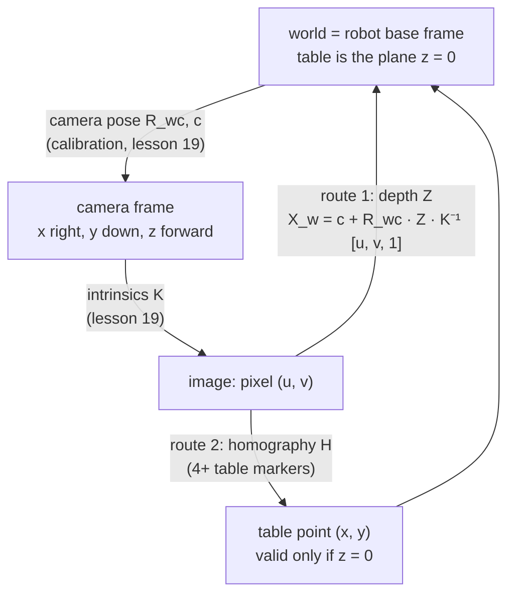

# 20 · From pixels to the table: homography and depth back-projection

<!-- meta -->
| | |
|---|---|
| **Part** | [5 · Perception and estimation](README.md) |
| **Run type** | CPU · Mac or Colab CPU |
| **Prerequisites** | [19](19-camera-calibration.md) |
| **Learn first** | [Linear Systems](https://aiengineeringfromscratch.com/lesson?path=phases/01-math-foundations/17-linear-systems) · [Monocular Depth & Geometry Estimation](https://aiengineeringfromscratch.com/lesson?path=phases/04-computer-vision/26-monocular-depth) |
| **Time** | ~45 min |
| **Code** | [`experiments/20-pixels-to-table/experiment.py`](../experiments/20-pixels-to-table/experiment.py) |
| **Status** | ✅ done |
<!-- /meta -->

> A pixel is a ray; you need one more fact to turn it into a point: a known plane (homography) or a measured depth.

## The problem

The detector in lesson 21 will say "the cube is at pixel (u, v)". The arm needs (x, y, z) in its base frame. A pixel only fixes a ray from the camera centre; every point on that ray lands on the same pixel. Two standard ways to pick the point: assume the object lies on the table plane and use a homography, or read the depth image and back-project. Both are easy to get subtly wrong: a homography is silently wrong for anything above the plane, and a depth image is silently wrong if you misread what its values mean.

## Core idea

### In plain words

A pixel tells you a direction, not a distance: picture a laser pointer at the lens, aimed through that pixel; every point along the beam lands on the same pixel. To get a 3D point you need one more fact, and there are two common ones.

- **Where the beam stops.** A depth image stores, for every pixel, how far away the surface is. Walk that far along the beam and you have the point. This is **back-projection**, the inverse of the camera function of lesson 19.
- **Which surface the object lies on.** If the object sits on the table, the point is where the beam hits the table plane. A **homography** is a shortcut for this case: a 3×3 map from image to table, fitted from a few marked spots, with no camera model at all, like georeferencing an aerial photo from known landmarks. It is exact for things lying flat and wrong for anything that sticks up.

Both need the robot and the camera to agree on frames: the table and the robot base share one world frame, and the camera's pose in it comes from calibration.

### Frames and the two routes



### The two routes, as code

```python
X_w = c + R_wc @ (Z * np.linalg.inv(K) @ [u, v, 1.0])   # route 1: Z = depth along the optical axis
x, y, w = H @ [u, v, 1.0]                               # route 2: homography pixel -> table ...
x, y = x / w, y / w                                     # ... divide the scale out; z assumed 0
```

| Piece | Formula |
|---|---|
| Back-projection, $Z$ along the optical axis | $X_c = Z\,K^{-1}[u,\ v,\ 1]^\top,\quad X_w = R_{wc}X_c + c$ |
| If the sensor reports ray length $\rho$ instead | $X_c = \rho\,\dfrac{K^{-1}[u,v,1]^\top}{\lVert K^{-1}[u,v,1]^\top\rVert}$ |
| Homography (table plane) | $[x,\ y,\ 1]^\top \sim H\,[u,\ v,\ 1]^\top$ |
| Depth buffer to metres (conventional / reversed) | $Z = \dfrac{nf}{f - d\,(f-n)}$ / $Z = \dfrac{nf}{n + d\,(f-n)}$ |

$(u, v)$ is the pixel, $K$ the camera matrix, $Z$ the depth measured along the camera's optical axis, $\rho$ the Euclidean distance along the ray, $X_c$ and $X_w$ the point in camera and world coordinates, $R_{wc}$ the rotation whose columns are the camera axes expressed in the world, $c$ the camera centre in the world, $H$ the 3×3 homography, $\sim$ "equal up to scale", $d$ the raw depth-buffer value, and $n, f$ the near and far clipping distances.

| Method | Needs | Valid for | Fails when |
|---|---|---|---|
| Homography | 4+ known table points | points on the plane | object has height, table not flat |
| Depth back-projection | $K$, camera pose, depth image | any visible surface | depth misread, depth noise, missing depth |

<details>
<summary>Math details: z-depth vs ray length, the MuJoCo depth buffer, and where the homography comes from</summary>

**Z-depth vs ray length.** $K^{-1}[u,v,1]^\top$ has third component 1, so multiplying it by $Z$ gives a point whose camera $z$ is exactly $Z$. That is why back-projection needs depth **along the optical axis**. If $Z$ were the Euclidean distance along the ray instead, you would have to divide by $\|K^{-1}[u,v,1]^\top\|$ first; the two agree only at the image centre and differ most at the corners.

**From lesson 19's extrinsics.** Lesson 19 wrote $X_c = R\,X_w + t$. Solving for $X_w$ gives $X_w = R^\top X_c - R^\top t$, so $R_{wc} = R^\top$ and the camera centre is $c = -R^\top t$.

**Depth from MuJoCo.** The GPU stores a non-linear z-buffer value $d\in[0,1]$, not metres. With near/far clipping distances $n = \texttt{znear}\cdot\text{extent}$ and $f = \texttt{zfar}\cdot\text{extent}$ (extent = the model's overall size; `znear` and `zfar` default to 0.01 and 50, [MuJoCo XML · visual/map](https://mujoco.readthedocs.io/en/stable/XMLreference.html#visual-map-znear)), a conventional OpenGL buffer gives $Z = \dfrac{nf}{f - d\,(f-n)}$. MuJoCo 3.17's Python `Renderer` reads a reversed buffer (1 at near, 0 at far), applies $Z = \dfrac{nf}{n + d\,(f-n)}$ in float64 and returns float32 metres ([`renderer.py`, tag 3.17.0](https://github.com/google-deepmind/mujoco/blob/3.17.0/python/mujoco/rendering/classic/renderer.py)); Build it, Step 2 does the same from `mjr_readPixels`. The docs warn that a near plane too close costs depth resolution.

**Homography.** Points on a plane map to the image by a 3×3 projective transform. For the table $z=0$, the projection of lesson 19 loses the third column of $R$: $s\,[u,v,1]^\top = K[r_1\ r_2\ t]\,[x,y,1]^\top$, so $[x,y,1]^\top \sim H\,[u,v,1]^\top$ with $H = (K[r_1\ r_2\ t])^{-1}$. $H$ has 8 degrees of freedom (9 entries, defined up to scale); 4 point pairs (no 3 collinear) determine it, more pairs give a least-squares fit (`cv2.findHomography`, method 0; RANSAC/LMEDS/RHO for outliers, [OpenCV calib3d](https://github.com/opencv/opencv/blob/4.x/modules/calib3d/include/opencv2/calib3d.hpp)). No $K$, no depth needed, only known table points. The price: the formula is only true for $z = 0$.

**Error above the plane.** A point at height $h$ on a ray that makes angle $\theta$ with the vertical is mapped to where that ray reaches $z = 0$, a horizontal distance $h\tan\theta$ further on. The error is linear in $h$ along one ray and larger for oblique rays.

Go deeper: [Linear Systems](https://aiengineeringfromscratch.com/lesson?path=phases/01-math-foundations/17-linear-systems), [Monocular Depth & Geometry Estimation](https://aiengineeringfromscratch.com/lesson?path=phases/04-computer-vision/26-monocular-depth); Hartley & Zisserman ([book page](https://www.robots.ox.ac.uk/~vgg/hzbook/)) on plane-induced homographies and back-projection.

</details>

## Build it

You will now write both routes from pixel to table in NumPy: rays and back-projection, the depth-buffer conversion, and the table homography, then rerun the Experiment's sweeps with your own code. The scene, the 300 table pixels, the markers and the random noise come from the Experiment script (same seed); MuJoCo renders, OpenCV referees.

Type the steps into a file of your own and run it after each step. The finished functions are in [`physai/vision.py`](../physai/vision.py); `uv run python experiments/20-pixels-to-table/build.py` runs all five steps with the checks (output in [`build_output.txt`](../experiments/20-pixels-to-table/build_output.txt)).

### Step 1 · Rays and back-projection

A pixel's ray is $K^{-1}[u, v, 1]^\top$ turned into the world. Scaled so its camera $z$ is 1, walking $Z$ along it lands at depth $Z$; intersecting it with a plane needs only the camera height.

```python
def pixel_rays(uv, K, R_wc):
    """World-frame directions of the rays through pixels uv (N, 2), scaled so each has camera z = 1."""
    p = np.c_[uv, np.ones(len(uv))] @ np.linalg.inv(K).T      # [x/z, y/z, 1] in the camera frame
    return p @ R_wc.T                                         # rotate into the world
```

```python
def back_project(uv, Z, K, R_wc, c):
    """World points seen at pixels uv with depth Z (N,) measured along the optical axis, not along the ray."""
    return c + Z[:, None] * pixel_rays(uv, K, R_wc)
```

```python
def ray_plane(uv, K, R_wc, c, z0=0.0):
    """Where the pixel rays meet the horizontal plane z = z0; also returns the z-depth of each hit."""
    r = pixel_rays(uv, K, R_wc)
    s = (z0 - c[2]) / r[:, 2]                                 # how far to walk along each ray
    return c + s[:, None] * r, s
```

Noisy pixels fall between pixel centres, so the depth lookup interpolates:

```python
def bilinear(img, uv):
    """Sample img at sub-pixel positions uv (N, 2) from the four nearest pixels (pixel centres on integers)."""
    u0 = np.clip(np.floor(uv[:, 0]).astype(int), 0, img.shape[1] - 2)
    v0 = np.clip(np.floor(uv[:, 1]).astype(int), 0, img.shape[0] - 2)
    a, b = uv[:, 0] - u0, uv[:, 1] - v0                       # weights inside the pixel square
    return ((1 - a) * (1 - b) * img[v0, u0] + a * (1 - b) * img[v0, u0 + 1]
            + (1 - a) * b * img[v0 + 1, u0] + a * b * img[v0 + 1, u0 + 1])
```

```text
== Step 1. Rays, the table plane and depth back-projection (camera 0.6 m, 300 table pixels) ==
max |ray_plane - Experiment's hit_plane| = 0.0e+00 m
rendered depth vs z-depth s:           median 0.001 mm, max 0.008 mm
rendered depth vs ray length:          median 45.8 mm, max 138.0 mm
back_project, depth used as Z:         median 0.001 mm, max 0.009 mm
back_project, depth misused as length: median 45.8 mm, max 138.0 mm
sub-pixel lookup: max |bilinear - cv2.remap| = 3.5e-08 m
```

These are the Experiment's first table, now from your code: MuJoCo's depth matches the z-depth of each ray-plane hit to 0.008 mm, and reading it as ray length costs up to 138.0 mm. Your bilinear lookup equals `cv2.remap` to 3.5e-08 m.

### Step 2 · The raw depth buffer

`Renderer` hides one conversion. Read the same frame's depth buffer yourself with `mjr_readPixels` and convert it:

```python
def linearize_depth(d, near, far):
    """Reversed-Z depth-buffer value d (1 at near, 0 at far) to metres along the optical axis."""
    return near * far / (near + d * (far - near))
```

```text
== Step 2. The raw depth buffer ==
near 5.0 mm, far 24.9 m; raw values 0.005052 .. 0.008911 (1 = near, 0 = far)
max |linearize_depth(raw) - Renderer| = 0.0012 mm
image centre: Renderer 0.6924 m, ours 0.6924 m, conventional formula 0.0050 m
```

The raw values are not metres: 0.005 to 0.009 for everything in view, because the buffer stores roughly near/depth (1 at the near plane, 0 at the far plane). Your conversion matches the Renderer to 0.0012 mm, the float32 rounding of its constants. The textbook formula for a conventional buffer, applied to this reversed one, puts the table 5.0 mm from the lens: at the near plane. The buffer also comes bottom row first (OpenGL), hence the `flipud`.

### Step 3 · The table homography

For the plane $z = 0$ the camera model gives the homography directly (Math details):

```python
def plane_homography(K, R_wc, c):
    """Pixel -> table (x, y) homography of the plane z = 0, from the camera model: (K [r1 r2 t])^-1."""
    R = R_wc.T                                                # world -> camera, as in lesson 19
    t = -R @ c
    H = np.linalg.inv(K @ np.c_[R[:, 0], R[:, 1], t])
    return H / H[2, 2]
```

```python
def apply_homography(H, p):
    """Map points p (N, 2) with H and divide out the scale."""
    q = np.c_[p, np.ones(len(p))] @ H.T
    return q[:, :2] / q[:, 2:3]
```

Fit it from markers instead with `homography_dlt` from [lesson 19](19-camera-calibration.md), pixels as the source and table points as the target:

```text
== Step 3. The table homography: from the camera model and from markers ==
plane_homography vs ray_plane on the 300 pixels: max 2.8e-16 m
 4 markers: exact pixels, max |H_fit - H_cam| on the table 1.0e-15 m; 1 px noise, ours vs cv2: median 0.000 mm, max 0.000 mm
12 markers: exact pixels, max |H_fit - H_cam| on the table 1.2e-15 m; 1 px noise, ours vs cv2: median 0.181 mm, max 1.380 mm
```

From exact marker pixels, 4 or 12 markers give the camera-model homography to 1e-15 m. With 1 px of noise, 4 points still fix $H$ exactly, so your result equals OpenCV's. With 12 points the two differ by a median of 0.181 mm: your DLT minimizes an algebraic error, `findHomography` refines the result on the reprojection error.

### Step 4 · The noise sweep with your code

The Experiment's loop, seed and pixels, with `homography_dlt` instead of `cv2.findHomography` and `bilinear` instead of `cv2.remap`:

```text
== Step 4. The pixel-noise sweep with your functions (Experiment seed and loop, 200 pixels x 50 trials) ==
 noise px  H from 4 pts  H from 12 pts  depth back-proj   (median mm)
        0          0.00           0.00             0.00
      0.5          2.15           1.76             0.81
        1          4.33           3.33             1.60
        2          8.90           7.59             3.21
        4         17.08          13.92             6.37
```

The 4-point and depth columns equal the Experiment table (4.33 and 1.60 mm at 1 px). The 12-point column differs slightly (3.33 vs 3.27 mm at 1 px, 13.92 vs 14.17 mm at 4 px) because of the refinement difference from Step 3; the ordering and the conclusion do not change.

### Step 5 · Break it with your functions

```text
== Step 5. Break it: the top face of each box (no pixel noise) ==
 box height mm  homography mm  depth back-proj mm  ray_plane at z = 0.6 h mm
            10            4.7                0.00                        1.9
            20           10.8                0.00                        4.3
            50           36.7                0.00                       14.7
           100           88.5                0.01                       35.4
```

The homography errors are the Break it table. The last column answers Check yourself 3 by running it: intersecting each ray with a guessed height of 0.6 $h$ (30 mm for the 50 mm box) leaves 14.7 mm, 40 % of the homography's error, because along one ray the horizontal offset is linear in height.

### What you keep

`physai.vision` now also has `pixel_rays`, `back_project`, `ray_plane`, `linearize_depth`, `bilinear`, `plane_homography` and `apply_homography`. [Lesson 21](21-object-perception.md) turns a detected blob into a table point with the same back-projection. [`tests/test_20_pixels_to_table.py`](../tests/test_20_pixels_to_table.py) pins them to exact geometry, SciPy and OpenCV; run `uv run pytest tests/test_20_pixels_to_table.py` after you change anything.

## Use it

MuJoCo renders metric depth; OpenCV fits and applies homographies.

```python
r = mujoco.Renderer(m, 480, 640)
r.enable_depth_rendering()
r.update_scene(d, camera="cam")
depth = r.render()                                      # (480, 640) float32, metres along the optical axis
H, inliers = cv2.findHomography(marker_px, marker_xy, 0)            # 0 = all points; cv2.RANSAC for outliers
xy = cv2.perspectiveTransform(px.reshape(-1, 1, 2), H).reshape(-1, 2)   # needs shape (N, 1, 2)
```

| Piece | This lesson / physai | OpenCV | MuJoCo |
|---|---|---|---|
| fit $H$ | `homography_dlt(src, dst)` | `findHomography(srcPoints, dstPoints, method)` returns `(H, mask)` | — |
| apply $H$ | `apply_homography(H, p)`, $p$ is (N, 2) | `perspectiveTransform(src, H)`, src is (N, 1, 2) | — |
| metric depth | $Z$ along the optical axis | — | `Renderer` with `enable_depth_rendering()` |
| raw depth buffer | `linearize_depth(d, near, far)` | — | `mjr_readPixels`; near, far = `znear`, `zfar` × `stat.extent` |

Sources: [OpenCV calib3d](https://github.com/opencv/opencv/blob/4.x/modules/calib3d/include/opencv2/calib3d.hpp), [MuJoCo renderer at 3.17.0](https://github.com/google-deepmind/mujoco/blob/3.17.0/python/mujoco/rendering/classic/renderer.py), [MuJoCo XML · visual/map](https://mujoco.readthedocs.io/en/stable/XMLreference.html#visual-map-znear); the (N, 1, 2) requirement is what OpenCV 5.0.0 enforces here.

Traps:

- **Z-depth, not range.** Multiply $K^{-1}[u,v,1]^\top$ by the depth, never the unit ray (Step 1: up to 138.0 mm).
- **The raw buffer is reversed and upside down.** Use the reversed formula and flip the rows (Step 2: the conventional formula gives 5.0 mm).
- **Direction of $H$.** `findHomography(src, dst)` maps src to dst. Here src is pixels and dst is table points; swap them and you get the table-to-image map, whose inverse you would need.

## Experiment

**Setup.** MuJoCo scene: grey table plane, four boxes 10/20/50/100 mm tall, a 640×480 camera (`fovy = 50`) tilted 30° from vertical, aimed at (0.25, 0, 0). Ground truth for a pixel is the exact intersection of its ray with the surface it sees. Homography markers: 4 or 12 known table points inside a 20 × 20 cm patch, their pixels perturbed by Gaussian noise $\sigma$ (detection error); test pixels are random table pixels across the view, also perturbed. Depth back-projection uses the rendered depth with bilinear lookup.

```python
r.enable_depth_rendering(); depth = r.render()            # metres along the optical axis
P = c + depth_at(uv)[:, None] * (np.c_[uv, ones] @ np.linalg.inv(K).T @ R_wc.T)
H, _ = cv2.findHomography(marker_px, marker_xy, 0)       # pixel -> table (x, y)
```

**Predict.** Depth is exact in simulation, so its error should be pixel noise times the pixel footprint (the size of one pixel on the table). The homography should add its own fitting error and break above the plane.

**Run** `uv run python experiments/20-pixels-to-table/experiment.py` (MuJoCo 3.17.0, OpenCV 5.0.0, NumPy 2.5.4, Apple M5, deterministic). On this Mac MuJoCo prints a stderr warning that `ARB_clip_control` is unavailable and depth accuracy will be limited; the measurements below are what you get anyway.

**What is in the depth image** (camera at 0.6 m; extent 0.497 m, so near 5.0 mm, far 24.9 m; 300 table pixels):

| Comparison | Median | Max |
|---|---|---|
| rendered depth vs z-depth along optical axis | 0.001 mm | 0.008 mm |
| rendered depth vs Euclidean ray length | 45.8 mm | 138.0 mm |
| back-projection, depth used as $Z$ | 0.001 mm | 0.009 mm |
| back-projection, depth misused as ray length | 45.8 mm | 138.0 mm |

The returned values are z-depth. Treating them as ray length costs up to 138.0 mm at the image corners.


**Pixel noise** (camera 0.6 m; 200 test pixels × 50 trials, median error in mm):

| Noise (px) | H from 4 points | H from 12 points | Depth back-projection |
|---|---|---|---|
| 0 | 0.00 | 0.00 | 0.00 |
| 0.5 | 2.15 | 1.81 | 0.81 |
| 1 | 4.33 | 3.27 | 1.60 |
| 2 | 8.90 | 7.67 | 3.21 |
| 4 | 17.08 | 14.17 | 6.37 |

**Camera height** (1 px noise, 12-point H):

| Height (m) | mm per px at target | Homography (mm) | Depth back-projection (mm) |
|---|---|---|---|
| 0.3 | 0.67 | 1.13 | 0.88 |
| 0.5 | 1.12 | 2.76 | 1.43 |
| 0.8 | 1.79 | 5.13 | 2.18 |
| 1.2 | 2.69 | 9.56 | 3.28 |
| 2.0 | 4.49 | 13.92 | 5.72 |

**Observe.**

1. All errors are linear in pixel noise. The depth back-projection error is 1.2–1.3 times the pixel footprint at the target: with perfect depth, pixel noise is the whole error budget.
2. The homography is up to about 3 times worse at equal noise: its 8 parameters are fitted from noisy markers that cover only a 20 × 20 cm patch, and test pixels extrapolate beyond it. 12 markers beat 4 (3.27 vs 4.33 mm at 1 px).
3. With height the depth error grows like the footprint (0.88 → 5.72 mm, footprint 0.67 → 4.49 mm), the homography error faster (1.13 → 13.92 mm): the fixed marker patch covers fewer pixels as the camera rises.
4. Simulated depth is noise-free; real depth sensors add their own noise, so the depth column is a lower bound.

## Break it

Query the pixel that sees the centre of each box's top face (no pixel noise):

| Box height (mm) | Homography xy error (mm) | Depth back-projection error (mm) |
|---|---|---|
| 10 | 4.7 | 0.00 |
| 20 | 10.8 | 0.00 |
| 50 | 36.7 | 0.00 |
| 100 | 88.5 | 0.01 |

The homography maps every pixel to where its ray hits $z = 0$, so a point at height $h$ slides away from the camera along the ray: the error grows with $h$ and with how oblique the ray is. A 10 mm object already costs 4.7 mm. Fix: if the height $h$ is known, intersect the ray with $z = h$ (this needs $K$ and the pose, not just $H$), or use depth.

## On the real robot

- For an SO-101 tabletop setup, a homography from 4–12 markers taped at measured positions is a quick calibration and is enough for flat, thin objects. Measure the marker positions in the robot base frame, not by eye. Not yet measured on the real arm.
- Real depth cameras return pixels without valid depth; check how your driver marks them and mask them before averaging. Check your sensor's documentation for whether it reports z-depth or range; we did not test any real depth camera.
- The camera pose $(R_{wc}, c)$ comes from extrinsic calibration (a board at a known base position) or hand-eye calibration for a wrist camera ([lesson 19](19-camera-calibration.md)); its error adds directly to every back-projected point.

## Check yourself

1. **Easy.** Why does $H$ need at least 4 point pairs?
2. **Medium.** At 0.6 m and 1 px noise, depth back-projection gives 1.60 mm. Name two error sources on a real robot that this simulation leaves out.
3. **Hard.** Implement "known height" back-projection: intersect the pixel ray with $z = h$ and rerun the break-it table. What error do you get if you assume $h = 30$ mm for the 50 mm box?

### Answers

1. $H$ is defined up to scale: 9 entries minus 1 = 8 unknowns, and each point pair gives 2 equations.
2. Depth sensor noise and calibration error in $K$ and the camera pose (also: rolling-shutter and timing offsets on a moving robot).
3. With the correct $h$ the ray hits the true point. Along one ray the horizontal offset is linear in height and the homography is the case $h = 0$, so 30 mm for the 50 mm box gives $36.7 \times 20/50 \approx 14.7$ mm; Build it, Step 5 runs it: 14.7 mm.

## Takeaways and sources

- `mujoco.Renderer` depth is metric z-depth along the optical axis (max 0.008 mm off here); misusing it as ray length costs up to 138.0 mm.
- Homography: no intrinsics needed, but valid only on the plane; 10 mm of object height already costs 4.7 mm.
- Both methods scale linearly with pixel noise and with the pixel footprint; aim cameras close and use more than 4 markers.

Next: [lesson 21](21-object-perception.md), object perception for manipulation.

Sources:
- [MuJoCo XML reference · visual/map znear, zfar](https://mujoco.readthedocs.io/en/stable/XMLreference.html#visual-map-znear): clipping planes as fractions of the model extent; resolution warning for a close near plane.
- [MuJoCo `rendering/classic/renderer.py` at 3.17.0](https://github.com/google-deepmind/mujoco/blob/3.17.0/python/mujoco/rendering/classic/renderer.py): reversed-Z read and conversion to metres.
- [OpenCV calib3d](https://github.com/opencv/opencv/blob/4.x/modules/calib3d/include/opencv2/calib3d.hpp): `findHomography` methods.
- R. Hartley, A. Zisserman, *Multiple View Geometry in Computer Vision*, 2nd ed., Cambridge University Press, 2004 ([book page](https://www.robots.ox.ac.uk/~vgg/hzbook/)): plane-induced homographies and back-projection.
- All numbers above: [`experiment.py`](../experiments/20-pixels-to-table/experiment.py), output in [`output.txt`](../experiments/20-pixels-to-table/output.txt); Build it: [`build.py`](../experiments/20-pixels-to-table/build.py), [`build_output.txt`](../experiments/20-pixels-to-table/build_output.txt).
