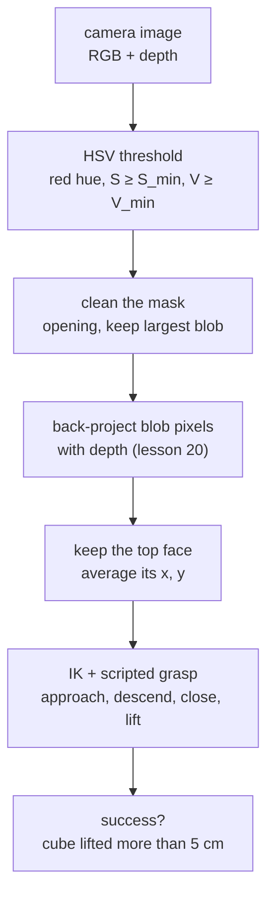

# 21 · Object perception for manipulation

<!-- meta -->
| | |
|---|---|
| **Part** | [5 · Perception and estimation](README.md) |
| **Run type** | CPU · Mac or Colab CPU |
| **Prerequisites** | [16](../part-4-dynamics-and-control/16-grasping-and-pick-place.md), [20](20-pixels-to-table.md) |
| **Learn first** | [Image Fundamentals — Pixels, Channels, Color Spaces](https://aiengineeringfromscratch.com/lesson?path=phases/04-computer-vision/01-image-fundamentals) · [Object Detection — YOLO from Scratch](https://aiengineeringfromscratch.com/lesson?path=phases/04-computer-vision/06-object-detection-yolo) · [Open-Vocabulary Vision — CLIP](https://aiengineeringfromscratch.com/lesson?path=phases/04-computer-vision/18-open-vocab-clip) · [SAM 3 & Open-Vocabulary Segmentation](https://aiengineeringfromscratch.com/lesson?path=phases/04-computer-vision/24-sam3-open-vocab-segmentation) |
| **Time** | ~60 min |
| **Code** | [`experiments/21-object-perception/experiment.py`](../experiments/21-object-perception/experiment.py) |
| **Status** | ✅ done |
<!-- /meta -->

> Perception for grasping is judged by one number: whether the gripper closes on the object. Measure the pick, not the pixel.

## The problem

A scripted pick ([lesson 16](../part-4-dynamics-and-control/16-grasping-and-pick-place.md)) needs the object's position in the robot frame. Lesson 20 turned pixels into table coordinates; now something has to find the object's pixels. The simplest detector, a colour threshold, works in the lab at the lighting it was tuned under and fails when the light changes. This lesson closes the loop in simulation: render, detect, back-project, pick with the SO-101, and count successful lifts, while sweeping the lighting.

## Core idea

### In plain words

The simplest detector is a hand-written rule: "a pixel belongs to the cube if it is red enough, colourful enough and bright enough". It works like a hard-coded `if` on a data stream: fine on the inputs it was tuned on, and when the input drifts (here: the lighting changes) it does not degrade gracefully. A pixel either passes the test or it does not, so the whole detector flips from "works" to "sees nothing" between two nearby lighting levels.

The rule is written in **HSV** instead of RGB because HSV separates the questions. **Hue** is which colour, an angle on the colour wheel (red sits at 0°). **Saturation** is how colourful versus grey. **Value** is how bright. Dimming a red cube mostly lowers V and leaves hue alone, which is why hue is the part of the rule you can trust most.

Detection is only half the job. The mask of red pixels becomes a 3D position through the depth image ([lesson 20](20-pixels-to-table.md)), and the arm goes there and closes the gripper. The score that matters is at the end of that chain: did the cube come up? So we measure **pick success**, not pixel error.

### Perceive, then pick



### The detector, as code

```python
hsv = cv2.cvtColor(rgb, cv2.COLOR_RGB2HSV)       # 8-bit: H in 0..179 (degrees / 2), S and V in 0..255
h, s, v = hsv[..., 0], hsv[..., 1], hsv[..., 2]
red = (h <= 10) | (h >= 170)                     # red wraps around hue 0
mask = red & (s >= 120) & (v >= 70)              # S_min = 120, V_min = 70, tuned at nominal light
mask = cv2.morphologyEx(mask.astype(np.uint8), cv2.MORPH_OPEN, np.ones((3, 3), np.uint8))  # drop speckles
n, labels, stats, _ = cv2.connectedComponentsWithStats(mask)   # group touching pixels into blobs
cube = labels == 1 + np.argmax(stats[1:, cv2.CC_STAT_AREA])    # the largest blob is the object
```

| Piece | Formula |
|---|---|
| Value | $V = \max(R, G, B)$ |
| Saturation | $S = (\max - \min)/\max$ |
| "Red" test | $H \in [0,10]\cup[170,179],\quad S \ge S_{\min},\quad V \ge V_{\min}$ |
| Grasp point | $(x, y) =$ mean of the back-projected points higher than 20 mm |
| Metric | pick success = cube more than 5 cm above its start height |

$R, G, B$ are the pixel's colour channels, $\max$ and $\min$ the largest and smallest of them, $H$ the hue in OpenCV's 8-bit units (degrees/2), and $S_{\min}, V_{\min}$ the two thresholds you tune (saturation and value in the 8-bit formulas are scaled to 0–255).

| Detector | Per-frame cost | Tuning | Typical failure |
|---|---|---|---|
| HSV threshold | a few array operations | 6 numbers per colour | lighting, similar-coloured background |
| Open-vocabulary (OWL-ViT, + SAM for masks) | one network forward pass | a text prompt | wrong object, ambiguous prompt; not measured here |

<details>
<summary>Math details: why thresholds fail as cliffs, and what learned detectors change</summary>

**HSV thresholding.** Convert RGB to hue–saturation–value (see AIEFS: [Image Fundamentals](https://aiengineeringfromscratch.com/lesson?path=phases/04-computer-vision/01-image-fundamentals)). Hue encodes colour and is fairly stable under brightness changes; S and V are not. For 8-bit images OpenCV stores hue as degrees/2, so 0–179, and red wraps around 0 ([OpenCV · color conversions](https://github.com/opencv/opencv/blob/4.x/modules/imgproc/doc/colors.markdown)). After the threshold, a morphological **opening** (erode, then dilate) removes speckles smaller than the kernel, the largest **connected component** (a group of touching pixels) is taken as the object, and its pixels are back-projected with depth ([lesson 20](20-pixels-to-table.md)). We keep only points higher than 20 mm, i.e. the top face of a 30 mm cube, and average their $(x, y)$.

**Where it fails.** Too little light: V or S falls below its limit (in step 2 below it is S). Too much light: channels clip at 255, the colour washes towards white, and S falls below $S_{\min}$: with $\max$ stuck at 255 while $\min$ keeps rising, $S = (\max-\min)/\max$ must fall. Grazing light: the face the camera sees is dark while a side face is bright. Every failure is a threshold crossing. All pixels of one face have nearly the same colour, so they cross together: the failure is abrupt, not gradual.

**Partial detections are biased.** If only part of the object passes, the centroid of that part is not the centroid of the object. The error is a fraction of the object's size, and the robot acts on it.

**Learned detectors.** Open-vocabulary detectors such as OWL-ViT ([Minderer et al. 2022, arXiv 2205.06230](https://arxiv.org/abs/2205.06230)) take a text query ("red cube") and are trained on large image–text data, so they do not depend on one hand-set colour window (see AIEFS: [Object Detection — YOLO from Scratch](https://aiengineeringfromscratch.com/lesson?path=phases/04-computer-vision/06-object-detection-yolo), [Open-Vocabulary Vision — CLIP](https://aiengineeringfromscratch.com/lesson?path=phases/04-computer-vision/18-open-vocab-clip), [SAM 3 & Open-Vocabulary Segmentation](https://aiengineeringfromscratch.com/lesson?path=phases/04-computer-vision/24-sam3-open-vocab-segmentation)). They cost a neural-network forward pass per frame instead of a few array comparisons. We did not run one here (no `transformers` in this environment), so this lesson states no robustness or speed numbers for them.

Go deeper: [Image Fundamentals — Pixels, Channels, Color Spaces](https://aiengineeringfromscratch.com/lesson?path=phases/04-computer-vision/01-image-fundamentals), [Object Detection — YOLO from Scratch](https://aiengineeringfromscratch.com/lesson?path=phases/04-computer-vision/06-object-detection-yolo), [Open-Vocabulary Vision — CLIP](https://aiengineeringfromscratch.com/lesson?path=phases/04-computer-vision/18-open-vocab-clip), [SAM 3 & Open-Vocabulary Segmentation](https://aiengineeringfromscratch.com/lesson?path=phases/04-computer-vision/24-sam3-open-vocab-segmentation); [Minderer et al. 2022](https://arxiv.org/abs/2205.06230); [OpenCV · color conversions](https://github.com/opencv/opencv/blob/4.x/modules/imgproc/doc/colors.markdown).

</details>

## Experiment

**Setup.** SO-101 from Menagerie (5 ms timestep) and a red 30 mm cube (0.05 kg) at 30 random positions, $x\in[0.15, 0.24]$ m, $y\in[-0.07, 0.07]$ m, rotated to face the robot (a simplification: we estimate position only). A camera looks straight down from 0.6 m; $K$ from `fovy` (lesson 19), pose from the model, as if calibrated. The arm is parked upright, out of view, while the image is taken.

**Pick routine** (self-contained, no import from lessons 10 or 16): damped-least-squares IK (inverse kinematics that stays stable near singular poses, [lesson 10](../part-3-kinematics/10-inverse-kinematics.md)) on the grasp point between the jaws, with the gripper pointing down and the jaw axis along the line from the shoulder to the target; approach 7 cm above, descend, close the jaw with the position actuator, lift 10 cm. Success = cube more than 5 cm above its start height.

```python
mask = detect(rgb)                                   # HSV threshold + opening + largest blob
v, u = np.nonzero(mask)
P = c + depth[v, u][:, None] * (np.c_[u, v, ones] @ np.linalg.inv(K).T @ R_wc.T)
xy = P[P[:, 2] > 0.02, :2].mean(axis=0)              # top face only
ok = pick(m, d, xy)                                  # IK + scripted grasp, lift test
```

**Run** `uv run python experiments/21-object-perception/experiment.py` (MuJoCo 3.17.0, OpenCV 5.0.0, NumPy 2.5.4, Apple M5, deterministic).

**Step 1: how accurate must perception be?** Aim at the true position plus an error of fixed size in a random direction:

| Aim error (mm) | 0 | 4 | 8 | 12 | 16 | 20 |
|---|---|---|---|---|---|---|
| Picks ok (of 30) | 30 | 29 | 21 | 15 | 11 | 7 |

With ground truth the routine picks 30/30. The error budget for this gripper and cube is a few millimetres: at 8 mm, 9 of 30 picks fail.


**Step 2: lighting intensity** (headlight, a light attached to the viewer, and directional light scaled together; thresholds frozen at $S\ge120$, $V\ge70$; "top HSV" is the pixel at the centre of the top face for position 1):

| Scale | Top HSV | Detected | Median error (mm) | Max error (mm) | Picks ok |
|---|---|---|---|---|---|
| 0.1 | (0,110,72) | 0/30 | – | – | 0/30 |
| 0.2 | (0,145,107) | 30/30 | 0.1 | 0.2 | 30/30 |
| 0.35 | (0,173,158) | 30/30 | 0.1 | 0.2 | 30/30 |
| 0.5 | (0,186,211) | 30/30 | 0.2 | 0.3 | 30/30 |
| 1.0 | (0,177,255) | 30/30 | 0.3 | 0.4 | 30/30 |
| 1.5 | (0,157,255) | 30/30 | 0.3 | 0.7 | 30/30 |
| 2.0 | (0,136,255) | 30/30 | 0.5 | 0.8 | 30/30 |
| 3.0 | (0,95,255) | 1/30 | 14.9 | 14.9 | 0/30 |

**Observe.**

1. When the cube is detected, the position error is below 1 mm (max 0.8 mm), far below the 4 mm aim error that already cost one pick in step 1, and every pick succeeds. In simulation, calibration and depth are perfect, so localization is not the bottleneck.
2. Failure is a cliff, not a slope: from 30/30 to 0/30 between scale 0.2 and 0.1, and to 1/30 at 3.0. The HSV column shows why: dim light drops S to 110 (< 120); overexposure saturates V at 255 and washes S down to 95.
3. The single detection at scale 3.0 is 14.9 mm off: only a darker side face still passed the threshold, its centroid is about half a cube away, and the pick fails. A partial detection is worse than none, because the robot acts on it.

## Break it

Turn off the headlight (ambient light 0.1, a uniform base brightness) and lower the sun (the directional light) from overhead to grazing, coming from the side away from the robot:

| Elevation (deg) | Top HSV | Detected | Median error (mm) | Max error (mm) | Picks ok |
|---|---|---|---|---|---|
| 90 | (0,185,211) | 30/30 | 0.1 | 0.2 | 30/30 |
| 45 | (0,224,130) | 30/30 | 0.1 | 0.5 | 30/30 |
| 20 | (0,224,74) | 30/30 | 0.3 | 0.8 | 30/30 |
| 10 | (0,223,48) | 1/30 | 15.8 | 15.8 | 0/30 |
| 5 | (0,219,35) | 0/30 | – | – | 0/30 |

Hue stays at 0 and saturation even rises, but V of the top face falls as the sun gets lower: 74 at 20°, 48 at 10°, below the $V_{\min} = 70$ threshold. The camera sees the top face; the lit side face is nearly edge-on. The detector reports nothing, or a 15.8 mm-off sliver.

Lowering $V_{\min}$ from 70 to 25 on the same scenes recovers everything:

| Elevation (deg) | Detected | Median error (mm) | Max error (mm) | Picks ok |
|---|---|---|---|---|
| 20 | 30/30 | 0.2 | 0.6 | 30/30 |
| 10 | 30/30 | 0.2 | 0.6 | 30/30 |
| 5 | 30/30 | 0.3 | 0.6 | 30/30 |
| nominal (scale 1.0) | 30/30 | 0.3 | 0.7 | 30/30 |

That is not a free fix: a lower $V$ floor admits dark red-brown pixels, and this scene has no distractor objects or shadows of other things, so we did not measure **false positives** (wrong objects reported as the cube). On a real table, expect the threshold that survives grazing light to also catch a brown box or a wooden surface. This is where a learned detector earns its compute.

## On the real robot

- Webcams run auto-exposure and auto-white-balance (the camera adjusts brightness and colour balance on its own), which change V and hue frame to frame. Lock both before tuning thresholds, and tune under the worst lighting the robot will see, not the best. Not yet measured on the real arm.
- Real error sources add up against the few-millimetre budget measured above: pixel noise and footprint (lesson 20: 1.60 mm median at 1 px from 0.6 m in simulation), extrinsic or hand-eye calibration error (lesson 19), depth-sensor noise, and joint-angle error of the arm itself. Our sub-millimetre numbers are simulation results with perfect calibration and depth.
- Log every failed pick with the image that caused it, and print the HSV values at the object, as the tables above do; a threshold failure is visible there.

## Check yourself

1. **Easy.** Why does red need two hue ranges in OpenCV?
2. **Medium.** At scale 3.0, why does the cube become *less* saturated although the light is brighter?
3. **Hard.** Add a dark-red distractor box (rgba 0.4, 0.15, 0.1) next to the cube and rerun step 2 with $V_{\min} = 25$ and with $V_{\min} = 70$. Which threshold now picks the wrong object, and how would you reject it (size, shape, depth)?

### Answers

1. Hue is an angle; red sits at 0°/360°, which OpenCV maps to both ends of 0–179.
2. The renderer clips each channel at 255. The red channel saturates first, while green and blue keep rising with the light, so the colour moves towards white and $S = (\max-\min)/\max$ falls (95 at scale 3.0).
3. Not computed here; run it. The distractor's base colour has hue 10° (OpenCV H = 5) and S = 0.75 (191 in 8 bits), inside both the hue and the saturation window, so only V separates it from the cube; if its rendered V exceeds 70 it passes both thresholds and the largest-blob rule decides. Blob size, squareness, or the height of its back-projected top face can reject it.

## Takeaways and sources

- Close the loop: the metric is pick success. Here a 4 mm aim error still gave 29/30 picks, 8 mm only 21/30.
- A colour threshold fails abruptly at the lighting where V or S crosses its limit (scale 0.1, scale 3.0, sun at 10°); when it does detect, localization in simulation is sub-millimetre.
- Open-vocabulary detectors trade per-frame compute for not depending on a single colour window; their speed and robustness were not measured here.

Next: [lesson 22](../part-6-planning-and-optimal-control/22-motion-planning.md), motion planning.

Sources:
- M. Minderer et al., "Simple Open-Vocabulary Object Detection with Vision Transformers", ECCV 2022. [arXiv:2205.06230](https://arxiv.org/abs/2205.06230)
- [OpenCV · color conversions](https://github.com/opencv/opencv/blob/4.x/modules/imgproc/doc/colors.markdown): HSV formulas; for 8-bit images H is stored as H/2, so hue spans 0–179.
- [MuJoCo Menagerie · robotstudio_so101](https://github.com/google-deepmind/mujoco_menagerie/tree/f3b6013/robotstudio_so101) (Apache-2.0).
- Back-projection and depth: [lesson 20](20-pixels-to-table.md). Calibration: [lesson 19](19-camera-calibration.md).
- All numbers above: [`experiment.py`](../experiments/21-object-perception/experiment.py), output in [`output.txt`](../experiments/21-object-perception/output.txt).
