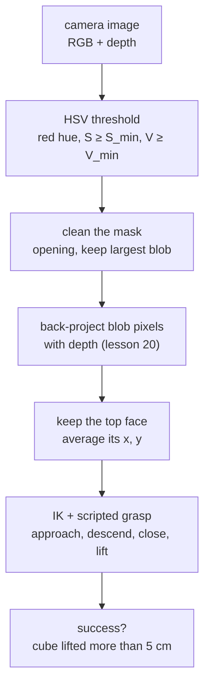

# 21 · Object perception for manipulation

<!-- meta -->
| | |
|---|---|
| **Part** | [5 · Perception and estimation](README.md) |
| **Run type** | CPU · Mac or Colab CPU |
| **Prerequisites** | [16](../part-4-dynamics-and-control/16-grasping-and-pick-place.md), [20](20-pixels-to-table.md) |
| **Learn first** | [Image Fundamentals — Pixels, Channels, Color Spaces](https://aiengineeringfromscratch.com/lesson?path=phases/04-computer-vision/01-image-fundamentals) · [Object Detection — YOLO from Scratch](https://aiengineeringfromscratch.com/lesson?path=phases/04-computer-vision/06-object-detection-yolo) · [Open-Vocabulary Vision — CLIP](https://aiengineeringfromscratch.com/lesson?path=phases/04-computer-vision/18-open-vocab-clip) · [SAM 3 & Open-Vocabulary Segmentation](https://aiengineeringfromscratch.com/lesson?path=phases/04-computer-vision/24-sam3-open-vocab-segmentation) |
| **Time** | ~60 min |
| **Code** | [`experiments/21-object-perception/experiment.py`](../experiments/21-object-perception/experiment.py) |
| **Status** | ✅ done |
<!-- /meta -->

> Perception for grasping is judged by one number: whether the gripper closes on the object. Measure the pick, not the pixel.

## The problem

A scripted pick ([lesson 16](../part-4-dynamics-and-control/16-grasping-and-pick-place.md)) needs the object's position in the robot frame. Lesson 20 turned pixels into table coordinates; now something has to find the object's pixels. The simplest detector, a colour threshold, works at the lighting it was tuned under. This lesson closes the loop in simulation (render, detect, back-project, pick with the SO-101) and counts successful lifts while sweeping the lighting.

## Core idea

### In plain words

The simplest detector is a hand-written rule: "a pixel belongs to the cube if it is red enough, colourful enough and bright enough". Like a hard-coded `if`, it works on the inputs it was tuned on, and when the light drifts it flips from "works" to "sees nothing" between two nearby levels.

The rule is written in **HSV** instead of RGB because HSV separates the questions. **Hue** is which colour, an angle on the colour wheel (red sits at 0°). **Saturation** is how colourful versus grey. **Value** is how bright. Dimming a red cube mostly lowers V and leaves hue alone.

The mask of red pixels then becomes a 3D position through the depth image ([lesson 20](20-pixels-to-table.md)), and the arm goes there. The score that matters is at the end of that chain, so we measure **pick success**, not pixel error.

### Perceive, then pick



### The detector, as code

```python
hsv = rgb_to_hsv8(rgb)                            # H in 0..179 (degrees / 2), S and V in 0..255
red = (hsv[..., 0] <= 10) | (hsv[..., 0] >= 170)  # red wraps around hue 0
mask = red & (hsv[..., 1] >= 120) & (hsv[..., 2] >= 70)   # S_min, V_min tuned at nominal light
cube = largest_blob(open3x3(mask))                # drop speckles, keep the biggest group of pixels
xy = mask_to_table_xy(cube, depth, K, R_wc, c)    # back-project, average the top face
```

| Piece | Formula |
|---|---|
| Value | $V = \max(R, G, B)$ |
| Saturation | $S = (\max - \min)/\max$ |
| "Red" test | $H \in [0,10]\cup[170,179],\quad S \ge S_{\min},\quad V \ge V_{\min}$ |
| Grasp point | $(x, y) =$ mean of the back-projected points higher than 20 mm |
| Metric | pick success = cube more than 5 cm above its start height |

$R, G, B$ are the pixel's colour channels, $\max$ and $\min$ the largest and smallest of them, $H$ the hue in OpenCV's 8-bit units (degrees/2), and $S_{\min}, V_{\min}$ the two thresholds you tune (S and V scaled to 0–255).

| Detector | Per-frame cost | Tuning | Typical failure |
|---|---|---|---|
| HSV threshold | a few array operations | 6 numbers per colour | lighting, similar-coloured background |
| Open-vocabulary (OWL-ViT, + SAM for masks) | one network forward pass | a text prompt | wrong object, ambiguous prompt; not measured here |

<details>
<summary>Math details: why thresholds fail as cliffs, and what learned detectors change</summary>

**HSV thresholding.** Hue is fairly stable under brightness changes; S and V are not (see AIEFS: [Image Fundamentals](https://aiengineeringfromscratch.com/lesson?path=phases/04-computer-vision/01-image-fundamentals)). A morphological **opening** (erode, then dilate) removes speckles smaller than the kernel; the largest **connected component** (a group of touching pixels) is the object.

**Where it fails.** Too little light: V or S falls below its limit. Too much light: channels clip at 255; with $\max$ stuck there while $\min$ keeps rising, $S = (\max-\min)/\max$ must fall. Grazing light: the face the camera sees is dark while a side face is bright. All pixels of one face have nearly the same colour, so they cross the threshold together: the failure is abrupt. If only part of the object passes, its centroid is biased by a fraction of the object's size.

**Learned detectors.** Open-vocabulary detectors such as OWL-ViT ([Minderer et al. 2022, arXiv 2205.06230](https://arxiv.org/abs/2205.06230)) take a text query ("red cube") instead of a hand-set colour window (see AIEFS: [Object Detection — YOLO from Scratch](https://aiengineeringfromscratch.com/lesson?path=phases/04-computer-vision/06-object-detection-yolo), [Open-Vocabulary Vision — CLIP](https://aiengineeringfromscratch.com/lesson?path=phases/04-computer-vision/18-open-vocab-clip), [SAM 3 & Open-Vocabulary Segmentation](https://aiengineeringfromscratch.com/lesson?path=phases/04-computer-vision/24-sam3-open-vocab-segmentation)). We did not run one here (no `transformers` in this environment), so this lesson states no numbers for them.

Go deeper: the AIEFS lessons above; [Minderer et al. 2022](https://arxiv.org/abs/2205.06230); [OpenCV · color conversions](https://github.com/opencv/opencv/blob/4.x/modules/imgproc/doc/colors.markdown).

</details>

## Build it

You will now write the detector in about 60 lines of NumPy. The scene, camera, lighting and pick routine come from the Experiment script, so Build it sees the same 30 frames; OpenCV and SciPy are only referees. Type the steps into your own file and run it after each step. The finished functions are in [`physai/vision.py`](../physai/vision.py); `uv run python experiments/21-object-perception/build.py` runs all five steps with the checks (output in [`build_output.txt`](../experiments/21-object-perception/build_output.txt)).

### Step 1 · RGB to HSV

$H$ says which channel is largest and how far towards the next one, in OpenCV's half-degree units:

```python
def rgb_to_hsv8(rgb):
    """8-bit RGB image -> HSV in OpenCV's 8-bit units: H = degrees / 2 in 0..179, S and V in 0..255."""
    x = rgb.astype(np.float64)
    r, g, b = x[..., 0], x[..., 1], x[..., 2]
    v = x.max(axis=-1)                                   # value: the brightest channel
    diff = v - x.min(axis=-1)                            # 0 for a grey pixel
    s = np.where(v > 0, 255 * diff / np.maximum(v, 1), 0)  # saturation: colourful vs grey
    dd = np.maximum(diff, 1)
    h = np.where(v == r, 30 * (g - b) / dd,              # hue in half-degrees, sector by sector
                 np.where(v == g, 60 + 30 * (b - r) / dd, 120 + 30 * (r - g) / dd))
    h = np.floor(np.where(diff > 0, h, 0) + 0.5)         # round first ...
    h = np.where(h < 0, h + 180, h)                      # ... then wrap: red sits at both ends
    return np.stack([h, np.floor(s + 0.5), v], axis=-1).astype(np.uint8)
```

Round before you wrap: a hue of −0.4 half-degrees rounds to 0; wrapping first would give 179.6, which rounds to 180, outside the range.

```text
== Step 1. RGB -> HSV (OpenCV 8-bit units) vs cv2.cvtColor ==
1,000,000 random colours: H differs on 1.65 % (max 1), S on 0.75 % (max 1), V on 0.00 %
rendered frame (position 1, light scale 1.0, 640 x 480): 49817 pixels off by 1, median OpenCV hue of those 106, 0 of them with a red hue
 scale  top HSV ours  top HSV OpenCV
   0.1    (0,110,72)      (0,110,72)
   1.0   (0,177,255)     (0,177,255)
   3.0    (0,95,255)      (0,95,255)
```

OpenCV's 8-bit path divides with integer lookup tables, so 1.65 % of hues and 0.75 % of saturations land one unit away; in the frame those are the bluish floor (hue 106), never a red pixel. At the top face both give the Experiment's "top HSV" column exactly.

### Step 2 · Threshold

```python
def color_mask(hsv, ranges):
    """Pixels inside any of the (lo, hi) HSV boxes, bounds inclusive; red needs two boxes (hue wraps)."""
    mask = np.zeros(hsv.shape[:2], bool)
    for lo, hi in ranges:
        mask |= np.all((hsv >= np.asarray(lo)) & (hsv <= np.asarray(hi)), axis=-1)
    return mask
```

```text
== Step 2. The red threshold vs cv2.inRange ==
same HSV input: our mask differs from inRange on 0 pixels
our HSV input:  742 red pixels, differs on 0 pixels
red pixels in the hue box near 0: 712, near 179: 30
```

With your own HSV the mask is still identical. The last line is why red needs two boxes: 30 of the cube's 742 pixels have hue near 179.

### Step 3 · Clean the mask, keep the largest blob

Shift the image by one pixel in each direction and combine the nine copies: *all* set is an erosion, *any* set a dilation, and erosion then dilation is the opening. Labelling uses the same shifts: every pixel takes the largest id among its neighbours until nothing changes, so each 8-connected blob ends with one id.

```python
def _shifts(a, fill):
    """The 9 copies of a 2D array shifted by -1, 0, +1 pixels in each direction; outside = fill."""
    p = np.pad(a, 1, constant_values=fill)
    h, w = a.shape
    return [p[i:i + h, j:j + w] for i in range(3) for j in range(3)]
```

```python
def open3x3(mask):
    """Morphological opening with a 3x3 square: erode (keep a pixel if all 9 are set), then dilate."""
    eroded = np.logical_and.reduce(_shifts(mask, True))   # outside the image counts as set, as in OpenCV
    return np.logical_or.reduce(_shifts(eroded, False))
```

```python
def label_blobs(mask):
    """Label 8-connected blobs: every pixel takes the largest id among its neighbours until nothing changes."""
    lab = np.where(mask, np.arange(1, mask.size + 1).reshape(mask.shape), 0)
    while True:
        new = np.where(mask, np.maximum.reduce(_shifts(lab, 0)), 0)
        if np.array_equal(new, lab):
            return lab                                    # one id per blob (not numbered 1, 2, 3 ...)
        lab = new
```

```python
def largest_blob(mask, min_area=30):
    """The biggest blob as a boolean mask, or None if there is none of at least min_area pixels."""
    if not mask.any():
        return None
    rows, cols = np.nonzero(mask.any(axis=1))[0], np.nonzero(mask.any(axis=0))[0]
    box = (slice(rows[0], rows[-1] + 1), slice(cols[0], cols[-1] + 1))   # label only the bounding box
    lab = label_blobs(mask[box])
    ids, area = np.unique(lab[lab > 0], return_counts=True)
    if area.max() < min_area:
        return None
    out = np.zeros_like(mask)
    out[box] = lab == ids[np.argmax(area)]
    return out
```

The check adds three stray pixels to the Step 2 mask, a 2-pixel and a 1-pixel speck:

```text
== Step 3. Opening and the largest blob vs OpenCV and SciPy ==
opening: 745 -> 740 pixels, differs from cv2.morphologyEx on 0
blobs before opening: ours 3, OpenCV 3, scipy.ndimage.label 3
largest blob: 740 pixels, differs from the Experiment's detect() on 0
```

The opening removes both specks (and two ragged cube pixels), all three labellers count three blobs, and the largest blob is the Experiment's `detect()` mask pixel for pixel.

### Step 4 · From blob to table position

The centroid is the mean pixel coordinate, $m_{10}/m_{00},\ m_{01}/m_{00}$ in image moments. For a table position, back-project every blob pixel with its depth (lesson 20) and average:

```python
def mask_centroid(mask):
    """Pixel centroid (u, v) from the image moments m00, m10, m01 of a binary mask."""
    v, u = np.nonzero(mask)
    m00, m10, m01 = len(u), u.sum(), v.sum()
    return np.array([m10 / m00, m01 / m00])
```

```python
def mask_to_table_xy(mask, depth, K, R_wc, c, z_min=0.02):
    """Back-project every mask pixel with its depth (lesson 20) and average (x, y) of the points above z_min."""
    v, u = np.nonzero(mask)
    rays = np.c_[u, v, np.ones(len(u))] @ np.linalg.inv(K).T @ R_wc.T   # camera ray of each pixel, world frame
    P = c + depth[v, u][:, None] * rays                                   # depth is the distance along the axis
    top = P[P[:, 2] > z_min]                                              # the top face of the object
    return (top if len(top) else P)[:, :2].mean(axis=0)
```

```text
== Step 4. Centroid and table position ==
centroid (u, v) = (326.092, 268.359) px, max |ours - cv2.moments| = 0.0e+00
30 positions, light scale 1.0              median mm  max mm
  centroid pixel, back-projected            0.57    1.09
  mean of all blob points                   0.32    0.47
  mean of top-face points (z > 20 mm)       0.29    0.45
max |ours - Experiment's locate()| = 0.0e+00 m
one pixel at the top face (0.57 m from the camera) spans 1.11 mm
```

Back-projecting the centroid pixel is worst (1.09 mm max): it must be rounded to a whole pixel, and one pixel spans 1.11 mm at the top face. Averaging all blob points removes the rounding; dropping the side-face points ($z \le 20$ mm) gives 0.29 mm median and 0.45 mm max, identical to the Experiment's `locate()`, whose table rounds them to 0.3 and 0.4 mm.

### Step 5 · Close the loop

One function composes the pipeline:

```python
def detect_color(rgb, ranges, min_area=30):
    """HSV threshold -> opening -> largest blob: the object's mask, or None."""
    return largest_blob(open3x3(color_mask(rgb_to_hsv8(rgb), ranges)), min_area)
```

and the pick is the Experiment's own routine:

```python
blob = detect_color(rgb, RED)                                  # None if nothing passes
xy = mask_to_table_xy(blob, depth, cam.K, cam.R_wc, cam.c)     # top face, world frame
ok = exp.pick(m, d, xy)                                        # IK, approach, close, lift > 5 cm
```

```text
== Step 5. Close the loop: our detector + the Experiment's pick ==
 scale  detected  median err mm  max err mm  picks ok
   0.1      0/30              -           -      0/30
   1.0     30/30            0.3         0.4     30/30
   3.0      1/30           14.9        14.9      0/30
```

These are the Experiment table's rows for scales 0.1, 1.0 and 3.0, number for number, including the one 14.9 mm-off detection at 3.0 that fails its pick.

### What you keep

`physai.vision` now has `rgb_to_hsv8`, `color_mask`, `open3x3`, `label_blobs`, `largest_blob`, `mask_centroid`, `mask_to_table_xy` and `detect_color`. The capstone ([lesson 44](../capstone/44-capstone.md)) finds its three cubes with the same HSV mask and back-projection. [`tests/test_21_object_perception.py`](../tests/test_21_object_perception.py) pins them to SciPy (and to OpenCV where it is installed); run `uv run pytest tests/test_21_object_perception.py` after you change anything.

## Use it

In practice the whole detector is five OpenCV calls on MuJoCo's images:

```python
renderer = mujoco.Renderer(m, 480, 640)                  # RGB, uint8, H x W x 3, channel order R, G, B
renderer.update_scene(d, "top"); rgb = renderer.render()
hsv = cv2.cvtColor(rgb, cv2.COLOR_RGB2HSV)               # RGB2HSV, not BGR2HSV, for MuJoCo images
mask = cv2.inRange(hsv, (0, 120, 70), (10, 255, 255)) | cv2.inRange(hsv, (170, 120, 70), (179, 255, 255))
mask = cv2.morphologyEx(mask, cv2.MORPH_OPEN, np.ones((3, 3), np.uint8))
n, labels, stats, centroids = cv2.connectedComponentsWithStats(mask)   # label 0 is the background
k = 1 + np.argmax(stats[1:, cv2.CC_STAT_AREA])
cube = labels == k                                       # centroids[k] is the pixel centroid of Step 4
```

Prerequisites: a depth renderer (`renderer.enable_depth_rendering()`, distance along the camera axis), $K$ and the camera pose (lessons 19–20), thresholds tuned with the same camera settings. Then back-project as in Step 4.

Other tools give the same colour other numbers. Pure blue, printed by each call (OpenCV 5.0.0, Pillow 13.0.0, Matplotlib 3.11.2):

| Tool and call | Input | Hue of pure blue | $S$, $V$ range |
|---|---|---|---|
| physai `rgb_to_hsv8`, OpenCV `cvtColor` on `uint8` | 0–255 | 120 (of 0–179) | 0–255 |
| OpenCV `cvtColor` on `float32` | 0–1 | 240 (of 0–360) | 0–1 |
| Pillow `Image.convert("HSV")` | 0–255 | 170 (of 0–255) | 0–255 |
| Matplotlib `colors.rgb_to_hsv`, Python `colorsys.rgb_to_hsv` | 0–1 | 0.667 (of 0–1) | 0–1 |

Sources: [OpenCV · color conversions](https://github.com/opencv/opencv/blob/4.x/modules/imgproc/doc/colors.markdown), [Python `colorsys`](https://docs.python.org/3/library/colorsys.html), [Matplotlib `rgb_to_hsv`](https://matplotlib.org/stable/api/_as_gen/matplotlib.colors.rgb_to_hsv.html), [Pillow modes](https://pillow.readthedocs.io/en/stable/handbook/concepts.html#modes).

Traps:

- **Channel order.** MuJoCo's renderer returns RGB; `cv2.imread` and `cv2.VideoCapture` return BGR. Convert RGB with `COLOR_BGR2HSV` and pure red comes out as hue 120 (blue): the detector silently sees nothing.
- **Hue units.** A threshold copied from a tool with another convention (table above) silently selects another colour.
- **Red wraps.** One box $[0, 10]$ drops the pixels near 179 (30 of 742 in Step 2).
- **Connectivity and borders.** `cv2.connectedComponentsWithStats` joins diagonal neighbours by default (8-connectivity); `scipy.ndimage.label` does not unless you pass `structure=np.ones((3, 3))`. SciPy's `binary_erosion` treats outside pixels as empty (`border_value=0`) and eats a blob touching the image edge; OpenCV's default does not ([`scipy.ndimage.label`](https://docs.scipy.org/doc/scipy/reference/generated/scipy.ndimage.label.html), [`binary_erosion`](https://docs.scipy.org/doc/scipy/reference/generated/scipy.ndimage.binary_erosion.html)).

## Experiment

**Setup.** SO-101 from Menagerie (5 ms timestep) and a red 30 mm cube (0.05 kg) at 30 random positions, $x\in[0.15, 0.24]$ m, $y\in[-0.07, 0.07]$ m, rotated to face the robot (we estimate position only). A camera looks straight down from 0.6 m; $K$ from `fovy` (lesson 19), pose from the model. The arm is parked out of view while the image is taken.

**Pick routine:** damped-least-squares IK ([lesson 10](../part-3-kinematics/10-inverse-kinematics.md)) on the point between the jaws, gripper pointing down, jaw axis along the shoulder–target line; approach 7 cm above, descend, close, lift 10 cm. Success = cube more than 5 cm above its start height.

```python
mask = detect(rgb)                                   # HSV threshold + opening + largest blob
xy = locate(mask, depth, K, R_wc, c)                 # back-project, mean of the top face
ok = pick(m, d, xy)                                  # IK + scripted grasp, lift test
```

**Run** `uv run python experiments/21-object-perception/experiment.py` (MuJoCo 3.17.0, OpenCV 5.0.0, NumPy 2.5.4, Apple M5, deterministic).

**Step 1: how accurate must perception be?** Aim at the true position plus an error of fixed size in a random direction:

| Aim error (mm) | 0 | 4 | 8 | 12 | 16 | 20 |
|---|---|---|---|---|---|---|
| Picks ok (of 30) | 30 | 29 | 21 | 15 | 11 | 7 |

With ground truth the routine picks 30/30. The error budget for this gripper and cube is a few millimetres: at 8 mm, 9 of 30 picks fail.


**Step 2: lighting intensity** (headlight, a light attached to the viewer, and directional light scaled together; thresholds frozen at $S\ge120$, $V\ge70$; "top HSV" is the pixel at the centre of the top face for position 1):

| Scale | Top HSV | Detected | Median error (mm) | Max error (mm) | Picks ok |
|---|---|---|---|---|---|
| 0.1 | (0,110,72) | 0/30 | – | – | 0/30 |
| 0.2 | (0,145,107) | 30/30 | 0.1 | 0.2 | 30/30 |
| 0.35 | (0,173,158) | 30/30 | 0.1 | 0.2 | 30/30 |
| 0.5 | (0,186,211) | 30/30 | 0.2 | 0.3 | 30/30 |
| 1.0 | (0,177,255) | 30/30 | 0.3 | 0.4 | 30/30 |
| 1.5 | (0,157,255) | 30/30 | 0.3 | 0.7 | 30/30 |
| 2.0 | (0,136,255) | 30/30 | 0.5 | 0.8 | 30/30 |
| 3.0 | (0,95,255) | 1/30 | 14.9 | 14.9 | 0/30 |

**Observe.**

1. When the cube is detected, the error stays below 1 mm (max 0.8 mm) and every pick succeeds: with perfect simulated calibration and depth, localization is not the bottleneck.
2. Failure is a cliff: 30/30 to 0/30 between scale 0.2 and 0.1, and 1/30 at 3.0. Dim light drops S to 110 (< 120); overexposure saturates V at 255 and washes S down to 95.
3. The single detection at scale 3.0 is 14.9 mm off: only a darker side face still passed, its centroid is about half a cube away, and the pick fails. A partial detection is worse than none, because the robot acts on it.

## Break it

Turn off the headlight (ambient light 0.1) and lower the sun (the directional light) from overhead to grazing, coming from the side away from the robot:

| Elevation (deg) | Top HSV | Detected | Median error (mm) | Max error (mm) | Picks ok |
|---|---|---|---|---|---|
| 90 | (0,185,211) | 30/30 | 0.1 | 0.2 | 30/30 |
| 45 | (0,224,130) | 30/30 | 0.1 | 0.5 | 30/30 |
| 20 | (0,224,74) | 30/30 | 0.3 | 0.8 | 30/30 |
| 10 | (0,223,48) | 1/30 | 15.8 | 15.8 | 0/30 |
| 5 | (0,219,35) | 0/30 | – | – | 0/30 |

Hue stays at 0 and saturation even rises, but V of the top face falls with the sun: 74 at 20°, 48 at 10°, below $V_{\min} = 70$. The lit side face is nearly edge-on to the camera. The detector reports nothing, or a 15.8 mm-off sliver.

Lowering $V_{\min}$ from 70 to 25 on the same scenes recovers everything:

| Elevation (deg) | Detected | Median error (mm) | Max error (mm) | Picks ok |
|---|---|---|---|---|
| 20 | 30/30 | 0.2 | 0.6 | 30/30 |
| 10 | 30/30 | 0.2 | 0.6 | 30/30 |
| 5 | 30/30 | 0.3 | 0.6 | 30/30 |
| nominal (scale 1.0) | 30/30 | 0.3 | 0.7 | 30/30 |

That is not a free fix: a lower $V$ floor admits dark red-brown pixels, and this scene has no distractors, so we did not measure **false positives** (wrong objects reported as the cube). On a real table, expect it to catch a brown box or a wooden surface too; this is where a learned detector earns its compute.

## On the real robot

- Webcams run auto-exposure and auto-white-balance, which change V and hue frame to frame. Lock both, then tune under the worst lighting the robot will see. Not yet measured on the real arm.
- Real error sources add up against the few-millimetre budget above: pixel noise and footprint (lesson 20: 1.60 mm median at 1 px from 0.6 m in simulation), extrinsic or hand-eye calibration error (lesson 19), depth noise, and the arm's own joint error. Our sub-millimetre numbers are simulation results with perfect calibration and depth.
- Log every failed pick with its image and the HSV values at the object; a threshold failure is visible there.

## Check yourself

1. **Easy.** Why does red need two hue ranges in OpenCV?
2. **Medium.** At scale 3.0, why does the cube become *less* saturated although the light is brighter?
3. **Hard.** Add a dark-red distractor box (rgba 0.4, 0.15, 0.1) next to the cube and rerun step 2 with $V_{\min} = 25$ and with $V_{\min} = 70$. Which threshold now picks the wrong object, and how would you reject it (size, shape, depth)?

### Answers

1. Hue is an angle; red sits at 0°/360°, which OpenCV maps to both ends of 0–179 (Build it, Step 2: 30 of the cube's 742 pixels sit near 179).
2. The renderer clips each channel at 255. The red channel saturates first while green and blue keep rising, so the colour moves towards white and $S = (\max-\min)/\max$ falls (95 at scale 3.0).
3. Not computed here; run it. The distractor's base colour has hue 10° (OpenCV H = 5) and S = 0.75 (191 in 8 bits), inside both windows, so only V separates it; above V = 70 the largest-blob rule decides. Blob size, squareness or the height of its top face can reject it.

## Takeaways and sources

- Close the loop: the metric is pick success. Here a 4 mm aim error still gave 29/30 picks, 8 mm only 21/30.
- A colour threshold fails abruptly at the lighting where V or S crosses its limit (scale 0.1, scale 3.0, sun at 10°); when it does detect, localization in simulation is sub-millimetre.
- Open-vocabulary detectors trade per-frame compute for not depending on a single colour window; their speed and robustness were not measured here.

Next: [lesson 22](../part-6-planning-and-optimal-control/22-motion-planning.md), motion planning.

Sources:
- M. Minderer et al., "Simple Open-Vocabulary Object Detection with Vision Transformers", ECCV 2022. [arXiv:2205.06230](https://arxiv.org/abs/2205.06230)
- [OpenCV · color conversions](https://github.com/opencv/opencv/blob/4.x/modules/imgproc/doc/colors.markdown): HSV formulas; for 8-bit images H is stored as H/2, so hue spans 0–179.
- [MuJoCo Menagerie · robotstudio_so101](https://github.com/google-deepmind/mujoco_menagerie/tree/f3b6013/robotstudio_so101) (Apache-2.0).
- Back-projection and depth: [lesson 20](20-pixels-to-table.md). Calibration: [lesson 19](19-camera-calibration.md).
- All numbers above: [`experiment.py`](../experiments/21-object-perception/experiment.py), output in [`output.txt`](../experiments/21-object-perception/output.txt); Build it: [`build.py`](../experiments/21-object-perception/build.py), [`build_output.txt`](../experiments/21-object-perception/build_output.txt).
