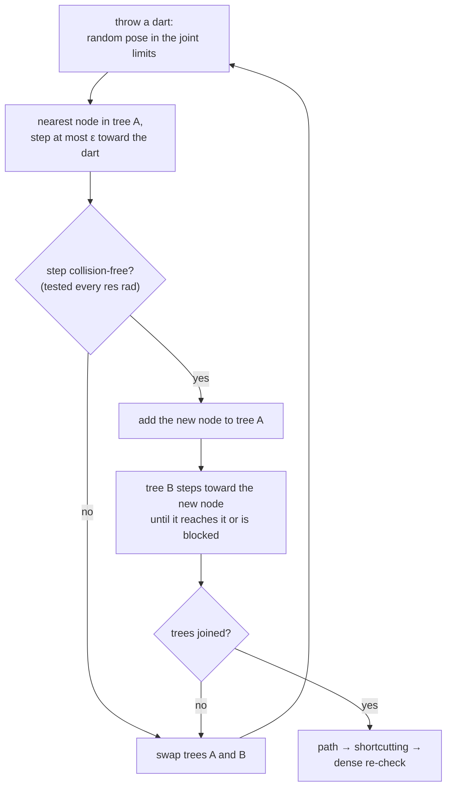

# 22 · Configuration space and sampling-based planning

<!-- meta -->
| | |
|---|---|
| **Part** | [6 · Planning and optimal control](README.md) |
| **Run type** | CPU · Mac or Colab CPU |
| **Prerequisites** | [10](../part-3-kinematics/10-inverse-kinematics.md) |
| **Learn first** | [Probability and Distributions](https://aiengineeringfromscratch.com/lesson?path=phases/01-math-foundations/06-probability-and-distributions) |
| **Time** | ~60 min |
| **Code** | [`experiments/22-motion-planning/experiment.py`](../experiments/22-motion-planning/experiment.py) |
| **Status** | ✅ done |
<!-- /meta -->

> A sampling planner never sees the obstacle. It only sees the collision checker's answers at the configurations it asks about.

## The problem

Inverse kinematics ([lesson 10](../part-3-kinematics/10-inverse-kinematics.md)) gives a goal configuration (one set of joint angles), not a way to get there. Put a 20 × 20 × 50 cm box in front of a Franka Panda, with the hand left of the box at the start and right of it at the goal. Both configurations are collision-free; the straight line between them in joint space is not: re-checked every 0.005 rad, it pushes the arm 139.0 mm into the box. We need a path through the free part of the 7-D joint space, and we need to know when a "found path" is actually free.

## Core idea

### In plain words

Picture a maze whose coordinates are joint angles instead of metres: for a 7-joint arm, one point in it is one complete pose, seven numbers. The walls are all poses in which some part of the arm overlaps an obstacle. This maze is the **configuration space** (C-space). A plain box in the room becomes a curved wall in it that nobody draws: in 7 dimensions that is far too expensive.

What is cheap is asking a **collision checker** about one pose at a time: "put the arm here; does anything overlap?" A sampling-based planner explores the maze with only that yes/no oracle. **RRT** (rapidly-exploring random tree) explores by throwing darts: pick a random pose, find the closest pose the tree has already reached, take a short step from it toward the dart, and keep the step if it is collision-free. Big unexplored regions catch most darts, so the tree spreads out fast. **RRT-Connect** grows one tree from the start and one from the goal and, after every step, tries to join them.

The catch is the step itself: a straight segment in joint space, tested at one pose every *res* radians. Whatever happens between two tested poses is assumed free, so with a coarse *res* a step can jump through a thin part of a wall and the planner still reports success. After the search, **shortcutting** replaces detours in the zig-zag result by straight segments that pass the same check.

### The RRT-Connect loop



### RRT-Connect as code

```python
A, B = Tree(q_start), Tree(q_goal)              # one tree grows from each end
for _ in range(budget):
    q_rand = uniform(joint_lo, joint_hi)        # the dart: a random pose inside the joint limits
    q_near = A.nearest(q_rand)                  # closest pose tree A has already reached
    q_new = step(q_near, q_rand, eps)           # move at most eps rad (L2) toward the dart
    if edge_free(q_near, q_new, res):           # test poses every res rad along the step
        A.add(q_new, parent=q_near)
        if B.connect_greedily(q_new):           # tree B walks toward q_new until blocked or there
            return join(A, B, q_new)            # start ... q_new ... goal, then shortcut it
    A, B = B, A                                 # alternate which tree grows
return None                                     # budget used up (not proof that no path exists)
```

| Quantity | Formula |
|---|---|
| Free space | $\mathcal{C}_{free} = \mathcal{C} \setminus \mathcal{C}_{obs}$ |
| Poses tested on one edge | $n = \lceil \lVert q_b - q_a \rVert / \text{res} \rceil$ |
| Worst motion of a point between two tests | $\sum_i r_i\,\lvert \Delta q_i \rvert$ |

Here $q$ is one pose (joint vector), $\mathcal{C}$ the box of poses within the joint limits, $\mathcal{C}_{obs}$ the poses that collide, $q_a$ and $q_b$ the ends of a tree edge, res the edge-check resolution in radians, $\Delta q_i$ the change of joint $i$ between two tested poses, and $r_i$ the distance of a point on the arm from joint $i$'s axis.

The experiment compares RRT-Connect ([Kuffner & LaValle 2000](http://lavalle.pl/papers/KufLav00.pdf)) with plain single-tree RRT ([LaValle 1998](http://lavalle.pl/papers/Lav98c.pdf)), which differs in two ways: it samples the goal itself with 5 % probability (goal bias), and it stops when a new node is within $\varepsilon$ of the goal and the edge to the goal is free.

<details>
<summary>Math details: C-space, collision queries, edge checks and completeness</summary>

**Configuration space.** A configuration $q \in \mathcal{C} \subset \mathbb{R}^7$ is one joint vector; joint limits make $\mathcal{C}$ a box. The obstacle region and the free space are

$$\mathcal{C}_{obs} = \{\, q : \text{robot}(q) \cap \text{obstacles} \neq \emptyset \,\}, \qquad \mathcal{C}_{free} = \mathcal{C} \setminus \mathcal{C}_{obs}.$$

A box in the workspace becomes a curved 7-D set in $\mathcal{C}$ that nobody computes explicitly ([Lynch & Park ch. 10](https://hades.mech.northwestern.edu/index.php/Modern_Robotics); [LaValle ch. 4](http://lavalle.pl/planning/)). Sampling-based planners only ask a membership question: is $q$ free? $\mathcal{C}_{free}$ is in general not convex, so two free poses do not imply a free segment between them.

**What an edge check guarantees.** A tree edge from $q_a$ to $q_b$ is the segment $q(s) = q_a + s\,(q_b - q_a)$, $s \in [0, 1]$, tested at $n = \lceil \lVert q_b - q_a \rVert / \text{res} \rceil$ points. A point at distance $r$ from a joint axis moves $r\,\Delta q$ when that joint turns by $\Delta q$, so between two tested poses no point moves more than $\sum_i r_i\,\lvert \Delta q_i \rvert$. With the Cauchy–Schwarz inequality and $r_i \le r_{max}$ this is at most $r_{max}\sqrt{7}\,\lVert \Delta q \rVert_2$. An overlap shallower than that bound can start and end between two tests and is never seen.

**Probabilistically complete, not optimal.** If a free path exists, the probability that either RRT variant finds one tends to 1 as iterations grow. That says nothing about how many iterations it takes or about path quality ([LaValle ch. 5](http://lavalle.pl/planning/)).

**Narrow passages.** A uniform sample lands in a region with probability equal to its share of the volume of $\mathcal{C}$; a passage thin in several joint directions at once has a tiny 7-D volume (Break it).

Go deeper: [Probability and Distributions](https://aiengineeringfromscratch.com/lesson?path=phases/01-math-foundations/06-probability-and-distributions) (uniform sampling, probabilities as volume fractions); [LaValle 1998](http://lavalle.pl/papers/Lav98c.pdf) (RRT); [Kuffner & LaValle 2000](http://lavalle.pl/papers/KufLav00.pdf) (RRT-Connect); [LaValle, *Planning Algorithms*, ch. 4–5](http://lavalle.pl/planning/); [Lynch & Park ch. 10](https://hades.mech.northwestern.edu/index.php/Modern_Robotics).

</details>

<!-- figure: 22-rrt -->

## Build it

You will now write RRT-Connect yourself, about 80 lines of NumPy: the edge check, a tree, the planner and the shortcut. MuJoCo answers only one question, "is this pose free?". Type the steps into a file of your own and run it after each step. The finished functions are in [`physai/planning.py`](../physai/planning.py); `uv run python experiments/22-motion-planning/build.py` runs all five steps with their checks (output in [`build_output.txt`](../experiments/22-motion-planning/build_output.txt)).

### Step 1 · The oracle and the edge check

The oracle is the Experiment's `depth(q)` (put the arm at `q`, run `mj_kinematics` and `mj_collision`, return the deepest contact); `free(q)` is `depth(q) == 0`. The edge check tests equally spaced poses no farther apart than `res`, and `all()` stops at the first collision:

```python
def edge_free(free, a, b, res):
    """True if free(q) holds at points spaced at most res (L2, rad) along the segment a -> b."""
    n = max(1, int(np.ceil(np.linalg.norm(b - a) / res)))
    return all(free(a + (b - a) * (k / n)) for k in range(1, n + 1))
```

```python
def worst_along(f, path, res):
    """Largest f(q) at points spaced at most res along a piecewise-linear path, both ends included."""
    worst = 0.0
    for a, b in zip(path[:-1], path[1:]):
        n = max(1, int(np.ceil(np.linalg.norm(b - a) / res)))
        worst = max(worst, max(f(a + (b - a) * (k / n)) for k in range(n + 1)))
    return worst
```

`worst_along` is the dense re-check: the largest value of any function, here the penetration depth, along a whole path. On the straight line from start to goal:

== Step 1. The edge check on the straight line start -> goal ==
start free: True | goal free: True | length 1.60 rad
res (rad)  poses on edge  tested until answer  edge_free says
    0.005            320                   98           False
    0.050             32                   10           False
    0.250              7                    3           False
    0.500              4                    2           False
    1.000              2                    1           False
dense truth: worst penetration on the line = 139.0 mm

Every resolution rejects this line, because it runs through the middle of the box, 139.0 mm deep as in the Experiment. The edges that slip through are the ones that graze a corner (Step 5).

### Step 2 · Steer and a tree

```python
def steer(a, b, eps):
    """Move from a toward b by at most eps (L2)."""
    v = b - a
    dist = np.linalg.norm(v)
    return b.copy() if dist <= eps else a + v * (eps / dist)
```

```python
class Tree:
    """Poses in a preallocated array; parent[i] is the index of node i's parent (-1 for the root)."""

    def __init__(self, root, capacity=100_000):
        self.q = np.zeros((capacity, len(root)))
        self.parent = np.full(capacity, -1)
        self.q[0], self.n = root, 1

    def nearest(self, x):
        return int(np.argmin(np.sum((self.q[:self.n] - x) ** 2, axis=1)))

    def add(self, x, parent):
        self.q[self.n], self.parent[self.n] = x, parent
        self.n += 1
        return self.n - 1

    def branch(self, i):
        """Poses from node i back to the root."""
        out = []
        while i != -1:
            out.append(self.q[i].copy())
            i = self.parent[i]
        return out
```

The tree stores poses in one array and, for each node, the index of its parent; `branch` walks back to the root. Nearest neighbour by brute force is one vectorized distance per node, fast enough for a few thousand nodes:

== Step 2. Steer and nearest neighbour vs scipy cKDTree (1000 random nodes, 200 queries) ==
nearest index identical in 200/200 queries
steer 0.5 rad toward the goal: step length 0.5000 rad; with eps = 2 it returns the goal itself: True

### Step 3 · RRT-Connect

The loop of the Core idea, with the two trees swapping roles after every iteration:

```python
def rrt_connect(free, lo, hi, q_start, q_goal, rng, eps=0.5, res=0.05, budget=2000):
    """RRT-Connect (Kuffner & LaValle 2000). Returns (path as a list of poses, or None; iterations used)."""
    ta, tb, a_is_start = Tree(q_start), Tree(q_goal), True
    for it in range(1, budget + 1):
        x = rng.uniform(lo, hi)                          # the dart
        i = ta.nearest(x)
        y = steer(ta.q[i], x, eps)
        if edge_free(free, ta.q[i], y, res):
            ja = ta.add(y, i)
            jb = tb.nearest(y)                           # CONNECT: tree b walks toward y
            while True:
                z = steer(tb.q[jb], y, eps)
                if not edge_free(free, tb.q[jb], z, res):
                    break                                # tree b is blocked
                jb = tb.add(z, jb)
                if np.allclose(z, y):                    # the trees touch
                    path = ta.branch(ja)[::-1] + tb.branch(jb)[1:]
                    return (path if a_is_start else path[::-1]), it
        ta, tb, a_is_start = tb, ta, not a_is_start      # alternate which tree grows
    return None, budget
```

With the Experiment's parameters and seeds:

== Step 3. RRT-Connect, res 0.05 rad, 100 seeds, budget 2000 iterations ==
success 100/100 | median iterations 33 | median collision checks 431

This is exactly the Experiment's res 0.05 row: the same algorithm with the same seeds draws the same darts.

### Step 4 · Shortcut

```python
def path_length(path):
    """Sum of the L2 lengths of the segments (rad)."""
    return float(sum(np.linalg.norm(b - a) for a, b in zip(path[:-1], path[1:])))
```

```python
def shortcut(free, path, res, rng, tries=200):
    """Random shortcutting: replace the poses between two waypoints by a straight edge if it is free."""
    p = [q.copy() for q in path]
    for _ in range(tries):
        if len(p) < 3:
            break
        i, j = sorted(rng.choice(len(p), 2, replace=False))
        if j - i >= 2 and edge_free(free, p[i], p[j], res):
            p = p[:i + 1] + p[j:]
    return p
```

== Step 4. Shortcutting (200 tries, same res) ==
median length raw 5.57 rad -> shortcut 3.59 rad | median waypoints after: 4

The shortcut keeps using the planner's generator, so the lengths match the Experiment's 5.57 → 3.59 rad as well.

### Step 5 · Re-check densely

Re-check every returned path with `worst_along(depth, path, 0.005)`:

== Step 5. Dense re-check of every returned path at 0.005 rad ==
paths in collision: 7/100 | worst penetration 4.5 mm

All 100 paths passed `edge_free` at 0.05 rad; 7 of them still clip the box by up to 4.5 mm. That is the gap between "the planner says free" and "it is free", which the Experiment sweeps.

### What you keep

`physai.planning` now has `edge_free`, `worst_along`, `steer`, `Tree`, `rrt_connect`, `path_length` and `shortcut`. They take any `free(q)`, so the same code plans for the 5-joint SO-101 or a toy 2-D world; lesson 23 turns such a geometric path into a trajectory. [`tests/test_22_motion_planning.py`](../tests/test_22_motion_planning.py) checks them on a 2-D wall with a gap and on the Panda scene; run `uv run pytest tests/test_22_motion_planning.py` after you change anything.

## Use it

MuJoCo, NumPy and SciPy have no sampling planner. MuJoCo supplies the oracle: `mj_collision` runs a broad phase (cheap bounding volumes find the geom pairs that might touch) and a narrow phase (exact distance for those pairs), the same contacts `mj_forward` would produce without the dynamics. SciPy supplies a faster nearest-neighbour search:

```python
d.qpos[:7] = q
mujoco.mj_kinematics(m, d)                 # place every body for this pose
mujoco.mj_collision(m, d)                  # broad + narrow phase -> d.contact[:d.ncon]
depth = -min(d.contact[i].dist for i in range(d.ncon)) if d.ncon else 0.0
gap = mujoco.mj_geomDistance(m, d, g1, g2, 0.1, None)   # signed distance of two geoms (clearance)

from scipy.spatial import cKDTree           # nearest neighbour for large trees
dist, i = cKDTree(tree.q[:tree.n]).query(q_rand)
```

Dedicated planning libraries name the same two knobs differently:

| Tool | Extend step ε | Edge-check resolution |
|---|---|---|
| physai | `rrt_connect(..., eps=0.5)` (rad, L2) | `res=0.05` (rad, L2) |
| OMPL | `RRTConnect::setRange`: "the maximum length of a motion to be added in the tree" | `StateSpace::setLongestValidSegmentFraction`: a fraction of the space's maximum extent |
| MoveIt (OMPL interface) | `range` in the planner's YAML config | `longest_valid_segment_fraction` / `maximum_waypoint_distance` |

Sources: OMPL [RRTConnect](https://ompl.kavrakilab.org/classompl_1_1geometric_1_1RRTConnect.html) and [StateSpace](https://ompl.kavrakilab.org/classompl_1_1base_1_1StateSpace.html) reference; the [MoveIt OMPL tutorial](https://moveit.picknik.ai/main/doc/examples/ompl_interface/ompl_interface_tutorial.html).

Traps:

- **Joints you do not plan for still collide.** Set every `qpos` the planner does not control (here the fingers, 0.04 m) before each query, or you check a different robot.
- **`d.ncon` counts everything.** Self-collisions and floor contacts count too; look at `contact.geom1` / `geom2` when start or goal is unexpectedly "not free". With a non-zero geom `margin`, contacts with positive `dist` appear as well, so test `dist < 0`, not `ncon > 0`.
- **One radian is not one radian.** An L2 resolution treats a shoulder radian like a wrist radian, although the shoulder moves the hand far more (Math details).

## Experiment

**Prediction.** A coarser edge-check resolution needs fewer collision checks and plans faster. It should also let some edges jump across the corner of the box.

The full script is [`experiments/22-motion-planning/experiment.py`](../experiments/22-motion-planning/experiment.py). The collision query:

```python
def depth(self, q):                       # penetration (m) at q, 0 if free
    d.qpos[:7] = q; d.qpos[7:] = 0.04     # fingers fixed open
    mujoco.mj_kinematics(m, d)
    mujoco.mj_collision(m, d)
    return 0.0 if d.ncon == 0 else -min(d.contact[i].dist for i in range(d.ncon))

# free(q) is depth(q) == 0; edge_free(a, b, res) is physai.planning.edge_free (Build it)
```

RRT-Connect uses $\varepsilon = 0.5$ rad (L2 over the 7 joints), a budget of 2000 iterations and 200 shortcut attempts; every returned path is re-checked at 0.005 rad, the ground truth for "paths in collision". MuJoCo 3.17.0, NumPy 2.5.4, Apple Silicon Mac (Apple M5), deterministic seeds, 100 seeds per row.

| res (rad) | success | median iterations | median collision checks | median length raw → shortcut (rad) | paths in collision | worst penetration (mm) |
|---|---|---|---|---|---|---|
| 0.01 | 100/100 | 33 | 2070 | 5.62 → 3.61 | 0/100 | 0.0 |
| 0.05 | 100/100 | 33 | 431 | 5.57 → 3.59 | 7/100 | 4.5 |
| 0.10 | 100/100 | 33 | 225 | 5.55 → 3.58 | 17/100 | 8.0 |
| 0.25 | 100/100 | 29 | 96 | 5.37 → 3.44 | 42/100 | 26.5 |
| 0.50 | 100/100 | 26 | 52 | 5.01 → 3.12 | 66/100 | 72.0 |
| 1.00 | 100/100 | 25 | 48 | 4.98 → 3.00 | 80/100 | 156.4 |


What the data says:

1. **The success rate is useless as a quality metric here.** Every row reports 100/100; only the dense re-check shows that at 1.0 rad 80 of 100 "solutions" go through the box, the worst 156.4 mm deep, deeper than the naive straight line (139.0 mm).
2. **Coarse checking looks better on every metric you would log by default.** Collision checks fall from 2070 to 48, iterations from 33 to 25, and the shortcut path gets shorter (3.61 → 3.00 rad), because shortcuts may now cut through the obstacle.
3. **Even 0.05 rad is not safe.** 7 of 100 paths clip the box by up to 4.5 mm. With $r = 0.6$ m, a 0.05 rad step of one joint moves a point 3 cm; a shallower overlap can begin and end between two checks.

**RRT vs RRT-Connect** (res 0.05 rad, 100 seeds, same budget):

| planner | success | median iterations | median checks | median length raw → shortcut (rad) |
|---|---|---|---|---|
| RRT | 42/100 | 151 | 1438 | 5.47 → 3.33 |
| RRT-Connect | 100/100 | 33 | 431 | 5.57 → 3.59 |

Growing from both ends and connecting greedily solves this query in a few dozen iterations; single-tree RRT succeeded in only 42 of 100 seeds.

## Break it

Replace the box by a 2 m wide wall at $x = 0.40$ m with a horizontal slot centred at $z = 0.45$ m. The goal has the hand behind the wall and the forearm inside the slot, so every solution must thread the slot. Shrink the slot (RRT-Connect, res 0.05 rad, 30 seeds, budget 3000 iterations):

| slot height (m) | success | median iterations | median checks | paths in collision |
|---|---|---|---|---|
| 0.40 | 30/30 | 9 | 128 | 2/30 |
| 0.30 | 30/30 | 102 | 896 | 4/30 |
| 0.25 | 30/30 | 360 | 2747 | 5/30 |
| 0.22 | 30/30 | 856 | 6372 | 5/30 |
| 0.20 | 25/30 | 1487 | 10520 | 0/25 |

From 0.40 m to 0.20 m the median iteration count goes from 9 to 1487, and 5 of 30 seeds run out of budget. At 0.20 m the 25 successful paths pass the dense re-check, so a free route exists: the failures are the planner running out of budget, not an infeasible problem.

The mechanism: halving the slot height shrinks the free tube through it in several joint directions at once, so its 7-D volume, and with it the chance that a uniform dart lands inside, drops much faster than the gap in the room. This is the **narrow-passage problem**. In the four wider rows 2 to 5 of 30 paths still clip the wall at res 0.05 rad: low clearance is exactly where a coarse edge check lies.

## On the real robot

- **Edge resolution is a real parameter.** MoveIt's OMPL interface exposes it as `longest_valid_segment_fraction` / `maximum_waypoint_distance`, and its documentation warns: "Set too high and collisions will be missed around small or narrow objects" ([MoveIt OMPL tutorial](https://moveit.picknik.ai/main/doc/examples/ompl_interface/ompl_interface_tutorial.html)). Our table is that sentence in numbers.
- **Panda.** Joint limits come from the Menagerie [`panda.xml`](https://github.com/google-deepmind/mujoco_menagerie/blob/f3b6013/franka_emika_panda/panda.xml) (e.g. joint 4 in [−3.0718, −0.0698] rad). MuJoCo collides the convex hulls of the link meshes, not the real arm surface.
- **SO-101.** The Menagerie [`so101.xml`](https://github.com/google-deepmind/mujoco_menagerie/blob/f3b6013/robotstudio_so101/so101.xml) has 5 arm joints plus a gripper: a 5-D planning space with the gripper fixed. Procedure: measure and inflate the obstacles, plan in MuJoCo, re-check the final path densely, execute it slowly through the position servos. Not yet measured on the real arm.
- **Model error is collision error.** A box 1 cm off in reality is a 1 cm unmodelled penetration. Inflate obstacles (or set a contact `margin`) by at least your calibration error (see [lesson 20](../part-5-perception-and-estimation/20-pixels-to-table.md)).

## Check yourself

1. **Easy.** Start and goal are both free, yet the straight segment between them is not. What property of $\mathcal{C}_{free}$ does this show?
2. **Medium.** Assume no point of the Panda is farther than $r_{max} = 1$ m from any joint axis. Which L2 edge resolution guarantees that no point moves more than 1 cm between two checks? (Use $\sum_i r_i \lvert\Delta q_i\rvert \le r_{max}\sqrt{7}\,\lVert \Delta q \rVert_2$.)
3. **Hard.** Plan at res 0.25 rad against the box inflated by 2 cm, then re-check the paths against the original box at 0.005 rad. Does inflation recover safety without the cost of res 0.01 rad?

### Answers

1. $\mathcal{C}_{free}$ is not convex: two free points do not imply a free segment. The measured straight-line penetration is 139.0 mm.
2. $\text{res} \le 0.01 / \sqrt{7} \approx 0.0038$ rad. The bound is conservative; real displacements are smaller.
3. Not computed here; run it. Expect fewer paths in collision than the 42/100 at 0.25 rad, but an inflation smaller than the largest gap between checks can still be crossed.

## Takeaways and sources

- A planner reports success against its own collision checker. Always re-check the final path at a fine resolution; at 1.0 rad, 80/100 "successful" paths went through the box.
- RRT-Connect solved the box query in a median of 33 iterations where single-tree RRT succeeded in only 42 of 100 seeds; shortcutting cut the median path from 5.62 to 3.61 rad.
- Narrow passages break uniform sampling: a 0.20 m slot needed a median of 1487 iterations versus 9 for 0.40 m, and 5/30 seeds failed.

Next: [lesson 23](23-trajectory-optimization.md), turning a geometric path into a dynamically feasible, torque-limited trajectory.

**Sources**

- K. M. Lynch, F. C. Park, *Modern Robotics*, ch. 10 "Motion Planning". [Book page and PDF](https://hades.mech.northwestern.edu/index.php/Modern_Robotics).
- S. M. LaValle, *Planning Algorithms*, Cambridge University Press 2006, ch. 4 "The Configuration Space", ch. 5 "Sampling-Based Motion Planning". [lavalle.pl/planning](http://lavalle.pl/planning/).
- S. M. LaValle, "Rapidly-exploring random trees: A new tool for path planning", TR 98-11, Iowa State University, 1998. [PDF](http://lavalle.pl/papers/Lav98c.pdf).
- J. J. Kuffner, S. M. LaValle, "RRT-connect: An efficient approach to single-query path planning", ICRA 2000, pp. 995–1001. [PDF](http://lavalle.pl/papers/KufLav00.pdf).
- MuJoCo API reference: [`mj_kinematics`, `mj_collision`](https://mujoco.readthedocs.io/en/stable/APIreference/APIfunctions.html).
- MoveIt, [OMPL interface tutorial](https://moveit.picknik.ai/main/doc/examples/ompl_interface/ompl_interface_tutorial.html).
- All tables: [`experiments/22-motion-planning/output.txt`](../experiments/22-motion-planning/output.txt) (MuJoCo 3.17.0, 2026-10-27).
