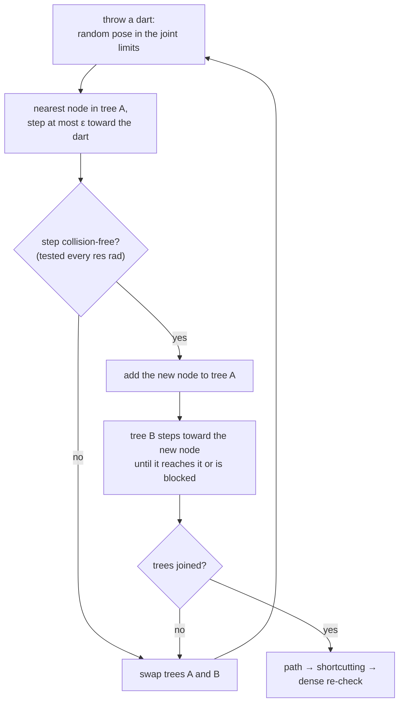

# 22 · Configuration space and sampling-based planning

<!-- meta -->
| | |
|---|---|
| **Part** | [6 · Planning and optimal control](README.md) |
| **Run type** | CPU · Mac or Colab CPU |
| **Prerequisites** | [10](../part-3-kinematics/10-inverse-kinematics.md) |
| **Learn first** | [Probability and Distributions](https://aiengineeringfromscratch.com/lesson?path=phases/01-math-foundations/06-probability-and-distributions) |
| **Time** | ~60 min |
| **Code** | [`experiments/22-motion-planning/experiment.py`](../experiments/22-motion-planning/experiment.py) |
| **Status** | ✅ done |
<!-- /meta -->

> A sampling planner never sees the obstacle. It only sees the collision checker's answers at the configurations it asks about.

## The problem

Inverse kinematics ([lesson 10](../part-3-kinematics/10-inverse-kinematics.md)) gives you a goal configuration (one set of joint angles). It does not give you a way to get there. Put a 20 × 20 × 50 cm box in front of a Franka Panda, start with the hand on the left of the box and end with it on the right. Both configurations are collision-free. The straight line between them in joint space (the space of joint-angle vectors) is not: re-checked every 0.005 rad, it pushes the arm 139.0 mm into the box (our run, below). We need a path through the free part of the 7-D joint space, and we need to know when a "found path" is actually free.

## Core idea

### In plain words

Picture a maze whose coordinates are joint angles instead of metres. For a 7-joint arm, one point in the maze is one complete pose of the arm: seven numbers. The walls are all poses in which some part of the arm overlaps an obstacle. This maze is the **configuration space** (C-space). A plain box in the room becomes a strange curved wall in it, and nobody draws that wall: in 7 dimensions it is far too expensive.

What is cheap is to ask a **collision checker** about one pose at a time: "put the arm here; does anything overlap?" A sampling-based planner explores the maze using only that yes/no oracle. **RRT** (rapidly-exploring random tree) explores by throwing darts: pick a random pose, find the closest pose the tree has already reached, take a short step from it toward the dart, and keep the step if it is collision-free. Big unexplored regions catch most darts, so the tree spreads out fast. **RRT-Connect** grows one tree from the start and one from the goal and, after every step, tries to join them.

The catch is the step itself. A step is a straight segment in joint space, and the checker can only test a finite number of poses along it, one every *res* radians. Whatever happens between two tested poses is assumed free. With a coarse *res*, a step can jump through a thin part of a wall and the planner still reports success. After the search, **shortcutting** straightens the zig-zag result by replacing detours with straight segments that pass the same check.

### The RRT-Connect loop



### RRT-Connect as code

```python
def rrt_connect(q_start, q_goal, eps=0.5, res=0.05, budget=2000):
    A, B = Tree(q_start), Tree(q_goal)          # one tree grows from each end
    for _ in range(budget):
        q_rand = uniform(joint_lo, joint_hi)    # the dart: a random pose inside the joint limits
        q_near = A.nearest(q_rand)              # closest pose tree A has already reached
        q_new = step(q_near, q_rand, eps)       # move at most eps rad (L2) toward the dart
        if edge_free(q_near, q_new, res):
            A.add(q_new, parent=q_near)
            q_b = B.nearest(q_new)              # CONNECT: tree B walks greedily toward q_new
            while True:
                q_next = step(q_b, q_new, eps)
                if not edge_free(q_b, q_next, res):
                    break                       # tree B is blocked
                B.add(q_next, parent=q_b)
                q_b = q_next
                if q_b == q_new:                # the trees touch
                    return join(A, B, q_new)    # start ... q_new ... goal
        A, B = B, A                             # alternate which tree grows
    return None                                 # budget used up (not proof that no path exists)

def edge_free(a, b, res):                       # the only place the obstacle is ever "seen"
    n = ceil(norm(b - a) / res)                 # number of poses tested on the segment
    return all(free(a + (b - a) * k / n) for k in range(1, n + 1))

def shortcut(path, res, tries=200):
    for _ in range(tries):
        i, j = sorted(random_pair(len(path)))   # two waypoints (stored poses on the path)
        if j - i >= 2 and edge_free(path[i], path[j], res):
            path = path[:i + 1] + path[j:]      # drop the detour between them
    return path
```

| Quantity | Formula |
|---|---|
| Free space | $\mathcal{C}_{free} = \mathcal{C} \setminus \mathcal{C}_{obs}$ |
| Poses tested on one edge | $n = \lceil \lVert q_b - q_a \rVert / \text{res} \rceil$ |
| Worst motion of a point between two tests | $\sum_i r_i\,\lvert \Delta q_i \rvert$ |

Here $q$ is one joint vector (a pose), $\mathcal{C}$ is the box of all poses allowed by the joint limits, $\mathcal{C}_{obs}$ the poses that collide, $q_a$ and $q_b$ the ends of a tree edge, res the edge-check resolution in radians, $\Delta q_i$ the change of joint $i$ between two tested poses, and $r_i$ the distance of a point on the arm from joint $i$'s axis.

The experiment compares RRT-Connect ([Kuffner & LaValle 2000](http://lavalle.pl/papers/KufLav00.pdf)) with plain single-tree RRT ([LaValle 1998](http://lavalle.pl/papers/Lav98c.pdf)), which differs in two ways: it samples the goal itself with 5 % probability (goal bias), and it stops when a new node is within $\varepsilon$ of the goal and the edge to the goal is free.

<details>
<summary>Math details: C-space, collision queries, edge checks and completeness</summary>

**Configuration space.** A configuration $q \in \mathcal{C} \subset \mathbb{R}^7$ is one joint vector; joint limits make $\mathcal{C}$ a box. The obstacle region and the free space are

$$\mathcal{C}_{obs} = \{\, q : \text{robot}(q) \cap \text{obstacles} \neq \emptyset \,\}, \qquad \mathcal{C}_{free} = \mathcal{C} \setminus \mathcal{C}_{obs}.$$

A box in the workspace becomes a curved 7-D set in $\mathcal{C}$ that nobody computes explicitly ([Lynch & Park ch. 10](https://hades.mech.northwestern.edu/index.php/Modern_Robotics); [LaValle ch. 4](http://lavalle.pl/planning/)). Sampling-based planners only ask a membership question: is $q$ free? $\mathcal{C}_{free}$ is in general not convex, so two free poses do not imply a free segment between them.

**Collision checking in MuJoCo.** `mj_kinematics` places every link for a given `qpos`. `mj_collision` runs the broad phase (a cheap bounding-volume test that finds the pairs of geoms that might touch) and the narrow phase (exact distance for those pairs), and fills `d.contact`. With the default zero contact margin, MuJoCo only reports contacts with distance $\le 0$, so `d.ncon > 0` means $q \in \mathcal{C}_{obs}$ and `-contact.dist` is the penetration depth. This produces the same contacts `mj_forward` would, without computing dynamics.

**What an edge check guarantees.** A tree edge from $q_a$ to $q_b$ is the segment $q(s) = q_a + s\,(q_b - q_a)$, $s \in [0, 1]$, tested at $n = \lceil \lVert q_b - q_a \rVert / \text{res} \rceil$ points. A point at distance $r$ from a joint axis moves $r\,\Delta q$ when that joint turns by $\Delta q$, so between two tested poses no point moves more than $\sum_i r_i\,\lvert \Delta q_i \rvert$. With the Cauchy–Schwarz inequality and $r_i \le r_{max}$ this is at most $r_{max}\sqrt{7}\,\lVert \Delta q \rVert_2$. An overlap shallower than that bound can start and end between two tests and is never seen.

**Probabilistically complete, not optimal.** Both RRT variants are probabilistically complete: if a free path exists, the probability of finding one tends to 1 as the number of iterations grows. That says nothing about how many iterations it takes, and nothing about path quality; the raw path zig-zags, which is why shortcutting follows ([LaValle ch. 5](http://lavalle.pl/planning/)).

**Narrow passages.** A uniform sample lands in a region with probability equal to that region's share of the volume of $\mathcal{C}$. A passage that is thin in several joint directions at once has a tiny 7-D volume, so the expected number of darts before one lands inside it grows quickly as it narrows (Break it below).

Go deeper: [Probability and Distributions](https://aiengineeringfromscratch.com/lesson?path=phases/01-math-foundations/06-probability-and-distributions) (uniform sampling, probabilities as volume fractions); [LaValle 1998](http://lavalle.pl/papers/Lav98c.pdf) (RRT); [Kuffner & LaValle 2000](http://lavalle.pl/papers/KufLav00.pdf) (RRT-Connect); [LaValle, *Planning Algorithms*, ch. 4–5](http://lavalle.pl/planning/); [Lynch & Park ch. 10](https://hades.mech.northwestern.edu/index.php/Modern_Robotics).

</details>

## Experiment

**Prediction.** A coarser edge-check resolution needs fewer collision checks and plans faster. It should also let some edges jump across the corner of the box.

The full script is [`experiments/22-motion-planning/experiment.py`](../experiments/22-motion-planning/experiment.py). The collision query:

```python
def depth(self, q):                       # penetration (m) at q, 0 if free
    d.qpos[:7] = q; d.qpos[7:] = 0.04     # fingers fixed open
    mujoco.mj_kinematics(m, d)
    mujoco.mj_collision(m, d)
    return 0.0 if d.ncon == 0 else -min(d.contact[i].dist for i in range(d.ncon))

# free(q) is depth(q) == 0; edge_free(a, b, res) is the function from the Core idea
```

RRT-Connect uses an extend step of $\varepsilon = 0.5$ rad (L2 norm, i.e. straight-line distance, over the 7 joints), a budget of 2000 iterations and 200 shortcut attempts. Every returned path is then re-checked at 0.005 rad: that is the ground truth for "paths in collision". MuJoCo 3.17.0, NumPy 2.5.4, Apple Silicon Mac (Apple M5), deterministic seeds, 100 seeds per row.

| res (rad) | success | median iterations | median collision checks | median length raw → shortcut (rad) | paths in collision | worst penetration (mm) |
|---|---|---|---|---|---|---|
| 0.01 | 100/100 | 33 | 2070 | 5.62 → 3.61 | 0/100 | 0.0 |
| 0.05 | 100/100 | 33 | 431 | 5.57 → 3.59 | 7/100 | 4.5 |
| 0.10 | 100/100 | 33 | 225 | 5.55 → 3.58 | 17/100 | 8.0 |
| 0.25 | 100/100 | 29 | 96 | 5.37 → 3.44 | 42/100 | 26.5 |
| 0.50 | 100/100 | 26 | 52 | 5.01 → 3.12 | 66/100 | 72.0 |
| 1.00 | 100/100 | 25 | 48 | 4.98 → 3.00 | 80/100 | 156.4 |


What the data says:

1. **The success rate is useless as a quality metric here.** Every row reports 100/100. Only the dense re-check shows that at 1.0 rad, 80 of 100 "solutions" go through the box, the worst one 156.4 mm deep, deeper than the naive straight line (139.0 mm).
2. **Coarse checking looks better on every metric you would log by default.** Collision checks fall from 2070 to 48, iterations from 33 to 25, and the shortcut path gets shorter (3.61 → 3.00 rad). It gets shorter because shortcuts are allowed to cut through the obstacle.
3. **Even 0.05 rad is not safe.** 7 of 100 paths clip the box by up to 4.5 mm. With $r = 0.6$ m, a 0.05 rad step of one joint already moves a point 3 cm; an overlap shallower than that can begin and end between two checks.

**RRT vs RRT-Connect** (res 0.05 rad, 100 seeds, same budget):

| planner | success | median iterations | median checks | median length raw → shortcut (rad) |
|---|---|---|---|---|
| RRT | 42/100 | 151 | 1438 | 5.47 → 3.33 |
| RRT-Connect | 100/100 | 33 | 431 | 5.57 → 3.59 |

Growing from both ends and connecting greedily is what lets RRT-Connect solve this query in a few dozen iterations; single-tree RRT succeeded in only 42 of 100 seeds within 2000 iterations.

## Break it

Replace the box by a 2 m wide wall at $x = 0.40$ m with a horizontal slot centred at $z = 0.45$ m. The goal has the hand behind the wall and the forearm inside the slot, so every solution must thread the slot. Shrink the slot (RRT-Connect, res 0.05 rad, 30 seeds, budget 3000 iterations):

| slot height (m) | success | median iterations | median checks | paths in collision |
|---|---|---|---|---|
| 0.40 | 30/30 | 9 | 128 | 2/30 |
| 0.30 | 30/30 | 102 | 896 | 4/30 |
| 0.25 | 30/30 | 360 | 2747 | 5/30 |
| 0.22 | 30/30 | 856 | 6372 | 5/30 |
| 0.20 | 25/30 | 1487 | 10520 | 0/25 |

From 0.40 m to 0.20 m the median iteration count goes from 9 to 1487, and 5 of 30 seeds run out of budget. Start and goal are free in every row (checked in the script), and at 0.20 m the 25 successful paths pass the dense re-check, so a free route exists: the 5 failures are the planner running out of budget, not an infeasible problem.

The mechanism: a uniform dart hits a region with probability proportional to its volume. Halving the slot height shrinks the free tube through it in several joint directions at once, so its 7-D volume drops much faster than the gap in the room. This is the **narrow-passage problem** of sampling-based planning. Note also that in the four wider rows 2 to 5 of 30 paths still clip the wall at res 0.05 rad: low clearance is exactly where a coarse edge check lies.

## On the real robot

- **Edge resolution is a real parameter.** MoveIt's OMPL interface exposes it as `longest_valid_segment_fraction` / `maximum_waypoint_distance`, and its documentation warns: "Set too high and collisions will be missed around small or narrow objects" ([MoveIt OMPL tutorial](https://moveit.picknik.ai/main/doc/examples/ompl_interface/ompl_interface_tutorial.html)). Our table is that sentence in numbers.
- **Panda.** Planning is in the 7-D space above; joint limits come from the Menagerie [`panda.xml`](https://github.com/google-deepmind/mujoco_menagerie/blob/f3b6013/franka_emika_panda/panda.xml) (e.g. joint 4 in [−3.0718, −0.0698] rad). MuJoCo collides the convex hulls of the link meshes (the tightest convex shape wrapped around each mesh), not the real arm surface.
- **SO-101.** The Menagerie [`so101.xml`](https://github.com/google-deepmind/mujoco_menagerie/blob/f3b6013/robotstudio_so101/so101.xml) has 5 arm joints plus a gripper, so the planning space is 5-D with the gripper fixed. Procedure: measure the table and obstacles, inflate each box by your measurement error, plan in MuJoCo, re-check the final path densely, then execute it slowly through the position servos. Not yet measured on the real arm.
- **Model error is collision error.** A box 1 cm off in reality is a 1 cm unmodelled penetration. Inflate obstacles (or set a contact `margin`) by at least your calibration error (see [lesson 20](../part-5-perception-and-estimation/20-pixels-to-table.md)).

## Check yourself

1. **Easy.** Start and goal are both free, yet the straight segment between them is not. What property of $\mathcal{C}_{free}$ does this show?
2. **Medium.** Assume no point of the Panda is farther than $r_{max} = 1$ m from any joint axis. Which L2 edge resolution guarantees that no point moves more than 1 cm between two checks? (Use $\sum_i r_i \lvert\Delta q_i\rvert \le r_{max}\sqrt{7}\,\lVert \Delta q \rVert_2$.)
3. **Hard.** Plan at res 0.25 rad against the box inflated by 2 cm, then re-check the paths against the original box at 0.005 rad. Does inflation recover safety without the cost of res 0.01 rad?

### Answers

1. $\mathcal{C}_{free}$ is not convex: two free points do not imply a free segment. The measured straight-line penetration is 139.0 mm.
2. $\text{res} \le 0.01 / \sqrt{7} \approx 0.0038$ rad. The bound is conservative; real displacements are smaller.
3. Not computed here; run it. Expect fewer paths in collision than the 42/100 at 0.25 rad, but an inflation smaller than the largest gap between checks can still be crossed.

## Takeaways and sources

- A planner reports success against its own collision checker. Always re-check the final path at a fine resolution; at 1.0 rad, 80/100 "successful" paths went through the box.
- RRT-Connect solved the box query in a median of 33 iterations where single-tree RRT succeeded in only 42 of 100 seeds; shortcutting cut the median path from 5.62 to 3.61 rad.
- Narrow passages break uniform sampling: a 0.20 m slot needed a median of 1487 iterations versus 9 for 0.40 m, and 5/30 seeds failed.

Next: [lesson 23](23-trajectory-optimization.md), turning a geometric path into a dynamically feasible, torque-limited trajectory.

**Sources**

- K. M. Lynch, F. C. Park, *Modern Robotics*, ch. 10 "Motion Planning". [Book page and PDF](https://hades.mech.northwestern.edu/index.php/Modern_Robotics).
- S. M. LaValle, *Planning Algorithms*, Cambridge University Press 2006, ch. 4 "The Configuration Space", ch. 5 "Sampling-Based Motion Planning". [lavalle.pl/planning](http://lavalle.pl/planning/).
- S. M. LaValle, "Rapidly-exploring random trees: A new tool for path planning", TR 98-11, Iowa State University, 1998. [PDF](http://lavalle.pl/papers/Lav98c.pdf).
- J. J. Kuffner, S. M. LaValle, "RRT-connect: An efficient approach to single-query path planning", ICRA 2000, pp. 995–1001. [PDF](http://lavalle.pl/papers/KufLav00.pdf).
- MuJoCo API reference: [`mj_kinematics`, `mj_collision`](https://mujoco.readthedocs.io/en/stable/APIreference/APIfunctions.html).
- MoveIt, [OMPL interface tutorial](https://moveit.picknik.ai/main/doc/examples/ompl_interface/ompl_interface_tutorial.html).
- All tables: [`experiments/22-motion-planning/output.txt`](../experiments/22-motion-planning/output.txt) (MuJoCo 3.17.0, 2026-10-27).
