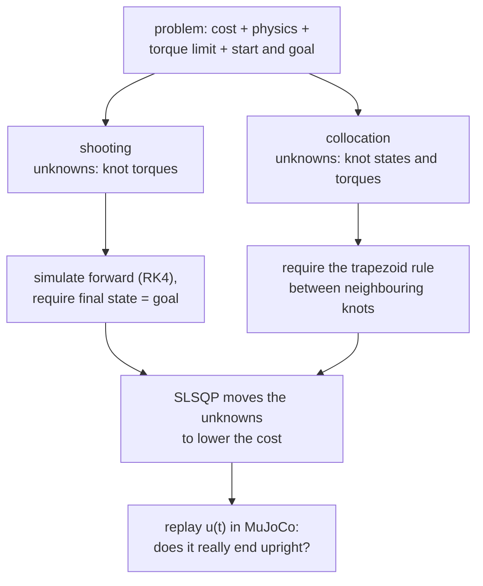

# 23 · Trajectory optimization

<!-- meta -->
| | |
|---|---|
| **Part** | [6 · Planning and optimal control](README.md) |
| **Run type** | CPU · Mac or Colab CPU |
| **Prerequisites** | [13](../part-4-dynamics-and-control/13-trajectory-generation.md), [22](22-motion-planning.md) |
| **Learn first** | [Optimization](https://aiengineeringfromscratch.com/lesson?path=phases/01-math-foundations/08-optimization) |
| **Time** | ~60 min |
| **Code** | [`experiments/23-trajectory-optimization/experiment.py`](../experiments/23-trajectory-optimization/experiment.py) |
| **Status** | ✅ done |
<!-- /meta -->

> Trajectory optimization turns "find a motion" into "minimize a cost subject to the dynamics". How you impose the dynamics decides what "converged" means.

## The problem

A pendulum (1 kg at 1 m, $mgl = 9.81$ N·m, joint damping 0.1 N·m·s) hangs down and must end upright and at rest after 4 s. The motor gives at most 5 N·m, about half of what gravity needs at horizontal, so it cannot simply lift the pendulum; it has to pump energy in. A time polynomial from [lesson 13](../part-4-dynamics-and-control/13-trajectory-generation.md) ignores both the dynamics and the torque limit, and a path from [lesson 22](22-motion-planning.md) is only geometry. We want the input $u(t)$ itself: feasible under the dynamics and the limit, and as cheap as possible.

## Core idea

### In plain words

Trajectory optimization is curve fitting under constraints. Describe the motor torque over the 4 s with a handful of control points, called **knots**, joined by straight lines, like dragging the handles of a curve in a drawing tool. Among all such torque curves you want the one that uses the least effort and changes smoothly, subject to rules that must hold exactly: the pendulum obeys its physics, the torque never exceeds the limit, the motion starts hanging down and ends upright and at rest. A numerical optimizer (here SLSQP, sequential quadratic programming: it repeatedly replaces the problem by a simpler quadratic one with linearized constraints, solves that, and steps) moves the knots until no small change can lower the cost without breaking a rule.

The interesting choice is how to enforce "obeys its physics". There are two standard ways:

- **Direct shooting** is aiming a cannon. Only the torques are unknown. For any guess you simulate forward and look where the pendulum lands at 4 s; the rule is "land on the goal". Every torque affects the landing, and early torques much more than late ones.
- **Direct collocation** is a connect-the-dots puzzle. You also guess the pendulum's state (angle and angular velocity) at every knot, and require that each pair of neighbouring dots agrees with the physics according to a simple integration rule. Nothing is simulated inside the optimizer, and every rule only links two neighbours, so the problem is easy for the solver. But "agrees by the simple rule" is not the same as "agrees with the real motion between the dots". That gap is this lesson's twist.

### The two transcriptions



### Shooting and collocation as code

```python
# Pendulum: state x = (theta, omega), theta = 0 hanging down; u = motor torque (N m)
def f(x, u):                                    # dynamics: returns (theta_dot, omega_dot)
    theta, omega = x
    return (omega, (u - b * omega - m * g * l * sin(theta)) / (m * l**2))

# Torque is piecewise linear through N+1 knots u[0..N], spaced h = T / N seconds apart.
def cost(u):                                    # effort + smoothness
    return h * sum((u[:-1]**2 + u[1:]**2) / 2) + w_s * sum(diff(u)**2) / h

def shooting_constraint(u):                     # unknowns: u only
    x = x0
    for k in range(N):                          # integrate every interval (RK4, 20 sub-steps)
        x = rk4_interval(f, x, u[k], u[k + 1], h)
    return x - x_goal                           # 2 equations: angle and speed at time T

def collocation_constraints(X, u):              # unknowns: knot states X[0..N] and u
    F = f(X, u)                                 # dynamics evaluated at every knot
    defects = X[1:] - X[:-1] - h / 2 * (F[1:] + F[:-1])   # trapezoid rule, 2N equations
    return concat(defects, X[0] - x0, X[-1] - x_goal)
```

The optimizer minimizes `cost` with the torque bounds `-u_max <= u <= u_max` and drives the constraint functions to zero.

| Quantity | Formula |
|---|---|
| Cost | $J = \int_0^T u^2\,dt + w_s \int_0^T \dot u^2\,dt$ |
| Dynamics | $\dot x = f(x, u)$ |
| Knot spacing | $h = T/N$ |
| Trapezoidal defect | $x_{k+1} - x_k - \tfrac{h}{2}\bigl(f(x_k,u_k) + f(x_{k+1},u_{k+1})\bigr) = 0$ |

Here $u$ is the motor torque, $\dot u$ its rate of change, $w_s$ the weight of the smoothness term, $T$ the duration, $x = (\theta, \omega)$ the pendulum's angle and angular velocity, $f$ the dynamics, $N$ the number of intervals (so $N+1$ knots), and $x_k, u_k$ the state and torque at knot $k$. A **defect** is the amount by which one interval breaks the integration rule; collocation requires every defect to be zero.

| | Direct shooting | Direct collocation |
|---|---|---|
| decision variables | knot inputs $u_0..u_N$ | knot states $x_0..x_N$ and inputs $u_0..u_N$ |
| dynamics | integrated forward (here RK4, 20 sub-steps per interval) | equality "defects" only at the knots |
| constraints | $x_N(u) = x_{goal}$ (2 equations) | $2N$ defects + boundary states |
| exact | the simulated trajectory | the discretized equations |
| initial guess | inputs only | states and inputs |

<details>
<summary>Math details: the continuous problem, the two transcriptions and their trade-offs</summary>

**The continuous problem.**

$$\min_{u(\cdot)} \int_0^T u^2\,dt + w_s \int_0^T \dot u^2\,dt \quad \text{s.t.}\quad \dot x = f(x,u),\ \ \lvert u\rvert \le u_{max},\ \ x(0)=x_0,\ \ x(T)=x_{goal}.$$

Effort and smoothness are cost terms; the goal is imposed here as a hard terminal constraint (a terminal penalty $w_g\lVert x(T)-x_{goal}\rVert^2$ is the soft alternative). Discretizing $u(t)$ as piecewise linear through $N+1$ knots turns the infinite-dimensional problem into a finite nonlinear program that SLSQP can solve ([Tedrake, ch. 10](https://underactuated.csail.mit.edu/trajopt.html)). In the code above the effort integral uses the trapezoid rule and $\int \dot u^2 dt$ is approximated by $\sum (\Delta u)^2 / h$.

**Accuracy of the trapezoid rule.** The trapezoidal defect is a second-order integration rule: its error per interval shrinks like $h^3$, its accumulated error like $h^2$. Tedrake's chapter uses a cubic-state, linear-input scheme (Hermite–Simpson), which is more accurate; trapezoidal is the simpler version. The solver satisfies the defects to machine precision, but the defects themselves only approximate $\dot x = f(x,u)$ between knots, which is why the replay error falls as $N$ grows.

**Structure of the constraints.** Collocation's constraint Jacobian (the matrix of derivatives of all constraints with respect to all unknowns) is sparse and banded: each defect only couples knots $k$ and $k+1$. Shooting has few variables, but every constraint depends on every input through the whole rollout, and early inputs move the terminal state far more than late ones (Tedrake's "tail wagging the dog"). That makes shooting numerically harder and its Jacobian expensive: here it is computed by forward differences, one extra rollout per knot.

**Local, not global.** The dynamics contain $\sin\theta$, so the set of feasible trajectories is not convex. SQP converges to a point satisfying the first-order optimality (KKT, Karush–Kuhn–Tucker) conditions: no feasible small change lowers the cost. Such a point is a local minimum at best, and which one you get depends on the initial guess (Break it). A local solver that stalls cannot tell you whether the problem is infeasible or it is merely stuck.

Go deeper: [Optimization](https://aiengineeringfromscratch.com/lesson?path=phases/01-math-foundations/08-optimization) (gradients, constraints, local minima); [Tedrake, *Underactuated Robotics*, ch. 10](https://underactuated.csail.mit.edu/trajopt.html) (direct transcription, shooting, collocation); [SciPy SLSQP](https://docs.scipy.org/doc/scipy/reference/optimize.minimize-slsqp.html).

</details>

## Experiment

**Prediction.** Both methods should converge for enough knots, to about the same cost. "Converged" may not mean the same thing for both.

Full script: [`experiments/23-trajectory-optimization/experiment.py`](../experiments/23-trajectory-optimization/experiment.py). The core of the collocation version:

```python
def defects(z):                                   # z = [x_0..x_N, u_0..u_N]
    X, U = unpack(z)
    F = f(X, U)
    d = X[1:] - X[:-1] - h / 2 * (F[1:] + F[:-1])  # trapezoidal rule
    return np.concatenate([d.ravel(), X[0] - X0, X[-1] - XG])

r = minimize(obj, z0, jac=obj_grad, method="SLSQP",
             bounds=[(None, None)] * (2 * n) + [(-UMAX, UMAX)] * n,
             constraints=[{"type": "eq", "fun": defects, "jac": defects_jac}])
```

Cost: $J = \int u^2 dt + 0.05 \int \dot u^2 dt$. Collocation gets an analytic constraint Jacobian; shooting's terminal-constraint Jacobian comes from batched forward differences (the cost gradient is analytic in both). Both start from zero torque with the state resting at the bottom. After solving, every $u(t)$ is **replayed open-loop in a MuJoCo pendulum** (played back as a fixed torque schedule, with no feedback; same parameters, RK4, 1 ms steps): the replay error is the goal error of the motion you would actually get. The solver residual is the largest constraint violation the solver itself sees. MuJoCo 3.17.0, NumPy 2.5.4, SciPy 1.18.1, Apple Silicon Mac (Apple M5), deterministic.

| method | N | converged | iterations | cost | solver residual | replay error θ (deg) | replay error ω (deg/s) |
|---|---|---|---|---|---|---|---|
| shooting | 5 | False | 438 | 104.44 | 3.9e-01 | 21.33 | 22.41 |
| collocation | 5 | False | 500 | 89.74 | 3.5e+00 | 174.73 | 527.46 |
| shooting | 10 | True | 158 | 43.51 | 1.1e-13 | 0.00 | 0.00 |
| collocation | 10 | True | 22 | 45.56 | 5.9e-12 | 23.82 | 71.61 |
| shooting | 20 | True | 123 | 39.33 | 5.5e-11 | 0.00 | 0.00 |
| collocation | 20 | True | 32 | 39.63 | 3.2e-12 | 6.73 | 20.45 |
| shooting | 40 | True | 147 | 38.34 | 5.1e-12 | 0.00 | 0.00 |
| collocation | 40 | True | 54 | 38.41 | 2.9e-12 | 2.27 | 6.92 |
| shooting | 80 | True | 158 | 38.09 | 1.4e-11 | 0.00 | 0.00 |
| collocation | 80 | True | 91 | 38.11 | 3.4e-13 | 0.61 | 1.87 |


1. **Same cost, different truth.** From $N=10$ on, both report convergence with residuals of $10^{-10}$ or less, and the costs meet (38.09 vs 38.11 at $N=80$). But collocation's $u(t)$ at $N=10$ ends 23.82° short of upright when actually simulated. The solver solved the discretized equations exactly; the trapezoidal rule between knots is what is wrong. The error falls as knots are added: 23.82 → 6.73 → 2.27 → 0.61°.
2. **Shooting's constraint is the simulation.** Its terminal constraint is evaluated on an RK4 rollout of the same piecewise-linear input, so the replay lands on the goal to the printed precision.
3. **Collocation is cheaper to solve.** 22–91 iterations against 123–158, and each shooting iteration also needs $N+1$ extra rollouts for its finite-difference Jacobian.
4. **$N=5$ fails for both.** With six knot torques neither solver reached a feasible point. As Tedrake notes, a local solver cannot tell you whether that problem is infeasible or the solver is merely stuck.

The practical recipe that follows: solve with collocation, then check by simulation (or refine with shooting from the collocation answer), and never trust the residual alone.

## Break it

Same problem, collocation with $N = 40$, different initial guesses. The eight noisy guesses are drawn in sequence from one generator (seed 0): the straight line plus Gaussian noise ($\sigma = 1$) on every knot state, and torques uniform within $\pm 5$ N·m.

| initial guess | converged | iterations | cost | replay error θ (deg) | torque sign changes | θ range (deg) |
|---|---|---|---|---|---|---|
| rest at bottom, u = 0 | True | 54 | 38.41 | 2.27 | 3 | −77 .. 180 |
| straight line θ 0 → π, u = 0 | True | 33 | 50.63 | 58.03 | 1 | −56 .. 180 |
| line + noise, draws 0, 1, 4, 5, 7 | True | 33–41 | 50.63 | 58.03 | 1 | −56 .. 180 |
| line + noise, draws 2, 3 | True | 50, 58 | 38.41 | 2.27 | 3 | −77 .. 180 |
| line + noise, draw 6 | False | 76 | 134.04 | 160.58 | 2 | −29 .. 197 |

The obvious guess, a straight line from down to up, converges cleanly and reports success, into a different **local minimum** (a solution no small change can improve, although a very different one is better): one big back-swing (θ down to −56°) instead of a three-reversal pump, at cost 50.63 instead of 38.41. Five of eight noisy guesses fall into the same basin (the set of starting points that end in that minimum), two into the better one, one does not converge at all. The defects contain $\sin\theta$, so the feasible set is not convex, and SQP converges to a local point satisfying the optimality (KKT) conditions; which one depends on where it starts. Tedrake reports that a straight-line guess was needed for his acrobot and cart-pole swing-ups; on our pendulum it works, but lands in the worse minimum. The success flag says nothing about which minimum you got. Remedies: multi-start and keep the best, initialize from a physically plausible rollout (or from an MPC run, lesson 24), or use continuation (solve an easier problem first, e.g. a larger torque limit, then tighten). We did not isolate why the one-swing solution also replays much worse at the same $N$; either way, an open-loop plan that ends at an unstable equilibrium needs feedback to track it.

## On the real robot

- **Torque limits are model data.** The Menagerie Panda clamps actuator force to ±87 N·m on joints 1–4 and ±12 N·m on joints 5–7 ([`panda.xml`](https://github.com/google-deepmind/mujoco_menagerie/blob/f3b6013/franka_emika_panda/panda.xml)); the SO-101 model uses ±2.94 N·m for its STS3215 servo class ([`so101.xml`](https://github.com/google-deepmind/mujoco_menagerie/blob/f3b6013/robotstudio_so101/so101.xml)). Those numbers go straight into the bounds; keep a margin below them because the model's limit is not a measured hardware limit.
- **SO-101 procedure.** Its actuators are position servos in the model (`<position kp=...>`), so the optimized motion is executed as a joint position trajectory and torque is respected only indirectly. Optimize a reach with torque bounds below the model limit, replay it in MuJoCo with the position actuators, compare the actuator forces against the bound, then send the positions at low speed. Not yet measured on the real arm.
- **Open loop is not enough.** Even in simulation, an exactly converged collocation plan missed by 0.61° to 23.82°. On hardware, model error adds to discretization error; the plan must be tracked by a feedback controller (lesson 12 PD, or LQR around the trajectory, lesson 24).

## Check yourself

1. **Easy.** Why does every converged shooting solution replay with 0.00° error while collocation does not?
2. **Medium.** Replace the trapezoidal defect by Hermite–Simpson (state cubic, defect at the interval midpoint). Predict how the $N=10$ replay error changes, then measure.
3. **Hard.** Run 20 random initial guesses at $N=40$ and cluster the final costs. How many distinct local minima do you find, and which guess family reaches the best one most often?

### Answers

1. Shooting's constraint is evaluated on an RK4 rollout of the same input that the replay integrates (MuJoCo's RK4 at 1 ms is another fine-step integration of it), so the residual measures the true terminal error up to integration error. Collocation's residual only measures the trapezoidal equations; their discretization error stays (23.82° at $N=10$).
2. Not computed here. A third-order scheme should give a smaller error at the same $N$; measure it.
3. With our 10 guesses: two minima (38.41 and 50.63) and one non-converged run (134.04). For 20 guesses, run it.

## Takeaways and sources

- Collocation and shooting reached the same cost (38.11 vs 38.09 at $N=80$), but collocation's "converged" plan at $N=10$ missed upright by 23.82° when simulated. Always replay.
- Collocation needed fewer iterations (22–91 vs 123–158) and accepts a state initial guess; shooting is exact for the integrator it uses.
- Nonconvex problems converge to the basin of the initial guess: the straight-line guess gave cost 50.63, the rest guess 38.41.

Next: [lesson 24](24-lqr-and-mpc.md), feedback from optimization: LQR around an equilibrium and MPC that re-solves every step.

**Sources**

- R. Tedrake, *Underactuated Robotics*, ch. 10 "Trajectory Optimization" (direct transcription, direct shooting, direct collocation, local minima). [underactuated.csail.mit.edu/trajopt.html](https://underactuated.csail.mit.edu/trajopt.html).
- SciPy, [`scipy.optimize.minimize` (SLSQP)](https://docs.scipy.org/doc/scipy/reference/optimize.minimize-slsqp.html).
- MuJoCo Menagerie, [`franka_emika_panda/panda.xml`](https://github.com/google-deepmind/mujoco_menagerie/blob/f3b6013/franka_emika_panda/panda.xml), [`robotstudio_so101/so101.xml`](https://github.com/google-deepmind/mujoco_menagerie/blob/f3b6013/robotstudio_so101/so101.xml).
- All tables: [`experiments/23-trajectory-optimization/output.txt`](../experiments/23-trajectory-optimization/output.txt) (MuJoCo 3.17.0, SciPy 1.18.1, 2026-10-27).
