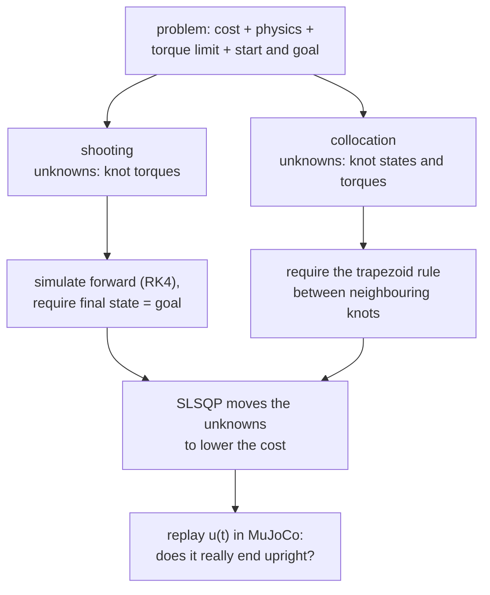

# 23 · Trajectory optimization

<!-- meta -->
| | |
|---|---|
| **Part** | [6 · Planning and optimal control](README.md) |
| **Run type** | CPU · Mac or Colab CPU |
| **Prerequisites** | [13](../part-4-dynamics-and-control/13-trajectory-generation.md), [22](22-motion-planning.md) |
| **Learn first** | [Optimization](https://aiengineeringfromscratch.com/lesson?path=phases/01-math-foundations/08-optimization) |
| **Time** | ~60 min |
| **Code** | [`experiments/23-trajectory-optimization/experiment.py`](../experiments/23-trajectory-optimization/experiment.py) |
| **Status** | ✅ done |
<!-- /meta -->

> Trajectory optimization turns "find a motion" into "minimize a cost subject to the dynamics". How you impose the dynamics decides what "converged" means.

## The problem

A pendulum (1 kg at 1 m, $mgl = 9.81$ N·m, joint damping 0.1 N·m·s) hangs down and must end upright and at rest after 4 s. The motor gives at most 5 N·m, about half of what gravity needs at horizontal, so it cannot simply lift the pendulum; it has to pump energy in. A time polynomial from [lesson 13](../part-4-dynamics-and-control/13-trajectory-generation.md) ignores both the dynamics and the torque limit, and a path from [lesson 22](22-motion-planning.md) is only geometry. We want the input $u(t)$ itself: feasible under the dynamics and the limit, and as cheap as possible.

## Core idea

### In plain words

Trajectory optimization is curve fitting under constraints. Describe the motor torque over the 4 s by a handful of control points, **knots**, joined by straight lines, like the handles of a curve in a drawing tool. You want the torque curve with the least effort and the smoothest changes, subject to rules that must hold exactly: the pendulum obeys its physics, the torque stays within the limit, the motion starts hanging down and ends upright and at rest. A numerical optimizer (here SLSQP, sequential quadratic programming: it repeatedly solves a quadratic approximation with linearized constraints and steps) moves the knots until no small change can lower the cost without breaking a rule.

The interesting choice is how to enforce "obeys its physics". There are two standard ways:

- **Direct shooting** is aiming a cannon. Only the torques are unknown: simulate forward and require the pendulum to land on the goal at 4 s. Every torque affects the landing, early ones much more than late ones.
- **Direct collocation** is a connect-the-dots puzzle. You also guess the pendulum's state (angle and angular velocity) at every knot and require that neighbouring dots agree with the physics according to a simple integration rule. Nothing is simulated and every rule links only two neighbours, so the problem is easy for the solver. But "agrees by the simple rule" is not "agrees with the real motion between the dots": that gap is this lesson's twist.

### The two transcriptions



### Shooting and collocation as code

```python
# x = (theta, omega), theta = 0 hanging down; u = torque, piecewise linear through N+1 knots
cost = h * sum((u[:-1]**2 + u[1:]**2) / 2) + w_s * sum(diff(u)**2) / h   # effort + smoothness

# shooting: unknowns u; simulate (RK4) and require the final state to be the goal (2 equations)
constraints = rollout(f, x0, u)[-1] - x_goal

# collocation: unknowns X and u; require the trapezoid rule between neighbours (2N equations)
F = f(X, u)
constraints = concat(X[1:] - X[:-1] - h / 2 * (F[1:] + F[:-1]), X[0] - x0, X[-1] - x_goal)
```

| Quantity | Formula |
|---|---|
| Cost | $J = \int_0^T u^2\,dt + w_s \int_0^T \dot u^2\,dt$ |
| Dynamics | $\dot x = f(x, u)$ |
| Knot spacing | $h = T/N$ |
| Trapezoidal defect | $x_{k+1} - x_k - \tfrac{h}{2}\bigl(f(x_k,u_k) + f(x_{k+1},u_{k+1})\bigr) = 0$ |

Here $u$ is the torque, $\dot u$ its rate of change, $w_s$ the smoothness weight, $T$ the duration, $x = (\theta, \omega)$ angle and angular velocity, $f$ the dynamics, $N$ the number of intervals ($N+1$ knots), and $x_k, u_k$ state and torque at knot $k$. A **defect** is the amount by which one interval breaks the integration rule; collocation requires every defect to be zero.

| | Direct shooting | Direct collocation |
|---|---|---|
| decision variables | knot inputs $u_0..u_N$ | knot states $x_0..x_N$ and inputs $u_0..u_N$ |
| dynamics | integrated forward (here RK4, 20 sub-steps per interval) | equality "defects" only at the knots |
| constraints | $x_N(u) = x_{goal}$ (2 equations) | $2N$ defects + boundary states |
| exact | the simulated trajectory | the discretized equations |
| initial guess | inputs only | states and inputs |

<details>
<summary>Math details: the continuous problem, the two transcriptions and their trade-offs</summary>

**The continuous problem.**

$$\min_{u(\cdot)} \int_0^T u^2\,dt + w_s \int_0^T \dot u^2\,dt \quad \text{s.t.}\quad \dot x = f(x,u),\ \ \lvert u\rvert \le u_{max},\ \ x(0)=x_0,\ \ x(T)=x_{goal}.$$

The goal is a hard terminal constraint (a terminal penalty $w_g\lVert x(T)-x_{goal}\rVert^2$ is the soft alternative). A piecewise-linear $u(t)$ through $N+1$ knots turns this into a finite nonlinear program ([Tedrake, ch. 10](https://underactuated.csail.mit.edu/trajopt.html)); the effort integral uses the trapezoid rule and $\int \dot u^2 dt \approx \sum (\Delta u)^2 / h$.

**Accuracy of the trapezoid rule.** A second-order rule: its error per interval shrinks like $h^3$, its accumulated error like $h^2$. Tedrake's chapter uses the more accurate Hermite–Simpson scheme (cubic state, linear input). The solver satisfies the defects to machine precision, but the defects only approximate $\dot x = f(x,u)$ between knots, which is why the replay error falls as $N$ grows.

**Structure of the constraints.** Collocation's constraint Jacobian is sparse and banded. Shooting has few variables, but every constraint depends on every input through the whole rollout, and early inputs move the terminal state far more than late ones (Tedrake's "tail wagging the dog"): numerically harder, and its Jacobian costs one extra rollout per knot.

**Local, not global.** The dynamics contain $\sin\theta$, so the feasible set is not convex. SQP converges to a point satisfying the first-order optimality (KKT, Karush–Kuhn–Tucker) conditions, a local minimum at best, and which one depends on the initial guess (Break it). A local solver that stalls cannot tell whether the problem is infeasible or it is merely stuck.

Go deeper: [Optimization](https://aiengineeringfromscratch.com/lesson?path=phases/01-math-foundations/08-optimization) (gradients, constraints, local minima); [Tedrake, *Underactuated Robotics*, ch. 10](https://underactuated.csail.mit.edu/trajopt.html) (direct transcription, shooting, collocation); [SciPy SLSQP](https://docs.scipy.org/doc/scipy/reference/optimize.minimize-slsqp.html).

</details>

## Build it

You will now write both transcriptions yourself and hand them to SciPy's SLSQP: the dynamics, the cost with its gradient, the trapezoidal defects with their Jacobian, and the two solver set-ups. SciPy only solves the nonlinear program; every function it calls is yours. Type the steps into a file of your own and run it after each step. The finished functions are in [`physai/optimal.py`](../physai/optimal.py); `uv run python experiments/23-trajectory-optimization/build.py` runs all five steps with their checks (output in [`build_output.txt`](../experiments/23-trajectory-optimization/build_output.txt)).

### Step 1 · Dynamics and a rollout

```python
def pendulum_f(x, u, m=1.0, l=1.0, b=0.1, g=9.81):
    """Pendulum dynamics, vectorized over leading dims. x = (theta, omega), theta = 0 hanging down."""
    th, w = x[..., 0], x[..., 1]
    return np.stack([w, (u - b * w - m * g * l * np.sin(th)) / (m * l * l)], axis=-1)
```

```python
def rk4_rollout(f, x0, U, T, sub=20):
    """Final state for knot torques U (rows: one control sequence each), u linear between knots, RK4."""
    U = np.atleast_2d(U)
    N = U.shape[1] - 1
    h = T / N / sub
    x = np.tile(x0, (U.shape[0], 1))
    for k in range(N):
        for s in range(sub):
            a = s / sub
            u0 = U[:, k] * (1 - a) + U[:, k + 1] * a                         # start of the sub-step
            um = U[:, k] * (1 - a - 0.5 / sub) + U[:, k + 1] * (a + 0.5 / sub)  # its midpoint
            u1 = U[:, k] * (1 - a - 1.0 / sub) + U[:, k + 1] * (a + 1.0 / sub)  # its end
            k1 = f(x, u0)
            k2 = f(x + h / 2 * k1, um)
            k3 = f(x + h / 2 * k2, um)
            k4 = f(x + h * k3, u1)
            x = x + h / 6 * (k1 + 2 * k2 + 2 * k3 + k4)
    return x
```

The rollout integrates every row of `U` at once (shooting's finite differences need that). Check it against the Experiment's MuJoCo pendulum (RK4, 1 ms):

== Step 1. RK4 rollout of the pendulum vs MuJoCo (u(t) = 4 sin(1.5 t) through 11 knots) ==
final state ours (theta, omega) = (-0.036999, 0.225944) | MuJoCo = (-0.036999, 0.225943)
max difference 8.2e-07

### Step 2 · Cost and gradient

```python
def effort_cost(U, h, w_smooth):
    """J = int u^2 dt (trapezoid) + w_smooth * sum (du)^2 / h, and its gradient dJ/dU."""
    du = np.diff(U)
    J = h * np.sum((U[:-1] ** 2 + U[1:] ** 2) / 2) + w_smooth * np.sum(du ** 2) / h
    g = 2 * h * U
    g[0] *= 0.5
    g[-1] *= 0.5
    gs = 2 * w_smooth * du / h
    g[:-1] -= gs
    g[1:] += gs
    return J, g
```

Every knot appears in two trapezoids and two differences, hence the gradient. Check it against finite differences:

== Step 2. Cost gradient vs finite differences (N = 10, random torques) ==
J = 57.5086 | max |grad - finite difference| = 6.6e-07

### Step 3 · Trapezoidal defects

```python
def trapezoid_defects(f, X, U, h):
    """x_{k+1} - x_k - h/2 (f_k + f_{k+1}) for every interval: an N x 2 array, zero when the knots obey the rule."""
    F = f(X, U)
    return X[1:] - X[:-1] - h / 2 * (F[1:] + F[:-1])
```

The solver also wants their derivatives. Each defect touches only knots $k$ and $k+1$, so the Jacobian is banded, built from the 2 × 2 derivatives of $f$:

```python
def pendulum_jac(x, u, m=1.0, l=1.0, b=0.1, g=9.81):
    """df/dx (2 x 2) and df/du (2,) of pendulum_f at one knot."""
    inertia = m * l * l
    return np.array([[0.0, 1.0], [-m * g * l * np.cos(x[0]) / inertia, -b / inertia]]), np.array([0.0, 1 / inertia])
```

```python
def trapezoid_jacobian(jac, X, U, h):
    """Derivative of the flattened defects w.r.t. z = [X.ravel(), U]: (2N) x 3(N+1), banded."""
    n = len(U)
    J = np.zeros((2 * (n - 1), 3 * n))
    for k in range(n - 1):
        r = slice(2 * k, 2 * k + 2)
        for j, sign in ((k, -1.0), (k + 1, 1.0)):
            dfx, dfu = jac(X[j], U[j])
            J[r, 2 * j:2 * j + 2] = sign * np.eye(2) - h / 2 * dfx
            J[r, 2 * n + j] = -h / 2 * dfu
    return J
```

Two checks: the Jacobian against finite differences, and the defects of the *true* motion (knots taken from a fine RK4 run) for three knot spacings:

== Step 3. Trapezoidal defects ==
Jacobian 20 x 33, nonzeros 100 | max |analytic - finite difference| = 8.0e-08
defects of the true motion (u linear through the knots of 4 sin(1.5 t), RK4 with 200 sub-steps per interval):
  N = 10  h = 0.40 s  max |defect| = 1.41e-01
  N = 20  h = 0.20 s  max |defect| = 1.95e-02
  N = 40  h = 0.10 s  max |defect| = 2.50e-03

100 of 660 entries are non-zero. The defects of the true motion are not zero and shrink by about 8× per halving of $h$, the $h^3$ of the trapezoid rule (Math details). When the solver drives the defects to zero, it therefore finds knots that obey the rule, not the motion.

### Step 4 · Collocation with SLSQP

```python
def collocate(f, jac, x0, xg, N, T, umax, w_smooth, X_init, U_init, maxiter=500):
    """Direct collocation: unknowns are knot states and torques, constraints are the trapezoidal defects."""
    h, n = T / N, N + 1

    def unpack(z):
        return z[:2 * n].reshape(n, 2), z[2 * n:]

    def cons(z):
        X, U = unpack(z)
        return np.concatenate([trapezoid_defects(f, X, U, h).ravel(), X[0] - x0, X[-1] - xg])

    def cons_jac(z):
        X, U = unpack(z)
        B = np.zeros((4, 3 * n))
        B[0:2, 0:2], B[2:4, 2 * n - 2:2 * n] = np.eye(2), np.eye(2)    # boundary states
        return np.vstack([trapezoid_jacobian(jac, X, U, h), B])

    def grad(z):
        g = np.zeros_like(z)
        g[2 * n:] = effort_cost(unpack(z)[1], h, w_smooth)[1]
        return g

    r = minimize(lambda z: effort_cost(unpack(z)[1], h, w_smooth)[0], np.r_[X_init.ravel(), U_init], jac=grad,
                 method="SLSQP", bounds=[(None, None)] * (2 * n) + [(-umax, umax)] * n,
                 constraints=[{"type": "eq", "fun": cons, "jac": cons_jac}],
                 options=dict(maxiter=maxiter, ftol=1e-9))
    X, U = unpack(r.x)
    return r, X, U, float(np.abs(cons(r.x)).max())
```

Solve from rest at the bottom and replay each $u(t)$ in MuJoCo:

== Step 4. Direct collocation, SLSQP from rest at the bottom, replayed in MuJoCo ==
  N converged iters    cost solver residual replay err theta (deg)
 10      True    22   45.56         5.9e-12                  23.82
 20      True    32   39.63         3.2e-12                   6.73
 40      True    54   38.41         2.9e-12                   2.27

These are the Experiment's collocation rows: same functions, same starting point, same SLSQP iterates. The residual is 10⁻¹², yet at $N = 10$ the pendulum misses upright by 23.82°: the defects of Step 3 at work.

### Step 5 · Shooting with SLSQP

```python
def shoot(f, x0, xg, N, T, umax, w_smooth, U_init, sub=20, eps=1e-6, maxiter=500):
    """Direct shooting: unknowns are the knot torques, the constraint is the RK4 rollout's final state."""
    h = T / N

    def term(U):
        return rk4_rollout(f, x0, U, T, sub)[0] - xg

    def term_jac(U):                     # forward differences, all perturbations in one batched rollout
        xs = rk4_rollout(f, x0, np.vstack([U, U + eps * np.eye(N + 1)]), T, sub)
        return ((xs[1:] - xs[0]) / eps).T

    r = minimize(lambda U: effort_cost(U, h, w_smooth)[0], U_init, jac=lambda U: effort_cost(U, h, w_smooth)[1],
                 method="SLSQP", bounds=[(-umax, umax)] * (N + 1),
                 constraints=[{"type": "eq", "fun": term, "jac": term_jac}],
                 options=dict(maxiter=maxiter, ftol=1e-9))
    return r, r.x, float(np.abs(term(r.x)).max())
```

== Step 5. Direct shooting, N = 10, SLSQP from zero torque, replayed in MuJoCo ==
converged True | iterations 158 | cost 43.51 | solver residual 1.1e-13 | replay error 0.00 deg, 0.00 deg/s

Again the Experiment's row: 158 iterations, cost 43.51, and a replay that lands on upright, because the constraint is the RK4 rollout itself.

### What you keep

`physai.optimal` now has `pendulum_f`, `pendulum_jac`, `rk4_rollout`, `effort_cost`, `trapezoid_defects`, `trapezoid_jacobian`, `collocate` and `shoot`. Lesson 24 adds LQR and MPPI to the same module. [`tests/test_23_trajectory_optimization.py`](../tests/test_23_trajectory_optimization.py) checks the gradients, the $h^3$ behaviour and the rollout against MuJoCo; run `uv run pytest tests/test_23_trajectory_optimization.py`.

## Use it

SciPy's `minimize` is the solver; what you choose is the method, which derivatives you pass and how you state the constraints:

```python
from scipy.optimize import Bounds, NonlinearConstraint, minimize
r = minimize(cost, z0, jac=cost_grad, method="SLSQP", bounds=bounds,
             constraints=[{"type": "eq", "fun": defects, "jac": defects_jac}],
             options=dict(maxiter=500, ftol=1e-9))
# trust-constr takes NonlinearConstraint(fun, lb, ub, jac=...) and accepts sparse Jacobians
r = minimize(cost, z0, jac=cost_grad, method="trust-constr", bounds=Bounds(lo, hi),
             constraints=[NonlinearConstraint(defects, 0.0, 0.0, jac=defects_jac)])
r.success, r.nit, r.fun, r.x                 # converged flag, iterations, cost, solution
```

| Tool | Equality constraint means | Jacobian |
|---|---|---|
| physai `collocate` | `cons(z) = 0` (defects, boundary states) | dense, banded (`trapezoid_jacobian`) |
| SciPy SLSQP | dict `{"type": "eq", "fun": ...}`: `fun(z) == 0`; `"ineq"` means `fun(z) >= 0` | dense array |
| SciPy trust-constr | `NonlinearConstraint(fun, lb, ub)` with `lb = ub` | dense or sparse |

Source: SciPy [`minimize`](https://docs.scipy.org/doc/scipy/reference/generated/scipy.optimize.minimize.html) and [SLSQP](https://docs.scipy.org/doc/scipy/reference/optimize.minimize-slsqp.html) reference.

Traps:

- **`success` is about the discretized problem.** `r.success` and a 10⁻¹² residual held at $N = 10$ while the replay missed by 23.82°. Always replay.
- **Inequality sign.** SLSQP's `"ineq"` means `fun(z) >= 0`; a torque limit written as `u - u_max` instead of `u_max - u` silently flips the feasible side. Bounds are simpler for box limits.
- **Missing `jac`.** Without it SciPy finite-differences every constraint at every iteration; for shooting that is one extra rollout per knot, which our batched `term_jac` does at once.

## Experiment

**Prediction.** Both methods should converge for enough knots, to about the same cost. "Converged" may not mean the same thing for both.

Full script: [`experiments/23-trajectory-optimization/experiment.py`](../experiments/23-trajectory-optimization/experiment.py); its two solvers do what Build it's `collocate` and `shoot` do, iterate for iterate.

```python
r, X, U, residual = collocate(pendulum_f, pendulum_jac, X0, XG, N, T, UMAX, 0.05, X_init, U_init)
r, U, residual = shoot(pendulum_f, X0, XG, N, T, UMAX, 0.05, U_init)
```

Cost: $J = \int u^2 dt + 0.05 \int \dot u^2 dt$. Both start from zero torque with the state resting at the bottom. Every $u(t)$ is then **replayed open-loop in a MuJoCo pendulum** (a fixed torque schedule, no feedback; RK4, 1 ms): the replay error is the goal error of the motion you would actually get, the solver residual the largest constraint violation the solver sees. MuJoCo 3.17.0, NumPy 2.5.4, SciPy 1.18.1, Apple Silicon Mac (Apple M5), deterministic.

| method | N | converged | iterations | cost | solver residual | replay error θ (deg) | replay error ω (deg/s) |
|---|---|---|---|---|---|---|---|
| shooting | 5 | False | 438 | 104.44 | 3.9e-01 | 21.33 | 22.41 |
| collocation | 5 | False | 500 | 89.74 | 3.5e+00 | 174.73 | 527.46 |
| shooting | 10 | True | 158 | 43.51 | 1.1e-13 | 0.00 | 0.00 |
| collocation | 10 | True | 22 | 45.56 | 5.9e-12 | 23.82 | 71.61 |
| shooting | 20 | True | 123 | 39.33 | 5.5e-11 | 0.00 | 0.00 |
| collocation | 20 | True | 32 | 39.63 | 3.2e-12 | 6.73 | 20.45 |
| shooting | 40 | True | 147 | 38.34 | 5.1e-12 | 0.00 | 0.00 |
| collocation | 40 | True | 54 | 38.41 | 2.9e-12 | 2.27 | 6.92 |
| shooting | 80 | True | 158 | 38.09 | 1.4e-11 | 0.00 | 0.00 |
| collocation | 80 | True | 91 | 38.11 | 3.4e-13 | 0.61 | 1.87 |


1. **Same cost, different truth.** From $N=10$ on, both report convergence with residuals of $10^{-10}$ or less, and the costs meet (38.09 vs 38.11 at $N=80$). But collocation's $u(t)$ at $N=10$ ends 23.82° short of upright when simulated: the discretized equations are solved exactly, the trapezoidal rule between knots is wrong. The error falls with more knots: 23.82 → 6.73 → 2.27 → 0.61°.
2. **Shooting's constraint is the simulation.** Its terminal constraint is evaluated on an RK4 rollout of the same piecewise-linear input, so the replay lands on the goal to the printed precision.
3. **Collocation is cheaper to solve.** 22–91 iterations against 123–158, and each shooting iteration also needs $N+1$ extra rollouts for its finite-difference Jacobian.
4. **$N=5$ fails for both.** With six knot torques neither solver reached a feasible point; a local solver cannot tell whether that problem is infeasible or it is merely stuck.

The recipe: solve with collocation, check by simulation (or refine with shooting from the collocation answer), never trust the residual alone.

## Break it

Same problem, collocation with $N = 40$, different initial guesses. The eight noisy guesses are drawn in sequence from one generator (seed 0): the straight line plus Gaussian noise ($\sigma = 1$) on every knot state, and torques uniform within $\pm 5$ N·m.

| initial guess | converged | iterations | cost | replay error θ (deg) | torque sign changes | θ range (deg) |
|---|---|---|---|---|---|---|
| rest at bottom, u = 0 | True | 54 | 38.41 | 2.27 | 3 | −77 .. 180 |
| straight line θ 0 → π, u = 0 | True | 33 | 50.63 | 58.03 | 1 | −56 .. 180 |
| line + noise, draws 0, 1, 4, 5, 7 | True | 33–41 | 50.63 | 58.03 | 1 | −56 .. 180 |
| line + noise, draws 2, 3 | True | 50, 58 | 38.41 | 2.27 | 3 | −77 .. 180 |
| line + noise, draw 6 | False | 76 | 134.04 | 160.58 | 2 | −29 .. 197 |

The obvious guess, a straight line from down to up, converges cleanly and reports success, into a different **local minimum** (no small change improves it, although a very different solution is better): one big back-swing (θ down to −56°) instead of a three-reversal pump, at cost 50.63 instead of 38.41. Five of eight noisy guesses fall into the same basin (the starting points that end in that minimum), two into the better one, one does not converge. Tedrake reports that a straight-line guess was needed for his acrobot and cart-pole swing-ups; on our pendulum it works, but lands in the worse minimum. The success flag says nothing about which minimum you got. Remedies: multi-start and keep the best, initialize from a plausible rollout (or an MPC run, lesson 24), or continuation (solve an easier problem first, e.g. a larger torque limit, then tighten). We did not isolate why the one-swing solution also replays much worse at the same $N$; either way, an open-loop plan that ends at an unstable equilibrium needs feedback to track it.

## On the real robot

- **Torque limits are model data.** The Menagerie Panda clamps actuator force to ±87 N·m on joints 1–4 and ±12 N·m on joints 5–7 ([`panda.xml`](https://github.com/google-deepmind/mujoco_menagerie/blob/f3b6013/franka_emika_panda/panda.xml)); the SO-101 model uses ±2.94 N·m for its STS3215 servo class ([`so101.xml`](https://github.com/google-deepmind/mujoco_menagerie/blob/f3b6013/robotstudio_so101/so101.xml)). Those numbers go straight into the bounds; keep a margin below them because the model's limit is not a measured hardware limit.
- **SO-101 procedure.** Its actuators are position servos in the model (`<position kp=...>`), so the optimized motion is executed as a joint position trajectory and torque is respected only indirectly. Optimize a reach with torque bounds below the model limit, replay it in MuJoCo with the position actuators, compare the actuator forces with the bound, then send the positions slowly. Not yet measured on the real arm.
- **Open loop is not enough.** Even in simulation, an exactly converged collocation plan missed by 0.61° to 23.82°. On hardware, model error adds to discretization error; the plan must be tracked by a feedback controller (lesson 12 PD, or LQR around the trajectory, lesson 24).

## Check yourself

1. **Easy.** Why does every converged shooting solution replay with 0.00° error while collocation does not?
2. **Medium.** Replace the trapezoidal defect by Hermite–Simpson (state cubic, defect at the interval midpoint). Predict how the $N=10$ replay error changes, then measure.
3. **Hard.** Run 20 random initial guesses at $N=40$ and cluster the final costs. How many distinct local minima do you find, and which guess family reaches the best one most often?

### Answers

1. Shooting's constraint is evaluated on an RK4 rollout of the same input that the replay integrates (MuJoCo's RK4 at 1 ms is another fine-step integration of it), so the residual measures the true terminal error up to integration error. Collocation's residual only measures the trapezoidal equations; their discretization error stays (23.82° at $N=10$).
2. Not computed here. A third-order scheme should give a smaller error at the same $N$; measure it.
3. With our 10 guesses: two minima (38.41 and 50.63) and one non-converged run (134.04). For 20 guesses, run it.

## Takeaways and sources

- Collocation and shooting reached the same cost (38.11 vs 38.09 at $N=80$), but collocation's "converged" plan at $N=10$ missed upright by 23.82° when simulated. Always replay.
- Collocation needed fewer iterations (22–91 vs 123–158) and accepts a state initial guess; shooting is exact for the integrator it uses.
- Nonconvex problems converge to the basin of the initial guess: the straight-line guess gave cost 50.63, the rest guess 38.41.

Next: [lesson 24](24-lqr-and-mpc.md), feedback from optimization: LQR around an equilibrium and MPC that re-solves every step.

**Sources**

- R. Tedrake, *Underactuated Robotics*, ch. 10 "Trajectory Optimization" (direct transcription, direct shooting, direct collocation, local minima). [underactuated.csail.mit.edu/trajopt.html](https://underactuated.csail.mit.edu/trajopt.html).
- SciPy, [`scipy.optimize.minimize` (SLSQP)](https://docs.scipy.org/doc/scipy/reference/optimize.minimize-slsqp.html).
- MuJoCo Menagerie, [`franka_emika_panda/panda.xml`](https://github.com/google-deepmind/mujoco_menagerie/blob/f3b6013/franka_emika_panda/panda.xml), [`robotstudio_so101/so101.xml`](https://github.com/google-deepmind/mujoco_menagerie/blob/f3b6013/robotstudio_so101/so101.xml).
- All tables: [`experiments/23-trajectory-optimization/output.txt`](../experiments/23-trajectory-optimization/output.txt) (MuJoCo 3.17.0, SciPy 1.18.1, 2026-10-27).
