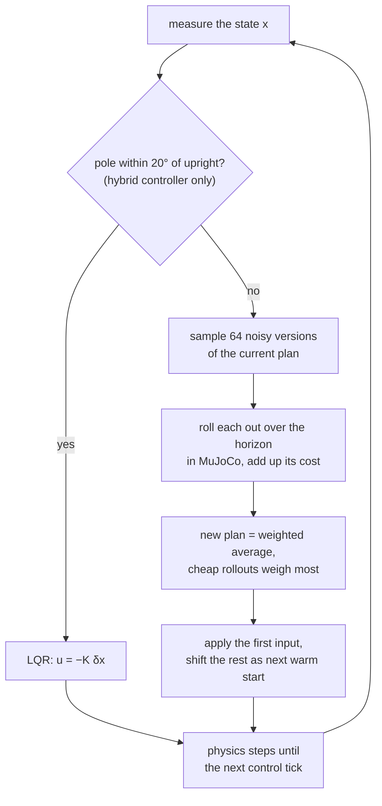

# 24 · LQR and model predictive control

<!-- meta -->
| | |
|---|---|
| **Part** | [6 · Planning and optimal control](README.md) |
| **Run type** | CPU · Mac or Colab CPU |
| **Prerequisites** | [11](../part-4-dynamics-and-control/11-rigid-body-dynamics.md), [23](23-trajectory-optimization.md) |
| **Learn first** | [Optimization](https://aiengineeringfromscratch.com/lesson?path=phases/01-math-foundations/08-optimization) · [Convex Optimization](https://aiengineeringfromscratch.com/lesson?path=phases/01-math-foundations/18-convex-optimization) |
| **Time** | ~75 min |
| **Code** | [`experiments/24-lqr-and-mpc/experiment.py`](../experiments/24-lqr-and-mpc/experiment.py) |
| **Status** | ✅ done |
<!-- /meta -->

> LQR is the exact answer to a linear question asked once. MPC asks the nonlinear question again at every control step.

## The problem

A cart-pole: a 1 kg cart on a 3 m track, a 0.2 kg, 0.6 m pole on a hinge, one horizontal force. Two jobs: hold the pole upright, and bring it up from hanging down. Lesson 23 produced converged open-loop plans that missed the goal by up to 23.82° in simulation; any real controller has to close the loop. The questions for this lesson: how far from upright does a linear feedback law still work, and what do you use outside that region?

## Core idea

### In plain words

Balancing a broomstick on your palm is a good picture of **LQR** (linear-quadratic regulator). Near upright, the stick's behaviour is almost linear: a small tilt makes it fall with an acceleration roughly proportional to the tilt. For physics that is linear and a cost that adds up squared errors and squared effort, the best possible controller is known in closed form and computed once, offline: a fixed row of gains $K$. At run time the controller is a single dot product, "push by minus $K$ times how far the state is from upright". Its weakness is that it only knows that neighbourhood. It does not know the motor has a maximum force or that the track ends, and from hanging down its linear picture is simply wrong.

**MPC** (model predictive control) is a GPS that recomputes the route at every intersection. At every control step it takes the state it actually measures, plans the next fraction of a second (the **horizon**) with the full nonlinear simulator, executes only the first instant of that plan, and then plans again from wherever the system really ended up. Errors do not pile up, because nothing is followed blindly for long. Our MPC is a sampling variant, MPPI: instead of computing gradients, it tries 64 noisy variations of the current plan in MuJoCo and averages them, giving the cheap ones far more weight. The horizon is the knob: too short and it cannot see far enough ahead to brake in time, too long and 64 samples cover the longer plan too thinly.

### The MPC loop, with the LQR hand-off



### LQR and MPPI as code

```python
# LQR, offline and once: linearize at the upright, solve the Riccati equation
A, B = linearize(model, x_up, u=0)               # mjd_transitionFD: dx[t+1] ≈ A dx[t] + B du[t]
P = solve_discrete_are(A, B, Q, R)               # Q penalizes state error, R penalizes force
K = solve(R + B.T @ P @ B, B.T @ P @ A)          # 1 x 4 row of gains

def lqr(x):                                      # online: one dot product, then the force limit
    return clip(-K @ (x - x_up), -F, F)

# MPPI, online at every control step (50 Hz, i.e. every 20 ms)
def mppi_step(x, U, n_samples=64, sigma=8.0, lam=0.5):
    Uk = clip(U + normal(0, sigma, (n_samples, len(U))), -F, F)   # noisy variations of plan U
    S = array([rollout_cost(x, u_seq) for u_seq in Uk])          # simulate each from x, sum the cost
    w = exp(-(S - S.min()) / lam)                # cheap rollouts get exponentially more weight
    U = (w / w.sum()) @ Uk                       # new plan: weighted average of the samples
    return U[0], append(U[1:], U[-1])            # apply the first input; shifted plan is the next guess

while True:                                      # receding horizon: always replan from the real state
    x = measure()
    u, U = mppi_step(x, U)                       # hybrid: u = lqr(x) once |theta| < 20 deg
    apply(u)
```

| Quantity | Formula |
|---|---|
| Linear model near the equilibrium | $\delta x_{t+1} \approx A\,\delta x_t + B\,\delta u_t$ |
| LQR cost | $\sum_t \delta x_t^\top Q\,\delta x_t + \delta u_t^\top R\,\delta u_t$ |
| LQR law | $u = -K\,\delta x, \quad K = (R + B^\top P B)^{-1} B^\top P A$ |
| MPPI update | $\bar U \leftarrow \sum_k w_k U_k, \quad w_k \propto \exp\!\bigl(-(S_k - \min_j S_j)/\lambda\bigr)$ |

Here $x = (x_{cart}, \theta, \dot x_{cart}, \dot\theta)$ is the state (cart position, pole angle from upright, and their velocities), $\delta x$ and $\delta u$ are deviations from the equilibrium, $A$ and $B$ describe how one simulator step propagates them, $Q$ and $R$ weight state error against force, $P$ is the solution of the Riccati equation (the cost-to-go matrix), $K$ the gain row, $\bar U$ the current input plan over the horizon, $U_k$ the $k$-th noisy sample of it, $S_k$ that sample's rollout cost, and $\lambda$ a temperature: small $\lambda$ trusts only the best samples, large $\lambda$ averages them more evenly.

<details>
<summary>Math details: linearizing MuJoCo, the Riccati equation, stability and MPPI</summary>

**Linearizing the simulator.** Around an equilibrium $(\bar x, \bar u)$ the MuJoCo step is approximately linear, $\delta x_{t+1} \approx A\,\delta x_t + B\,\delta u_t$. `mujoco.mjd_transitionFD(m, d, eps, flg_centered, A, B, C, D)` computes $A$ ($2n_v{+}n_a$ square) and $B$ ($2n_v{+}n_a \times n_u$) by finite-differencing `mj_step`, centered if `flg_centered` is true. It does not support the RK4 integrator ([MuJoCo API](https://mujoco.readthedocs.io/en/stable/APIreference/APIfunctions.html)), so our model uses Euler at $dt = 0.01$ s.

**Discrete LQR.** Minimize $\sum_t \delta x_t^\top Q\,\delta x_t + \delta u_t^\top R\,\delta u_t$ subject to the linear model. The optimal law is linear state feedback ([Tedrake ch. 8](https://underactuated.csail.mit.edu/lqr.html)):

$$P = A^\top P A - A^\top P B\,(R + B^\top P B)^{-1} B^\top P A + Q, \qquad K = (R + B^\top P B)^{-1} B^\top P A, \qquad u = -K\,\delta x.$$

The first equation is the discrete algebraic Riccati equation; $\delta x^\top P\,\delta x$ is the optimal cost from state $\delta x$ onward. `scipy.linalg.solve_discrete_are(A, B, Q, R)` returns $P$. For a fixed linear model and quadratic cost with $Q \succeq 0$, $R \succ 0$ the problem is convex, so the optimum is global; dynamic programming then gives it in closed form through this Riccati equation (see AIEFS: [Convex Optimization](https://aiengineeringfromscratch.com/lesson?path=phases/01-math-foundations/18-convex-optimization)). The guarantee holds for the linear model, without force limits or track ends.

**Stability in discrete time.** Each step multiplies a deviation along an eigenvector by its eigenvalue. If any eigenvalue has magnitude above 1 the deviation grows step after step (unstable); if all closed-loop eigenvalues of $A - BK$ lie inside the unit circle, small deviations shrink to zero. The **region of attraction** is the set of starting states from which the real, nonlinear, force-limited system still reaches the equilibrium; the linear analysis says it is non-empty but not how large it is, so it must be measured.

**MPC and MPPI.** At every control step, solve a finite-horizon trajectory optimization from the measured state, apply the first input, discard the rest, repeat ([Tedrake ch. 10, MPC](https://underactuated.csail.mit.edu/trajopt.html)). We use a simplified MPPI ([Williams et al. 2017](https://homes.cs.washington.edu/~bboots/files/InformationTheoreticMPC.pdf)): sample $K$ perturbed input sequences $U_k = \bar U + \epsilon_k$, roll each out in MuJoCo (`mujoco.rollout`, multithreaded), score them with cost $S_k$, update $\bar U$ with the exponential weights above, then shift $\bar U$ by one step as the next warm start. Subtracting $\min_j S_j$ does not change the normalized weights; it only prevents numerical underflow. No linearization, no gradients, any cost: here $5(1-\cos\theta) + 0.5x^2 + 0.01(\dot x^2 + \dot\theta^2) + 10^{-4}u^2$ plus a penalty near the track ends.

Go deeper: [Optimization](https://aiengineeringfromscratch.com/lesson?path=phases/01-math-foundations/08-optimization), [Convex Optimization](https://aiengineeringfromscratch.com/lesson?path=phases/01-math-foundations/18-convex-optimization); [Tedrake ch. 8 (LQR)](https://underactuated.csail.mit.edu/lqr.html) and [ch. 10 (MPC)](https://underactuated.csail.mit.edu/trajopt.html); [Williams et al. 2017](https://homes.cs.washington.edu/~bboots/files/InformationTheoreticMPC.pdf) (MPPI).

</details>

## Experiment

Full script: [`experiments/24-lqr-and-mpc/experiment.py`](../experiments/24-lqr-and-mpc/experiment.py). MuJoCo 3.17.0, NumPy 2.5.4, SciPy 1.18.1, Apple Silicon Mac (Apple M5), deterministic seeds.

```python
mujoco.mj_forward(m, d)                                  # upright, at rest, u = 0
A = np.zeros((4, 4)); B = np.zeros((4, 1))
mujoco.mjd_transitionFD(m, d, 1e-6, True, A, B, None, None)
P = solve_discrete_are(A, B, Q, R)                       # Q = diag(1, 10, 0.1, 0.1), R = 0.01
K = np.linalg.solve(R + B.T @ P @ B, B.T @ P @ A)
```

**Part A.** The largest open-loop eigenvalue magnitude is 1.0536 (> 1: without control, a small tilt grows every step). $K = [-9.081, -65.8771, -10.3669, -11.81]$; the closed-loop magnitudes are 0.9202 and 0.9869 (pairs), all inside the unit circle.

**Part B, region of attraction** (the starting states from which the controller still gets the pole upright). Release the pole at rest at angle $\theta_0$, cart at $x=0$, apply $u = \text{clip}(-K\delta x, \pm F)$ for 5 s. Success: $\lvert\theta\rvert < 2°$ at the end. Prediction: larger force limits help, but only up to a point.

| $\theta_0$ (deg) | F = 5 N | F = 10 N | F = 20 N | F = 50 N |
|---|---|---|---|---|
| 0–15 | ok | ok | ok | ok |
| 20–30 | fell | ok | ok | ok |
| 35–40 | fell | track end | ok | ok |
| 45–50 | fell | fell | track end | ok |
| 55–60 | fell | fell | track end | track end |
| 180 (down) | not up | not up | not up | not up |

Two different failure modes. With a small force limit the linear law asks for more force than exists; the command saturates (is clipped at the limit) and the pole falls. With enough force the pole is caught, but the cart runs into the end of the track: LQR knows only a quadratic penalty on $x$, not the constraint $\lvert x\rvert \le 1.5$ m. Even at 50 N the region ends between 50° and 55° in this 5° sweep. From hanging down (a trial that cannot "fall", so it runs the full 5 s) LQR never brings the pole up at any force: the linearization at the upright says nothing there.

**Part C, MPPI swing-up.** From hanging down, $\lvert F\rvert \le 20$ N, 64 samples, $\sigma = 8$ N, $\lambda = 0.5$, 50 Hz, 6 s, 8 seeds per row. Sweep the horizon. "Held" means $\lvert\theta\rvert < 10°$ for the whole last second; "worst" is the median over seeds of the largest $\lvert\theta\rvert$ in that last second.

| horizon (s) | steps | passed upright | held | median first time up (s) | worst $\lvert\theta\rvert$, last 1 s (deg) | median cost |
|---|---|---|---|---|---|---|
| 0.2 | 10 | 8/8 | 0/8 | 0.80 | 178.2 | 30.97 |
| 0.3 | 15 | 8/8 | 0/8 | 0.72 | 177.2 | 29.84 |
| 0.5 | 25 | 8/8 | 8/8 | 0.90 | 3.1 | 10.79 |
| 0.7 | 35 | 8/8 | 8/8 | 1.27 | 5.1 | 9.12 |
| 1.0 | 50 | 8/8 | 3/8 | 1.09 | 11.8 | 7.57 |
| 1.5 | 75 | 8/8 | 1/8 | 1.51 | 16.0 | 10.08 |

- **Too short (0.2–0.3 s):** the pole is driven through upright but never caught; in the last second it is still swinging through the bottom (178.2°). The controller is myopic: it cannot see far enough ahead to brake in time.
- **0.5–0.7 s:** swing-up and balance in all 8 seeds, median worst angle 3.1° and 5.1°.
- **Longer (1.0–1.5 s):** still swings up every time, the 1.0 s horizon gives the lowest median cost (7.57), but balance gets sloppy (11.8°, 16.0°). An explanation consistent with these numbers: with 64 samples fixed, a 50- or 75-step input sequence is sampled more sparsely, so the averaged first input is noisier. We did not sweep the sample count to confirm it.

**The engineering answer: use both.** Same MPPI, but switch to the LQR as soon as $\lvert\theta\rvert < 20°$:

| horizon (s) | passed upright | held | median first time up (s) | worst $\lvert\theta\rvert$, last 1 s (deg) | median cost |
|---|---|---|---|---|---|
| 0.5 | 8/8 | 7/8 | 1.09 | 0.1 | 7.61 |
| 1.0 | 8/8 | 8/8 | 1.12 | 0.0 | 7.16 |
| 1.5 | 8/8 | 8/8 | 1.66 | 0.1 | 9.00 |

MPC does the nonlinear part that LQR cannot; LQR holds the equilibrium with a precision sampling cannot match. One 0.5 s run did not hold. A likely reason, not isolated here: Part B measured the region only for a pole released at rest, and a hand-off happens at speed, so 20° is not automatically inside it.


## Break it

The break is already in the tables: the LQR region ends where the force saturates or the track ends (Part B), and MPPI breaks at both ends of the horizon sweep, myopic below 0.5 s and noisy above 0.7 s for this sample budget (Part C). Summary of when each suffices:

| situation | LQR | MPC |
|---|---|---|
| small deviations around one equilibrium, inputs well inside limits | sufficient and cheapest (one matrix-vector product) | unnecessary |
| large deviations, nonlinear motion (swing-up) | fails (180°: not up at any force) | needed |
| hard constraints (force, track, contacts) | ignored, only penalized through $Q$, $R$ | in the cost or as constraints |
| compute per step | $O(n\,m)$ | $K$ rollouts of $H$ steps (here 64 rollouts of up to 75 control steps) |

## On the real robot

- **MPC runs on real legged robots.** The MIT Cheetah 3 controller simplifies the dynamics so that the problem is convex, uses prediction horizons of up to 0.5 s, and solves it in under 1 ms at 20–30 Hz ([Di Carlo et al., IROS 2018](https://dspace.mit.edu/handle/1721.1/138000.2)). Simplify the model until the solver meets the control period: the same trade-off as our horizon sweep.
- **SO-101.** The Menagerie model drives every joint through position servos (`kp="998.22" kv="2.731"`, force limit ±2.94 N·m, [`so101.xml`](https://github.com/google-deepmind/mujoco_menagerie/blob/f3b6013/robotstudio_so101/so101.xml)). `mjd_transitionFD` linearizes whatever actuators the model has, so the $B$ you get maps position targets, not torques, to the next state. Design an LQR on that servo-in-the-loop model, simulate it with the force clip, then test it at low gain on the arm. Not yet measured on the real arm.
- **The region of attraction must be measured.** Our table is in simulation with an exact model. On hardware, delays, friction and estimation noise shrink it. Sweep the initial condition on the real system as we did here, and include velocity, not just angle.

## Check yourself

1. **Easy.** Why does LQR started from hanging down fail regardless of the force limit?
2. **Medium.** With F = 10 N the failures at 35–40° are "track end". Which entry of $Q$ would you raise, and what do you expect to happen to the "fell" boundary?
3. **Hard.** Test the explanation for the long-horizon wobble: at a 1.0 s horizon, sweep the sample count (64, 128, 256) and measure "held" and the worst angle.

### Answers

1. The linear model is valid only near $\theta = 0$. Near $\theta = \pi$ the coupling from cart force to pole acceleration ($\propto \cos\theta$) has the opposite sign, so a push that would right the pole at the top turns it the other way at the bottom, and a fixed linear law cannot pump energy into a swing. Measured: "not up" at all four forces.
2. The cart-position weight $Q_{11}$. The cart should stay closer to the centre, at the price of more aggressive pole recovery, so some track-end cases may turn into "fell" cases at 10 N. Not computed here.
3. Not computed here; run it.

## Takeaways and sources

- `mjd_transitionFD` + `solve_discrete_are` give an LQR from any MuJoCo model in a few lines; here it caught the pole up to 15° at 5 N and up to 50° at 50 N, and failed by saturation or at the track end beyond.
- MPPI swung the pole up from hanging down in 8/8 seeds at every horizon, but held it only for horizons of 0.5–0.7 s with 64 samples.
- MPC for the nonlinear swing-up plus LQR for the balance held 8/8 at 1.0 and 1.5 s, with worst angle at most 0.1°.

Next: [lesson 25](../part-7-learning-from-demonstration/25-evaluating-policies.md), how to evaluate a policy with enough trials to trust the success rate.

**Sources**

- R. Tedrake, *Underactuated Robotics*, ch. 8 "Linear Quadratic Regulators" ([lqr.html](https://underactuated.csail.mit.edu/lqr.html)) and ch. 10, section on model-predictive control ([trajopt.html](https://underactuated.csail.mit.edu/trajopt.html)).
- MuJoCo API reference, [`mjd_transitionFD`](https://mujoco.readthedocs.io/en/stable/APIreference/APIfunctions.html); Python bindings, [`mujoco.rollout`](https://mujoco.readthedocs.io/en/stable/python.html).
- SciPy, [`scipy.linalg.solve_discrete_are`](https://docs.scipy.org/doc/scipy/reference/generated/scipy.linalg.solve_discrete_are.html).
- G. Williams et al., "Information Theoretic MPC for Model-Based Reinforcement Learning", ICRA 2017. [PDF](https://homes.cs.washington.edu/~bboots/files/InformationTheoreticMPC.pdf).
- J. Di Carlo, P. M. Wensing, B. Katz, G. Bledt, S. Kim, "Dynamic Locomotion in the MIT Cheetah 3 Through Convex Model-Predictive Control", IROS 2018. [MIT DSpace](https://dspace.mit.edu/handle/1721.1/138000.2).
- All tables: [`experiments/24-lqr-and-mpc/output.txt`](../experiments/24-lqr-and-mpc/output.txt) (MuJoCo 3.17.0, 2026-10-27).
