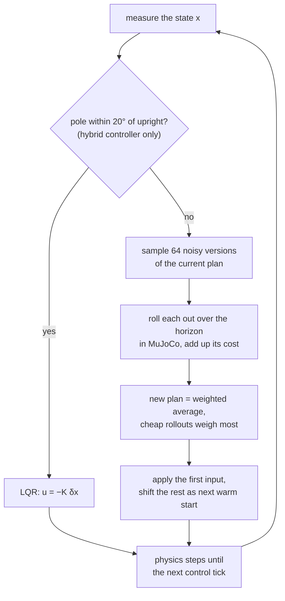

# 24 · LQR and model predictive control

<!-- meta -->
| | |
|---|---|
| **Part** | [6 · Planning and optimal control](README.md) |
| **Run type** | CPU · Mac or Colab CPU |
| **Prerequisites** | [11](../part-4-dynamics-and-control/11-rigid-body-dynamics.md), [23](23-trajectory-optimization.md) |
| **Learn first** | [Optimization](https://aiengineeringfromscratch.com/lesson?path=phases/01-math-foundations/08-optimization) · [Convex Optimization](https://aiengineeringfromscratch.com/lesson?path=phases/01-math-foundations/18-convex-optimization) |
| **Time** | ~75 min |
| **Code** | [`experiments/24-lqr-and-mpc/experiment.py`](../experiments/24-lqr-and-mpc/experiment.py) |
| **Status** | ✅ done |
<!-- /meta -->

> LQR is the exact answer to a linear question asked once. MPC asks the nonlinear question again at every control step.

## The problem

A cart-pole: a 1 kg cart on a 3 m track, a 0.2 kg, 0.6 m pole on a hinge, one horizontal force. Two jobs: hold the pole upright, and bring it up from hanging down. Lesson 23's converged open-loop plans missed the goal by up to 23.82° in simulation; a real controller has to close the loop. How far from upright does a linear feedback law still work, and what do you use outside that region?

## Core idea

### In plain words

Balancing a broomstick on your palm is a good picture of **LQR** (linear-quadratic regulator). Near upright the stick is almost linear: a small tilt makes it fall with an acceleration roughly proportional to the tilt. For linear physics and a cost that adds up squared errors and squared effort, the best controller is known in closed form and computed once, offline: a fixed row of gains $K$. At run time it is one dot product, "push by minus $K$ times how far the state is from upright". It only knows that neighbourhood: not the motor's maximum force, not the track ends, and from hanging down its linear picture is simply wrong.

**MPC** (model predictive control) is a GPS that recomputes the route at every intersection. At every control step it plans the next fraction of a second (the **horizon**) from the measured state with the full nonlinear simulator, executes only the first instant, and plans again from wherever the system really ended up, so errors do not pile up. Our MPC is a sampling variant, MPPI: it tries 64 noisy variations of the current plan in MuJoCo and averages them, giving the cheap ones far more weight. The horizon is the knob: too short and it cannot see far enough to brake in time, too long and 64 samples cover the longer plan too thinly.

### The MPC loop, with the LQR hand-off



### LQR and MPPI as code

```python
# LQR, offline and once: linearize at the upright, solve the Riccati equation
A, B = linearize(model, x_up, u=0)               # mjd_transitionFD: dx[t+1] ≈ A dx[t] + B du[t]
P = solve_discrete_are(A, B, Q, R)               # Q penalizes state error, R penalizes force
K = solve(R + B.T @ P @ B, B.T @ P @ A)          # 1 x 4 row of gains

def lqr(x):                                      # online: one dot product, then the force limit
    return clip(-K @ (x - x_up), -F, F)

# MPPI, online at every control step (50 Hz, i.e. every 20 ms)
def mppi_step(x, U, n_samples=64, sigma=8.0, lam=0.5):
    Uk = clip(U + normal(0, sigma, (n_samples, len(U))), -F, F)   # noisy variations of plan U
    S = array([rollout_cost(x, u_seq) for u_seq in Uk])          # simulate each from x, sum the cost
    w = exp(-(S - S.min()) / lam)                # cheap rollouts get exponentially more weight
    U = (w / w.sum()) @ Uk                       # new plan: weighted average of the samples
    return U[0], append(U[1:], U[-1])            # apply the first input; shifted plan is the next guess

while True:                                      # receding horizon: always replan from the real state
    x = measure()
    u, U = mppi_step(x, U)                       # hybrid: u = lqr(x) once |theta| < 20 deg
    apply(u)
```

| Quantity | Formula |
|---|---|
| Linear model near the equilibrium | $\delta x_{t+1} \approx A\,\delta x_t + B\,\delta u_t$ |
| LQR cost | $\sum_t \delta x_t^\top Q\,\delta x_t + \delta u_t^\top R\,\delta u_t$ |
| LQR law | $u = -K\,\delta x, \quad K = (R + B^\top P B)^{-1} B^\top P A$ |
| MPPI update | $\bar U \leftarrow \sum_k w_k U_k, \quad w_k \propto \exp\!\bigl(-(S_k - \min_j S_j)/\lambda\bigr)$ |

Here $x = (x_{cart}, \theta, \dot x_{cart}, \dot\theta)$ is the state (pole angle from upright), $\delta x, \delta u$ deviations from the equilibrium, $A, B$ one simulator step's propagation of them, $Q, R$ the weights on state error and force, $P$ the Riccati solution (cost-to-go matrix), $K$ the gain row, $\bar U$ the input plan over the horizon, $U_k$ its $k$-th noisy sample with rollout cost $S_k$, and $\lambda$ a temperature: small $\lambda$ trusts only the best samples.

<details>
<summary>Math details: linearizing MuJoCo, the Riccati equation, stability and MPPI</summary>

**Linearizing the simulator.** `mjd_transitionFD` finite-differences `mj_step` (Build it, Step 1). It does not support the RK4 integrator ([MuJoCo API](https://mujoco.readthedocs.io/en/stable/APIreference/APIfunctions.html)), so our model uses Euler at $dt = 0.01$ s.

**Discrete LQR.** Minimize $\sum_t \delta x_t^\top Q\,\delta x_t + \delta u_t^\top R\,\delta u_t$ subject to the linear model. The optimal law is linear state feedback ([Tedrake ch. 8](https://underactuated.csail.mit.edu/lqr.html)):

$$P = A^\top P A - A^\top P B\,(R + B^\top P B)^{-1} B^\top P A + Q, \qquad K = (R + B^\top P B)^{-1} B^\top P A, \qquad u = -K\,\delta x.$$

The first equation is the discrete algebraic Riccati equation; $\delta x^\top P\,\delta x$ is the optimal cost from $\delta x$ onward. With $Q \succeq 0$, $R \succ 0$ the problem is convex, so the optimum is global (see AIEFS: [Convex Optimization](https://aiengineeringfromscratch.com/lesson?path=phases/01-math-foundations/18-convex-optimization)), for the linear model, without force limits or track ends.

**Stability in discrete time.** Each step multiplies a deviation along an eigenvector by its eigenvalue; if all eigenvalues of $A - BK$ lie inside the unit circle, small deviations shrink to zero. The **region of attraction**, the starting states from which the real, nonlinear, force-limited system still reaches the equilibrium, is non-empty, but its size must be measured.

**MPC and MPPI.** Solve a finite-horizon trajectory optimization from the measured state, apply the first input, repeat ([Tedrake ch. 10, MPC](https://underactuated.csail.mit.edu/trajopt.html)). We use a simplified MPPI ([Williams et al. 2017](https://homes.cs.washington.edu/~bboots/files/InformationTheoreticMPC.pdf)): perturbed sequences $U_k = \bar U + \epsilon_k$, rolled out with `mujoco.rollout`, weighted as above, then $\bar U$ shifted by one step as the next warm start. Subtracting $\min_j S_j$ only prevents underflow. No linearization, no gradients, any cost: here $5(1-\cos\theta) + 0.5x^2 + 0.01(\dot x^2 + \dot\theta^2) + 10^{-4}u^2$ plus a penalty near the track ends.

Go deeper: [Optimization](https://aiengineeringfromscratch.com/lesson?path=phases/01-math-foundations/08-optimization), [Convex Optimization](https://aiengineeringfromscratch.com/lesson?path=phases/01-math-foundations/18-convex-optimization); [Tedrake ch. 8 (LQR)](https://underactuated.csail.mit.edu/lqr.html) and [ch. 10 (MPC)](https://underactuated.csail.mit.edu/trajopt.html); [Williams et al. 2017](https://homes.cs.washington.edu/~bboots/files/InformationTheoreticMPC.pdf) (MPPI).

</details>

<!-- figure: 24-lqr-cartpole -->

## Build it

You will now build the LQR pipeline, linearization included, and the MPPI update. MuJoCo only steps the physics; SciPy only checks your Riccati solution. Type the steps into your own file and run it after each step. The finished functions are in [`physai/optimal.py`](../physai/optimal.py); `uv run python experiments/24-lqr-and-mpc/build.py` runs all five steps with their checks (output in [`build_output.txt`](../experiments/24-lqr-and-mpc/build_output.txt)).

### Step 1 · Linearize by finite differences

Any simulator step is a function `step(x, u)`. Nudge each state and input entry both ways and difference:

```python
def linearize(step, x, u, eps=1e-6):
    """A = d step / d x, B = d step / d u by central differences of any step(x, u) -> next state."""
    A = np.column_stack([(step(x + e, u) - step(x - e, u)) / (2 * eps) for e in eps * np.eye(len(x))])
    B = np.column_stack([(step(x, u + e) - step(x, u - e)) / (2 * eps) for e in eps * np.eye(len(u))])
    return A, B
```

Here `step` writes `qpos`, `qvel` and `ctrl` into a fresh `MjData`, calls `mj_step` and reads the state back. Against MuJoCo's `mjd_transitionFD` at the upright:

== Step 1. Linearize at the upright: central differences of mj_step vs mjd_transitionFD ==
theta row of A: [0.     1.0027 0.     0.01  ] | B: [ 0.0001 -0.0002  0.0095 -0.0232]
max |A - A_mj| = 2.2e-16 | max |B - B_mj| = 2.7e-20
open-loop max |eig(A)| = 1.0536

The same matrices to round-off, and Part A's unstable eigenvalue 1.0536.

### Step 2 · The Riccati recursion, finite horizon

Dynamic programming backwards in time: with cost-to-go $\delta x^\top P\,\delta x$ from step $t+1$, one more step gives a linear law and a new quadratic cost-to-go.

```python
def riccati_step(A, B, Q, R, P):
    """One backward step of the Riccati recursion: (P one step earlier, the gain K for that step)."""
    K = np.linalg.solve(R + B.T @ P @ B, B.T @ P @ A)
    return Q + A.T @ P @ (A - B @ K), K
```

```python
def lqr_finite(A, B, Q, R, Qf, N):
    """Finite-horizon discrete LQR: gains K_0 .. K_{N-1} (u_t = -K_t dx_t) and the cost-to-go matrix P_0."""
    P, gains = Qf, []
    for _ in range(N):
        P, K = riccati_step(A, B, Q, R, P)
        gains.append(K)
    return gains[::-1], P
```

The first gain of a horizon of $N$ steps:

== Step 2. Finite-horizon LQR (Qf = Q): the first gain K_0 for growing horizons ==
N =   10 steps (  0.1 s)  K_0 = [  0.4182 -14.1056   0.7483  -2.6585]
N =   50 steps (  0.5 s)  K_0 = [ -0.2921 -45.6948  -0.9843  -7.1108]
N =  200 steps (  2.0 s)  K_0 = [ -8.9347 -65.5536 -10.2164 -11.7349]
N = 1000 steps ( 10.0 s)  K_0 = [ -9.081  -65.8771 -10.3669 -11.81  ]

A 0.1 s horizon gives a different law (it even pushes the cart the other way); by 10 s the gain no longer depends on the horizon.

### Step 3 · Infinite horizon

Iterate the same step until $P$ stops changing:

```python
def dlqr(A, B, Q, R, tol=1e-12, max_iter=100_000):
    """Infinite-horizon discrete LQR: iterate the Riccati recursion until P stops changing. Returns (K, P, steps)."""
    P = Q.copy()
    for i in range(1, max_iter + 1):
        P_new, K = riccati_step(A, B, Q, R, P)
        if np.abs(P_new - P).max() <= tol * np.abs(P_new).max():
            return K, P_new, i
        P = P_new
    raise RuntimeError("Riccati iteration did not converge")
```

== Step 3. Infinite horizon: iterate Riccati to a fixed point vs solve_discrete_are ==
converged after 978 iterations | max |P - P_scipy| / max |P| = 3.0e-11
K = [ -9.081  -65.8771 -10.3669 -11.81  ]
closed-loop |eig(A - B K)| = [0.9202 0.9202 0.9869 0.9869]

The Experiment's $K$ to the printed digits, and its closed-loop magnitudes 0.9202 and 0.9869. The iteration converges geometrically at a rate set by the slowest closed-loop eigenvalue, hence about a thousand steps.

### Step 4 · Use the gain

The Experiment's rule, $u = \text{clip}(-K\,\delta x, \pm F)$ with the angle wrapped to $(-\pi, \pi]$:

== Step 4. Use the gain: release at rest, u = clip(-K x, +-F), 5 s ==
theta0 (deg) |     F=5 N |    F=10 N |    F=50 N
          15 |        ok |        ok |        ok
          20 |      fell |        ok |        ok
          35 |      fell | track end |        ok
          50 |      fell |      fell |        ok
          55 |      fell |      fell | track end

Every cell matches the region-of-attraction table of Part B.

### Step 5 · The MPPI update

```python
def mppi_update(samples, costs, lam):
    """MPPI: weights exp(-(S_k - min S) / lam), normalized; returns (new plan = weighted mean of samples, weights)."""
    w = np.exp(-(costs - costs.min()) / lam)
    w = w / w.sum()
    return w @ samples, w
```

The loop around it is the Core idea's `mppi_step`, with `mujoco.rollout` simulating the 64 samples. Horizon 0.5 s, 8 seeds:

== Step 5. MPPI swing-up from hanging down (|F| <= 20 N, 64 samples, sigma 8 N, lambda 0.5, 50 Hz) ==
horizon 0.5 s, 8 seeds: held (|theta| < 10 deg for the last 1 s) 8/8 | median worst |theta| 3.1 deg | median cost 10.79

The Experiment's 0.5 s row, exactly.

### What you keep

`physai.optimal` now also has `linearize`, `riccati_step`, `lqr_finite`, `dlqr` and `mppi_update`; `linearize` works on any `step(x, u)`, a learned model included. [`tests/test_24_lqr_and_mpc.py`](../tests/test_24_lqr_and_mpc.py) checks them against `solve_discrete_are`, `mjd_transitionFD` and the properties of the MPPI weights; run `uv run pytest tests/test_24_lqr_and_mpc.py`.

## Use it

The library way: two calls for the model, one for the Riccati equation, one line for the gain:

```python
mujoco.mj_forward(m, d)                                    # d holds the equilibrium (qpos, qvel, ctrl)
A = np.zeros((2 * m.nv + m.na, 2 * m.nv + m.na)); B = np.zeros((2 * m.nv + m.na, m.nu))
mujoco.mjd_transitionFD(m, d, 1e-6, True, A, B, None, None)   # centered differences of mj_step
P = scipy.linalg.solve_discrete_are(A, B, Q, R)            # returns P, not K
K = np.linalg.solve(R + B.T @ P @ B, B.T @ P @ A)          # the discrete-time gain
states, sensordata = rollout.rollout(m, datas, state0, ctrl)  # many MPPI samples, multithreaded
```

| Tool | Call | Returns |
|---|---|---|
| physai | `dlqr(A, B, Q, R)` | `K, P, iterations`, law $u = -K\,\delta x$ |
| SciPy | `solve_discrete_are(a, b, q, r)` | $P$ only |
| python-control | `control.dlqr(A, B, Q, R)` | `K, S, E` (gain, Riccati solution, closed-loop eigenvalues), law $u[n] = -K x[n]$ |

Sources: [SciPy `solve_discrete_are`](https://docs.scipy.org/doc/scipy/reference/generated/scipy.linalg.solve_discrete_are.html), [python-control `dlqr`](https://python-control.readthedocs.io/en/latest/generated/control.dlqr.html), [MuJoCo API](https://mujoco.readthedocs.io/en/stable/APIreference/APIfunctions.html).

Traps:

- **Continuous vs discrete gain.** $K = R^{-1}B^\top P$ is the continuous-time formula; with `mjd_transitionFD`'s discrete $A$, $B$ use $(R + B^\top P B)^{-1}B^\top P A$.
- **Wrap the angle.** A pole that went once around reads 2π off and gets a huge push unless $\delta x$ wraps it to $(-\pi, \pi]$.
- **State layout.** `mjd_transitionFD`'s state has size $2n_v + n_a$ (positions in velocity coordinates, velocities, actuator states), not `nq + nv`; free and ball joints make them differ.

## Experiment

Full script: [`experiments/24-lqr-and-mpc/experiment.py`](../experiments/24-lqr-and-mpc/experiment.py). MuJoCo 3.17.0, NumPy 2.5.4, SciPy 1.18.1, Apple Silicon Mac (Apple M5), deterministic seeds.

**Part A.** Use it's calls with $Q = \text{diag}(1, 10, 0.1, 0.1)$, $R = 0.01$. The largest open-loop eigenvalue magnitude is 1.0536 (a small tilt grows every step). $K = [-9.081, -65.8771, -10.3669, -11.81]$; the closed-loop magnitudes are 0.9202 and 0.9869 (pairs), inside the unit circle.

**Part B, region of attraction.** Release the pole at rest at $\theta_0$, cart at $x=0$, apply $u = \text{clip}(-K\delta x, \pm F)$ for 5 s; success is $\lvert\theta\rvert < 2°$ at the end. Prediction: larger force limits help, but only up to a point.

| $\theta_0$ (deg) | F = 5 N | F = 10 N | F = 20 N | F = 50 N |
|---|---|---|---|---|
| 0–15 | ok | ok | ok | ok |
| 20–30 | fell | ok | ok | ok |
| 35–40 | fell | track end | ok | ok |
| 45–50 | fell | fell | track end | ok |
| 55–60 | fell | fell | track end | track end |
| 180 (down) | not up | not up | not up | not up |

Two failure modes. With a small force limit the linear law asks for more force than exists, the command saturates and the pole falls. With enough force the pole is caught, but the cart hits the track end: LQR knows a quadratic penalty on $x$, not the constraint $\lvert x\rvert \le 1.5$ m. From hanging down (a trial that cannot "fall" and runs the full 5 s) LQR never brings the pole up: the linearization at the upright says nothing there.

**Part C, MPPI swing-up.** From hanging down, $\lvert F\rvert \le 20$ N, 64 samples, $\sigma = 8$ N, $\lambda = 0.5$, 50 Hz, 6 s, 8 seeds per row; sweep the horizon. "Held" means $\lvert\theta\rvert < 10°$ for the whole last second; "worst" is the median over seeds of the largest $\lvert\theta\rvert$ in it.

| horizon (s) | steps | passed upright | held | median first time up (s) | worst $\lvert\theta\rvert$, last 1 s (deg) | median cost |
|---|---|---|---|---|---|---|
| 0.2 | 10 | 8/8 | 0/8 | 0.80 | 178.2 | 30.97 |
| 0.3 | 15 | 8/8 | 0/8 | 0.72 | 177.2 | 29.84 |
| 0.5 | 25 | 8/8 | 8/8 | 0.90 | 3.1 | 10.79 |
| 0.7 | 35 | 8/8 | 8/8 | 1.27 | 5.1 | 9.12 |
| 1.0 | 50 | 8/8 | 3/8 | 1.09 | 11.8 | 7.57 |
| 1.5 | 75 | 8/8 | 1/8 | 1.51 | 16.0 | 10.08 |

- **Too short (0.2–0.3 s):** the pole passes upright but is never caught (178.2° in the last second): the controller cannot see far enough to brake in time.
- **0.5–0.7 s:** swing-up and balance in all 8 seeds (3.1°, 5.1°).
- **Longer (1.0–1.5 s):** still swings up every time and 1.0 s gives the lowest median cost (7.57), but balance gets sloppy (11.8°, 16.0°). Consistent with these numbers, not confirmed by a sample-count sweep: 64 samples cover a 50- or 75-step sequence more sparsely, so the averaged first input is noisier.

**The engineering answer: use both.** Switch from MPPI to the LQR once $\lvert\theta\rvert < 20°$:

| horizon (s) | passed upright | held | median first time up (s) | worst $\lvert\theta\rvert$, last 1 s (deg) | median cost |
|---|---|---|---|---|---|
| 0.5 | 8/8 | 7/8 | 1.09 | 0.1 | 7.61 |
| 1.0 | 8/8 | 8/8 | 1.12 | 0.0 | 7.16 |
| 1.5 | 8/8 | 8/8 | 1.66 | 0.1 | 9.00 |

MPC does the nonlinear part, LQR holds the equilibrium with a precision sampling cannot match. One 0.5 s run did not hold; likely (not isolated) because Part B measured the region at rest and a hand-off happens at speed.


## Break it

The break is in the tables: the LQR region ends where the force saturates or the track ends (Part B); MPPI breaks at both ends of the horizon sweep (Part C). When each suffices:

| situation | LQR | MPC |
|---|---|---|
| small deviations around one equilibrium, inputs well inside limits | sufficient and cheapest (one matrix-vector product) | unnecessary |
| large deviations, nonlinear motion (swing-up) | fails (180°: not up at any force) | needed |
| hard constraints (force, track, contacts) | ignored, only penalized through $Q$, $R$ | in the cost or as constraints |
| compute per step | $O(n\,m)$ | $K$ rollouts of $H$ steps (here 64 rollouts of up to 75 control steps) |

## On the real robot

- **MPC runs on real legged robots.** The MIT Cheetah 3 controller simplifies the dynamics until the problem is convex, predicts up to 0.5 s and solves in under 1 ms at 20–30 Hz ([Di Carlo et al., IROS 2018](https://dspace.mit.edu/handle/1721.1/138000.2)): simplify the model until the solver meets the control period.
- **SO-101.** The Menagerie model drives every joint through position servos (`kp="998.22" kv="2.731"`, force limit ±2.94 N·m, [`so101.xml`](https://github.com/google-deepmind/mujoco_menagerie/blob/f3b6013/robotstudio_so101/so101.xml)), so `mjd_transitionFD`'s $B$ maps position targets, not torques, to the next state. Design an LQR on that servo-in-the-loop model, simulate it with the force clip, then test it at low gain on the arm. Not yet measured on the real arm.
- **The region of attraction must be measured.** Our table is a simulation with an exact model; delays, friction and estimation noise shrink it on hardware. Sweep the initial condition on the real system, velocity included.

## Check yourself

1. **Easy.** Why does LQR started from hanging down fail regardless of the force limit?
2. **Medium.** With F = 10 N the failures at 35–40° are "track end". Which entry of $Q$ would you raise, and what do you expect to happen to the "fell" boundary?
3. **Hard.** Test the explanation for the long-horizon wobble: at a 1.0 s horizon, sweep the sample count (64, 128, 256) and measure "held" and the worst angle.

### Answers

1. The linear model is valid only near $\theta = 0$. Near $\theta = \pi$ the coupling from cart force to pole acceleration ($\propto \cos\theta$) has the opposite sign, and a fixed linear law cannot pump energy into a swing. Measured: "not up" at all four forces.
2. The cart-position weight $Q_{11}$. The cart stays nearer the centre at the price of a more aggressive pole recovery, so some track-end cases may become "fell" at 10 N. Not computed here.
3. Not computed here; run it.

## Takeaways and sources

- Linearize, iterate Riccati, done: an LQR from any MuJoCo model in a few lines. It caught the pole up to 15° at 5 N and up to 50° at 50 N, and failed by saturation or at the track end beyond.
- MPPI swung the pole up in 8/8 seeds at every horizon but held it only at 0.5–0.7 s with 64 samples.
- MPC for the swing-up plus LQR for the balance held 8/8 at 1.0 and 1.5 s, worst angle at most 0.1°.

Next: [lesson 25](../part-7-learning-from-demonstration/25-evaluating-policies.md), how to evaluate a policy with enough trials to trust the success rate.

**Sources**

- R. Tedrake, *Underactuated Robotics*, ch. 8 "Linear Quadratic Regulators" ([lqr.html](https://underactuated.csail.mit.edu/lqr.html)) and ch. 10, section on model-predictive control ([trajopt.html](https://underactuated.csail.mit.edu/trajopt.html)).
- MuJoCo API reference, [`mjd_transitionFD`](https://mujoco.readthedocs.io/en/stable/APIreference/APIfunctions.html); Python bindings, [`mujoco.rollout`](https://mujoco.readthedocs.io/en/stable/python.html).
- SciPy, [`scipy.linalg.solve_discrete_are`](https://docs.scipy.org/doc/scipy/reference/generated/scipy.linalg.solve_discrete_are.html).
- G. Williams et al., "Information Theoretic MPC for Model-Based Reinforcement Learning", ICRA 2017. [PDF](https://homes.cs.washington.edu/~bboots/files/InformationTheoreticMPC.pdf).
- J. Di Carlo, P. M. Wensing, B. Katz, G. Bledt, S. Kim, "Dynamic Locomotion in the MIT Cheetah 3 Through Convex Model-Predictive Control", IROS 2018. [MIT DSpace](https://dspace.mit.edu/handle/1721.1/138000.2).
- All tables: [`experiments/24-lqr-and-mpc/output.txt`](../experiments/24-lqr-and-mpc/output.txt) (MuJoCo 3.17.0, 2026-10-27).
