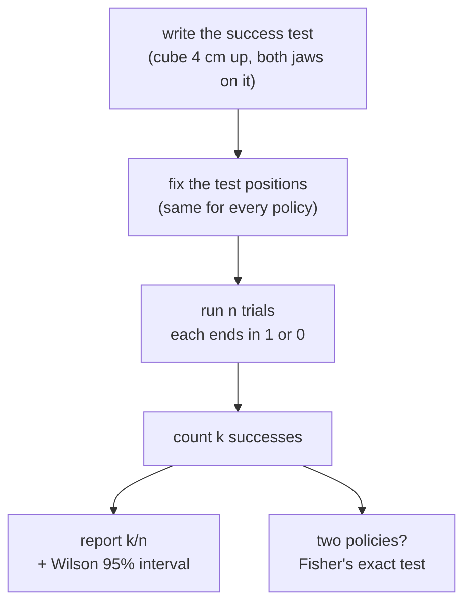

# 25 · Evaluating robot policies

<!-- meta -->
| | |
|---|---|
| **Part** | [7 · Learning from demonstration](README.md) |
| **Run type** | CPU · Mac or Colab CPU |
| **Prerequisites** | [16](../part-4-dynamics-and-control/16-grasping-and-pick-place.md) |
| **Learn first** | [Statistics for Machine Learning](https://aiengineeringfromscratch.com/lesson?path=phases/01-math-foundations/15-statistics-for-ml) · [Model Evaluation](https://aiengineeringfromscratch.com/lesson?path=phases/02-ml-fundamentals/09-model-evaluation) |
| **Time** | ~40 min |
| **Code** | [`experiments/25-evaluating-policies/experiment.py`](../experiments/25-evaluating-policies/experiment.py) |
| **Status** | ✅ done |
<!-- /meta -->

> A success rate without its number of trials is not a measurement. Report k/n, a Wilson interval, and the physical test that decided each trial.

## The problem

Part 7 trains policies and asks one question of each: does it pick up the cube? Answers like "90% success" usually rest on 10 or 20 rollouts (one rollout = one run of the policy from start to finish). With 10 trials, a policy whose long-run rate is 0.74 scores 9/10 or better about one time in five (measured below), so a single "9/10" cannot tell a 0.74 policy from a 0.88 one. Before training anything, this lesson builds the evaluation protocol the rest of the book uses: what counts as success, how many trials, what interval to report, and when two policies are actually different.

## Core idea

### In plain words

A success rate measured on a handful of trials is an opinion poll with a tiny sample. If a pollster asks 10 people and 9 say yes, nobody serious reports "90% of the country agrees"; they report "about 90%, with a wide margin of error". Robot evaluation works the same way. Each trial is one respondent, the policy's long-run success rate is the opinion of the whole country, and the number of trials sets the margin of error. That margin is what statisticians call a **confidence interval**: a range computed so that, over many evaluations, it contains the true rate a stated fraction of the time (here 95%).

Three rules follow. Decide before you start what counts as a "yes": a physical test that marks a trial a success. Report the margin with the result: k successes out of n trials plus an interval. And compare two policies with a test built for comparing, not by eyeballing whether their intervals overlap.

The margin shrinks slowly. Halving it costs four times the trials, and every trial costs robot time and a cube reset.

### The evaluation protocol



### The interval, as code

Each trial ends in 1 (success) or 0 (failure), like a biased coin flip: a Bernoulli trial, and the count of heads in n flips a binomial count. The textbook interval (Wald) and the one this book uses (Wilson, 1927), in a few lines (full code in Build it):

```python
p = k / n                                                    # observed success rate
wald = (p - z * sqrt(p * (1 - p) / n), p + z * sqrt(p * (1 - p) / n))   # zero width at p = 0 or 1
center = (p + z * z / (2 * n)) / (1 + z * z / n)             # Wilson: pulled toward 0.5
half = z * sqrt(p * (1 - p) / n + z * z / (4 * n * n)) / (1 + z * z / n)  # never zero
wilson(9, 10)    # (0.596, 0.982): a "9/10" fits a mediocre or an excellent policy
wald(10, 10)     # (1.0, 1.0): claims certainty after ten trials
```

| Quantity | Formula |
|---|---|
| observed rate | $\hat p = k/n$ |
| Wald interval | $\hat p \pm z\sqrt{\hat p(1-\hat p)/n}$ |
| Wilson interval | $\dfrac{\hat p + \frac{z^2}{2n}}{1 + \frac{z^2}{n}} \;\pm\; \dfrac{z}{1 + \frac{z^2}{n}}\sqrt{\dfrac{\hat p(1-\hat p)}{n} + \dfrac{z^2}{4n^2}}$ |
| half-width | shrinks like $1/\sqrt n$ |

Here $k$ is the number of successful trials, $n$ the number of trials, $\hat p$ the observed rate, $p$ the long-run rate that $\hat p$ estimates, and $z = 1.96$ the multiplier that gives 95% confidence. Our success test, from [lesson 16](../part-4-dynamics-and-control/16-grasping-and-pick-place.md): at the end the cube bottom is ≥ 4 cm above the floor and both jaws touch it, with no weld or attachment.

<details>
<summary>Math details: where the two intervals come from</summary>

**Binomial model.** Trial $i$ ends in $X_i \in \{0, 1\}$. If trials are independent and share the same rate $p$, the count $k = \sum X_i$ is binomial, $\hat p = k/n$ has mean $p$ and variance $p(1-p)/n$ (see AIEFS: [Statistics for Machine Learning](https://aiengineeringfromscratch.com/lesson?path=phases/01-math-foundations/15-statistics-for-ml)). By the normal approximation, $|\hat p - p| \le z\sqrt{p(1-p)/n}$ with probability about 95% for $z = 1.96$.

**Wald** replaces the unknown $p$ under the square root by $\hat p$. At $k = 0$ or $k = n$ the estimated variance is exactly zero and the interval collapses to a point; when $np$ or $n(1-p)$ is small the normal approximation is poor and coverage falls below 95%.

**Wilson** keeps $p$ in the variance and solves the inequality for $p$ (it "inverts the score test"). Squaring gives the quadratic $(\hat p - p)^2 = z^2 p(1-p)/n$, i.e.

$$p^2\Big(1 + \tfrac{z^2}{n}\Big) - p\Big(2\hat p + \tfrac{z^2}{n}\Big) + \hat p^2 = 0,$$

whose two roots are the Wilson bounds above. The center moves toward 0.5 by $z^2/2n$ and the $z^2/4n^2$ term keeps the width positive even at $\hat p = 0$ or 1. Brown, Cai and DasGupta (2001) show that the Wald interval's coverage is erratic and recommend Wilson (or Jeffreys) for small $n$.

**Why four times the trials.** The half-width is about $z\sqrt{p(1-p)/n}$; halving it needs $n$ four times larger. Near $p = 0.5$ the variance $p(1-p)$ is largest, so the same precision needs the most trials there.

**The assumption that fails first** is independence: drift in servos, camera or resets correlates trials, and the binomial interval is then too narrow.

Go deeper: [Statistics for Machine Learning](https://aiengineeringfromscratch.com/lesson?path=phases/01-math-foundations/15-statistics-for-ml), [Model Evaluation](https://aiengineeringfromscratch.com/lesson?path=phases/02-ml-fundamentals/09-model-evaluation); Wilson (1927) and Brown, Cai, DasGupta (2001) in the sources below.

</details>

<!-- figure: 25-wilson -->

### What the interval does not cover

**Variance has more than one source.** The binomial interval covers evaluation noise only. A learned policy also varies across training seeds (the random number that sets initial weights and batch order) and data subsets; a claim about a *method* needs several training runs, each evaluated on the same set of test positions. Lesson 28 reports per-seed and pooled results.

**Comparing two policies.** Overlapping intervals do not prove equality, and disjoint 95% intervals are a stricter test than a direct comparison. For $k_A/n_A$ vs $k_B/n_B$ use a two-sample test, e.g. Fisher's exact test on the 2 × 2 table of successes and failures ([SciPy `fisher_exact`](https://docs.scipy.org/doc/scipy/reference/generated/scipy.stats.fisher_exact.html)). It answers: if both policies had the same rate, how likely is a gap at least this large? A p-value below 0.05 is the usual bar for "different".

## Build it

You will now write the statistics of this lesson yourself: both intervals, exact coverage, the trial budget and Fisher's test, in plain Python with `math.comb`. SciPy only checks your numbers. Type the steps into a file of your own and run it after each step. The finished functions are in [`physai/evaluation.py`](../physai/evaluation.py); `uv run python experiments/25-evaluating-policies/build.py` runs all five steps with their checks (output in [`build_output.txt`](../experiments/25-evaluating-policies/build_output.txt)).

### Step 1 · Two intervals

```python
def wald(k, n, z=1.96):
    """Textbook normal-approximation interval p +- z sqrt(p(1-p)/n), clipped to [0, 1]."""
    p = k / n
    h = z * math.sqrt(p * (1 - p) / n)
    return max(0.0, p - h), min(1.0, p + h)
```

```python
def wilson(k, n, z=1.96):
    """Wilson score interval for k successes in n trials (Wilson 1927)."""
    if n == 0:
        return 0.0, 1.0
    p = k / n
    den = 1 + z * z / n
    c = (p + z * z / (2 * n)) / den
    h = z * math.sqrt(p * (1 - p) / n + z * z / (4 * n * n)) / den
    return max(0.0, c - h), min(1.0, c + h)
```

== Step 1. Wald and Wilson intervals (z = 1.96) vs scipy.stats.binomtest ==
    k/n             Wald           Wilson     scipy Wilson
   9/10   [0.714, 1.000]   [0.596, 0.982]   [0.596, 0.982]
  10/10   [1.000, 1.000]   [0.722, 1.000]   [0.722, 1.000]
  18/20   [0.769, 1.000]   [0.699, 0.972]   [0.699, 0.972]
221/300   [0.687, 0.787]   [0.684, 0.783]   [0.684, 0.783]
scipy uses z = 1.959964; with that z, max difference over k = 0..20 of n = 20: 2.2e-16

The Wilson column is the Experiment's (part C, and 221/300 from part A). SciPy's `binomtest(k, n).proportion_ci(method="wilson")` agrees to the printed digits; with SciPy's exact $z = 1.959964$ instead of 1.96 the two agree to round-off.

### Step 2 · Exact coverage

"95%" is a claim about all the evaluations you could have run. With the binomial probabilities you can check it without resampling: add up the probability of every $k$ whose interval contains $p$.

```python
def binom_pmf(k, n, p):
    """Probability of exactly k successes in n independent trials with rate p."""
    return math.comb(n, k) * p ** k * (1 - p) ** (n - k)
```

```python
def coverage(interval, n, p, z=1.96):
    """Exact probability that interval(k, n) contains p when k ~ Binomial(n, p)."""
    return sum(binom_pmf(k, n, p) for k in range(n + 1) if interval(k, n, z)[0] <= p <= interval(k, n, z)[1])
```

== Step 2. Exact coverage at p = 221/300 by a binomial sum ==
binom_pmf vs scipy.stats.binom.pmf (n = 50): max difference 2.3e-16
   n  Wilson coverage  Wald coverage
   5            0.981          0.764
  10            0.975          0.927
  20            0.962          0.908
  50            0.947          0.914
 100            0.946          0.945

These are table B's "exact" columns at $p$ = 221/300: Wilson stays at 0.946–0.981, Wald falls to 0.764 at $n = 5$.

### Step 3 · What a 9/10 means, and the trial budget

```python
def trials_needed(p, half_width, z=1.96):
    """Smallest n whose Wilson interval at observed rate p has half-width <= half_width."""
    n = 1
    while True:
        lo, hi = wilson(round(p * n), n, z)
        if (hi - lo) / 2 <= half_width:
            return n
        n += 1
```

== Step 3. A 9/10 claim, and trials for a Wilson half-width target ==
policy A (p = 0.737): P(>= 9/10) = 0.215
policy B (p = 0.877): P(>= 9/10) = 0.645
 observed rate  +-0.10  +-0.05  +-0.02
          0.50      93     381    2398
          0.70      78     320    2014
          0.90      34     141     864
          0.95      24      82     465

$P(\ge 9/10)$ is two terms of the binomial (table C), and the budget is table D, both exactly.

### Step 4 · Fisher's exact test

With the totals of the 2 × 2 table fixed, the number of A's successes follows a hypergeometric distribution. The two-sided p-value adds up every table that is no more likely than the one observed:

```python
def fisher_p(k1, n1, k2, n2):
    """Two-sided Fisher exact test for k1/n1 vs k2/n2: the total probability, with the margins fixed,
    of all tables no more likely than the observed one."""
    K, N = k1 + k2, n1 + n2
    pmf = {a: math.comb(n1, a) * math.comb(n2, K - a) / math.comb(N, K) for a in range(max(0, K - n2), min(K, n1) + 1)}
    return min(1.0, sum(q for q in pmf.values() if q <= pmf[k1] * (1 + 1e-7)))
```

== Step 4. Fisher's exact test by hand vs scipy.stats.fisher_exact ==
all 441 tables k_A/20 vs k_B/20: max p-value difference 3.3e-16
14/20 vs 18/20: p = 0.235 | 74/100 vs 88/100: p = 0.018

The relative tolerance `1 + 1e-7` lets tables that tie with the observed one in exact arithmetic count despite round-off (SciPy uses 1e-14 for the same purpose).

### Step 5 · Exact power

How often does Fisher's test separate A from B? Sum the probability of every pair of outcomes $(k_A, k_B)$ for which the test says "different":

```python
def power(p1, p2, n, alpha=0.05):
    """Exact probability that Fisher's test at level alpha separates two policies with rates p1, p2, n trials each."""
    pm1 = [binom_pmf(k, n, p1) for k in range(n + 1)]
    pm2 = [binom_pmf(k, n, p2) for k in range(n + 1)]
    return sum(pm1[a] * pm2[b] for a in range(n + 1) for b in range(n + 1) if fisher_p(a, n, b, n) < alpha)
```

== Step 5. Exact power of Fisher's test, A (p = 0.737) vs B (p = 0.877), n trials each ==
   n  P(Fisher p < 0.05)  P(B scores <= A)
  10               0.028             0.301
  20               0.119             0.173
  50               0.337             0.046
 100               0.656             0.007

Table E resampled 1000 evaluation pairs from the pools and found 0.037, 0.113, 0.335 and 0.673; the exact values are 0.028, 0.119, 0.337 and 0.656. The gaps are resampling noise: with 1000 pairs the standard error of a rate near 0.66 is about 0.015. The same holds for "B scores ≤ A" (0.286, 0.170, 0.041, 0.005 resampled).

### What you keep

`physai.evaluation` now has `wald`, `wilson`, `binom_pmf`, `coverage`, `trials_needed`, `fisher_p` and `power`. Lessons 26–29 report k/n with `wilson`, and lesson 26's Build it imports it. [`tests/test_25_evaluating_policies.py`](../tests/test_25_evaluating_policies.py) pins them to SciPy; run `uv run pytest tests/test_25_evaluating_policies.py`.

## Use it

SciPy has every piece:

```python
from scipy import stats
ci = stats.binomtest(k, n).proportion_ci(confidence_level=0.95, method="wilson")   # ci.low, ci.high
exact = stats.binomtest(k, n).proportion_ci(method="exact")                         # Clopper-Pearson
odds, p = stats.fisher_exact([[k_a, n_a - k_a], [k_b, n_b - k_b]])                   # two-sided by default
stats.binom.pmf(k, n, p_true)                                                        # binomial probabilities
```

| Tool | Wilson interval | Default |
|---|---|---|
| physai | `wilson(k, n, z=1.96)` | $z = 1.96$ |
| SciPy | `binomtest(k, n).proportion_ci(method="wilson")` | `method="exact"` (Clopper–Pearson), `confidence_level=0.95` |
| statsmodels | `proportion_confint(count, nobs, method="wilson")` | `method="normal"`, i.e. Wald |

Sources: SciPy [`binomtest`](https://docs.scipy.org/doc/scipy/reference/generated/scipy.stats.binomtest.html) and [`fisher_exact`](https://docs.scipy.org/doc/scipy/reference/generated/scipy.stats.fisher_exact.html); statsmodels [`proportion_confint`](https://www.statsmodels.org/stable/generated/statsmodels.stats.proportion.proportion_confint.html).

Traps:

- **Defaults differ.** SciPy's default interval is Clopper–Pearson, wider than Wilson; statsmodels' default is Wald, the one that collapses at 10/10. Always pass `method`.
- **The table orientation.** `fisher_exact` wants counts of successes *and failures* per row, not success rates or k and n.
- **One evaluation, one test.** Running Fisher after every new batch of trials and stopping at the first p < 0.05 inflates false positives; fix n before you start.

## Experiment

A "policy" with an unknown rate: the scripted pick of lesson 16 aiming at a noisy cube estimate, true position + $\mathcal N(0, \sigma^2)$ per axis, as if from an imperfect perception module. Cube positions are uniform in x ∈ [16, 28] cm, y ∈ [−8, 8] cm. Policy A has σ = 9 mm, policy B σ = 6 mm. Each gets a pool of 300 simulated trials, whose rate stands in for the long-run rate $p$. An evaluation of $n$ trials picks $n$ trials from a pool at random, with replacement, far cheaper than re-running the robot. Full script: [`experiments/25-evaluating-policies/experiment.py`](../experiments/25-evaluating-policies/experiment.py), output: [`output.txt`](../experiments/25-evaluating-policies/output.txt). MuJoCo 3.17.0, NumPy 2.5.4, SciPy 1.18.1, Apple Silicon Mac (Apple M5), deterministic, about 1 min of CPU.

**A. The pools.**

| Policy | Aim noise | Success | Wilson 95% | "Jaw closed on cube" |
|---|---|---|---|---|
| A | 9 mm | 221/300 (0.737) | [0.684, 0.783] | 259/300 (0.863) |
| B | 6 mm | 263/300 (0.877) | [0.835, 0.909] | 288/300 (0.960) |

The last column is a looser criterion counted on the same trials: the jaw settled with both jaws on the cube. It adds 38 "successes" to A and 25 to B, cubes that were touched or squeezed but not lifted and held. The success test has to be written down before the evaluation, and it has to be physical.

**B. Number of trials.** *Predict:* at $n = 10$, how wide is a 95% interval around $p \approx 0.74$? 2000 evaluations per row, from pool A:

| n | mean Wilson width | Wilson covers p | Wald covers p | exact Wilson | exact Wald | 5–95% of k/n |
|---|---|---|---|---|---|---|
| 5 | 0.577 | 0.987 | 0.764 | 0.981 | 0.764 | 0.40–1.00 |
| 10 | 0.463 | 0.971 | 0.928 | 0.975 | 0.927 | 0.50–0.90 |
| 20 | 0.354 | 0.967 | 0.919 | 0.962 | 0.908 | 0.55–0.90 |
| 50 | 0.235 | 0.951 | 0.916 | 0.947 | 0.914 | 0.62–0.84 |
| 100 | 0.169 | 0.942 | 0.942 | 0.946 | 0.945 | 0.66–0.81 |

"Covers p" is the fraction of evaluations whose interval contains the pool rate; for a 95% interval it should be about 0.95. "Exact" is the same coverage computed from the binomial distribution at $p$ = 0.737; the resampled columns agree with it.


 At 10 trials the interval is 0.46 wide and the observed rate lands anywhere from 0.50 to 0.90. Wilson stays within about one point of 95% (0.942–0.987; it is slightly conservative at small $n$); Wald falls to 0.76 at $n = 5$.

**C. What "9/10" means.** Wilson 95% for 9/10 is [0.596, 0.982]; for 10/10 it is [0.722, 1.000]. The probability of seeing ≥ 9/10:

| Policy | long-run p | P(≥ 9/10), binomial | drawn from the pool |
|---|---|---|---|
| A | 0.737 | 0.215 | 0.208 |
| B | 0.877 | 0.645 | 0.634 |

A 9/10 is consistent with both policies, and B fails to produce one in about a third of evaluations.

**D. Trials for a target half-width** (Wilson 95%):

| observed rate | ±0.10 | ±0.05 | ±0.02 |
|---|---|---|---|
| 0.50 | 93 | 381 | 2398 |
| 0.70 | 78 | 320 | 2014 |
| 0.90 | 34 | 141 | 864 |
| 0.95 | 24 | 82 | 465 |

**E. Is B better than A?** The true gap is 0.14. 1000 evaluation pairs of $n$ trials each; the first column is how often Fisher's test calls the difference significant (the test's *power*):

| n per policy | Fisher p < 0.05 | Wilson intervals disjoint | B scores ≤ A |
|---|---|---|---|
| 10 | 0.037 | 0.006 | 0.286 |
| 20 | 0.113 | 0.025 | 0.170 |
| 50 | 0.335 | 0.152 | 0.041 |
| 100 | 0.673 | 0.423 | 0.005 |

With 20 trials each, the better policy scores the same or worse 17% of the time and the difference is significant only 11% of the time. Even 100 trials each detect a 14-point gap only two times in three.

## Break it

Push $n$ down and $p$ toward 1 and the Wald interval breaks. At $n = 5$ it covers the true rate in 76% of evaluations instead of 95%. At 10/10 it reports [1.000, 1.000], a claim of certainty from ten trials, while Wilson gives [0.722, 1.000]. The mechanism: Wald plugs $\hat p$ into the variance, so the estimated variance is zero exactly when $\hat p$ hits 0 or 1, and the normal approximation is poor when $np$ or $n(1-p)$ is small. Wilson centers the interval toward 0.5 by $z^2/2n$ and keeps a $z^2/4n^2$ term that never vanishes.

## On the real robot

- **Protocol** (not yet run on our SO-101): fix 20 cube positions on a grid marked on the table, and use the same positions for every policy compared. Write the success test before running: cube lifted ≥ 4 cm and held for 1 s, judged from video. Reset the cube by hand to the mark. Report k/n, Wilson 95%, and failure types (missed, pushed, dropped).
- **Independence is the assumption that fails first.** Servo heating, a cube that wears, a shifted camera and the operator's resets all make trials correlated. Interleave the policies (A, B, A, B, …) rather than running all of A first.
- LeRobot's `lerobot-rollout` can record evaluation episodes to a dataset (e.g. `--strategy.type=sentry`; `base` runs without recording) ([il_robots](https://huggingface.co/docs/lerobot/il_robots)). The success decision and the interval are still yours to define and report.

## Check yourself

1. **Easy.** A policy scores 18/20. Give its Wilson 95% interval using the code above.
2. **Medium.** From table D, about how many trials does a ±0.05 claim need at an observed rate of 0.70? Why is it fewer at 0.95?
3. **Hard.** Run 3 training seeds of the same method and evaluate each on the same 20 positions. Propose how to report the result so both seed variance and trial variance are visible.

### Answers

1. [0.699, 0.972] (`wilson(18, 20)`; also printed in part C of the output).
2. 320. The binomial variance $p(1-p)$ is 0.21 at 0.70 and 0.0475 at 0.95, so the same precision needs fewer trials near the edges.
3. One acceptable answer: report each seed's k/20 with its Wilson interval, plus the pooled k/60 with its interval and the min–max across seeds. The pooled interval alone hides seed variance.

## Takeaways and sources

- Report k/n, a Wilson 95% interval and the physical success test. In simulation, a looser "jaw closed" test inflated policy A from 0.737 to 0.863.
- Ten trials give an interval about 0.46 wide; a 0.74 policy produces ≥ 9/10 in about 21% of evaluations.
- Telling a 0.74 from a 0.88 policy reliably takes on the order of 100+ trials each; at 20 each, Fisher's test detected the gap 11% of the time.

Next: [lesson 26 · Teleoperation, replay and data collection](26-teleop-replay-data.md).

Sources:
- E. B. Wilson, ["Probable inference, the law of succession, and statistical inference"](https://doi.org/10.1080/01621459.1927.10502953), *J. Amer. Statist. Assoc.* 22 (158), 209–212, 1927.
- L. D. Brown, T. T. Cai, A. DasGupta, ["Interval Estimation for a Binomial Proportion"](https://doi.org/10.1214/ss/1009213286), *Statistical Science* 16 (2), 101–133, 2001.
- SciPy, [`scipy.stats.fisher_exact`](https://docs.scipy.org/doc/scipy/reference/generated/scipy.stats.fisher_exact.html).
- LeRobot, [Imitation learning on real-world robots](https://huggingface.co/docs/lerobot/il_robots).
- All measured numbers: [`experiments/25-evaluating-policies/output.txt`](../experiments/25-evaluating-policies/output.txt).
