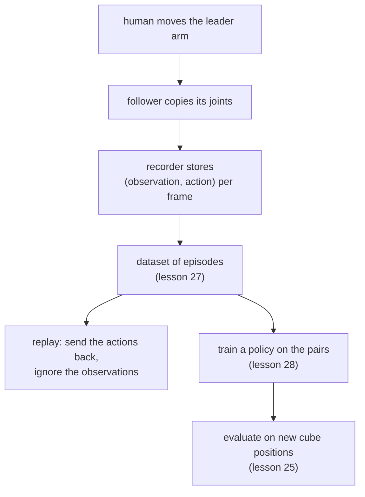

# 26 · Teleoperation, replay and data collection

<!-- meta -->
| | |
|---|---|
| **Part** | [7 · Learning from demonstration](README.md) |
| **Run type** | CPU · Mac or Colab CPU |
| **Prerequisites** | [16](../part-4-dynamics-and-control/16-grasping-and-pick-place.md), [25](25-evaluating-policies.md) |
| **Learn first** | none |
| **Time** | ~45 min |
| **Code** | [`experiments/26-teleop-replay-data/experiment.py`](../experiments/26-teleop-replay-data/experiment.py) · [notebook](../notebooks/26-teleop-replay-data.ipynb) |
| **Status** | ✅ done |
<!-- /meta -->

> Replay repeats the motion, not the task. A recording becomes useful only when it pairs what the robot saw with what it did.

## The problem

LeRobot ships a command that plays a recorded episode back on the arm: `lerobot-replay` sends the dataset's recorded actions to the robot frame by frame, and the docs present it as a way to "test the repeatability of your robot's actions" ([LeRobot · imitation learning on real robots](https://huggingface.co/docs/lerobot/il_robots)). When the follower repeats a pick flawlessly it is tempting to think the robot has learned the task. It has not: replay is a fixed list of joint targets that never looks at the cube. This lesson measures how far the cube may move before replay fails, contrasts it with a controller that looks, and records the demonstrations lessons 27–29 learn from.

## Core idea

### In plain words

A macro recorder stores your clicks at fixed screen coordinates and plays them back; move one window and the macro clicks empty space. A script that first looks at the screen, finds the button and then clicks survives the move. Replay is the macro. A controller that reads the cube position before moving is the script.

Teleoperation is how people make robot recordings: a human drives the robot through a **leader arm**, a light, passive copy of the arm moved by hand, and the real arm (the **follower**) copies its joint angles. The human is the one looking. To learn from the recording later, it must keep both halves of every moment: what the robot saw (the **observation**) and what it was told to do (the **action**). Replay keeps only the actions and throws the observations away.

### From demonstration to policy



### Open loop and closed loop, as code

```python
# Replay = macro recorder: a fixed list indexed by time; the cube never enters the loop
def replay(actions):
    for a in actions:                # a = 6 joint targets recorded at one frame
        robot.apply(a)
        robot.step(1 / fps)          # hold it for one frame (zero-order hold)

# Closed loop = a program that looks at the screen before every move
def run(policy, T):
    for t in range(T):
        o = robot.observe()          # joints, jaw, cube position
        robot.apply(policy(o))       # decide from what is seen now
        robot.step(1 / fps)

# Recording a demonstration keeps both halves of each frame
episode = []
for t in range(T):
    o = robot.observe()              # what the robot sees
    a = leader.read_joints()         # what the human commands
    robot.apply(a)
    robot.step(1 / fps)
    episode.append((o, a))           # the pair a policy will learn from
```

| Mode | Formula |
|---|---|
| open loop (replay) | $u_t = u^{\text{rec}}_t$, a fixed sequence $u_0, u_1, \dots$ |
| closed loop | $u_t = \pi(o_t)$ |
| one recorded episode | $\big\{(o_t, a_t)\big\}_{t=0}^{T-1}$ plus a task string |
| zero-order hold | $a(\tau) = a_k$ for $k/f \le \tau < (k+1)/f$ |

Here $u_t$ is the command sent at step $t$, $o_t$ the observation at that step (robot state, plus images on a real robot), $\pi$ the controller or policy that maps an observation to a command, $a_t$ the recorded action (the joint targets sent at $t$), $T$ the number of frames in an episode, $f$ the recording rate in Hz and $\tau$ continuous time. Build it, Step 1 shows exactly which observation and action a frame pairs.

### Who closes the loop

| Mode | Who closes the loop | Generalizes to a moved cube? |
|---|---|---|
| Replay of a recording | nobody | only within the grasp tolerance |
| Re-planning from perception | the planner (IK on the measured cube pose) | yes, if perception is right |
| Leader–follower teleoperation | the human, through the leader arm | yes, the human adapts |
| Learned policy $\pi_\theta(o_t)$ | the network | what lessons 28–29 measure |

IK is inverse kinematics: the joint angles that put the gripper at a desired pose ([lesson 10](../part-3-kinematics/10-inverse-kinematics.md)).

<details>
<summary>Math details: open loop, closed loop and what a recording must contain</summary>

**Definitions.** An open-loop controller applies a precomputed command sequence $u_0, u_1, \dots$ without measuring the result. A closed-loop (feedback) controller computes $u_t = \pi(o_t)$ from the current observation (Lynch & Park, *Modern Robotics*, ch. 11). Replay is open loop over the whole task. The scripted pick of [lesson 16](../part-4-dynamics-and-control/16-grasping-and-pick-place.md) is closed loop at the task level: it reads the cube position, solves IK and waits on a sensed jaw condition. The servos always run their own position loops; "open loop" here means open at the task level.

**Why replay tolerates anything at all.** The recorded jaw opening is wider than the cube. A shift smaller than the gap between cube and jaw still ends with the cube between the jaws; a larger one does not. The tolerance is a property of the gripper geometry and differs by direction (Break it).

**What the recording must keep.** During teleoperation the human computes $a_t = \pi_{\text{human}}(o_t^{\text{human}})$ from what they see. A learner can only imitate that mapping if the dataset stores $o_t$ next to $a_t$, aligned in time. Replaying $a_{0:T}$ discards $o_t$ and with it any chance of reacting to a different start state.

**Zero-order hold.** Between frames the last action is held constant. The recording stays a valid description of the expert only while the held steps are short compared with the fastest segment of the motion (here the jaw ramp); part C checks 25 Hz.

Go deeper: Lynch & Park, [*Modern Robotics*](https://hades.mech.northwestern.edu/index.php/Modern_Robotics), ch. 11; LeRobot, [Imitation learning on real-world robots](https://huggingface.co/docs/lerobot/il_robots).

</details>

## Build it

You will now write the data side of this lesson: cutting a recording into (observation, action) frames, holding frames for replay, and the smallest closed loop that rescues a replay, re-targeting the recorded joints by the observed cube shift with the Jacobian of [lesson 09](../part-3-kinematics/09-jacobians.md). Scenes, recordings and the success test are the Experiment's. Type the steps into your own file and run it after each step. The finished functions are in [`physai/data.py`](../physai/data.py); `uv run python experiments/26-teleop-replay-data/build.py` runs all five steps with their checks (output in [`build_output.txt`](../experiments/26-teleop-replay-data/build_output.txt)).

### Step 1 · Cut a recording into frames

The scripted pick runs at 500 Hz; the dataset keeps one frame every 20 physics steps. Frame $j$ pairs the observation at its start with the command at the end of its 40 ms:

```python
def to_frames(o0, obs_steps, act_steps, k):
    """Frames every k physics steps: frame j holds the observation at its start (o0 for j = 0, else the state
    after step j*k) and the command sent at the end of its k steps."""
    n = len(act_steps) // k
    return np.vstack([o0, obs_steps[k - 1:(n - 1) * k:k]]), act_steps[k - 1:n * k:k]
```

Run the lesson-16 pick for episode 0's cube position and compare with what part B saved:

== Step 1. A scripted demonstration cut into 25 Hz frames vs demos.npz, episode 0 ==
2284 physics steps -> 114 frames | demos.npz episode 0: 114 frames
max |obs - saved| = 1.2e-07 | max |action - saved| = 1.2e-07

The same 114 frames. The 1.2e-07 is one float32 rounding step (the file stores float32).

### Step 2 · Zero-order hold

Replay needs a command for every physics step, so each frame is held for 20 steps:

```python
def hold(frames, k):
    """Zero-order hold: repeat each frame's command for k physics steps."""
    return np.repeat(frames, k, axis=0)
```

Apply it to part A's fixed-timeline recording (2250 commands at 500 Hz):

== Step 2. Zero-order hold of the part-A recording (fixed 4.5 s timeline, cube at (22, 0) cm) ==
2250 commands -> 112 frames -> 2240 held commands
largest gap between held and original command: arm 3.72 deg, jaw 9.22 deg
replay of the held frames at the recorded spot: held

A held frame anticipates the next 40 ms: up to 3.72° ahead on an arm joint, 9.22° on the jaw ramp. At the recorded spot the pick still works, as in part C.

### Step 3 · Open-loop replay under a shift

Play the held frames with the cube moved 1, 2 and 3 cm in 8 directions; the success test is the Experiment's (cube ≥ 4 cm up, both jaws on it), the interval is `wilson` from [lesson 25](25-evaluating-policies.md):

== Step 3. Open-loop replay of the held frames, cube shifted in 8 directions ==
   shift   held  Wilson 95%    failures
    1 cm    7/8  [0.53, 0.98]  pushed 1
    2 cm    2/8  [0.07, 0.59]  one jaw 1, pushed 5
    3 cm    1/8  [0.02, 0.47]  missed 2, pushed 5

The Experiment's 500 Hz replay got 7/8, 3/8 and 1/8. The held version agrees at 1 and 3 cm and loses one trial at 2 cm (135°, caught by one jaw only): the hold moves the jaw ramp by up to 40 ms.

### Step 4 · Re-target with the Jacobian

A cube moved by $\Delta$ needs the tool moved by $\Delta$ at every frame. To first order, the joint change that does that with the least motion is the pseudo-inverse of the position Jacobian times $\Delta$:

```python
def retarget(q_frames, jac_pos, shift):
    """Move a recorded joint trajectory so the tool point moves by `shift` (m) at every frame, to first order:
    q' = q + pinv(J_p(q)) shift, with J_p the 3 x n position Jacobian."""
    return np.array([q + np.linalg.pinv(jac_pos(q)) @ shift for q in q_frames])
```

How far off is the tool point after the correction, at the frame where the gripper is down at the cube?

== Step 4. Re-target with the Jacobian: q' = q + pinv(J_p(q)) shift, error of the tool point ==
shift 1 cm toward +y: tool point off by 0.28 mm
shift 2 cm toward +y: tool point off by 1.10 mm
shift 3 cm toward +y: tool point off by 2.48 mm
shift 5 cm toward +y: tool point off by 6.89 mm

The error grows with the square of the shift, the signature of a first-order method; the Experiment's re-planning solves IK exactly (0.18 mm) instead.

### Step 5 · Replay the re-targeted frames

Read the cube position once, re-target all frames, hold, replay:

== Step 5. Replay of the re-targeted frames (cube position read once), same 24 shifts ==
   shift   held  Wilson 95%    failures
    1 cm    8/8  [0.68, 1.00]
    2 cm    8/8  [0.68, 1.00]
    3 cm    8/8  [0.68, 1.00]

24/24 where replay managed 10/24: one observation of the cube, used before moving, is the whole difference. A learned policy (lesson 28) has to do the same from its inputs at every frame.

### What you keep

`physai.data` now has `to_frames`, `hold` and `retarget`; lesson 27 adds the dataset functions to the same module. [`tests/test_26_teleop_replay_data.py`](../tests/test_26_teleop_replay_data.py) checks the frame indexing, the hold and the second-order residual of `retarget`; run `uv run pytest tests/test_26_teleop_replay_data.py`.

## Use it

In MuJoCo, an open-loop replay of one command list from many start states is a single `mujoco.rollout` call, which the docs describe as rolling out "open-loop trajectories from initial states":

```python
from mujoco import rollout
spec = mujoco.mjtState.mjSTATE_FULLPHYSICS
x0 = np.zeros((len(shifts), mujoco.mj_stateSize(m, spec)))
for i, s in enumerate(shifts):                     # one start state per cube position
    mujoco.mj_resetData(m, d)
    d.qpos[arm], d.qpos[jaw], d.qpos[cube:cube + 2] = HOME_Q, G_OPEN, CUBE_HOME + s
    mujoco.mj_forward(m, d)
    mujoco.mj_getState(m, d, x0[i], spec)
states, _ = rollout.rollout(m, mujoco.MjData(m), x0, ctrl[None])   # ctrl: (steps, nu), the same for all
```

For the closed loop, re-solve IK from the observed pose (lesson 16's `ik`, built on `mj_jacSite`) instead of the first-order `retarget`. On the real arm, LeRobot's `lerobot-replay --dataset.episode=0` plays a recorded episode's actions back ([il_robots](https://huggingface.co/docs/lerobot/il_robots)), open loop like Step 3.

Traps:

- **Which observation goes with which action.** Our frame $j$ pairs the state at its start with the command at its end. Pair the command with the state *after* it and a policy learns to copy the present instead of predicting the next target.
- **Hold, don't interpolate, unless you trained that way.** The recording means "this target for 40 ms"; interpolating between frames changes the timing of fast segments such as the jaw ramp.
- **Replay is not evaluation.** A replay that succeeds at the recorded spot (Step 2) says nothing about a moved cube (Step 3).

## Experiment

Full script: [`experiments/26-teleop-replay-data/experiment.py`](../experiments/26-teleop-replay-data/experiment.py), output: [`output.txt`](../experiments/26-teleop-replay-data/output.txt). MuJoCo 3.17.0, NumPy 2.5.4, Apple Silicon Mac (Apple M5), deterministic. Part A is a port of the earlier notebook ([`notebooks/26-teleop-replay-data.ipynb`](../notebooks/26-teleop-replay-data.ipynb)); its numbers reproduced exactly.

**A. Replay vs re-planning.** The SO-101 picks a 3 cm, 30 g cube at (22, 0) cm along a fixed 4.5 s timeline (settle, above, down, close, lift, hold). The 6 commands of every 2 ms step are recorded: 2250 × 6. Then the cube is shifted 0.5–5 cm in 8 directions (plus the recorded spot: 81 trials). *Replay* sends the list unchanged; *feedback* keeps the timeline but re-solves the three IK poses (above, down, lift) from the cube's true position. Success is physical: at 4.5 s the cube bottom is ≥ 4 cm up and both jaws touch it.

```python
rec_ctrl, _ = plan_a(m, d, I, CUBE_HOME)        # record once
ok_r, kind_r, _ = run_a(xy, rec_ctrl)           # replay: same 2250 x 6 list
ctrl, _ = plan_a(m0, d0, ids(m0), xy)           # feedback: re-plan from the cube pose
ok_f, kind_f, _ = run_a(xy, ctrl)
```

*Predict:* the jaws open wider than the cube, so small shifts should be tolerated. Where does replay stop working?

| Cube shift | Replay | Wilson 95% | Feedback | Replay failures |
|---|---|---|---|---|
| 0 cm | 1/1 | [0.21, 1.00] | 1/1 | – |
| 0.5 cm | 8/8 | [0.68, 1.00] | 8/8 | – |
| 1 cm | 7/8 | [0.53, 0.98] | 8/8 | pushed 1 |
| 1.5 cm | 4/8 | [0.22, 0.78] | 8/8 | pushed 4 |
| 2 cm | 3/8 | [0.14, 0.69] | 8/8 | pushed 5 |
| 2.5 cm | 1/8 | [0.02, 0.47] | 8/8 | missed 2, pushed 5 |
| 3 cm | 1/8 | [0.02, 0.47] | 8/8 | missed 2, pushed 5 |
| 3.5 cm | 1/8 | [0.02, 0.47] | 8/8 | missed 6, pushed 1 |
| 4 cm | 1/8 | [0.02, 0.47] | 8/8 | missed 6, pushed 1 |
| 4.5 cm | 0/8 | [0.00, 0.32] | 8/8 | missed 6, pushed 2 |
| 5 cm | 0/8 | [0.00, 0.32] | 8/8 | missed 7, pushed 1 |
| **total** | **27/81** | | **81/81** | |

"Pushed" = the jaws touched the cube but it stayed on the floor; "missed" = the jaws never touched it. The intervals use the Wilson formula of [lesson 25](25-evaluating-policies.md); with 8 trials per row they are wide, so read the trend, not single rows.


**B. Demonstrations for lessons 27–29.** The lesson 16 `scripted_pick` on 120 cube positions drawn uniformly in x ∈ [16, 28] cm, y ∈ [−8, 8] cm (seed 26), recorded at 25 Hz:

```python
r = pick16.scripted_pick(scene.m, scene.d, cube_pos, record=True)   # 2 ms steps
obs.append(scene.obs_from_qpos(tr[k * K - 1][2]))  # o_k: 5 arm joints, jaw, cube xyz
act.append(tr[k * K + K - 1][3])                   # a_k: 6 joint targets [rad]
```

| Quantity | Value |
|---|---|
| episodes (physical success) | 120/120 |
| frames per episode | 114 (4.56 s) |
| total frames | 13680 |
| observation | 9: 5 arm joints, jaw, cube x/y/z |
| action | 6 joint position targets |
| file | `demos.npz`, 0.47 MB |

The file also stores `episode_index`, `frame_index`, `timestamp`, the expert's phase per frame, the per-episode cube position and success flag, and the task string.

**C. Is the data self-consistent?** Replaying the saved 25 Hz actions of the first 20 episodes (zero-order hold, same cube position) succeeds 20/20 (Wilson 95% [0.84, 1.00]). Downsampling the 500 Hz commands to 25 Hz did not break the pick: the dataset describes the expert, at least on its own states.

## Break it

The breaking parameter is the cube shift, and the failure is direction-dependent:

| Direction | 0° (+x, forward) | 45° | 90° (+y) | 135° | 180° | 225° | 270° (−y) | 315° |
|---|---|---|---|---|---|---|---|---|
| farthest replay success | 1 cm | 2 cm | 4 cm | 2 cm | 1.5 cm | 1 cm | 0.5 cm | 1 cm |

Toward +y replay still holds at 4 cm; toward −y it already fails at 1 cm; forward and backward the tolerance is 1–1.5 cm. Mechanism (our reading; contacts were not instrumented): the SO-101 has one fixed jaw and one moving jaw that sweeps toward it while closing. A cube displaced toward the moving jaw is swept into the fixed jaw; one displaced toward the fixed jaw is struck by it on the way down and pushed. Up to about 2 cm most failures are "pushed", from 3.5 cm on most are "missed". Open-loop tolerance is a property of the gripper geometry, not of the recording.

## On the real robot

- **Teleoperation and recording with LeRobot** (procedure; not yet measured on our arm). Calibrate follower and leader (`lerobot-calibrate`), check the pair with `lerobot-teleoperate --robot.type=so101_follower --teleop.type=so101_leader ...`, then record with `lerobot-record ... --dataset.num_episodes=... --dataset.single_task="..."`. Keep the same `--robot.id` for teleoperation, recording and evaluation, because the id selects the calibration file ([il_robots](https://huggingface.co/docs/lerobot/il_robots)).
- **What the docs say about rate and counts.** The examples run cameras and the control loop at 30 fps. Defaults: 60 s per episode, 60 s reset, 50 episodes. Their advice is to record "at least 50 episodes, with 10 episodes per location", keep cameras fixed and grasping consistent, and add variation gradually ([il_robots](https://huggingface.co/docs/lerobot/il_robots)). During recording, → ends an episode early, ← re-records it, Esc stops.
- **The leader arm is not the follower.** The follower uses 6 STS3215 servos with 1/345 gearing; the leader mixes 1/191, 1/345 and 1/147 gearing so it is light to move ([SO-101 docs](https://huggingface.co/docs/lerobot/so101)). Calibration maps both to the same joint values, and calibration error becomes action error in the dataset.
- **Replay test on hardware** (procedure, not measured): record one pick, run `lerobot-replay --dataset.episode=0` with the cube at the recorded spot, then shifted 0.5–3 cm in 8 directions, 1 trial each; report k/n per distance with Wilson intervals. Expect a different tolerance: real friction, jaw pads and servo tracking differ from the model.

## Check yourself

1. **Easy.** At 1.5 cm replay scored 4/8. Using the table, could the true rate at that shift be 0.75?
2. **Medium.** Part A's feedback controller scored 81/81. Name two things it gets for free in simulation that a real perception pipeline would not give it.
3. **Hard.** In Part B, change `FPS` to 5 (one frame every 100 ms) and rerun part C. Predict first: does replaying the downsampled actions still pick the cube 20/20?

### Answers

1. Yes. The Wilson 95% interval for 4/8 is [0.22, 0.78], which contains 0.75.
2. The exact cube position (no camera, no noise, no calibration error), and that position is read once before the motion with no latency. The arm model's servos also track the plan as modelled.
3. Not computed here; run it. Look at what a 100 ms hold does to the jaw ramp, which lasts 0.3 s.

## Takeaways and sources

- Replay is open loop: 27/81 successes over all shifts (26/80 with the cube actually moved), against 81/81 for re-planning from the measured cube pose, in simulation.
- The open-loop tolerance is set by gripper geometry and is direction-dependent: 4 cm toward the moving jaw, under 1 cm toward the fixed jaw.
- A demonstration dataset is (observation, action) pairs per frame, grouped into episodes; our 120 scripted demos (13680 frames at 25 Hz, 0.47 MB) replay 20/20 from their own start states.

Next: [lesson 27 · Robot datasets](27-robot-datasets.md).

Sources:
- LeRobot, [Imitation learning on real-world robots](https://huggingface.co/docs/lerobot/il_robots) (teleoperate, record, replay, recording parameters, data tips; read 2026-10-27).
- LeRobot, [SO-101](https://huggingface.co/docs/lerobot/so101) (motors, leader gearing, calibration; read 2026-10-27).
- Lynch & Park, [*Modern Robotics*](https://hades.mech.northwestern.edu/index.php/Modern_Robotics), ch. 11.
- [MuJoCo Menagerie `robotstudio_so101`](https://github.com/google-deepmind/mujoco_menagerie/tree/main/robotstudio_so101) (Apache-2.0).
- All measured numbers: [`experiments/26-teleop-replay-data/output.txt`](../experiments/26-teleop-replay-data/output.txt).
