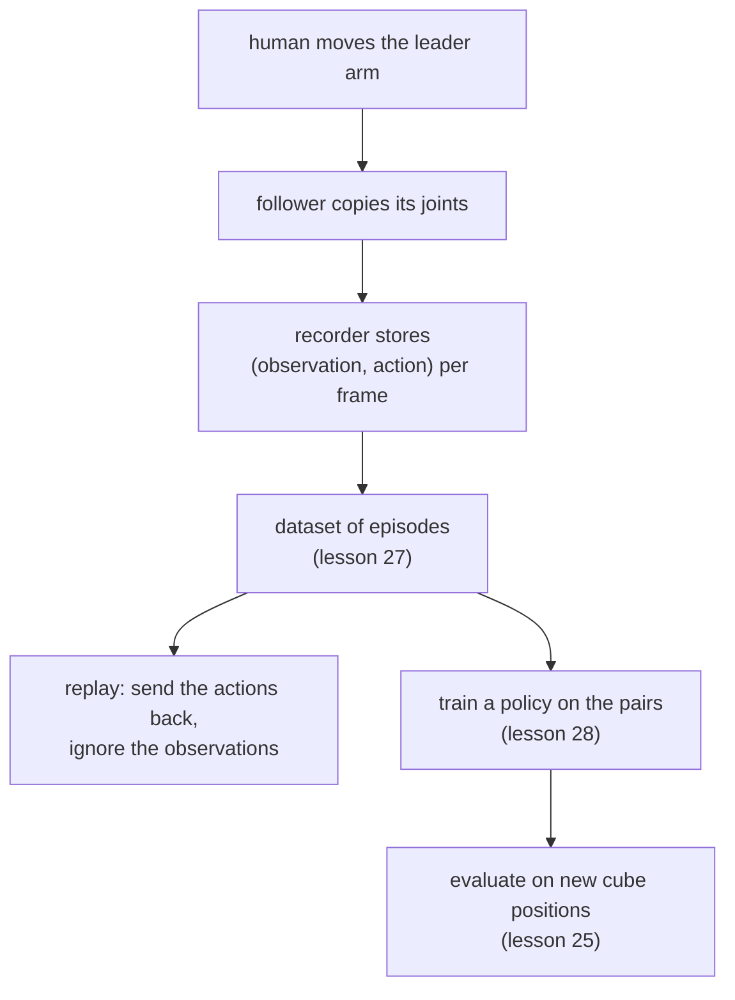

# 26 · Teleoperation, replay and data collection

<!-- meta -->
| | |
|---|---|
| **Part** | [7 · Learning from demonstration](README.md) |
| **Run type** | CPU · Mac or Colab CPU |
| **Prerequisites** | [16](../part-4-dynamics-and-control/16-grasping-and-pick-place.md), [25](25-evaluating-policies.md) |
| **Learn first** | none |
| **Time** | ~45 min |
| **Code** | [`experiments/26-teleop-replay-data/experiment.py`](../experiments/26-teleop-replay-data/experiment.py) · [notebook](../notebooks/26-teleop-replay-data.ipynb) |
| **Status** | ✅ done |
<!-- /meta -->

> Replay repeats the motion, not the task. A recording becomes useful only when it pairs what the robot saw with what it did.

## The problem

LeRobot ships a command that plays a recorded episode back on the arm: `lerobot-replay` sends the dataset's recorded actions to the robot frame by frame, and the docs present it as a way to "test the repeatability of your robot's actions" ([LeRobot · imitation learning on real robots](https://huggingface.co/docs/lerobot/il_robots)). When the follower repeats a pick flawlessly it is tempting to think the robot has learned the task. It has not: replay is a fixed list of joint targets that never looks at the cube. This lesson measures how far the cube may move before the replayed pick fails, contrasts it with a controller that looks, and then records the demonstrations that lessons 27–29 learn from.

## Core idea

### In plain words

A macro recorder in a desktop app stores your clicks at fixed screen coordinates and plays them back. It works as long as every window sits exactly where it sat during the recording. Move one window and the macro clicks empty space. A script that first looks at the screen, finds the button and then clicks it survives the move. Replay is the macro. A controller that reads the cube position before moving is the script.

Teleoperation is how people make robot recordings: a human drives the robot through a **leader arm**, a light, passive copy of the arm moved by hand, and the real arm (the **follower**) copies its joint angles. During the recording the human is the one looking at the screen. To learn from such a recording later, it must keep both halves of every moment: what the robot saw (the **observation**) and what it was told to do (the **action**). Replay keeps only the actions and throws the observations away.

### From demonstration to policy



### Open loop and closed loop, as code

```python
# Replay = macro recorder: a fixed list indexed by time; the cube never enters the loop
def replay(actions):
    for a in actions:                # a = 6 joint targets recorded at one frame
        robot.apply(a)
        robot.step(1 / fps)          # hold it for one frame (zero-order hold)

# Closed loop = a program that looks at the screen before every move
def run(policy, T):
    for t in range(T):
        o = robot.observe()          # joints, jaw, cube position
        robot.apply(policy(o))       # decide from what is seen now
        robot.step(1 / fps)

# Recording a demonstration keeps both halves of each frame
episode = []
for t in range(T):
    o = robot.observe()              # what the robot sees
    a = leader.read_joints()         # what the human commands
    robot.apply(a)
    robot.step(1 / fps)
    episode.append((o, a))           # the pair a policy will learn from
```

| Mode | Formula |
|---|---|
| open loop (replay) | $u_t = u^{\text{rec}}_t$, a fixed sequence $u_0, u_1, \dots$ |
| closed loop | $u_t = \pi(o_t)$ |
| one recorded episode | $\big\{(o_t, a_t)\big\}_{t=0}^{T-1}$ plus a task string |
| zero-order hold | $a(\tau) = a_k$ for $k/f \le \tau < (k+1)/f$ |

Here $u_t$ is the command sent at step $t$, $o_t$ the observation at that step (robot state, plus images on a real robot), $\pi$ the controller or policy that maps an observation to a command, $a_t$ the recorded action (the joint targets sent at $t$), $T$ the number of frames in an episode, $f$ the recording rate in Hz and $\tau$ continuous time. In our sim recording at 25 Hz, frame $k$ stores the observation at $t = k/25$ s and the joint targets the expert commands at the end of the next 40 ms.

### Who closes the loop

| Mode | Who closes the loop | Generalizes to a moved cube? |
|---|---|---|
| Replay of a recording | nobody | only within the grasp tolerance |
| Re-planning from perception | the planner (IK on the measured cube pose) | yes, if perception is right |
| Leader–follower teleoperation | the human, through the leader arm | yes, the human adapts |
| Learned policy $\pi_\theta(o_t)$ | the network | what lessons 28–29 measure |

IK is inverse kinematics: the joint angles that put the gripper at a desired pose ([lesson 10](../part-3-kinematics/10-inverse-kinematics.md)).

<details>
<summary>Math details: open loop, closed loop and what a recording must contain</summary>

**Definitions.** An open-loop controller applies a precomputed command sequence $u_0, u_1, \dots$ without measuring the result. A closed-loop (feedback) controller computes $u_t = \pi(o_t)$ from the current observation (Lynch & Park, *Modern Robotics*, ch. 11). Replay is open loop over the whole task. The scripted pick of [lesson 16](../part-4-dynamics-and-control/16-grasping-and-pick-place.md) is closed loop at the task level: it reads the cube position, solves IK, and waits on a sensed jaw condition. Inside each segment the servos still run their own position loops, so "open loop" here means open at the task level.

**Why replay tolerates anything at all.** The recorded jaw opening is wider than the cube. A shift smaller than the gap between cube and jaw still ends with the cube between the jaws; a larger one does not. The tolerance is therefore a property of the gripper geometry, not of the recording, and it differs by direction (Break it).

**What the recording must keep.** During teleoperation the human computes $a_t = \pi_{\text{human}}(o_t^{\text{human}})$ from what they see. A learner can only imitate that mapping if the dataset stores $o_t$ next to $a_t$, aligned in time. Replaying $a_{0:T}$ discards $o_t$ and with it any chance of reacting to a different start state.

**Zero-order hold.** Between frames the last action is held constant. A slower frame rate makes the held steps longer; the recording stays a valid description of the expert only while those steps are short compared with the motion's fastest segment (the jaw ramp, in our case). Part C checks this for 25 Hz.

Go deeper: Lynch & Park, [*Modern Robotics*](https://hades.mech.northwestern.edu/index.php/Modern_Robotics), ch. 11; LeRobot, [Imitation learning on real-world robots](https://huggingface.co/docs/lerobot/il_robots).

</details>

## Experiment

Full script: [`experiments/26-teleop-replay-data/experiment.py`](../experiments/26-teleop-replay-data/experiment.py), output: [`output.txt`](../experiments/26-teleop-replay-data/output.txt). MuJoCo 3.17.0, NumPy 2.5.4, Apple Silicon Mac (Apple M5), deterministic. Part A is a port of the earlier notebook ([`notebooks/26-teleop-replay-data.ipynb`](../notebooks/26-teleop-replay-data.ipynb)); its numbers reproduced exactly.

**A. Replay vs re-planning.** The SO-101 picks a 3 cm, 30 g cube at (22, 0) cm along a fixed 4.5 s timeline (settle, above, down, close, lift, hold). The 6 commands of every 2 ms step are recorded: 2250 × 6. Then the cube is shifted 0.5–5 cm in 8 directions (plus the recorded spot: 81 trials). *Replay* sends the list unchanged; *feedback* keeps the timeline but re-solves the three IK poses (above, down, lift) from the cube's true position. Success is physical, no weld: at 4.5 s the cube bottom is ≥ 4 cm above the floor and both jaws touch it.

```python
rec_ctrl, _ = plan_a(m, d, I, CUBE_HOME)        # record once
ok_r, kind_r, _ = run_a(xy, rec_ctrl)           # replay: same 2250 x 6 list
ctrl, _ = plan_a(m0, d0, ids(m0), xy)           # feedback: re-plan from the cube pose
ok_f, kind_f, _ = run_a(xy, ctrl)
```

*Predict:* the jaws open wider than the cube, so small shifts should be tolerated. Where does replay stop working?

| Cube shift | Replay | Wilson 95% | Feedback | Replay failures |
|---|---|---|---|---|
| 0 cm | 1/1 | [0.21, 1.00] | 1/1 | – |
| 0.5 cm | 8/8 | [0.68, 1.00] | 8/8 | – |
| 1 cm | 7/8 | [0.53, 0.98] | 8/8 | pushed 1 |
| 1.5 cm | 4/8 | [0.22, 0.78] | 8/8 | pushed 4 |
| 2 cm | 3/8 | [0.14, 0.69] | 8/8 | pushed 5 |
| 2.5 cm | 1/8 | [0.02, 0.47] | 8/8 | missed 2, pushed 5 |
| 3 cm | 1/8 | [0.02, 0.47] | 8/8 | missed 2, pushed 5 |
| 3.5 cm | 1/8 | [0.02, 0.47] | 8/8 | missed 6, pushed 1 |
| 4 cm | 1/8 | [0.02, 0.47] | 8/8 | missed 6, pushed 1 |
| 4.5 cm | 0/8 | [0.00, 0.32] | 8/8 | missed 6, pushed 2 |
| 5 cm | 0/8 | [0.00, 0.32] | 8/8 | missed 7, pushed 1 |
| **total** | **27/81** | | **81/81** | |

"Pushed" = the jaws touched the cube but it stayed on the floor; "missed" = the jaws never touched it. The intervals use the Wilson formula of [lesson 25](25-evaluating-policies.md); with 8 trials per row they are wide, so read the trend, not single rows.


**B. Demonstrations for lessons 27–29.** The lesson 16 `scripted_pick` on 120 cube positions drawn uniformly in x ∈ [16, 28] cm, y ∈ [−8, 8] cm (seed 26), recorded at 25 Hz:

```python
r = pick16.scripted_pick(scene.m, scene.d, cube_pos, record=True)   # 2 ms steps
obs.append(scene.obs_from_qpos(tr[k * K - 1][2]))  # o_k: 5 arm joints, jaw, cube xyz
act.append(tr[k * K + K - 1][3])                   # a_k: 6 joint targets [rad]
```

| Quantity | Value |
|---|---|
| episodes (physical success) | 120/120 |
| frames per episode | 114 (4.56 s) |
| total frames | 13680 |
| observation | 9: 5 arm joints, jaw, cube x/y/z |
| action | 6 joint position targets |
| file | `demos.npz`, 0.47 MB |

The file also stores `episode_index`, `frame_index`, `timestamp`, the expert's phase per frame, the per-episode cube position and success flag, and the task string.

**C. Is the data self-consistent?** Replaying the saved 25 Hz actions of the first 20 episodes (zero-order hold, same cube position) succeeds 20/20 (Wilson 95% [0.84, 1.00]). Downsampling from 500 Hz commands to 25 Hz did not break the pick, so the dataset is a valid description of the expert, at least on its own states.

## Break it

The breaking parameter is the cube shift, and the failure is direction-dependent:

| Direction | 0° (+x, forward) | 45° | 90° (+y) | 135° | 180° | 225° | 270° (−y) | 315° |
|---|---|---|---|---|---|---|---|---|
| farthest replay success | 1 cm | 2 cm | 4 cm | 2 cm | 1.5 cm | 1 cm | 0.5 cm | 1 cm |

Toward +y replay still holds at 4 cm; toward −y it already fails at 1 cm; forward and backward the tolerance is 1–1.5 cm. Mechanism (our reading, contacts were not instrumented here): the SO-101 has one fixed jaw and one moving jaw that sweeps toward it while closing. A cube displaced toward the moving jaw is swept into the fixed jaw; a cube displaced toward the fixed jaw is struck by it on the way down and pushed. Up to about 2 cm most failures are "pushed"; from 3.5 cm on most are "missed": the jaws close on empty space where the cube used to be. Open-loop tolerance is a property of the gripper geometry, not of the recording.

## On the real robot

- **Teleoperation and recording with LeRobot** (procedure; not yet measured on our arm). Calibrate follower and leader (`lerobot-calibrate`), check the pair with `lerobot-teleoperate --robot.type=so101_follower --teleop.type=so101_leader ...`, then record with `lerobot-record ... --dataset.num_episodes=... --dataset.single_task="..."`. Keep the same `--robot.id` for teleoperation, recording and evaluation, because the id selects the calibration file ([il_robots](https://huggingface.co/docs/lerobot/il_robots)).
- **What the docs say about rate and counts.** The examples run cameras and the control loop at 30 fps. Defaults: 60 s per episode, 60 s reset, 50 episodes. Their advice is to record "at least 50 episodes, with 10 episodes per location", keep cameras fixed and grasping consistent, and add variation gradually ([il_robots](https://huggingface.co/docs/lerobot/il_robots)). During recording, → ends an episode early, ← re-records it, Esc stops.
- **The leader arm is not the follower.** The follower uses 6 STS3215 servos with 1/345 gearing; the leader mixes 1/191, 1/345 and 1/147 gearing so it is light to move ([SO-101 docs](https://huggingface.co/docs/lerobot/so101)). Calibration maps both to the same joint values, and calibration error becomes action error in the dataset.
- **Replay test on hardware** (procedure, not measured): record one pick, run `lerobot-replay --dataset.episode=0` with the cube at the recorded spot, then shifted 0.5–3 cm in 8 directions, 1 trial each; report k/n per distance with Wilson intervals. Expect a different tolerance from the sim: real friction, jaw pads and servo tracking differ from the Menagerie model.

## Check yourself

1. **Easy.** At 1.5 cm replay scored 4/8. Using the table, could the true rate at that shift be 0.75?
2. **Medium.** Part A's feedback controller scored 81/81. Name two things it gets for free in simulation that a real perception pipeline would not give it.
3. **Hard.** In Part B, change `FPS` to 5 (one frame every 100 ms) and rerun part C. Predict first: does replaying the downsampled actions still pick the cube 20/20?

### Answers

1. Yes. The Wilson 95% interval for 4/8 is [0.22, 0.78], which contains 0.75.
2. The exact cube position (no camera, no noise, no calibration error), and that position is read once before the motion with no latency. The arm model's servos also track the plan as modelled.
3. Not computed here; run it. Look at what a 100 ms hold does to the jaw ramp, which lasts 0.3 s.

## Takeaways and sources

- Replay is open loop: 27/81 successes over all shifts (26/80 with the cube actually moved), against 81/81 for re-planning from the measured cube pose, in simulation.
- The open-loop tolerance is set by gripper geometry and is direction-dependent: 4 cm toward the moving jaw, under 1 cm toward the fixed jaw.
- A demonstration dataset is (observation, action) pairs per frame, grouped into episodes; our 120 scripted demos (13680 frames at 25 Hz, 0.47 MB) replay 20/20 from their own start states.

Next: [lesson 27 · Robot datasets](27-robot-datasets.md).

Sources:
- LeRobot, [Imitation learning on real-world robots](https://huggingface.co/docs/lerobot/il_robots) (teleoperate, record, replay, recording parameters, data tips; read 2026-10-27).
- LeRobot, [SO-101](https://huggingface.co/docs/lerobot/so101) (motors, leader gearing, calibration; read 2026-10-27).
- Lynch & Park, [*Modern Robotics*](https://hades.mech.northwestern.edu/index.php/Modern_Robotics), ch. 11.
- [MuJoCo Menagerie `robotstudio_so101`](https://github.com/google-deepmind/mujoco_menagerie/tree/main/robotstudio_so101) (Apache-2.0).
- All measured numbers: [`experiments/26-teleop-replay-data/output.txt`](../experiments/26-teleop-replay-data/output.txt).
