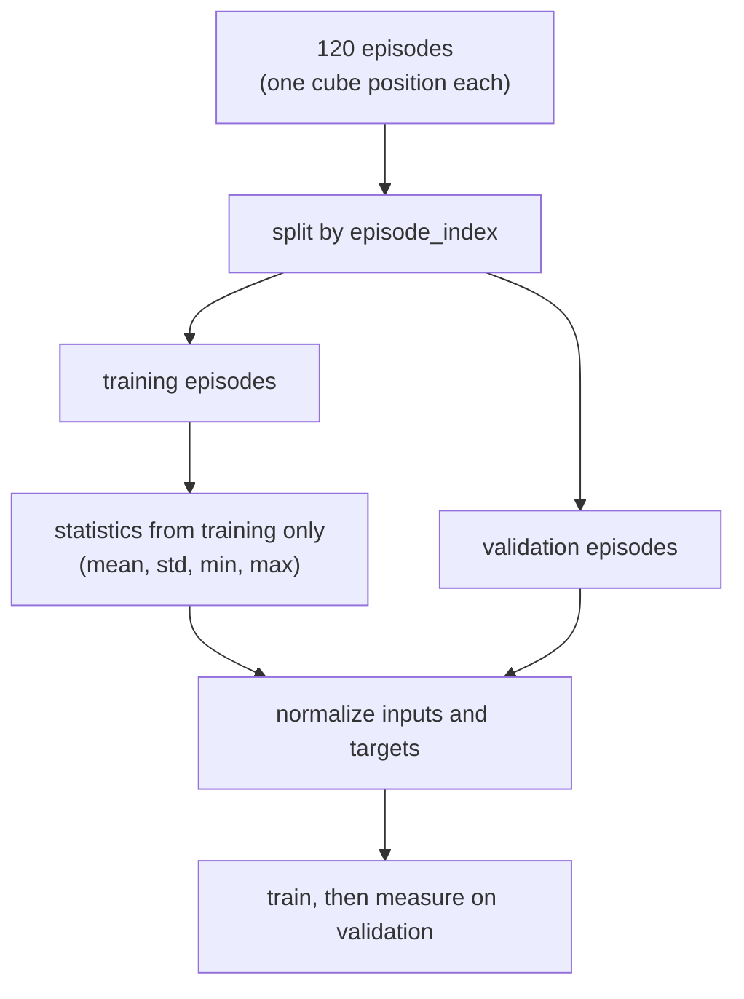

# 27 · Robot datasets

<!-- meta -->
| | |
|---|---|
| **Part** | [7 · Learning from demonstration](README.md) |
| **Run type** | CPU · Mac or Colab CPU |
| **Prerequisites** | [26](26-teleop-replay-data.md) |
| **Learn first** | none |
| **Time** | ~40 min |
| **Code** | [`experiments/27-robot-datasets/experiment.py`](../experiments/27-robot-datasets/experiment.py) |
| **Status** | ✅ done |
<!-- /meta -->

> A robot dataset is a time series cut into episodes. Normalize with its statistics, and split it by episode, never by frame.

## The problem

Lesson 26 produced 13680 frames of scripted SO-101 demonstrations. Three decisions decide whether the training numbers mean anything: what each frame contains and where episodes start, how the features are scaled, and how the data is split into training and validation. The last is the easiest to get wrong: frames 40 ms apart are almost identical, so a random frame-level split puts near-duplicates on both sides, and the validation error measures interpolation between neighbouring frames. This lesson measures how large that illusion is on our data.

## Core idea

### In plain words

A robot dataset looks like a big table of rows, one row per frame, but it is really a set of short recordings (**episodes**), each a time series. That one fact drives two decisions.

**Split by episode, not by row.** A churn model built from an app's click log must not see random rows of the same user in both training and validation: it would recognise the user instead of learning the pattern, so you hold out whole users. Frames 40 ms apart in one episode are as alike as two clicks of one user a second apart, so validation must hold out whole episodes; otherwise it measures how well the model fills tiny gaps between frames it has seen.

**Scale with the training data's statistics.** Each input is rescaled with numbers computed on the training set (mean and spread, or minimum and maximum), and those numbers ship with the trained policy. Then it no longer matters whether someone logged the cube in metres or millimetres.

### The data path



### Splitting and normalization, as code

```python
f_train, f_val = split_rows(all_frames)                 # wrong: neighbours 40 ms apart on both sides
val = np.isin(episode_index, held_out_episodes)         # right: whole episodes, like whole users
train = ~val
x_norm = (x - x[train].mean(0)) / x[train].std(0)       # MEAN_STD with training statistics only
```

| Quantity | Formula |
|---|---|
| MEAN_STD | $\tilde x = \dfrac{x - \mu}{\sigma}$ |
| MIN_MAX | $\tilde x = 2\,\dfrac{x - x_{\min}}{x_{\max} - x_{\min}} - 1$ |
| global row of a frame | `index` $= e \cdot T + t$ when every episode has $T$ frames |
| episode split | validation = every frame of the held-out episodes |

Here $x$ is one raw feature value, $\tilde x$ its normalized value, $\mu, \sigma, x_{\min}, x_{\max}$ that feature's mean, standard deviation, minimum and maximum over the training frames, $e$ the episode id (`episode_index`), $t$ the position inside the episode (`frame_index`) and $T$ the episode length in frames.

### What a frame holds

A dataset is a set of episodes $e$, each a sequence of frames $t = 0 \dots T_e - 1$ at a fixed rate:

| Column | Meaning | Our data |
|---|---|---|
| `observation.state` | proprioception (the robot's reading of its own joint positions), here plus the cube pose | 9 floats |
| `observation.images.*` | camera frames | none (state-based) |
| `action` | command sent at this frame | 6 joint targets |
| `timestamp` | seconds since episode start | $t/25$ |
| `frame_index`, `episode_index`, `index` | position in episode, episode id, global row | int |
| `task_index` | which natural-language task | 0: "pick up the cube" |

### The LeRobot format (v3.0)

Verified in the docs and code ([LeRobotDataset v3.0](https://huggingface.co/docs/lerobot/lerobot-dataset-v3); `CODEBASE_VERSION = "v3.0"` in [`dataset_metadata.py`](https://github.com/huggingface/lerobot/blob/main/src/lerobot/datasets/dataset_metadata.py)):

- `meta/info.json`: schema (feature names, dtypes, shapes), fps, codebase version, path templates.
- `meta/stats.json`: per-feature statistics for normalization; the code computes min, max, mean, std, count and the quantiles 0.01, 0.10, 0.50, 0.90, 0.99 ([`compute_stats.py`](https://github.com/huggingface/lerobot/blob/main/src/lerobot/datasets/compute_stats.py)).
- `meta/episodes/`: per-episode records (length, tasks, offsets into the shared files) as chunked Parquet.
- `meta/tasks.parquet`: task strings mapped to integer ids (the docs page still says `tasks.jsonl`, which the code keeps as the legacy path, [`utils.py`](https://github.com/huggingface/lerobot/blob/main/src/lerobot/datasets/utils.py)).
- `data/chunk-000/file-000.parquet`: frame rows, many episodes per file; `videos/<camera>/chunk-000/file-000.mp4` likewise.

`timestamp`, `frame_index`, `episode_index`, `index` and `task_index` are filled in by the recorder, not by the user ([`feature_utils.py`](https://github.com/huggingface/lerobot/blob/main/src/lerobot/datasets/feature_utils.py)). In v3 episode boundaries live in the metadata, not in file names.

<details>
<summary>Math details: why a frame split leaks and why statistics travel with the policy</summary>

**The independent unit is the episode.** Within an episode neighbouring rows are 40 ms of a smooth motion apart and strongly correlated; across episodes the cube position is drawn independently. A validation set estimates error on *new, independent* inputs, so it must hold out whole episodes, as the evaluation in [lesson 25](25-evaluating-policies.md) holds out test positions.

**The leak shrinks as data grows.** With many episodes the training set covers the cube area densely, so even a truly new episode has close neighbours and the two estimates converge. With few episodes they diverge most; robot datasets are usually small.

**Why scale matters.** An MLP's first layer forms weighted sums of its inputs. Logged in millimetres the cube values are 1000 times larger while joint angles stay of order 1 rad, so they dominate the sums, and default initializations and learning rates assume inputs of order 1. Rescaling each feature to a common range removes the dependence on units.

**Statistics belong to the model.** $\mu, \sigma$ (or $x_{\min}, x_{\max}$) are fitted on training data and are part of the policy: evaluated with different statistics, the same raw observation becomes a different network input. Computing them on validation data as well is a second, smaller leak.

Go deeper: [Model Evaluation](https://aiengineeringfromscratch.com/lesson?path=phases/02-ml-fundamentals/09-model-evaluation); [LeRobotDataset v3.0](https://huggingface.co/docs/lerobot/lerobot-dataset-v3) and [`compute_stats.py`](https://github.com/huggingface/lerobot/blob/main/src/lerobot/datasets/compute_stats.py).

</details>

## Build it

You will now write the dataset side yourself on lesson 26's `demos.npz`: episode bookkeeping, statistics, the two splits, normalization, and a model-free probe of the split leak, all in NumPy (the Experiment's MLP needs PyTorch; the probe does not). Type the steps into a file of your own and run it after each step. The finished functions are in [`physai/data.py`](../physai/data.py); `uv run python experiments/27-robot-datasets/build.py` runs all five steps with their checks (output in [`build_output.txt`](../experiments/27-robot-datasets/build_output.txt)).

### Step 1 · Episodes and the global index

Rows are sorted by episode, so an episode starts wherever `episode_index` changes:

```python
def episode_starts(episode_index):
    """Row of the first frame of every episode, for rows sorted by episode."""
    return np.flatnonzero(np.r_[True, episode_index[1:] != episode_index[:-1]])
```

```python
def global_index(episode_index, frame_index):
    """The dataset-wide row number `index` from (episode_index, frame_index)."""
    starts = episode_starts(episode_index)
    return starts[np.searchsorted(episode_index[starts], episode_index)] + frame_index
```

== Step 1. Episode boundaries and the global index ==
episodes 120 | starts [0, 114, 228, 342] ... 13566 | lengths 114-114
index == row number for all 13680 frames: True | episode 2, frame 5 -> index 233

The boundaries of part A, and the answer to the first exercise (233), without assuming equal-length episodes.

### Step 2 · Statistics, and merging them

```python
def feature_stats(x):
    """Per-feature statistics as a dataset's stats file stores them."""
    return dict(mean=x.mean(0), std=x.std(0), min=x.min(0), max=x.max(0),
                q01=np.percentile(x, 1, axis=0), q99=np.percentile(x, 99, axis=0), count=len(x))
```

A recorder computes statistics per episode and combines them, so it never needs all frames in memory at once. Mean, standard deviation, min and max combine exactly (pooled variance); quantiles do not:

```python
def merge_stats(a, b):
    """Combine the mean/std/min/max/count of two disjoint sets of frames (pooled variance). Quantiles do not merge."""
    n = a["count"] + b["count"]
    mean = (a["count"] * a["mean"] + b["count"] * b["mean"]) / n
    m2 = (a["count"] * (a["std"] ** 2 + (a["mean"] - mean) ** 2) + b["count"] * (b["std"] ** 2 + (b["mean"] - mean) ** 2))
    return dict(mean=mean, std=np.sqrt(m2 / n), min=np.minimum(a["min"], b["min"]),
                max=np.maximum(a["max"], b["max"]), count=n)
```

== Step 2. Statistics (all frames) and merged per-episode statistics ==
       feature     mean      std      min      max      q01      q99
 shoulder_lift   -0.240    0.515   -1.200    0.702   -1.200    0.620
       gripper    0.731    0.505    0.141    1.200    0.162    1.200
        cube_x    0.222    0.037    0.160    0.332    0.161    0.321
120 per-episode stats merged vs computed on all frames: max |mean diff| 1.1e-15, max |std diff| 6.4e-15, min/max equal: True

The rows of part A's table, and 120 merged episodes agree with the all-frames statistics to round-off.

### Step 3 · Two splits

```python
def split_frames(rows, val_frac, rng):
    """Frame split (the wrong one for time series): shuffle the rows, the last val_frac go to validation."""
    perm = rng.permutation(rows)
    cut = int((1 - val_frac) * len(perm))
    return perm[:cut], perm[cut:]
```

```python
def split_episodes(episode_index, val_episodes):
    """Episode split: every frame of the held-out episodes goes to validation. Returns (train, val) masks."""
    val = np.isin(episode_index, val_episodes)
    return ~val, val
```

With the Experiment's generator and its 10-episode draw:

== Step 3. 10 episodes, 80/20: frame split vs episode split ==
frame split:   912 / 228 frames, episodes on both sides 10/10, validation frames with a training neighbour 40 ms away 96.5%
episode split: 912 / 228 frames, episodes on both sides 0/10

Same sizes, very different content. In the frame split every episode is on both sides, and 96.5% of validation frames have a training frame 40 ms away in the same episode.

### Step 4 · Normalize with training statistics

```python
def normalize(x, s, mode="mean_std"):
    """MEAN_STD: (x - mean) / std. MIN_MAX: map [min, max] to [-1, 1]. s comes from the training frames."""
    if mode == "mean_std":
        return (x - s["mean"]) / (s["std"] + 1e-8)
    return 2 * (x - s["min"]) / (s["max"] - s["min"] + 1e-8) - 1
```

```python
def unnormalize(y, s, mode="mean_std"):
    """Inverse of normalize (for actions a policy outputs in normalized units)."""
    if mode == "mean_std":
        return y * (s["std"] + 1e-8) + s["mean"]
    return (y + 1) / 2 * (s["max"] - s["min"] + 1e-8) + s["min"]
```

== Step 4. Normalize with training statistics (episodes 0-79) ==
mean_std: train range [-3.57, 2.86] | round trip error 1.1e-16 | m vs mm after normalizing: 7.9e-07
 min_max: train range [-1.00, 1.00] | round trip error 4.4e-16 | m vs mm after normalizing: 2.0e-07

MIN_MAX maps the training range to exactly [−1, 1]; MEAN_STD gives zero mean and unit spread (here −3.57 to 2.86). After normalization metres and millimetres differ only at the 1e-7 level, the `1e-8` division guard relative to a 0.037 m standard deviation. Hence part B's 0.264° in m and 0.265° in mm.

### Step 5 · A model-free probe of the leak

The cheapest "policy" there is: predict the action of the closest training frame.

```python
def nearest_neighbour(X_train, Y_train, X_query, chunk=1024):
    """1-nearest-neighbour regression: the target of the closest training row (L2), chunked to bound memory."""
    out, sq = [], (X_train ** 2).sum(1)
    for i in range(0, len(X_query), chunk):
        q = X_query[i:i + chunk]
        out.append(Y_train[np.argmin(sq[None] - 2 * q @ X_train.T, axis=1)])
    return np.vstack(out)
```

On the same splits as part C, with the 20 test episodes 100–119:

== Step 5. 1-nearest-neighbour probe, MEAN_STD, the Experiment's splits; test = episodes 100-119 ==
 train eps    split  val RMSE deg  test RMSE deg  test / val
        10    frame         1.536          6.064        3.95
        10  episode         5.303          6.614        1.25
        30    frame         1.426          3.468        2.43
        30  episode         2.730          3.607        1.32
        90    frame         1.272          1.708        1.34
        90  episode         2.516          1.687        0.67

Part C's pattern without any training: the frame-split validation error stays flat (1.27–1.54°) while the test error falls from 6.06° to 1.71°; with 10 episodes the frame split understates it 3.95 times. The numbers differ from part C's because the model differs: a nearest neighbour copies a frame 40 ms away instead of interpolating smoothly like the MLP, so its validation errors are larger and its ratio smaller than the MLP's 6.33.

### What you keep

`physai.data` now also has `episode_starts`, `global_index`, `feature_stats`, `merge_stats`, `split_frames`, `split_episodes`, `normalize`, `unnormalize` and `nearest_neighbour`. The learning lessons that follow need exactly these pieces: an episode split and training statistics. [`tests/test_27_robot_datasets.py`](../tests/test_27_robot_datasets.py) checks them on unequal toy episodes and the leak on the lesson-26 data; run `uv run pytest tests/test_27_robot_datasets.py`.

## Use it

LeRobot (not installed in this repo; calls from its [v3.0 docs](https://huggingface.co/docs/lerobot/lerobot-dataset-v3)) does the bookkeeping of Steps 1–2 for you:

```python
from lerobot.datasets import LeRobotDataset
dataset = LeRobotDataset(repo_id)                 # from the Hub, cached locally
frame = dataset[100]                              # dict: 'observation.state', 'action', 'timestamp', ...
stats = dataset.meta.stats                        # meta/stats.json: per-feature mean/std/min/max
dataset = LeRobotDataset(repo_id, delta_timestamps={"action": [0.0, 0.04, 0.08]})   # windows, in seconds
```

| | physai | LeRobot |
|---|---|---|
| episode boundaries | `episode_starts(episode_index)` | `meta/episodes/`: lengths and offsets into shared files |
| statistics | `feature_stats`: mean, std, min, max, q01, q99, count | min, max, mean, std, count, quantiles 0.01–0.99 (Core idea) |
| normalization | `normalize(x, s, "mean_std" / "min_max")` | modes MIN_MAX, MEAN_STD, IDENTITY, QUANTILES, QUANTILE10 ([`types.py`](https://github.com/huggingface/lerobot/blob/main/src/lerobot/configs/types.py)); ACT defaults to MEAN_STD for state and action, Diffusion Policy to MIN_MAX ([ACT](https://github.com/huggingface/lerobot/blob/main/src/lerobot/policies/act/configuration_act.py), [Diffusion](https://github.com/huggingface/lerobot/blob/main/src/lerobot/policies/diffusion/configuration_diffusion.py)) |

The split by episode is still yours: select whole `episode_index` values, as in Step 3.

Traps:

- **Statistics from training frames only.** Statistics computed on all frames leak a little of the validation set into the inputs; they also travel with the policy and must be the same at deployment.
- **float32 on disk, float64 for statistics.** The dataset stores float32, about 7 significant digits; Step 2 casts to float64 before computing statistics.
- **Seconds, not frames.** `delta_timestamps` takes offsets in seconds; at 25 fps one frame is 0.04 s.

## Experiment

Input: [`demos.npz`](../experiments/26-teleop-replay-data/demos.npz) from lesson 26. Model: an MLP (2 × 256 ReLU, Adam, 4000 steps of batch 256) predicting the 6 action values from the 9 state values, the same network lesson 28 trains, there with two extra ingredients (see AIEFS: [Model Evaluation](https://aiengineeringfromscratch.com/lesson?path=phases/02-ml-fundamentals/09-model-evaluation)). Error is the action RMSE (root-mean-square difference between predicted and recorded joint targets) in degrees, measured open loop: on recorded frames, without running the robot. Full script: [`experiments/27-robot-datasets/experiment.py`](../experiments/27-robot-datasets/experiment.py), output: [`output.txt`](../experiments/27-robot-datasets/output.txt). NumPy 2.5.4, PyTorch 2.14.1 (CPU), Apple Silicon Mac (Apple M5), deterministic.

**A. Anatomy.** 120 episodes, 13680 frames, 25 fps, all 120 successful; episode boundaries at rows 0, 114, 228, …, 13566. Statistics as `stats.json` would hold them (excerpt; q01 and q99 are the 1st and 99th percentiles):

| Feature | mean | std | min | max | q01 | q99 |
|---|---|---|---|---|---|---|
| shoulder_lift [rad] | −0.240 | 0.515 | −1.200 | 0.702 | −1.200 | 0.620 |
| gripper [rad] | 0.731 | 0.505 | 0.141 | 1.200 | 0.162 | 1.200 |
| cube_x [m] | 0.222 | 0.037 | 0.160 | 0.332 | 0.161 | 0.321 |
| cube_z [m] | 0.036 | 0.032 | 0.015 | 0.114 | 0.015 | 0.101 |
| action gripper [rad] | 0.561 | 0.674 | −0.170 | 1.200 | −0.170 | 1.200 |

Two details show up only in the statistics. The commanded gripper reaches −0.170 rad (the closed limit) while the measured jaw never goes below 0.141 rad: the cube stops it, and the servo squeezes. And cube_x reaches 0.332 m although cubes were placed at most 0.28 m out: in the farthest episodes the lifted cube moves outward with the gripper during lift and hold (we checked the per-episode trajectories).

**B. Normalization** (train on episodes 0–79, validate on 80–99):

| Inputs | normalization | val RMSE [deg] | worst joint (RMSE) |
|---|---|---|---|
| cube in m | none | 0.306 | gripper (0.480) |
| cube in mm | none | 4.649 | gripper (8.164) |
| cube in m | MEAN_STD | 0.264 | gripper (0.507) |
| cube in mm | MEAN_STD | 0.265 | gripper (0.514) |
| cube in m | MIN_MAX | 0.245 | gripper (0.448) |

In metres our raw features are already of order 0.01–1, so normalization gains little (0.306 → 0.264). Log the cube in millimetres and the unnormalized model is 15 times worse, while the normalized one is unchanged. Normalization makes the model independent of the units someone chose when logging.

**C. Frame split vs episode split.** *Predict:* with 10 episodes, which split reports the lower validation error, and which one is right? Both splits are 80/20: the frame split shuffles all frames of the $n$ episodes, the episode split trains on 80% of the episodes (8, 24, 72) and validates on the rest (2, 6, 18). The test set is 20 episodes (100–119) that no model ever sees:

| Episodes used | split | val RMSE [deg] | test RMSE [deg] | test / val |
|---|---|---|---|---|
| 10 | frame | 0.252 | 1.595 | 6.33 |
| 10 | episode | 0.640 | 1.804 | 2.82 |
| 30 | frame | 0.280 | 0.446 | 1.59 |
| 30 | episode | 0.544 | 0.479 | 0.88 |
| 90 | frame | 0.270 | 0.279 | 1.03 |
| 90 | episode | 0.343 | 0.323 | 0.94 |

The frame-level validation error stays at 0.25–0.28° whatever the dataset size. It measures how well the model fills the 40 ms gaps between frames it has already seen, and with 10 episodes it understates the real error on new cube positions by a factor of 6.33. The episode-level number moves with the test error. With only 2 validation episodes (the 10-episode row) it is still optimistic, because 2 episodes are a small sample.


## Break it

The breaking parameter is the dataset size under a frame split. With 90 episodes the leak barely matters (test/val 1.03), because the training episodes already cover the cube area densely. With 10 it hides most of the error. Small datasets are where the frame split does the most damage, and robot datasets are small: LeRobot's own guide starts from 50 episodes ([il_robots](https://huggingface.co/docs/lerobot/il_robots)). The same leak appears in any per-frame shuffle that ignores `episode_index`: an early-stopping rule or a hyperparameter search driven by a leaky validation set picks overfitted models.

## On the real robot

- A real SO-101 recording made with `lerobot-record` already contains `episode_index`, `frame_index`, `timestamp` and `task_index`, and its `meta/stats.json` is written by the recorder ([LeRobotDataset v3.0](https://huggingface.co/docs/lerobot/lerobot-dataset-v3)). Split with `episode_index`; with several recording sessions, hold out a whole session, because lighting, calibration and the operator drift between sessions.
- Real observations contain images, and their statistics are per-channel. Real actions come from the leader arm, so they are noisier than our scripted ones, and two operators produce different action distributions for the same task.
- Not yet measured on the real arm: the frame-vs-episode gap of part C on a teleoperated SO-101 dataset. Procedure: record 50 episodes, train the same MLP on state → action, and compare both validation numbers with 10 held-out episodes.

## Check yourself

1. **Easy.** Our episodes all have 114 frames at 25 fps. How long is each episode, and what is `index` of frame 5 of episode 2?
2. **Medium.** Why does the measured jaw angle never go below 0.141 rad while the action goes to −0.170 rad? What would a policy trained on `observation.state` alone have to learn about this gap?
3. **Hard.** Split the 100 training episodes by cube position instead of at random: train on cubes with y < 4 cm, validate on y ≥ 4 cm. Predict the validation error relative to the random episode split, then run it.

### Answers

1. 114 / 25 = 4.56 s. `index` = 2 · 114 + 5 = 233.
2. The cube blocks the jaw; the command is the closed limit so the servo pushes until its torque cap (lesson 16). The policy must output −0.17 rad when it sees the jaw stopped at the cube width, i.e. learn a command that is never observed as a state.
3. Not computed here; run it. An extrapolation split tests a different question from a random episode split.

## Takeaways and sources

- A robot dataset is (observation, action, timestamp) frames grouped by `episode_index`, with task strings and statistics in metadata; LeRobot v3.0 stores many episodes per Parquet/MP4 file and resolves episodes through `meta/episodes/`.
- Normalize with training-set statistics: logging the cube in mm raised the unnormalized error from 0.306° to 4.649°, the normalized one stayed at 0.265°.
- Split by episode: with 10 episodes the frame split reported 0.252° against a true 1.595° on unseen episodes.

Next: [lesson 28 · Behavior cloning](28-behavior-cloning.md).

Sources:
- LeRobot, [LeRobotDataset v3.0](https://huggingface.co/docs/lerobot/lerobot-dataset-v3) (read 2026-10-27).
- LeRobot source (main, read 2026-10-27): [`datasets/utils.py`](https://github.com/huggingface/lerobot/blob/main/src/lerobot/datasets/utils.py), [`datasets/compute_stats.py`](https://github.com/huggingface/lerobot/blob/main/src/lerobot/datasets/compute_stats.py), [`datasets/feature_utils.py`](https://github.com/huggingface/lerobot/blob/main/src/lerobot/datasets/feature_utils.py), [`datasets/dataset_metadata.py`](https://github.com/huggingface/lerobot/blob/main/src/lerobot/datasets/dataset_metadata.py), [`configs/types.py`](https://github.com/huggingface/lerobot/blob/main/src/lerobot/configs/types.py), [ACT config](https://github.com/huggingface/lerobot/blob/main/src/lerobot/policies/act/configuration_act.py), [Diffusion config](https://github.com/huggingface/lerobot/blob/main/src/lerobot/policies/diffusion/configuration_diffusion.py).
- LeRobot, [Imitation learning on real-world robots](https://huggingface.co/docs/lerobot/il_robots).
- All measured numbers: [`experiments/27-robot-datasets/output.txt`](../experiments/27-robot-datasets/output.txt).
