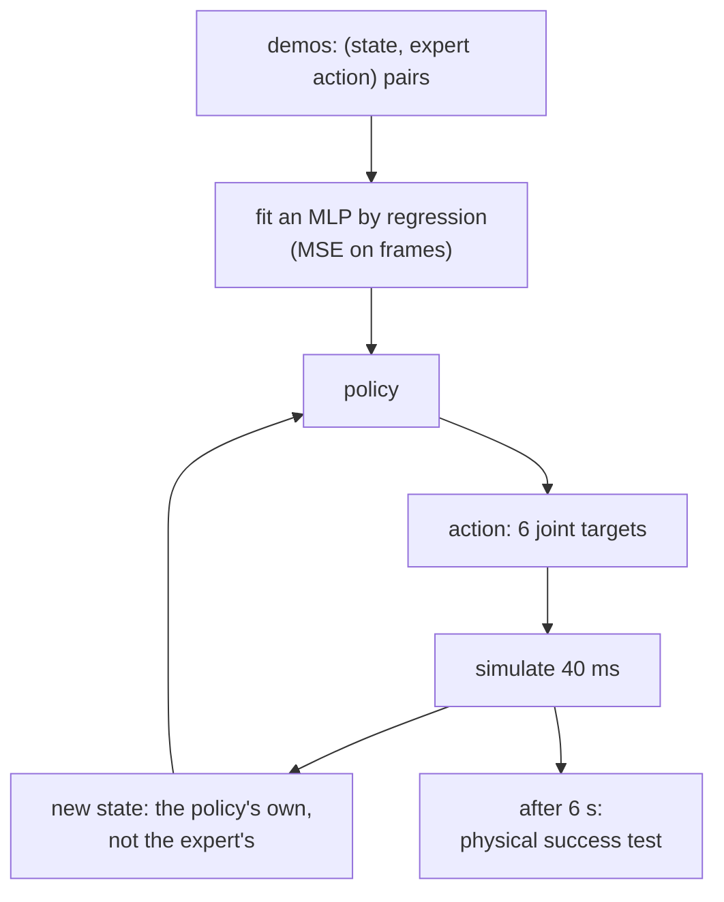

# 28 · Behavior cloning

<!-- meta -->
| | |
|---|---|
| **Part** | [7 · Learning from demonstration](README.md) |
| **Run type** | CPU · Mac or Colab CPU |
| **Prerequisites** | [27](27-robot-datasets.md) |
| **Learn first** | [Multi-Layer Networks and Forward Pass](https://aiengineeringfromscratch.com/lesson?path=phases/03-deep-learning-core/02-multi-layer-networks) · [Loss Functions](https://aiengineeringfromscratch.com/lesson?path=phases/03-deep-learning-core/05-loss-functions) · [Introduction to PyTorch](https://aiengineeringfromscratch.com/lesson?path=phases/03-deep-learning-core/11-intro-to-pytorch) |
| **Time** | ~60 min |
| **Code** | [`experiments/28-behavior-cloning/experiment.py`](../experiments/28-behavior-cloning/experiment.py) |
| **Status** | ✅ done |
<!-- /meta -->

> Behavior cloning is supervised regression from states to the expert's actions. Its loss is measured on frames, its success only in closed loop, and the two can disagree.

## The problem

Lessons 26–27 left us 120 scripted demonstrations and a clean dataset. The simplest way to turn them into a policy is behavior cloning (BC): fit $\pi_\theta(o) \approx a$ by regression, the recipe behind ALVINN, which learned to steer a vehicle from camera and laser range images (Pomerleau, NIPS 1988). The questions a robotics engineer has to answer before trusting it are concrete. How many demonstrations does an SO-101 pick need? Does a lower validation loss mean more successful picks? And what makes a network that fits the data almost perfectly drop the cube anyway?

## Core idea

### In plain words

Suppose you want a bot that plays a video game. You record a good player: at every frame, the screen and the key they press. Then you train an ordinary supervised model on those (screen, keypress) pairs: screen in, key out. That is behavior cloning. It needs no reward and no trial and error during training, only recorded pairs. For our robot the "screen" is the joint angles plus the cube position, and the "keypress" is the next set of joint targets.

Two things go wrong. First, the bot never plays exactly like the player, so after a few frames it sees screens the player never produced, and there it has no data; each small mistake pushes it further off. Second, sometimes the screen alone does not say what to do: the player waited, then pressed jump, and the screens just before and just after that decision look the same.

And the score you watch during training (error on recorded frames) is not the score that matters (does the cube get lifted when the bot plays on its own). This lesson measures both and shows they can disagree.

### Training on frames, running in a loop



### Behavior cloning, as code

```python
# Training: ordinary supervised regression on (observation, expert action) pairs
for step in range(4000):
    x, a = sample_batch(demos, 256)           # x: 9 state values + clock t, a: expert action (6)
    x_in = x + noise_like(x)                  # 0.02 rad on joints and jaw, 1 mm on the cube, 0 on t
    pred = policy(normalize(x_in))            # MLP 2 x 256, MEAN_STD from lesson 27
    loss = ((pred - normalize_a(a)) ** 2).mean()  # MSE against the clean expert targets
    loss.backward(); opt.step(); opt.zero_grad()

# Run time: the policy feeds itself (closed loop)
for k in range(150):                          # 6 s at 25 Hz
    x = concat(scene.obs(), min(k / 25, 4.52))   # clock clipped to the last demo timestamp
    a = unnormalize_a(policy(normalize(x)))
    scene.apply(a); scene.step(20)            # hold 40 ms
```

| Quantity | Formula |
|---|---|
| BC objective | $\theta^* = \arg\min_\theta \; \mathbb E_{(o,a) \sim \mathcal D}\, \big\| \pi_\theta(o) - a \big\|^2$ |
| with input noise | $\mathbb E_{(o,a) \sim \mathcal D,\ \epsilon}\, \big\| \pi_\theta(o + \epsilon) - a \big\|^2$ |
| open-loop RMSE | $\sqrt{\operatorname{mean}\big(\pi_\theta(o) - a\big)^2}$ over held-out demo frames |
| closed-loop success | $k/n$ from the physical test of [lesson 25](25-evaluating-policies.md) |

Here $\theta$ are the network weights, $\pi_\theta$ the policy network, $\mathcal D = \{(o_t, a_t)\}$ the demonstrations from the expert $\pi^*$, $o$ an observation (9 state values plus the clock), $a$ the expert's action (6 joint targets) and $\epsilon$ Gaussian noise with a standard deviation of 0.02 rad per joint and 1 mm on the cube. The objective is an ordinary MSE regression (see AIEFS: [Multi-Layer Networks](https://aiengineeringfromscratch.com/lesson?path=phases/03-deep-learning-core/02-multi-layer-networks), [Loss Functions](https://aiengineeringfromscratch.com/lesson?path=phases/03-deep-learning-core/05-loss-functions), [Introduction to PyTorch](https://aiengineeringfromscratch.com/lesson?path=phases/03-deep-learning-core/11-intro-to-pytorch)). The catch is the training distribution: $o$ is drawn from the states the *expert* visits, while at run time the policy feeds itself its own states. Lesson 29 deals with that gap; this lesson measures what it does to BC.

### Our policy

| Part | Choice |
|---|---|
| input | 5 arm joints, jaw, cube xyz (9) + episode clock $t$ (clipped to 4.52 s, the last demo timestamp) |
| output | next 6 joint targets [rad], held for 40 ms (20 physics steps) |
| network | MLP 2 × 256 ReLU, MEAN_STD normalization from lesson 27 |
| training | Adam, lr 1e-3, batch 256, 4000 steps, MSE |
| augmentation | Gaussian noise on the inputs of each batch: 0.02 rad on joints, 1 mm on the cube; targets unchanged |

**Why the clock and the noise.** The scripted expert is a state machine with timed segments. At the bottom of the descent, the arm state "jaws open, at the cube" is the same just before and just after the expert decides to close, so the state alone does not say which action comes next; the clock does. The noise matters because the demonstrations are noise-free curves in a 10-D input space: off those curves the network's output is unconstrained, and the learner leaves them within the first steps. Training on slightly perturbed inputs with the expert's unperturbed actions teaches it to map nearby states onto the expert's targets; because the targets are absolute joint positions, the same target pulls a displaced arm back. Both are design choices of this lesson, not part of BC. Break it measures them (50 demos, seed 0): 20/20 with both, 0/20 without noise, 4/20 without the clock.

**Closed-loop evaluation.** Every 40 ms the policy reads the simulated state and outputs joint targets; the SO-101 position servos track them. After 6 s the physical test of [lesson 25](25-evaluating-policies.md) decides success. Each configuration is run with 3 training seeds on the same 20 test positions (seed 28, never used for training), and we report each seed's k/20 and the pooled k/60 (the three seeds' trials added together) with a Wilson interval.

<details>
<summary>Math details: what MSE regression learns, and why the loop changes things</summary>

**MSE learns the average action.** For a fixed input $o$, the value $\hat a$ that minimizes $\mathbb E\,\|\hat a - a\|^2$ over the actions seen with that input is their mean, $\mathbb E[a \mid o]$. If one state is followed by "keep open" in most frames and by "start closing" in a few, the regression outputs something close to "keep open". Adding the clock makes those frames different inputs, so each gets its own mean.

**Training and run-time inputs differ.** Training draws $o$ from the expert's state distribution. At run time $o_{t+1}$ is produced by the simulator from $o_t$ and the policy's own action $\pi_\theta(o_t)$, so any action error moves the next input. If the network is accurate only on the expert's states, a small error takes it to a state where it is less accurate, and the errors compound over the 150 steps of an episode.

**Why input noise helps here.** Minimizing $\mathbb E\,\|\pi_\theta(o + \epsilon) - a\|^2$ asks the network to output the expert's action for every state in a small neighbourhood of the demonstrations, not just on the curves themselves. Because $a$ is an absolute joint target, outputting it from a slightly displaced state commands a move back toward the demonstrated path. This is a property of our action space; with velocity or delta actions the argument does not carry over directly.

**Open loop vs closed loop.** The open-loop RMSE averages over all demonstration frames equally. Closed-loop success depends on a few decisive frames (the grasp) and on states the expert never visited, so the two need not move together.

Go deeper: [Multi-Layer Networks and Forward Pass](https://aiengineeringfromscratch.com/lesson?path=phases/03-deep-learning-core/02-multi-layer-networks), [Loss Functions](https://aiengineeringfromscratch.com/lesson?path=phases/03-deep-learning-core/05-loss-functions), [Introduction to PyTorch](https://aiengineeringfromscratch.com/lesson?path=phases/03-deep-learning-core/11-intro-to-pytorch); Pomerleau (1988) and UC Berkeley CS 285, lectures 2–3, in the sources below.

</details>

## Experiment

Full script: [`experiments/28-behavior-cloning/experiment.py`](../experiments/28-behavior-cloning/experiment.py), output: [`output.txt`](../experiments/28-behavior-cloning/output.txt). MuJoCo 3.17.0, NumPy 2.5.4, PyTorch 2.14.1 (CPU, 1 thread), Apple Silicon Mac (Apple M5), deterministic, about 1 min of CPU.

```python
def train_policy(obs, act, t, seed=0, sigma_rad=0.02, clock=True, steps=4000):
    X = features(obs, t, clock)                        # [joints, jaw, cube xyz, t]
    return train_mlp(X, act, steps=steps, seed=seed,   # MEAN_STD inside
                     obs_noise=noise_vector(sigma_rad, clock))

for k in range(150):                                   # 6 s at 25 Hz
    a = policy(scene.obs(), k / 25)
    scene.apply(a); scene.step(20)                     # hold 40 ms
success = scene.success()                              # lifted >= 4 cm, both jaws touching
```

*Predict:* how many demonstrations until 20/20, and does the open-loop error predict the success rate?

**A. Number of demonstrations.**

| Demos | frames | seeds 0 / 1 / 2 | pooled | Wilson 95% | open-loop RMSE [deg] | failed test positions (×seeds) |
|---|---|---|---|---|---|---|
| 5 | 570 | 12 / 11 / 13 | 36/60 | [0.47, 0.71] | 4.138 | 9 positions, all "closed, cube on floor" |
| 10 | 1140 | 19 / 19 / 19 | 57/60 | [0.86, 0.98] | 2.282 | #4 (16.6, −6.6) cm ×3 |
| 20 | 2280 | 20 / 20 / 20 | 60/60 | [0.94, 1.00] | 0.945 | – |
| 50 | 5700 | 20 / 20 / 20 | 60/60 | [0.94, 1.00] | 0.408 | – |
| 100 | 11400 | 18 / 18 / 19 | 55/60 | [0.82, 0.96] | 0.360 | #19 (16.2, 2.7) cm ×3, #3, #7 ×1 |

Open-loop RMSE is measured on the 20 unseen demo episodes (100–119). Three things stand out:

- **Success saturates long before the loss does.** Success is already 60/60 at 20 demos; from 20 to 100 demos the RMSE still falls from 0.945° to 0.360° without any gain in success.
- **More data was not monotonically better.** At 100 demos the pooled rate drops to 55/60; the 95% intervals of 50 and 100 demos barely overlap ([0.94, 1.00] vs [0.82, 0.96]). A two-sided Fisher test on 60/60 vs 55/60 gives p = 0.057, and even that treats the 60 rollouts as independent, which they are not: the three seeds share the same 100 demos and the same 20 test positions. The failures concentrate on test position #19, at x = 16.2 cm, the near edge of the demonstrated area, where all three seeds fail. So the drop is not statistically established, but it is not noise we can dismiss either. With a fixed 4000 training steps, 100 demos means fewer passes over each episode; we did not isolate the cause.
- **Failures are physical, not numerical.** With 5 demos the arm closes the jaws but the cube stays on the floor (24 of 24 failures): the aim is off by more than the grasp tolerance of lesson 26.


## Break it

Two knobs, 50 demonstrations, seed 0 (noise 0 turns off the 1 mm cube noise too; the other rows keep it):

| Input noise [rad] | clock | success | Wilson 95% | failures |
|---|---|---|---|---|
| 0 | yes | 0/20 | [0.00, 0.16] | closed, cube on floor 20 |
| 0.005 | yes | 0/20 | [0.00, 0.16] | never closed 20 |
| 0.01 | yes | 7/20 | [0.18, 0.57] | closed, cube on floor 6; lifted, not held 7 |
| 0.02 | yes | 20/20 | [0.84, 1.00] | – |
| 0.04 | yes | 20/20 | [0.84, 1.00] | – |
| 0.02 | no | 4/20 | [0.08, 0.42] | never closed 16 |

Without input noise the policy fits the demonstrations and fails every test: 0/20 at 0 and at 0.005 rad. Our reading, consistent with the drift measured in lesson 29: the learner leaves the narrow tube of demonstrated states. Each 40 ms step adds a small error, the next input is slightly off the demonstrations, the output there is extrapolated, and the errors compound. Remove the clock instead and 16 of 20 episodes end with the jaws never closing. Our reading here too: in the demonstrations the state "arm at the cube, jaws open" is followed by "keep open" in most frames and by "start closing" in only a few, so a state-only regression averages toward "keep open", and once the arm stops moving nothing in the state changes.

## On the real robot

- LeRobot trains BC-family policies with `lerobot-train --policy.type=act` (and others) on a recorded dataset, and evaluates them with `lerobot-rollout` ([il_robots](https://huggingface.co/docs/lerobot/il_robots)). Its policies take camera images; our state-only policy reads the cube position from the simulator, which a real arm must estimate from cameras (Part 5).
- Not yet measured on the real arm. Procedure: record 10, 20 and 50 teleoperated episodes over the same cube area, train one policy per size, evaluate each on the same 20 marked positions as in lesson 25, and report k/20 with Wilson intervals and failure types. Expect a different curve: human demonstrations are noisier and less consistent than scripted ones, which acts partly like the input noise above and partly like label noise.
- The input-noise trick has a hardware analogue: demonstrations that already contain small corrections. That is what DAgger ([lesson 29](29-dagger.md)) collects deliberately.

## Check yourself

1. **Easy.** With 5 demos, which failure type dominates, and what does it say about the policy's aim?
2. **Medium.** RMSE at 50 demos is 0.408°, at 100 it is 0.360°, yet success went from 60/60 to 55/60. Give two reasons an open-loop metric can disagree with closed-loop success.
3. **Hard.** Replace the clock by a phase variable the policy can observe on a real robot without a timer (hint: the jaw angle and cube height). Retrain with 50 demos and compare with the 4/20 of the no-clock row.

### Answers

1. "Closed, cube on floor" (24 of 24 failures): the jaws close next to the cube, so the aim is off by more than the grasp tolerance; open-loop RMSE is 4.138° at 5 demos.
2. RMSE is averaged over demonstration states, while success depends on a few decisive states (the grasp) and on states the expert never visited; small errors there matter more than large errors elsewhere. And the metric ignores compounding: in closed loop each error changes the next input.
3. Not computed here; run it.

## Takeaways and sources

- In simulation, BC with a clock input and 0.02 rad input noise picked the cube 57/60 with 10 demonstrations and 60/60 with 20 and 50 (3 seeds × 20 test positions).
- Open-loop RMSE kept improving (0.945° → 0.360° from 20 to 100 demos) while success did not; evaluate closed loop.
- Without input noise the same network scored 0/20; without the clock, 4/20: BC breaks on states the demonstrations do not cover and on decisions the state does not determine.

Next: [lesson 29 · Distribution shift and DAgger](29-dagger.md).

Sources:
- D. A. Pomerleau, ["ALVINN: An Autonomous Land Vehicle in a Neural Network"](https://proceedings.neurips.cc/paper/1988/hash/812b4ba287f5ee0bc9d43bbf5bbe87fb-Abstract.html), NIPS 1, 1988.
- UC Berkeley [CS 285 Deep Reinforcement Learning](https://rail.eecs.berkeley.edu/deeprlcourse/), lectures 2–3 "Behavioral Cloning" (slides on the course page).
- LeRobot, [Imitation learning on real-world robots](https://huggingface.co/docs/lerobot/il_robots).
- All measured numbers: [`experiments/28-behavior-cloning/output.txt`](../experiments/28-behavior-cloning/output.txt).
