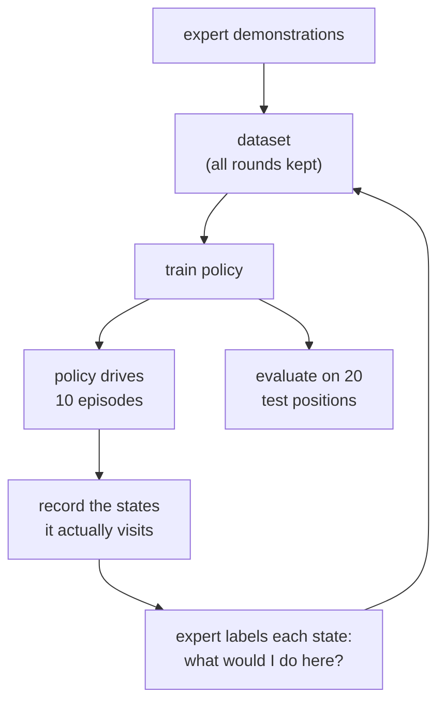

# 29 · Distribution shift and DAgger

<!-- meta -->
| | |
|---|---|
| **Part** | [7 · Learning from demonstration](README.md) |
| **Run type** | CPU · Mac or Colab CPU |
| **Prerequisites** | [28](28-behavior-cloning.md) |
| **Learn first** | [Bias-Variance Tradeoff](https://aiengineeringfromscratch.com/lesson?path=phases/02-ml-fundamentals/10-bias-variance) |
| **Time** | ~45 min |
| **Code** | [`experiments/29-dagger/experiment.py`](../experiments/29-dagger/experiment.py) |
| **Status** | ✅ done |
<!-- /meta -->

> Behavior cloning trains on the expert's states and runs on its own. DAgger closes that gap by asking the expert what to do in the states the learner actually reaches.

## The problem

Lesson 28 ended with a network trained on 50 demonstrations that scores 0/20 when trained without input noise. Nothing is wrong with the regression; the failures happen in closed loop, where the policy's own output moves the robot and the robot's new state is the policy's next input. Ross and Bagnell (2010) gave the reason a name: treating imitation as i.i.d. supervised learning (every example drawn independently from one fixed distribution) ignores that the learner's own actions decide which states it sees next, and the resulting regret "grows quadratically in the time horizon of the task". The gap between the states seen in training and the states met at run time is called **distribution shift**. This lesson measures it on the SO-101 pick and applies the standard fix, DAgger (Ross, Gordon, Bagnell 2011), with lesson 16's scripted pick as the expert.

## Core idea

### In plain words

You learn to drive by watching an instructor who always stays in the middle of the lane. You have never seen what to do half a metre to the left, because the instructor was never there. On your first solo drive a small error puts you exactly there; your next decision is a guess, the guess is a little off, and the car drifts further into places you have never seen. Errors compound: each mistake makes the next one more likely. That is distribution shift.

A good instructor fixes this differently: they let you drive, sit next to you, and at every moment say what *they* would do from where the car actually is. You write those corrections down, add them to everything you already know, practise on all of it, and drive again. After a few rounds your notes cover the places where *you* drift, not only the middle of the lane. That is DAgger (Dataset Aggregation).

It needs two things: an expert who can answer "what would you do here?" for any state, not just replay its own drive, and keeping all earlier notes. The Break it section shows what happens without the second.



### DAgger as code

```python
def dagger(expert, demos, n_iters, m):
    data = list(demos)                       # (state, action) pairs recorded while the expert drove
    policy = train(data)                     # iteration 0: this is plain behavior cloning
    policies = [policy]
    for i in range(n_iters):
        for _ in range(m):                   # m episodes per iteration (here 10)
            for s in rollout(policy):        # the LEARNER drives, so it picks the states...
                data.append((s, expert(s)))  # ...and the EXPERT picks the action label
        policy = train(data)                 # retrain on everything, not only the newest round
        policies.append(policy)
    return best_on_validation(policies)      # success is not monotonic in the iteration

def drift_deg(q, demo_frames):               # q: 5 joints + jaw of one visited state, in degrees
    return min(max(abs(q - f)) for f in demo_frames)   # 0 = a state the dataset contains
```

| What | Formula |
|---|---|
| BC cost bound | $J(\hat\pi_{\text{BC}}) \le J(\pi^*) + T^2 \epsilon$ |
| DAgger cost bound | $J(\hat\pi_{\text{DAgger}}) \le J(\pi^*) + u\,T\,\epsilon_N + O(1)$ |
| Shift measure | $\min_j \max_i \lvert q_i - q_i^{(j)}\rvert$ |

$J$ is the expected cost over an episode of $T$ steps (ours: $T = 150$ policy steps), $\pi^*$ the expert and $\hat\pi$ a learned policy, $\epsilon$ the probability that BC errs on the expert's states, $\epsilon_N$ the loss of the best policy in hindsight on the states the learned policies visited, $u$ a bound on how much one mistake (followed by the expert) can add to the remaining cost, $q_i$ joint $i$ of a visited state and $q^{(j)}$ demonstration frame $j$. In words: BC's extra cost can grow with the square of the episode length, DAgger's only linearly.

<details>
<summary>Math details: why BC's error grows with T² and DAgger's with T</summary>

**Two state distributions.** BC minimizes the loss under $d_{\pi^*}$, the states the expert visits. At run time the policy meets $d_{\pi_\theta}$, the states it visits itself. Assume a 0-1 loss and a task cost per step in [0, 1], and let the policy err with probability $\epsilon$ on expert states.

**The $T^2$ intuition.** One error can move the learner to states where nothing was trained; in the worst case it then pays the maximum cost for every remaining step. An error can start at any of the $T$ steps (probability about $\epsilon$ each) and can cost up to $T$, so the extra cost is of order $T \cdot \epsilon T = T^2\epsilon$. The DAgger paper states this BC bound and its tightness (Ross & Bagnell 2010 give an example that attains it).

**The DAgger bound.** Algorithm 3.1 runs, at iteration $i$, the mixture $\pi_i = \beta_i \pi^* + (1-\beta_i)\hat\pi_i$, labels the visited states with $\pi^*(s)$, aggregates $\mathcal D \leftarrow \mathcal D \cup \{(s, \pi^*(s))\}$ and trains $\hat\pi_{i+1}$ on all of $\mathcal D$. Training on the union of all rounds is Follow-The-Leader, a no-regret online learner; that is what turns the $T^2$ into $u\,T\,\epsilon_N$. The bound holds for some policy among $\hat\pi_{1:N}$ once $N$ is of order $uT$ (Theorems 2.1 and 3.2), which is why the algorithm ends with "Return best $\hat\pi_i$ on validation".

**Our schedule.** $\beta_i = \mathbb 1(i = 1)$: the first data comes from the expert, after that the learner drives alone. The paper calls this the simple, parameter-free version and reports it often performs best in practice.

Go deeper: [Bias-Variance Tradeoff](https://aiengineeringfromscratch.com/lesson?path=phases/02-ml-fundamentals/10-bias-variance) (AIEFS); [Ross, Gordon, Bagnell 2011](https://arxiv.org/abs/1011.0686), Algorithm 3.1 and Theorems 2.1, 3.2; [Ross & Bagnell 2010](https://proceedings.mlr.press/v9/ross10a.html); [CS 285](https://rail.eecs.berkeley.edu/deeprlcourse/), lectures 2–3.

</details>

### The expert as labeler

DAgger needs $\pi^*(s)$ at states the expert never visited. Our expert is the time-indexed state machine of lesson 16, so the label for a learner state at policy step $k$ is the action the scripted pick commands at step $k$ for the cube where it is now. If the learner has pushed the cube more than 1 cm, the expert re-plans for the new position (plans are cached on a 2 mm grid of cube positions). This labeler is exact on schedule and weaker when the learner runs late or early; a human operator has the same limit in a different form.

## Experiment

Setup: lesson 28's features (state + clock) and MLP, trained **without** input noise ("plain BC"), 20 demonstrations, the same 20 test positions, 3 seeds. DAgger adds 10 learner episodes per iteration at fresh cube positions, 4 iterations. The baseline is plain BC trained on the same number of expert-labelled episodes, taken from the scripted demonstrations. Full script: [`experiments/29-dagger/experiment.py`](../experiments/29-dagger/experiment.py), output: [`output.txt`](../experiments/29-dagger/output.txt). MuJoCo 3.17.0, NumPy 2.5.4, PyTorch 2.14.1 (CPU), Apple Silicon Mac (Apple M5), deterministic, about 4.5 min of CPU (approximate; wall time was several times longer on a heavily loaded machine).

```python
for it in range(1, ITERS + 1):
    for xy in L26.sample_positions(ROLLOUTS, seed=1000 * seed + it):
        _, x, y, _ = run_episode(scene, labeler, pol, xy, label=True)   # learner drives
        nx += x; ny += y                                                # expert labels
    X, Y = np.concatenate([X, nx]), np.concatenate([Y, ny])             # aggregate
    pol = L28.train_mlp(X, Y, seed=seed)                                # retrain on all
```

*Predict:* plain BC fails at 20 demonstrations. Does it recover with 40 or 60 demonstrations? Does DAgger with the same number of expert-labelled episodes?

**B. DAgger vs plain BC.** "Pooled" sums the three seeds; "dist" is the mean distance of visited arm states to the nearest frame of the 20 initial demonstrations (also for the BC rows trained on 40 and 60).

| Iteration | expert-labelled episodes | DAgger, seeds 0/1/2 | pooled | Wilson 95% | dist [deg] | plain BC, seeds 0/1/2 | pooled | dist [deg] |
|---|---|---|---|---|---|---|---|---|
| 0 | 20 | 0/0/0 | 0/60 | [0.00, 0.06] | 29.35 | 0/0/0 | 0/60 | 29.35 |
| 1 | 30 | 3/18/5 | 26/60 | [0.32, 0.56] | 15.79 | – | – | – |
| 2 | 40 | 19/11/12 | 42/60 | [0.57, 0.80] | 12.59 | 0/0/0 | 0/60 | 26.75 |
| 3 | 50 | 19/16/15 | 50/60 | [0.72, 0.91] | 6.09 | – | – | – |
| 4 | 60 | 15/15/15 | 45/60 | [0.63, 0.84] | 7.50 | 0/0/0 | 0/60 | 24.76 |


(Plain BC was retrained only at 40 and 60 episodes to stay within the CPU budget.) Tripling the demonstrations does nothing for plain BC: 0/60 at 20, 40 and 60 episodes, and its states stay about 25–29° from the initial demonstrations. The same expert budget spent by DAgger on the learner's own states lifts success to 50/60 after three iterations, and the distance falls to about 6°. Iteration 4 is lower than iteration 3 (45/60 vs 50/60, overlapping intervals): DAgger does not improve monotonically, hence "Return best $\hat\pi_i$ on validation". The labels are not free: the scripted expert was run 1327 times (labelling and drift reference). At most 180 of those runs are for fresh start positions (20 test + 160 collection episodes); the rest are re-plans after the learner pushed the cube more than 1 cm.

**A. Where the learner goes.** Mean distance to the nearest demonstration frame [deg] per time window, seed 0:

| Policy | 0–1 s | 1–2 s | 2–3 s | 3–4.5 s | 4.5–6 s | success | mean max deviation from expert trajectory [deg] |
|---|---|---|---|---|---|---|---|
| plain BC, 20 demos | 22.44 | 29.05 | 28.96 | 28.94 | 28.87 | 0/20 | 62.6 |
| BC + input noise (lesson 28), 20 demos | 1.80 | 4.52 | 4.94 | 4.46 | 3.85 | 20/20 | 10.7 |
| DAgger after 4 iterations | 2.27 | 4.97 | 7.38 | 15.10 | 15.95 | 15/20 | 19.0 |

Plain BC is already 22° from every demonstrated arm configuration in the first second and about 29° after that: the compounding happens within the first 25 policy steps, and from then on the policy runs where it has no data. Both fixes stay close to the data during the approach (under 5° in the first two seconds). DAgger's states drift later (15° after 3 s), but its dataset now contains those states with expert labels, so being far from the *demonstrations* there is not the same as being far from the *training data*. The noise-trained BC policy of lesson 28 is the best of the three here: 20/20 with no extra expert queries. Input noise is a cheap, local stand-in for DAgger's on-policy data (data from the states the learner itself visits), and it suffices when the learner's errors stay small.

## Break it

Aggregation is the "Agg" in DAgger. Train each iteration only on its newest 10 learner episodes (dropping the demonstrations and earlier rounds), seed 0:

| Iteration | 0 | 1 | 2 | 3 | 4 |
|---|---|---|---|---|---|
| success without aggregation | 0/20 | 0/20 | 0/20 | 0/20 | 0/20 |
| success with aggregation | 0/20 | 3/20 | 19/20 | 19/20 | 15/20 |

Without aggregation every iteration fails. Our reading: each new dataset contains only the states the previous, failing policy visited, mostly states after its mistakes. A policy trained on those alone has never seen the approach done right, so it fails in a new way, and the next dataset covers only that failure: a student who keeps only last lesson's corrections forgets how to drive in the lane. The paper's analysis rests on training on the union of all rounds (Follow-The-Leader, a no-regret learner); the newest round alone is not. Keeping the demonstrations anchors the policy on the expert's states, and the learner's states teach it to recover from its own errors.

## On the real robot

- **LeRobot supports DAgger-style collection.** `lerobot-rollout --strategy.type=dagger` runs a trained policy on the robot while a human watches. The operator can pause it, take over with the leader arm (the hand-guided twin arm used for teleoperation), teleoperate a recovery and a correction, and hand control back, all within one episode. Both the autonomous and the human segments are recorded, and the policy is then fine-tuned on demonstrations plus the new data ([Human-In-the-Loop Data Collection](https://huggingface.co/docs/lerobot/hil_data_collection)). The docs list `so_leader` among the compatible teleoperators, because the leader must be able to move itself to mirror the follower when paused, and they name DAgger, HG-DAgger and RaC as the ideas behind it.
- **What changes with a human labeler.** In human-in-the-loop (HIL) collection the human intervenes only when failure looks imminent (the HG-DAgger gating), so the labels cover the states where the learner was about to fail rather than every visited state as in our loop. Labels are also noisier and slower than a script's.
- Not yet measured on the real arm. Procedure: train a policy on 20 teleoperated episodes, evaluate it on 20 marked positions (lesson 25), run 2–3 rounds of `--strategy.type=dagger` with 10 episodes each, fine-tune, and re-evaluate on the same positions; report k/20 and Wilson intervals after each round, next to a policy trained on the same number of plain teleoperated episodes.

## Check yourself

1. **Easy.** In the DAgger loop above, who chooses the states and who chooses the actions that end up in the dataset?
2. **Medium.** Lesson 28's input noise also lifted plain BC to 20/20 at 20 demonstrations. Explain why it works and why it is not a general replacement for DAgger.
3. **Hard.** Add a mid-episode perturbation to evaluation (move the cube 3 cm at t = 1.6 s) and repeat the DAgger loop with the same perturbation during collection. Predict the gap to plain BC, then measure it.

### Answers

1. The learner chooses the states (it is driving); the expert chooses the actions (the labels).
2. Noise trains the policy on states near the demonstrations with the expert's action from the nearby demonstration state, which is a good label only when the correct action changes little across that neighbourhood. DAgger labels the states the learner actually reaches, however far they are, with the expert's action for that state.
3. Not computed here; run it.

## Takeaways and sources

- In simulation, plain BC (no input noise) scored 0/60 at 20, 40 and 60 demonstrations; DAgger with the same expert budget reached 50/60 after three iterations.
- The shift is measurable: plain BC's arm states were 22–29° from every demonstrated configuration, DAgger's 6–8° (mean) after three to four iterations.
- Aggregate: retraining only on the newest learner data scored 0/20 at every iteration. For this task, lesson 28's input noise (20/20 with no expert queries) was the cheaper fix; DAgger is the general one, and LeRobot's `--strategy.type=dagger` is its human-in-the-loop form.

Next: [lesson 30 · Multimodal actions: diffusion and flow policies](30-diffusion-and-flow-policies.md).

Sources:
- S. Ross, G. J. Gordon, J. A. Bagnell, ["A Reduction of Imitation Learning and Structured Prediction to No-Regret Online Learning"](https://arxiv.org/abs/1011.0686), AISTATS 2011 (Algorithm 3.1, Theorems 2.1 and 3.2).
- S. Ross, J. A. Bagnell, ["Efficient Reductions for Imitation Learning"](https://proceedings.mlr.press/v9/ross10a.html), AISTATS 2010.
- LeRobot, [Human-In-the-Loop Data Collection](https://huggingface.co/docs/lerobot/hil_data_collection) and [Imitation learning on real-world robots](https://huggingface.co/docs/lerobot/il_robots) (read 2026-10-27).
- UC Berkeley [CS 285 Deep Reinforcement Learning](https://rail.eecs.berkeley.edu/deeprlcourse/), lectures 2–3 "Behavioral Cloning".
- All measured numbers: [`experiments/29-dagger/output.txt`](../experiments/29-dagger/output.txt).
