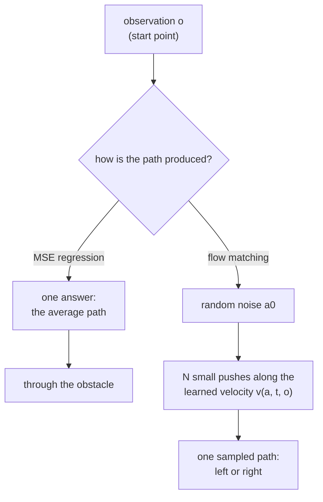

# 30 · Multimodal actions: diffusion and flow policies

<!-- meta -->
| | |
|---|---|
| **Part** | [7 · Learning from demonstration](README.md) |
| **Run type** | CPU · Mac or Colab CPU |
| **Prerequisites** | [28](28-behavior-cloning.md) |
| **Learn first** | [Diffusion Models — DDPM from Scratch](https://aiengineeringfromscratch.com/lesson?path=phases/08-generative-ai/06-diffusion-ddpm-from-scratch) · [Flow Matching & Rectified Flows](https://aiengineeringfromscratch.com/lesson?path=phases/08-generative-ai/13-flow-matching-rectified-flows) · [Loss Functions](https://aiengineeringfromscratch.com/lesson?path=phases/03-deep-learning-core/05-loss-functions) |
| **Time** | ~75 min |
| **Code** | [`experiments/30-diffusion-and-flow-policies/experiment.py`](../experiments/30-diffusion-and-flow-policies/experiment.py) · [notebook](../notebooks/30-diffusion-and-flow-policies.ipynb) |
| **Status** | ✅ done |
<!-- /meta -->

> A regression policy returns the average of the demonstrations. When the demonstrations disagree, the average can be the one motion nobody showed.

## The problem

Diffusion Policy ([Chi et al. 2023](https://arxiv.org/abs/2303.04137)) starts from multimodal actions: in one state there can be several correct motions, each a "mode". In their Push-T task the policy "learns to approach the contact point equally likely from left or right", while LSTM-GMM and IBC show a bias toward one side and BET "cannot commit to one mode" (Sec. 5.3).

The smallest version of that failure: a point must go from $(0,-1)$ to $(0,+1)$ past a round obstacle of radius 0.30 at the origin. Of 200 demonstrations, 100 pass on the left and 100 on the right, whatever the start. A behavior-cloning MLP (lesson 28) trained with MSE on them collides in **200 of 200** trials in simulation. Why, and what replaces it?

## Core idea

### In plain words

Two equally good roads go around a field, left and right, and half of the drivers you learn from take each. Train a navigator to give *one* answer as close as possible, on average, to what the drivers did, and it answers with the midpoint: straight through the field. That is what regression with an MSE loss does: it returns the average of the demonstrations, fine when they agree, wrong when they split.

The fix is to learn to *sample* an answer: each query returns one plausible road, about as often as the drivers chose each. A **mixture model** predicts a fixed number of candidates plus their probabilities and picks one. **Generative models** (diffusion, flow matching) need no fixed number: they start from random noise and push it, step by step, until it looks like a demonstration; flow matching learns the push as a velocity field, and the random start decides the road. The number of pushes is a knob: many small pushes follow the flow to one road, one big push lands on the average, back in the field.



### Flow matching as code

```python
# MSE regression, for comparison: one answer per observation -> learns E[a1 | o]
loss_mse = ((net_mse(o) - a1) ** 2).mean()

# flow matching, one training step
a1, o = sample_demos(batch)               # demonstrated path (80 numbers) and its observation
a0 = torch.randn_like(a1)                 # pure noise with the same shape
t = torch.rand(batch, 1)                  # random time in [0, 1]
at = (1 - t) * a0 + t * a1                # a point on the straight line from noise to demo
target = a1 - a0                          # the velocity of that straight line
loss = ((net(at, t, o) - target) ** 2).mean()   # still MSE, but on velocities, not on paths

# sampling: Euler integration from noise (t = 0) to a path (t = 1)
def sample(net, o, n_steps):
    a = torch.randn(80)                   # a different random start can end on the other side
    for i in range(n_steps):
        a = a + net(a, i / n_steps, o) / n_steps   # one small push along the learned velocity
    return a
```

| What | Formula |
|---|---|
| MSE optimum | $f^*(o) = \mathbb{E}[a \mid o]$; two 50/50 modes give $\tfrac12(a_L + a_R)$ |
| Mixture model | $p(a \mid o) = \sum_k \pi_k(o)\,\mathcal N(a;\mu_k(o), \sigma^2 I)$ |
| Flow-matching loss | $a_t = (1-t)\,a_0 + t\,a_1, \quad \mathcal L = \mathbb{E}\,\bigl\lVert v_{\theta}(a_t, t, o) - (a_1 - a_0)\bigr\rVert^2$ |
| Sampling (Euler) | $a \leftarrow a_0, \quad a \leftarrow a + \tfrac1N\, v_{\theta}\!\left(a, \tfrac iN, o\right), \quad i = 0,\dots,N-1$ |

$o$ is the observation (here the start point), $a$ the action (here the whole path), $a_L$ and $a_R$ the left and right demonstrated paths, $\pi_k$, $\mu_k$ and $\sigma$ the weight, mean and fixed spread of mixture component $k$ out of $K$, $a_0 \sim \mathcal N(0, I)$ the noise, $a_1$ a demonstration, $t \sim U(0,1)$ the time along the path from noise to data, $v_\theta$ the learned velocity network and $N$ the number of Euler steps (each one network call).

<details>
<summary>Math details: why MSE averages, and why one Euler step is regression again</summary>

**MSE learns the conditional mean.** For any $f$, $\mathbb{E}\,\lVert a - f(o)\rVert^2 = \mathbb{E}\,\lVert a - \mathbb{E}[a\mid o]\rVert^2 + \mathbb{E}\,\lVert \mathbb{E}[a\mid o] - f(o)\rVert^2$; the first term does not depend on $f$, so the minimizer is $f^*(o) = \mathbb{E}[a \mid o]$ (see AIEFS: [Loss Functions](https://aiengineeringfromscratch.com/lesson?path=phases/03-deep-learning-core/05-loss-functions)). With two equally likely modes this is the middle of the obstacle. An L1 loss gives the per-dimension median instead; with exactly 50/50 modes any point between them is a median, so it is no better (L1 returns in [lesson 31](31-act.md)).

**Mixture model.** Train by negative log-likelihood; at run time sample $k$ from $\pi_k(o)$, then output $\mu_k$. It works if you know $K$ and the components do not collapse. **Generative action models** sample from $p(a \mid o)$ without fixing $K$; $a$ is usually a whole chunk of future actions and $o$ a condition. We implement flow matching with straight paths ($\sigma_{\min} = 0$).

**One step is regression.** At $t = 0$, $a_t = a_0$ carries no information about $a_1$, so the best velocity is $v^*(a_0, 0, o) = \mathbb{E}[a_1 \mid o] - a_0$. A single Euler step lands on $a_0 + v^* = \mathbb{E}[a_1 \mid o]$, the MSE answer. Later steps see an $a_t$ that already leans to one side, and the learned velocity bends toward that side's mode. The integration steps are what turn regression into sampling.

Go deeper (AIEFS): [Diffusion Models — DDPM from Scratch](https://aiengineeringfromscratch.com/lesson?path=phases/08-generative-ai/06-diffusion-ddpm-from-scratch), [Flow Matching & Rectified Flows](https://aiengineeringfromscratch.com/lesson?path=phases/08-generative-ai/13-flow-matching-rectified-flows), [Loss Functions](https://aiengineeringfromscratch.com/lesson?path=phases/03-deep-learning-core/05-loss-functions). Primary sources: [Lipman et al. 2023](https://arxiv.org/abs/2210.02747), [Ho et al. 2020](https://arxiv.org/abs/2006.11239), [Chi et al. 2023](https://arxiv.org/abs/2303.04137).

</details>

<!-- figure: 30-mean-vs-flow -->

### Four ways to produce an action

| | trained to predict | sampling | cost per action |
|---|---|---|---|
| MSE regression | $\mathbb{E}[a\mid o]$ | none | 1 network call |
| Mixture (MDN) | $\pi_k, \mu_k$ | pick $k$, take $\mu_k$ | 1 call |
| DDPM ([Ho et al. 2020](https://arxiv.org/abs/2006.11239)) | the noise $\epsilon$ added to $a$, given $(a_t, t, o)$ | start from Gaussian noise, denoise $N$ times | $N$ calls |
| Flow matching ([Lipman et al. 2023](https://arxiv.org/abs/2210.02747)) | a velocity field $v_{\theta}(a_t, t, o)$ | integrate an ODE from noise in $N$ steps | $N$ calls |

DDPM ("denoising diffusion") and flow matching are close relatives: both start from noise and need $N$ network calls per sample; flow matching regresses a velocity, DDPM the noise to remove.

## Build it

You will now write the three pieces of a flow policy, the training pair, the velocity field and the Euler sampler, and check each on the Experiment's 200 demonstrations and 200 trials. Instead of training a network, you derive the field a perfect network would learn on these demonstrations: no PyTorch, about 2 s, and it separates what flow matching does from what a learned network adds.

The functions are in [`physai/imitation.py`](../physai/imitation.py); `uv run python experiments/30-diffusion-and-flow-policies/build.py` runs the four steps (output in [`build_output.txt`](../experiments/30-diffusion-and-flow-policies/build_output.txt)).

### Step 1 · The least-squares answer is the mean

Fit the paths by least squares, linear in the start $x_0$, which is the best MSE predictor for this data:

```python
F = np.c_[np.ones(len(X)), X[:, 0]]                 # 1 and the start x0 of each demonstration
coef = np.linalg.lstsq(F, Y, rcond=None)[0]         # 80 path numbers, linear in x0
```

```text
== Step 1. 200 demonstrations, half left, half right: the least-squares answer ==
demos pass the obstacle (y = 0) at x = -0.551 / +0.552
least-squares path from x0 = 0 passes at x = +0.000; max |intercept - mean of the 200 demos| = 7.5e-15
200 trials: collided 200/200, left 0, right 0
```

The intercept is the mean of the 200 demonstrations (difference 7.5e-15); the path passes the obstacle at $x = +0.000$, dead centre: 200/200 collisions. The Experiment's MSE network approximates this mean (200/200, path at $+0.030$).

### Step 2 · The training pair and what it regresses

```python
def flow_matching_pair(a0, a1, t):
    """Training input and target of flow matching with straight paths: a_t on the line noise -> data, and its velocity."""
    t = np.reshape(t, (-1,) + (1,) * (np.ndim(a1) - 1))
    return (1 - t) * a0 + t * a1, a1 - a0
```

A network sees only $a_t$, not which $a_0$ and $a_1$ produced it, so the best it can learn is the average target over all pairs passing through $a_t$. For a finite dataset that average has a closed form: given demonstration $j$, $a_t$ is Gaussian around $t\,a^{(j)}$ with standard deviation $1 - t$, so the posterior over $j$ is a softmax, and each demonstration pulls with velocity $(a^{(j)} - a)/(1 - t)$:

```python
def empirical_velocity(a, t, data):
    """The velocity field that minimizes the flow-matching loss on a finite dataset: E[a1 - a0 | a_t = a].

    Given a1 = data[j], a_t is Gaussian around t * data[j] with std (1 - t), so the posterior over j is a softmax.
    a: (n, D) points at time t (0 <= t < 1); data: (m, D) demonstrations.
    """
    a = np.atleast_2d(a)
    d2 = ((a[:, None, :] - t * data[None, :, :]) ** 2).sum(-1)      # (n, m) squared distances
    logw = -d2 / (2 * (1 - t) ** 2)
    w = np.exp(logw - logw.max(1, keepdims=True))
    w /= w.sum(1, keepdims=True)
    return (w @ data - a) / (1 - t)                                 # sum_j w_j (data_j - a) / (1 - t)
```

The check draws 4 million pairs from two 1-D modes at $\pm 1.1$ (the obstacle offsets $\pm 0.55$ times the Experiment's scaling of 2) and averages the target near five points at $t = 0.5$:

```text
== Step 2. The flow-matching pair and the field it regresses ==
t = 0.0: a_t = [0.3 0.3], target a1 - a0 = [ 0.8 -1.4]
t = 0.5: a_t = [ 0.7 -0.4], target a1 - a0 = [ 0.8 -1.4]
t = 1.0: a_t = [ 1.1 -1.1], target a1 - a0 = [ 0.8 -1.4]
t = 0.5     a    mean target near a (Monte Carlo)   empirical_velocity
         -0.8                          -0.467               -0.474
         -0.2                          -0.501               -0.510
         +0.0                          -0.001               +0.000
         +0.2                          +0.524               +0.510
         +0.8                          +0.478               +0.474
```

Monte Carlo agrees within about 0.015, its sampling noise. At $a = 0$ the two modes pull equally; a little to either side the field already points to that side's mode.

### Step 3 · Euler sampling

```python
def euler_sample(velocity, a0, n_steps):
    """Integrate da/dt = velocity(a, t) from t = 0 (noise a0) to t = 1 in n_steps equal Euler steps."""
    a = np.array(a0, dtype=float)
    for i in range(n_steps):
        a = a + velocity(a, i / n_steps) / n_steps
    return a
```

Integrate the exact field of the 200 demonstrations from noise, with the Experiment's trials, and compare with the Experiment's learned network:

```text
== Step 3. Euler sampling along the exact field of the 200 demonstrations ==
steps  collided  left  right  mean |x| at y=0   (Experiment's network: collided, mean |x|)
    1   200/200     0      0            0.026   (200/200, 0.161)
    2    34/200    84     82            0.403   (95/200, 0.372)
    4     0/200    98    102            0.487   (17/200, 0.494)
    8     0/200    97    103            0.515   (7/200, 0.533)
   16     0/200    97    103            0.528   (5/200, 0.546)
   32     0/200    97    103            0.536   (3/200, 0.554)
1 step: max |sample - mean of the demos| = 3.0e-14
```

One step lands exactly on the mean of the demonstrations (3.0e-14) and collides 200/200: "one step is regression" (Math details), measured. With 2 steps 34 samples still end between the modes (the network: 95); from 4 steps on the exact field never collides, while the network still does (17, 7, 5, 3). The gap is the network's error.

### Step 4 · What a perfect fit does

```text
== Step 4. Many steps: the exact field returns the training demonstrations ==
   8 steps: RMS distance of a sample to its nearest demonstration, median 0.0018, max 0.0158
  32 steps: RMS distance of a sample to its nearest demonstration, median 0.0009, max 0.0029
 128 steps: RMS distance of a sample to its nearest demonstration, median 0.0000, max 0.0010
demonstrations differ from each other by (median RMS, nearest pair) 0.0024
```

After 128 steps every sample sits on one of the 200 demonstrations (median RMS distance 0.0000; neighbouring demonstrations differ by 0.0024): the exact minimizer of the training loss memorizes the data. A network smooths this field and produces new paths between nearby demonstrations, which is why it generalizes and why it leaves a few samples between the modes.

### What you keep

`physai.imitation` now also has `flow_matching_pair`, `empirical_velocity` and `euler_sample`; `euler_sample` takes any velocity function, so the same sampler runs a trained network. [Lesson 31](31-act.md) keeps the chunked action and drops the sampler; [lesson 41](../part-10-foundation-models-and-agents/41-vla.md) meets flow-matching action heads again in vision-language-action models. [`tests/test_30_diffusion_and_flow_policies.py`](../tests/test_30_diffusion_and_flow_policies.py) checks the one-step mean, that a single demonstration is reached exactly in any number of steps, and that many steps land on a mode; run `uv run pytest tests/test_30_diffusion_and_flow_policies.py`.

## Use it

For a real arm, LeRobot's Diffusion Policy is ready-made: `lerobot-train --policy.type=diffusion`. It is DDPM, not flow matching, but the knobs are the ones you built ([`configuration_diffusion.py`](https://github.com/huggingface/lerobot/blob/main/src/lerobot/policies/diffusion/configuration_diffusion.py)):

| Knob | This lesson | LeRobot `DiffusionConfig` default |
|---|---|---|
| what the network predicts | velocity $a_1 - a_0$ | `prediction_type = "epsilon"` (the added noise) |
| steps per sample (network calls) | `n_steps`, 1 to 32 | `num_inference_steps`, defaults to `num_train_timesteps = 100` |
| sampler | Euler, $t$: 0 → 1 | `noise_scheduler_type = "DDPM"` |
| action chunk | the whole path, 40 waypoints | `horizon = 64` predicted, `n_action_steps = 32` executed |
| observation | the start point | `n_obs_steps = 2` (current and previous step) |
| action normalization | divide by `SCALE = 2` | `MIN_MAX` for state and action, then `clip_sample_range = 1.0` |

Three traps:

- **Noise and data must have comparable scale.** The sampler starts from $\mathcal N(0, I)$; the Experiment multiplies paths by 2 so that offsets of about 0.5 become about 1. Unnormalized actions in radians or millimetres make the first steps meaningless.
- **Time runs in opposite directions.** Here (and in Lipman et al.) $t = 0$ is noise and $t = 1$ is data; DDPM counts its timesteps down from noise at $T$ to data at 0. Mixing the conventions integrates the wrong way.
- **Steps cost latency.** Every step is one network call: 100 by default in LeRobot's diffusion config, against the 0.04–0.77 ms per query of the Experiment's small MLP at 1–32 steps. Check the budget against your control rate before you choose a step count.

## Experiment

Full script: [`experiments/30-diffusion-and-flow-policies/experiment.py`](../experiments/30-diffusion-and-flow-policies/experiment.py). NumPy 2.5.4, PyTorch 2.14.1 (CPU, 2 threads), Apple Silicon Mac (Apple M5), fixed seeds, deterministic. Parts A–B port the experiment of the earlier [notebook](../notebooks/30-diffusion-and-flow-policies.ipynb) and reproduce the numbers recorded for it, except the three-seed MSE check, which now gives somewhat different collision counts.

The observation is the start point $(x_0, y_0)$ with $x_0 \in [-0.05, 0.05]$; the action is the whole path, 40 waypoints relative to the start (80 numbers). A trial passes or hits the obstacle; "left/right" counts the collision-free trials by the side they passed. 200 trials per row, 95% Wilson intervals (lesson 25).

**Prediction:** the MSE path goes through the middle; the mixture and the flow policy split roughly 50/50.

```python
a0 = torch.randn(a1.shape)                          # noise
t = torch.rand(batch)
at = (1 - t[:, None]) * a0 + t[:, None] * a1        # point on the straight path
loss = ((net(at, t, o) - (a1 - a0)) ** 2).mean()    # regress the velocity, conditioned on o

a = torch.randn(n, 80)                              # sampling: Euler from t = 0 to 1
for i in range(n_steps):
    a = a + net(a, torch.full((n,), i / n_steps), o) / n_steps
```

**Part A.** NumPy MLP 64-64 tanh, 1,500 full-batch Adam epochs; mixture with $K = 2$, fixed $\sigma = 0.2$.

| model | collided | 95% CI | left | right |
|---|---|---|---|---|
| MSE, demos half left / half right | **200/200** | 98.1–100% | 0 | 0 |
| MSE, all demos on the left | 0/200 | 0–1.9% | 200 | 0 |
| Mixture (MDN, $K=2$) | **0/200** | 0–1.9% | 96 | 104 |

At $y = 0$ the demonstrations pass at $x = \pm 0.55$, the MSE path at $x = +0.030$, inside the radius of 0.30. With three other seeds the MSE model collided 193, 184 and 200 times out of 200, the mixture 0 times in each.

**Part B: more data does not help.** Same MSE model, demonstrations half/half:

| demos | 10 | 20 | 50 | 100 | 200 | 500 |
|---|---|---|---|---|---|---|
| MSE collisions | 8.0% | 46.0% | 85.0% | 91.5% | 100% | 100% |

A likely reason (not instrumented): with 10 demonstrations the network ties tiny differences in $x_0$ to the nearest demonstration's side; with more data it approaches the conditional mean.

**Part C: flow-matching policy** on the same 200 demonstrations: MLP 3×256 SiLU, input = noisy chunk + sinusoidal time embedding + observation, 4,000 Adam steps, batch 256. Sweep the number of Euler steps.

| Euler steps | collided | 95% CI | left | right | single-query time (ms) | mean $\lvert x\rvert$ at $y=0$ |
|---|---|---|---|---|---|---|
| 1 | 200/200 | 98.1–100% | 0 | 0 | 0.04 | 0.161 |
| 2 | 95/200 | 40.7–54.4% | 53 | 52 | 0.06 | 0.372 |
| 4 | 17/200 | 5.4–13.2% | 87 | 96 | 0.10 | 0.494 |
| 8 | 7/200 | 1.7–7.0% | 95 | 98 | 0.19 | 0.533 |
| 16 | 5/200 | 1.1–5.7% | 96 | 99 | 0.39 | 0.546 |
| 32 | **3/200** | 0.5–4.3% | 97 | 100 | 0.77 | 0.554 |


Times are the fastest of 30 single-trajectory queries on a heavily loaded machine (approximate); the step count is the machine-independent cost. The flow policy splits left/right like the mixture model without being told there are two modes, and the lateral offset approaches the demonstrations' 0.55 as steps increase.

## Break it

Cut the integration steps. With 1 step the flow policy collides **200/200**, like MSE: mean distance from the centre line 0.161, inside the obstacle. That is the $t = 0$ argument, measured; the paths are not exactly the mean (the exact field of Build it, Step 3 gives 0.026, the spread of the starts) because the learned field still depends a little on $a_0$. With 2 steps 95/200 still end between the modes, and even at 32 steps 3/200 touch the obstacle: the exact field reaches 0/200 from 4 steps on, so what remains is the learned field's error.

The second break is the data, for the MSE model (200 demos, Part B sweep):

| fraction of left demos | 50% | 60% | 70% | 80% | 90% | 100% |
|---|---|---|---|---|---|---|
| MSE collisions | 100% | 91.5% | 63.0% | 36.5% | 0% | 0% |

MSE is safe only for nearly unimodal data: the mean lateral offset $0.55\,\lvert 2p_{\text{left}} - 1\rvert$ must clear the radius 0.30 plus a margin.

## On the real robot

- **Diffusion Policy** uses a DDPM to model $p(A \mid O)$, the action sequence conditioned on observations, not their joint distribution; the CNN variant conditions through FiLM (a learned per-channel scale and shift computed from the observation). With DDIM (a faster DDPM sampler), 100 training iterations and 10 inference iterations give about 0.1 s inference on an Nvidia 3080 in their real-world setup; an action horizon of 8 steps worked best for most tasks; reported average improvement 46.9% over prior methods across 15 tasks from 4 benchmarks ([Chi et al. 2023](https://arxiv.org/abs/2303.04137)).
- **π0** uses conditional flow matching for actions, a 300M-parameter "action expert" on a 3B vision-language model (3.3B total), chunks of $H = 50$ actions, 10 integration steps; on an RTX 4090 the 10 action passes take 27 ms of a 73 ms on-board inference ([Black et al. 2024](https://arxiv.org/abs/2410.24164)). Same trade-off as Part C, at real scale.
- **SO-101 procedure** (LeRobot's defaults are in Use it). Record teleop demos of a task with two valid strategies (grasp a cube from either side), train an MSE behavior-cloning baseline and a diffusion policy on the same episodes, and count grasps that end between the two strategies over at least 50 trials each. Not yet measured on the real arm.

## Check yourself

1. **Easy.** Why does a 1-step flow policy behave like MSE regression?
2. **Medium.** With 80% left demonstrations, where does the MSE path pass at $y = 0$, and why do some trials still collide?
3. **Hard.** Write a closed-loop step policy (current position → next step) trained with MSE on the same demonstrations and measure its collision rate. Is the average flow at the centre line stable?

### Answers

1. At $t=0$ the input $a_0$ is independent of the target, so the optimal velocity is $\mathbb{E}[a_1\mid o] - a_0$ and one Euler step returns $\mathbb{E}[a_1\mid o]$. Measured: 200/200 collisions, same as MSE.
2. Around $0.8\cdot(-0.55) + 0.2\cdot 0.55 = -0.33$, just outside the radius 0.30; jitter in the learned path and in $x_0$ pushes many trials inside. Measured: 73/200 (36.5%).
3. Not computed here; run it.

## Takeaways and sources

- MSE regression returns the conditional mean; with two 50/50 modes it collided 200/200 in simulation, and more data (10 → 500 demos) raised the collision rate from 8% to 100%.
- A mixture model (0/200, 96 left / 104 right) and a flow-matching policy (3/200 at 32 steps, 97 / 100) represent both modes; the flow policy did not need to know the number of modes.
- Sampling steps are the knob: 1 step reproduced the mean (200/200), 8 steps reached 7/200, and cost grows linearly with steps.

Next: [lesson 31](31-act.md), predicting chunks of future actions and executing them.

**Sources**

- C. Chi et al., "Diffusion Policy: Visuomotor Policy Learning via Action Diffusion", 2023. [arXiv 2303.04137](https://arxiv.org/abs/2303.04137).
- K. Black et al., "π0: A Vision-Language-Action Flow Model for General Robot Control", 2024. [arXiv 2410.24164](https://arxiv.org/abs/2410.24164).
- Y. Lipman, R. T. Q. Chen, H. Ben-Hamu, M. Nickel, M. Le, "Flow Matching for Generative Modeling", 2023. [arXiv 2210.02747](https://arxiv.org/abs/2210.02747).
- J. Ho, A. Jain, P. Abbeel, "Denoising Diffusion Probabilistic Models", 2020. [arXiv 2006.11239](https://arxiv.org/abs/2006.11239).
- LeRobot, [`configuration_diffusion.py`](https://github.com/huggingface/lerobot/blob/main/src/lerobot/policies/diffusion/configuration_diffusion.py).
- All tables: [`experiments/30-diffusion-and-flow-policies/output.txt`](../experiments/30-diffusion-and-flow-policies/output.txt) (2026-10-27).
