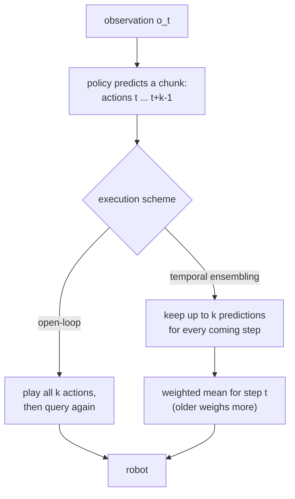

# 31 · Action chunking and ACT

<!-- meta -->
| | |
|---|---|
| **Part** | [7 · Learning from demonstration](README.md) |
| **Run type** | CPU · Mac or Colab CPU |
| **Prerequisites** | [28](28-behavior-cloning.md), [30](30-diffusion-and-flow-policies.md) |
| **Learn first** | [The Full Transformer — Encoder + Decoder](https://aiengineeringfromscratch.com/lesson?path=phases/07-transformers-deep-dive/05-full-transformer) · [Autoencoders & Variational Autoencoders (VAE)](https://aiengineeringfromscratch.com/lesson?path=phases/08-generative-ai/02-autoencoders-vae) |
| **Time** | ~75 min |
| **Code** | [`experiments/31-act/experiment.py`](../experiments/31-act/experiment.py) |
| **Status** | ✅ done |
<!-- /meta -->

> Predict the next k actions, not the next one: a chunk can reach past a pause that the observation cannot time.

## The problem

A behavior-cloning policy maps the current observation to the next action, but in demonstrations the observation sometimes stays the same while the right action changes with time: the arm waits while a gripper closes, then moves on. The ACT paper (Action Chunking with Transformers, [Zhao et al. 2023](https://arxiv.org/abs/2304.13705), Sec. I) says predicting action sequences "helps tackle temporally correlated confounders", such as pauses in demonstrations. In its chunk-size ablation (Fig. 8a, no ensembling) success rises from 1% at $k = 1$ to 44% at $k = 100$.

Our version, in simulation: a planar arm reaches a target, holds still for 0.5 s, then goes to a drop point. A single-step policy trained on 100 demonstrations is **stuck at the target in 543 of 600 episodes**.

## Core idea

### In plain words

Picture a student driver at a red light with no countdown: every second of the wait looks the same. A student who only learns "in this scene, what is my next move?" sees "stay" in almost every example, because "go" happens once, at the end, and learns to stay forever. The timing lives in the past, not in the current observation.

**Action chunking** commits to the next $k$ moves at once, for example "stay, stay, stay, go, go"; if the plan is long enough to include the moment of leaving, the arm leaves. With fewer decisions there are also fewer chances for errors to compound ([lesson 29](29-dagger.md)).

Two ways to execute a chunk: **open-loop**, play all $k$ actions without looking, then ask again; **temporal ensembling**, ask every step and average all the overlapping plans' advice for *now*, trusting older plans slightly more. The first commits; the second reacts and smooths, but averaging can water down a decision to leave.



### Chunking and ensembling as code

```python
# dataset: one observation -> the next k actions (episode end padded with the last action)
X = [o[t] for t in range(T)]
Y = [a_pad[t:t + k] for t in range(T)]           # shape (k, n_joints); trained with L1 loss

# open-loop: query once every k steps
if t % k == 0:
    chunk = policy(obs)
action = chunk[t % k]

# temporal ensembling: query every step, average every prediction made for step t
chunks[t] = policy(obs)                           # chunks[s][j] predicts step s + j
def ensembled_action(chunks, t, k, m=0.01):
    preds = [chunks[s][t - s] for s in range(max(0, t - k + 1), t + 1)]  # oldest first
    w = [exp(-m * i) for i in range(len(preds))]                          # i = 0 is the oldest
    return sum(wi * p for wi, p in zip(w, preds)) / sum(w)
```

| What | Formula |
|---|---|
| Single-step policy | $\pi(a_t \mid o_t)$ |
| Chunked policy | $\pi(a_{t:t+k} \mid o_t)$ |
| Temporal ensembling | $a_t = \dfrac{\sum_i w_i\, \hat a_t^{(i)}}{\sum_i w_i}, \qquad w_i = e^{-m i}$ |
| L1 optimum | per-dimension median of the demonstrated actions for that observation |

$o_t$ is the observation at step $t$, $a_t$ the action, $k$ the chunk size, $\hat a_t^{(i)}$ the $i$-th prediction for step $t$ with $i = 0$ the oldest, $w_i$ its weight and $m$ how fast the weight decays ($m \to 0$ is a plain average).

<details>
<summary>Math details: why L1 holds forever, and how a chunk escapes</summary>

**Why a pause breaks a single-step policy.** During a pause the observation barely changes, and the next action is "hold" at every pause step but the last. ACT's L1 loss is minimized by the per-dimension median: hold, forever. L2 would give the mean, a slow creep ([lesson 30](30-diffusion-and-flow-policies.md)).

**Why a chunk can escape.** Entry $i$ of a chunk predicted from that observation is "already moving" in a fraction of the demonstrations that grows with $i$; once it passes one half, the median moves (Build it, Step 2).

**Fewer decisions.** Querying every $k$ steps "reduces the effective horizon of the task by k-fold" (Sec. I): fewer steps for errors to compound.

**Ensembling weights.** With $w_i = e^{-mi}$ and $i = 0$ the oldest prediction, older predictions weigh more; "a smaller m means faster incorporation" of new observations (Sec. IV-A). The paper gives no value; LeRobot's config comment says the original uses $m = 0.01$. At most $k$ predictions exist for any step.

Go deeper (AIEFS): [The Full Transformer — Encoder + Decoder](https://aiengineeringfromscratch.com/lesson?path=phases/07-transformers-deep-dive/05-full-transformer), [Autoencoders & Variational Autoencoders (VAE)](https://aiengineeringfromscratch.com/lesson?path=phases/08-generative-ai/02-autoencoders-vae). Primary source: [Zhao et al. 2023](https://arxiv.org/abs/2304.13705), Sec. I and IV.

</details>

<!-- figure: 31-action-chunks -->

### Two ways to execute a chunk

| | open-loop chunks | temporal ensembling |
|---|---|---|
| query | every $k$ steps | every step |
| action at step $t$ | entry $t \bmod k$ of the last chunk | weighted mean of all chunk entries predicted for $t$ |
| reacts to disturbances | once per chunk | every step |
| chunk boundaries | jumps | smoothed |

### ACT's architecture

ACT adds a transformer and a CVAE (conditional variational autoencoder) that compresses the demonstrated chunk into a small "style" vector $z$ during training, to represent different ways of doing the same thing (Sec. IV):

| part | what it does |
|---|---|
| CVAE encoder (training only) | transformer over [CLS], joint positions and the demonstrated chunk → diagonal Gaussian over a "style variable" $z$ |
| backbone | ResNet18 per camera; four 480×640 images → 15×20×512 feature maps with 2D sinusoidal position embeddings |
| transformer encoder | image features + joint positions + $z$, each projected to 512 dimensions |
| transformer decoder | cross-attention, outputs a $k \times 14$ chunk (two 7-DoF arms) |
| loss, inference | L1 reconstruction + KL; at test time $z = 0$ (prior mean), deterministic |

About 80M parameters, ~5 hours of training per task on one RTX 2080 Ti, 50 Hz, $k = 100$, 50 demonstrations for most real tasks. Without the CVAE objective success fell from 35.3% to 2% on human data, barely changing on scripted data (Fig. 8c); ensembling added 3.3% (Fig. 8b).

## Build it

You will now write the parts of ACT that the Experiment's table depends on: chunk targets, the L1 optimum at a pause, and temporal ensembling. The network is an ordinary MLP, so Build it works with hand-made chunks; the script runs in under a second.

The functions are in [`physai/imitation.py`](../physai/imitation.py); `uv run python experiments/31-act/build.py` runs the four steps (output in [`build_output.txt`](../experiments/31-act/build_output.txt)).

### Step 1 · Chunk targets

Every observation gets the next $k$ actions as its target; past the end of an episode the last action is repeated:

```python
def chunk_targets(actions, k):
    """Training targets of a chunked policy: for every step t the next k actions, padded with the last action."""
    actions = np.asarray(actions)
    padded = np.concatenate([actions, np.repeat(actions[-1:], k - 1, axis=0)])
    return np.stack([padded[t:t + k] for t in range(len(actions))])
```

Compared with the Experiment's `chunk_dataset` on five random episodes:

```text
== Step 1. Chunk targets ==
k =  1: targets (750, 1, 2), max |ours - Experiment| = 0.0e+00
k =  4: targets (750, 4, 2), max |ours - Experiment| = 0.0e+00
k = 32: targets (750, 32, 2), max |ours - Experiment| = 0.0e+00
last step's chunk repeats the last action: True
```

### Step 2 · The L1 optimum at a pause

An idealized pause: the arm rests on the goal for 25 "hold" commands, then the first "move" (0.12 rad per step) arrives while it is still at rest. So 26 steps share one observation, and their chunks differ only in where the departure falls. L1 is minimized by the per-entry median, MSE by the mean:

```python
traj = np.r_[np.zeros(25), 0.12 * np.arange(1, 41)]        # target relative to the goal, from the first pause step
chunks = np.stack([chunk_targets(traj[:, None], 32)[j, :, 0] for j in range(26)])
med, mean = np.median(chunks, 0), chunks.mean(0)
```

```text
== Step 2. An idealized pause: 25 hold commands, then a move, all seen from the same resting observation ==
entry i          0      4      8     12     13     16     24     31
moving %        4     19     35     50     54     65     96    100
median      0.000  0.000  0.000  0.060  0.180  0.540  1.500  2.340
mean        0.005  0.069  0.208  0.420  0.485  0.706  1.500  2.340
single-step policy (entry 0): median 0.000 rad = hold forever, mean 0.0046 rad = a creep
first entry whose median departs: 12; chunks of k <= 12 are all 'hold'
```

Entry 0 is the single-step policy: median 0, hold forever; mean 0.0046 rad, a creep (Math details). Entry $i$ departs in $(i+1)$ of 26 chunks, so its median turns at the half: half a step at entry 12, a full step from 13. A chunk of $k \le 12$ is all "hold"; longer chunks hold, then leave. The trained policies of the Experiment depart earlier, at entry 8–9. A possible reason (not measured): the demonstrator starts its timer 1 cm before the goal, so the first pause steps do not look "at rest" and fewer observations share the median.

### Step 3 · Temporal ensembling, two ways

The formula from Core idea, written for a list of stored chunks (`chunks[s][j]` predicts step $s + j$):

```python
def ensembled_action(chunks, t, k, m=0.01):
    """Temporal ensembling (ACT): weighted mean of every prediction made for step t; chunks[s][j] predicts s + j.

    Weights w_i = exp(-m i) with i = 0 the oldest prediction, so older predictions weigh more for m > 0.
    """
    preds = [chunks[s][t - s] for s in range(max(0, t - k + 1), t + 1)]   # oldest first
    w = np.exp(-m * np.arange(len(preds)))
    return np.tensordot(w, np.array(preds), axes=1) / w.sum()
```

A robot keeps the same average as a running sum, one update per new chunk:

```python
class TemporalEnsembler:
    """The same ensembling as a running average (one new chunk per step, O(k) memory)."""

    def __init__(self, k, m=0.01):
        self.w = np.exp(-m * np.arange(k))       # w[i]: weight of the i-th prediction for a step, oldest first
        self.cum = np.cumsum(self.w)
        self.avg, self.count = None, None

    def update(self, chunk):
        """Add the chunk predicted now (shape (k, n)); return the action to execute now."""
        chunk = np.asarray(chunk, dtype=float)
        if self.avg is None:
            self.avg, self.count = chunk.copy(), np.ones(len(chunk), dtype=int)
        else:                                    # entries 0..k-2 of the stored average are steps 1..k-1 of the new chunk
            c = self.count
            self.avg = (self.avg * self.cum[c - 1, None] + chunk[:-1] * self.w[c, None]) / self.cum[c, None]
            self.avg = np.concatenate([self.avg, chunk[-1:]])
            self.count = np.concatenate([np.minimum(c + 1, len(self.w) - 1), [1]])
        action, self.avg, self.count = self.avg[0], self.avg[1:], self.count[1:]
        return action
```

The check feeds 60 random chunks of $k = 32$ to both, and to the Experiment's accumulators (weight $e^{-m(k-1-j)}$ for chunk offset $j$, so the oldest prediction weighs most):

```text
== Step 3. Temporal ensembling, k = 32, m = 0.01, 60 steps of random chunks ==
max |running average - list formula| = 2.8e-16
max |Experiment's accumulators - list formula| = 2.8e-16
full window: oldest weight 0.0363, newest 0.0266, ratio 1.363
```

All three agree to rounding. With $m = 0.01$ the oldest of 32 predictions weighs 0.0363, the newest 0.0266: a mild preference for old plans.

### Step 4 · Why ensembling can water down a departure

Take the departure indices the Experiment measured (9 at $k = 16$, 8 at $k = 32$) and assume every query at rest returns the same chunk: hold until that entry, then 0.12 rad per step. Open-loop plays the whole chunk; ensembling averages entries predicted at different times:

```text
== Step 4. A chunk that departs at entry i0, queried again and again at rest ==
(i0 = the Experiment's median first departure index; same chunk at every query; 0.12 rad per step after i0)
   k  i0  weight on departing entries  open-loop, entries i0 .. k-1  ensembled, at rest  [rad from the goal]
  16   9                         0.46          0.12 .. 0.84               0.222
  32   8                         0.78          0.12 .. 2.88               1.213
```

At $k = 16$ only 46% of the weight sits on departing entries and the ensembled target moves 0.222 rad, against 0.12 to 0.84 rad open-loop; at $k = 32$ it is 78% and 1.213 rad. Arithmetic under an idealization, not a simulation, but it agrees with the table: $k = 16$ ensembled was stuck in 362 of 600 episodes, $k = 32$ ensembled in none.

### What you keep

`physai.imitation` now also has `chunk_targets`, `ensembled_action` and `TemporalEnsembler`. [`tests/test_31_act.py`](../tests/test_31_act.py) checks the padding, that the running average equals the list formula for several $k$ and $m$, and that $m > 0$ favours older predictions; run `uv run pytest tests/test_31_act.py`.

## Use it

LeRobot's ACT has both schemes ([`configuration_act.py`](https://github.com/huggingface/lerobot/blob/main/src/lerobot/policies/act/configuration_act.py), [`modeling_act.py`](https://github.com/huggingface/lerobot/blob/main/src/lerobot/policies/act/modeling_act.py)). By default it queries the model when its action queue is empty and plays the first `n_action_steps` actions: open-loop. A coefficient switches on temporal ensembling, with a query at every step:

```python
from lerobot.policies.act.configuration_act import ACTConfig
cfg = ACTConfig(temporal_ensemble_coeff=0.01, n_action_steps=1)   # query every step, ensemble the chunks
```

| | This lesson | LeRobot ACT |
|---|---|---|
| chunk size $k$ | 1 to 32 | `chunk_size`, default 100 |
| open-loop steps per query | $k$ | `n_action_steps`, default 100 |
| ensembling rate $m$ | 0.01 | `temporal_ensemble_coeff`, default `None` (off); 0.01 is "the value used in ACT" |
| weights | $w_i = e^{-m i}$, $i = 0$ oldest | `exp(-temporal_ensemble_coeff * arange(chunk_size))`, $w_0$ the oldest |
| running update | `TemporalEnsembler` | `ACTTemporalEnsembler.update`, with a cumulative sum of the weights |
| CVAE | dropped | `use_vae = True`, `kl_weight = 10.0` |

Three traps:

- **Ensembling needs one step per query.** LeRobot raises an error if `temporal_ensemble_coeff` is set with `n_action_steps > 1`.
- **The sign of $m$.** With $w_0$ the oldest prediction, $m > 0$ favours old plans; a port that indexes from the newest silently reverses it.
- **The chunk must outlast the pause.** From a resting observation a chunk shorter than about half the wait is all "hold" (Step 2; Break it: 196/200 stuck at a 1.5 s pause with a 0.64 s chunk). LeRobot's 100 steps at 30 fps last about 3.3 s.

## Experiment

Full script: [`experiments/31-act/experiment.py`](../experiments/31-act/experiment.py). MuJoCo 3.17.0, NumPy 2.5.4, PyTorch 2.14.1 (CPU, 2 threads), Apple Silicon Mac (Apple M5), deterministic seeds; wall times in `output.txt` are approximate.

**Task.** A 2-link planar arm (0.30 m + 0.25 m, position servos `kp=20`, `kv=1.5`), 50 Hz control, random torque disturbance (std 0.2 N·m per joint, every control step). The demonstrator moves toward the target's IK solution (lead clipped at 0.12 rad), starts a timer within 1 cm, holds for 25 steps (0.5 s), then moves to a fixed drop pose. The policy sees $(q, \dot q, q_{goal})$, no timer. 100 demonstrations × 150 steps.

**Kept from ACT:** chunks of absolute joint targets, L1 loss, both execution schemes with $m = 0.01$. **Dropped:** images, transformer, CVAE (it mattered least on scripted data, like ours). Policy: MLP 6-256-256-$2k$, 3,000 Adam steps, one model per $k$ and training seed (3 seeds).

```python
for t in range(len(o)):                                # dataset: o_t -> a_{t..t+k-1}
    X.append(o[t]); Y.append(a_pad[t:t + k].reshape(-1))

w = np.exp(-m * (k - 1 - np.arange(k)))                # chunk offset j: older prediction, larger weight
chunk = pol(obs)                                       # temporal ensembling: query every step
num[:, t:t + k] += w[None, :, None] * chunk
den[:, t:t + k] += w[None, :, None]
a = num[:, t] / den[:, t]
```

**Success:** within 3 cm of the target for ≥ 0.2 s, then within 3 cm of the drop point at 4.0 s; 200 new targets per seed, 600 episodes per row, same disturbances in every row. Failures: *miss* (never reached the target), *short* (left before 0.2 s), *stuck* (still there at 4.0 s). Pause: median longest stay at the target in successes. Jerk: RMS third difference of the commanded joint targets (rad/s³).

**Prediction:** small $k$ gets stuck; large open-loop chunks react too rarely; ensembling smooths.

| policy | success | 95% CI | miss | short | stuck | pause (s) | jerk |
|---|---|---|---|---|---|---|---|
| demonstrator | 200/200 | 98.1–100% | 0 | 0 | 0 | 0.66 | 3506 |
| $k=1$ | 18/600 | 1.9–4.7% | 2 | 26 | **543** | 0.44 | 2443 |
| $k=4$ open-loop | 20/600 | 2.2–5.1% | 0 | 27 | 535 | 0.33 | 1734 |
| $k=4$ ensembled | 14/600 | 1.4–3.9% | 1 | 23 | 545 | 0.59 | 677 |
| $k=8$ open-loop | 32/600 | 3.8–7.4% | 3 | 25 | 534 | 0.37 | 1694 |
| $k=8$ ensembled | 23/600 | 2.6–5.7% | 2 | 34 | 538 | 0.82 | 376 |
| $k=16$ open-loop | 431/600 | 68.1–75.3% | 62 | 87 | 6 | 0.48 | 3085 |
| $k=16$ ensembled | 160/600 | 23.3–30.3% | 5 | 1 | 362 | 0.81 | 543 |
| $k=32$ open-loop | 297/600 | 45.5–53.5% | 200 | 103 | 0 | 0.38 | 3875 |
| $k=32$ ensembled | **552/600** | 89.6–93.9% | 39 | 9 | 0 | 0.58 | **433** |


Why the jump between 8 and 16? Query each policy (seed 0) at rest on the goal, for 200 goals, and find the first chunk entry that leaves it by more than 0.02 rad:

| $k$ | 1 | 4 | 8 | 16 | 32 |
|---|---|---|---|---|---|
| chunks containing a departure | 0/200 | 0/200 | 8/200 | 200/200 | 200/200 |
| median first departure index | – | – | 6.0 | 9.0 | 8.0 |

The chunk predicted from the pause state holds for about 8–9 steps, then departs (Build it, Step 2 explains why a median holds first). A shorter chunk is all "hold": $k \le 8$ is stuck in 534–545 of 600 episodes under either scheme. Above that the scheme decides:

- **$k=16$ open-loop (71.8%)** commits to the whole chunk, so its departure entries are executed. **$k=16$ ensembled (26.7%)** averages departing entries (older queries) with holding entries (newer queries at the same resting state). Hypothesis, consistent with the 362 stuck episodes and with Build it's Step 4 arithmetic but not instrumented: the averaged command moves too little to leave the pause state, so the next queries say "hold" again.
- **$k=32$ open-loop (49.5%)** misses the target in 200 of 600 episodes: 0.64 s of blind commands cannot correct the disturbance at 3 cm. Ensembling the same models gives **92.0%**, the best row.
- **Jerk.** Ensembling lowers command jerk at every $k$ (1734 → 677 at $k=4$, 3875 → 433 at $k=32$), below even the demonstrator (3506).

## Break it

Lengthen the pause; keep $k = 32$ ensembled (seed 0, 200 episodes, budget = pause + 3.5 s):

| pause | 0.5 s | 1.0 s | 1.5 s | 2.0 s |
|---|---|---|---|---|
| success | 185/200 | 65/200 | 2/200 | 0/200 |
| stuck | 0 | 1 | 196 | 154 |

The chunk covers 0.64 s. Consistent with the median argument: once most demonstrations are still holding at the end of a chunk predicted from rest, the chunk is all "hold" and the arm never leaves (196/200 stuck at 1.5 s). At 1.0 s, 126 of 200 episodes left the target but missed the drop point within the budget (not broken down further). The chunk must be long compared to the longest unobservable wait, or the observation must contain the missing state (a timer, a gripper signal, history).

## On the real robot

- **LeRobot.** `lerobot-train --policy.type=act --dataset.repo_id=...` trains ACT; the docs recommend it as the first policy to try (~80M parameters, "a few hours for 100k training steps on a single GPU") and evaluate on an SO-101 with `lerobot-rollout --robot.type=so101_follower ...` ([LeRobot ACT docs](https://huggingface.co/docs/lerobot/act)). Its defaults are in Use it; one more from the config comment: `n_decoder_layers=1`, because the original sets 7 but a bug uses only the first.
- **SO-101 procedure.** Record 50 episodes of a pick with a deliberate pause while the gripper closes. Train ACT with defaults and evaluate three settings on the same 20+ object placements: defaults, `n_action_steps=1` with `temporal_ensemble_coeff=0.01`, and a short `chunk_size`. Count successes and stuck episodes with Wilson intervals (lesson 25). Not yet measured on the real arm.

## Check yourself

1. **Easy.** Why does the $k=1$ policy stay at the target instead of leaving late?
2. **Medium.** With the measured departure index of about 9, why can $k = 16$ ensembled get stuck while $k = 16$ open-loop leaves?
3. **Hard.** Add the time since arrival to the observation and rerun $k = 1$. Does the stuck count drop? When is chunking then needed?

### Answers

1. At rest on the goal, "hold" is the demonstrated next action at every pause step but the last; the L1-optimal output, the median, is hold. Measured: 543/600 stuck.
2. Likely mechanism (not instrumented): only predictions made at least ~9 steps earlier contain the departure, so the weighted mean moves little (Build it, Step 4: 46% of the weight, 0.222 rad), and fresh queries at rest say hold. Open-loop executes its departure unmixed. Measured: 362/600 vs 6/600 stuck.
3. Not computed here; run it.

## Takeaways and sources

- A pause the observation cannot time makes an L1 single-step policy hold forever (543/600 stuck in simulation); a chunk reaches past it only if $k$ exceeds the learned hold (8–9 steps here).
- Open-loop chunks commit (71.8% at $k=16$) but react rarely (200 misses at $k=32$); ensembling at $k=32$ gave the best result (92.0%) and lowered jerk at every $k$.
- The chunk must outlast the longest unobservable wait: with a 0.64 s chunk, success fell from 185/200 at a 0.5 s pause to 0/200 at 2.0 s.

Next: [lesson 32](../part-8-rl-for-robots/32-rl-environment.md), wrapping a MuJoCo task as an RL environment.

**Sources**

- T. Z. Zhao, V. Kumar, S. Levine, C. Finn, "Learning Fine-Grained Bimanual Manipulation with Low-Cost Hardware", 2023. [arXiv 2304.13705](https://arxiv.org/abs/2304.13705).
- LeRobot, [ACT documentation](https://huggingface.co/docs/lerobot/act) and [`configuration_act.py`](https://github.com/huggingface/lerobot/blob/main/src/lerobot/policies/act/configuration_act.py).
- All tables: [`experiments/31-act/output.txt`](../experiments/31-act/output.txt) (2026-10-27).
