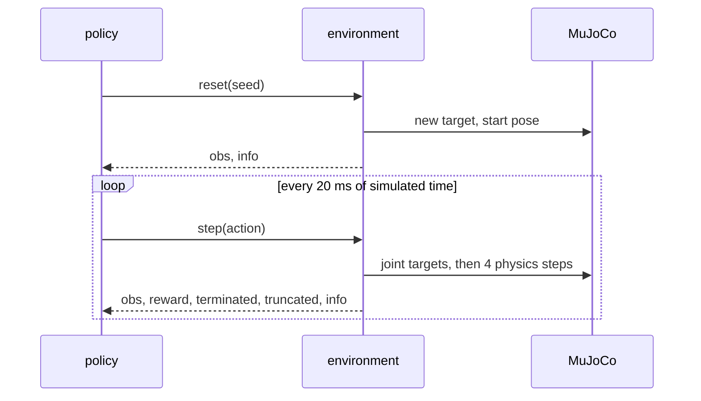

# 32 · A MuJoCo RL environment

<!-- meta -->
| | |
|---|---|
| **Part** | [8 · Reinforcement learning for robots](README.md) |
| **Run type** | CPU · Mac or Colab CPU |
| **Prerequisites** | [12](../part-4-dynamics-and-control/12-joint-control.md), [25](../part-7-learning-from-demonstration/25-evaluating-policies.md) |
| **Learn first** | [MDPs, States, Actions & Rewards](https://aiengineeringfromscratch.com/lesson?path=phases/09-reinforcement-learning/01-mdps-states-actions-rewards) |
| **Time** | ~45 min |
| **Code** | [`experiments/32-rl-environment/experiment.py`](../experiments/32-rl-environment/experiment.py) |
| **Status** | ✅ done |
<!-- /meta -->

> Before any learning, write the contract: what the policy sees, what its numbers do to the motors, when an episode ends, and how often it decides.

## The problem

An RL algorithm only ever sees what the environment hands it: an observation, a reward, two end-of-episode flags. Mistakes in that interface do not crash anything; they make training quietly worse. The classic one: Gymnasium replaced the single `done` flag with `terminated` and `truncated` in v0.26 ([Env API](https://gymnasium.farama.org/api/env/)), because "the episode hit its time limit" and "the episode reached a terminal state" need different training targets. Unitree's locomotion training code carries the same distinction as a config switch, `send_timeouts = True # send time out information to the algorithm` ([`legged_robot_config.py`](https://github.com/unitreerobotics/unitree_rl_gym/blob/main/legged_gym/envs/base/legged_robot_config.py)). In this lesson we build the SO-101 reach environment used in lessons 33–35 and measure the baselines that tell us later what "learned" means.

## Core idea

### In plain words

An RL environment is an API with two endpoints. `reset()` starts a new attempt and tells you what the robot sees. `step(action)` applies one decision, advances the simulation a little, and returns what the robot sees now, a score for that step (the **reward**) and two flags. One run from `reset()` to the end is an **episode**; the function that turns what the robot sees into an action is the **policy**.

The two flags answer different questions. `terminated` says "the task itself is over": the goal was reached, or the robot fell. `truncated` says "we stopped watching": the clock ran out, but the robot is in an ordinary state and would keep collecting reward. A learner that confuses them learns that the world ends every 1.6 s, which is false.

The third part of the contract is timing. The physics runs in small steps (5 ms here), but the policy decides only every few of them, like a game that updates physics at 200 Hz and reads the controller at 50 Hz. That ratio is the **frame skip** (Unitree calls it `decimation`).

### The agent–environment loop



### The contract, as code

```python
obs, info = env.reset(seed=k)            # seed k -> the same target and start pose every time
while True:
    action = policy(obs)                 # 4 numbers in [-1, 1]
    obs, reward, terminated, truncated, info = env.step(action)
    if terminated or truncated:          # either flag ends the episode ...
        break

def value_target(r, v_next, terminated, gamma):
    # ... but only "terminated" removes the future.
    # r:      reward of this step
    # v_next: the critic's estimate of all future reward from the next state
    # gamma:  discount, how much one step later counts (lesson 33)
    return r + gamma * (1 - terminated) * v_next

policy_period = frame_skip * h           # 4 * 5 ms = 20 ms, i.e. 50 decisions per second
```

| Quantity | Formula |
|---|---|
| value target | $y_t = r_t + \gamma\,(1 - \text{terminated}_t)\, V(s_{t+1})$ |
| policy period | $\Delta t = k\,h$ |

$r_t$ is the reward at step $t$, $\gamma$ the discount, $V(s_{t+1})$ the learned estimate of future reward from the next state $s_{t+1}$, $k$ the frame skip and $h$ the physics timestep.

<details>
<summary>Math details: why truncation must bootstrap</summary>

A value-based learner fits the expected discounted return $V(s) = \mathbb E\big[\sum_{l\ge0}\gamma^l r_{t+l} \mid s_t = s\big]$ (see AIEFS: [MDPs, States, Actions & Rewards](https://aiengineeringfromscratch.com/lesson?path=phases/09-reinforcement-learning/01-mdps-states-actions-rewards)). Replacing the tail of that sum by the current estimate $V(s_{t+1})$ is called **bootstrapping**.

- **Terminal state.** After it every reward is 0 by definition, so the exact target is $y_t = r_t$.
- **Time limit.** The last state is an ordinary state; the true return continues. Using $y = r$ there would make the target depend on the clock. The clock is not in our 15-number observation, so the same arm pose would get two different targets (with and without a future), and the value function cannot fit both. Bootstrapping keeps the target a function of the state only.

**Seeding.** `reset(seed=k)` re-seeds the environment's own generator `self.np_random`. Episodes are reproducible only if *all* randomness (target, start pose) comes from that generator. Evaluation then uses a fixed list of seeds.

**Frame skip.** The action is held constant for $k$ physics steps while the servo's PD loop runs at every physics step. The Go2 training config uses $h = 5$ ms and `decimation = 4`, a 20 ms (50 Hz) policy ([`legged_robot_config.py`](https://github.com/unitreerobotics/unitree_rl_gym/blob/main/legged_gym/envs/base/legged_robot_config.py), [`go2_config.py`](https://github.com/unitreerobotics/unitree_rl_gym/blob/main/legged_gym/envs/go2/go2_config.py)). The Menagerie SO-101 also uses $h = 5$ ms, so we take $k = 4$ as well.

Go deeper: [MDPs, States, Actions & Rewards](https://aiengineeringfromscratch.com/lesson?path=phases/09-reinforcement-learning/01-mdps-states-actions-rewards); [Gymnasium · `Env` API](https://gymnasium.farama.org/api/env/) (terminated vs truncated, seeding).

</details>

| Call | Returns | Robot meaning |
|---|---|---|
| `reset(seed=None)` | `obs, info` | put the robot in a start state, sample a new task (here: a target point) |
| `step(action)` | `obs, reward, terminated, truncated, info` | apply the action for one policy period, advance physics |
| `observation_space`, `action_space` | `Box` shapes and bounds | the policy's input and output sizes |

### The reach task

The environment of lessons 33–35, in [`reach_env.py`](../experiments/32-rl-environment/reach_env.py):

| Element | Definition |
|---|---|
| Robot | Menagerie `robotstudio_so101`; 4 controlled joints (shoulder pan, shoulder lift, elbow, wrist flex), wrist roll and gripper held at 0 |
| Action | $a \in [-1,1]^4$, joint target $q^* = q_{\text{home}} + 1.0\,\text{rad} \cdot a$, tracked by the model's servo PD (lesson 34 changes this) |
| Observation (15) | $q - q_{\text{home}}$, $0.1\,\dot q$, $p_{\text{target}} - p_{\text{gripper}}$, previous action |
| Target | per episode: forward kinematics of $q_{\text{home}} + U(\pm[1.0, 0.6, 0.6, 0.6])$ rad, rejected if below 4 cm or in contact, so every target is reachable |
| Start | $q_{\text{home}} + U(\pm 0.1)$ rad, at rest |
| Reward | $r_t = -\lVert p_{\text{target}} - p_{\text{gripper}} \rVert$ (metres) every step |
| Episode | 1.6 s = 80 policy steps, then `truncated` |
| Success | gripper within 2 cm of the target at the time limit |

Sampling targets in joint space and passing them through forward kinematics ([lesson 08](../part-3-kinematics/08-forward-kinematics.md)) is a cheap way to guarantee that a 0% success rate is the policy's fault, not the task's.

## Build it

You will now write the reach environment yourself, about 70 lines on top of MuJoCo, and check it against the lesson's [`reach_env.py`](../experiments/32-rl-environment/reach_env.py) step by step: same seeds, same targets, same observations, same rewards. Gymnasium appears only at the end, as a referee.

The class is in [`physai/rl.py`](../physai/rl.py); `uv run python experiments/32-rl-environment/build.py` runs the five steps (output in [`build_output.txt`](../experiments/32-rl-environment/build_output.txt)).

### Step 1 · The class and its timing

The constructor reads everything from the model: joint and actuator indices, the servo ranges, the gripper site, and the two times that define the task, the physics step $h$ and the policy period $k h$.

```python
class ReachTask:
    """SO-101 reach with the Gymnasium API: position actions around a home pose, frame skip, time limit.

    Observation (15): q - q_home, 0.1 * qdot, target - gripper, previous action. Reward: -distance [m].
    """
    JOINTS = ("shoulder_pan", "shoulder_lift", "elbow_flex", "wrist_flex")
    Q_HOME = np.array([0.0, -1.0, 1.0, 0.5])
    SPREAD = np.array([1.0, 0.6, 0.6, 0.6])        # targets = FK(q_home + U(-spread, spread)), always reachable

    def __init__(self, model_path, frame_skip=4, episode_seconds=1.6, scale=1.0, radius=0.02,
                 terminate_on_success=False):
        self.model = mujoco.MjModel.from_xml_path(model_path)
        self.data, self._fk = mujoco.MjData(self.model), mujoco.MjData(self.model)
        self.frame_skip, self.scale, self.radius = frame_skip, scale, radius
        self.terminate_on_success = terminate_on_success
        self.dt = self.model.opt.timestep * frame_skip                 # policy period
        self.max_steps = int(round(episode_seconds / self.dt))
        self.qadr = np.array([self.model.joint(j).qposadr[0] for j in self.JOINTS])
        self.vadr = np.array([self.model.joint(j).dofadr[0] for j in self.JOINTS])
        self.act = np.array([self.model.actuator(j).id for j in self.JOINTS])
        self.site = self.model.site("gripperframe").id
        self.lo, self.hi = self.model.actuator_ctrlrange[self.act].T.copy()
        self.np_random = None

    def _sample_target(self):
        while True:                                                    # rejection sampling in joint space
            q = np.clip(self.Q_HOME + self.np_random.uniform(-self.SPREAD, self.SPREAD), self.lo * 0.95, self.hi * 0.95)
            self._fk.qpos[:] = 0.0
            self._fk.qpos[self.qadr] = q
            mujoco.mj_forward(self.model, self._fk)
            p = self._fk.site_xpos[self.site].copy()
            if p[2] > 0.04 and self._fk.ncon == 0:                     # above the floor, nothing in contact
                return p

    def _obs(self):
        q = self.data.qpos[self.qadr] - self.Q_HOME
        qd = self.data.qvel[self.vadr]
        ee = self.data.site_xpos[self.site]
        return np.concatenate([q, 0.1 * qd, self.target - ee, self.prev_a]).astype(np.float32)

    def reset(self, seed=None, options=None):
        if seed is not None or self.np_random is None:
            self.np_random = np.random.default_rng(seed)               # all randomness comes from this generator
        mujoco.mj_resetData(self.model, self.data)
        self.target = self._sample_target()
        q0 = self.Q_HOME + self.np_random.uniform(-0.1, 0.1, size=4)
        self.data.qpos[self.qadr] = q0
        self.data.ctrl[:] = 0.0
        self.data.ctrl[self.act] = q0                                  # the servos hold the start pose
        mujoco.mj_forward(self.model, self.data)
        self.t, self.prev_a = 0, np.zeros(4)
        self.dist = float(np.linalg.norm(self.target - self.data.site_xpos[self.site]))
        return self._obs(), {"dist": self.dist}

    def step(self, action):
        a = np.clip(np.asarray(action, dtype=np.float64), -1.0, 1.0)
        self.data.ctrl[self.act] = np.clip(self.Q_HOME + self.scale * a, self.lo, self.hi)
        mujoco.mj_step(self.model, self.data, nstep=self.frame_skip)  # hold the action for frame_skip steps
        self.t += 1
        self.dist = float(np.linalg.norm(self.target - self.data.site_xpos[self.site]))
        self.prev_a = a
        success = self.dist < self.radius
        terminated = bool(self.terminate_on_success and success)       # the task itself is over
        truncated = (not terminated) and self.t >= self.max_steps      # we stopped watching
        info = {"dist": self.dist}
        if terminated or truncated:
            info["is_success"] = success
        return self._obs(), -self.dist, terminated, truncated, info
```

The check: four single `mj_step` calls and one `mj_step(nstep=4)` give the same state, and the period is the 20 ms of Core idea.

```text
== Step 1. Timing ==
physics step h = 5 ms, frame_skip 4 -> policy period 20 ms (50 Hz), 80 steps = 1.6 s
4 x mj_step vs mj_step(nstep=4): max |qpos diff| = 0.0e+00, time 0.020 s vs 0.020 s
```

### Step 2 · `reset(seed)`

All randomness, the target and the start pose, comes from one generator, created from the seed. `np.random.default_rng(seed)` builds the same generator as Gymnasium's `super().reset(seed=seed)`, so your targets can be compared with `ReachEnv`'s number for number:

```text
== Step 2. reset(seed) vs the lesson's ReachEnv, seeds 0-199 ==
max |target ours - ReachEnv| = 0.0e+00 m, max |first observation diff| = 0.0e+00
reset(seed=7), reset(seed=8), reset(seed=7): same target True, target [0.273 0.098 0.153] m, start distance 0.113 m
reset() without a seed continues the generator: new target [0.238 0.105 0.143] m
```

Identical for all 200 seeds. `reset()` without a seed continues the same generator, so a training run sees a new target every episode while evaluation can replay a fixed list of seeds.

### Step 3 · `step(action)`

```text
== Step 3. step(action) vs ReachEnv, and the zero-action baseline ==
5 episodes of random actions: max |obs or reward diff| = 0.0e+00
zero action, 200 episodes: return -12.87 +- 4.92, median final distance 170.8 mm, success 1/200
```

The same random actions give the same observations and rewards (difference 0.0e+00), and the zero-action baseline reproduces the Experiment's row: −12.87 ± 4.92, 170.8 mm, 1/200.

### Step 4 · terminated, truncated and the value target

```python
def value_target(r, v_next, terminated, gamma):
    """One-step value target: bootstrap from the next state unless the episode terminated (truncation bootstraps)."""
    return r + gamma * (1.0 - terminated) * v_next
```

Run the scripted IK controller of the Experiment through your class, once with `terminate_on_success=True` and once without:

```text
== Step 4. terminated vs truncated ==
scripted IK, terminate_on_success=True, 50 episodes: terminated 50, truncated 0, mean length 11.4 steps
last episode with terminate_on_success=False: terminated False, truncated True, t = 80
V(s) = r / (1 - gamma) = -0.200; target at the time limit: bootstrap -0.200, treated as terminal -0.010
```

With termination every episode ends `terminated` after 11.4 steps on average, the Experiment's 50/0; without it the episode runs to step 80 and ends `truncated`. The last line is the Math details argument in numbers. A state that pays −1 cm per step forever is worth $-0.01/(1-0.95) = -0.200$. At the time limit, bootstrapping gives the target −0.200, the state's true value; treating the limit as terminal gives −0.010, as if the world ended.

### Step 5 · Gymnasium's checker

Gymnasium only asks for two more attributes, the spaces, and for the class to inherit `gymnasium.Env`:

```python
from gymnasium import spaces

class GymReach(ReachTask, gym.Env):                     # physai's reset/step, Gymnasium's base class
    def __init__(self, **kw):
        super().__init__(SO101, **kw)
        self.action_space = spaces.Box(-1.0, 1.0, shape=(4,), dtype=np.float32)
        self.observation_space = spaces.Box(-np.inf, np.inf, shape=(15,), dtype=np.float32)
```

```text
== Step 5. Gymnasium's env_checker ==
check_env passed, 2 warnings
  warning: WARN: A Box observation space minimum value is -infinity. This is probably too low.
  warning: WARN: A Box observation space maximum value is infinity. This is probably too high.
```

The checker passes: seeding, return types and spaces are as Gymnasium expects. Its two warnings are about the unbounded observation box, which the lesson's `ReachEnv` declares the same way; the observation has no hard limits, so we leave it.

### What you keep

`physai.rl` now has `ReachTask` and `value_target`. [Lesson 33](33-ppo.md) adds the PPO pieces to the same module and trains on this task; lessons 34 and 35 change its actions and rewards. [`tests/test_32_rl_environment.py`](../tests/test_32_rl_environment.py) checks seeding, the two flags, frame skip and the equality with `ReachEnv`; run `uv run pytest tests/test_32_rl_environment.py`.

## Use it

Gymnasium has a base class for MuJoCo tasks, `gymnasium.envs.mujoco.MujocoEnv`. You give it the model file and `frame_skip`; it loads the model, defines `dt = model.opt.timestep * frame_skip` and gives you `do_simulation(ctrl, n_frames)`, which sets the controls and steps the physics `n_frames` times. You still write `reset_model`, `step` and the observation. The time limit is usually not in the environment at all but in a wrapper, which sets `truncated` when the step count reaches `max_episode_steps`:

```python
from gymnasium.wrappers import TimeLimit
from gymnasium.utils.env_checker import check_env

env = TimeLimit(GymReach(episode_seconds=1e9), max_episode_steps=80)   # the wrapper owns truncation
check_env(env.unwrapped)                                                # check the raw env, not the wrapper
```

| Piece | This lesson / physai | Gymnasium | Go2 training (`legged_gym`) |
|---|---|---|---|
| physics steps per decision | `frame_skip = 4` | `frame_skip` (`MujocoEnv`) | `decimation = 4` |
| policy period | `dt = h * frame_skip` | `dt` property, same formula | `sim.dt * decimation` = 0.02 s |
| step the physics | `mj_step(..., nstep=k)` | `do_simulation(ctrl, n_frames)` | PD torque recomputed each substep |
| time limit | `max_steps` inside the env | `TimeLimit(max_episode_steps=...)` | `send_timeouts = True` |

Sources: Gymnasium 1.4.0's [`mujoco_env.py`](https://github.com/Farama-Foundation/Gymnasium/blob/main/gymnasium/envs/mujoco/mujoco_env.py) and [`TimeLimit`](https://github.com/Farama-Foundation/Gymnasium/blob/main/gymnasium/wrappers/common.py) (the snippet above runs: the wrapped env truncates at step 80); the Go2 config links in The problem and Math details.

Three traps:

- **The learner must see the flag.** Stable-Baselines3's PPO bootstraps a time-limit step only when the info dict says `TimeLimit.truncated` and carries the `terminal_observation` ([`on_policy_algorithm.py`](https://github.com/DLR-RM/stable-baselines3/blob/master/stable_baselines3/common/on_policy_algorithm.py), "Handle timeout by bootstrapping with value function"); a custom loop that merges the flags into `done` loses the distinction silently.
- **Randomness outside `np_random`.** One call to `np.random.uniform` or Python's `random` in `reset` breaks reproducibility, and Step 2's equality test is the cheapest way to catch it.
- **Changing `frame_skip` changes the task.** The policy period, the episode length in steps and the meaning of $\gamma$ all move with it (lesson 34 measures the effect).

## Experiment

`ReachEnv`'s `reset` and `step` are the ones you wrote in Build it, plus the action modes and pluggable rewards of lessons 34–35.

[`experiment.py`](../experiments/32-rl-environment/experiment.py) checks the API, runs three **baselines** (fixed reference policies to compare against) for 200 episodes each (seeds 0–199) and sweeps `frame_skip`. The scripted controller does one damped least-squares IK step per policy step ([lesson 10](../part-3-kinematics/10-inverse-kinematics.md)): $\Delta q = J^\top (J J^\top + 0.05^2 I)^{-1} e$, sent as $q^* = q + \Delta q$. It reads the Jacobian from the model, which a policy cannot.

**Predict:** what success rate does a random policy get with a 2 cm radius?

MuJoCo 3.17.0, NumPy 2.5.4, Gymnasium 1.4.0, Apple Silicon Mac (Apple M5), one thread. The full script took 54 s wall-clock on a loaded machine; `python experiment.py --quick` (50 episodes per row, 1 s per throughput row) is a smoke test and does not reproduce the tables. Sections A, B and D are deterministic (a rerun gave identical numbers); section C is a timing and changes from run to run.

- `reset(seed=7)` twice (with `reset(seed=8)` in between) gives the same target: `True`.
- With `terminate_on_success=True`, the scripted controller's 50 episodes all ended `terminated` (50), none `truncated`.

**Baselines** (200 episodes each; the Wilson 95% interval is the range the true success rate plausibly lies in, see [lesson 25](../part-7-learning-from-demonstration/25-evaluating-policies.md)):

| policy | return (mean ± std) | median final distance | success | Wilson 95% |
|---|---|---|---|---|
| random | −14.37 ± 5.10 | 185.7 mm | 1/200 | 0.1–2.8% |
| zero action (hold home) | −12.87 ± 4.92 | 170.8 mm | 1/200 | 0.1–2.8% |
| scripted IK | −1.16 ± 0.68 | 0.2 mm | 200/200 | 98.1–100.0% |

Random actions are no better than standing still (185.7 vs 170.8 mm median final distance). The scripted IK sets the ceiling; its return of −1.16 is the distance accumulated while the arm moves, not a residual error (median final distance 0.2 mm). Every learned policy in this part will be placed between these rows.

**Throughput vs frame_skip** (random actions, one env, one thread; process CPU time, so other jobs distort it less; approximate):

| frame_skip | policy rate | env steps / CPU s | physics steps / CPU s | sim s / CPU s |
|---|---|---|---|---|
| 1 | 200 Hz | 22595 | 22595 | 113.0 |
| 2 | 100 Hz | 22316 | 44631 | 223.2 |
| 4 | 50 Hz | 14809 | 59235 | 296.2 |
| 8 | 25 Hz | 10900 | 87203 | 436.0 |
| 16 | 12.5 Hz | 6224 | 99585 | 497.9 |
| 32 | 6.25 Hz | 3357 | 107417 | 537.1 |


A linear fit gives **31.0 µs + 8.3 µs × frame_skip** of CPU time per `env.step()`. One SO-101 physics step costs about 8 µs; the Python side of a step (clipping, observation, reward, bookkeeping) costs about as much as four physics steps. At frame_skip 1 the env spends most of its time in Python, one reason to batch many environments per Python call (lesson 36). At frame_skip 4 it runs 296.2 simulated seconds per CPU second.

## Break it

Truncation is part of the task definition. Shorten the time limit and run the scripted controller, which is perfect at 1.6 s:

| time limit | steps | success | Wilson 95% | median final distance |
|---|---|---|---|---|
| 0.08 s | 4 | 11/200 | 3.1–9.6% | 120.1 mm |
| 0.16 s | 8 | 43/200 | 16.4–27.7% | 50.7 mm |
| 0.24 s | 12 | 81/200 | 33.9–47.4% | 23.1 mm |
| 0.32 s | 16 | 160/200 | 73.9–85.0% | 7.9 mm |
| 0.48 s | 24 | 199/200 | 97.2–99.9% | 1.0 mm |
| 1.60 s | 80 | 200/200 | 98.1–100.0% | 0.2 mm |

Below about 0.5 s even the model-based controller misses: with torque-limited servos (±2.94 N·m) and one IK step per 20 ms, it needs between 0.32 and 0.48 s for almost every reach. It is not time-optimal (a policy can command larger target jumps), so 81/200 at 0.24 s is a reference, not a hard ceiling. Still, a learner given a 0.24 s episode is scored on a task that even a model-based controller mostly fails, and its low success would look like a learning problem. Measure a scripted or oracle baseline under the same time limit before tuning the learner.

## On the real robot

- On hardware `step()` waits for real time: one 20 ms policy step takes 20 ms. In simulation the same env ran 296.2 simulated seconds per CPU second (section C, frame_skip 4). That ratio is why policies are trained in simulation.
- `reset()` on a real arm is a motion, not an assignment: the arm has to be driven back to $q_{\text{home}}$ and the target placed or marked, which costs seconds per episode and needs a safe trajectory ([lesson 15](../part-4-dynamics-and-control/15-safety.md)).
- The observation must be built from what the robot measures: servo encoder positions, finite-difference velocities, and a target position from a camera ([lesson 20](../part-5-perception-and-estimation/20-pixels-to-table.md)). Each has noise and delay that this simulated env does not have (Part 9).
- Procedure for the SO-101: run the scripted IK baseline on 20 fixed reachable targets, measure the final gripper position with the camera, report $k/n$ with a Wilson interval. **Not yet measured on the real arm.**

## Check yourself

1. **Easy.** The scripted controller reaches the target and the env is configured with `terminate_on_success=True`. Which flag is set, and what does the learner bootstrap from that step?
2. **Medium.** Add a rule: if any arm geom touches the floor, the episode ends. Should that be `terminated` or `truncated`? Implement it in `step()` and count how often the random policy triggers it in 200 episodes.
3. **Hard.** Wrap 16 copies of the env in `gymnasium.vector.SyncVectorEnv` and `AsyncVectorEnv` and measure total env steps/s against one env. Where does the difference come from?

### Answers

1. `terminated = True`, `truncated = False`; the target is $y = r$ with no $\gamma V(s')$ term, because the goal state is terminal by definition of the task.
2. `terminated`: touching the floor is part of the task's dynamics (a failure state), not an external clock. The count is yours to measure; we did not run it.
3. Open; we did not run it. `SyncVectorEnv` still steps the 16 copies one after another in the same Python process, so expect roughly the single-env rate. `AsyncVectorEnv` runs each copy in its own subprocess, so the gain comes from extra cores, minus the inter-process cost per step, which matters most at small frame_skip where a step is short (section C).

## Takeaways and sources

- The environment is a contract: `reset(seed)` reproduces episodes, `step()` returns five values, and `terminated` (task over) must be kept apart from `truncated` (clock over).
- Baselines bracket the task: random and zero actions succeed 1/200 times, scripted IK 200/200; a learned policy must be read against both.
- Frame skip sets both the control rate and the simulator's speed; the episode length (truncation) defines what is achievable at all.

Next: [lesson 33](33-ppo.md), training a policy on this environment with PPO.

**Sources**

- [Gymnasium · `Env` API](https://gymnasium.farama.org/api/env/) (`reset`, `step`, terminated vs truncated, seeding).
- [MuJoCo documentation · Python bindings](https://mujoco.readthedocs.io/en/stable/python.html).
- [`unitree_rl_gym` · `legged_robot_config.py`](https://github.com/unitreerobotics/unitree_rl_gym/blob/main/legged_gym/envs/base/legged_robot_config.py), [`go2_config.py`](https://github.com/unitreerobotics/unitree_rl_gym/blob/main/legged_gym/envs/go2/go2_config.py) (BSD-3-Clause).
- [MuJoCo Menagerie · `robotstudio_so101`](https://github.com/google-deepmind/mujoco_menagerie/tree/f3b6013/robotstudio_so101) (Apache-2.0).
- Code: [`reach_env.py`](../experiments/32-rl-environment/reach_env.py), [`experiment.py`](../experiments/32-rl-environment/experiment.py), [`output.txt`](../experiments/32-rl-environment/output.txt); figure from [`plot.py`](../experiments/32-rl-environment/plot.py).
